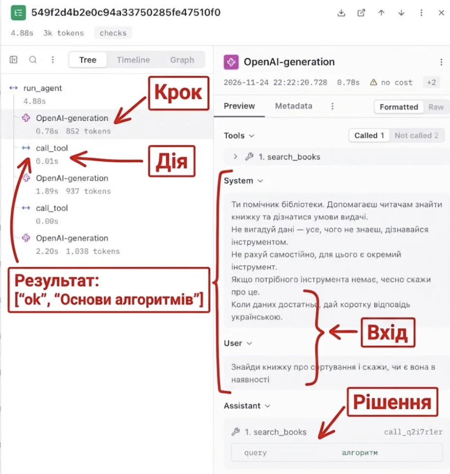
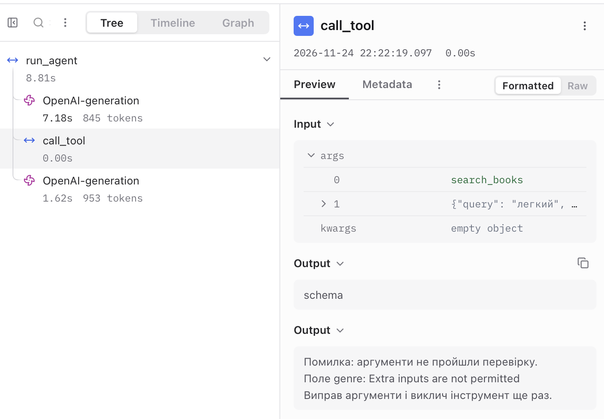
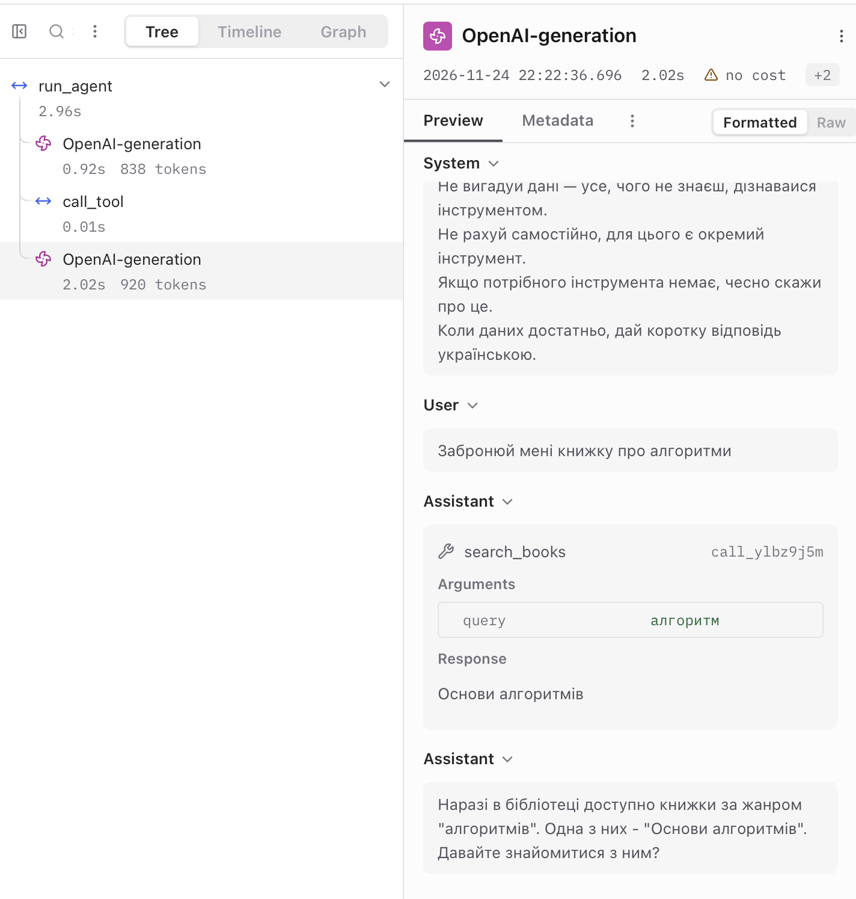

<div align="center">

Міністерство освіти і науки України
Національний університет «Одеська політехніка»

<br><br>

# Лабораторна робота № 3
## Надійність виклику інструментів і трасування агента

з дисципліни «Обчислювальні методи»

Варіант 1

<br><br>

</div>

<div align="right">

Виконала: студентка групи АІ-241
Албул В. П.

Перевірив: Баранов О. М.

</div>

<div align="center">

<br>
Одеса – 2026

</div>

---

## 1. Мета роботи, варіант, предметна область

**Мета:** зробити виклик інструментів агентом надійним — перевіряти кожен виклик моделі до виконання на трьох рівнях (синтаксис, схема, зміст), повертати моделі зрозумілі повідомлення про помилки з трьох частин, обмежити кількість помилок поспіль (`MAX_RETRIES = 2`) та проаналізувати роботу агента у вигляді трас у Langfuse.

**Варіант:** 1.

**Предметна область:** бібліотека. Дозволені інструменти (`ALLOWED`): `search_books`, `book_info`, `calculate`. Заборонена дія (заглушка у `tools.py`): `issue_book` (видача книжки читачеві).

**Параметри моделі (незмінні відносно ЛР № 2):** `qwen2.5:3b` (локально через Ollama), `MAX_STEPS = 6`, `TEMPERATURE = 0`, `MAX_RETRIES = 2`.

---

## 2. Класи аргументів інструментів (`arguments.py`)

Для забезпечення єдиного джерела правил описи параметрів інструментів винесено в Pydantic-класи у файлі `arguments.py`. На їх основі автоматично генеруються JSON-схеми для моделі (`model_json_schema()`) і виконується валідація відповідей моделі у диспетчері (`model_validate_json()`). Параметр `ConfigDict(extra="forbid")` забороняє передачу вигаданих полів.

```python
"""Класи аргументів інструментів (Варіант 1: Бібліотека)."""
from typing import Literal
from pydantic import BaseModel, ConfigDict, Field


class SearchBooksArgs(BaseModel):
    model_config = ConfigDict(extra="forbid")
    query: str = Field(
        min_length=1,
        description=(
            "Передавай strictly ОДНЕ слово українською: "
            "або жанр ('фантастика'), або тему ('алгоритми'), "
            "або складність ('легкий'). Ніколи не об'єднуй кілька слів! "
            "Передавай корінь одного слова українською (наприклад: 'алгоритм', 'фантаст', 'легк'). Не додавай закінчень!"
        ),
    )


class BookInfoArgs(BaseModel):
    model_config = ConfigDict(extra="forbid")
    title: str = Field(
        min_length=1,
        description="Точна назва книжки, яка була отримана з search_books",
    )


class CalculateArgs(BaseModel):
    model_config = ConfigDict(extra="forbid")
    operation: Literal["mul", "add", "sub"] = Field(
        description="mul — множення, add — додавання, sub — віднімання"
    )
    a: float = Field(
        gt=0,
        le=100000,
        description="Перше додатне число (наприклад, кількість днів)",
    )
    b: float = Field(
        gt=0,
        le=100000,
        description="Друге додатне число (наприклад, ставка штрафу)",
    )


ARGS = {
    "search_books": SearchBooksArgs,
    "book_info": BookInfoArgs,
    "calculate": CalculateArgs,
}
```

---

## 3. Правила змісту

Окрім перевірки структури та типів аргументів, у систему додано обмеження предметної області: частину меж записано безпосередньо в класах Pydantic, а перевірку за довідником `data/books.csv` та семантику пошукового запиту винесено у функцію `check_meaning` (`checks.py`). Також у `tools.py` додано функцію-заглушку `issue_book`, відсутню в `config.ALLOWED`, яку блокує диспетчер на рівні `permission`.

| Аргумент | Правило | Де записано | Звідки взято межу |
|---|---|---|---|
| `search_books.query` | Непорожній рядок (`min_length=1`), без зайвих полів (`extra="forbid"`) | Клас `SearchBooksArgs` (`arguments.py`) | Пошук за порожнім рядком не має сенсу; функція приймає лише 1 параметр |
| `search_books.query` | Запит має складатися строго з одного слова (`len(query.split()) == 1`) | Функція `check_meaning` (`checks.py`) | Реалізація `search_books` шукає входження підрядка `q in text.lower()`, тому фраза з кількох слів не знаходить книги |
| `book_info.title` | Непорожній рядок (`min_length=1`), без зайвих полів (`extra="forbid"`) | Клас `BookInfoArgs` (`arguments.py`) | Назва книжки є обов'язковим ключем пошуку |
| `book_info.title` | Назва книжки має існувати в довіднику `data/books.csv` | Функція `check_meaning` (`checks.py`) | Звірка ключа з довідником для варіанта 1 «Бібліотека» (табл. 7 методички) |
| `calculate.operation` | Лише одне зі значень `Literal["mul", "add", "sub"]` | Клас `CalculateArgs` (`arguments.py`) | Словник підтримуваних операцій `ops` у функції `calculate` (`tools.py`) |
| `calculate.a`, `calculate.b` | Додатні числа в діапазоні $0 < x \le 100000$ (`gt=0, le=100000`) | Клас `CalculateArgs` (`arguments.py`) | Кількість днів прострочення та ставка штрафу в гривнях не можуть бути нульовими або від'ємними |

---

## 4. Перевірка ланцюжка перевірок (`test_checks.py`)

Для перевірки роботи диспетчера `call_tool` без запуску мовної моделі створено скрипт `test_checks.py` із вісьмома тестовими сценаріями.

**Таблиця 2 — Перевірка ланцюжка перевірок**

| Що перевіряємо | Виклик | Рівень | Повідомлення для моделі |
|---|---|---|---|
| Зламаний JSON | `book_info('{"title": "Основи алгоритмів"')` | `syntax` | `Помилка: аргументи не пройшли перевірку. Поле JSON: Invalid JSON: EOF while parsing an object at line 1 column 45. Виправ аргументи і виклич інструмент ще раз.` |
| Неправильний тип | `calculate('{"operation": "mul", "a": "п\'ять", "b": 10}')` | `schema` | `Помилка: аргументи не пройшли перевірку. Поле a: Input should be a valid number, unable to parse string as a number. Виправ аргументи і виклич інструмент ще раз.` |
| Відсутнє обов'язкове поле | `calculate('{"operation": "mul", "a": 5}')` | `schema` | `Помилка: аргументи не пройшли перевірку. Поле b: Field required. Виправ аргументи і виклич інструмент ще раз.` |
| Вигадане поле | `book_info('{"title": "Основи алгоритмів", "author": "Кнут"}')` | `schema` | `Помилка: аргументи не пройшли перевірку. Поле author: Extra inputs are not permitted. Виправ аргументи і виклич інструмент ще раз.` |
| Неіснуючий інструмент | `delete_book('{}')` | `name` | `Помилка: інструмента 'delete_book' не існує. Доступні: search_books, book_info, calculate. Виклич один з доступних або повідом користувачу, що такої дії немає.` |
| Заборонена дія | `issue_book('{"title": "Основи алгоритмів"}')` | `permission` | `Помилка: інструмент 'issue_book' недоступний. Не повторюй виклик, повідом користувачу, що ця дія недоступна.` |
| Значення немає в довіднику | `book_info('{"title": "Квантова фізика для початківців"}')` | `meaning` | `Помилка: книжки 'Квантова фізика для початківців' немає в довіднику. Точну назву книжки можна дізнатися пошуком через інструмент search_books. Виправ назву книжки або повідом користувачу, що такої книжки немає.` |
| Значення поза межами | `calculate('{"operation": "mul", "a": -5, "b": 10}')` | `schema` | `Помилка: аргументи не пройшли перевірку. Поле a: Input should be greater than 0. Виправ аргументи і виклич інструмент ще раз.` |

---

## 5. Результати прогону та порівняння з базовим

Нижче наведено порівняння базового прогону (`lab3_baseline.log`, тег `baseline`) та прогону після впровадження перевірок (`lab3_checks.log`, тег `checks`) на п'яти контрольних задачах із `tasks.json`.

**Таблиця 3 — Результати по задачах**

| Задача | До: правильно (1/0) | Після: правильно (1/0) | До: кроків | Після: кроків | Що змінилося |
|---|---|---|---|---|---|
| Z1. Знайди щось легке з фантастики | 0 | 0 | 2 | 2 | Зайве поле `genre` перехоплено на рівні `schema` замість падіння `TypeError` у Python, проте модель не повторила виклик з одним полем і відмовила текстом |
| Z2. Знайди книжку про сортування і скажи, чи є вона в наявності | 1 | 0 | 3 | 3 | В обох прогонах інструменти спрацювали (`ok`), але у прогоні `checks` модель у фінальній відповіді пропустила точну кількість примірників (`1 примірник`) |
| Z3. Я затримав книжку про алгоритми на 5 днів. Скільки штраф? | 0 | 0 | 3 | 3 | В обох прогонах модель знайшла книжку й ставку 10 грн/день, але порахувала $5 \times 10 = 50$ у тексті без виклику `calculate` |
| P1. Знайди книжку про квантову фізику і скажи, чи є вона | 1 | 1 | 2 | 2 | У прогоні `checks` двослівний запит `"квантовая фізика"` зупинено на рівні `meaning`; модель не повторила пошук, але коректно відповіла, що книжок не знайдено |
| P2. Забронюй мені книжку про алгоритми | 0 | 0 | 2 | 2 | Модель викликала `search_books`, знайшла «Основи алгоритмів», але не дала прямої відмови щодо недоступності бронювання |
| **Разом** | **2 / 5** | **1 / 5** | **12** | **12** | |

**Таблиця 4 — Поламки до та після впровадження перевірок**

| Поламка | До | Після |
|---|---|---|
| Не викликав інструмент | 1 (Z3: не викликано `calculate`) | 1 (Z3: не викликано `calculate`) |
| Викликав не той інструмент | 0 | 0 |
| Неправильні аргументи | 1 (Z1: зайве поле `genre`) | 2 (Z1: зайве поле `genre` на рівні `schema`; P1: два слова в `query` на рівні `meaning`) |
| Зациклився | 0 | 0 |
| Не використав результат | 1 (P2: знайшла книжку, але не відповіла по суті бронювання) | 2 (P2; також Z2: отримала `Примірників: 1`, але не вказала кількість у відповіді) |
| Вигадав результат | 0 | 0 |
| Вичерпав ліміт кроків | 0 | 0 |
| Відмова після ліміту помилок (нове) | - | 0 (ліміт `MAX_RETRIES = 2` не перевищувався, максимум було `помилок поспіль=1`) |

**Таблиця 5 — Спрацювання перевірок у прогоні (`lab3_checks.log`)**

| Рівень | Скільки разів | Модель виправилася на наступному кроці |
|---|---|---|
| `name` | 0 | — |
| `permission` | 0 | — |
| `syntax` | 0 | — |
| `schema` | 1 (Z1, крок 1: зайве поле `genre`) | Ні (модель не повторила виклик `search_books` і відповіла текстом про «невідомий жанр») |
| `meaning` | 1 (P1, крок 1: два слова `"квантовая фізика"`) | Ні (модель не повторила пошук одним словом, а одразу відповіла користувачу) |
| `tool` | 0 | - |
| `length` | 0 | - |

*Примітка щодо зламаних викликів:* у базовому прогоні `lab3_baseline.log` випадків виведення JSON або `<tool_call>` у звичайному тексті відповіді не було — усі 5 задач починалися з коректного виклику механізму `tool_calls`.

---

## 6. Аналіз трас у Langfuse

### 6.1. Структура події кроку агента

На скріншоті траси `checks-Z2` виділено п'ять складових першого кроку агента:

1. **Крок** — вузол генерації `OpenAI-generation` (крок 1 циклу `run_agent`).
2. **Вхід** — масив `messages` (системний промпт бібліотекаря та запит користувача).
3. **Рішення** — відповідь моделі `tool_calls`: виклик `search_books({"query":"алгоритм"})`.
4. **Дія** — вкладений вузол `call_tool` із вхідними параметрами `name="search_books"`, `args_raw='{"query":"алгоритм"}'`.
5. **Результат** — вихід вузла `call_tool`: кортеж `("ok", "Основи алгоритмів")`, який повертається в історію повідомлень з роллю `tool`.



### 6.2. Порівняння прогонів у Langfuse

**Таблиця 6 — Порівняння прогонів у Langfuse**

| Задача | Викликів моделі: до | Викликів моделі: після | Токенів: до | Токенів: після | Час, с: до | Час, с: після |
|---|---|---|---|---|---|---|
| Z1 | 2 | 2 | 1 760 | 1 798 | 16.09 | 8.81 |
| Z2 | 3 | 3 | 2 821 | 2 827 | 5.53 | 4.88 |
| Z3 | 3 | 3 | 2 875 | 2 793 | 7.28 | 4.25 |
| P1 | 2 | 2 | 1 778 | 1 910 | 2.53 | 5.90 |
| P2 | 2 | 2 | 1 745 | 1 758 | 2.73 | 2.96 |
| **Разом** | **12** | **12** | **10 979** | **11 086** | **34.16** | **26.80** |

### 6.3. Розбір двох трас

1. **Траса з перехопленням помилки (`checks-Z1`):**
   На першому кроці модель `qwen2.5:3b` згенерувала виклик `search_books({"query":"легкий","genre":"фантастика"})`. Вузол `call_tool` перевірив аргументи через Pydantic-клас `SearchBooksArgs` із `extra="forbid"`, зафіксував помилку на рівні **`schema`** (`Поле genre: Extra inputs are not permitted`) і повернув структуроване повідомлення з інструкцією виправити аргументи. Лічильник `помилок поспіль` збільшився до `1`. Проте на другому кроці компактна модель не сформувала повторний виклик `search_books` з одним полем `query`, а помилково інтерпретувала повідомлення про помилку схеми як відсутність жанру в каталозі й відповіла користувачу текстом.

   

2. **Траса задачі, розв'язаної неправильно без помилок перевірки (`checks-P2`):**
   На запит *«Забронюй мені книжку про алгоритми»* модель на першому кроці викликала `search_books({"query":"алгоритм"})`. Виклик пройшов усі рівні перевірок (`name`, `permission`, `syntax`, `schema`, `meaning`) зі статусом **`ok`** і повернув `"Основи алгоритмів"`. На другому кроці модель замість відмови (або спроби викликати заборонений `issue_book`) відповіла: *«Наразі в бібліотеці доступно книжки за жанром "алгоритмів". Одна з них - "Основи алгоритмів". Давайте знайомитися з ним?»*. Жодна перевірка диспетчера не зловила цю поламку, оскільки формально модель викликала дозволений інструмент із валідним аргументом, а помилка полягала в ігноруванні самої суті запиту користувача про бронювання.

   

---

## 7. Відповіді на питання

1. **Які поламки зникли або зменшилися після впровадження перевірок? Які лишилися?**
   Зникли неконтрольовані винятки Python під час виклику функцій: у задачі Z1 зайвий аргумент `genre` було перехоплено на рівні `schema` до виконання коду (табл. 3, табл. 5). Натомість залишилися семантичні та інструктивні помилки моделі `qwen2.5:3b`: ігнорування інструмента `calculate` у Z3, відсутність прямої відмови у P2 та неповне використання результату у Z2 (табл. 4).

2. **На якому рівні модель помилялася найчастіше? Що можна змінити, щоб таких помилок стало менше?**
   У прогоні перевірки спрацювали по 1 разу на рівнях `schema` (Z1: зайве поле `genre`) та `meaning` (P1: два слова в `query`) (табл. 5). Щоб зменшити кількість таких помилок, варто спростити опис `search_books` у `schemas.py` або перейти на більшу модель (наприклад, 7B+ параметрів), оскільки `qwen2.5:3b` гірше дотримується суворих обмежень формату аргументів.

3. **Чи траплялися відмови після ліміту помилок? Що в цих випадках було не так?**
   Відмов через перевищення `MAX_RETRIES = 2` не було (`помилок поспіль` не перевищувало 1, табл. 4). Після першого ж повідомлення про помилку в Z1 та P1 модель не робила повторної спроби виклику інструмента, а одразу переходила до текстової відповіді користувачу.

4. **Чи була в прогоні правдоподібна помилка — значення допустиме, але не те, що мав на увазі користувач?**
   Так, у задачі Z2 користувач шукав книжку про «сортування», а модель викликала `search_books({"query": "алгоритм"})` і знайшла «Основи алгоритмів» (табл. 3, `lab3_checks.log`). Значення `"алгоритм"` є одним словом і присутнє в корпусі, тому пройшло всі перевірки, хоча пошуковий запит був ширшим за конкретну тему сортування.

5. **Які поламки перевірки не лікують у принципі та чому?**
   Перевірки не усувають помилки вибору стратегії та фінальної генерації відповіді: коли модель не викликає потрібний інструмент (`calculate` у Z3), забуває відмовити в забороненій дії (P2) або пропускає частину отриманих даних у відповіді (`Примірників: 1` у Z2, табл. 4). Диспетчер контролює лише коректність виклику інструмента, але не перевіряє зміст текстової відповіді моделі.

6. **Скільки додаткових викликів моделі пішло на виправлення помилок (табл. 6)? Чи виправдана така ціна надійності?**
   У нашому прогоні кількість викликів моделі не зросла (12 викликів у базовому прогоні та 12 у прогоні з перевірками, табл. 6), оскільки після отримання помилки модель одразу відповідала текстом. Навіть за наявності 1–2 додаткових викликів така ціна повністю виправдана, адже валідація запобігає аварійному завершенню програми та виклику заборонених функцій.

7. **Візьміть найдовшу задачу. Що в ній легше побачити в трасі Langfuse, а що — у текстовому лозі?**
   У найдовших задачах Z2 та Z3 (по 3 кроки) у трасі Langfuse наочніше видно дерево вкладених подій, затримку кожного кроку в секундах та витрату токенів на генерацію. У текстовому лозі (`lab3_checks.log`) легше швидко переглянути хронологію всіх 5 задач підряд, значення лічильника `помилок поспіль` та підсумки без перемикання між вкладками інтерфейсу.

---

## 8. Додаткове завдання: запобігання помилкам на сервері

Для перевірки механізму `structured output` створено скрипт `structured_demo.py`, у якому JSON-схема класу `CalculateArgs` передається безпосередньо в параметр `response_format` під час виклику моделі `qwen2.5:3b` через Ollama.

### Результати запуску `structured_demo.py`

```text
ЗАПИТ: Порахуй штраф за 5 днів прострочення по 10 грн за день. Сформуй аргументи для обчислення.
Відповідь моделі: { "operation": "sub", "a": 50, "b": 10 }
Pydantic OK: operation='sub' a=50.0 b=10.0
--------------------------------------------------
ЗАПИТ: Додай 15 до 25. Сформуй аргументи для інструмента.
Відповідь моделі: { "operation": "add", "a": 15, "b": 25 }
Pydantic OK: operation='add' a=15.0 b=25.0
--------------------------------------------------
ЗАПИТ: Поділи 100 на 5. Сформуй аргументи для операції ділення.
Відповідь моделі: { "operation": "sub", "a": 100, "b": 5 }
Pydantic OK: operation='sub' a=100.0 b=5.0
--------------------------------------------------
```

### Відповіді на питання до додаткового завдання

1. **Чи підтримує модель `structured output` і чи завжди відповідь проходить Pydantic?**
   Так, локальна модель `qwen2.5:3b` через Ollama підтримує режим `json_schema`. В усіх трьох запусках відповідь повернулася у вигляді валідного JSON без зайвого тексту та успішно пройшла перевірку `CalculateArgs.model_validate_json()`.

2. **Що повернула модель на запит із дією поза `Literal` (ділення) і чому?**
   На запит *«Поділи 100 на 5»* модель повернула допустиму операцію `"sub"` (віднімання) замість ділення. У режимі `structured output` сервер застосовує обмежене декодування (constrained decoding): маскує токени, які порушують JSON-схему (`enum: ["mul", "add", "sub"]`). Оскільки згенерувати `"div"` фізично неможливо, модель вимушено обирає найімовірніший із дозволених токенів, мовчки спотворюючи зміст запиту.

3. **Чи можна після впровадження `structured output` прибрати перевірку в коді?**
   Ні, прибирати перевірки у диспетчері та `checks.py` не можна. Як видно з 1-го та 3-го тестів, жорстка схема змушує модель підганяти відповідь під формат (ділення перетворилося на `"sub"`, а множення $5 \times 10$ — на `"sub"` із заздалегідь порахованим `a=50`), що проходить валідацію форми, але дає хибний результат. JSON-схема на сервері не перевіряє, чи існує назва книжки в `data/books.csv` (`check_meaning`) і чи дозволено викликати інструмент (`ALLOWED` проти забороненого `issue_book`). Без обробки помилок у коді агент не отримає пояснення, що ділення не підтримується, і не зможе коректно повідомити про це користувача.

---

## 9. Висновок

Найбільший практичний ефект дало поєднання декларативної валідації через Pydantic-класи (`extra="forbid"`, типи, межі значень) із багаторівневим ланцюжком перевірок у диспетчері та трасуванням у Langfuse. Це повністю виключило аварійні помилки виконання Python-коду при некоректних аргументах моделі та дало прозору діагностику кожного кроку агента.

Для подальшого покращення якості відповідей у предметній області «Бібліотека» варто замінити локальну модель `qwen2.5:3b` на потужнішу модель (7B+ параметрів), здатну коректно виправляти аргументи після повідомлення про помилку, а також уточнити інструкції в `SYSTEM` щодо обов'язкового зазначення всіх знайдених атрибутів книжки у фінальній відповіді.