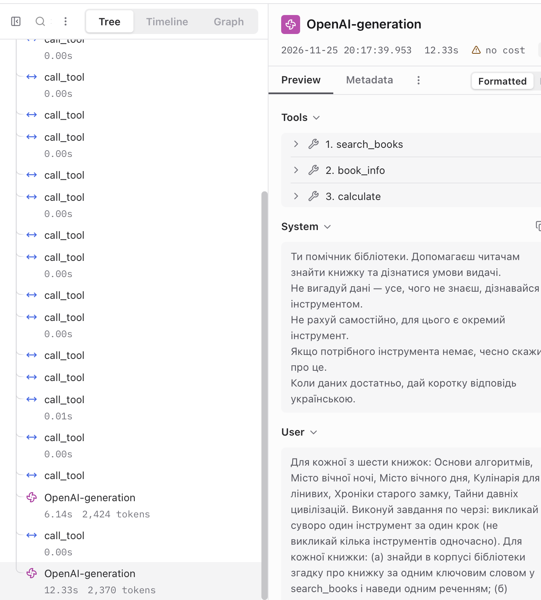

# Звіт з лабораторної роботи № 4
**Тема:** Керування контекстом і пам'яттю в циклі агента

---

## 1. Мета роботи та налаштування середовища

**Мета роботи:** дослідити поведінку LLM-агента під час виконання довгої багатокрокової задачі в умовах обмеженого контекстного вікна, реалізувати механізми керування контекстом (обрізання історії `trim`, збереження зовнішнього стану задачі `trim+state`, кешування викликів моделі `cache` та переказ історії `summary`) і порівняти їх за точністю, витратами токенів, часом виконання та кількістю повторних викликів.

**Конфігурація моделі та агента (`config.py`):**
* Базова модель: `qwen2.5:3b` (локальний сервер Ollama, `http://localhost:11434/v1`).
* Кастомна модель із фіксованим вікном: `qwen25-3k` (`PARAMETER num_ctx 3072`).
* Температура генерації: `TEMPERATURE = 0`.
* Ліміт кроків для довгої задачі: `MAX_STEPS_LONG = 25`.
* Поріг запуску стиснення: `COMPRESS_AT = 2150` токенів.
* Кількість останніх повідомлень, що зберігаються під час стиснення: `KEEP_LAST = 6`.
* Обмеження довжини одного результату в стані: `STATE_RESULT_CHARS = 200` символів.

---

## 2. Довга задача та її еталонне розв'язання

За допомогою скрипту `make_task.py` сформовано довгу задачу `L1` (файл `long_task.json`) для перших шести книжок із довідника `data/books.csv` із мінімальною кількістю викликів інструментів `MIN_CALLS = 18` (по три виклики на кожну книжку: `search_books`, `book_info` та `calculate`).

**Формулювання задачі:**
> Для кожної з шести книжок: *Основи алгоритмів, Місто вічної ночі, Місто вічного дня, Кулінарія для лінивих, Хроніки старого замку, Тайни давніх цивілізацій*. Виконуй завдання по черзі: викликай суворо один інструмент за один крок (не викликай кілька інструментів одночасно). Для кожної книжки: (а) знайди в корпусі бібліотеки згадку про книжку за одним ключовим словом у `search_books` і наведи одним реченням; (б) знайди в довіднику через `book_info` термін видачі в днях та штраф за день прострочення; (в) порахуй через `calculate` штраф за три дні затримки (множення штрафу за день на 3). У кінці порахуй через `calculate` загальний штраф за всі шість книжок і назви його одним числом.

**Таблиця 1 — Еталонний розрахунок штрафу по книжках (`compute()` у `make_task.py`):**

| № | Назва книжки | Термін видачі, днів | Штраф за день, грн | Штраф за 3 дні, грн |
|---:|---|---:|---:|---:|
| 1 | Основи алгоритмів | 7 | 10 | $10 \times 3 = 30$ |
| 2 | Місто вічної ночі | 14 | 5 | $5 \times 3 = 15$ |
| 3 | Місто вічного дня | 7 | 8 | $8 \times 3 = 24$ |
| 4 | Кулінарія для лінивих | 14 | 5 | $5 \times 3 = 15$ |
| 5 | Хроніки старого замку | 14 | 10 | $10 \times 3 = 30$ |
| 6 | Тайни давніх цивілізацій | 14 | 12 | $12 \times 3 = 36$ |
| **Разом** | **Еталонна відповідь (`expected`)** | — | — | **150** |

---

## 3. Поведінка агента без захисту контексту (`none`) та межі вікна

Під час первинного пробного прогону у вікні `4096` токенів максимальний вхід становив `2104` токени ($51\%$ вікна), через що межа вікна не досягалася. Відповідно до інструкції вікно було зменшено до `3072` токенів (`qwen25-3k`), у `tools.py` прибрано скорочення результатів пошуку до першого рядка, а в текст задачі додано вимогу викликати по одному інструменту за крок.

**Результати аналізу пробного прогону `probe_none_r1.log` (`NUM_CTX = 3072`):**
* **Статус завершення:** `final` (відповідь дано на 3-му кроці, але неправильно: `2.2 грн` замість `150`).
* **Кількість кроків:** $n = 3$ (повторних викликів інструментів: `3`).
* **Вхід першого кроку ($C$):** `1094` токенів.
* **Типовий приріст за крок ($d$):** `676` токенів (медіана приростів `1300` і `51` дорівнює $675.5$).
* **Найбільший вхід:** `2445` токенів ($80\%$ вікна `3072`).
* **Сума `prompt_tokens` за прогін:** `5933` токенів.
* **Теоретична оцінка за формулою $n \cdot C + d \cdot \frac{n(n-1)}{2}$:**
  $$3 \cdot 1094 + 675.5 \cdot \frac{3 \cdot (3 - 1)}{2} = 3282 + 2026.5 \approx 5308 \text{ токенів}$$
* **Крок зупинки росту входу:** не помічено — замість переповнення вікна модель об'єднала всі 18 викликів у пакет на першому кроці, через що швидко вичерпала власну здатність утримувати увагу на аргументах і передчасно завершила цикл.

**Таблиця 2 — Динаміка `prompt_tokens` по кроках у конфігурації `none` (`probe_none_r1`):**

| Крок | `prompt_tokens` | Приріст | Що зробила модель |
|---:|---:|---:|---|
| 1 | 1094 | — | Пакет із 18 викликів (`search_books`, `book_info`, `calculate` для всіх 6 книжок) |
| 2 | 2394 | +1300 | `calculate({"a":1.1,"b":1.1,"operation":"add"})` |
| 3 | 2445 | +51 | Фінальна відповідь без виклику інструментів (`2.2 грн`) |

---

## 4. Обрізання історії (`trim`) та збереження стану (`trim+state`)

Для запобігання переповненню контексту реалізовано модуль обрізання історії (`context.py`, `compress.py`), який при перевищенні `COMPRESS_AT = 2150` залишає перші два повідомлення (`system` і `user`) та останні `KEEP_LAST = 6` повідомлень (із видаленням «осиротілих» повідомлень `role = "tool"` на початку хвоста).

У режимі `trim+state` (`state.py`) програма додатково записує кожен успішний виклик (`level == "ok"`) у файл `state/<run_id>.json` і після обрізання дописує компактний список результатів до повідомлення користувача.

**Таблиця 3 — Порівняння стиснення без стану (`trim`) і зі станом (`trim+state`):**

| Конфігурація | Крок стиснення | Вхід до стиснення, токенів | Повідомлень було -> стало | Повторних викликів за прогін |
|---|---:|---:|---:|---:|
| `trim` | 2 | 2394 | 23 -> 4 | 6 |
| `trim+state` | 2 | 2394 | 23 -> 4 | 3 |

**Аналіз поведінки та розміру блоку стану:**
1. **Ефект «амнезії» у режимі `trim`:** після обрізання на 2-му кроці (з 23 до 4 повідомлень) модель забула вже виконані запити та на кроках 3–5 повторно викликала `search_books({"query":"алгоритм"})`, `book_info({"title":"Основи алгоритмів"})` і `calculate`, збільшивши число повторних викликів до `6`.
2. **Ефект зовнішнього стану у `trim+state`:** після додавання блоку стану вхід на 3-му кроці знизився з `2394` до `2119` токенів, і модель не зробила жодного повторного виклику після стиснення (3 дублі виникли ще всередині пакета 1-го кроку).
3. **Оцінка розміру блоку стану (`probe_trim+state_r1`):**
   * Кількість рядків вигляду `- інструмент(...) -> ...`: `19` (18 викликів 1-го кроку + 1 виклик 2-го кроку).
   * Довжина блоку в символах: `2013` символів.
   * Орієнтовний обсяг у токенах: $\frac{2013}{2.5} \approx 805$ токенів, що становить $\frac{805}{675.5} \approx 1.19$ від типового приросту за один крок (`676` токенів). Тобто компактний конспект усіх 19 викликів займає приблизно стільки ж місця, скільки один звичайний крок історії.

---

## 5. Кешування викликів моделі (`cache.py`)

Для прискорення повторних експериментів реалізовано детермінований кеш відповідей моделі (`cache.py`), де ключ формується як перші 16 символів `SHA-256` від JSON-серіалізації словника з полями `model`, `temperature`, `messages` та `tools`.

**Таблиця 4 — Робота кешу на двох однакових прогонах (`cache1` та `cache2`):**

| Запуск | Кроків | Влучань у кеш | Викликів до сервера | Час, с | Правильно |
|---|---:|---:|---:|---:|:---:|
| 1 (кеш порожній) | 3 | 0 | 3 | 25.3 | ні |
| 2 (той самий запит) | 3 | 3 | 0 | 0.1 | ні |

**Висновки щодо кешування:**
* Другий запуск виявився швидшим за перший у $\frac{25.3}{0.1} = 253$ рази, повністю виключивши звернення до сервера Ollama.
* Якщо перед другим запуском змінити текст системної інструкції `SYSTEM` у `config.py`, кеш **не спрацює** (`0` влучань), оскільки `SYSTEM` входить до списку `messages`, за яким обчислюється хеш `cache_key()`. Зміна навіть одного символу змінює ключ кешу, що гарантує захист від використання застарілих відповідей після редагування промпту.

---

## 6. Порівняльні вимірювання, додаткове завдання (`summary`) та траси Langfuse

### 6.1. Зведена таблиця вартості циклу

Було проведено серію з 9 прогонів `main` (3 конфігурації $\times$ 3 повтори) та додаткову серію `extra` (3 повтори для конфігурації `summary`, у якій стару частину історії переказує сама модель окремим викликом без інструментів).

**Таблиця 5 — Вартість циклу в чотирьох конфігураціях (медіани по трьох повторах):**

| Конфігурація | Правильно | Кроків | Токенів на вхід | Токенів на вихід | На підсумовування | Час, с | Стиснень | Повторних викликів |
|---|---:|---:|---:|---:|---:|---:|---:|---:|
| `none` | 0 з 3 | 3 | 6109 | 630 | 0 | 33.1 | 0 | 3 |
| `trim` | 0 з 3 | 6 | 8646 | 667 | 0 | 36.7 | 1 | 5 |
| `trim+state` | 0 з 3 | 3 | 5607 | 786 | 0 | 44.6 | 1 | 3 |
| `summary` | 0 з 3 | 7 | 12435 | 1161 | 2994 | 86.7 | 2 | 3 |

*(Примітка: у всіх 12 прогонах ручна перевірка підтвердила оцінку `0 з 3` — модель не змогла коректно обчислити еталонну суму `150`.)*

### 6.2. Аналіз прихованих поломок у логах

Перевірка логів `logs/main_*.log` виявила два типи прихованих помилок, які не призводять до аварійної зупинки скрипту (`status = final`), але руйнують якість відповіді:
1. **Передчасна відповідь (менше ніж за 19 кроків) — у 9 з 9 прогонів `main`:** модель ігнорувала вимогу викликати суворо один інструмент за крок і генерувала всі 18 викликів одним пакетом на 1-му кроці, підставляючи хибні аргументи в `calculate` (`a=1, b=0.1` замість реальних ставок штрафу і числа `3`).
2. **Вигадане число, якого не було в рядках `результат:` — у 3 з 9 прогонів `main`:** у всіх трьох запусках конфігурації `trim` (`main_trim_r1..r3`) модель у фінальній відповіді вказала штраф `210 грн` для книжки *«Основи алгоритмів»*, хоча інструмент `calculate({"a":7,"b":10,"operation":"mul"})` повернув `70.0`. У `none` та `trim+state` модель взяла число `2.2` із останнього результату `calculate`, однак воно було обчислене з неправильних вхідних даних (`1.1 + 1.1`).

### 6.3. Аналіз додаткового завдання (`summary`)

Експеримент із переказом історії (`summary.py`, серія `extra_summary_r1..r3`) показав, що для компактної локальної моделі `qwen2.5:3b` переказ історії значно поступається детермінованому стану `trim+state`:
1. **Високі накладні витрати:** медіана витрат на додаткові виклики підсумовування становила `2994` токени, а сумарні витрати токенів досягли `12435 + 2994 = 15429` токенів (у $2.75$ раза більше, ніж у `trim+state` — `5607` токенів), а час виконання зріс майже вдвічі (`86.7 с` проти `44.6 с`). Оскільки переказ дописувався до запитання користувача, історія швидко знову перевищувала `COMPRESS_AT`, викликаючи повторне друге стиснення в прогонах `r1` та `r3`.
2. **Втрата та спотворення точних чисел:** попри вимогу зберегти всі числа та результати без змін, модель під час переказу втрачала ставки штрафів із `book_info`, плутала книжки між собою (у `r1` приписала опис *«Місто вічного дня»* книжці *«Хроніки старого замку»*; у `r3` переплутала терміни видачі та штрафи між книжками), а під час другого стиснення в `r1` відмовилася зберігати результати, а в `r3` перейшла на російську мову й інвертувала інструкцію (*«Уберите все точные числа...»*), внаслідок чого перемножила штрафи на термін видачі замість `3` днів і видала відповідь `364 грн`.

### 6.4. Порівняння трас у Langfuse

Для візуального контролю виконано порівняння трас `long-main_none_r1` та `long-main_trim+state_r1` у веб-інтерфейсі Langfuse (тег `main`):

* **Кількість токенів на першому виклику після стиснення (крок 3):** у трасі `long-main_trim+state_r1` вхідний контекст на 3-му кроці зменшився з `2394` до **`2119` токенів** (`2370` токенів разом із виходом), тоді як у трасі `long-main_none_r1` на тому самому 3-му кроці вхід продовжив зростати й досяг **`2445` токенів** (`2494` токенів разом із виходом) — різниця становить `326` вхідних токенів уже на першому кроці після обрізання.
* **Що в трасі видно одразу без читання текстового лога:** у дереві викликів (`Tree`) та на шкалі часу (`Timeline`) миттєво видно групування 18 викликів `call_tool` у межах одного кроку, точну тривалість кожного звернення до моделі (`OpenAI-generation`) та момент скидання сумарної кількості токенів після спрацювання стиснення.

---

## 7. Висновки

1. **Проблема некерованого контексту:** у багатокроковому циклі агента вхідний контекст зростає квадратично відносно кількості кроків ($O(n^2)$), що в обмеженому вікні (`3072` токенів) швидко призводить до досягнення межі вікна або втрати уваги моделі до інструкцій та аргументів інструментів.
2. **Обрізання без пам'яті (`trim`) спричиняє повтори:** просте видалення старих повідомлень утримує розмір запиту в межах вікна, але змушує агента повторно викликати вже виконані інструменти (`5` повторних викликів проти `3` у `none`) і витрачати більше вхідних токенів (`8646` проти `6109`).
3. **Зовнішній стан (`trim+state`) — найефективніша стратегія:** фіксація результатів інструментів поза контекстом LLM дозволяє стискати історію без втрати фактів, мінімізує витрати вхідних токенів (`5607` — найкращий показник серед усіх конфігурацій) і повністю усуває повторні виклики після стиснення.
4. **Переказ моделлю (`summary`) не підходить для малих моделей і точних даних:** для моделей класу `3B–4B` переказ вимагає значних додаткових витрат (`+2994` токенів на підсумовування) і спотворює числові значення, тому для збереження фактів слід використовувати детерміновані структури даних (`state.py`), а не генеративний переказ.
5. **Кешування (`cache.py`) критично важливе для розробки:** хешування запитів разом із системним промптом і схемами інструментів прискорює повторні прогони більш ніж у `250` разів (`0.1 с` проти `25.3 с`), зберігаючи коректність інвалідації при будь-якій зміні інструкцій.