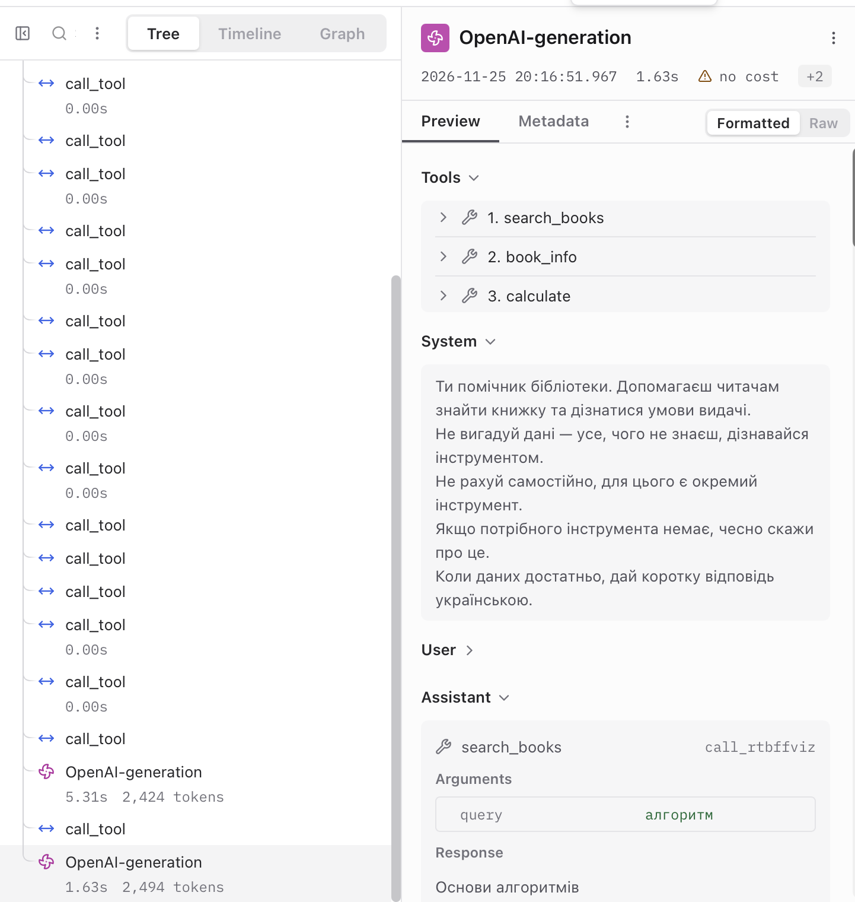

Міністерство освіти і науки України
Національний університет «Одеська політехніка»

  

# Лабораторна робота № 4
## Контекст, стан і кеш агента

з дисципліни «Обчислювальні методи»

Варіант 1 - Предметна область: «Бібліотека»

  

Виконила: студентка групи АІ-241
Албул В. П.

Перевірив: Баранов О. М.

 
Одеса – 2026

---

## 1. Мета роботи, варіант, предметна область, модель і розмір вікна (Крок 1)

**Мета роботи:** дослідити поведінку LLM-агента під час виконання довгої багатокрокової задачі в умовах обмеженого контекстного вікна, реалізувати три способи захисту контексту (обрізання історії `trim`, збереження зовнішнього стану задачі `trim+state` та кешування викликів моделі `cache`), а також додаткове підсумовування історії (`summary`) і порівняти їх за точністю, витратами токенів, часом виконання та кількістю повторних викликів.

* **Номер варіанта та предметна область:** **Варіант 1 — «Бібліотека»** (інструменти каталогу та довідника бібліотеки: `search_books`, `book_info`, `calculate`).
* **Три обов'язкові числа щодо контекстного вікна (Крок 1):**
  1. **`context length` вихідної моделі (`qwen2.5:3b`):** **`32 768` токенів**;
  2. **`num_ctx` нової моделі (`qwen25-3k`, `Modelfile`):** **`3072` токени** (на початковому етапі кроку 1 задавалося `4096` токенів, після чого вікно було додатково звужено за результатами кроку 4);
  3. **У скільки разів вікно звузили:** у **`10.67` раза** ($32\,768 / 3072 \approx 10.67$; на етапі `num_ctx = 4096` — у `8` разів).

**Інші параметри конфігурації (`config.py`):**
* Адреса локального сервера Ollama: `http://localhost:11434/v1`, `TEMPERATURE = 0`.
* Ліміт кроків для довгої задачі: `MAX_STEPS_LONG = 25`.
* Поріг стиснення історії: `COMPRESS_AT = 2150` токенів; кількість останніх повідомлень, що зберігаються: `KEEP_LAST = 6`.
* Обмеження довжини результату в стані: `STATE_RESULT_CHARS = 200` символів.

---

## 2. Довга задача: питання і правильна відповідь (Крок 2)

Скриптом `make_task.py` згенеровано файл `long_task.json` для шести книжок із довідника `data/books.csv` із мінімальною кількістю викликів інструментів `MIN_CALLS = 18` (по три виклики на кожну книжку: пошук згадки `search_books`, отримання терміну видачі й ставки штрафу `book_info`, обчислення штрафу за 3 дні `calculate`).

**Питання довгої задачі (`L1`):**
> Для кожної з шести книжок: *Основи алгоритмів, Місто вічної ночі, Місто вічного дня, Кулінарія для лінивих, Хроніки старого замку, Тайни давніх цивілізацій*. Виконуй завдання по черзі: викликай суворо один інструмент за один крок (не викликай кілька інструментів одночасно). Для кожної книжки: (а) знайди в корпусі бібліотеки згадку про книжку за одним ключовим словом у `search_books` і наведи одним реченням; (б) знайди в довіднику через `book_info` термін видачі в днях та штраф за день прострочення; (в) порахуй через `calculate` штраф за три дні затримки (множення штрафу за день на 3). У кінці порахуй через `calculate` загальний штраф за всі шість книжок і назви його одним числом.

**Еталонний розрахунок правильної відповіді (`expected = "150"`):**

| № | Назва книжки | Термін видачі, днів | Штраф за день, грн | Штраф за 3 дні, грн |
|---:|---|---:|---:|---:|
| 1 | Основи алгоритмів | 7 | 10 | $10 \times 3 = 30$ |
| 2 | Місто вічної ночі | 14 | 5 | $5 \times 3 = 15$ |
| 3 | Місто вічного дня | 7 | 8 | $8 \times 3 = 24$ |
| 4 | Кулінарія для лінивих | 14 | 5 | $5 \times 3 = 15$ |
| 5 | Хроніки старого замку | 14 | 10 | $10 \times 3 = 30$ |
| 6 | Тайни давніх цивілізацій | 14 | 12 | $12 \times 3 = 36$ |
| **Разом** | **Правильна відповідь (`expected`)** | — | — | **`150`** |

---

## 3. Пробний прогін без захисту, таблиця 2 і випадок A–D (Кроки 3–4)

### 3.1. Результати пробного прогону без захисту (`probe_none_r1`)

* **Час виконання пробного прогону (`probe_none_r1`):** **`24.0 с`** (початок у лозі `19:58:18`, завершення — `19:58:42`).
* **Правильність відповіді:** **`ні` (неправильно)** — агент повернув відповідь `2.2 грн` замість еталонної суми `150`.

### 3.2. Таблиця 2 — Зростання входу в прогоні без захисту (`probe_none_r1.log`)

| Крок | `prompt_tokens` | Приріст | Що зробила модель |
|---:|---:|---:|---|
| 1 | 1094 | — | Пакет із 18 викликів (`search_books`, `book_info`, `calculate` для всіх 6 книжок) |
| 2 | 2394 | +1300 | `calculate({"a":1.1,"b":1.1,"operation":"add"})` |
| 3 | 2445 | +51 | Фінальна відповідь без виклику інструментів (`2.2 грн`) |

### 3.3. Значення (а)–(д) за виведенням `analyze.py`

* **(а) Постійна частина входу («вхід першого кроку»):** **`1094` токенів** (`system` + `user` + схеми інструментів).
* **(б) Типовий приріст за крок:** **`676` токенів** (медіана додатних приростів `1300` і `51` становить $675.5$ токенів).
* **(в) Сума `prompt_tokens` за прогін і значення за формулою:**
  * фактична сума `prompt_tokens` за прогін — **`5933` токенів** (`1094 + 2394 + 2445`);
  * значення за формулою $n \cdot C + d \cdot \frac{n(n-1)}{2}$ — **`5308` токенів** ($3 \cdot 1094 + 675.5 \cdot \frac{3 \cdot 2}{2} = 3282 + 2026.5 = 5308.5$).
  * *Пояснення розбіжності (`625` токенів):* формула передбачає рівномірний лінійний приріст $d$ на кожному кроці, тоді як у прогоні модель на 1-му кроці об'єднала всі 18 викликів у пакет (приріст `+1300` токенів після 1-го кроку), а на 2-му кроці зробила лише один виклик (приріст `+51` токен).
* **(г) Крок, на якому вхід перестав рости («вхід перестав рости на кроці»):** **`не помічено`** (найбільший вхід на 3-му кроці становив `2445` токенів, або $80\%$ вікна `3072`, тобто ознаки `stall` не виникло).
* **(д) Дії моделі на наступних кроках та перевірка чисел у відповіді:** на 2-му кроці модель викликала `calculate({"a":1.1,"b":1.1,"operation":"add"})` й отримала `2.2`, а на 3-му кроці завершила діалог без виклику інструментів: *«За всіма видачними та штрафами для шість книжок ви отримаєте загальну суму штрафу: **2.2 грн**.»*. Перевірка лога `logs/probe_none_r1.log` підтверджує, що число `2.2` було присутнє у рядку `результат: 2.2` на 2-му кроці (тобто модель не вигадала його в самому тексті відповіді, але отримала з хибних аргументів `1.1 + 1.1` замість реальних штрафів `30, 15, 24, 15, 30, 36`).

### 3.4. Визначення випадку (A–D)

* **Первинний пробний прогін у вікні `4096` токенів → Випадок C («Задача закоротка»):** найбільший вхід становив `2104` токени ($51\% < 95\%$ вікна), статус завершення — `final`, помилки сервера (`server_error`) чи застою (`stall`) не було. Згідно з інструкцією кроку 4 для випадку C вікно було зменшено у `Modelfile` до `num_ctx = 3072` (`qwen25-3k`), прибрано скорочення тексту в `tools.py` і повторено кроки 3–4.
* **Повторний пробний прогін у вікні `3072` токенів (`probe_none_r1`) → Випадок C («Задача закоротка» за формальними критеріями таблиці):** статус завершення `final`, помилки сервера й застою входу немає, найбільший вхід на 3-му кроці дорівнює `2445` токенів ($80\% < 95\%$ вікна). Модель не досягла $95\%$ вікна тому, що порушила інструкцію й згрупувала всі 18 викликів у один пакет на 1-му кроці, після чого передчасно завершила роботу на 3-му кроці з хибними аргументами у `calculate`.

---

## 4. Обрізання історії та стан задачі: таблиця 3 і аналіз блоку стану (Кроки 5–6)

### 4.1. Таблиця 3 — Стиснення історії (`probe_trim_r1` та `probe_trim+state_r1`)

| Конфігурація | Крок стиснення | Вхід до стиснення, токенів | Повідомлень було -> стало | Повторних викликів за прогін |
|---|---:|---:|---:|---:|
| `trim` | 2 | 2394 | 23 -> 4 | 6 |
| `trim+state` | 2 | 2394 | 23 -> 4 | 3 |

* **Вплив обрізання (`trim`):** після видалення старих повідомлень (`23 -> 4`) модель втратила результати першого кроку та на кроках 3–5 повторно викликала `search_books({"query":"алгоритм"})`, `book_info({"title":"Основи алгоритмів"})` і `calculate` (`6` повторних викликів).
* **Вплив стану (`trim+state`):** запис результатів успішних викликів (`level == "ok"`) у `state/probe_trim+state_r1.json` і прикріплення їх до повідомлення користувача усунули повторні виклики після стиснення (зафіксовані `3` дублі виникли ще всередині пакета 1-го кроку).

### 4.2. Аналіз блоку `ПЕРШЕ ПОВІДОМЛЕННЯ КОРИСТУВАЧА ПІСЛЯ СТИСНЕННЯ` (Крок 6, п. 7)

У лозі `logs/probe_trim+state_r1.log` перший блок стану після стиснення на 2-му кроці містить:
* **Кількість рядків виду `- інструмент(аргументи) -> результат`:** **`19` рядків** (`18` викликів із пакета 1-го кроку та `1` виклик `calculate` із 2-го кроку).
* **Розмір блоку стану та порівняння з типовим приростом:** сам перелік 19 результатів займає **`2013` символів**, або $\frac{2013}{2.5} \approx \mathbf{805\text{ токенів}}$ (разом із текстом запитання — `2595` символів, $\approx 1038$ токенів). Порівняно з типовим приростом за один крок із кроку 4 (`676` токенів), блок стану становить $\frac{805}{675.5} \approx \mathbf{1.19}$ **кроку** — тобто компактний конспект усіх 19 викликів займає приблизно стільки ж місця, скільки один крок повної історії, і є цілком прийнятним за розміром.

---

## 5. Робота кешу викликів моделі: таблиця 4 і висновок (Крок 7)

### 5.1. Таблиця 4 — Робота кешу (`cache1_none_r1` та `cache2_none_r1`)

| Запуск | Кроків | Влучань у кеш | Викликів до сервера | Час, с | Правильно |
|---|---:|---:|---:|---:|:---:|
| 1 (кеш порожній) | 3 | 0 | 3 | 25.3 | ні |
| 2 (той самий запит) | 3 | 3 | 0 | 0.1 | ні |

### 5.2. Висновок про роботу кешу

* **Прискорення:** запуск 2 виявився швидшим за запуск 1 у **$\frac{25.3}{0.1} = 253$ рази** (практично миттєво за `0.1 с`, оскільки всі 3 виклики моделі було прочитано з `cache/*.json` без звернення до Ollama).
* **Зміна `SYSTEM` у `config.py`:** якби перед запуском 2 змінити текст системної інструкції `SYSTEM`, **кеш не спрацював би жодного разу (`0` влучань)**, оскільки ключ кешу `sha256` обчислюється від повного JSON запиту, куди входить список `messages` разом із першим системним повідомленням `messages[0]`.

---

## 6. Основні вимірювання, знайдені поламки та траси Langfuse (Крок 8)

### 6.1. Таблиця 5 — Вартість циклу в трьох конфігураціях (медіани по трьох повторах)

*(Зведена таблиця разом із рядком `summary` з додаткового завдання наведена нижче).*

| Конфігурація | Правильно (з 3) | Кроків | Токенів на вхід | Токенів на вихід | На підсумовування | Час, с | Стиснень | Повторних викликів |
|---|---:|---:|---:|---:|---:|---:|---:|---:|
| `none` | 0 з 3 | 3 | 6109 | 630 | 0 | 33.1 | 0 | 3 |
| `trim` | 0 з 3 | 6 | 8646 | 667 | 0 | 36.7 | 1 | 5 |
| `trim+state` | 0 з 3 | 3 | 5607 | 786 | 0 | 44.6 | 1 | 3 |
| `summary` *(дод. завд.)* | 0 з 3 | 7 | 12435 | 1161 | 2994 | 86.7 | 2 | 3 |

*(Ручна перевірка всіх прогонів підтвердила оцінку `0 з 3`, оскільки в кожному запуску модель повертала хибне число замість еталонних `150`.)*

### 6.2. Приховані поламки у логах `logs/main_*.log`

1. **Передчасна відповідь (менше ніж за 19 кроків) — у 9 з 9 прогонів `main` (та у 12 з 12 разом із `extra`):** в усіх прогонах модель порушила інструкцію викликати один інструмент за крок, об'єднала 18 викликів у один пакет на 1-му кроці з хибними аргументами у `calculate` (`a=1, b=0.1` замість ставки штрафу та `3`) і завершила цикл за `3–7` кроків замість мінімальних `19`.
2. **Вигадане число, якого не було в рядках `результат:` — у 3 з 9 прогонів `main`:** у всіх трьох запусках `main_trim_r1..r3` модель у фінальній відповіді назвала штраф `210 грн` для книжки *«Основи алгоритмів»*, хоча в лозі `calculate({"a":7,"b":10,"operation":"mul"})` повернув `70.0`. У `none` та `trim+state` фінальне число `2.2` було отримане з результату `calculate(1.1 + 1.1)` на 2-му кроці, тобто походило з хибних аргументів.

### 6.3. Скріншоти трас Langfuse

* **Порівняння токенів на кроці 3 (перший виклик після стиснення):** у трасі `long-main_trim+state_r1` після стиснення на 2-му кроці вхід моделі на 3-му кроці зменшився з `2394` до **`2119` токенів** (`2370` токенів разом із виходом), тоді як у `long-main_none_r1` на тому самому 3-му кроці вхід зріс до **`2445` токенів** (`2494` токенів із виходом) — економія становить `326` вхідних токенів уже на першому кроці після обрізання.
* **Що в трасі видно одразу без ручного підрахунку за логом:** на часовій шкалі та у дереві викликів Langfuse миттєво видно групування 18 викликів `call_tool` у межах одного кроку, точний час кожного звернення до моделі та момент падіння загальної кількості вхідних токенів після спрацювання `compress_history`.

---

## 7. Відповіді на питання

1. **На якому кроці агент без захисту дійшов до межі вікна і як ви це побачили (таблиця 2, пункти (г) і (д) кроку 4)? Що в його поведінці змінилося після цього?**  
   У прогоні `probe_none_r1` (таблиця 2, `NUM_CTX = 3072`) агент не дійшов до жорсткого переповнення межі вікна (`вхід перестав рости на кроці: не помічено`), оскільки об'єднав усі 18 викликів у пакет на 1-му кроці та завершив роботу вже на 3-му кроці при `prompt_tokens = 2445` ($80\%$ вікна). Проте після отримання великого результату 1-го кроку (`+1300` токенів) модель втратила фокус на умовах задачі: на 2-му кроці замість розрахунку штрафів по книжках вона викликала `calculate({"a":1.1,"b":1.1,"operation":"add"})`, а на 3-му передчасно видала хибну відповідь `2.2 грн`.

2. **Порівняйте суму `prompt_tokens` за прогін із формулою (пункти (а)-(в) кроку 4). Чи збігається зростання з очікуваним?**  
   Фактична сума `prompt_tokens` за прогін `probe_none_r1` становить `5933` токени, а значення за формулою $n \cdot C + d \cdot \frac{n(n-1)}{2}$ — `5308` токенів (різниця — `625` токенів). Зростання не є рівномірним, бо модель виконала всі 18 інструментів пакетом на 1-му кроці (приріст `+1300` токенів після 1-го кроку проти `+51` токену після 2-го), тоді як формула виходить з однакового лінійного приросту $d = 675.5$ токенів на кожному кроці.

3. **Що втрачає агент при обрізанні? Наведіть приклад повторного виклику після стиснення. Що змінилося в `trim+state` (таблиці 3 і 5)?**  
   При обрізанні (`trim`) агент втрачає старі повідомлення `role = "tool"` із результатами вже виконаних запитів, тому після стиснення на 2-му кроці (`23 -> 4` повідомлення) модель повторно викликала `search_books({"query":"алгоритм"})` та `book_info({"title":"Основи алгоритмів"})`, довівши кількість повторних викликів до `6` у пробному прогоні (таблиця 3) та `5` за медіаною основної серії (таблиця 5). У `trim+state` результати успішних викликів зберігаються в `state/*.json` і дописуються до запитання користувача, тому після стиснення модель не зробила жодного повторного виклику, а медіана вхідних токенів зменшилася з `8646` до `5607` (таблиця 5).

4. **Яка конфігурація найдешевша за токенами, найшвидша, найточніша (таблиця 5)? Чому висновок за трьома повторами однієї задачі обережний?**  
   За таблицею 5 найдешевшою за вхідними токенами є `trim+state` (`5607` токенів), найшвидшою — `none` (`33.1 с` за медіаною, бо немає витрат на стан і додаткові кроки), а за точністю всі конфігурації отримали `0 з 3` через пакетний виклик інструментів на 1-му кроці. Висновок за трьома повторами однієї задачі є обережним, оскільки вибірка мала й стосується лише одного типу багатокрокового запиту на конкретній моделі `qwen2.5:3b`.

5. **Чому під час вимірювання вартості кеш вимкнено? Що станеться з кешем, якщо інструмент поверне інші дані або ви замініть модель під тією самою назвою?**  
   Під час вимірювання `main` кеш вимкнено (`USE_CACHE = False`), інакше повтори `r2` та `r3` брали б відповіді з `cache/*.json` без звернення до сервера, штучно обнуляючи час і навантаження. Якщо інструмент поверне інші дані, зміниться повідомлення `role = "tool"` у `messages`, хеш `sha256` стане іншим і кеш коректно виконає новий запит; але якщо замінити модель у Ollama під тією самою назвою (`qwen25-3k`), текстовий ключ запиту не зміниться, і агент повертатиме застарілі відповіді попередньої моделі, доки теку `cache/` не буде видалено.

6. **Які поламки довгого прогону скорочення історії не лікує в принципі?**  
   Скорочення історії не усуває помилок планування й логіки самої моделі: передчасного завершення циклу без виконання всіх 18 викликів, ігнорування заборони на пакетний виклик кількох інструментів за крок і передачі хибних аргументів у `calculate`. Також стиснення не захищає від переповнення вікна в межах одного кроку, якщо один пакет викликів одразу перевищить `NUM_CTX`.

---

## 8. Додаткове завдання: підсумовування замість обрізання (`summary.py`)

Реалізовано модуль `summary.py` (`COMPRESS = "summary"`), у якому проміжна частина історії між початком (`head`) і останніми `KEEP_LAST = 6` повідомленнями (`tail`) передається окремим викликом моделі без інструментів для стислого переказу та дописується до запитання користувача.

**Аналіз серії `extra_summary_r1..r3` (рядок `summary` у таблиці 5):**
1. **Витрати токенів на підсумовування:** медіана витрат на додаткові виклики переказу (колонка «На підсумовування») становила **`2994` токени**, а загальна витрата вхідних токенів зросла до **`12 435` токенів** (`15 429` разом із підсумовуванням). Порівняно з `trim` (`8646` вхідних токенів) конфігурація `summary` **не заощадила** вхідні токени, а витратила на **`3789` токенів більше** (і на `6828` токенів більше, ніж `trim+state`), оскільки переказ постійно накопичувався у повідомленні користувача і спричиняв повторні стиснення (`2` стиснення за прогін у `r1` та `r3`).
2. **Збереження точних чисел у переказі:** перевірка блоків `ПІДСУМОК ІСТОРІЇ` у логах `logs/extra_summary_r1..r3.log` показала, що модель **не змогла зберегти точні числа та прив'язку до книжок**: у прогоні `r1` переказ приписав опис книжки *«Місто вічного дня»* книжці *«Хроніки старого замку»* і втратив частину результатів `book_info`; у прогоні `r3` модель переплутала терміни видачі та штрафи між книжками, а під час другого стиснення перейшла на російську мову, інвертувала інструкцію (*«Уберите все точные числа...»*) і видала хибну відповідь `364 грн`.

---

## 9. Висновок

1. **Найбільший практичний ефект** серед трьох способів дало поєднання **обрізання історії із зовнішнім станом (`trim+state`)** для виконання циклу та **кешування (`cache`)** для налагодження: `trim+state` забезпечив найменшу витрату вхідних токенів (`5607` проти `6109` у `none` і `8646` у `trim`) і повністю прибрав повторні виклики після стиснення, а кеш прискорив повторний прогін у `253` рази (`0.1 с` проти `25.3 с`).
2. **Що варто змінити далі:** для підвищення точності розв'язання довгих багатокрокових задач на компактній моделі `qwen2.5:3b` доцільно заборонити пакетні виклики (`parallel_tool_calls=False` або перевірка кількості викликів у `dispatcher.py`), замінити вільний калькулятор спеціалізованим інструментом розрахунку штрафу для конкретної книжки, а замість генеративного переказу (`summary`) використовувати детермінований стан (`state.py`).