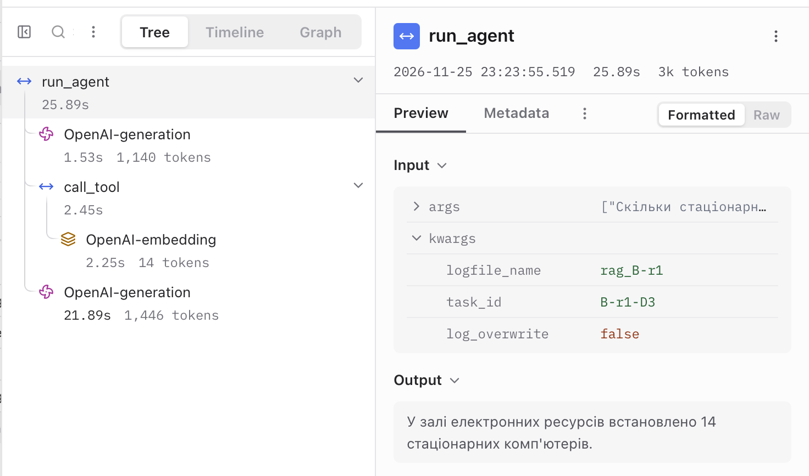
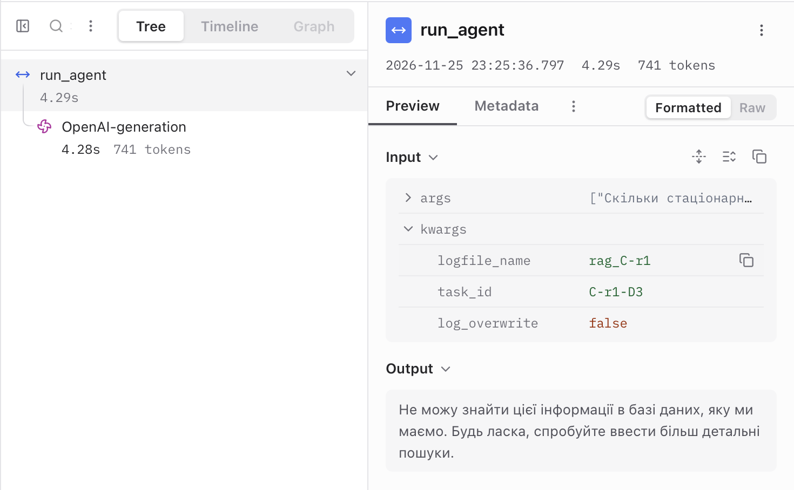

# Лабораторна робота № 5. Пошук по документах (RAG) для агента

**Виконала:** Албул Віра, група АІ-241  
**Модель LLM:** `qwen25-4k` (контекстне вікно `4096` токенів, `temperature = 0.0`)  
**Модель ембедингів:** `bge-m3` (розмірність вектора `1024`)  
**Векторне сховище:** FAISS (`IndexFlatIP`) та ChromaDB (`PersistentClient`, метрика `cosine`)

---

## 1. База документів і контрольні питання (Кроки 1–2)

Для перевірки RAG-агента сформовано базу із **17 текстових документів**:
* `data/corpus/` — 12 коротких карток художніх і навчальних книжок;
* `data/docs/` — 5 регламентних документів центральної міської бібліотеки (`d01.txt` — правила користування, `d02.txt` — читальна зала та зал електронних ресурсів, `d03.txt` — міжбібліотечний абонемент і доставка, `d04.txt` — формування й оцифрування фонду, `d05.txt` — актова зала та гуртки).

Перевірка скриптом `python check_cases.py` підтвердила коректність набору даних:
* **Загальний обсяг документів:** `17 504` символи ($\approx 7002$ токени), що перевищує контекстне вікно моделі (`4096` токенів) і унеможливлює передачу всіх текстів у системний промпт.
* **Контрольні питання (`rag_cases.json`):** `10` питань — `4` прямих (`D1`–`D4`), `4` переформульованих (`P1`–`P4`) і `2` питання без відповіді в документах (`N1`–`N2`).

### Перевірка моделі без доступу до документів

Перед підключенням пошуку три прямі питання поставлено моделі `qwen25-4k` напряму через `ollama run qwen25-4k`:

| ID | Питання | Відповідь моделі без документів | Еталон із документів | Результат |
| :--- | :--- | :--- | :--- | :---: |
| `D1` | Скільки коштує оформлення пластикового читацького квитка? | Вигадала, що пластиковий читацький квиток — «фікціональна концепція з кіберпанк-книжок» і платних квитків не існує. | `37 грн` (`d01.txt`) | Помилка (вигадка) |
| `D2` | На скільки днів видаються навчальні посібники та довідники підвищеного попиту з абонемента? | Заявила, що єдиного правила немає і кожна бібліотека вирішує окремо. | `11 днів` (`d01.txt`) | Помилка (немає даних) |
| `D3` | Скільки стаціонарних комп'ютерів встановлено у залі електронних ресурсів? | Чесно повідомила, що не має точної кількості комп'ютерів. | `14` (`d02.txt`) | Помилка (немає даних) |

**Висновок:** без механізму RAG модель правильно відповіла на **0 із 3** питань і схильна вигадувати факти, коли не знає відповіді.

---

## 2. Нарізання документів і перевірка моделі ембедингів (Кроки 3–4)

### 2.1. Порівняння способів нарізання на `data/docs/d01.txt` (`show_chunks.py`)

| Режим нарізання | Кількість чанків | Обриваються посеред речення | Особливості |
| :--- | :---: | :---: | :--- |
| `fixed 200 0` | 16 | 14 | Числа та умови розриваються між сусідніми чанками (наприклад, `37 грн` у чанку 2, `11 днів` у чанку 4). |
| `fixed 500 100` | 8 | 7 | Перекриття у `100` символів дублює межі фрагментів, тому факти на стиках не губляться. |
| `paragraphs 800` | 5 | 0 | Текст ділиться строго за межами абзаців (`\n\n`), кожен чанк зберігає цілісну думку. |

### 2.2. Перевірка `bge-m3` (`embed_check.py`)

* Час обчислення ембедингів (без кешу): `2.8 с` (із кешем у `index/embeddings_cache.json` — майже `0 с`).
* Розмірність вектора: `1024`, L2-норма вектора: `1.000`.
* Косинусна схожість запиту *«Скільки коштує відправити посилку?»* із релевантною фразою *«Тариф на доставку»* становить **`0.732`**, а з нерелевантною *«Графік роботи кур'єрів»* — **`0.568`**.

---

## 3. Якість пошуку за конфігураціями нарізання та підбір порогу (Крок 5)

### 3.1. Таблиця порівняння конфігурацій (`python check_retrieval.py`)

| Конфігурація | Чанків | Сер. довжина, симв. | `hit@1` | `hit@3` | `hit@5` | `hit@3` прямі | `hit@3` перефр. | Токенів (`k=3`) |
| :--- | :---: | :---: | :---: | :---: | :---: | :---: | :---: | :---: |
| `fixed-200-0` | 93 | 188 | 0.88 | 0.88 | 0.88 | 0.75 | 1.00 | 226 |
| `fixed-500-0` | 47 | 372 | 0.88 | 0.88 | 0.88 | 1.00 | 0.75 | 447 |
| **`fixed-500-100`** | **53** | **396** | **1.00** | **1.00** | **1.00** | **1.00** | **1.00** | **476** |
| `fixed-1500-0` | 27 | 648 | 0.50 | 0.88 | 1.00 | 0.75 | 1.00 | 778 |
| `paragraphs-800` | 37 | 472 | 1.00 | 1.00 | 1.00 | 1.00 | 1.00 | 566 |
| `paragraphs-800+title` | 37 | 489 | 1.00 | 1.00 | 1.00 | 1.00 | 1.00 | 587 |

**Вибір конфігурації:** максимальний `hit@3 = 1.00` (і `hit@1 = 1.00`) досягнуто у трьох варіантах: `fixed-500-100` (`476` токенів), `paragraphs-800` (`566` токенів) і `paragraphs-800+title` (`587` токенів). За критерієм найменшого обсягу контексту за однакового `hit@3` обрано **`fixed-500-100`** (`53` чанки, середня довжина `396` символів, найкоротший `7`, найдовший `500`). Перекриття у `100` символів усунуло втрати на межах чанків, які знижували `hit@3` у `fixed-500-0` до `0.88`.

### 3.2. Підбір порогу схожості `MIN_SCORE` (`python check_retrieval.py scores`)

| ID | Вид питання | Схожість першого результату | Чи містить потрібну фразу |
| :--- | :--- | :---: | :---: |
| `D1` | `direct` | `0.736` | так |
| `D2` | `direct` | `0.731` | так |
| `D3` | `direct` | `0.619` | так |
| `D4` | `direct` | `0.710` | так |
| `P1` | `paraphrase` | `0.671` | так |
| `P2` | `paraphrase` | `0.631` | так |
| `P3` | `paraphrase` | `0.702` | так |
| `P4` | `paraphrase` | `0.604` | так |
| `N1` | `none` | `0.642` | — |
| `N2` | `none` | `0.585` | — |

* Найнижча схожість серед питань із відповіддю: **`0.604`** (`P4`).
* Найвища схожість серед питань без відповіді: **`0.642`** (`N1`, де збігаються слова *«абонемент»*, *«біля входу до бібліотеки»*, *«коштує»* з описом застави за абонемент у `d01.txt`).
* **Обраний компроміс: `MIN_SCORE = 0.60`.** Такий поріг зберігає 100% повноту пошуку для всіх 8 питань із відповіддю (`hit@3 = 1.00`), відсікає на етапі пошуку питання `N2` (`0.585 < 0.60`), а для `N1` (`0.642 >= 0.60`) покладається на інструкцію в описі інструмента відповідати лише за знайденими фрагментами.

---

## 4. Підключення `search_docs` і перевірка диспетчера (Крок 6)

* У `tools.py` додано функцію `search_docs(query: str)`, яка повертає до `TOP_K = 3` чанків зі схожістю `>= 0.60` із зазначенням імені файлу (`[1] Джерело: d01.txt`) та записує статистику пошуку в `rag.TRACE`.
* У `arguments.py` створено схему валідації `DocsArgs` (`min_length=3`, `max_length=300`, `extra="forbid"`).
* Перевірка через `python try_tool.py` підтвердила коректну роботу диспетчера:
  * `try_tool.py D1` → `рівень: ok`, повернуто фрагмент із `d01.txt` із ціною `37 грн`;
  * `try_tool.py N2` → `рівень: ok`, повернуто `"У документах нічого схожого не знайдено."`;
  * запит `{"query": "а"}` → `рівень: schema` (`String should have at least 3 characters`).

---

## 5. Вимірювання агента з трьома описами `search_docs` (Кроки 7–8)

Проведено **90 прогонів** (`python measure_rag.py`): 3 варіанти опису (`A`, `B`, `C`) $\times$ 10 питань $\times$ 3 повтори.

### 5.1. Зведена таблиця за описами (`python rag_report.py`)

| Опис | Правильно | Викликав пошук | Кроків (медіана) | Токенів входу (медіана) | Час, с (медіана) |
| :--- | :---: | :---: | :---: | :---: | :---: |
| **A** (старий опис від `search_books`) | `0 / 24` | `3 / 24` | `1.0` | `754` | `4.4` |
| **B** (повний опис із переліком тем і правил) | **`9 / 24`** | **`9 / 24`** | `2.0` | `2378` | `6.3` |
| **C** (мінімальний `«Шукає інформацію.»`) | `0 / 24` | `0 / 24` | `1.0` | `690` | `6.5` |

### 5.2. Розподіл результатів і помилок за категоріями

| Категорія прогону | Опис A | Опис B | Опис C |
| :--- | :---: | :---: | :---: |
| Правильно (питання з відповіддю) | `0` | **`9`** | `0` |
| Не шукав і відповів неправильно (`no_search`) | `21` | `15` | `24` |
| Шукав, але потрібного фрагмента в результаті немає (`miss`) | `3` | `0` | `0` |
| Фрагмент у результаті був, відповідь неправильна (`ignored`) | `0` | `0` | `0` |
| Питання без відповіді: визнав, що не знає (`refused`) | `0` | `0` | `3` *(6 вручну)* |
| Питання без відповіді: вигадав відповідь (`invented`) | `6` | `6` | `3` *(0 вручну)* |

### 5.3. Розбір помилок і поведінки моделі

1. **Ефективність опису `B` після успішного пошуку:** у всіх 9 запусках, де модель викликала `search_docs` (`D3`, `D4`, `P4` у всіх трьох повторах), пошук повернув потрібний чанк з першого разу (`hit = 1`), і модель надала повністю правильну відповідь (`14` комп'ютерів, `110` глядачів, `13` учасників; категорія `ignored = 0`). У задачі `P4` модель на 2-му кроці додатково викликала `calculate(1 + 13 = 14)`, але у фінальній відповіді все одно коректно вказала `13 осіб`.

2. **Причина пропусків пошуку в `B` (`15` `no_search` і `6` `invented`):** компактна модель `qwen25-4k` (3B) у питаннях, де фігурують гроші, терміни в днях/хвилинах або швидкість (`D1`, `D2`, `P1`, `P2`, `P3`, `N1`, `N2`), замість пошуку фактів у базі одразу викликала інструмент `calculate` з вигаданими числами (`1 + 100 = 101`, `7 + 2 = 9`, `1 - 1000 = -999`, `60 - 1 = 59`, `1 * 100 = 100`), оскільки її системний промпт та опис `calculate` вимагають не рахувати самостійно.

3. **Провали описів `A` та `C`:**
   * за опису **`C`** (`«Шукає інформацію.»`) модель не розуміє, що саме зберігається в документах, тому не викликала `search_docs` жодного разу (`0/24`) і завершувала роботу за 1 крок без звернення до бази знань;

   * за опису **`A`** (опис пошуку книжок за жанром/темою) модель викликала `search_docs` лише на `D2` зі спотвореним ключовим запитом `"навчальні посібники довідники підвищеного попиту"` (без дієслів і контексту видачі), схожість якого виявилася нижчою за `0.60` (`3` випадки `miss`).

4. **Похибка автоматичної перевірки `UNKNOWN` в описі `C`:** при ручній перевірці логів виявлено, що в конфігурації `C` на питання `N2` модель відповіла *«...не вказуються в довіднику»*, тобто чесно визнала відсутність даних (`refused`), але словоформа `«вказуються»` не входила до списку підрядків `UNKNOWN`, тому автоматично була позначена як `invented`.

---

## 6. Перевірка регресії на звичайних задачах із ЛР № 4 (Крок 9)

З активним описом `DOCS_DESCRIPTION = "B"` виконано перевірку на 5 типових задачах попередньої лабораторної (`check_regression.py`, лог збережено у `logs/run_rag.log`):

| Задача | Запит | Статус і кроки | Виклики `search_docs` | Результат |
| :--- | :--- | :---: | :---: | :--- |
| `T1` | Знайди щось легке з фантастики | `final`, 1 крок | 0 | Порожня відповідь (спроба викликати вилучений `search_books`). |
| `T2` | Скільки примірників книжки «Основи алгоритмів» є в бібліотеці та на скільки днів її видають? | `final`, 1 крок | 0 | Порожня відповідь. |
| `T3` | Дізнайся ставку штрафу для книжки «Основи алгоритмів» і порахуй штраф за 4 дні прострочення. | `final`, 4 кроки | 0 | **Успіх:** самовиправлення схеми `book_info` → `10 грн/день` → `calculate(4 * 10)` → `40 грн`. |
| `T4` | Видай мені книжку «Основи алгоритмів» додому. | `final`, 1 крок | 0 | Порожня відповідь (спроба викликати заборонений `issue_book`). |
| `T5` | Скільки примірників книжки «Гаррі Поттер і філософський камінь» є в бібліотеці? | `final`, 1 крок | 0 | Порожня відповідь. |

**Аналіз регресії:** складена двоетапна задача розрахунку штрафу (`T3`) виконана бездоганно (`40 грн`). На решті задач проявилося обмеження локальної 3B-моделі при збільшенні довжини системного контексту (`~1100` вхідних токенів з описом `B`): модель намагається викликати відсутній в `ALLOWED` інструмент `search_books` або формує некоректний виклик, після очищення якого парсером Ollama `msg.content` стає порожнім рядком, а `check_response()` у `dispatcher.py` не перехоплює порожній рядок як помилку формату.

---

## 7. Додаткове завдання: заміна FAISS на ChromaDB

Векторний індекс у `rag.py` та `build_index.py` переведено з **FAISS** (`IndexFlatIP`) на **ChromaDB** (`chromadb.EphemeralClient` для побудови в пам'яті та `chromadb.PersistentClient(path="index/chroma")` для збереження на диск):
* для колекції `"docs"` задано косинусний простір (`metadata={"hnsw:space": "cosine"}`);
* косинусна відстань $d$, яку повертає `collection.query()`, переводиться у косинусну схожість за формулою $\text{score} = 1 - d$, що зберігає повну сумісність із порогом `MIN_SCORE = 0.60`.

**Результати перевірки на ChromaDB:**
* `python check_retrieval.py` та `python check_retrieval.py scores` відтворили ідентичні метрики (`hit@1 = 1.00`, `hit@3 = 1.00` для `fixed-500-100`, межі схожості `0.604` і `0.642`);
* `python build_index.py` зберіг дисковий індекс у `index/chroma/` (`53` чанки, модель `bge-m3`, розмірність `1024`);
* `try_tool.py D1`, `try_tool.py N2` та `ask.py D3` відпрацювали коректно (*«У залі електронних ресурсів встановлено 14 стаціонарних комп'ютерів»*).