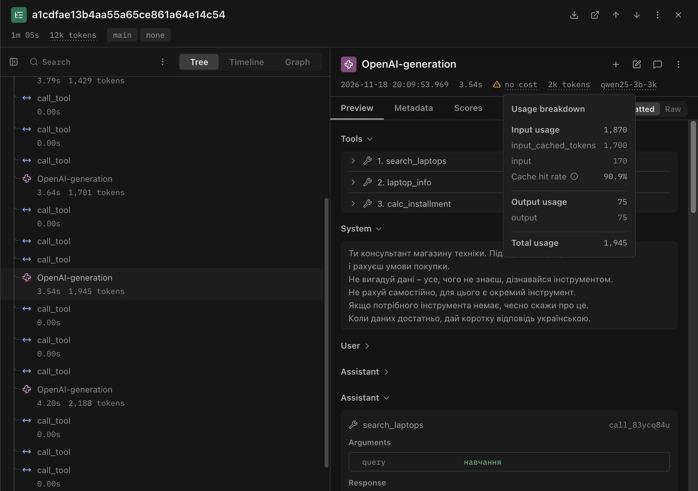
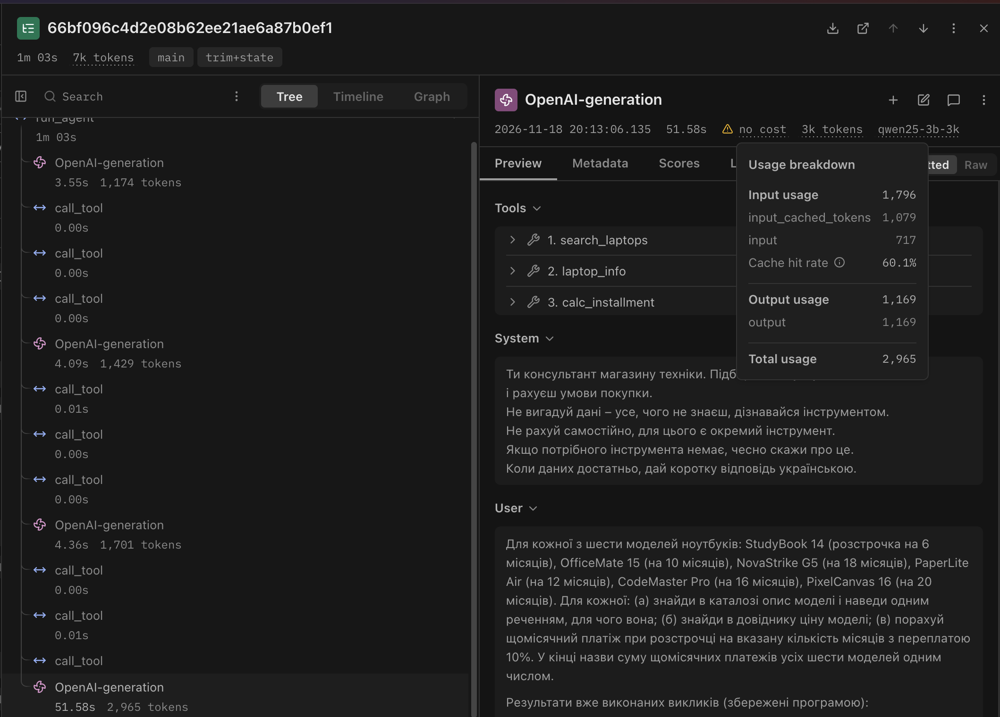
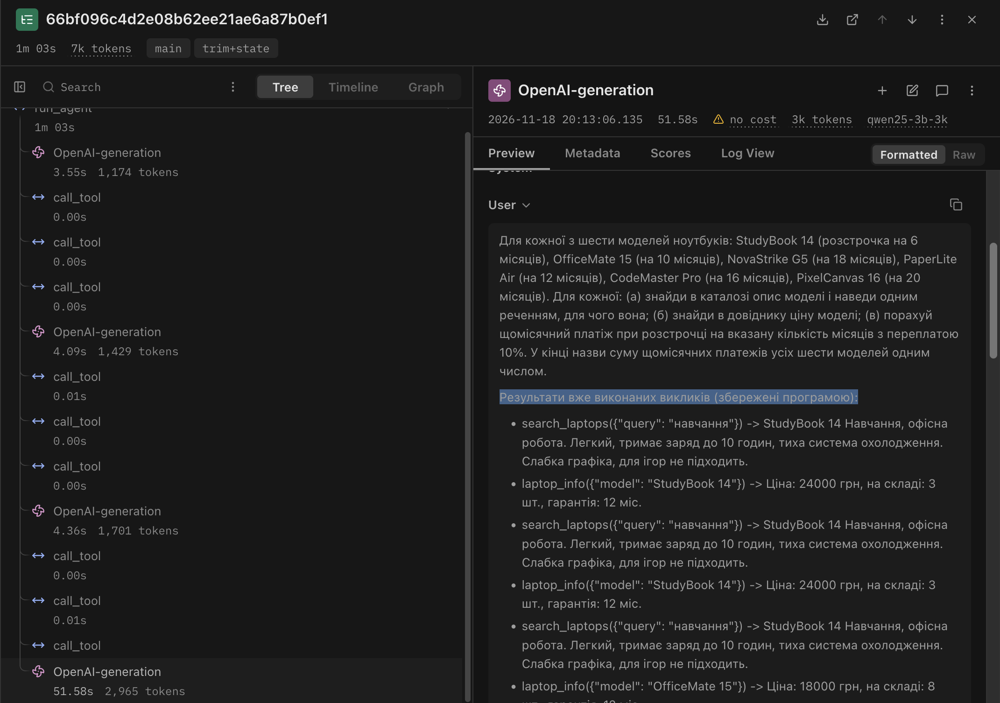

Міністерство освіти і науки України
Національний університет «Одеська політехніка»

  

# Лабораторна робота № 4
## Контекст, стан і кеш агента

з дисципліни «Обчислювальні методи»

Варіант 9

  

Виконала: студентка групи АІ-241
Давидович К. Д.

Перевірив: Баранов О. М.

 
Одеса – 2026

---

## 1. Мета роботи, варіант, модель і вікно

**Мета:** побачити, що відбувається з агентом, коли історія не вміщується в контекстне вікно моделі; навчитися скорочувати історію, зберігати результати інструментів поза текстом діалогу та кешувати виклики моделі; виміряти, скільки це коштує.

**Варіант:** 9. **Предметна область:** вибір ноутбука (інструменти `search_laptops`, `laptop_info`, `calc_installment`; заборонена дія `place_order`).

**Модель:** `qwen2.5:3b` (Ollama), та сама, що в лабораторній роботі № 3. Перевірки викликів з лабораторної роботи № 3 (`arguments.py`, `checks.py`, `dispatcher.py`) залишено без змін.

| Показник | Значення |
|---|---|
| `context length` вихідної моделі `qwen2.5:3b` | 32768 |
| `num_ctx` нової моделі `qwen25-3b-4k` (розділ `Parameters`) | 4096 |
| У скільки разів звузили вікно | 8 |

Пробний прогін з вікном 4096 потрапив у випадок C (п. 4), тому за методичкою вікно звужено до **3072** (модель `qwen25-3b-3k`, `NUM_CTX = 3072`). Усі подальші прогони виконано з вікном 3072.

**Зміна в `tools.py`.** У лабораторних № 2–3 `search_laptops` повертав лише назви знайдених моделей. Методичка вимагає не скорочувати результат пошуку по корпусу, а пункт (а) довгої задачі просить навести опис моделі, тому тепер інструмент повертає повний текст опису (назва, призначення, переваги й недоліки). Опис інструмента в `schemas.py` оновлено відповідно.

## 2. Довга задача

`make_task.py` рахує правильну відповідь прямими викликами функцій з `tools.py` (`laptop_info` і `calc_installment`), без моделі.

**Питання:**

> Для кожної з шести моделей ноутбуків: StudyBook 14 (розстрочка на 6 місяців), OfficeMate 15 (на 10 місяців), NovaStrike G5 (на 18 місяців), PaperLite Air (на 12 місяців), CodeMaster Pro (на 16 місяців), PixelCanvas 16 (на 20 місяців). Для кожної: (а) знайди в каталозі опис моделі і наведи одним реченням, для чого вона; (б) знайди в довіднику ціну моделі; (в) порахуй щомісячний платіж при розстрочці на вказану кількість місяців з переплатою 10%. У кінці назви суму щомісячних платежів усіх шести моделей одним числом.

| Модель | Ціна, грн | Місяців | Платіж, грн/міс |
|---|---|---|---|
| StudyBook 14 | 24000 | 6 | 4400 |
| OfficeMate 15 | 18000 | 10 | 1980 |
| NovaStrike G5 | 36000 | 18 | 2200 |
| PaperLite Air | 45000 | 12 | 4125 |
| CodeMaster Pro | 52000 | 16 | 3575 |
| PixelCanvas 16 | 61000 | 20 | 3355 |

**Правильна відповідь (`expected`):** **19635** грн. `min_calls` = 18 (шість позицій по три інструменти).

## 3. Прогін без захисту (крок 3–4)

### 3.1. Вікно 4096: випадок C

`python measure.py none 1 probe` з моделлю `qwen25-3b-4k` (лог `logs/probe_none_4k_r1.log`): прогін тривав 68 с, відповідь неправильна (175200 грн замість 19635). Статус `final`, найбільший вхід 2357 токенів – **58% вікна** 4096. Вхід не наблизився до межі: це випадок C («задача закоротка»), тому вікно звужено до 3072.

### 3.2. Вікно 3072 (лог `logs/probe_none_r1.log`)

Прогін з вікном 3072 збігся з прогоном на 4096 токен у токен: при `TEMPERATURE = 0` та сама історія дає ту саму відповідь, а вхід жодного разу не перевищив 3072, тож розмір вікна на нього не вплинув. Тривалість 77 с, відповідь неправильна.

Таблиця 2 – Зростання входу в прогоні без захисту

| Крок | `prompt_tokens` | Приріст | Що зробила модель |
|---:|---:|---:|:---|
| 1 | 1085 | | `search_laptops("навчання")`, `laptop_info("StudyBook 14")`, `calc_installment(price=4500, months=6)` – помилка `meaning` |
| 2 | 1355 | 270 | ті самі три виклики знову (`price=4500` – знову `meaning`) |
| 3 | 1625 | 270 | `search_laptops("навчання")`, `laptop_info("OfficeMate 15")`, `calc_installment(price=24000, months=10)` |
| 4 | 1870 | 245 | `search_laptops("навчання")`, `laptop_info("NovaStrike G5")`, `calc_installment(price=18000, months=18)` |
| 5 | 2114 | 244 | `search_laptops("навчання")`, `laptop_info("PaperLite Air")`, `calc_installment(price=36000, months=12)` |
| 6 | 2357 | 243 | відповідь без виклику |

**(а) Постійна частина входу** – 1085 токенів (системне повідомлення, описи трьох інструментів і довге питання).

**(б) Типовий приріст за крок** – 245 токенів. Модель робить по три виклики за крок, тож приріст – це одне повідомлення моделі з трьома викликами і три результати, серед яких повний опис з корпусу.

**(в) Сума `prompt_tokens` за прогін** – 10406, **за формулою** n·C + d·n·(n−1)/2 = 6·1085 + 245·15 = **10185**. Розбіжність 2%: приріст на перших кроках (270) трохи більший за медіану (245), бо на них у результатах є ще й повідомлення про помилку `meaning`.

**(г) Вхід перестав рости** – не помічено: вхід ріс рівномірно до самого кінця й зупинився на 77% вікна.

**(д)** Застою не було, тож розібрано останній крок. На кроці 6 модель відповіла без виклику, зробивши 15 викликів з 18 (з них 5 повторних) і не дійшовши до CodeMaster Pro і PixelCanvas 16. У відповіді є числа, яких не було в жодному рядку `результат:`: ціни 24000 і 45000 для CodeMaster Pro і PixelCanvas 16 (`laptop_info` для них не викликався), підсумок 175200 грн. Крім того, усі шість моделей отримали опис StudyBook 14, бо модель щоразу шукала `навчання`, а не назву моделі, і ціни зсунуті на одну позицію: у `calc_installment` для OfficeMate 15 передано ціну StudyBook 14 (24000), для NovaStrike G5 – ціну OfficeMate 15 (18000) тощо.

**Випадок:** **C** (і з вікном 4096, і з 3072): найбільший вхід 2357 токенів – 77% вікна 3072, статус `final`. Межа вікна не стала проблемою, бо агент здається раніше, ніж історія встигає вирости: відповідає на шостому кроці «з пам'яті». Методичка дозволяє звузити вікно лише до 3072, тому досліджено саме цю поведінку.

**Поріг стиснення.** Методичка радить для вікна 3072 `COMPRESS_AT = 2150`. Але стиснення перевіряється після кроку, а після п'ятого кроку вхід був лише 2114, тож з цим порогом `trim` і `trim+state` нічим би не відрізнялися від `none`. Тому, як у прикладі викладача для вікна 3072, задано **`COMPRESS_AT = 1500`**: стиснення спрацьовує після третього кроку (вхід 1625).

## 4. Обрізання і стан (кроки 5–6)

Таблиця 3 – Стиснення історії

| Конфігурація | Крок стиснення | Вхід до стиснення, токенів | Повідомлень було -> стало | Повторних викликів за прогін |
|---|---:|---:|---|---:|
| `trim` | 3 | 1625 | 14 -> 6 | 58 |
| `trim` | 5 | 1754 | 14 -> 6 | |
| `trim` | 7 | 1798 | 16 -> 2 | |
| `trim` | 10 | 1625 | 14 -> 6 | |
| `trim` | 12 | 1754 | 14 -> 6 | |
| `trim` | 14 | 1798 | 16 -> 2 | |
| `trim` | 17 | 1625 | 14 -> 6 | |
| `trim` | 19 | 1754 | 14 -> 6 | |
| `trim` | 21 | 1798 | 16 -> 2 | |
| `trim` | 24 | 1625 | 14 -> 6 | |
| `trim+state` | 3 | 1625 | 14 -> 6 | 4 |

**`trim` (лог `logs/probe_trim_r1.log`): цикл.** Прогін дійшов до ліміту 25 кроків без відповіді, зробивши 81 виклик, з них 58 повторних. Стиснення повторюються з періодом 7 кроків: 3, 5, 7, потім 10, 12, 14 тощо. Причина – стиснення на кроці 7 «16 -> 2». На кроці 7 модель зробила шість викликів `calc_installment` поспіль, тож усі шість останніх повідомлень – результати інструментів. `drop_orphan_tools` відкинула їх усі як «осиротілі» (повідомлення з викликом лишилося за межею `KEEP_LAST`), і в історії залишилися тільки інструкція й питання. Вхід кроку 8 – 1085 токенів, рівно як на кроці 1, і агент починає задачу заново: знову `search_laptops("навчання")` і `laptop_info("StudyBook 14")`. Оскільки `TEMPERATURE = 0`, усе повторюється точно так само.

**`trim+state` (лог `logs/probe_trim+state_r1.log`).** Одне стиснення на кроці 3, після нього модель бачить записник і на кроці 4 одразу відповідає. Прогін короткий (4 кроки, 4 повторні виклики), але відповідь неправильна: у записнику на той момент лише ціни StudyBook 14 і OfficeMate 15 і один розрахунок, а решту модель дописала сама.

**Блок стану після стиснення** (перший `ПЕРШЕ ПОВІДОМЛЕННЯ КОРИСТУВАЧА ПІСЛЯ СТИСНЕННЯ`): **7 рядків** виду `- інструмент(аргументи) -> результат`. Обсяг блоку – 973 символи, тобто приблизно 973 / 2,5 ≈ **390 токенів**, що в 1,6 раза більше за типовий приріст за крок (245). Причина – дублікати: `search_laptops({"query": "навчання"})` з повним описом StudyBook 14 записано тричі, `laptop_info("StudyBook 14")` двічі, бо стан зберігає кожен успішний виклик, навіть повторний. Довгі результати обрізаються до `STATE_RESULT_CHARS = 200`, але жоден результат тут не довший за 200 символів, тож обрізання не спрацювало. Блок завеликий не через довжину записів, а через повтори.

## 5. Кеш (крок 7)

Таблиця 4 – Робота кешу

| Запуск | Кроків | Влучань у кеш | Викликів до сервера | Час, с | Правильно |
|---|---:|---:|---:|---:|---|
| 1 (кеш порожній) | 6 | 0 | 6 | 57 | ні |
| 2 (той самий запит) | 6 | 6 | 0 | ≈ 0 | ні |

Час визначено за часовими мітками першого й останнього рядків логу (`logs/cache1_none_r1.log`, `logs/cache2_none_r1.log`).

Запуск 2 **практично миттєвий**: усі шість відповідей моделі взято з файлів `cache/`, і жоден запит не пішов на сервер. Відповідь, звісно, та сама неправильна: кеш повторює відповідь, а не покращує її.

Якби перед запуском 2 змінити текст `SYSTEM` у `config.py`, змінився б перший елемент `messages`, отже, і текст запиту, з якого рахується `sha256`. Ключ кешу був би іншим уже на першому кроці, кожен запит ішов би на сервер, а кеш лише записав би нові файли: влучань 0, час як у запуску 1.

## 6. Вимірювання і траси (крок 8)

`python measure.py all 3 main` (кеш вимкнений) і `python measure.py summary 3 extra`. Час – медіана за часовими мітками логів.

Таблиця 5 – Вартість циклу в трьох конфігураціях (медіани по трьох повторах)

| Конфігурація | Правильно (з 3) | Кроків | Токенів на вхід | Токенів на вихід | Час, с | Стиснень | Повторних викликів |
|---|---:|---:|---:|---:|---:|---:|---:|
| `none` | 0 | 6 | 10406 | 1322 | 66 | 0 | 5 |
| `trim` | 0 | 25 | 36658 | 2370 | 140 | 10 | 59 |
| `trim+state` | 0 | 4 | 5861 | 1452 | 71 | 1 | 3 |
| `summary` (дод. завдання) | 0 | 8 | 15719 | 1019 | 110 | 5 | 6 |

Колонку «Правильно» перевірено вручну за текстом відповідей: у жодній немає 19635.

**Поламки, яких таблиця не показує** (9 прогонів серії `main`):

- **агент відповів, зробивши менше 19 кроків** – у **6 з 9** прогонів: усі три `none` (6 кроків) і всі три `trim+state` (4 кроки). Три прогони `trim` не відповіли зовсім (ліміт 25 кроків);
- **агент назвав число, якого не було в жодному рядку `результат:`** – у **6 з 6** прогонів, де була відповідь: `none` – 120000 грн у всіх трьох, `trim+state` – 192000 грн (r1) і 244440 грн (r2, r3). Правильна відповідь 19635.

Повтори майже ідентичні: при `TEMPERATURE = 0` модель на однакову історію відповідає однаково, тож три повтори – це фактично один прогін, а не три незалежні спостереження.

**Траси Langfuse.** Траси відфільтровано за міткою `main`.

Стиснення в `trim+state` відбулося після кроку 3, тож перший виклик після нього – крок 4: **вхід 1796 токенів**. У `none` на тому самому кроці 4 – **1870 токенів**. Виграш лише 74 токени: обрізання прибрало 8 повідомлень, але записник з 7 рядків (≈390 токенів) повернув більшу частину цього обсягу.

У трасі одразу видно те, що в лозі довелося б рахувати вручну: вхід і вихід кожного виклику моделі окремо (у вузлі сума, у підказці Usage breakdown – розклад), повну історію, яку модель отримала на кроці 4 (зокрема дописаний записник), і тривалість кожної генерації. Наприклад, видно, що 51,6 с з 63 с прогону `trim+state` пішли на останню генерацію з 1169 токенами відповіді. Окремо Langfuse показує `input_cached_tokens` (1700 з 1870 на кроці 4 у `none`, cache hit rate 90,9%): це власний кеш Ollama, який не перераховує однаковий початок історії. Він не пов'язаний з кешем з кроку 7, вимкненим у серії `main`.

## 7. Відповіді на питання

1. **На якому кроці агент без захисту дійшов до межі вікна?** Ні на якому: найбільший вхід 2357 токенів – 77% вікна 3072 (табл. 2), статус `final`, «вхід перестав рости» не помічено – це випадок C. Агент перестав працювати не через вікно, а тому що на кроці 6 вирішив, що даних досить, і відповів «з пам'яті»: 15 викликів замість 18, вигадані ціни для двох моделей і підсумок 175200 грн замість 19635.
2. **Сума `prompt_tokens` і формула.** 10406 проти 10185 за формулою (C = 1085, d = 245, n = 6) – розбіжність 2%. Зростання таке, як очікувалося: вхід росте лінійно (на 243–270 токенів за крок, табл. 2), а сума – квадратично, бо на кожному кроці вся історія надсилається заново. Невелике перевищення дають перші кроки з приростом 270 замість 245: у них є ще й повідомлення про помилку `meaning`.
3. **Що втрачає агент при обрізанні?** Результати відкинутих викликів, а в нашому випадку – і розуміння, що вже зроблено. На кроці 7 `trim` обрізання «16 -> 2» видалило всю історію (табл. 3), вхід кроку 8 дорівнював входу кроку 1 (1085), і агент повторно викликав `search_laptops("навчання")` і `laptop_info("StudyBook 14")`, почавши задачу заново; за прогін 58–60 повторних викликів і жодної відповіді. У `trim+state` записник прибрав цикл: одне стиснення, 3 повторні виклики замість 59, у 6 разів менше токенів на вхід (5861 проти 36658, табл. 5). Але модель сприйняла записник як готові дані й одразу відповіла, хоча в ньому були ціни лише двох моделей з шести.
4. **Яка конфігурація найдешевша, найшвидша, найточніша?** Найдешевша за токенами – `trim+state` (5861 на вхід), найшвидші `none` (66 с) і `trim+state` (71 с), найточнішої немає: усі 0 з 3. Висновок обережний: одна задача, а три повтори при `TEMPERATURE = 0` практично однакові, тобто це одне спостереження, а не три; до того ж агент відповідає раніше, ніж вікно стає проблемою, тож ми порівнюємо не стільки способи скорочення, скільки те, як вони змінюють момент, коли модель вирішує відповісти.
5. **Чому під час вимірювання кеш вимкнено?** Інакше повтори 2 і 3 брали б відповіді з кешу: нуль звернень до сервера, час близько нуля (табл. 4) – ми виміряли б швидкість читання файлів, а не вартість агента. Ключ кешу – хеш моделі (назви), історії, інструментів і температури. Якщо інструмент поверне інші дані, перший запит (ще без результатів) усе одно влучить у кеш, і модель «повторить» старий виклик; далі історія відрізнятиметься, і кеш спрацьовувати перестане. Якщо ж замінити модель під тією самою назвою, ключ не зміниться, і кеш роздаватиме відповіді старої моделі як нові – такий кеш треба очищати вручну.
6. **Які поламки скорочення історії не лікує в принципі?** Ті, що виникають ще до переповнення вікна: передчасна відповідь з вигаданими числами (`none`, усі 3 прогони), неправильний запит пошуку (`навчання` для всіх шести моделей у всіх конфігураціях), передача ціни попередньої моделі в `calc_installment` (правдоподібна помилка: ціна є в довіднику, тож `check_meaning` її пропускає). Скорочення змінює те, що модель бачить, але не те, як вона міркує.

## 8. Додаткове завдання: підсумовування замість обрізання

`python measure.py summary 3 extra`, логи `logs/extra_summary_r1..r3.log`. Рядок `summary` додано в табл. 5.

**Вартість підсумовування:** медіана 3526 токенів за прогін (5 стиснень; одне підсумовування – від 206 до 994 токенів).

**Заощаджено на вході порівняно з `trim`:** 36658 − 15719 = 20939 токенів (57%). Але порівняння нечесне на користь `summary`: `trim` зациклюється і доходить до ліміту 25 кроків, а `summary` відповідає на 4–11 кроках. Порівняно з `trim+state` (5861) підсумовування дорожче в 2,7 раза, і ще 3526 токенів іде на самі перекази. У r1 вхід дійшов до 3070 токенів – це 100% вікна 3072: переказ дописується до питання й накопичується.

**Чи зберіг переказ точні числа?** Ні. Порівняння блоків `ПІДСУМОК ІСТОРІЇ` з рядками `результат:`:

- r2: «`laptop_info` … `{"model": "OfficeMate 14"}`» – модель викликали з `OfficeMate 15`, номер змінено; там само «Ціна: 2640.0 грн на місяць» – щомісячний платіж записано як ціну моделі;
- r2: «Назва книги: "StudyBook 14" … Ціна книги: 45000 грн, гарантія 24 міс.» – ціну й гарантію PaperLite Air приписано StudyBook 14 (і ноутбук став «книгою»);
- r1: двічі замість переказу модель видала переклад самого запиту російською мовою («Повторно перепечатайте информацию…»), і всі числа з тієї частини історії зникли;
- r3: переказ взагалі не містить жодного результату, лише фразу, що «ціни 4500 грн немає в довіднику», після чого агент відмовився рахувати.

Жоден з трьох прогонів не дав правильної відповіді. Для 3-мільярдної моделі підсумовування виявилося найризикованішим способом: вона не просто втрачає числа, а підміняє їх правдоподібними.

## 9. Висновок

Найбільший і найнадійніший ефект дав **кеш**: повторний прогін став практично миттєвим (табл. 4), а відповідь – точно такою самою. Це інструмент для налагодження, а не для вимірювання вартості.

Зі способів роботи з контекстом найкращий результат за вартістю дав **стан** (`trim+state`): у 6 разів менше токенів на вхід, ніж `trim`, і жодного циклу. Саме **обрізання** без стану виявилося шкідливим: на нашій задачі воно видаляло всю історію після кроку з шістьма паралельними викликами, і агент безкінечно починав задачу заново.

Головний висновок у тому, що в цій роботі вузьким місцем була не довжина вікна, а модель: `qwen2.5:3b` відповідала раніше, ніж історія наближалася до межі, і в жодній конфігурації не дала правильної відповіді. Що варто змінити: перевіряти в коді, що агент виконав усі 18 викликів (`min_calls`), перш ніж приймати відповідь; прибрати з опису `query` приклад «навчання», який модель повторює замість назви; зберігати в стані не всі виклики, а прогрес задачі без дублікатів (які позиції вже пораховано); у `trim` не відкидати повідомлення з викликами, від яких залишилися результати; і повторити вимірювання на більшій моделі.
