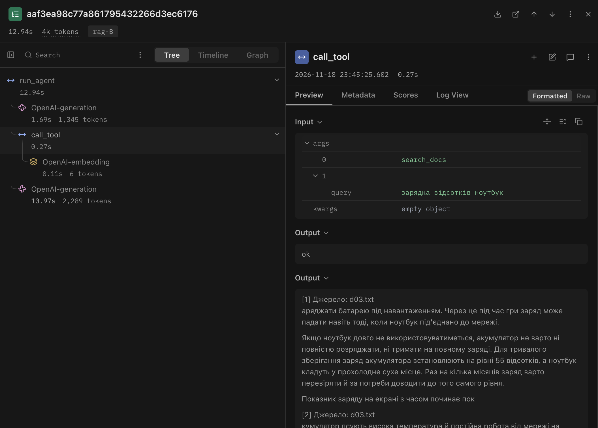
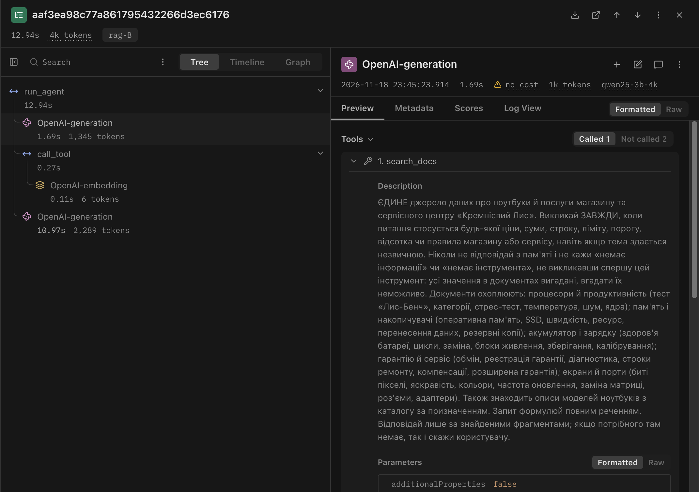
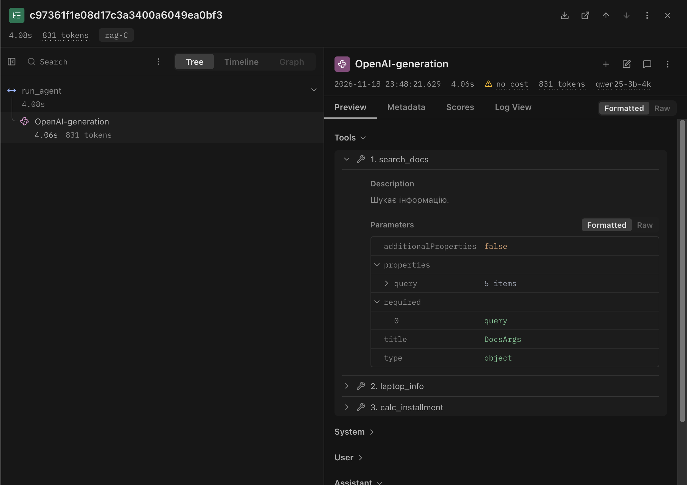

<div align="center">

Міністерство освіти і науки України
Національний університет «Одеська політехніка»

<br><br>

# Лабораторна робота № 5
## RAG-агент: пошук по документах як інструмент

з дисципліни «Обчислювальні методи»

Варіант 9

<br><br>

</div>

<div align="right">

Виконала: студентка групи АІ-241
Давидович К. Д.

Перевірив: Баранов О. М.

</div>

<div align="center">

<br>
Одеса – 2026

</div>

---

## 1. Мета роботи, варіант, моделі

**Мета:** замінити пошук підрядком з лабораторної роботи № 2 векторним, під'єднати його до агента як звичайний інструмент, перевірити якість пошуку окремо від агента, побачити, як розмір чанка та опис інструмента впливають на поведінку агента, і виміряти це кількома повторами.

**Варіант:** 9. **Предметна область:** вибір ноутбука.

| Параметр | Значення |
|---|---|
| Модель чату | `qwen25-3b-4k` (копія `qwen2.5:3b` з лабораторної № 4) |
| Розмір вікна | 4096 токенів |
| Модель ембедингів | `bge-m3` (Ollama) |
| Температура | 0 |
| Скорочення історії, стан, кеш викликів | вимкнено (`COMPRESS = "none"`, `USE_STATE = False`, `USE_CACHE = False`) |
| Інструменти агента | `search_docs` (новий, замість `search_laptops`), `laptop_info`, `calc_installment` |

## 2. Дані

### 2.1. Документи

До старого корпусу (12 анотацій моделей ноутбуків, `data/corpus/`) додано п'ять довгих документів (`data/docs/`). Організація вигадана: магазин і сервісний центр ноутбуків «Кремнієвий Лис». Усі значення вигадані, записані цифрами й не повторюються між документами.

| Файл | Тема | Символів | Абзаців |
|---|---|---|---|
| `d01.txt` | Процесори й продуктивність | 3092 | 9 |
| `d02.txt` | Пам'ять і накопичувачі | 3160 | 9 |
| `d03.txt` | Акумулятор і зарядка | 3106 | 9 |
| `d04.txt` | Гарантія й сервіс | 3004 | 9 |
| `d05.txt` | Екрани й порти | 3026 | 9 |

Разом з корпусом: **17 документів, 17171 символ, приблизно 6868 токенів** – більше за вікно 4096, тож усі документи в контекст не вмістяться і пошук потрібен (`check_cases.py`: «Усе гаразд»).

### 2.2. Питання (`rag_cases.json`)

| id | Вид | Питання | `must_contain` | `expected` |
|---|---|---|---|---|
| D1 | direct | Скільки коштує платна заміна акумулятора? | заміна акумулятора коштує 2380 грн | 2380 |
| D2 | direct | Скільки грошей отримує клієнт за кожен день прострочки гарантійного ремонту? | 85 грн за кожен день | 85 |
| D3 | direct | Скільки балів у тесті «Лис-Бенч» має набрати ноутбук для категорії «Навчання»? | набирає щонайменше 4370 балів | 4370 |
| D4 | direct | Скільки коштує заміна матриці екрана? | Заміна матриці коштує 5290 грн | 5290 |
| P1 | paraphrase | Скільки часу є в покупця, щоб передумати й поміняти придбаний ноутбук на інший? | протягом 18 днів з дня покупки | 18 |
| P2 | paraphrase | Скільки відсотків заряду лишити в батареї, якщо ноутбук кілька місяців пролежить у шафі? | на рівні 55 відсотків | 55 |
| P3 | paraphrase | Яка максимальна гучність кулерів допускається, коли їх вимірюють у тесті? | не перевищує 38 децибел | 38 |
| P4 | paraphrase | Скільки треба заплатити, щоб усі мої файли переписали зі старого диска на новий? | даних на новий SSD коштує 1150 грн | 1150 |
| N1 | none | Скільки коштує чохол для ноутбука в «Кремнієвому Лисі»? | – | – |
| N2 | none | Яку знижку дають студентам при купівлі ноутбука? | – | – |

Слів «чохол», «студент», «знижка» і «кулер» у документах немає (перевірено пошуком по текстах).

### 2.3. Чи вгадує модель без документів

`ollama run qwen25-3b-4k`, питання без документів:

| Питання | Правильно | Відповідь моделі |
|---|---|---|
| Скільки коштує платна заміна акумулятора в сервісному центрі «Кремнієвий Лис»? | 2380 | «Вибачте, але я не маю доступу до конкретної ціни…» |
| Скільки балів у тесті «Лис-Бенч» має набрати ноутбук для категорії «Навчання»? | 4370 | «Вибачте, але я не маю доступу до конкретного оцінки чи балів…» |
| До якого рівня заряду в «Кремнієвому Лисі» радять заряджати батарею перед тривалим зберіганням ноутбука? | 55 | «…до 20-40% заряду» |

Жодне значення модель не вгадала, тож міняти документи не довелося.

## 3. Модель ембедингів (`embed_check.py`)

Фрази адаптовано до варіанта: запит «Скільки годин ноутбук пропрацює без розетки?», близька фраза «Час автономної роботи від акумулятора», далека фраза «Кількість портів USB на корпусі».

| Показник | Значення |
|---|---|
| Довжина вектора | 1024 |
| Норма першого вектора | 1.000 (вектори вже нормалізовані) |
| Схожість запит – «Час автономної роботи» | 0.669 |
| Схожість запит – «Кількість портів USB» | 0.451 |

Запит ближчий до фрази за змістом, хоча спільних слів у них немає («розетки» проти «акумулятора»).

## 4. Нарізання одного документа (`show_chunks.py`, `data/docs/d01.txt`)

Таблиця 1 – Нарізання одного документа

| Спосіб | Чанків | Закінчуються посеред речення | Довжина найбільшого, символів |
|---|---:|---:|---:|
| `fixed`, 200, перекриття 0 | 16 | 15 | 200 |
| `fixed`, 500, перекриття 100 | 8 | 7 | 500 |
| `paragraphs`, 800 | 5 | 0 | 734 |

**Приклад розрізаного факту** (`fixed`, 200): чанк 3 закінчується словами «…набирає щонайменше 4370 балів. Для категорії «Програмування»», а чанк 4 починається з «поріг значно вищий: модель має показати не менше 7815 балів…». Число 7815 опинилося в чанку, де немає назви категорії, до якої воно належить. Якщо пошук поверне лише чанк 4, агент побачить «7815 балів» без «Програмування» і може приписати його «Навчанню».

## 5. Пошук без агента

### 5.1. Нарізання і hit rate (`check_retrieval.py`)

Таблиця 2 – Пошук при різному нарізанні

| Конфігурація | Чанків | Сер. довжина | hit@1 | hit@3 | hit@5 | hit@3 прямі | hit@3 перефр. | Токенів (k=3) |
|---|---:|---:|---:|---:|---:|---:|---:|---:|
| `fixed-200-0` | 92 | 187 | 0.88 | 0.88 | 0.88 | 1.00 | 0.75 | 224 |
| `fixed-500-0` | 47 | 365 | 0.88 | 0.88 | 0.88 | 1.00 | 0.75 | 438 |
| `fixed-500-100` | 52 | 398 | 0.88 | **1.00** | 1.00 | 1.00 | 1.00 | **477** |
| `fixed-1500-0` | 27 | 636 | 1.00 | 1.00 | 1.00 | 1.00 | 1.00 | 763 |
| `paragraphs-800` | 37 | 463 | 1.00 | 1.00 | 1.00 | 1.00 | 1.00 | 556 |
| `paragraphs-800+title` | 37 | 474 | 1.00 | 1.00 | 1.00 | 1.00 | 1.00 | 569 |

**Вибір: `fixed-500-100`.** `hit@3` = 1.00 дали чотири конфігурації. За правилом «за рівності – менший розмір результату» обрано ту, що дає 477 токенів на три чанки (проти 556 у `paragraphs-800` і 763 у `fixed-1500-0`).

**Чому `fixed-200-0` і `fixed-500-0` не досягли 1.00.** В обох випадках потрібна фраза розрізана межею чанка, тож жоден чанк її не містить і влучити неможливо в принципі: у `fixed-200-0` розрізано фразу P4 «даних на новий SSD коштує 1150 грн», у `fixed-500-0` – фразу P1 «протягом 18 днів з дня покупки». Перекриття 100 символів у `fixed-500-100` гарантує, що короткий факт цілком потрапить хоча б в один із сусідніх чанків, і `hit@3` стає повним. Абзаци й великі чанки (1500) теж не розрізають фактів, але дорожчі.

### 5.2. Поріг схожості (`check_retrieval.py scores`, `fixed-500-100`)

Таблиця 3 – Схожість першого результату

| id | Вид | Схожість | Перший результат містить потрібну фразу |
|---|---|---:|---|
| D1 | direct | 0.773 | так |
| D2 | direct | 0.720 | так |
| D3 | direct | 0.770 | так |
| D4 | direct | 0.799 | так |
| P1 | paraphrase | 0.766 | так |
| P2 | paraphrase | 0.693 | так |
| P3 | paraphrase | 0.555 | так |
| P4 | paraphrase | 0.658 | ні (потрібний чанк другий, `hit@3` = 1) |
| N1 | none | 0.652 | – |
| N2 | none | 0.597 | – |

Найнижча схожість серед питань з відповіддю – 0.555 (P3), найвища серед питань без відповіді – 0.652 (N1). **Межі перекриваються**, жоден поріг не розділяє питання ідеально.

**Вибрано `MIN_SCORE = 0.60`** – компроміс. Порівняння варіантів:

| `MIN_SCORE` | Питань з відповіддю проходить поріг | Питань без відповіді відсікається |
|---|---|---|
| 0.55 | 8 з 8 | 0 з 2 |
| **0.60** | **7 з 8** (відсікається P3) | **1 з 2** (N2) |
| 0.66 | 6 з 8 (відсікаються P3 і P4) | 2 з 2 |

Поріг 0.55 нічого не відсікає, тобто захисту немає зовсім; 0.66 втрачає чверть питань з відповіддю. 0.60 жертвує одним перефразованим питанням, щоб на питання N2 агент отримав «нічого не знайдено» замість трьох нерелевантних чанків. Для магазину, що відповідає про гроші й строки, важливіше не вигадати значення, ніж іноді не знайти відповідь, тому обрано суворіший із двох розумних порогів.

Остаточний індекс (`python build_index.py`): **52 чанки, середня довжина 398 символів, найкоротший 136, найдовший 500; модель `bge-m3`, довжина вектора 1024.**

## 6. Інструмент `search_docs` без моделі (`try_tool.py`)

**`python try_tool.py D1`** – рівень `ok`, перший фрагмент з `d03.txt` містить потрібну фразу:

```
рівень: ok
[1] Джерело: d03.txt
у акумулятор замінюється безкоштовно, якщо його ємність упала нижче 67 відсотків від початкової. …
Платна заміна акумулятора коштує 2380 грн разом із роботою, а сама заміна виконується за 2 години, …
[2] Джерело: d05.txt
… Заміна матриці коштує 5290 грн разом із роботою …

Занадто короткий запит -> рівень: schema
Помилка: аргументи не пройшли перевірку.
Поле query: String should have at least 3 characters
Виправ аргументи і виклич інструмент ще раз.
```

**`python try_tool.py N1`** (чохол) – схожість 0.652 вища за поріг, тож пошук повертає нерелевантні фрагменти з `d04.txt` (платна діагностика 420 грн, розширена гарантія). Поріг тут не допомагає, і вся надія на те, що модель сама помітить, що про чохли у фрагментах нічого немає.

**`python try_tool.py N2`** (знижка студентам) – схожість 0.597 нижча за поріг:

```
рівень: ok
У документах нічого схожого не знайдено.
```

`checks.py` не змінювався: для `search_docs` правил змісту немає, і `check_meaning` повертає `None`. Короткий запит відхиляється схемою (`min_length=3` у класі `DocsArgs`).

## 7. Агент з трьома описами інструмента

Описи `search_docs` (`schemas.RAG_DESCRIPTIONS`):

- **A** – дослівно опис старого `search_laptops`: «Шукає ноутбуки в каталозі магазину за призначенням або характеристикою. Повертає повні описи знайдених моделей… Використовуй, коли користувач описує, для чого йому потрібен ноутбук, але не називає модель.»
- **B** – докладний: «ЄДИНЕ джерело даних про ноутбуки й послуги магазину та сервісного центру «Кремнієвий Лис». Викликай ЗАВЖДИ… Ніколи не відповідай з пам'яті… усі значення в документах вигадані, вгадати їх неможливо. Документи охоплюють: процесори й продуктивність…; пам'ять і накопичувачі…; акумулятор і зарядку…; гарантію й сервіс…; екрани й порти… Запит формулюй повним реченням. Відповідай лише за знайденими фрагментами; якщо потрібного там немає, так і скажи користувачу.»
- **C** – «Шукає інформацію.»

`python measure_rag.py`: три описи × три повтори × десять питань = 90 прогонів агента.

**Ручна перевірка.** Автоматична оцінка в одному місці помилилася: на N2 з описом B агент у всіх трьох повторах відповів «На жаль, документи не містять даних про знижки для студентів…», але скрипт шукає «не містить», а не «не містять», і зарахував це як «вигадав». Три рядки `B / N2` у `results/rag.csv` виправлено на `correct = 1`, `category = refused`. Решту відповідей з `correct = 0` переглянуто – помилкових оцінок серед них немає (числа ніде не записано словами).

Таблиця 5 – Агент з трьома описами інструмента (питань з відповіддю 8, у трьох повторах 24 прогони)

| Опис | Правильно (з 24) | Викликав пошук (з 24) | Кроків, медіана | Токенів входу, медіана | Час, с, медіана |
|---|---:|---:|---:|---:|---:|
| `A` | 0 | 0 | 1 | 832 | 5.8 |
| `B` | 6 | 9 | 2 | 2675 | 6.1 |
| `C` | 0 | 0 | 1 | 735 | 5.0 |

Таблиця 6 – Куди ламається відповідь (кількість прогонів; з відповіддю 24 на опис, без відповіді 6)

| Категорія | `A` | `B` | `C` |
|---|---:|---:|---:|
| Правильно | 0 | 6 | 0 |
| Не шукав і відповів неправильно | 24 | 15 | 24 |
| Шукав, але потрібного фрагмента в результаті немає | 0 | 3 | 0 |
| Фрагмент був у результаті, відповідь неправильна | 0 | 0 | 0 |
| Питання без відповіді: визнав, що не знає | 0 | 3 | 3 |
| Питання без відповіді: вигадав відповідь | 6 | 3 | 3 |

Усі три повтори кожного опису дали однакові відповіді (при `TEMPERATURE = 0` однакова історія дає однакову відповідь), тож фактично це по одному спостереженню на питання, помножене на три.

## 8. Розбір у логах і трасах

**1. Агент не шукав.** З описами A і C модель не викликала `search_docs` жодного разу. `logs/rag_C-r1.log`, P2:

```
ЗАДАЧА: Скільки відсотків заряду лишити в батареї, якщо ноутбук кілька місяців пролежить у шафі?
--- крок 1 | помилок поспіль=0 | prompt_tokens=754 | completion_tokens=77
ВІДПОВІДЬ: Для ць задачі необхідно знати модель ноутбука, щоб знати, скільки відсотків заряду відстовляє батарея. Підкажіть, будь ласка, модель вашого ноутбука?
```

Число модель не вигадала, але й не знайшла: вона вирішила, що питання про конкретну модель, і перепитала. В A подібно (D1: «Я не знайшов ціни заміни акумулятора в довіднику магазину»), хоча нічого не шукала. Із B модель теж часто не шукала, а йшла в інший інструмент і вигадувала аргументи: `rag_B-r1.log`, P1 – `laptop_info({"model":"TestBook 15"})`, D2 – `calc_installment({"price":10000,"months":30,...})`, P4 – `calc_installment({"price":8000,"months":2,...})`. Перевірки з лабораторної № 3 (рівні `meaning` і `schema`) зловили всі три виклики, але модель після цього не пішла в пошук, а просто переказала користувачу текст помилки. D4 з B – єдиний випадок вигаданого числа: «Заміна матриці екрана коштує 24000 грн» (це ціна StudyBook 14 з прикладу в описі `laptop_info`).

**2. Який запит написала модель.** Модель не копіює питання, а стискає його до ключових слів, хоча опис B просить «повне речення»:

| Питання | `query` | `top_score` |
|---|---|---:|
| D3 «Скільки балів у тесті «Лис-Бенч» має набрати ноутбук для категорії «Навчання»?» | «процесори Й продуктивність (тест Лис-Бенч, категорії Навчання)» | 0.663 |
| P2 «Скільки відсотків заряду лишити в батареї, якщо ноутбук кілька місяців пролежить у шафі?» | «зарядка відсотків ноутбук» | 0.652 |
| P3 «Яка максимальна гучність кулерів допускається, коли їх вимірюють у тесті?» | «кулер гучність тест» | 0.498 |
| N2 «Яку знижку дають студентам при купівлі ноутбука?» | «знижки студентам ноутбуки» | 0.568 |

Схожість з короткими запитами помітно нижча, ніж для повних питань у табл. 3: D3 0.663 проти 0.770, P2 0.652 проти 0.693, P3 0.498 проти 0.555. У D3 модель скопіювала в запит шматок опису B («процесори й продуктивність (тест «Лис-Бенч», категорії…»).

**3. Шукав, але не знайшов** (`miss`, P3, усі три повтори B):

```
виклик   : search_docs({"query":"кулер гучність тест"})
рівень   : ok
результат: У документах нічого схожого не знайдено.
ВІДПОВІДЬ: Здати не знайшли даних про максимальну гучність кулера, вимірювану в тесті. …
```

Потрібного чанка немає через поєднання двох причин: запит з трьох слів без контексту (у документі «рівень шуму вентиляторів», а не «гучність кулерів») дав схожість 0.498, і поріг 0.60 відкинув усі три результати. Це та сама ціна компромісу, яку видно в табл. 3 (P3 – 0.555 навіть для повного питання). Агент повівся чесно: визнав, що не знайшов.

**4. Знайшов, але не використав** (`ignored`) – таких прогонів немає: щоразу, коли потрібний фрагмент був у результаті (D3 і P2 з B), відповідь була правильною.

**5. Питання без відповіді.**
- N2 з B: модель шукала («знижки студентам ноутбуки», 0.568), **поріг спрацював**, і агент відповів «документи не містять даних про знижки для студентів» – правильно в усіх трьох повторах.
- N1 з B: модель не шукала й відповіла англійською про ціну *екрана* («I need to find the price of a laptop screen… provide me with the model»). Числа не вигадала, але й не визнала, що інформації немає.
- N1 з C: «Я не знайшов ціни чохола…», без пошуку. Збіг із правильною поведінкою випадковий: модель нічого не шукала.
- A і N2 з C: вигаданих чисел немає, але модель переводить розмову на «вкажіть модель ноутбука» замість чесного «не знаю».

**Траси Langfuse** (питання P2 в описах B і C):







- **B:** дерево `OpenAI-generation → call_tool → OpenAI-embedding → OpenAI-generation`. Вхід `call_tool`: `search_docs`, `{"query": "зарядка відсотків ноутбук"}`; вихід: `ok` і три чанки з `d03.txt`, у першому – «на рівні 55 відсотків». Відповідь правильна.
- **C:** у дереві лише одна `OpenAI-generation` і жодного `call_tool`: модель відповіла одразу.
- **Різниця в описі.** У вході першої генерації (Tools → `search_docs` → Description) в C стоїть одне речення «Шукає інформацію.», у B – абзац з темами всіх п'яти документів і прямою забороною відповідати з пам'яті. Через довгий опис вхід першого виклику в B більший: 1291 токен проти 722–754 в C.

У трасі одразу видно структуру прогону: чи був `call_tool` узагалі, з яким запитом, що саме повернув пошук і скільки часу та токенів пішло на кожен крок. Видно навіть вкладений виклик ембедингу (`OpenAI-embedding`, 6 токенів, 0.11 с). У текстовому лозі все це треба вишукувати по рядках `виклик` / `результат` і рахувати самому, а опис інструмента, який отримала модель, у лог не пишеться зовсім.

## 9. Звичайні задачі до і після заміни пошуку

`logs/run_lab4.log` – агент лабораторної № 4 (пошук `search_laptops` підрядком) на тій самій моделі з вікном 4096. Лог з лабораторної № 4 містив лише тестовий запуск `agent.py`, тому п'ять задач прогнано скриптом `run_lab4_baseline.py`: він запускає `agent_runner.py` зі старим набором інструментів. `logs/run_rag.log` – агент з `search_docs`, опис B.

Таблиця 7 – П'ять задач до і після заміни пошуку

| Задача | Відповідь у лабораторній № 4 | Відповідь тепер | Чи викликав `search_docs` | Що змінилося |
|---|---|---|---|---|
| Z1 «Потрібен ноутбук для навчання» | текст помилки «ціни 4500 грн немає в довіднику» (після `search_laptops("навчання")` і вигаданої ціни) | порожня відповідь | ні | стало гірше: модель згенерувала 25 токенів, але агент не отримав ні тексту, ні розпізнаного виклику |
| Z2 «…чи є на складі й скільки коштує» | StudyBook 14, ціна **15000 грн** (вигадана) | порожня відповідь | ні | обидві неправильні, тепер порожня |
| Z3 «…скільки платити на місяць (6 міс., 10%)» | 4400 грн на місяць (5 кроків, з однією помилкою `meaning`) | 4400 грн на місяць (3 кроки) | ні | стало краще: модель одразу викликала `laptop_info("StudyBook 14")` – назву вона взяла з прикладу в описі `laptop_info`, а не з пошуку; модель у відповіді не названо |
| P1 «…монтаж відео 8К» | рекомендував StudyBook 14 (неправильно) | порожня відповідь | ні | порожня замість хибної рекомендації |
| P2 «Зарезервуй мені цей ноутбук» | попросив назву моделі (не відмовив) | описав StudyBook 14 за `laptop_info` (не відмовив) | ні | обидва раз не відмовили |

Жодна з п'яти задач не викликала `search_docs`. Головна причина погіршення – порожні відповіді в Z1, Z2, P1. Модель видає щось на 25 токенів (схоже на виклик інструмента, судячи з довжини), але сервер не розпізнає його як виклик, а `check_response` перевіряє лише непорожній текст з `<tool_call>` або `{` і пропускає порожню відповідь як фінальну. Ймовірна причина: новий опис B і довший набір схем (вхід першого кроку 1274 проти 845) збивають 3-мільярдну модель з формату виклику. Звичайні задачі (вибір моделі за призначенням) для нового пошуку складніші за старий: раніше `search_laptops("навчання")` прямо повертав анотацію StudyBook 14, а тепер ту саму анотацію треба знайти серед 52 чанків довгих документів.

## 10. Відповіді на питання

1. **Нарізання за символами проти абзаців (табл. 1).** На документі `d01.txt` `fixed-200` дав 16 чанків, з них 15 обірвано посеред речення, `fixed-500-100` – 8 і 7, а `paragraphs-800` – 5 чанків і жодного обірваного. Приклад: у `fixed-200` «не менше 7815 балів» потрапило в чанк, де немає слова «Програмування» (воно в кінці попереднього чанка), тож агент, отримавши лише другий чанк, може приписати 7815 балів не тій категорії.
2. **Найкраща конфігурація (табл. 2).** `hit@3` = 1.00 у `fixed-500-100`, `fixed-1500-0`, обох `paragraphs-800`; обрано `fixed-500-100` як найдешевшу з них (477 токенів на k = 3). Збільшення чанка з 200 до 1500 підняло `hit@1` з 0.88 до 1.00, бо факт рідше розрізається й більше контексту для ембедингу, але результат пошуку подорожчав у 3,4 раза (224 → 763 токени). Перекриття виправило розрізані факти (P1, P4: 0.88 → 1.00), а назва документа в чанку на цих даних нічого не змінила (усі значення вже 1.00), лише додала 13 токенів.
3. **Прямі й перефразовані питання.** У найкращих конфігураціях `hit@3` однаковий (1.00), а там, де він нижчий, причина – розрізана фраза, а не перефразування. Перефразування помітне на схожості (табл. 3): прямі 0.72–0.80, перефразовані 0.56–0.77. Пошук підрядком на P3 («кулерів», «гучність») чи P4 («файли», «диска») не знайшов би нічого, бо в документі «шуму вентиляторів» і «перенесення даних на новий SSD», а векторний знаходить за змістом.
4. **Поріг (табл. 3).** Не розділяє ідеально: найнижча схожість з відповіддю 0.555 нижча за найвищу без відповіді 0.652. Надто високий поріг (0.66) відсікає правильні відповіді – агент на P3, P4 отримає «нічого не знайдено»; надто низький (0.55) нічого не відсікає, і на питання без відповіді агент отримує нерелевантні чанки й може «знайти» в них відповідь. Обраний 0.60 у прогонах спрацював двічі: правильно на N2 і, на жаль, на P3 (табл. 6, `miss`).
5. **Описи (табл. 5, 6).** Найбільше правильних дав B – 6 з 24; A і C – 0. З A і C агент не звернувся до пошуку жодного разу (0 з 24), з B – у 9 з 24 прогонів. Опис A говорить про пошук моделі за призначенням, тож для питань про ціни сервісу модель вважала інструмент недоречним; C не дає жодної причини його викликати. У B вирішальними були пряма вимога «Викликай ЗАВЖДИ, коли питання стосується будь-якої ціни, суми, строку…» і перелік тем: на D3 і P2 модель навіть скопіювала слова з цього переліку в запит.
6. **Найчастіша помилка в B** – «не шукав» (15 з 24). Частково це лікується описом (від A і C до B вона впала з 24 до 15), але решту опис не виправляє: модель обирає `laptop_info` чи `calc_installment` з вигаданими аргументами. Тут потрібна інша модель або зміни в системі (наприклад, обов'язковий пошук перед першою відповіддю). Розрізнення важливе, бо «не шукав», «не знайшов» і «не використав» лікуються в різних місцях: описом, пошуком (нарізання, поріг, запит) і моделлю відповідно, і змінювати нарізання, коли агент просто не шукає, марно.
7. **Питання без відповіді.** Вигаданих чисел у відповідях на N1 і N2 немає в жодному описі. Категорія «вигадав» (6 в A, 3 в B, 3 в C) тут означає «не визнав, що не знає»: модель перепитує про модель ноутбука або говорить про інше. Із двох захистів спрацював **поріг**: на N2 з B пошук повернув «нічого не знайдено», і модель чесно відповіла, що даних немає (3 з 3). Текст опису B («якщо потрібного там немає, так і скажи») спрацював лише разом з порогом; без пошуку (N1) він не допоміг.
8. **Скільки токенів додає `search_docs`.** За логом B: P2 – вхід кроку 1 1311, кроку 2 2105, тобто +794 токени за три чанки; D3 – +554 за два чанки (третій відсік поріг); «нічого не знайдено» (P3, N2) – близько +60. Оцінка з табл. 2 – 477 токенів, реальне значення в 1,7 раза більше: українська мова дає менше за 2,5 символа на токен, плюс до кожного чанка дописано «[n] Джерело: …». За формулою з лекції 7: постійна частина з описом B ≈ 1290 токенів, один пошук ≈ 800, тож у вікно 4096 вміщуються (4096 − 1290) / 800 ≈ **3 виклики пошуку**, четвертий уже не влізе.
9. **Звичайні задачі (табл. 7).** Так, зламав: Z1, Z2 і P1 тепер повертають порожню відповідь, і `search_docs` не викликано в жодній з п'яти задач. Покращилася лише Z3 (3 кроки замість 5), і то завдяки прикладу «StudyBook 14» в описі `laptop_info`, а не пошуку. Причина – не нарізання (пошук жодного разу не викликався), а реакція малої моделі на довший опис і нову схему інструмента.
10. **Що не вилікує жоден опис.** Вибір не того інструмента з вигаданими аргументами (`laptop_info("TestBook 15")`, `calc_installment(price=8000)`) і порожні відповіді: це обмеження 3-мільярдної моделі, яка погано тримає формат виклику. Я б змінила систему: (а) у `check_response` вважати порожню відповідь помилкою формату і повертати моделі пояснення; (б) для питань, де інструмент не викликано, примусово робити `search_docs` за текстом питання і додавати результат у контекст (RAG як обов'язковий крок, а не вибір моделі); (в) повторити вимірювання на більшій моделі.

## 11. Додаткове завдання: той самий індекс на Chroma

`python chroma_test.py` (питання D1, ті самі чанки й вектори):

| Індекс | Що повертає | Значення |
|---|---|---:|
| FAISS (`IndexFlatIP`) | схожість | 0.7734 |
| Chroma, `space = "cosine"` | косинусна відстань | 0.2266 |
| Chroma за замовчуванням | квадрат евклідової відстані | 0.4533 |

1. **Зв'язок чисел.** Косинусна відстань = 1 − схожість: 1 − 0.7734 = 0.2266. Для нормалізованих векторів квадрат евклідової відстані = 2 − 2 · схожість: 2 − 2 · 0.7734 = 0.4532 (у виводі 0.4533 – округлення). Тобто три числа описують одну й ту саму близькість у різних шкалах.
2. **Чи збігаються чанки.** Скрипт друкує лише числа, а не тексти, але всі три значення точно перераховуються одне в одне через ту саму схожість 0.7734, тож найближчим в усіх трьох індексах є той самий чанк (саме той, що FAISS знайшов для D1 – з «заміна акумулятора коштує 2380 грн»).
3. **Що сталося б з порогом.** У Chroma менше – ближче, а в `search_docs` перевірка `score >= MIN_SCORE`. Якби підставити туди відстань з Chroma за замовчуванням, найрелевантніший чанк D1 (0.4533 < 0.60) було б відкинуто, а далекі нерелевантні чанки з відстанню понад 0.60 (схожість нижче 0.70) пройшли б. Поріг працював би навпаки, і помилки не було б жодної: пошук просто мовчки повертав би гірші результати.

## 12. Висновок

Найбільше на якість відповідей вплинув **опис інструмента**: з описами A і C агент жодного разу не звернувся до пошуку й не дав жодної правильної відповіді, а з докладним описом B шукав у 9 з 24 прогонів і відповів правильно в 6. Сам **пошук** працює добре: після вибору нарізання з перекриттям (`fixed-500-100`) потрібний фрагмент потрапляє в top-3 для всіх восьми питань, а векторний пошук знаходить перефразовані питання, на яких пошук підрядком мовчав би. **Поріг** дав змішаний результат: правильно захистив від N2, але через короткий запит моделі відсік відповідь на P3.

Отже, у пошуку лежить мала частина помилок (3 `miss` з 24 в описі B, усі через поріг), а більшість – в агенті: 15 з 24 «не шукав», вибір не того інструмента й порожні відповіді. Що варто змінити: зробити пошук обов'язковим кроком, а не рішенням моделі; ловити порожні відповіді в `check_response`; переписувати запит моделі в повне речення перед пошуком або шукати і за текстом питання; і повторити вимірювання на більшій моделі, яка краще тримає формат виклику.
