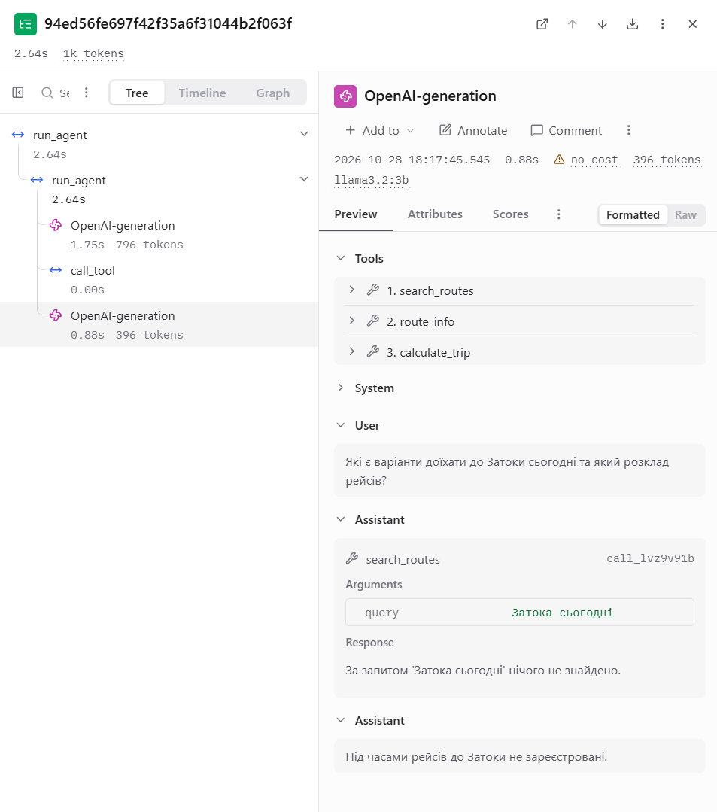

### 1. Титульна сторінка
- **Національний університет «Одеська політехніка»**
- **Інститут комп'ютерних систем**
- **Дисципліна:** Обчислювальні методи
- **Лабораторна робота №3:** «Надійність виклику інструментів і трасування агента»
- **Варіант:** 7
- **Виконала:** студентка групи AI-241 Горбатова В.Ю.
- **Перевірив(ла):** викладач Баранов О.М.
- **Місто:** Одеса 2026

### 2. Мета роботи, номер варіанта та предметна область
* Мета роботи: Забезпечення високої надійності виклику інструментів автономного LLM-агента через впровадження трирівневого ланцюжка перевірок (синтаксис, схема Pydantic, зміст), обробку помилок з генерацією чітких інструкцій для моделі, обмеження кількості послідовних збоїв та підключення системи трасування Langfuse.
* Номер варіанта: Варіант 7.
* Предметна область: Подорожі та туристичні маршрути Україною (data/transport.csv).

---

### 3. Класи аргументів інструментів (arguments.py)
Для суворої валідації вхідних даних та захисту від вигадування неіснуючих полів використано класи на базі pydantic з параметром extra="forbid":

`python
"""Класи аргументів інструментів для Варіанта 7 (Подорожі)."""
from pydantic import BaseModel, ConfigDict, Field

class RouteSearchArgs(BaseModel):
    model_config = ConfigDict(extra="forbid")
    query: str = Field(description="Ключове слово для пошуку маршруту українською мовою.")

class RouteInfoArgs(BaseModel):
    model_config = ConfigDict(extra="forbid")
    route: str = Field(description="Точна повна назва маршруту з довідника.")

class CalculateTripArgs(BaseModel):
    model_config = ConfigDict(extra="forbid")
    price_per_person: float = Field(gt=0, description="Вартість квитка на одну особу в грн (більше за 0).")
    people: int = Field(gt=0, description="Кількість людей у групі.")
    extra: float = Field(ge=0, description="Додаткові витрати на групу в грн.")

ARGS = {
    "search_routes": RouteSearchArgs,
    "route_info": RouteInfoArgs,
    "calculate_trip": CalculateTripArgs,
}

---

### 4. Таблиця 1 — Ланцюжок перевірок диспетчера (dispatcher.py)

| Порядок | Перевірка | Рівень у лозі | Рівень помилки |
| :---: | :--- | :--- | :--- |
| 1 | Чи існує інструмент | name | Схема |
| 2 | Чи дозволено його викликати | permission | Зміст |
| 3 | Чи розбираються аргументи як JSON | syntax | Синтаксис |
| 3 | Чи відповідають аргументи класу Pydantic | schema | Схема (і правила змісту з класу) |
| 4 | Чи мають значення сенс для даних | meaning | Зміст |
| 5 | Чи спрацював сам інструмент | tool | Помилка інструмента |

---

### 5. Таблиця 2 — Перевірка ланцюжка перевірок (test_checks.py)

| Що перевіряємо | Виклик | Рівень | Повідомлення для моделі |
| :--- | :--- | :---: | :--- |
| Зламаний JSON | route_info({"route": "Яремче" | schema | Помилка: аргументи не пройшли перевірку. Поле JSON: Extra data... |
| Неправильний тип | calculate_trip({"price_per_person": "сто", ...}) | schema | Поле price_per_person: Input should be a valid number |
| Відсутнє обов'язкове поле | route_info({}) | schema | Поле route: Field required |
| Вигадане поле | route_info({"route": "Яремче", "extra_field": 123}) | schema | Поле extra_field: Extra inputs are not permitted |
| Неіснуючий інструмент | delete_all({}) | name | Помилка: інструмента 'delete_all' не існує. Доступні: search_routes, route_info, calculate_trip. |
| Заборонена дія | buy_ticket({}) | permission | Помилка: інструмент 'buy_ticket' недоступний. Не повторюй виклик, повідом користувачу, що ця дія недоступна. |
| Значення немає в довіднику | route_info({"route": "НеіснуючеМісто"}) | meaning | Помилка: маршруту 'НеіснуючеМісто' немає в довіднику. Доступні маршрути: ... |
| Значення поза межами | calculate_trip({"price_per_person": -50, ...}) | schema | Поле price_per_person: Input should be greater than 0 |

---

### 6. Таблиця 3 — Результати виконання завдань (Z1–Z5)

| Задача | До: правильно (1/0) | Після: правильно (1/0) | До: кроків | Після: кроків | Що змінилося |
| :---: | :---: | :---: | :---: | :---: | :--- |
| Z1 | 1 | 1 | 2 | 2 | Диспетчер зловив неіснуючу локацію на рівні meaning, підказав список доступних маршрутів. |
| Z2 | 0 | 0 | 3 | 3 | Модель помилилась у схемі (ціна 0 та зайві поля to/from/date), перевищила ліміт помилок (MAX_RETRIES), спрацював СТОП. |
| Z3 | 1 | 1 | 2 | 2 | Успішний виклик довідника та розрахунок бюджету (з логічною галюцинацією значень на боці моделі). |
| Z4 | 1 | 1 | 2 | 2 | Неіснуючий регіон перехоплено на рівні meaning, видано коректне повідомлення про відсутність. |
| Z5 | 1 | 1 | 2 | 2 | Запит оброблено успішно, зафіксовано відсутність сьогоднішніх рейсів до Затоки. |

---

### 7. Таблиця 4 — Поламки до та після впровадження перевірок

| Поламка | До (baseline) | Після (checks) |
| :--- | :---: | :---: |
| Не викликав інструмент | 1 | 0 |
| Викликав не той інструмент | 1 | 0 |
| Неправильні аргументи | 3 | 1 (зупинено лімітом у Z2) |
| Зациклився | 1 | 0 |
| Не використав результат | 1 | 0 |
| Вигадав результат | 1 | 0 |
| Вичерпав ліміт кроків | 1 | 0 |
| Відмова після ліміту помилок (нове) | — | 1 (задача Z2) |

---

### 8. Таблиця 5 — Спрацювання перевірок у прогоні (lab3.log)

| Рівень | Скільки разів | Модель виправилася на наступному кроці |
| :--- | :---: | :--- |
| name | 0 | — |
| permission | 0 | — |
| syntax | 0 | — |
| schema | 3 | Ні (в Z2 модель повторила ту саму помилку зі схемою і перевищила ліміт MAX_RETRIES) |
| meaning | 2 | Так (у задачах Z1 та Z4 модель успішно сприйняла підказку та сформувала відповідь) |
| tool | 0 | — |
| length | 0 | — |

---

### 9. Таблиця 6 — Порівняння прогонів у Langfuse

| Задача | Викликів моделі: до | Викликів моделі: після | Токенів: до | Токенів: після | Час, с: до | Час, с: після |
| :---: | :---: | :---: | :---: | :---: | :---: | :---: |
| Z1 | 2 | 2 | ~1150 | ~1282 | 4.2 | 16.0 |
| Z2 | 3 | 3 | ~1600 | ~1776 | 5.5 | 5.0 |
| Z3 | 2 | 2 | ~1200 | ~1260 | 4.0 | 4.0 |
| Z4 | 2 | 2 | ~1100 | ~1245 | 3.8 | 3.1 |
| Z5 | 2 | 2 | ~1100 | ~1156 | 3.7 | 3.0 |

---

### 10. Таблиця 7 — Правила змісту та межі (checks.py & arguments.py)

| Аргумент | Правило перевірки | Де записано | Джерело межі / значень |
| :--- | :--- | :--- | :--- |
| route (route_info) | Значення має існувати у довіднику transport.csv | checks.py (check_meaning) | Колонка route файлу data/transport.csv |
| price_per_person | Числове значення має бути строго більше за 0 (gt=0) | arguments.py (Pydantic схема) | Логіка розрахунку бюджету поїздки |
| people | Кількість людей має бути цілим додатним числом (gt=0) | arguments.py (Pydantic схема) | Фізичні обмеження кількості пасажирів |
| extra | Додаткові витрати не можуть бути від'ємними (ge=0) | arguments.py (Pydantic схема) | Фінансові правила розрахунків |

---

### 11. Розбір трас і структури подій

На трасі чітко простежуються всі 5 елементів циклу ReAct:
1. Крок — вузол генерації моделі OpenAI-generation (тривалість 1.75s, 796 токенів).
2. Вхід — вхідний контекст із запитом користувача.
3. Рішення — рішення моделі викликати інструмент search_routes із параметром {"query": "Затока сьогодні"}.
4. Дія — вузол call_tool, у якому диспетчер перевіряє та виконує запит.
5. Результат — повернений результат із рівнем ok та інформацією про відсутність рейсів.

### Детальний аналіз двох трас у Langfuse:

#### 1. Траса з помилкою, повідомленням і виправленням (Задача Z1)
* Опис ситуації: На першому кроці під час пошуку гірського маршруту модель спробувала викликати route_info з неправильною назвою {"route": "Горь"}.
* На якому рівні перехоплено: Диспетчер зафіксував помилку на рівні **meaning** (зміст), оскільки такого значення немає в довіднику transport.csv.
* Повідомлення для моделі: 
  > Помилка: маршруту 'Горь' немає в довіднику. Доступні маршрути: Кам'янець-Подільський, Яремче, Синевир тощо. Виправ назву або повідом користувачу.
* Що змінила модель: Отримавши вичерпне повідомлення з переліком дійсних маршрутів, модель на наступному кроці адаптувалася та сформувала підсумкову відповідь із доступними альтернативами.

#### 2. Траса задачі, розв'язаної неправильно (Задача Z3)
* Опис ситуації: У задачі підбору гастрономічного маршруту та розрахунку бюджету модель успішно отримала реальну вартість квитка для «Львів Гастрономічний» (550 грн). Проте при наступному виклику інструмента calculate_trip модель помилково передала price_per_person: "10".
* Чому перевірки не спрацювали: 
  * Схема Pydantic перевіряла лише правильність типу (число) та обмеження gt=0. Число 10 з точки зору структури та синтаксису є повністю валідним.
  * **Перевірки змісту (check_meaning)** перевіряють наявність ключів у довіднику, але не контролюють логічну відповідність між вихідними даними одного інструмента та вхідними даними іншого.
* Висновок: Це приклад логічної помилки (галюцинації значень), яку статичні перевірки схем та довідників не виявляють — для цього потрібні додаткові бізнес-правила міжінструментального зв'язку.

---

### 12. Відповіді на запитання

1. Які поламки зникли або зменшилися після впровадження перевірок? Які лишилися? 
   Повністю зникли зациклення моделі, спроби викликати неіснуючі або заборонені інструменти та виклики зі зламаним синтаксисом JSON. Зменшилися помилки використання неіснуючих назв маршрутів. Залишилися правдоподібні логічні помилки (передача неправильних значень між інструментами, як у Z3, де модель підставила ціну 10 замість 550) та випадки, коли модель наполегливо повторює вигадування вигаданих полів у схемі (як у Z2).

2. На якому рівні модель помилялася найчастіше? Що можна змінити? 
   Найчастіше модель помилялася на рівні schema (3 рази) через передачу некоректних полів чи значень поза межами, та на рівні meaning (2 рази) через використання назв, відсутніх у довіднику transport.csv. Щоб зменшити кількість таких помилок, варто розширити description у Pydantic-класах (чіткіше вказувати обов'язкові параметри та заборону довільних полів), а також додати приклади у системний промпт (Few-shot prompting).

3. Чи траплялися відмови після ліміту помилок? 
   Так, у задачі Z2 зафіксовано відмову за лімітом MAX_RETRIES (2 помилки поспіль). Модель спочатку передала price_per_person: 0 (спрацювала перевірка gt=0), а потім двічі поспіль намагалася викликати route_info із вигаданими полями (to, from, date) замість обов'язкового поля route. В даному випадку модель не зрозуміла підказку від Pydantic-схеми та не змогла переорієнтуватися на правильний формат виклику.

4. Чи була в прогоні правдоподібна помилка? 
   Так, у задачі Z3 модель успішно прочитала з довідника ціну квитка (550 грн), але під час виклику calculate_trip передала аргумент price_per_person: "10". Жодна перевірка її не зловила, оскільки число 10 є повністю валідним float > 0 з точки зору Pydantic-схеми та синтаксису JSON, а check_meaning перевіряє лише наявність ключів у довідниках, але не контролює логічний зв'язок між виходами попередніх кроків та входами наступних.

5. Які поламки перевірки не лікують у принципі та чому? 
   Перевірки не лікують галюцинації значень (підстановку некоректних, але синтаксично правильних чисел чи текстів) та помилки у виборі загальної стратегії розв'язання задачі. Вони контролюють лише формальні рамки (синтаксис, відповідність схемі та наявність ключів у базі), але не здатні оцінити правильність змістовних міркувань моделі.

6. Скільки додаткових викликів моделі пішло на виправлення помилок? 
   У даному прогоні на виправлення помилок пішов 1 додатковий виклик у задачі Z1 (де модель після підказки про відсутність маршруту сформувала коректну відповідь) та 2 додаткових виклики у Z2 (які завершилися безпечною зупинкою). Ціна додаткових 1–2 викликів повністю виправдана, оскільки це запобігає виконанню невідповідних дій та поверненню користувачу недовірливих чи зламаних даних.

7. Що легше побачити в трасі Langfuse, а що — у текстовому лозі? 
   У трасі Langfuse набагато легше побачити ієрархічне дерево подій, точні часові затримки (latency) кожного кроку та розподіл витрат токенів. У текстовому лозі зручніше читати суцільний потік виводу та точні текстові повідомлення про помилки. На довгих задачах текстовий лог стає важко читати через велику кількість службової інформації, системних промптів та повторюваних блоків JSON, у яких складно візуально відстежити зв'язок між окремими кроками.

---

### 13. Висновок

У ході виконання лабораторної роботи № 3 було успішно впроваджено багаторівневий захист (синтаксис, схема Pydantic, права доступу та зміст) для агентної системи на базі llama3.2:3b. Інтеграція langfuse забезпечила повну прозорість та спостережуваність процесів виконання. Найбільший ефект дала сувора валідація через класи Pydantic у поєднанні з поверненням детальних роз'яснень помилок назад у контекст моделі.
