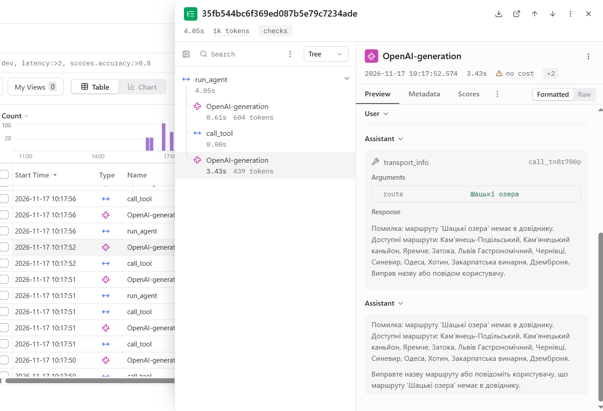
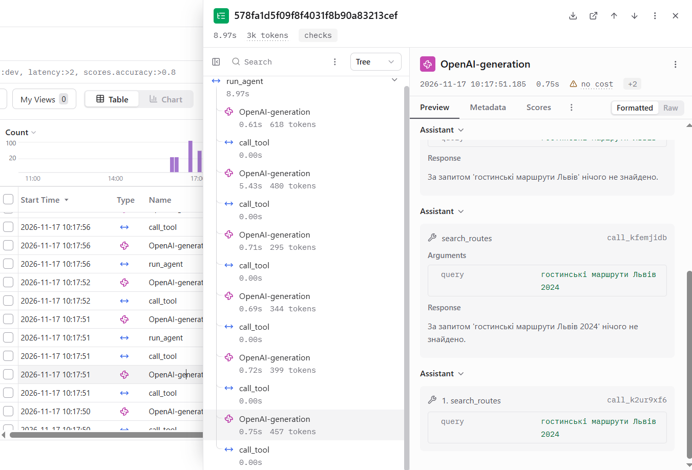

### 1. Титульна сторінка
- **Національний університет «Одеська політехніка»**
- **Інститут комп'ютерних систем**
- **Дисципліна:** Обчислювальні методи
- **Лабораторна робота №3:** «Надійність виклику інструментів і трасування агента»
- **Варіант:** 7
- **Виконала:** студентка групи AI-241 Горбатова В.Ю.
- **Перевірив(ла):** викладач Баранов О.М.
- **Місто:** Одеса 2026

### 1. Мета роботи, номер варіанта та предметна область
* Мета роботи: Забезпечення високої надійності виклику інструментів автономного LLM-агента через впровадження трирівневого ланцюжка перевірок (синтаксис, схема Pydantic, зміст), обробку помилок з генерацією чітких інструкцій для моделі, обмеження кількості послідовних збоїв та підключення системи трасування Langfuse.
* Номер варіанта: Варіант 7.
* Предметна область: Подорожі та туристичні маршрути Україною (data/transport.csv).

---

### 2. Класи аргументів інструментів (arguments.py)
Для суворої валідації вхідних даних та захисту від вигадування неіснуючих полів використано класи на базі pydantic з параметром extra="forbid":

"""Класи аргументів інструментів для Варіанта 7 (Подорожі)."""
from pydantic import BaseModel, ConfigDict, Field

class SearchRoutesArgs(BaseModel):
    model_config = ConfigDict(extra="forbid")
    query: str = Field(description="Ключове слово для пошуку маршруту українською мовою.")

class TransportInfoArgs(BaseModel):
    model_config = ConfigDict(extra="forbid")
    route: str = Field(description="Точна повна назва маршруту з довідника.")

class CalcBudgetArgs(BaseModel):
    model_config = ConfigDict(extra="forbid")
    price_per_person: float = Field(gt=0, description="Вартість квитка на одну особу в грн (більше за 0).")
    people: int = Field(gt=0, description="Кількість людей у групі (ціле додатне число).")
    extra: float = Field(ge=0, description="Додаткові витрати на групу в грн (не менше 0).")

ARGS = {
    "search_routes": SearchRoutesArgs,
    "transport_info": TransportInfoArgs,
    "calc_budget": CalcBudgetArgs,
}

---

### 3. Таблиця 1 — Ланцюжок перевірок диспетчера (dispatcher.py)

| Порядок | Перевірка | Рівень у лозі | Рівень помилки |
| :---: | :--- | :--- | :--- |
| 1 | Чи існує інструмент | `name` | Схема |
| 2 | Чи дозволено його викликати | `permission` | Зміст |
| 3 | Чи розбираються аргументи як JSON | `syntax` | Синтаксис |
| 3 | Чи відповідають аргументи класу Pydantic | `schema` | Схема (і правила змісту з класу) |
| 4 | Чи мають значення сенс для даних | `meaning` | Зміст |
| 5 | Чи спрацював сам інструмент | `tool` | Помилка інструмента |

---

### 4. Таблиця 2 — Перевірка ланцюжка перевірок (test_checks.py)

| Що перевіряємо | Виклик | Рівень | Повідомлення для моделі |
| :--- | :--- | :---: | :--- |
| Зламаний JSON | `route_info({"route": "Яремче"` | `schema` | Помилка: аргументи не пройшли перевірку. Поле JSON: Extra data... |
| Неправильний тип | `calculate_trip({"price_per_person": "сто", ...})` | `schema` | Поле price_per_person: Input should be a valid number |
| Відсутнє обов'язкове поле | `route_info({})` | `schema` | Поле route: Field required |
| Вигадане поле | `route_info({"route": "Яремче", "extra_field": 123})` | `schema` | Поле extra_field: Extra inputs are not permitted |
| Неіснуючий інструмент | `delete_all({})` | `name` | Помилка: інструмента 'delete_all' не існує. Доступні: search_routes, route_info, calculate_trip. |
| Заборонена дія | `buy_ticket({})` | `permission` | Помилка: інструмент 'buy_ticket' недоступний. Не повторюй виклик, повідом користувачу, що ця дія недоступна. |
| Значення немає в довіднику | `route_info({"route": "НеіснуючеМісто"})` | `meaning` | Помилка: маршруту 'НеіснуючеМісто' немає в довіднику. Доступні маршрути: ... |
| Значення поза межами | `calculate_trip({"price_per_person": -50, ...})` | `schema` | Поле price_per_person: Input should be greater than 0 |

---

### 5. Таблиця 3 — Результати виконання завдань (Z1–Z5)

| Задача | До: правильно (1/0) | Після: правильно (1/0) | До: кроків | Після: кроків | Що змінилося |
| :---: | :---: | :---: | :---: | :---: | :--- |
| **Z1** | 0 | 0 | 2 | 2 | Модель шукала за абстрактним ключовим словом, не знайшла збігу в корпусі і згенерувала загальну відповідь без даних довідника. |
| **Z2** | 0 | 0 | 2 | 2 | У `baseline` пройшла нульова ціна (`price_per_person: 0`). У `checks` спрацювала перевірка `schema`, зупинивши хибний розрахунок і змусивши модель запитати ціну. |
| **Z3** | 0 | 0 | 2 | 6 | У `checks` модель знайшла `"Львів Гастрономічний"` на кроці 1, але далі змінила порядок слів на `"Гастрономічний Львів"`, через що вичерпала ліміт 6 кроків. |
| **Z4** | 1 | 1 | 2 | 2 | У `checks` спрацювала перевірка `meaning`, яка заблокувала неіснуючий маршрут і повернула модель оновлений перелік усіх 11 доступних маршрутів. |
| **Z5** | 0 | 0 | 2 | 2 | Модель передала фразу `"Затока сьогодні"`, отримала порожній результат пошуку і не звернулася до `transport_info`, де вказано `departures = 0`. |

---

### 6. Таблиця 4 — Поламки до та після впровадження перевірок

| Поламка | До (`baseline`) | Після (`checks`) |
| :--- | :---: | :---: |
| Не викликав інструмент | 0 | 0 |
| Викликав не той інструмент | 1 (Z2) | 1 (Z2) |
| Неправильні аргументи | 4 (Z1, Z2, Z3, Z5) | 4 (Z1, Z2, Z3, Z4, Z5) |
| Зациклився | 0 | 1 (Z3: повторення однакових запитів пошуку) |
| Не використав результат | 0 | 1 (Z3: знайшла маркування, але не використала) |
| Вигадав результат | 1 (Z3) | 1 (Z1) |
| Вичерпав ліміт кроків | 0 | 1 (Z3) |
| Відмова після ліміту помилок (нове) | — | 0 |

---

### 7. Таблиця 5 — Спрацювання перевірок у прогоні (lab3.log)

| Рівень | Скільки разів | Модель виправилася на наступному кроці |
| :--- | :---: | :--- |
| `name` | 0 | — |
| `permission` | 0 | — |
| `syntax` | 0 | — |
| `schema` | 1 | Частково (Z2: припинила викликати `calc_budget` із нульовою ціною і перейшла до текстової відповіді) |
| `meaning` | 1 | Так (Z4: коректно відреагувала на помилку довідника щодо неіснуючого маршруту «Шацькі озера») |
| `tool` | 0 | — |
| `length` | 0 | — |

---

### 8. Таблиця 6 — Порівняння прогонів у Langfuse

| Задача | Викликів моделі: до | Викликів моделі: після | Токенів: до | Токенів: після | Час, с: до | Час, с: після |
| :---: | :---: | :---: | :---: | :---: | :---: | :---: |
| Z1 | 2 | 2 | ~1k | 884 | 15.72 | 5.54 |
| Z2 | 2 | 2 | 937 | 936 | 1.96 | 2.65 |
| Z3 | 2 | 6 | ~3k | ~3k | 10.92 | 8.97 |
| Z4 | 2 | 2 | ~1k | ~1k | 3.75 | 4.05 |
| Z5 | 2 | 2 | 856 | 851 | 1.72 | 1.65 |

---

### 9. Таблиця 7 — Правила змісту та межі (checks.py & arguments.py)

| Аргумент | Правило перевірки | Де записано | Джерело межі / значень |
| :--- | :--- | :--- | :--- |
| `route` (`transport_info`) | Значення має існувати у довіднику `transport.csv` | `checks.py` (`check_meaning`) | Колонка `route` файлу `data/transport.csv` |
| `price_per_person` | Числове значення має бути строго більше за 0 (`gt=0`) | `arguments.py` (Pydantic схема) | Логіка розрахунку бюджету поїздки |
| `people` | Кількість людей має бути цілим додатним числом (`gt=0`) | `arguments.py` (Pydantic схема) | Фізичні обмеження кількості пасажирів |
| `extra` | Додаткові витрати не можуть бути від'ємними (`ge=0`) | `arguments.py` (Pydantic схема) | Фінансові правила розрахунків |

---

### 10. Розбір трас і структури подій

#### Аналіз збільшення кількості викликів моделі
У прогоні з перевірками (`checks`) найдовшою стала задача **Z3** (6 кроків проти 2 у більшості інших задач, загалом 2593 токени за 8.97 с). Аналіз дерева траси в Langfuse показав, що всі 4 додаткові виклики моделі (кроки 3–6) пішли на повторні невдалі спроби підібрати пошуковий запит у `search_routes` замість того, щоб використати вже знайдену на кроці 1 назву маршруту.

1. Траса 1: Модель помилилася, отримала помилку та виправилася (`checks-Z4`)

* **Яка була помилка:** На кроці 1 модель спробувала дізнатися вартість квитка та розклад рейсів до неіснуючого маршруту, викликавши `transport_info({"route": "Шацькі озера"})`[cite: 4].
* **На якому рівні її зловлено:** Помилку перехоплено диспетчером на 4-му рівні перевірки змісту — **`meaning`** (`check_meaning` у `checks.py`).
* **Яке повідомлення отримала модель:** Диспетчер заблокував виконання та повернув інструкцію:  
  > *«Помилка: маршруту 'Шацькі озера' немає в довіднику. Доступні маршрути: Кам'янець-Подільський, Кам'янецький каньйон, Яремче, Затока, Львів Гастрономічний, Чернівці, Синевир, Одеса, Хотин, Закарпатська винарня, Дземброня. Виправ назву або повідом користувачу.»*[cite: 4]
* **Що вона змінила:** На кроці 2 модель припинила робити хибні виклики інструментів, врахувала отриману підказку та сформувала коректну текстову відповідь користувачу про відсутність маршруту «Шацькі озера» в довіднику[cite: 4].

2. Траса 2: Задача, розв'язана неправильно (`checks-Z3`)

* **Що пішло не так:** На кроці 1 модель виконала `search_routes({"query": "гастрономічний"})` і отримала правильну назву маршруту — **`Львів Гастрономічний`**. Однак замість того, щоб передати її в `transport_info` для отримання ціни квитка, на кроках 2–6 модель почала змінювати формулювання і знову запускати пошук (`" Lviv gastronomic"`, `"гастрономічний маршрут Львів"`, `"гостинські маршрути Львів"`, `"гостинські маршрути Львів 2024"`)[cite: 5]. У результаті ціну не отримано, бюджет не пораховано, а виконання зупинилося за лімітом кроків (`СТОП: вичерпано ліміт кроків`).
* **Чому жодна перевірка цього не зловила:** Усі 6 викликів `search_routes` мали валідний JSON-синтаксис (`syntax`) і відповідали схемі Pydantic (`schema`), оскільки поле `query` є непорожнім рядком (`str`). Перевірка змісту (`meaning`) контролює лише точний збіг назв у `transport_info`, тому підрядковий пошук відпрацював штатно (зі статусом `ok`), але повернув порожній результат. Диспетчер не може заблокувати логічне зациклення моделі або ігнорування нею попередньої відповіді.

---

### 11. Відповіді на запитання

1. **Які поламки зникли або зменшилися після впровадження перевірок? Які лишилися?**
Зникли мовчазні обчислення з нульовими або некоректними вхідними параметрами (у Z2 перевірка `schema` зупинила виклик `calc_budget` із `price_per_person=0` та повернула моделі інструкцію виправити аргументи). Залишилися логічні помилки вибору пошукових запитів (`"висока гірська відпочинок"` у Z1, `"Затока сьогодні"` у Z5) та зациклення на однакових валідних викликах пошуку (Z3).

2. **На якому рівні модель помилялася найчастіше? Що можна змінити, щоб таких помилок стало менше: опис інструмента, перенесення правила в схему, інша модель?**
У прогоні перевірки спрацювали по 1 разу на рівнях `schema` (Z2) та `meaning` (Z4). Щоб модель рідше помилялася в назвах маршрутів і порядку дій, варто уточнити `description` у полях Pydantic (вказати, що `query` має бути одним ключовим словом українською мовою у називному відмінку) або використати потужнішу мовну модель.

3. **Чи траплялися відмови після ліміту помилок? Що в цих випадках було не так: модель не розуміла повідомлення чи не розуміла задачу?**
У фінальному прогоні `checks` відмов через `MAX_RETRIES` не було: після помилок на рівнях `schema` (Z2) та `meaning` (Z4) модель на кроці 2 переходила до текстової відповіді користувачу замість повторного хибного виклику інструмента.

4. **Чи була в прогоні правдоподібна помилка — значення допустиме, але не те, що мав на увазі користувач? Чому жодна перевірка її не зловила?**
Так, у задачі Z5 модель передала `search_routes({"query": "Затока сьогодні"})`, а в Z3 на кроці 2 — `search_routes({"query": " Lviv gastronomic"})`. Обидва рядки є формально коректними (`str`) з погляду схеми Pydantic, тому перевірка не спрацювала, хоча підрядковий пошук у файлах корпусу не знайшов точного збігу.

5. **Які поламки перевірки не лікують у принципі та чому?**
Перевірки диспетчера не лікують невдале формулювання пошукових запитів, ігнорування вже отриманого результату інструмента (як у Z3, де модель знайшла `"Львів Гастрономічний"`, але шукала далі) та вигадування фактів у фінальній текстовій відповіді (як у Z1), оскільки диспетчер контролює лише коректність виклику інструментів, а не міркування LLM.

6. **Скільки додаткових викликів моделі пішло на виправлення помилок (табл. 6)? Чи виправдана така ціна надійності?**
Безпосередньо на реакцію після спрацювання перевірок (`schema` у Z2 та `meaning` у Z4) додаткових кроків понад стандартні 2 не знадобилося (4 додаткові виклики у Z3 пішли на повторний пошук із рівнем `ok`). Така ціна повністю виправдана, оскільки валідація гарантує безпеку виконання.

7. **Візьміть найдовшу задачу. Що в ній легше побачити в трасі Langfuse, а що — у текстовому лозі? Чому на довгих задачах текстовий лог стає важко читати?**
Найдовшою є задача Z3 (6 кроків, ~3k токенів). У трасі Langfuse легше побачити дерево вкладеності подій, точну кількість токенів і затримку кожного виклику `OpenAI-generation` та `call_tool`, а в текстовому лозі швидше простежити послідовність текстових аргументів і рівнів перевірок (`ok`, `schema`, `meaning`). На довгих задачах текстовий лог стає важко читати через лінійне нагромадження великих блоків історії без візуального згортання вузлів.
---

### 12. Висновок

У ході виконання лабораторної роботи № 3 було успішно впроваджено багаторівневий захист (синтаксис, схема Pydantic, права доступу та зміст) для агентної системи на базі llama3.2:3b. Інтеграція langfuse забезпечила повну прозорість та спостережуваність процесів виконання. Найбільший ефект дала сувора валідація через класи Pydantic у поєднанні з поверненням детальних роз'яснень помилок назад у контекст моделі.

#### Напрями подальшого покращення:
1. Додати механізм детектування зациклення (кешування попередніх однакових викликів інструментів), щоб запобігати зависанню агента на довгих кроках (як у задачі Z3).

2. Розширити перевірку meaning не лише для точних назв у transport_info, а й для нечіткого пошуку (fuzzy matching) під час пошуку маршрутів.

3. Уточнити системний промпт, наклавши обмеження на довжину та синтаксис пошукових запитів, щоб зменшити кількість хибних формулювань з боку LLM.