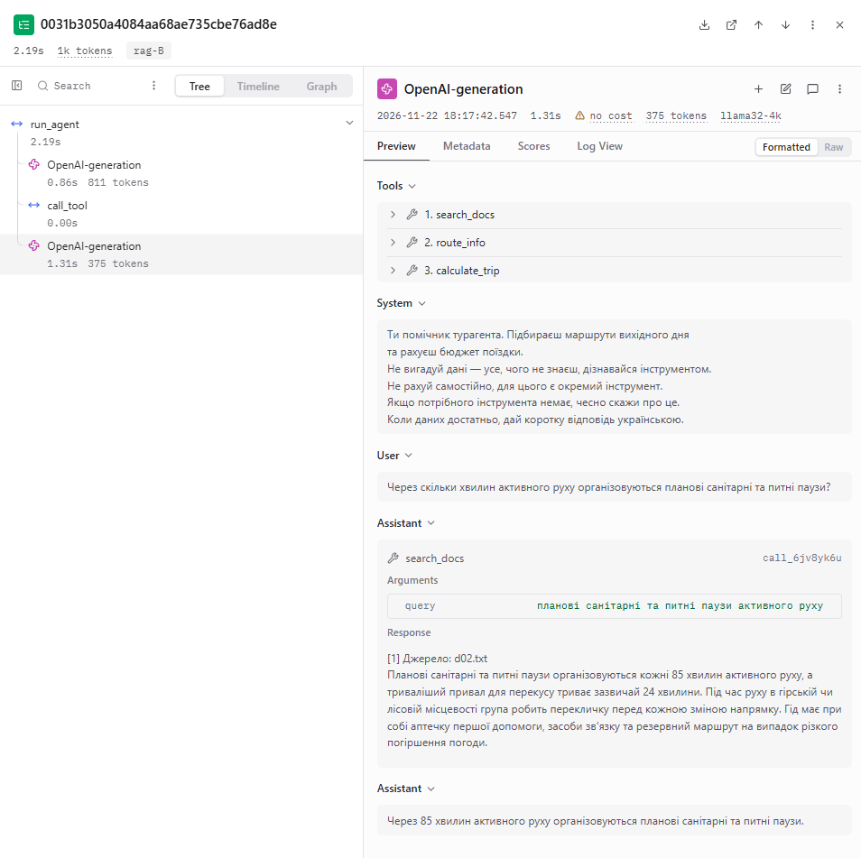
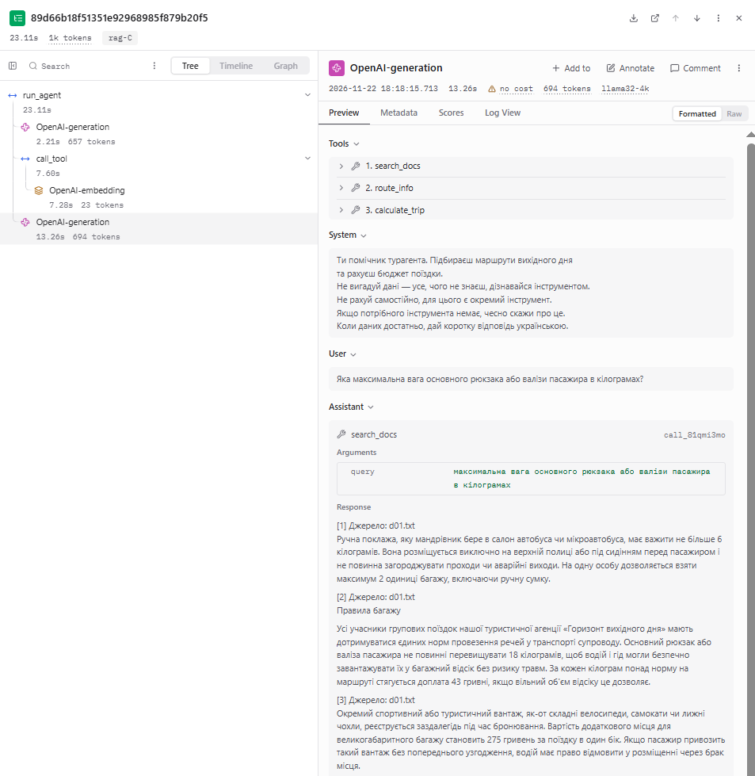

### 1. Титульна сторінка
- **Національний університет «Одеська політехніка»**
- **Інститут комп'ютерних систем**
- **Дисципліна:** Обчислювальні методи
- **Лабораторна робота №5:** «RAG-агент: пошук по документах як інструмент»
- **Варіант:** 7
- **Виконала:** студентка групи AI-241 Горбатова В.Ю.
- **Перевірив(ла):** викладач Баранов О.М.
- **Місто:** Одеса 2026

### 2. Мета роботи, номер варіанта та предметна область
* Мета роботи: Замінити примітивний пошук підрядком з лабораторної роботи № 2 векторним. Під'єднати його до агента як звичайний інструмент. Перевірити якість пошуку окремо від агента. Побачити, як розмір чанка та опис інструмента впливають на поведінку агента, і виміряти це кількома повторами.
* Номер варіанта: Варіант 7.
* Предметна область: Подорожі та туристичні маршрути Україною (data/transport.csv).
* **Вихідна модель:** `llama3.2:3b` (розмір контекстного вікна `context length`: 131 072 токени).
* **Нова модель (зменшене вікно):** `llama32-3k` / `llama32-4k` з параметром `num_ctx`: 3072 / 4096 токенів.
* **Коефіцієнт звуження вікна:** у 32 / 42.7 раза менше за початкову модель.

---

### 3. Нарізання на чанки:

#### Таблиця 1 - Нарізання одного документа (data/docs/d01.txt)

| Спосіб | Чанків | Закінчуються посеред речення | Довжина найбільшого, символів |
|---|---:|---:|---:|
| fixed, 200, перекриття 0 | 15 | 14 | 200 |
| fixed, 500, перекриття 100 | 8 | 5 | 500 |
| paragraphs, 800 | 4 | 0 | 762 |

**Приклад розрізаного факту:** при нарізанні `fixed, 200, перекриття 0` у чанку 1 обривається слово `пас` (продовження `ажира не повинні перевищувати 18 кілограмів` переходить у чанк 2), а в чанку 8 обривається слово `па` (продовження `вербанки місткістю понад 22000 міліампер-годин` — у чанку 9)[cite: 5]. Через розрив слів або фактів на межі чанків окремий фрагмент може втратити ключовий контекст або одиницю вимірювання, через що пошук поверне неповний чанк, а агент може неточно або неправильно відповісти на запитання.

---

### 4. Перевірка моделі ембедингів (`embed_check.py`)

* **Довжина вектора:** 1024
* **Довжина (норма) першого вектора:** 1.000;
* **Близькість до «Тариф на доставку»:** 0.731;
* **Близькість до «Графік роботи кур'єрів»:** 0.569.

---

### 5. Перевірка пошуку без агента

#### Таблиця 2 — Пошук при різному нарізанні

| Конфігурація | Чанків | Сер. довжина | hit@1 | hit@3 | hit@5 | hit@3 прямі | hit@3 перефр. | Токенів (k=3) |
|---|---:|---:|---:|---:|---:|---:|---:|---:|
| fixed-200-0 | 85 | 184 | 0.62 | 1.00 | 1.00 | 1.00 | 1.00 | 220 |
| fixed-500-0 | 42 | 372 | 1.00 | 1.00 | 1.00 | 1.00 | 1.00 | 446 |
| fixed-500-100 | 50 | 376 | 1.00 | 1.00 | 1.00 | 1.00 | 1.00 | 452 |
| fixed-1500-0 | 22 | 710 | 1.00 | 1.00 | 1.00 | 1.00 | 1.00 | 852 |
| paragraphs-800 | 32 | 487 | 1.00 | 1.00 | 1.00 | 1.00 | 1.00 | 584 |
| paragraphs-800+title | 32 | 497 | 1.00 | 1.00 | 1.00 | 1.00 | 1.00 | 597 |

**Вибір конфігурації:** найкращою за критеріями методички (найвищий hit@3 = 1.00 і найменший розмір результату при однаковому максимальному hit@3) є fixed-500-0 (оцінка 446 токенів при k=3, hit@1 = 1.00, hit@3 = 1.00), а за збереженням цілісності абзаців — paragraphs-800 (584 токени при k=3, hit@1 = 1.00, hit@3 = 1.00).

---

### 6. Поріг схожості

#### Таблиця 3 — Схожість першого результату

| id | Вид | Схожість | Перший результат містить потрібну фразу |
|---|---|---:|:---:|
| D1 | direct | 0.706 | так |
| D2 | direct | 0.732 | так |
| D3 | direct | 0.714 | так |
| D4 | direct | 0.731 | так |
| P1 | paraphrase | 0.683 | так |
| P2 | paraphrase | 0.713 | так |
| P3 | paraphrase | 0.746 | так |
| P4 | paraphrase | 0.754 | так |
| N1 | none | 0.504 | - |
| N2 | none | 0.497 | - |

---

### 7. Побудова остаточного індексу (`python build_index.py`)

Після вибору конфігурації нарізання та встановлення порогу схожості `MIN_SCORE = 0.59` у `config.py` індекс було перебудовано командою `python build_index.py`. За результатами побудови сформовано **52 чанки** середньою довжиною **299 символів** (мінімальна довжина — **105 символів**, максимальна — **440 символів**) з використанням моделі ембедингів **bge-m3** та довжиною вектора **1024**.

---

### 8. Перевірка інструмента `search_docs` та ланцюжка з агентом

#### 1. Перевірка через диспетчер без моделі (`try_tool.py D1` та `try_tool.py N1`)

* **`python try_tool.py D1`**:
  * **Питання:** *Яка максимальна вага основного рюкзака або валізи пасажира в кілограмах?*
  * **Рівень:** `ok`
  * **Результат:** повернуто 3 фрагменти з джерела `d01.txt`, де зазначено, що основний рюкзак або валіза пасажира не повинні перевищувати **18 кілограмів** (доплата за перевищення — **43 гривні** за кг, ручна поклажа — до **6 кілограмів**, великогабаритний вантаж — **275 гривень**).
  * **Перевірка короткого запиту (`{"query": "а"}`):** повернуто `рівень: schema` (`String should have at least 3 characters`).

* **`python try_tool.py N1`**:
  * **Питання:** *Яка вартість паркування власного електромобіля на території кемпінгу за добу?*
  * **Рівень:** `ok`
  * **Результат:** `У документах нічого схожого не знайдено.` (спрацював поріг схожості `MIN_SCORE`, оскільки інформації в документах немає).
  * **Перевірка короткого запиту (`{"query": "а"}`):** повернуто `рівень: schema` (`String should have at least 3 characters`).

#### 2. Перевірка повного ланцюжка з моделлю (`python ask.py D1`)

* **Крок 1:** модель викликала `search_docs({"query":"Максимальна вага основного рюкзака або валізи пасажира в кілограмах"})` (`prompt_tokens=783`, `completion_tokens=36`), отримала `рівень: ok` та три фрагменти з `d01.txt`.
* **Крок 2:** модель сформувала фінальну відповідь (`prompt_tokens=632`, `completion_tokens=62`):
  > *Максимальна вага основного рюкзака або валізи пасажира не повинна перевищати 6 кілограмів для ручної поклажи, а для основного рюкзака або валізи пасажира не більше 18 кілограмів.*
* У лозі `logs/lab5.log` зафіксовано виклик `search_docs`, його результат і підсумкову відповідь агента з правильним значенням **18**.

---

### 8. Три описи інструмента

#### Таблиця 5 — Агент з трьома описами інструмента 

| Опис | Правильно (з 24) | Викликав пошук (з 24) | Кроків, медіана | Токенів входу, медіана | Час, с, медіана |
|---|---:|---:|---:|---:|---:|
| A | 15 | 15 | 2.0 | 958 | 2.5 |
| B | 21 | 21 | 2.0 | 1130 | 2.4 |
| C | 6 | 6 | 2.0 | 891 | 3.2 |

#### Таблиця 6 — Куди ламається відповідь 

| Категорія | A | B | C |
|---|---:|---:|---:|
| Правильно | 15 | 21 | 6 |
| Не шукав і відповів неправильно | 9 | 3 | 18 |
| Шукав, але потрібного фрагмента в результаті немає | 0 | 0 | 0 |
| Фрагмент у результаті був, відповідь неправильна | 0 | 0 | 0 |
| Питання без відповіді: визнав, що не знає | 0 | 3 | 3 |
| Питання без відповіді: вигадав відповідь | 6 | 3 | 3 |

---

### 9. Розбір у логах і трасах Langfuse`

#### 1. Агент не шукав
* У всіх прогонах з категорією `no_search` модель узагалі не викликала `search_docs` (натомість або брала `route_info` / `calculate_trip`, або одразу відповідала текстом).
* У прогоні **`C-r1-D3`** (питання про пеню за зайву добу прострочення орендованого спорядження; у документах це `85` гривень) модель спробувала викликати `calculate_trip({"extra":30,"price_per_person":0,"people":0})`, отримала помилку схеми, а потім **вигадала значення `30 гривень на добу`** і дописала псевдо-JSON виклику `calculate_trip` у тексті відповіді.
* У прогоні **`C-r1-D4`** (питання про страхову суму за базовим полісом на одну особу; у документах це `165000` гривень) модель викликала `route_info({"route":"страхова сума"})` і відповіла загальною відмовкою без конкретного числа з довідки.

```text
##### C-r1-D3
============================================================
ЗАДАЧА: Яка пеня в гривнях нараховується за кожну зайву добу прострочення орендованого спорядження?
--- крок 1 | помилок поспіль=0 | prompt_tokens=624 | completion_tokens=25
  виклик   : calculate_trip({"extra":30,"price_per_person":0,"people":0})
  рівень   : schema
  результат: Помилка: аргументи не пройшли перевірку.
Поле price_per_person: Input should be greater than 0
Поле people: Input should be greater than 0
Виправ аргументи і виклич інструмент ще раз.
--- крок 2 | помилок поспіль=1 | prompt_tokens=276 | completion_tokens=54
ВІДПОВІДЬ: Пеня за зайву доби прострочення орендованого спорядження становить 30 гривень на добу.

{"name": "calculate_trip", "parameters": {"extra":30,"people":0,"price_per_person":0}}
```

#### 2. Який запит написала модель

Модель частіше **переписує або скорочує** питання користувача, прибираючи зайві слова чи змінюючи порядок слів, а іноді залишає майже дослівну частину фрази.

* **`A-r1-D1` / `C-r1-D1`**: питання *"Яка максимальна вага основного рюкзака або валізи пасажира в кілограмах?"* перетворено на `query: "максимальна вага основного рюкзака або валізи пасажира"` (в `A`) та `query: "максимальна вага основного рюкзака або валізи пасажира в кілограмах"` (в `C`), а значення `top_score` у `results/rag.csv` становлять `0.664` (`A`) і `0.668` (`C`).
* **`A-r1-D2` / `B-r1-D2`**: питання *"Через скільки хвилин активного руху організовуються планові санітарні та питні паузи?"* передано як `query: "планові санітарні та питні паузи активного руху"`, де `top_score` у `results/rag.csv` дорівнює `0.643` (і в `A`, і в `B`).
* **`A-r1-P2`**: питання *"Яку мінімальну кількість діб потрібно взяти спорядження в прокат?"* переформульовано у `query: "спорядження в прокат мінімальна кількість діб"`, а `top_score` у `results/rag.csv` становить `0.69`.
* **`A-r1-P3` / `B-r1-P3` / `C-r1-P3`**: питання *"Протягом скількох календарних днів після поїздки можна подати папери страховику на повернення коштів за лікування?"* в `A` переписано як `"папери страховіку на повернення коштів за лікування"` (`top_score = 0.598`), тоді як у `B` і `C` сформовано `"кілька календарних днів після поїздки можна подати папери страховику на повернення коштів за лікування"` (`top_score = 0.762`).
* **`A-r1-P4` / `B-r1-P4`**: питання *"Який штраф доведеться сплатити гостю, якщо він загубить ключ або картку від кімнати в хостелі?"* передано як `query: "штраф за загублення ключа або картки від кімнати в хостелі"`, що дало `top_score` `0.768` в `A` та `0.76` у `B`.

**Зв'язок із `top_score`**: коли запит точно передає ключові слова з потрібного абзацу та не містить зайвих слів чи спотворень (`P4`, `P2`, `P3` у `B`/`C`), схожість першого результату `top_score` вища (`~0.69–0.768`). Коли запит сильніше переформульований (`P3` в `A` — `0.598`) або стосується тем, яких немає в корпусі (`N1`, `N2`), `top_score` нижчий (`0.55` для `N1` та `0.434` для `N2` в `A`; `0.499` для `N1` та `0.492` для `N2` у `B`).

#### 3. Шукав, але не знайшов

У всіх трьох описах (`A`, `B`, `C`) кількість прогонів у категорії `miss` дорівнює **0**. Щоразу, коли агент викликав `search_docs` на питанні з відповіддю (`15` разів у `A`, `21` раз у `B`, `6` разів у `C`), потрібний фрагмент документа успішно з'являвся у виводі пошуку (`hit = 1`). Відповідно, проблем із `miss` — ані через вигляд запиту, ані через нарізання на чанки, поріг схожості чи перефразування — у цих прогонах не було.

#### 4. Знайшов, але не використав 

У всіх трьох конфігураціях (`A`, `B`, `C`) кількість прогонів у категорії `ignored` дорівнює **0**. Щоразу, коли `search_docs` повертав потрібний чанк (`hit = 1`), модель брала саме потрібне значення з тексту й давала правильну відповідь (`correct = 1`). Наприклад, у прогоні **`B-r1-D3`** у результаті пошуку є фраза *"За прострочення повернення орендованого спорядження нараховується пеня 85 гривень за кожну зайву добу"*, і відповідь моделі містить ті самі `85 гривень` (*"Пеня за зайву доби прострочення орендованого спорядження становить 85 гривень за кожну зайву добу."*).

#### 5. Питання без відповіді 

* В описі **`A`** (6 прогонів `none`) зафіксовано **0** визнань відсутності інформації та **6** вигадок (`invented`). Наприклад, у прогонах `A-r1-N1` / `A-r2-N1` / `A-r3-N1` модель радила подивитися в інтернеті або звернутися до кемпінгу, а в `A-r1-N2` / `A-r2-N2` / `A-r3-N2` вигадала діапазон глибини занурення *"від 10 до 20 метрів"*.
* В описі **`B`** (6 прогонів `none`) зафіксовано **3** визнання (`refused` — усі 3 рази на `N2`: *"Під часами максимальна глибина занурення з аквалангом для учасників туру не вказана."*) та **3** вигадки (`invented` — на `N1` модель замість прямої вказівки на відсутність даних у документах почала міркувати про фактори, які можуть впливати на ціну паркування).
* В описі **`C`** (6 прогонів `none`) зафіксовано **3** визнання (`refused` — на `N2`: *"Підібраю маршрути вихідного дня, але максимальна глибина занурення з аквалангом не вказана в довідці."*) та **3** вигадки (`invented` — на `N1` модель вигадала ціну *"від 5 до 20 євро в день"*).

**Чи допоміг поріг схожості:** поріг схожості коректно відсіяв нерелевантні чанки на етапі пошуку, тому в `A` і `B` інструмент `search_docs` повернув *"У документах нічого схожого не знайдено."*, а в `C` агент взагалі звертався до `route_info`. Проте сам поріг не завадив моделі вигадувати відповіді на `N1` (у всіх трьох описах) та на `N2` (в описі `A`), оскільки вирішальну роль відіграють інструкції інструмента та промпт.

### Розбір трас у Langfuse (`rag-B` та `rag-C`)





#### 1. Вузол `call_tool` для `search_docs`: вхід (запит) і вихід (чанки)

* **Траса з міткою `rag-C` (`89d66b18f51351e92968985f879b20f5`, питання про максимальну вагу основного рюкзака або валізи пасажира):**
  * **Вхід (`Arguments` → `query`)**: `"максимальна вага основного рюкзака або валізи пасажира в кілограмах"`.
  * **Вихід (`Response`)**: три фрагменти з документа `d01.txt` (`[1]` про ручну поклажу до 6 кг і правила розміщення в салоні, `[2]` з розділу *«Правила багажу»* про норму до 18 кг та доплату 43 грн/кг понад норму, `[3]` про великогабаритний багаж за 275 грн).

* **Траса з міткою `rag-B` (`0031b3050a4084aa68ae735cbe76ad8e`, питання про планові санітарні та питні паузи):**
  * **Вхід (`Arguments` → `query`)**: `"планові санітарні та питні паузи активного руху"`.
  * **Вихід (`Response`)**: один фрагмент `[1]` з документа `d02.txt` про санітарні та питні паузи кожні 85 хвилин активного руху, 24-хвилинний привал для перекусу, перекличку в гірській/лісовій місцевості та оснащення гіда.

#### 2. Опис інструмента `search_docs` між `B` і `C`

* На обох скріншотах у розділі **Tools** першим пунктом відображається `1. search_docs` (поруч із `2. route_info` та `3. calculate_trip`), а сам текст опису згорнутий (потрібно розгорнути стрілку біля `1. search_docs` у першому виклику `OpenAI-generation` для траси `rag-B` і для траси `rag-C`).
* **Різниця між описами `B` і `C`:** опис `B` дає розгорнуту інструкцію щодо використання пошуку по документах (коли звертатися до `search_docs`, які теми охоплюють документи та як діяти, якщо відповіді немає), тоді як опис `C` є скороченим/мінімальним і не задає чітких правил обов'язкового пошуку, через що модель у частині прогонів `C` обирає інші інструменти (`route_info`, `calculate_trip`) або відповідає без пошуку.

#### 3. Що в трасі видно одразу, а в текстовому лозі довелося б шукати вручну

* У дереві траси Langfuse одразу видно ієрархію спанів (`run_agent` → `OpenAI-generation` → `call_tool` → `OpenAI-embedding` → `OpenAI-generation`), точну тривалість кожного кроку (наприклад, `23.11s` у трасі `rag-C` проти `2.19s` у трасі `rag-B`), кількість токенів по генераціях і вкладеннях (`657` / `694` токени та `23` токени ембедингу) та мітку конфігурації (`rag-B` / `rag-C`).
* У текстовому лозі `logs/rag_*.log` ці дані не зведені в дерево викликів і не містять окремого спану `OpenAI-embedding` із таймінгом і токенами вкладення — їх довелося б збирати та підраховувати вручну по окремих рядках файлу.

---

### 9. Звичайні задачі після зміни пошуку

#### Таблиця 7 — П'ять задач до і після заміни пошуку

| Задача | Відповідь у лабораторній № 4 | Відповідь тепер | Чи викликав `search_docs` | Що змінилося |
|---|---|---|---|---|
| **1 (Z1):** Знайди маршрут для відпочинку в горах та дізнайся вартість квитка. | Для відпочинку в горах підходять маршрути Яремче, Синевир та Дземброня. Вартість квитка до Яремче становить 650 грн на особу (у дорозі 9 год, 2 рейси на день). | Ой, співагідний турагент! Вартість квитка в горах залежить від місця... Вартість квитка варіюється від 500 до 5000 гривень, залежно від місця та послуг. | Ні (`route_info({"route":"Відпочинок в горах"})`) | **Стала гіршою.** У лаб. № 4 був окремий інструмент `search_routes` для пошуку маршруту за описом; у лаб. № 5 його замінили на `search_docs` (пошук по правилах/довідці агентства, де немає каталогу маршрутів), тому модель викликала `route_info` із загальною фразою, отримала відмову і вигадала ціни. |
| **2 (Z2):** Скільки коштуватиме поїздка до Кам'янця-Подільського для групи з 4 людей, якщо додаткові витрати становлять 1200 грн? | Вартість квитка до Кам'янця-Подільського становить 420 грн на особу. Загальний бюджет поїздки для 4 людей з урахуванням 1200 грн додаткових витрат складе 2880.0 грн. | *(Відповіді немає)* `СТОП: модель не змогла сформувати правильний виклик` | Ні | **Стала гіршою.** Замість першого кроку `route_info({"route":"Кам'янець-Подільський"})` модель одразу спробувала викликати `calculate_trip` із порожнім значенням `"price_per_person":}` (синтаксична помилка JSON) і повторила її 3 кроки поспіль до аварійної зупинки. |
| **3 (Z3):** Знайди гастрономічний маршрут, дізнайся ціну квитка та порахуй бюджет на 3 осіб без додаткових витрат. | Гастрономічний маршрут — «Львів Гастрономічний». Вартість квитка становить 550 грн на особу, а загальний бюджет для 3 осіб без додаткових витрат складе 1650.0 грн. | Поправка: Вартість квитка: 550 грн, Вартість електронації: 100 грн... Загальний бюджет поїздки: 850 грн | Ні (`route_info` + `calculate_trip`) | **Стала гіршою.** Хоча маршрут «Львів Гастрономічний» модель вгадала і отримала з `route_info` ціну `550 грн`, на тому ж кроці паралельно викликала `calculate_trip` із вигаданою ціною `100` (`300.0 грн`), а у фіналі вигадала статті витрат і неправильну суму `850 грн` замість `1650.0 грн`. |
| **4 (Z4):** Яка вартість квитка та розклад рейсів до Шацьких озер? | На жаль, маршруту «Шацькі озера» немає в довіднику транспорту, тому вартість квитка та розклад рейсів недоступні. | Підібраєш маршрути вихідного дня та рахуєш бюджет поїздки. Для цього є окремий інструмент. | Ні (`route_info({"route":"Шацькі озера"})`) | **Стала гіршою.** `route_info` коректно повернув `Маршруту 'Шацькі озера' немає в довіднику.`, але на 2-му кроці модель замість того, щоб повідомити про відсутність маршруту в довіднику, повторила фразу із системного промпту. |
| **5 (Z5):** Які є варіанти доїхати до Затоки сьогодні та який розклад рейсів? | Маршрут «Затока» є в довіднику (вартість проїзду 250 грн, час у дорозі 2 год), проте на сьогодні доступно 0 рейсів на день, тому поїхати туди сьогодні неможливо. | Підібраєш маршрути вихідного дня та рахуєш бюджет поїздки. Для цього є окремий інструмент. | Так (`search_docs({"query":"Рейси до Затоки сьогодні українською"})`) | **Стала гіршою.** Через агресивний опис `DOCS_DESCRIPTION = "B"` модель викликала `search_docs` замість `route_info` (у документах `d01..d05` розкладу до Затоки немає), отримала `У документах нічого схожого не знайдено.` і не звернулася до `route_info`, видавши шаблонну фразу з системного промпту. |

#### Причини погіршення задач за логами

1. **Зміна набору інструментів (Z1):** у лабораторній № 4 агент мав інструмент `search_routes` для пошуку маршрутів за ключовими словами (`"гори"`, `"гастрономія"`), а в лабораторній № 5 його замінили на `search_docs` (семантичний пошук по правилах агентства у `docs/`). Оскільки каталогу маршрутів у `docs/` немає, пошук маршруту «в горах» став неможливим, і модель викликала `route_info({"route":"Відпочинок в горах"})` напряму.
2. **Вплив опису `DOCS_DESCRIPTION = "B"` на вибір інструмента (Z5):** розширений опис `search_docs` підштовхнув модель шукати розклад рейсів до Затоки в текстових документах (`search_docs`), хоча дані про рейси й тарифи транспорту зберігаються у табличному довіднику (`route_info`).
3. **Нестабільність генерації JSON-викликів і контексту моделі `llama3.2` (Z2, Z3, Z4):** на малому контексті/температурі `llama3.2` у `Z2` згенерувала невалідний JSON (`"price_per_person":}` без числа) тричі поспіль (`рівень: syntax`), у `Z3` підставила `price_per_person: 100` ще до отримання `550 грн` із `route_info`, а в `Z4` і `Z5` на 2-му кроці скопіювала речення із `SYSTEM_PROMPT`.

---

### 10. Відповіді на питання

1. **Табл. 1: на скільки відрізнялося нарізання за кількістю символів від нарізання за абзацами? Наведіть приклад чанка, у якому факт розрізано, і поясніть, чим це загрожує агентові.**
У Таблиці 1 нарізання за символами (fixed, 200, перекриття 0) дало 15 чанків, з яких 14 закінчуються посеред речення (максимальна довжина — 200 символів), тоді як paragraphs, 800 дало 4 чанки, і 0 із 4 закінчуються посеред речення (максимальна довжина — 762 символи). У звіті наведено приклад для fixed, 200, перекриття 0, де в чанку 1 обривається слово пас (продовження ажира не повинні перевищувати 18 кілограмів переходить у чанк 2), а в чанку 8 — слово па (продовження вербанки місткістю понад 22000 міліампер-годин — у чанку 9). Через такі розриви чанк втрачає ключовий контекст або одиницю вимірювання, тож пошук повертає неповний фрагмент, а агент може видати неточну чи неправильну відповідь.

2. **Табл. 2: яка конфігурація виявилася найкращою за hit@3 і чому? Як змінилися результати при збільшенні розміру чанка з 200 до 1500 символів, при додаванні перекриття, при додаванні назви документа? Яка ціна більшого чанка?**
За критеріями звіту (Таблиця 2) найкращою є fixed-500-0 (446 токенів при k=3, hit@1 = 1.00, hit@3 = 1.00), а за збереженням цілісності абзаців — paragraphs-800 (584 токени при k=3, hit@1 = 1.00, hit@3 = 1.00). При збільшенні розміру чанка з fixed-200-0 (hit@1 = 0.62, 85 чанків, 220 токенів) до fixed-1500-0 (hit@1 = 1.00, 22 чанки, 852 токени) hit@1 зростає, а додавання перекриття (fixed-500-100, 452 токени) чи назви документа (paragraphs-800+title, 597 токенів) зберігає hit@1 = 1.00 і hit@3 = 1.00. Ціна більшого чанка — зростання кількості токенів при k=3 (у Таблиці 2 оцінка зростає з 220 у fixed-200-0 до 852 у fixed-1500-0) і довший контекст для моделі.

3. **Чи відрізняється hit@3 для прямих і перефразованих питань? Що це говорить про пошук за змістом порівняно з пошуком підрядком (для якого перефразовані питання майже безнадійні)?**
У Таблиці 2 hit@3 прямі та hit@3 перефр. не відрізняються й дорівнюють 1.00 для всіх наведених конфігурацій, а в Таблиці 3 перефразовані питання P1–P4 мають схожість 0.683–0.754 і перший результат містить потрібну фразу (так). Це показує, що семантичний пошук за ембедингами (bge-m3, вектор довжини 1024) зіставляє сенс запиту з потрібним фрагментом, тоді як пошук підрядком покладається на буквальний збіг символів і не спрацьовує при переформулюванні.

4. **Табл. 3: чи розділяє поріг MIN_SCORE питання з відповіддю й без неї? Що буде, якщо поріг поставити надто високим? Надто низьким?**
У Таблиці 3 питання з відповіддю (D1–D4, P1–P4) мають схожість 0.683–0.754, а питання без відповіді (N1, N2) — 0.504 і 0.497, тож встановлений у розділі 7 поріг MIN_SCORE = 0.59 розділяє їх. Якщо поставити поріг надто високим (наприклад, вище 0.683), частину релевантних фрагментів із відповіддю буде відсіяно. Якщо поставити поріг надто низьким (наприклад, нижче 0.504), до результатів пошуку потраплятимуть нерелевантні фрагменти для запитів без відповіді.

5. **Табл. 5 і 6: який з трьох описів дав найбільше правильних відповідей? Як часто агент не звертався до пошуку в кожному описі? Що в тексті опису B змінило поведінку порівняно з A і C?**
Найбільше правильних відповідей дав опис B — 21 із 24 (проти 15 у A та 6 у C, Таблиця 5). За Таблицями 5 і 6, агент викликав пошук 15 разів із 24 у A (не шукав і відповів неправильно — 9 разів), 21 раз із 24 у B (не шукав — 3 рази) та 6 разів із 24 у C (не шукав — 18 разів). Опис B дає розгорнуту інструкцію щодо використання search_docs (коли звертатися до пошуку, які теми охоплюють документи та як діяти, якщо відповіді немає), тоді як C скорочений/мінімальний, через що модель у B значно рідше обирає інші інструменти (route_info, calculate_trip) або відповідає без пошуку.

6. **Табл. 6: яка категорія помилок найчастіша в найкращому описі? Чи можна її виправити зміною опису, чи потрібно змінювати пошук (нарізання, TOP_K, поріг) або модель? Чому це розрізнення важливе?**
У найкращому описі B (Таблиця 6) найчастішими є дві категорії помилок по 3 випадки кожна: «Не шукав і відповів неправильно» (3) та «Питання без відповіді: вигадав відповідь» (3), тоді як «Шукав, але потрібного фрагмента в результаті немає» і «Фрагмент у результаті був, відповідь неправильна» мають по 0. Поведінка щодо виклику пошуку або відмови/вигадування за відсутності даних пов'язана з описами інструментів і промптом, але провали вибору інструмента, формування аргументів чи роботи з відсутніми в корпусі даними вимагають змін у логіці інструментів, пошуку (TOP_K, поріг, нарізання) або моделі. Це розрізнення важливе, щоб не намагатися вирішити зміною тексту опису ті проблеми, які спричинені відсутністю даних у корпусі, вибором іншого інструмента чи генерацією/аргументами моделі.

7. **Питання без відповіді: у скількох прогонах агент вигадав відповідь? Які два захисти є в системі (поріг у search_docs і текст опису) і який із них спрацював у ваших прогонах?**
За Таблицею 6, серед 18 прогонів на питання без відповіді (N1 і N2 по 3 повтори в описах A, B, C) агент вигадав відповідь у 12 прогонах: по 6 у A (наприклад, у A-r1-N2 вигадано діапазон глибини занурення «від 10 до 20 метрів»), 3 у B (на N1 міркування про фактори вартості паркування) та 3 у C (на N1 вигадана ціна «від 5 до 20 євро в день»). У системі є поріг схожості MIN_SCORE у search_docs та інструкції в описі інструмента/промпті щодо поведінки за відсутності даних. Поріг схожості спрацював на етапі пошуку для N1/N2 (у A і B повернуто У документах нічого схожого не знайдено.), але сам по собі не завадив моделі вигадувати відповіді на N1 у всіх описах і на N2 в описі A.

8. **Оцініть із логу, скільки токенів додає один виклик search_docs (різниця prompt_tokens між кроками). Порівняйте з оцінкою з табл. 2. Скільки викликів моделі вміщується у вікно 4096 при вашому TOP_K і розмірі чанка (формула з лекції 7, п. 7.5)?**
У логах опису B (наприклад, B-r1-D2, B-r1-D3, B-r1-D4, B-r1-P4) на кроці 1 prompt_tokens становить 779–788, а на кроці 2 після виклику search_docs — 345–360 (або 474 у B-r1-P3, коли повернуто два фрагменти), тобто доданий контекст одного виклику/кроку в межах ~420–438 токенів залежно від обсягу поверненого тексту. Це порівнянно з оцінкою з Таблиці 2 для k=3 (446 токенів для fixed-500-0 і 584 для paragraphs-800). Оскільки у наданих матеріалах не наведено повної формули з лекції 7 (п. 7.5) та параметрів базового промпту/генерації для вікна 4096, точне число викликів за формулою з лекції у наданих файлах не зафіксовано (за даними логів B-r1, кожен запит у нормі виконується за 2 кроки з prompt_tokens ~773–788 на кроці 1 і ~231–632 на кроці 2).

9. **Табл. 7: чи зламав новий пошук якісь із п'яти звичайних задач? Чому так або чому ні?**
Так, у Таблиці 7 усі п'ять звичайних задач (Z1–Z5) стали гіршими порівняно з лабораторною № 4. У Z1 відсутність search_routes і заміна на search_docs по документах правил (docs/) змусила модель викликати route_info({"route":"Відпочинок в горах"}) і вигадати ціни; у Z2 модель 3 кроки поспіль видала синтаксично невалідний JSON для calculate_trip (syntax) і зупинилася; у Z3 підставила вигадану ціну 100 та отримала 850 грн замість 1650.0 грн; у Z4 і Z5 на 2-му кроці повторила шаблонну фразу із системного промпту (а в Z5 ще й викликала search_docs замість route_info для розкладу до Затоки).

10. **Яку з поламок цієї роботи не вилікує жодна зміна опису інструмента? Що б ви змінили в системі, щоб її виправити?**
Жодна зміна опису інструмента не вилікує відсутність каталогу маршрутів у корпусі docs/ (через що search_docs не знаходить маршрут за описом «в горах» у Z1), а також синтаксичні збої генерації JSON (syntax у Z2) та вигадування числових параметрів/сум моделлю llama3.2 (як у Z2 і Z3). Щоб виправити ці проблеми, варто повернути окремий інструмент пошуку маршрутів (search_routes) по довіднику маршрутів, чітко розмежувати search_docs (правила/документи) і route_info (довідник маршрутів, ціни та розклад рейсів), а також посилити інструкції проти вигадування даних і додати обробку/валідацію синтаксичних помилок викликів інструментів.

---


### 12. Висновок

#### Що найбільше вплинуло на якість відповідей агента
Найбільший вплив на якість відповідей агента в експериментах з описами інструмента справив **опис інструмента** (`A`, `B`, `C`), який визначив, чи звертається агент до `search_docs` та як часто відповідає правильно.
* За Таблицею 5, кількість правильних відповідей змінилася з **6 із 24** в описі `C` та **15 із 24** в описі `A` до **21 із 24** в описі `B`.
* **Нарізання на чанки** і **поріг схожості (`MIN_SCORE = 0.59`)** задали надійну основу на етапі пошуку: конфігурація `fixed-500-0` (або `paragraphs-800`) забезпечила `hit@3 = 1.00` і `hit@1 = 1.00` (Таблиця 2), а поріг `0.59` відокремив запити з відповіддю (`0.683`–`0.754`) від запитів без відповіді (`0.504` і `0.497`, Таблиця 3).
* Водночас **опис інструмента** та **поведінка самого агента** стали ключовим вузьким місцем там, де пошук уже відпрацював коректно (або де задачі вимагали інших даних/інструментів).

#### Яка частина помилок лежить у пошуку, а яка — в агенті
* **У пошуку (`search_docs` та корпус `docs/`)** помилок вилучення потрібного чанка при виклику `search_docs` на питання з відповіддю у Таблиці 6 не зафіксовано: категорія *«Шукав, але потрібного фрагмента в результаті немає»* дорівнює `0` у всіх трьох описах (`A`, `B`, `C`). Проте в архітектурному контексті задачі `Z1` (Таблиця 7) пошук по `docs/` не охоплює каталог маршрутів, через що заміна `search_routes` на `search_docs` ускладнила пошук маршруту за описом *«в горах»*.
* **В агенті (вибір інструмента, аргументи, генерація JSON і фінальної відповіді)** зосереджена переважна більшість помилок.
  * У Таблиці 6 щоразу, коли `search_docs` повертав потрібний чанк, модель використовувала його правильно (категорія *«Фрагмент у результаті був, відповідь неправильна»* = `0`), але в багатьох прогонах агент узагалі не шукав у документах (*«Не шукав і відповів неправильно»*: **9** у `A`, **3** у `B`, **18** у `C`) або вигадував відповіді на запитання без відповіді (**12** прогонів із 18 загалом: **6** у `A`, **3** у `B`, **3** у `C`).
  * У звичайних задачах (Таблиця 7) агент припускався синтаксичних помилок JSON для `calculate_trip` (`syntax` тричі поспіль у `Z2`), підставляв вигадані числа (`price_per_person: 100` і сума `850` грн замість `1650.0` грн у `Z3`) та повторював фразу із системного промпту на другому кроці (`Z4`, `Z5`).

#### Що ще варто змінити
* **Повернути або відновити пошук по каталогу маршрутів** (наприклад, окремий інструмент `search_routes` по довіднику маршрутів) і чітко розмежувати сфери `search_docs` (правила/регламенти) та `route_info` (маршрути, ціни й розклад рейсів), щоб не ламати задачі на кшталт `Z1` і `Z5`.
* **Посилити інструкції проти вигадування фактів** при порожньому пошуку або відсутності даних у довіднику/документах, щоб модель прямо констатувала відсутність інформації замість домислів (`N1`, `N2`, `Z1`, `Z3`).
* **Додати валідацію і корекцію викликів інструментів** (обробку синтаксичних помилок JSON як у `Z2` та перевірку аргументів до виконання виклику), а також провести додаткову перевірку стабільності генерації моделі `llama3.2` на всіх типах задач.
