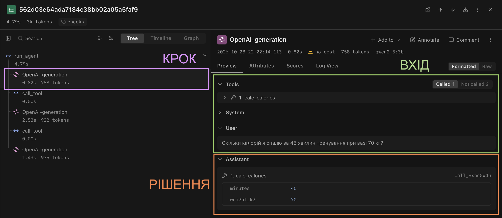
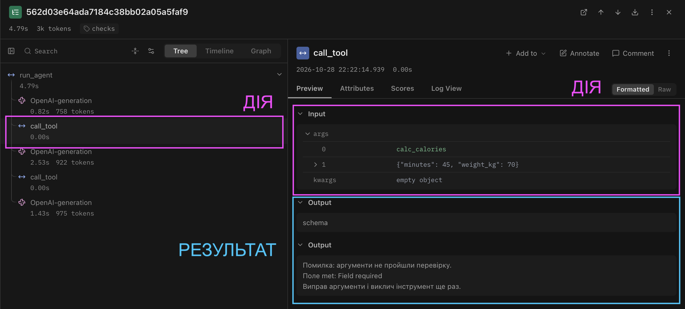
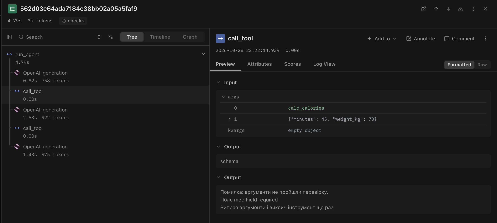
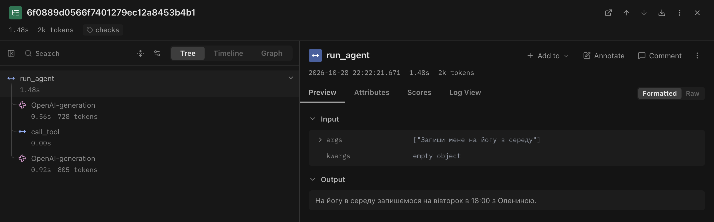

<div align="center">

Міністерство освіти і науки України

Національний університет «Одеська політехніка»

Навчально-науковий інститут комп'ютерних систем

Кафедра інформаційних систем

&nbsp;

&nbsp;

**Лабораторна робота № 3**

З дисципліни: «Обчислювальні методи»

**Тема: «Надійність виклику інструментів і трасування агента»**

&nbsp;

&nbsp;

</div>

<div align="right">

**Виконав:**

Студент групи AI-241

Гайтукаєв Мансур Заурович

**Викладач:**

Доц. Годовиченко М. А.

Баранов О. М.

</div>

&nbsp;

<div align="center">

Одеса 2026

</div>

---

## 1. Мета роботи, номер варіанта, предметна область

**Мета роботи:** зробити виклик інструментів надійним: перевіряти кожен виклик моделі до виконання на трьох рівнях (синтаксис, схема, зміст), повертати моделі зрозумілі повідомлення про помилки, обмежити кількість помилок моделі поспіль і побачити роботу агента як трасу в Langfuse.

| Параметр | Значення |
|---|---|
| **Варіант** | 4 |
| **Предметна область** | Тренування |
| **Модель** | `qwen2.5:3b` (Ollama, локально, `TEMPERATURE = 0`) |
| **Ліміти циклу** | `MAX_STEPS = 6`, `MAX_RETRIES = 2` |
| **Дозволені інструменти (`ALLOWED`)** | `search_exercises`, `schedule_info`, `calc_calories` |
| **Заборонена дія (заглушка, табл. 7)** | `book_session` — записати на заняття |
| **Ключ довідника для перевірки змісту** | назва заняття (`data/schedule.csv`, колонка `activity`) |

Дані, набір задач, модель, температура, ліміт кроків і системне повідомлення з лабораторної роботи № 2 не змінювалися.

---

## 2. Класи аргументів трьох інструментів (`arguments.py`)

Аргументи описано класами Pydantic. З них генерується опис для моделі (`model_json_schema()`), ці самі класи перевіряють відповідь моделі. У кожному класі `extra="forbid"`, тому вигадані поля не відкидаються мовчки, а дають помилку.

```python
"""Класи аргументів інструментів."""
from pydantic import BaseModel, ConfigDict, Field


class SearchExercises(BaseModel):
    model_config = ConfigDict(extra="forbid")
    query: str = Field(
        min_length=1,
        description="Група м'язів або рівень складності, одне-два слова українською, "
                    "не все питання користувача цілком",
    )


class ScheduleInfo(BaseModel):
    model_config = ConfigDict(extra="forbid")
    activity: str = Field(
        min_length=1,
        description="Назва заняття українською в нижньому регістрі",
    )


class CalcCalories(BaseModel):
    model_config = ConfigDict(extra="forbid")
    minutes: float = Field(gt=0, le=300, description="Тривалість тренування у хвилинах")
    weight_kg: float = Field(gt=20, le=300, description="Вага людини в кілограмах")
    met: float = Field(gt=0, le=20,
                       description="Коефіцієнт навантаження; якщо користувач його не назвав, використовуй 5")


ARGS = {
    "search_exercises": SearchExercises,
    "schedule_info": ScheduleInfo,
    "calc_calories": CalcCalories,
}
```

`schemas.py` тепер лише зберігає тексти описів функцій (`DESCRIPTIONS`), а розділ `parameters` бере з класів. Перевірка згенерованої схеми для `calc_calories` показала `additionalProperties: false`, повний список `required` і межі `exclusiveMinimum` / `maximum` для кожного числового поля.

---

## 3. Таблиця правил змісту

Кілька меж я визначив сам. `Literal` не використовував: заняття в розкладі 5, але значення вводяться текстом і порівнюються без урахування регістру, тож перевірка зроблена в коді. У `data/schedule.csv` 18 рядків, але лише 5 різних занять (йога, силове, пілатес, розтяжка, кардіо); у повідомленні для моделі дублікати прибрано.

| Аргумент / дія | Правило | Де записано | Звідки взято межу |
|---|---|---|---|
| Усі інструменти | Вигадані поля заборонені | Класи у arguments.py `extra="forbid"` | Вимога методички: відсутність вигаданих полів у схемі |
| `search_exercises.query` | Непорожній рядок (`min_length=1`) | Клас `SearchExercises` | Порожній пошук не має змісту |
| `schedule_info.activity` | Непорожній рядок | Клас `ScheduleInfo` | Те саме |
| `schedule_info.activity` | Значення має бути серед занять у `data/schedule.csv` (без урахування регістру) | `check_meaning` (`checks.py`) | Ключ довідника за табл. 7 для варіанта 4 |
| `calc_calories.minutes` | `0 < minutes <= 300` | Клас `CalcCalories` | Тривалість не буває нульовою чи від'ємною; понад 5 годин для одного тренування нереально |
| `calc_calories.weight_kg` | `20 < weight_kg <= 300` | Клас `CalcCalories` | Вага дорослої людини в межах цього діапазону |
| `calc_calories.met` | `0 < met <= 20` | Клас `CalcCalories` | Типові значення MET лежать приблизно в межах 1–18 |
| Інструмент `book_session` | Є в `TOOLS`, але відсутній у `config.ALLOWED` | `call_tool` (`dispatcher.py`), рівень `permission` | Табл. 7: агентові ця дія заборонена |

---

## 4. Перевірка ланцюжка перевірок без моделі (`test_checks.py`)

### Таблиця 2 — Перевірка ланцюжка перевірок

| Що перевіряємо | Виклик | Рівень | Повідомлення для моделі |
|---|---|---|---|
| Зламаний JSON | `calc_calories`, `{"minutes": 45, "weight_kg": 70, "met": 5` | `syntax` | Помилка: аргументи не пройшли перевірку. Поле JSON: Invalid JSON: EOF while parsing an object at line 1 column 41. Виправ аргументи і виклич інструмент ще раз. |
| Неправильний тип | `calc_calories`, `"minutes": "сорок п'ять"` | `schema` | Поле minutes: Input should be a valid number, unable to parse string as a number |
| Відсутнє обов'язкове поле | `calc_calories` без `met` | `schema` | Поле met: Field required |
| Вигадане поле | `calc_calories` з `"x": 1` | `schema` | Поле x: Extra inputs are not permitted |
| Неіснуючий інструмент | `delete_all` | `name` | Помилка: інструмента 'delete_all' не існує. Доступні: search_exercises, schedule_info, calc_calories. Виклич один з доступних або повідом користувачу, що такої дії немає. |
| Заборонена дія | `book_session`, `{"activity": "йога"}` | `permission` | Помилка: інструмент 'book_session' недоступний. Не повторюй виклик, повідом користувачу, що ця дія недоступна. |
| Значення немає в довіднику | `schedule_info`, `"плавання"` | `meaning` | Помилка: заняття 'плавання' немає в розкладі. Доступні: йога, силове, пілатес, розтяжка, кардіо. Виправ назву заняття або повідом користувачу, що такого заняття немає. |
| Значення поза межами | `calc_calories`, `"minutes": -5` | `schema` | Поле minutes: Input should be greater than 0 |
| Контроль: коректний виклик | `schedule_info`, `"йога"` | `ok` | День: вівторок, час: 18:00, тренер: Олена |

Передостанній рядок показує, що межа, записана в класі, дає рівень `schema`. Якби це ж правило стояло в `check_meaning`, рівень був би `meaning`.

Повідомлення рівнів `schema` і `syntax` складаються з тексту Pydantic англійською, тоді як решта повідомлень українською.

---

## 5. Результати прогону та порівняння з базовим (Таблиці 3–5)

Прогони на тих самих п'яти задачах з `tasks.json`, модель `qwen2.5:3b`, `TEMPERATURE = 0`:

- **До (`baseline`)** — агент із лабораторної № 2 з підключеним Langfuse, без перевірок (`lab3_baseline.log`);
- **Після (`checks`)** — агент зі схемами з Pydantic, ланцюжком перевірок у диспетчері та лімітом помилок (`lab3_checks.log`).

### Таблиця 3 — Результати по задачах

| Задача | Питання | До: правильно | Після: правильно | До: кроків | Після: кроків | Що змінилося |
|---|---|:-:|:-:|:-:|:-:|---|
| Z1 | Які є вправи на спину? | 1 | 1 | 2 | 2 | Нічого: `search_exercises("спина")`, три вправи |
| Z2 | Коли проходить йога і хто тренер? | 1 | 1 | 2 | 2 | Нічого. Відповідь неповна, див. примітку нижче |
| Z3 | Скільки калорій я спалю за 45 хвилин тренування при вазі 70 кг? | 0 | 1 | 2 | 3 | Виклик без `met` отримав `schema`-помилку, модель повторила виклик із `met: 5`, інструмент повернув 276 ккал |
| P1 | Підбери вправи для плавання й скажи, коли басейн | 0 | 0 | 2 | 2 | Нічого: у відповіді лишилася вигадка про «сухі м'яги організми», басейн не перевірено |
| P2 | Запиши мене на йогу в середу | 0 | 0 | 2 | 2 | Нічого: модель викликала `schedule_info` і відповіла, ніби запише |
| **Разом** | | **2 із 5** | **3 із 5** | **10** | **11** | Виправилась лише Z3 |

Примітки:

- Z3: за формулою інструмента 5 × 3,5 × 70 / 200 × 45 = 275,6, тобто 276 ккал — результат правильний.
- Z2: йога є в розкладі тричі (вівторок 18:00, четвер 10:00, субота 11:00), а `schedule_info` повертає лише перший знайдений рядок, тому агент назвав тільки вівторок. Відповідь збігається з `expected` («день, час і тренер»), але неповна. Це помилка в самому інструменті, а не в аргументах.
- P1 оцінено в 0 в обох прогонах: відмова є, але з вигадкою, і друга частина питання (басейн) не перевірена.
- Повторний прогін `checks` (22:25) дав ті самі результати, зокрема в Z3 знову спершу `schema`, потім `ok`. Це підтверджує відтворюваність при `temperature=0`.

### Таблиця 4 — Поламки до та після впровадження перевірок

| Поламка | До | Після |
|---|:-:|:-:|
| Не викликав інструмент | 0 | 0 |
| Викликав не той інструмент | 1 (P2) | 1 (P2) |
| Неправильні аргументи | 1 (Z3) | 1 (Z3, виправлено на наступному кроці) |
| Зациклився | 0 | 0 |
| Не використав результат | 1 (Z3) | 0 |
| Вигадав результат | 2 (P1, P2) | 2 (P1, P2) |
| Вичерпав ліміт кроків | 0 | 0 |
| Відмова після ліміту помилок (нове) | — | 0 |

У базовому прогоні в Z3 помилка «Помилка в аргументах: ... missing 1 required positional argument: 'met'» залишилась без виправлення: модель відповіла користувачу, що треба «спробувати знову». У прогоні `checks` помилка з'явилась так само, але модель її виправила.

Випадків, коли у відповіді моделі видно текст, схожий на виклик інструмента (`<tool_call>` або сирий JSON), у базовому логу не було, тому «не викликав інструмент» там немає.

### Таблиця 5 — Спрацювання перевірок у прогоні

| Рівень | Скільки разів | Модель виправилася на наступному кроці |
|---|:-:|---|
| `ok` | 5 | — |
| `name` | 0 | — |
| `permission` | 0 | — |
| `syntax` | 0 | — |
| `schema` | 1 (Z3, відсутнє `met`) | так |
| `meaning` | 0 | — |
| `tool` | 0 | — |
| `length` | 0 | — |

Лічильник «помилок поспіль» піднявся до 1 на кроці 2 задачі Z3 і скинувся до 0 після успішного виклику. Ліміт `MAX_RETRIES = 2` жодного разу не перевищено.

Рівні `name`, `permission`, `syntax` і `meaning` у прогоні не спрацювали жодного разу: їх перевірено окремо без моделі в табл. 2.

---

## 6. Аналіз трас у Langfuse

### 6.1. Структура події

Для розбору взято трасу `checks-Z3`, крок 1 (виклик `calc_calories` без `met`):

1. **Крок** — вузол `OpenAI-generation` у дереві траси.
2. **Вхід** — історія повідомлень: системне повідомлення і питання «Скільки калорій я спалю за 45 хвилин тренування при вазі 70 кг?» разом з описами трьох інструментів.
3. **Рішення** — відповідь моделі: виклик `calc_calories({"minutes":45,"weight_kg":70})`.
4. **Дія** — вузол `call_tool` з входом `["calc_calories", "{\"minutes\":45,\"weight_kg\":70}"]`.
5. **Результат** — вихід `call_tool`: `["schema", "Помилка: аргументи не пройшли перевірку. Поле met: Field required ..."]`.




### 6.2. Порівняння двох прогонів

Для порівняння взято прогони `baseline` (21:08) і `checks` (22:22). Токени вказано як `prompt_tokens` з логів, час — тривалість вузла `run_agent` у Langfuse.

### Таблиця 6 — Порівняння прогонів у Langfuse

| Задача | Викликів моделі: до | після | `prompt_tokens`: до | після | Час, с: до | після |
|---|:-:|:-:|:-:|:-:|:-:|:-:|
| Z1 | 2 | 2 | 1476 (703+773) | 1476 (703+773) | 4,88 | 1,89 |
| Z2 | 2 | 2 | 1478 (707+771) | 1478 (707+771) | 1,34 | 1,36 |
| Z3 | 2 | 3 | 1523 (727+796) | 2458 (727+817+914) | 3,34 | 4,79 |
| P1 | 2 | 2 | 1489 (716+773) | 1489 (716+773) | 2,76 | 2,76 |
| P2 | 2 | 2 | 1476 (706+770) | 1476 (706+770) | 1,47 | 1,48 |
| **Разом** | **10** | **11** | **7442** | **8377 (+935)** | **13,79** | **12,28** |

Спостереження:

- Єдина задача, де змінилась вартість, — Z3: один додатковий виклик моделі, +935 `prompt_tokens` (+61 % для цієї задачі) і приблизно +1,45 с. Токени ростуть тому, що кожен оберт передає всю історію, і тепер у ній є помилка та виправлений виклик.
- Різниця в часі Z1 (4,88 с проти 1,89 с) пояснюється прогрівом моделі: це перший запит прогону `baseline`. До порівняння перевірок вона не стосується.
- `call_tool` виконується за 0,00 с, тобто самі перевірки нічого не коштують; уся ціна надійності — додаткові виклики моделі.
- Токени в `prompt_tokens` у решти задач збіглися до одиниці: опис інструментів із Pydantic має той самий обсяг для моделі, що й ручний.

### 6.3. Розбір двох трас

#### Траса 1: модель помилилася й виправилася (`checks-Z3`)



- **Помилка:** на кроці 1 модель викликала `calc_calories` з `minutes=45` і `weight_kg=70`, пропустивши обов'язкове поле `met`.
- **Рівень:** `schema` (Pydantic, поле без значення за замовчуванням).
- **Повідомлення моделі:** «Помилка: аргументи не пройшли перевірку. Поле met: Field required. Виправ аргументи і виклич інструмент ще раз.»
- **Що змінила модель:** на кроці 2 повторила виклик із `met: 5` (значення, яке підказує опис поля), `call_tool` повернув `ok` і `276 ккал`, на кроці 3 модель відповіла користувачу.
- **Порівняння з базовим прогоном:** там та сама помилка повернулась у вигляді одного рядка «missing 1 required positional argument: 'met'», і модель відповіла користувачу, що треба «спробувати знову». Різниця в тому, що тепер повідомлення вказує поле й каже, що робити далі.

#### Траса 2: задача розв'язана неправильно (`checks-P2`)



- **Задача:** «Запиши мене на йогу в середу», очікується відмова: запис на заняття недоступний.
- **Що пішло не так:** модель викликала `schedule_info({"activity":"йога"})`, отримала «День: вівторок, час: 18:00, тренер: Олена» і відповіла «На йогу в середу запишемося на вівторок в 18:00 з Олениною». Запису не відбулося, відмови немає, у відповіді вигадане «запишемося».
- **Чому жодна перевірка не зловила:** `book_session` у `SCHEMAS` моделі не передано, тож вона його навіть не пробувала викликати, і рівень `permission` не спрацював. `schedule_info` — існуючий дозволений інструмент, аргумент `йога` є в розкладі, а виклик повернув `ok`. Помилка полягає не в аргументах, а в тому, що модель не зрозуміла: дії «записати» серед її можливостей немає. Диспетчер перевіряє окремий виклик, але не відповідність відповіді наміру користувача.

---

## 7. Відповіді на питання

**1. Які поламки зникли або зменшилися після впровадження перевірок? Які лишилися?**
Зникла поламка «не використав результат» у Z3: замість «спробуйте знову» модель виправила виклик (табл. 3–4), а кількість правильних відповідей зросла з 2 до 3 із 5. Лишились «викликав не той інструмент» і «вигадав результат» у P1 та P2, а також неповна відповідь в Z2.

**2. На якому рівні модель помилялася найчастіше? Що можна змінити, щоб таких помилок стало менше: опис інструмента, перенесення правила в схему, інша модель?**
В основному прогоні спрацював лише рівень `schema` (один раз, Z3). Помилку спричинило те, що `met` — обов'язковий параметр, якого користувач не називав. Щоб вона не виникала, можна зробити `met` необов'язковим зі значенням за замовчуванням 5 у класі (тоді правило живе в схемі, а не лише в тексті опису), або чіткіше написати в описі інструмента, що `met` треба завжди передавати. Інша модель теж могла б допомогти, але міняти модель за умовами роботи не можна.

**3. Чи траплялися відмови після ліміту помилок? Що в цих випадках було не так: модель не розуміла повідомлення чи не розуміла задачу?**
Ні, лічильник не перевищив 1 при ліміті 2. Єдину помилку модель зрозуміла й виправила одразу: повідомлення називало поле й просило повторити виклик.

**4. Чи була в прогоні правдоподібна помилка — значення допустиме, але не те, що мав на увазі користувач? Чому жодна перевірка її не зловила?**
Так, дві. У Z2 `schedule_info("йога")` повертає лише перше заняття з трьох, тож користувач отримує неповну відповідь, хоча виклик цілком коректний. У P2 допустимий виклик `schedule_info("йога")` використано замість відмови на запит про запис. Перевірки аргументів не можуть це зловити: аргумент допустимий, інструмент не падає, а помилка в логіці міркування моделі та в самому інструменті.

**5. Які поламки перевірки не лікують у принципі та чому?**
Вигадки у фінальному тексті (P1: «сухі м'яги організми», P2: «запишемося»), вибір невідповідного інструмента та неповну відповідь через логіку самого інструмента (Z2). Диспетчер стоїть на вході виклику функції й оцінює допустимість аргументів, але не перевіряє, чи відповідь моделі правдива й відповідає наміру користувача.

**6. Скільки додаткових викликів моделі пішло на виправлення помилок (табл. 6)? Чи виправдана така ціна надійності?**
Один зайвий виклик (лише Z3): 11 викликів замість 10, +935 `prompt_tokens` у цій задачі (табл. 6) і приблизно 1,5 с. Ціна виправдана: Z3 з неправильної стала правильною, а решта задач нічого не втратила.

**7. Візьміть найдовшу задачу. Що в ній легше побачити в трасі Langfuse, а що — у текстовому лозі? Чому на довгих задачах текстовий лог стає важко читати?**
Найдовша задача — Z3 (3 виклики моделі). У трасі легко побачити вкладеність (який виклик моделі за яким викликом інструмента), рівень кожного `call_tool` і повну історію повідомлень у вході моделі. У текстовому лозі зручно читати послідовність «виклик, рівень, результат», але на довгих задачах він перетворюється на суцільну стрічку: вхідні промпти туди не потрапляють, кроки складно порівнювати між прогонами, а кілька задач перемішуються в одному файлі.

---

## 8. Додаткове завдання: запобігання помилкам на сервері (`structured_demo.py`)

Я реалізував скрипт `structured_demo.py`: він передає JSON-схему класу `CalcCalories` (`ARGS["calc_calories"].model_json_schema()`) у параметр `response_format` при зверненні до локального сервера Ollama (`qwen2.5:3b`) і перевіряє відповідь через `model_validate_json`.


### Результати шести експериментів

Для кожного запуску в `content` підставлялося інше формулювання питання.

| № | Що перевіряю | Питання користувача | Сира відповідь моделі | Результат `model_validate_json` |
|---|---|---|---|---|
| 1 | Стандартний запит | «Скільки калорій я спалю за 45 хвилин при вазі 70 кг і коефіцієнті навантаження 5?» | `{ "minutes": 45, "weight_kg": 70, "met": 5 }` | OK: `minutes=45.0 weight_kg=70.0 met=5.0` |
| 2 | Числа словами | «Тренування тривало дві години, вага сімдесят п'ять кілограмів, met вісім.» | `{ "minutes" : 120, "weight_kg" : 75, "met" : 8 }` | OK: `minutes=120.0 weight_kg=75.0 met=8.0` |
| 3 | Поза межами (`minutes <= 300`) | «Я бігав 10 годин поспіль (600 хвилин), вага 70 кг, met 10.» | `{ "minutes": 600, "weight_kg": 70, "met": 10 }` | **ValidationError**: `minutes` — Input should be less than or equal to 300 |
| 4 | Поза межами (`met <= 20`) | «Тренування 30 хвилин, вага 70 кг, коефіцієнт навантаження 50.» | `{ "minutes": 30, "weight_kg": 70, "met": 50 }` | **ValidationError**: `met` — Input should be less than or equal to 20 |
| 5 | Користувач не назвав `met` | «Тренування 45 хвилин, вага 70 кг.» | `{ "minutes" : 45, "weight_kg" : 70.0, "met" : 5.0 }` | OK: `minutes=45.0 weight_kg=70.0 met=5.0` |
| 6 | Запит, що не стосується інструмента | «Скільки буде сто доларів у гривнях? Курс 45. Сформуй аргументи для обчислення калорій.» | `{ "minutes": 45, "weight_kg": 80, "met": 3.5 }` | OK: `minutes=45.0 weight_kg=80.0 met=3.5` |

У чотирьох із шести запусків відповідь пройшла перевірку Pydantic. Два запуски, де користувач назвав значення поза межами схеми, не пройшли. Але проходження Pydantic не означає правильність: в експерименті 6 значення вигадані.

### Відповіді на питання додаткового завдання

**1. Чи завжди відповідь проходила перевірку Pydantic?**
Ні. Форму JSON сервер витримав у всіх шести запусках: завжди були рівно три потрібні поля `minutes`, `weight_kg`, `met` і числові типи, вигаданих полів не було. Але в експериментах 3 і 4 значення порушили межі схеми, і перевірка Pydantic їх відхилила.

**2. Що повернула модель, коли значення не вкладається в межі схеми (експерименти 3 і 4)? Чому так?**
Модель не підставила допустиме число й не відмовилась: вона дослівно повторила те, що написав користувач (`minutes: 600`, `met: 50`), а `ValidationError` виник уже після генерації, у Pydantic. Отже, у моєму запуску серверний режим `json_schema` гарантував структуру й типи, але не змусив модель дотриматися числових меж (`maximum`). Пояснення, яке я вважаю найімовірнішим: сервер обмежує токени, виходячи зі структури схеми (поля, типи, обов'язковість), а межі значень до цього обмеження не входять. Це моя гіпотеза за результатом експерименту, документацію Ollama щодо цього я окремо не перевіряв.

**3. Чи підтримує моя модель structured output і чи можна після цього прибрати перевірку в коді? Чому?**
Так, `qwen2.5:3b` через Ollama підтримує `response_format={"type": "json_schema", ...}`: у всіх шести запусках я отримав синтаксично правильний JSON потрібної форми. Проте перевірку в коді прибирати не можна:

- Межі значень сервер не перевірив (експерименти 3 і 4), тож без Pydantic у `calc_calories` потрапили б 600 хвилин і `met = 50`.
- Серверна схема не знає наших даних. Назву заняття з `data/schedule.csv` (рівень `meaning`) вона перевірити не може: для неї це будь-який рядок.
- Режим змушує модель завжди видати JSON, навіть коли в запиті немає потрібних даних. В експерименті 5 користувач не назвав `met`, і модель підставила `5.0` (це збігається з підказкою в описі поля, але в запиті такого значення не було). У агенті з перевірками модель, що пропустила поле, отримує повідомлення «Поле met: Field required» і може виправитися (як у Z3); тут цього шансу немає.
- Експеримент 6 показує це найкраще. У питанні про долари немає жодного числа про калорії, але модель мусила видати JSON за схемою: `45` вона взяла з курсу долара, а `weight_kg = 80` і `met = 3.5` вигадала. Pydantic цей результат пропустив, бо значення формально допустимі. У агентському циклі модель сама вирішує, чи викликати інструмент, і в такому випадку відповіла б текстом.


Тому structured output й перевірка в коді доповнюють одне одного: сервер зменшує кількість помилок форми, а перевірка в коді ловить межі, зміст і те, що сервер пропустив.

## 9. Висновок

У цій роботі я перетворив диспетчер з виконавця будь-якого виклику на ланцюжок перевірок (існування, дозвіл, синтаксис, схема, зміст, виконання), описав аргументи класами Pydantic, обмежив помилки моделі поспіль і підключив Langfuse. Окремо без моделі перевірено всі рівні (табл. 2).

**Яка зміна дала найбільший ефект.** Повідомлення про помилку з вказанням поля. У Z3 одна така помилка (`met` відсутнє) перетворила неправильну відповідь на правильну за ціну одного додаткового виклику моделі; правильних відповідей стало 3 із 5 замість 2.

**Що перевірки не змінили.** P1 і P2 лишились хибними, а Z2 дає неповну відповідь: тут помилка не в аргументах, а в логіці моделі та інструмента. Перевірки лікують помилки у формі виклику, але не відсутність відмови, вигадки у фінальному тексті чи неповні дані.

**Що ще варто покращити.** Доповнити системне повідомлення вказівкою чесно відмовляти, коли потрібної дії немає, і перевіряти басейн/заняття, що не знайдені; зробити `schedule_info` таким, що повертає всі рядки заняття, а не лише перший (це потребує змін в інструменті, яких у цій роботі свідомо не робилось).