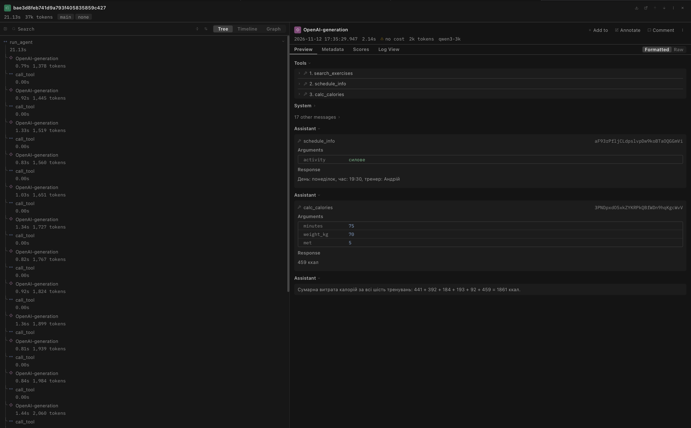
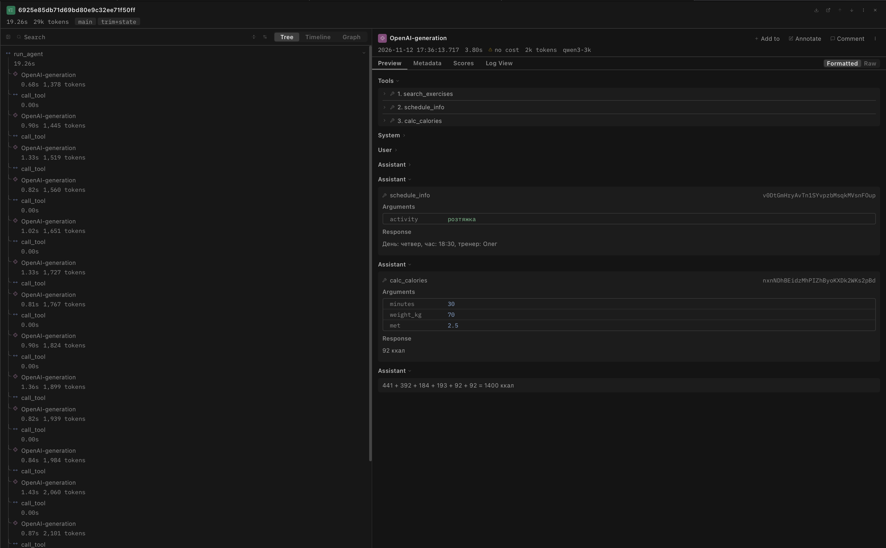

<div align="center">

Міністерство освіти і науки України

Національний університет «Одеська політехніка»

Навчально-науковий інститут комп'ютерних систем

Кафедра інформаційних систем

&nbsp;

&nbsp;

&nbsp;

**Лабораторна робота № 4**

З дисципліни: «Обчислювальні методи»

**Тема: «Контекст, стан і кеш агента»**

&nbsp;

&nbsp;

&nbsp;

&nbsp;

</div>

<div align="right">

**Виконав:**

Студент групи АІ-241

Гайтукаєв Мансур

**Викладач:**

Доц. Годовиченко М. А.

Баранов О. М.

</div>

&nbsp;

&nbsp;

&nbsp;

<div align="center">

Одеса 2026

</div>

---

## 1. Мета роботи, варіант, предметна область, модель і розмір вікна (Крок 1)

**Мета роботи:** Побачити, що відбувається з агентом, коли історія не вміщується в контекстне вікно моделі; навчитися скорочувати історію, зберігати результати інструментів поза текстом діалогу та кешувати виклики моделі; виміряти, скільки це коштує.

### Характеристики варіанта та середовища

| Параметр | Значення |
|---|---|
| **Варіант** | 4 |
| **Предметна область** | Тренування (тренажерний зал) |
| **Інструменти (`ALLOWED`)** | `search_exercises` (пошук у корпусі `data/corpus/`, 12 файлів), `schedule_info` (довідник `data/schedule.csv`, 5 занять), `calc_calories` (витрата калорій за часом, вагою та коефіцієнтом `met`) |
| **Вихідна модель** | `qwen3:4b-instruct` (Ollama, локально, `TEMPERATURE = 0`); у лабораторній роботі № 3 використовувалась `qwen2.5:3b` |
| **Ліміти кроків** | `MAX_STEPS = 6` (звичайні задачі), `MAX_STEPS_LONG = 25` (довга задача), `MAX_RETRIES = 2` |

**Чому змінено модель.** На `qwen2.5:3b` довга задача не відтворила потрібну картину: модель видавала виклики пачками (до 18 за один крок), тому історія майже не росла (2-4 кроки), а `trim` зациклювався на 25 кроків із 422 повторними викликами (логи збережено в `logs_qwen25/`). Тому остаточні вимірювання виконано на `qwen3:4b-instruct`, яка робить виклики по одному.

### Три числа з Кроку 1 (звуження контекстного вікна через `Modelfile`)

Спочатку за інструкцією Кроку 1 було створено модель `qwen3-4k` із `PARAMETER num_ctx 4096`. Оскільки у пробному прогоні з вікном `4096` найбільший вхід склав `2412` токенів (`59%` вікна, статус `final` — **випадок C** за Кроком 4), вікно в `Modelfile` було зменшено до **`3072`** токенів (`qwen3-3k`), а поріг стиснення у `config.py` виставлено на `COMPRESS_AT = 2150`:

```dockerfile
FROM qwen3:4b-instruct
PARAMETER num_ctx 3072
```

| Показник (`ollama show`) | Початкове зменшення (`4k`) | Робоче вікно за випадком C (`3k`) |
|---|---|---|
| 1. `context length` вихідної моделі (`qwen3:4b-instruct`) | **262 144** токенів | **262 144** токенів |
| 2. `num_ctx` нової моделі (розділ `Parameters`) | **4 096** токенів (`qwen3-4k`) | **3 072** токенів (`qwen3-3k`) |
| 3. У скільки разів вікно звузили | у **64** рази (`262144 / 4096`) | у **85,33** раза (`262144 / 3072`) |

Параметри `config.py`: `MODEL = "qwen3-3k"`, `NUM_CTX = 3072`, `COMPRESS_AT = 2150`, `KEEP_LAST = 6`, `STATE_RESULT_CHARS = 200`, `MAX_STEPS_LONG = 25`.

---

## 2. Довга задача: питання і правильна відповідь (Крок 2)

Для варіанта 4 (Таблиця 6 методичних вказівок: *«Шість занять із розкладу | Тривалість заняття | Витрата калорій за заняття | Сумарна витрата калорій»*) було створено скрипт `make_task.py`, який формує `long_task.json` для шести тренувань (`MIN_CALLS = 18`, тобто 6 позицій × 3 інструменти). У `schedule.csv` немає поля тривалості заняття, тому тривалість (хвилини) і коефіцієнт навантаження `met` задано прямо в питанні, вага людини 70 кг. З довідника береться день, час і тренер, з корпусу — назви вправ.

- **Шість позицій (`ITEMS`) та розрахунок без моделі (`compute()`):**

| № | Заняття | Запит до корпусу | Хвилин | `met` | Калорій |
|--:|---|---|--:|--:|--:|
| 1 | силове | спина | 60 | 6 | 441 |
| 2 | кардіо | ноги | 40 | 8 | 392 |
| 3 | йога | прес | 50 | 3 | 184 |
| 4 | пілатес | руки | 45 | 3,5 | 193 |
| 5 | розтяжка | груди | 30 | 2,5 | 92 |
| 6 | силове | просунутий | 75 | 5 | 459 |

У розкладі лише п'ять різних занять, тому «силове» повторюється двічі, і один виклик `schedule_info` у ідеальному прогоні однаковий (це не помилка агента).

- **Текст питання (`question` у `long_task.json`):**
  > «Для кожного з шести тренувань (вага людини 70 кг): 1) заняття «силове», група м'язів спина, 60 хв, коефіцієнт навантаження 6; 2) заняття «кардіо», група м'язів ноги, 40 хв, коефіцієнт 8; 3) заняття «йога», група м'язів прес, 50 хв, коефіцієнт 3; 4) заняття «пілатес», група м'язів руки, 45 хв, коефіцієнт 3.5; 5) заняття «розтяжка», група м'язів груди, 30 хв, коефіцієнт 2.5; 6) заняття «силове», рівень складності просунутий, 75 хв, коефіцієнт 5. Для кожного: (а) знайди в корпусі вправи за вказаною групою м'язів або рівнем (запит одним словом, наприклад «просунутий») і наведи назви одним реченням; (б) знайди в розкладі за назвою заняття день, час і тренера; (в) порахуй витрату калорій за заняття. У кінці назви сумарну витрату калорій за всі шість тренувань одним числом. Працюй строго по одному виклику інструмента за крок: зроби один виклик, дочекайся результату і лише потім роби наступний. У schedule_info завжди передавай назву заняття (силове, кардіо, йога, пілатес, розтяжка), а не групу м'язів чи рівень. Не давай відповіді, доки не виконаєш усі 18 викликів: для кожного з шести тренувань обов'язково потрібні search_exercises, schedule_info і calc_calories.»

  Останні три речення додано після пробних прогонів на `qwen2.5:3b`, щоб модель не пропускала позиції; `expected` при цьому не змінювався.

- **Правильна відповідь (`expected` у `long_task.json`):**

  expected = 441 + 392 + 184 + 193 + 92 + 459 = **1761**

---

## 3. Прогін без захисту та аналіз переповнення вікна (Кроки 3–4)

### Результат пробного прогону (`python measure.py none 1 probe`)

- **Конфігурація:** `none` (`COMPRESS = "none"`, `USE_STATE = False`).
- **Час виконання:** `27.1 с` на вікні `4096` і `27.9 с` на вікні `3072`.
- **Чи правильна відповідь:** **ні** (відповідь `1861`, а `expected = 1761`).

### Таблиця 2 — Зростання входу в прогоні без захисту (вікно 3072, `logs/probe_none_r1.log`)

Виведення команди `python analyze.py logs/probe_none_r1.log steps`:

| Крок | `prompt_tokens` | Приріст | Що зробила модель |
|-----:|----------------:|--------:|:------------------|
| 1 | 1356 | | `search_exercises({"query":"спина"})` |
| 2 | 1422 | 66 | `schedule_info({"activity":"силове"})` |
| 3 | 1482 | 60 | `calc_calories({"minutes":60,"weight_kg":70,"met":6})` |
| 4 | 1537 | 55 | `search_exercises({"query":"ноги"})` |
| 5 | 1628 | 91 | `schedule_info({"activity":"кардіо"})` |
| 6 | 1690 | 62 | `calc_calories({"minutes":40,"weight_kg":70,"met":8})` |
| 7 | 1745 | 55 | `search_exercises({"query":"прес"})` |
| 8 | 1802 | 57 | `schedule_info({"activity":"йога"})` |
| 9 | 1862 | 60 | `calc_calories({"minutes":50,"weight_kg":70,"met":3})` |
| 10 | 1917 | 55 | `search_exercises({"query":"рука"})` |
| 11 | 1961 | 44 | `schedule_info({"activity":"пілатес"})` |
| 12 | 2021 | 60 | `calc_calories({"minutes":45,"weight_kg":70,"met":3.5})` |
| 13 | 2078 | 57 | `search_exercises({"query":"грудь"})` |
| 14 | 2123 | 45 | `schedule_info({"activity":"розтяжка"})` |
| 15 | 2179 | 56 | `calc_calories({"minutes":30,"weight_kg":70,"met":2.5})` |
| 16 | 2235 | 56 | `search_exercises({"query":"просунутий"})` |
| 17 | 2297 | 62 | `schedule_info({"activity":"силове"})` |
| 18 | 2357 | 60 | `calc_calories({"minutes":75,"weight_kg":70,"met":5})` |
| 19 | 2412 | 55 | відповідь без виклику |

### Показники (а)–(д) за виведенням `analyze.py` та аналізом лога

- **(а) Постійна частина входу («вхід першого кроку»):** C = **1356** токенів (системна інструкція, JSON-схеми трьох інструментів у `SCHEMAS` та текст довгого питання).
- **(б) Типовий приріст за крок:** d = **57** токенів (медіана всіх додатних приростів; найбільший, 91, після пошуку вправ для ніг).
- **(в) Сума `prompt_tokens` за прогін і значення за формулою:**
  - Фактична сума `prompt_tokens` за 19 кроків: **36 104** токени.
  - За формулою n·C + d·n·(n−1)/2: 19·1356 + 57·19·18/2 = 25 764 + 9 747 = **35 511** токенів.
  - **Чому числа відрізняються:** різниця 593 токени (≈1,6%), бо приріст нерівний (від 44 до 91 токена на крок), а формула бере однакове значення d.
- **(г) Крок, на якому вхід перестав рости:** **не помічено**. Найбільший вхід 2412 токенів, це `79%` вікна `3072` (на вікні `4096` було `59%`).
- **(д) Що робила модель і перевірка чисел у `logs/probe_none_r1.log`:** застою входу немає, тому цей пункт не застосовується. Лог перевірено окремо: усі 18 викликів виконано (по одному за крок), у відповіді `441 + 392 + 184 + 193 + 92 + 459 = 1861` усі шість доданків правильні, а суму модель додала сама з помилкою (числа `1861` немає в жодному рядку `результат:`, бо в варіанті 4 немає інструмента додавання). Також модель спотворила два запити до корпусу: `рука` замість `руки` (знайдено лише «Скручування на прес») і `грудь` замість `груди` (знайдено лише «Жим гантелей лежачи»).

### Визначення випадку (A–D)

Прогін належить до **Випадку C — «Задача закоротка»**: помилки сервера немає, вхід не застиг, найбільший вхід `2412` токенів менший за `95%` вікна, статус `final`. За інструкцією Кроку 4 вікно зменшено з `4096` до `3072` (`qwen3-3k`), прогін повторено (найбільший вхід `79%` вікна), і далі працюємо з вікном `3072`. Поріг `COMPRESS_AT = 2150` вхід перетинає на кроці 15 (`2179`), тому стиснення спрацьовує посеред прогону.

---

## 4. Обрізання історії та стан задачі (Кроки 5–6)

### Таблиця 3 — Стиснення історії (`logs/probe_trim_r1.log` та `logs/probe_trim+state_r1.log`)

Поріг стиснення: `COMPRESS_AT = 2150`, `KEEP_LAST = 6`.

| Конфігурація | Крок стиснення | Вхід до стиснення, токенів | Повідомлень було -> стало | Повторних викликів за прогін |
|--------------|---------------:|---------------------------:|--------------------------:|-----------------------------:|
| `trim` | 15 | 2179 | `32 -> 8` | **10** (вичерпано ліміт 25 кроків, `step_limit`) |
| `trim+state` | 15 | 2179 | `32 -> 8`, стан додано | **0** (завершено за 16 кроків, `final`) |

- **`trim`:** після стиснення вхід упав з `2179` до `1513`, але агент забув усе, окрім інструкції, питання й останніх 6 повідомлень. З кроку 16 він знову викликає `search_exercises({"query":"ноги"})`, `schedule_info(кардіо)`, `calc_calories(40, 70, 8)` та інші виклики (усі вже виконані раніше): `10` повторів, прогін закінчився на кроці 25 (`step_limit`) без відповіді, `26.4 с`.
- **`trim+state`:** те саме стиснення, але до питання дописано записник. Повторів немає, модель відповіла на кроці 16, `19.9 с`, статус `final`. Відповідь неправильна: `441 + 392 + 184 + 193 + 92 + 92 = 1400` (модель не виконала шосту позицію і підставила `92` замість `459`).

### Аналіз першого блоку `ПЕРШЕ ПОВІДОМЛЕННЯ КОРИСТУВАЧА ПІСЛЯ СТИСНЕННЯ` (пункт 7 Кроку 6)

У файлі `logs/probe_trim+state_r1.log` після стиснення на кроці 15 блок `Результати вже виконаних викликів (збережені програмою):` містить:

- **Кількість рядків виду `- інструмент(аргументи) -> результат`:** **15 рядків** (усі успішні виклики кроків 1–15, `level == "ok"`).
- **Оцінка розміру блоку стану:**
  - Вхід на кроці 16 у `trim+state` становить `2090` токенів, а у `trim` — `1513`, отже блок стану займає приблизно **577 ≈ 580 токенів**.
  - Порівняно з типовим приростом за крок із Кроку 4 (d = 57 токенів) цей блок приблизно **у 10 разів більший** за приріст одного кроку.
  - **Чи завеликий цей блок:** так. Стиснення скоротило вхід лише з `2179` до `2090` (на `89` токенів), тобто записник майже з'їв економію, і він ростиме разом із задачею (для 18 викликів це близько 700 токенів). `STATE_RESULT_CHARS = 200` тут не допомагає, бо результати інструментів короткі. Водночас записник повністю усуває повторні виклики (`0` повторів проти `10` у чистому `trim`).

---

## 5. Кеш викликів моделі (Крок 7)

### Таблиця 4 — Робота кешу (`logs/cache1_none_r1.log` та `logs/cache2_none_r1.log`)

Перед запуском `cache1` каталог `cache/` було очищено (`rm -rf cache`). Обидва прогони виконано в конфігурації `none` з увімкненим кешем (серії `cache1` і `cache2`):

| Запуск | Кроків | Влучань у кеш | Викликів до сервера | Час, с | Правильно |
|---|---:|---:|---:|---:|---|
| 1 (кеш порожній) | 19 | 0 | 19 | 27.3 | ні |
| 2 (той самий запит) | 19 | 19 | 0 | 0.1 | ні |

### Висновки щодо роботи кешу (пункт 7 Кроку 7)

1. **Прискорення:** запуск 2 відбувся приблизно у **270 разів швидше** (27.3 / 0.1; час округлено до 0.1 с, тож це оцінка, практично миттєво), оскільки програма зробила **0 звернень до сервера Ollama**, а всі 19 відповідей прочитано з файлів у `cache/`.
2. **Що сталося б при зміні `SYSTEM` у `config.py` перед запуском 2:** функція `make_key(request)` перетворює весь запит (`model`, `messages`, `tools`, `temperature`) на JSON і рахує від нього `sha256`. Системна інструкція є першим повідомленням у `messages`, тому зміна навіть одного символу змінить відбиток кожного запиту: жодного влучання в кеш, усі 19 викликів знову пішли б на сервер.

---

## 6. Вимірювання вартості циклу та аналіз трас Langfuse (Крок 8)

### Таблиця 5 — Вартість циклу в конфігураціях (медіани по трьох повторах, серія `main`)

Виконано команду `caffeinate -i python measure.py all 3 main` (12 прогонів: по 3 повтори для `none`, `trim`, `trim+state` та додаткової конфігурації `summary`). Кеш вимкнено автоматично, бо назва серії не починається з `cache`.

| Конфігурація | Правильно (з 3) | Кроків | Токенів на вхід | Токенів на вихід | На підсумовування | Час, с | Стиснень | Повторних викликів |
|--------------|----------------:|-------:|----------------:|-----------------:|------------------:|-------:|---------:|-------------------:|
| `none` | 0 з 3 | 19 | 36 104 | 562 | 0 | 21.2 | 0 | 1 |
| `trim` | 0 з 3 | 25 | 44 804 | 684 | 0 | 26.3 | 1 | 10 |
| `trim+state` | 0 з 3 | 16 | 28 893 | 449 | 0 | 19.6 | 1 | 0 |
| `summary` *(серія `main`)* | 0 з 3 | 16 | 28 786 | 478 | 1 630 | 39.7 | 1 | 0 |
| `summary` *(серія `extra`)* | 0 з 3 | 16 | 28 837 | 478 | 1 680 | 39.9 | 1 | 0 |

Колонку «Правильно» перевірено вручну за рядками `ВІДПОВІДЬ:` у `logs/main_*.log`: правильної відповіді (`1761`) немає в жодному з 12 прогонів. Відповіді: `none` — `1861` (три рази); `trim` — без відповіді (три рази, `step_limit`); `trim+state` — `1400` (три рази); `summary` — `1733`, `1394`, `1733`.

### Приховані поламки у логах `logs/main_*.log` (пункт 5 Кроку 8)

Перевірка всіх **12 прогонів** показала такі поламки, яких не видно лише з цифр у Таблиці 5:

1. **Відповів менше ніж за 19 кроків:** сталося у **6 з 12 прогонів** (усі `trim+state` і `summary`, по 3 прогони, `16` кроків, тобто 15 викликів і відповідь). Агент пропускав шосту позицію: корпус «просунутий», розклад «силове» і `calc_calories` для 75 хв.
2. **Назвав число, якого не було в жодному рядку `результат:` (вигадав результат або неправильно додав):** сталося у **9 з 12 прогонів** (усі прогони, що дали відповідь):
   - `none` (3 прогони): `1861`. Усі шість доданків правильні, але суму додано з помилкою (має бути `1761`), бо інструмента додавання немає.
   - `trim+state` (3 прогони): `1400`. Шостий доданок вигаданий (`92` замість `459`), і додано знову з помилкою (`441 + 392 + 184 + 193 + 92 + 92 = 1394`).
   - `summary` (3 прогони): `1733`, `1394`, `1733`. Шостий доданок вигаданий (`441` або `92`), у двох прогонах додано з помилкою.
3. **Без відповіді:** `trim` у 3 з 12 прогонів (вичерпано ліміт кроків: 25 кроків, 10 повторних викликів).
4. **Спотворені запити до корпусу:** у всіх конфігураціях модель написала `рука` замість `руки` та `грудь` замість `груди`, через що корпус повернув неповні результати.

### Порівняння трас `long-main_none_r1` та `long-main_trim+state_r1` у Langfuse (пункт 6 Кроку 8)

- **Перше стиснення в `main_trim+state_r1`:** відбулося наприкінці **кроку 15** (`СТИСНЕННЯ: вхід був 2179 токенів, повідомлень 32 -> 8, стан додано`).
- **Перший виклик моделі після стиснення — крок 16 (`OpenAI-generation` № 16):**
  - Токени входу на **кроці 16** у `long-main_trim+state_r1`: **2 090 токенів** (записник із 15 рядками прикріплено до питання; у `trim` без стану вхід на цьому кроці лише `1 513`).
  - Токени входу на тому самому **кроці 16** у `long-main_none_r1`: **2 235 токенів**. Різниця 145 токенів невелика, бо записник майже з'їв економію.
  - Langfuse показує біля кожного виклику суму вхідних і вихідних токенів (крок 16: `2 125` у `trim+state` і `2 260` у `none`); у таблицях цього протоколу наведено `prompt_tokens` з логів.
- **Що в трасі Langfuse видно одразу, а в текстовому лозі довелося б рахувати вручну:**
  У дереві траси біля кожного вузла `OpenAI-generation` та `call_tool` одразу відображаються **тривалість кроку, токени кроку**, а зверху **сумарні токени та час усього прогону** (`37k` токенів і `21.13 с` у `none` проти `29k` токенів і `19.26 с` у `trim+state`). Також видно **повну історію повідомлень на вході кожного виклику**: після стиснення в `trim+state` це лише інструкція, питання із записником і кілька останніх повідомлень. У текстовому лозі суми токенів і часу довелося б рахувати вручну, а вміст `messages` кожного кроку відновлювати з усього лога.

#### Скріншоти дерев трас у Langfuse

1. **Траса `long-main_none_r1` (без захисту контексту):**



2. **Траса `long-main_trim+state_r1` (обрізання історії + стан задачі):**



---

## 7. Відповіді на питання (Розділ «Відповіді на питання»)

1. **На якому кроці агент без захисту дійшов до межі вікна і як ви це побачили (таблиця 2, пункти (г) і (д) кроку 4)? Що в його поведінці змінилося після цього?**
   До межі вікна агент без захисту не дійшов: найбільший вхід `2412` токенів (`79%` вікна `3072`) на кроці 19, а `analyze.py` показав `вхід перестав рости на кроці : не помічено` (таблиця 2). Поріг `COMPRESS_AT = 2150` вхід перетнув на кроці 15 (`2179`). Поведінка після цього не змінилася: агент завершив усі 18 викликів і відповів на кроці 19, але відповідь неправильна (`1861`) через арифметику моделі, а не через вікно.

2. **Порівняйте суму `prompt_tokens` за прогін із формулою (пункти (а)–(в) кроку 4). Чи збігається зростання з очікуваним?**
   Фактична сума `prompt_tokens` склала **36 104**, а за формулою n·C + d·n·(n−1)/2 при n = 19, C = 1356, d = 57 вийшло **35 511** (різниця 593 токени, ≈1,6%). Зростання збігається з очікуваним: вхід збільшується майже лінійно (приріст 44–91 токен за крок), а сума за прогін росте квадратично; невелика різниця пояснюється нерівним приростом (найбільший, 91, після пошуку вправ для ніг).

3. **Що втрачає агент при обрізанні? Наведіть приклад повторного виклику після стиснення. Що змінилося в `trim+state` (таблиці 3 і 5)?**
   При обрізанні `32` повідомлення стали `8`: агент забув результати всіх викликів, окрім останніх шести повідомлень. Приклад: на кроці 16 у `logs/probe_trim_r1.log` виклик `search_exercises({"query":"ноги"})` повторює виклик кроку 4; усього `10` повторів, `25` кроків, відповіді немає. У `trim+state` ті самі результати дописані до питання (15 рядків, ≈580 токенів): повторів `0`, відповідь на кроці 16, вхід `28 893` проти `44 804` токенів у `trim` (таблиці 3 і 5).

4. **Яка конфігурація найдешевша за токенами, найшвидша, найточніша (таблиця 5)? Чому висновок за трьома повторами однієї задачі обережний?**
   Найдешевша за токенами `trim+state` (`28 893` на вхід; у `summary` `28 786`, але разом із підсумовуванням `30 416`), найшвидша теж `trim+state` (`19.6 с`, `summary` найповільніша, `39.7 с`). Найточнішої немає: усі конфігурації дали `0 з 3` правильних відповідей; лише `none` зберіг усі шість правильних доданків, а в `trim+state` та `summary` шостий доданок вигаданий. Висновок обережний: одна задача, одна модель і `TEMPERATURE = 0`, тому повтори `none`, `trim` і `trim+state` збіглися повністю, і медіана нічого не додає (розкид дав лише `summary`: `1733`, `1394`, `1733`).

5. **Чому під час вимірювання вартості кеш вимкнено? Що станеться з кешем, якщо інструмент поверне інші дані або ви заміните модель під тією самою назвою?**
   Інакше повтори брали б відповіді з диска (таблиця 4: `27.3 с` проти `0.1 с`), і вартість була б майже нульовою: ми б вимірювали кеш, а не агента. Якщо інструмент поверне інші дані, зміниться історія повідомлень і ключ від цього кроку (промах кешу, а попередні кроки ще влучатимуть). Якщо замінити модель під тією самою назвою, ключ не зміниться (у ньому лише назва), і кеш віддаватиме застарілі відповіді старої моделі, тому каталог `cache/` треба очистити вручну.

6. **Які поламки довгого прогону скорочення історії не лікує в принципі?**
   Скорочення історії не лікує помилки арифметики самої моделі (у варіанті 4 немає інструмента додавання: `1861` у `none`, `1733` у `summary`), передчасну відповідь без виконання всіх викликів і вигадане шосте значення в `trim+state` та `summary` (15 викликів із 18), а також спотворені аргументи інструментів («рука», «грудь»), через які корпус повертає неповні результати. Стан зберігає результати, але не змушує модель довести задачу до кінця.

---

## 8. Додаткове завдання: підсумовування замість обрізання (`summary.py`)

Було реалізовано модуль `summary.py` (`split_history`, `render_messages`, `summarize`, `compress_by_summary`), підключено гілку `config.COMPRESS == "summary"` у `compress.py`, додано конфігурацію `summary` у `measure.py` та виконано три повтори `python measure.py summary 3 extra` (результати внесено до Таблиці 5; логи в `logs/extra_summary_r1..r3.log` та `logs/main_summary_r1..r3.log`).

### Аналіз результатів `summary` (пункт 5 додаткового завдання)

1. **Скільки токенів коштувало підсумовування (колонка «На підсумовування»):**
   `1708`, `1680` і `1638` токенів у трьох прогонах, медіана **1 680** токенів на прогін (у серії `main` — `1 630`), плюс приблизно `18 с` на додатковий виклик моделі.
2. **Скільки токенів на вході заощаджено порівняно з `trim`:**
   `44 804 − 28 837 = 15 967` токенів на вході (**14 287** після вирахування вартості підсумовування `1 680`), бо `summary`, на відміну від `trim`, не зациклюється на повторних викликах (`0` проти `10`). Порівняно з `trim+state` (`28 893`) різниця лише `56` токенів, менше за вартість підсумовування, тому загалом `summary` дорожчий (`28 837 + 1 680 = 30 517`).
3. **Чи зберіг переказ точні числа (порівняння `ПІДСУМОК ІСТОРІЇ` з рядками `результат:` у `logs/extra_summary_r1..r3.log`):**
   - **Так, числа збереглися без спотворень** у всіх трьох блоках: `441`, `392`, `184`, `193` ккал, а також дні, час і тренери (силове: понеділок 19:30, Андрій; кардіо: п'ятниця 19:00, Ірина; йога: вівторок 18:00, Олена; пілатес: середа 17:00, Марія). Результати кроків 13–15 (зокрема `92` ккал) в підсумок не потрапили, бо лишились в «хвості» з останніх 6 повідомлень.
   - **Чого переказ не зберіг:** він не нагадує, що шосту позицію ще не виконано. У всіх трьох прогонах модель відповіла на кроці 16, вигадавши шосте значення (`441`, `392` або `92` замість `459`) і додавши з помилкою (відповіді `1733`, `1714`, `1394`; наприклад, `441 + 392 + 184 + 193 + 92 + 392` дає `1694`, а модель написала `1714`).

---

## 9. Dідповіді на питання для захисту

1. **Чому вартість усього прогону агента зростає швидше, ніж вартість одного кроку?**
   Модель не має пам'яті між викликами: на кожному кроці k їй передається вся історія від кроку 1 до k. Вхід кроку становить C + (k−1)·d, а сума за n кроків росте квадратично. У нашому прогоні `none` вхід одного кроку виріс з `1356` до `2412` токенів, а сума за 19 кроків досягла **36 104** токенів (за формулою `35 511`).
2. **Що відбувається, коли історія не вміщується у вікно? Як ви помітили це у своєму лозі і чому агент не отримує помилки?**
   Ollama не повертає помилку, а мовчки відкидає початок історії (разом з питанням). Ознака в лозі: вхід перестає рости або падає, хоча повідомлення додаються (`analyze.py` показує «вхід перестав рости на кроці N»). У нашому прогоні на вікні `3072` вхід не дійшов до межі (максимум `2412`, `79%`), тому цього ефекту ми не спостерігали (`не помічено`).
3. **Чому `COMPRESS_AT` менший за `NUM_CTX`?**
   Стиснення перевіряється за входом поточного виклику, але у вікно мають вміститися також відповідь моделі, результат наступного інструмента і блок стану (у нас `≈580` токенів). Для вікна `3072` поріг `2150` залишає запас `922` токени.
4. **Навіщо цикл `while` у `trim` (`drop_orphan_tools`)? Що станеться, якщо його прибрати?**
   Межа розрізу може пройти між повідомленням моделі з викликом і відповідним результатом (`role = "tool"`). «Осиротілий» результат без виклику сервер може відхилити або модель не зрозуміє, до чого він. У прогонах на `qwen2.5:3b` модель робила пачку з 6 викликів, останні 6 повідомлень були самими результатами, і цикл прибрав їх усі (`23 -> 2`, `logs_qwen25/`). На `qwen3` хвіст починається з виклику (`32 -> 8` = 2 + 6), тому цикл нічого не прибирав.
5. **Що втрачає агент при обрізанні і як це компенсує стан? Чого стан не компенсує? Чому стан записується тільки для викликів з рівнем `ok`?**
   При обрізанні агент втрачає результати старих викликів і повторює їх (`10` повторів у `trim`). Стан зберігає список `- tool(args) -> result` у програмі й дописує його до питання (`0` повторів у `trim+state`). Він не компенсує того, що модель не знає, які позиції ще не виконано (відповідь `1400` на кроці 16), і не рахує за модель (помилки додавання). Записуються лише виклики з `level == "ok"`, щоб помилки валідації не потрапляли до записника як факти.
6. **З чого складається ключ кешу? Коли від кешу є користь, а коли його не можна вмикати?**
   Ключ це `sha256` від JSON із `model`, `messages`, `tools` і `temperature` (з `sort_keys=True`). Кеш корисний під час налагодження (`27.3 с` -> `0.1 с`), але його не можна вмикати під час вимірювання вартості, коли змінюються дані інструментів або коли модель замінено під тією самою назвою.
7. **Чому кожну конфігурацію проганяли тричі й брали медіану? Чому висновки все одно обережні?**
   Три повтори й медіана відсіюють випадкові відхилення часу та варіації генерації. У нас через `TEMPERATURE = 0` повтори `none`, `trim` і `trim+state` збіглися повністю, розкид дав лише `summary` (`1733`, `1394`, `1733`). Висновки обережні: одна задача, одна модель, одне вікно.
8. **Покажіть у трасі Langfuse місце, де стиснення зменшило вхід моделі.**
   У трасі `long-main_trim+state_r1` стиснення спрацювало після кроку 15: сумарні токени генерації (вхід + вихід) впали з `2 218` на кроці 15 (`2179 + 39`) до `2 125` на кроці 16 (`2090 + 35`), а в `long-main_none_r1` на кроці 16 було `2 260`. У деталях генерації кроку 16 видно скорочену історію: інструкцію, питання із записником (15 рядків) і кілька останніх повідомлень (`8` повідомлень замість `32`).

---

## 10. Висновок

У ході виконання лабораторної роботи було досліджено поведінку агента в умовах обмеженого контекстного вікна (`NUM_CTX = 3072`) на довгій задачі з 18 викликів інструментів (варіант 4, тренування) та випробувано чотири способи керування контекстом:

1. **Без захисту (`none`):** агент виконав усі 18 викликів за 19 кроків, вхід виріс з `1356` до `2412` токенів (`79%` вікна), мовчазного обрізання не було. Відповідь неправильна (`1861`): усі доданки правильні, але суму модель додала сама з помилкою.
2. **Обрізання історії (`trim`):** після стиснення на кроці 15 (`32 -> 8` повідомлень) агент забув виконані виклики, зробив **10 повторних викликів** і не завершив задачу за ліміт у 25 кроків (`44 804` токени на вхід, без відповіді).
3. **Обрізання + стан задачі (`trim+state`):** дало **найбільший ефект**: `0` повторних викликів замість `10`, `16` кроків замість `25` і `28 893` токени входу проти `44 804` у `trim` (на 36% менше) та `36 104` у `none` (на 20% менше). Але записник коштує близько `580` токенів і не змусив модель виконати шосту позицію: відповідь `1400` неправильна.
4. **Кешування (`cache`) та підсумовування (`summary`):** кеш скоротив час повторного прогону з `27.3 с` до `0.1 с` (`19` з `19` влучань), що корисно для налагодження, але не для вимірювання. Підсумовування точно зберегло числа, але коштувало `1 680` токенів і подвоїло час (`39.9 с`), тому виграшу над станом не дало.
5. **Що ще варто змінити:** (а) додати до набору інструментів додавання (суму списку чисел), щоб модель не складала шість значень сама; (б) додавати до записника список позицій, що лишилися, щоб модель не відповідала достроково; (в) скоротити записник до фактів (наприклад, лише чисел); (г) обрізати історію групами «виклик + результати» та за токенами; (д) перевіряти аргументи запитів до корпусу (`рука`, `грудь`).