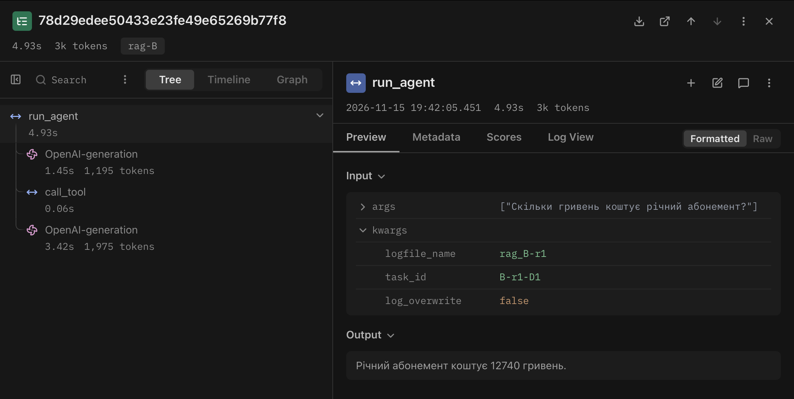
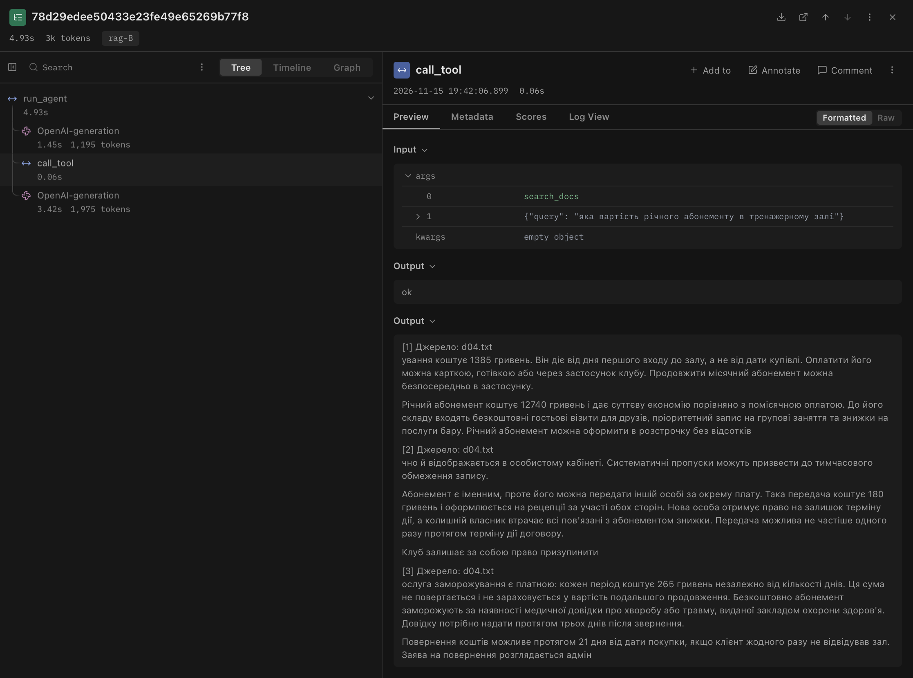
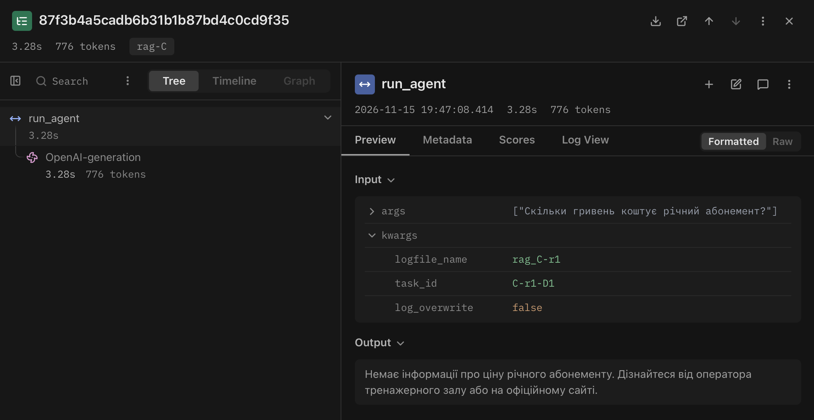

<div align="center">

Міністерство освіти і науки України

Національний університет «Одеська політехніка»

Навчально-науковий інститут комп'ютерних систем

Кафедра інформаційних систем

&nbsp;

&nbsp;

**Лабораторна робота № 5**

З дисципліни: «Обчислювальні методи»

**Тема: «RAG-агент: пошук по документах як інструмент»**

&nbsp;

&nbsp;

</div>

<div align="right">

**Виконав:**

Студент групи АІ-241

Гайтукаєв Мансур

**Викладач:**

Доц. Годовиченко М. А.

Баранов О. М.

</div>

&nbsp;

<div align="center">

Одеса 2026

</div>

---

## Мета роботи

Замінити примітивний пошук підрядком з лабораторної роботи № 2 векторним. Під'єднати його до агента як звичайний інструмент. Перевірити якість пошуку окремо від агента. Побачити, як розмір чанка та опис інструмента впливають на поведінку агента, і виміряти це кількома повторами.

---

## 1. Підготовка проєкту та вихідні параметри

Основою проєкту є агент із лабораторної роботи № 4. Каталог `lab5` створено копіюванням `lab4` без `venv/`, `cache/`, `state/`, `results/` і `logs/`. Збережено локальну модель чату, температуру, системне повідомлення, розмір вікна, п'ять задач із `tasks.json` та інструменти `schedule_info` і `calc_calories`. Інструмент пошуку підрядком `search_exercises` замінено на векторний `search_docs`: у списку `ALLOWED` його немає, у `tools.py` він залишився, але агентові недоступний. Для ембедингів завантажено `bge-m3` (`ollama pull bge-m3`), додано бібліотеки `numpy` і `faiss-cpu`, у `.gitignore` додано `index/embeddings_cache.json`, `chroma_db/`, `chroma_*/`, `state/`.

| Параметр | Значення |
|---|---|
| Варіант | 4 |
| Предметна область | Тренування (вигаданий тренажерний зал «Ритм Арени») |
| Модель чату | `qwen3-4k` на основі `qwen3:4b-instruct` (Ollama) |
| Контекстне вікно | 4096 токенів (`num_ctx 4096`) |
| Температура | 0 |
| Модель ембедингів | `bge-m3`, довжина вектора 1024 |
| Векторний індекс | FAISS `IndexFlatIP` |
| Метрика | Косинусна схожість (скалярний добуток L2-нормалізованих векторів) |
| Каталоги документів | `data/corpus/`, `data/docs/` |
| Спосіб нарізання | `fixed`, 500 символів, перекриття 0, без заголовка в чанку |
| `TOP_K` / `MIN_SCORE` | 3 / 0.55 |
| Інструменти (`ALLOWED`) | `search_docs`, `schedule_info`, `calc_calories` |
| Скорочення історії, стан, кеш відповідей | Вимкнено (`COMPRESS = "none"`, `USE_STATE = False`, `USE_CACHE = False`) |
| Трасування | Langfuse |

Усі документи разом містять 18 147 символів, що за наближеною оцінкою 2,5 символа на токен становить близько 7259 токенів. Це приблизно в 1,77 раза більше за контекстне вікно 4096 токенів, а ще в запиті є системне повідомлення й схеми інструментів (близько 1150 токенів). Оцінка не є точним підрахунком токенізатора, але показує, чому для роботи з корпусом потрібен пошук окремих фрагментів.

Для дослідження впливу опису використано три варіанти інструмента: `A`, `B`, `C`. Кожен перевірено на десяти зафіксованих питаннях із трьома повторами, разом **90 прогонів**. Між конфігураціями змінювався лише текст опису `search_docs`.

---

## 2. Документи та контрольні питання

### 2.1. Документи

Початковий корпус із 12 коротких описів вправ `e01`-`e12` у `data/corpus/` лишився без змін. До нього додано п'ять довгих вигаданих документів у `data/docs/`; теми взято з рядка варіанта 4 табл. 8 методички. Документи згенеровано чат-ботом за запитом з методички й збережено в UTF-8: перший рядок це назва, далі абзаци, розділені порожніми рядками, без таблиць і розмітки. Числові значення записані цифрами, нетипові й не повторюються між документами.

| Файл | Назва документа | Абзаців після заголовка |
|---|---|---:|
| `d01.txt` | Правила техніки безпеки у тренажерному залі «Ритм Арени» | 8 |
| `d02.txt` | Програма адаптації для новачків у тренажерному залі «Ритм Арени» | 9 |
| `d03.txt` | Рекомендації щодо відновлення та харчування для клієнтів «Ритм Арени» | 9 |
| `d04.txt` | Правила абонементів і заморожування в клубі «Ритм Арени» | 9 |
| `d05.txt` | Правила користування обладнанням у тренажерному залі «Ритм Арени» | 9 |

Документи містять спеціально задані навчальні значення: вартість річного абонемента 12740 гривень, цикл адаптації 11 тижнів, найважча гантель 44 кілограми, штраф за пропущене заняття 130 гривень та інші. Це умовні дані експерименту, а не реальні рекомендації.

### 2.2. Контрольні питання

У файлі `rag_cases.json` зафіксовано десять питань: 4 прямих (`direct`), 4 перефразованих (`paraphrase`) і 2 без відповіді (`none`). Для питань із відповіддю `must_contain` це дослівна фраза з документа, яка зустрічається в корпусі рівно один раз, а `expected` це очікуване значення. Для питань без відповіді обидва поля `null`. Питання й правильні відповіді зафіксовано до першого прогону та не змінювалися.

| ID | Тип | Питання | `must_contain` | `expected` |
|---|---|---|---|---|
| D1 | `direct` | Скільки гривень коштує річний абонемент? | Річний абонемент коштує 12740 гривень | 12740 |
| D2 | `direct` | Яка щонайменша тривалість розминки перед основною частиною тренування у хвилинах? | тривалістю щонайменше 14 хвилин | 14 |
| D3 | `direct` | Скільки кілограмів важить найважча гантель у зоні вільних ваг? | найважча з них важить 44 кілограми | 44 |
| D4 | `direct` | Скільки тижнів триває повний цикл адаптації для новачків? | адаптації триває 11 тижнів | 11 |
| P1 | `paraphrase` | Яку кількість рідини радять випивати щодня відносно власної ваги? | норма становить 33 мілілітри води | 33 |
| P2 | `paraphrase` | Скільки доведеться доплатити, якщо записався на групове тренування, але не прийшов і не попередив завчасно? | штраф у розмірі 130 гривень | 130 |
| P3 | `paraphrase` | За який час працівники клубу мають добігти до відвідувача, який подав сигнал небезпеки? | місця виклику за 38 секунд | 38 |
| P4 | `paraphrase` | Яку грошову гарантію треба внести, щоб користуватися індивідуальним відділенням для речей у роздягальні? | застава в розмірі 85 гривень | 85 |
| N1 | `none` | Скільки коштує година занять із приватним тренером? | `null` | `null` |
| N2 | `none` | Скільки гривень коштує щомісячна підписка на онлайн-тренування у застосунку клубу? | `null` | `null` |

### 2.3. Перевірка корпусу та питань

```bash
python check_cases.py
```

Результат:

```text
Документів: 17; символів: 18147; приблизно токенів: 7259 (вікно 4096)
Питань: 10 ({'direct': 4, 'paraphrase': 4, 'none': 2})
Усе гаразд
```

Перевірка підтвердила потрібну кількість питань кожного типу, відсутність повторюваних ідентифікаторів, наявність кожної фрази `must_contain` рівно в одному місці корпусу та приналежність `expected` до `must_contain`. Обсяг корпусу перевищує вікно моделі, тож пошук справді потрібен.

### 2.4. Перевірка відповідей без документів

Три питання поставлено моделі напряму (`ollama run qwen3-4k`), без документів.

| Питання | Відповідь моделі без документів | Значення в документах | Вгадала? |
|---|---|---|---|
| D2 (тривалість розминки) | 5 хвилин | 14 | Ні |
| D4 (цикл адаптації) | 8-12 тижнів, у висновку 8 тижнів | 11 | Ні |
| P1 (рідина відносно ваги) | 30-35 мл на 1 кг ваги | 33 | Ні, але названий діапазон включає 33 |

Точних збігів немає, тобто значення не вгадуються. Єдине зауваження стосується P1: 33 мл/кг лежить усередині типового діапазону, який модель знає із загальних знань, тож це найменш «нетипове» значення з усіх. Мала перевірка з трьох питань не доводить, що випадкове вгадування неможливе в інших запусках.

---

## 3. Перевірка моделі ембедингів

Для перетворення текстів на вектори використано `bge-m3` в Ollama. Перевірку виконано скриптом:

```bash
python embed_check.py
```

| Показник | Значення |
|---|---:|
| Довжина вектора | 1024 |
| Норма першого вектора | 1.000 |
| Схожість запиту «Скільки коштує відправити посилку?» із фразою «Тариф на доставку» | 0.732 |
| Схожість того самого запиту із фразою «Графік роботи кур'єрів» | 0.568 |

Запит ближчий до фрази про тариф, ніж до фрази про графік, тобто модель розрізняє зміст, а не збіг слів. Загальну якість пошуку на нашому корпусі перевірено окремо в розділі 5.

### Нормалізація векторів

У реалізації пошуку вектори документів і запитів нормалізуються до одиничної L2-норми, тому їхній скалярний добуток дорівнює косинусній схожості, і можна використовувати `IndexFlatIP`. Без нормалізації скалярний добуток залежав би не лише від кута між векторами, а й від їхніх норм.

### Кешування ембедингів

Модуль `embedder.py` зберігає обчислені вектори в `index/embeddings_cache.json`. Ключ кешу складається з назви моделі й тексту, тому незмінені фрагменти не потребують повторного звернення до Ollama (перший запуск `embed_check.py` тривав 1,7 с, наступні майже миттєві). Цей кеш відрізняється від кешу відповідей чат-моделі: він зберігає вектори текстів, а не результати генерації. Кеш відповідей під час вимірювань вимкнено. Файл кешу ембедингів до комплекту здачі не входить.

---

## 4. Нарізання документів на чанки

### 4.1. Реалізація

У `chunking.py` реалізовано два способи поділу:

- `fixed` – шматки заданої довжини в символах із можливістю перекриття;
- `paragraphs` – склеювання сусідніх абзаців, поки вони вміщуються в заданий розмір.

Для кожного чанка зберігаються файл `source`, номер `chunk` (з нуля) і текст `text`. Скрипт `show_chunks.py` нумерує чанки з одиниці.

### 4.2. Порівняння нарізання одного документа

Для дослідження використано `data/docs/d01.txt`.

```bash
python show_chunks.py data/docs/d01.txt fixed 200 0
python show_chunks.py data/docs/d01.txt fixed 500 100
python show_chunks.py data/docs/d01.txt paragraphs 800
```

**Таблиця 1 – Нарізання одного документа**

| Спосіб | Чанків | Закінчуються посеред речення | Довжина найбільшого, символів |
|---|---:|---:|---:|
| `fixed`, 200, перекриття 0 | 16 | 14 | 200 |
| `fixed`, 500, перекриття 100 | 8 | 7 | 500 |
| `paragraphs`, 800 | 5 | 0 | 798 |

Скрипт визначає можливий розрив речення за останнім символом чанка (`.`, `!`, `?`, `…`, `:`), тож це спрощена перевірка. Нарізання за абзацами зберегло природні межі тексту (чанки від 407 до 798 символів), а фіксована довжина частіше розділяла слова й речення.

### 4.3. Приклади розривів

У `fixed`, 500, перекриття 100, чанк 3 закінчується словами «…розминку тривалістю щонайменше 14 **хви**». Число 14 лишилося без одиниці виміру, бо слово «хвилин» обірвано. Повний факт є лише в чанку 4, і то завдяки перекриттю в 100 символів; без перекриття він був би розрізаний між двома чанками.

У `fixed`, 200, чанки 14 і 15 розділені посеред слова: «У залі встановлено тр» | «ивожні кнопки, а чергова зміна зобов'язана дістатися місця виклику за 38 секунд». Число 38 лишилося в одному фрагменті, а початок речення з пояснювальним контекстом в іншому.

Для агента це небезпечно: якщо пошук поверне чанк із обірваним фактом, модель може відповісти неправильно або вигадати відсутню частину. Не кожен факт розривається, тож остаточну конфігурацію обрано за результатами пошуку на контрольних питаннях (розділ 5).

---

## 5. Оцінка якості пошуку без агента

### 5.1. Порівняння конфігурацій нарізання

```bash
python check_retrieval.py
```

Для кожної конфігурації проіндексовано всі 17 документів. Якість оцінюється на восьми питаннях із відповіддю. Показник `hit@k` це частка питань, для яких серед перших `k` результатів є чанк із дослівною фразою `must_contain`. На цьому етапі оцінюється лише ранжування, без відсіювання порогом.

**Таблиця 2 – Пошук при різному нарізанні**

| Конфігурація | Чанків | Сер. довжина | hit@1 | hit@3 | hit@5 | hit@3 прямі | hit@3 перефр. | Токенів (k=3) |
|---|---:|---:|---:|---:|---:|---:|---:|---:|
| `fixed-200-0` | 95 | 191 | 0.75 | 0.88 | 0.88 | 1.00 | 0.75 | 229 |
| **`fixed-500-0`** | **47** | **386** | **1.00** | **1.00** | **1.00** | **1.00** | **1.00** | **463** |
| `fixed-500-100` | 54 | 404 | 1.00 | 1.00 | 1.00 | 1.00 | 1.00 | 484 |
| `fixed-1500-0` | 27 | 672 | 0.62 | 0.88 | 1.00 | 0.75 | 1.00 | 807 |
| `paragraphs-800` | 37 | 489 | 1.00 | 1.00 | 1.00 | 1.00 | 1.00 | 587 |
| `paragraphs-800+title` | 37 | 523 | 1.00 | 1.00 | 1.00 | 1.00 | 1.00 | 628 |

Обсяг результату оцінено як три середні довжини чанка, поділені на 2,5 символа на токен. Це наближення, яке не включає службове оформлення виклику інструмента.

### 5.2. Вибір конфігурації

За методичкою обирається конфігурація з найвищим `hit@3`, а за рівності з найменшим обсягом результату. Максимального `hit@3 = 1.00` досягли чотири конфігурації, і серед них найменший оцінений обсяг має **`fixed-500-0` (463 токени)**. Тому в `config.py` встановлено:

```python
CHUNK_METHOD = "fixed"
CHUNK_SIZE = 500
CHUNK_OVERLAP = 0
WITH_TITLE = False
TOP_K = 3
```

Спостереження за таблицею 2:

- Збільшення розміру з 200 до 500 символів підняло `hit@3` з 0.88 до 1.00 (дрібні чанки відокремлюють факт від контексту, зокрема на перефразованих питаннях: 0.75). При 1500 символах `hit@3` знову 0.88, а `hit@1` падає до 0.62, бо великий чанк розмиває зміст.
- Перекриття 100 і назва документа в чанку не змінили hit rate, але збільшили кількість чанків (54 проти 47) і оцінку обсягу (484 проти 463; 628 проти 587).
- Недолік обраної конфігурації: `fixed` ріже текст посеред речень (розділ 4). На наших восьми питаннях це не завадило, а `paragraphs-800` дає таку саму точність без обривів ціною на 124 токени більшого результату.

Для обраної конфігурації `hit@3` досягло повного значення, тому випадків, коли потрібного чанка немає серед трьох, розбирати не потрібно. У слабших конфігураціях `hit@3` впав до 0.88.

Ці спостереження стосуються нашого корпусу й восьми питань і не доводять переваги способу нарізання для будь-яких документів.

### 5.3. Підбір порога схожості

Векторний пошук повертає найближчі чанки навіть для питання без відповіді. Щоб відсіяти недостатньо схожі результати, використано поріг `MIN_SCORE`. Для обраної конфігурації виконано:

```bash
python check_retrieval.py scores
```

**Таблиця 3 – Схожість першого результату (`fixed-500-0`)**

| ID | Тип | Схожість | Перший результат містить `must_contain` |
|---|---|---:|---|
| D1 | `direct` | 0.734 | Так |
| D2 | `direct` | 0.709 | Так |
| D3 | `direct` | 0.563 | Так |
| D4 | `direct` | 0.684 | Так |
| P1 | `paraphrase` | 0.583 | Так |
| P2 | `paraphrase` | 0.608 | Так |
| P3 | `paraphrase` | 0.627 | Так |
| P4 | `paraphrase` | 0.611 | Так |
| N1 | `none` | 0.561 | - |
| N2 | `none` | 0.648 | - |

Найнижча схожість серед питань із відповіддю 0.563 (D3), найвища серед питань без відповіді 0.648 (N2). **Межі перекриваються**, тож жоден поріг не розділяє питання ідеально.

Обрано `MIN_SCORE = 0.55`: це трохи нижче найнижчої схожості питань із відповіддю, із запасом на те, що агент переписує запит і схожість трохи змінюється (у прогонах `top_score` питань із відповіддю був від 0.557). Компроміс полягає в тому, що важливіше не пропустити правильну відповідь, ніж відсікти питання без відповіді: поріг 0.60 відкинув би D3 і P1, а 0.65 п'ять із восьми питань із відповіддю. Поріг виконує роль страховки від нетематичних запитів, а від вигадування відповіді має захищати другий рівень, текст опису інструмента. Для довідки: для `paragraphs-800` межі не перекривалися (0.612 проти 0.617), але розрив лише 0.005, і поріг був би надто крихким.

### 5.4. Остаточний індекс

```bash
python build_index.py
```

Остаточний індекс містить **47 чанків**: середня довжина 386 символів, найкоротший 32, найдовший 500, розмірність вектора 1024. У каталозі `index/` збережено `docs.faiss`, `chunks.json` і `meta.json`. Файл `meta.json` фіксує параметри побудови, тому завантаження індексу з іншими параметрами в `config.py` зупиняється з поясненням.

Схожості в таблиці 3 отримано для оригінальних питань користувача. Під час роботи агент переписує запит, тож фактичні значення можуть відрізнятися (розділ 8).

---

## 6. Перевірка інструмента через диспетчер без моделі

Перед вимірюванням агента `search_docs` перевірено без чат-моделі: скрипт `try_tool.py` передає виклик через той самий диспетчер `call_tool`, що й агент.

### 6.1. Питання з відповіддю

```bash
python try_tool.py D1
```

```text
ПИТАННЯ: Скільки гривень коштує річний абонемент? 

рівень: ok
[1] Джерело: d04.txt
ування коштує 1385 гривень. Він діє від дня першого входу до залу, а не від дати купівлі. Оплатити його можна карткою, готівкою або через застосунок клубу. Продовжити місячний абонемент можна безпосередньо в застосунку.

Річний абонемент коштує 12740 гривень і дає суттєву економію порівняно з помісячною оплатою. До його складу входять безкоштовні гостьові візити для друзів, пріоритетний запис на групові заняття та знижки на послуги бару. Річний абонемент можна оформити в розстрочку без відсотків

[2] Джерело: d04.txt
чно й відображається в особистому кабінеті. Систематичні пропуски можуть призвести до тимчасового обмеження запису.

Абонемент є іменним, проте його можна передати іншій особі за окрему плату. Така передача коштує 180 гривень і оформлюється на рецепції за участі обох сторін. Нова особа отримує право на залишок терміну дії, а колишній власник втрачає всі пов'язані з абонементом знижки. Передача можлива не частіше одного разу протягом терміну дії договору.

Клуб залишає за собою право призупинити 

[3] Джерело: d04.txt
ослуга заморожування є платною: кожен період коштує 265 гривень незалежно від кількості днів. Ця сума не повертається і не зараховується у вартість подальшого продовження. Безкоштовно абонемент заморожують за наявності медичної довідки про хворобу або травму, виданої закладом охорони здоров'я. Довідку потрібно надати протягом трьох днів після звернення.

Повернення коштів можливе протягом 21 дня від дати покупки, якщо клієнт жодного разу не відвідував зал. Заява на повернення розглядається адмін
```

Усі три результати з `d04.txt`, і перший містить потрібну фразу «Річний абонемент коштує 12740 гривень». Початок і кінець чанків обірвані («ування коштує 1385 гривень…», «…без відсотків»), бо нарізання йде по 500 символів без перекриття, але факт у першому результаті повний.

### 6.2. Питання без відповіді

```bash
python try_tool.py N1
```

```text
ПИТАННЯ: Скільки коштує година занять із приватним тренером? 

рівень: ok
[1] Джерело: d04.txt
чно й відображається в особистому кабінеті. Систематичні пропуски можуть призвести до тимчасового обмеження запису.

Абонемент є іменним, проте його можна передати іншій особі за окрему плату. Така передача коштує 180 гривень і оформлюється на рецепції за участі обох сторін. Нова особа отримує право на залишок терміну дії, а колишній власник втрачає всі пов'язані з абонементом знижки. Передача можлива не частіше одного разу протягом терміну дії договору.

Клуб залишає за собою право призупинити 
```

Відповіді на питання N1 у документах немає, але пошук однаково повернув чанк про вартість передачі абонемента, а не повідомлення «У документах нічого схожого не знайдено». Причина в тому, що найвища схожість для N1 (0.561) трохи перевищує поріг 0.55 (розділ 5): поріг відсік лише два слабші кандидати, залишивши один. Це наслідок того, що межі схожості питань із відповіддю й без неї перекриваються. Відмовляється відповідати вже сам агент (розділ 8).

### 6.3. Невалідні аргументи

Закороткий запит `query: "а"`, який скрипт передає після кожного питання, відхилено схемою Pydantic ще до пошуку (однаково для D1 і N1):

```text
Занадто короткий запит -> рівень: schema
Помилка: аргументи не пройшли перевірку.
Поле query: String should have at least 3 characters
Виправ аргументи і виклич інструмент ще раз.
```

Статус `ok` означає лише, що інструмент виконався, а не що відповідь знайдено. Вибір інструмента й формулювання запиту самою моделлю досліджуються в наступних розділах.

---

## 7. Експерименти з агентом за трьох описів інструмента

### 7.1. Умови

**Таблиця 4 – Конфігурації агента**

| Опис | Текст `search_docs` | Нарізання, `TOP_K`, `MIN_SCORE` |
|---|---|---|
| `A` | «Шукає вправи за групою м'язів або рівнем складності. Використовуй, коли користувач описує, що хоче тренувати.» (опис старого пошуку) | `fixed-500-0`, 3, 0.55 |
| `B` | Докладний: «ЄДИНЕ джерело даних про правила й організацію роботи тренажерного залу та про вправи. Викликай ЗАВЖДИ, коли питання стосується будь-якого правила, ліміту, терміну, суми, віку, кількості чи умови залу… Ніколи не відповідай «немає інформації»… не викликавши спершу цей інструмент. Документи охоплюють: техніку безпеки; програму для початківців; відновлення й харчування; абонементи; користування обладнанням; вправи… Розклад занять шукай через schedule_info, калорії рахуй через calc_calories. Відповідай лише за знайденими фрагментами; якщо потрібного там немає, так і скажи користувачу.» | ті самі |
| `C` | «Шукає інформацію.» | ті самі |

Повний текст опису `B` наведено в `schemas.py`. Вимірювання виконано командою `python measure_rag.py` (3 описи × 3 повтори × 10 питань = 90 прогонів), таблиці побудовано `python rag_report.py`. Результати збережено в [results/rag.csv](results/rag.csv), логи у `logs/rag_<опис>-r<повтор>.log`. Через `TEMPERATURE = 0` три повтори кожного опису дали однакові відповіді (різниться лише час), тож фактично це вибірка з 8 питань із відповіддю та 2 без відповіді на кожен опис.

### 7.2. Підсумкові показники

**Таблиця 5 – Агент із трьома описами інструмента**

| Опис | Правильно (з 24) | Викликав пошук (з 24) | Кроків, медіана | Токенів входу, медіана | Час, с, медіана |
|---|---:|---:|---:|---:|---:|
| `A` | 0 | 0 | 1.0 | 778 | 2.2 |
| `B` | 15 | 15 | 2.0 | 2677 | 4.3 |
| `C` | 6 | 6 | 1.0 | 738 | 2.7 |

Правильність і звернення до пошуку стосуються 24 прогонів питань із відповіддю на опис. Медіани кроків, токенів і часу обчислено за всіма 30 прогонами опису. Токени входу це сума `prompt_tokens` за всі виклики моделі в одному прогоні.

### 7.3. Розподіл результатів

**Таблиця 6 – Куди ламається відповідь**

| Категорія | `A` | `B` | `C` |
|---|---:|---:|---:|
| Правильно (питання з відповіддю) | 0 | 15 | 6 |
| Не шукав і відповів неправильно | 24 | 9 | 18 |
| Шукав, але потрібного фрагмента в результаті немає | 0 | 0 | 0 |
| Фрагмент був у результаті, відповідь неправильна | 0 | 0 | 0 |
| Питання без відповіді: визнав, що не знає | 6 | 3 | 6 |
| Питання без відповіді: вигадав відповідь | 0 | 3 | 0 |

### 7.4. Ручна перевірка автоматичної оцінки

Автоматична перевірка груба, тому переглянуто всі прогони з `correct = 0` і всі відповіді на питання `none`. Скрипт позначив відповіді опису `B` на N1 («Інформації про вартість години занять із приватним тренером у даних немає») як `invented`, бо шукає шаблони на кшталт «немає інформац», а тут слова стоять в іншому порядку. Це правильна відмова, тож у `results/rag.csv` для трьох рядків `B,<повтор>,N1` виправлено `correct = 1`, `category = refused` і перераховано таблиці. Відповіді B на N2 («Щомісячна підписка… коштує 1385 гривень») справді вигадані. Інших розбіжностей немає.

### 7.5. Висновки за таблицями

- Усі помилки на питаннях із відповіддю лежать в одному місці: агент не звертається до пошуку (51 з 72 прогонів: 24 + 9 + 18). Категорії «шукав, але немає» й «фрагмент був, але не використав» дорівнюють 0: щоразу, коли агент викликав `search_docs`, потрібний фрагмент був у результаті й відповідь була правильна (21 з 21).
- Опис `B` дав найбільше правильних відповідей (15 з 24): пошук викликано для D1, D2, D4, P1, P2, а для D3, P3, P4 ні. Опис `C` викликав пошук лише для D4 і P1, опис `A` ніколи.
- Відмови `A` і `C` на питання без відповіді (по 6) не є заслугою захисту: ці описи взагалі не викликали пошук і відповідали «немає інформації» навіть на питання, відповідь на які є. Опис `B` після пошуку відмовив на N1 і вигадав відповідь на N2.

Висновки обмежені десятьма питаннями й одним варіантом моделі; через нульову температуру повтори не є незалежними.

---

## 8. Розбір прогонів у логах і трасах Langfuse

Фрагменти взято з `logs/rag_*-r*.log`; прогін позначено рядком `##### <опис>-r<повтор>-<id>`, а назва його траси в Langfuse `rag-<опис>-r<повтор>-<id>`.

### 8.1. Агент не шукав (`no_search`)

- `A-r1-D3`: виклику немає (`prompt_tokens=774`), відповідь «Найважча гантель у зоні вільних ваг важить 100 кілограмів.» У документі 44, число вигадане.
- `C-r1-D2`: без виклику, «…зазвичай становить 5-10 хвилин». У документі 14, це загальне знання моделі.
- `A-r1-P1`: «приблизно 30-40 мілілітрів рідини на кілограм ваги тіла». У документі 33.
- `B-r1-D3`: «Не має інформації про вагу найважчої гантели… Дізнайтеся це через інструмент `search_docs`…»: модель називає інструмент, але сама його не викликає. Так само `B-r1-P3`: «Немає інформації… Скажи, чи хочеш ти, щоб я це дізнався?»

У `A` і `C` без пошуку модель або вигадує число (A: D3, P1; C: D2), або відмовляється. У `B` вигадок без пошуку немає, але 3 із 8 питань агент усе одно не шукає.

### 8.2. Який запит написала модель

| Питання | Запит у виклику `search_docs` | Схожість питання (табл. 3) | `top_score` агента |
|---|---|---:|---:|
| D1 | «яка вартість річного абонементу в тренажерному залі» | 0.734 | 0.700 |
| D2 | майже копія питання з малої літери | 0.709 | 0.691 |
| D4 | питання + «в тренажерному залі» | 0.684 | 0.724 |
| P1 | копія питання з малої літери | 0.583 | 0.557 |
| P2 | «умови виплати штрафу за відмову від групового тренування або не приймання залу без попередження» | 0.608 | 0.615 |
| N1 | «вартість години занять із приватним тренером» | 0.561 | 0.552 |
| N2 | «вартість щомісячної підписки на онлайн-тренування у застосунку клубу» | 0.648 | 0.619 |

Модель то копіює питання, то переписує його іменниковою фразою («яка вартість…») і часто додає «в тренажерному залі». У P2 вона сама додала слово «штрафу», якого не було в питанні, але яке збігається зі словом у документі, і схожість трохи зросла (0.615 проти 0.608). Схожості переписаних запитів відрізняються від схожостей оригінальних питань приблизно на ±0.04. Прямі питання дають 0.69-0.72, перефразовані 0.557-0.615: чим менше збігів ключових слів, тим нижча схожість. Питання P1 (0.557) лежить лише на 0.007 вище порога.

### 8.3. Шукав, але не знайшов (`miss`)

Таких прогонів немає. У всіх 15 прогонах `B` із пошуком і в 6 прогонах `C` чанк із потрібною фразою був у результаті, зазвичай першим. Це наслідок нарізання `fixed-500-0` і `TOP_K = 3` на наших десяти питаннях. Через те, що поріг 0.55 лежить майже на межі (P1 пройшов із 0.557), на інших запитах `miss` цілком можливий.

### 8.4. Знайшов, але не використав (`ignored`)

Таких прогонів теж немає: коли фрагмент був у результаті, відповідь збігалася з числом у ньому. Наприклад, у `B-r1-D2` чанк містить «розминку тривалістю щонайменше 14 хвилин», а відповідь «14 хвилин».

### 8.5. Питання без відповіді

- `B-r1-N1`: модель отримала один нерелевантний чанк (про передачу абонемента за 180 гривень) і правильно сказала, що даних немає.
- `B-r1-N2`: вигадка «Щомісячна підписка на онлайн-тренування у застосунку клубу коштує 1385 гривень». У чанку було «Місячний абонемент… коштує 1385 гривень… через застосунок клубу»: збіг слів «місячний/щомісячна» й «застосунок клубу» змусив модель прийняти його за відповідь. Схожість 0.619 перевищує поріг, а підняти поріг вище 0.62 не можна без втрати питань із відповіддю (відпали б P1 і P2).
- Поріг `MIN_SCORE = 0.55` лише скорочував результат (D1, D2, D4 отримали по 3 чанки, P1, P2 і N1 по 1, N2 два), але жодного разу не відкинув найкращий чанк, тому повідомлення «У документах нічого схожого не знайдено» в прогонах не з'являлося. Від вигадування захищав лише текст опису `B`, і лише на N1.

### 8.6. Траси Langfuse

Траси відфільтровано за міткою `rag-B` і `rag-C`. Для питання D1 порівняно два описи.

**`rag-B-r1-D1` (агент шукав).** Дерево `run_agent → OpenAI-generation → call_tool → OpenAI-generation`: 4.93 с, 1195 + 1975 токенів, сам пошук займає 0.06 с.



*Рисунок 1 – Дерево виконання для опису B, питання D1*

Вузол `call_tool` для `search_docs`: у вході запит, у виході чанки з `d04.txt`.



*Рисунок 2 – Запит і результат `search_docs`*

У вході першого виклику моделі видно повний опис `B` («ЄДИНЕ джерело даних… Викликай ЗАВЖДИ…»), вкладку Tools «Called 1, Not called 2» і запит моделі `яка вартість річного абонементу в тренажерному залі`.

**`rag-C-r1-D1` (те саме питання, агент не шукав).** Один `OpenAI-generation` без `call_tool`; у вкладці Tools «Called 0», а опис `search_docs` лише «Шукає інформацію.».



*Рисунок 3 – Дерево виконання для опису C, питання D1*

Пара «одне питання, два описи, різна поведінка» добре показує, що вибір інструмента залежить від опису.

### 8.7. Що видно в Langfuse і чого немає в текстовому лозі

У дереві траси одразу видно порядок викликів моделі й інструментів, вкладеність, тривалість і токени кожного вузла (пошук 0.06 с з 4.93 с загалом), повний опис інструмента у вході виклику та кількість викликаних інструментів («Called 1, Not called 2»). У текстовому лозі опису інструмента немає взагалі (він лише в `schemas.py`), а суми токенів і часу доводиться рахувати вручну. Зате лог зручний для точного цитування відповідей і послідовності кроків.

---

## 9. Звичайні задачі після заміни пошуку

### 9.1. Умови порівняння

Виконано п'ять незмінених задач із `tasks.json` командою `python agent_runner.py` з `DOCS_DESCRIPTION = "B"`. Лог `logs/lab5.log` перейменовано на [logs/run_rag.log](logs/run_rag.log) і порівняно з [logs/run_lab4.log](logs/run_lab4.log). Ідентифікатори P1 і P2 у цьому розділі належать задачам із `tasks.json`, а не перефразованим питанням із `rag_cases.json`.

### 9.2. Результати

**Таблиця 7 – П'ять задач до і після заміни пошуку**

| Задача | Відповідь у лабораторній № 4 | Відповідь тепер | Чи викликав `search_docs` | Що змінилося |
|---|---|---|---|---|
| Z1 «Які є вправи на спину?» | `search_exercises("спина")`: тяга верхнього блоку, тяга нижнього блоку, гіперекстензія (одним реченням) | `search_docs("вправи на спину")`: ті самі три вправи, розгорнутим списком з описом техніки | Так | Вправи ті самі. Відповідь довша (266 токенів на виході проти 50), бо модель переписала в список текст чанків. Порядок за схожістю: e11, e02, e01 |
| Z2 «Коли проходить йога і хто тренер?» | Вівторок, 18:00, Олена | Те саме | Ні | Без змін (`schedule_info`) |
| Z3 «Скільки калорій… 45 хв, 70 кг?» | 276 ккал | 276 ккал | Ні | Без змін (`calc_calories`, met = 5) |
| P1 «Підбери вправи для плавання й скажи, коли басейн» | `search_exercises` нічого не знайшов, `schedule_info("плавання")` дав помилку рівня `meaning`; відповідь: вправ немає, заняття немає в розкладі, доступні йога, силове, пілатес, розтяжка, кардіо | `search_docs(…)` повернув три нерелевантні чанки; відповідь: «немає вправ для плавання… Зал не містить басейну» | Так | Висновок «такого немає» зберігся, але став гірше обґрунтованим: модель не звернулася до розкладу й заявила «Зал не містить басейну», чого в даних немає. Три нерелевантні абзаци (сауна, рушники, згадка плавання серед активностей у дні відпочинку) поріг 0.55 не відсік |
| P2 «Запиши мене на йогу в середу» | «Йога відбувається в вівторок о 18:00, а не в середу…» | «Йога в середу не проводиться. Найближчий час… вівторок о 18:00» | Ні | Без суттєвих змін. В обох версіях немає очікуваної відмови «запис недоступний»: це слабкість із лаби 4, а не наслідок нового пошуку |

### 9.3. Аналіз

Новий пошук жодної з п'яти задач не зламав. Z2 і Z3 не змінилися, бо `search_docs` у них не викликається: опис `B` прямо вказує шукати розклад через `schedule_info`, а калорії рахувати через `calc_calories`. Z1 працює, бо корпус вправ лишився в індексі (`DOC_DIRS` містить `data/corpus`). Помітні зміни дві: Z1 стала багатослівнішою, а P1 гірше обґрунтованою. Побічний ефект довгого опису `B`: вхід першого кроку зріс на 369 токенів у всіх п'яти задачах (774 → 1143 у Z1, 778 → 1147 у Z2 тощо), навіть коли `search_docs` не викликається. Порівняння виконано по одному разу на задачу, тож воно показує поведінку в конкретних прогонах, а не стабільну частоту помилок.

---

## 10. Відповіді на контрольні питання

**1. Табл. 1: на скільки відрізнялося нарізання за кількістю символів від нарізання за абзацами? Наведіть приклад чанка, у якому факт розрізано, і поясніть, чим це загрожує агентові.**

`fixed-200-0` дало 16 чанків (14 закінчуються посеред речення), `fixed-500-100` 8 чанків (7), а `paragraphs-800` 5 чанків без жодного обриву. У `fixed-500-100` чанк 3 закінчується на «…щонайменше 14 хви», тож число лишилося без одиниці виміру, а повний факт є лише в чанку 4 завдяки перекриттю. Для агента це загрожує неповним контекстом числа й, як наслідок, неправильною або вигаданою відповіддю.

**2. Табл. 2: яка конфігурація виявилася найкращою за hit@3 і чому? Як змінилися результати при збільшенні розміру чанка з 200 до 1500 символів, при додаванні перекриття, при додаванні назви документа? Яка ціна більшого чанка?**

`hit@3 = 1.00` мають чотири конфігурації, і за правилом «менший результат» обрано `fixed-500-0` (463 токени). Зі збільшенням розміру `hit@3` змінюється так: 0.88 (200), 1.00 (500), 0.88 (1500), а `hit@1` падає до 0.62. Перекриття 100 і назва документа не змінили hit rate, але додали чанків і токенів. Ціна більшого чанка це токени в історії агента: результат при k=3 зростає з 229 до 807.

**3. Чи відрізняється hit@3 для прямих і перефразованих питань? Що це говорить про пошук за змістом порівняно з пошуком підрядком (для якого перефразовані питання майже безнадійні)?**

В обраній конфігурації однаково 1.00, у слабких різниця є: `fixed-200-0` має 1.00 і 0.75, а `fixed-1500-0` 0.75 і 1.00. Схожість перефразованих питань нижча (0.583-0.627 проти 0.563-0.734, середнє 0.607 проти 0.673), але потрібний чанк однаково знаходиться без збігу ключових слів, чого пошук підрядком майже не вміє.

**4. Табл. 3: чи розділяє поріг MIN_SCORE питання з відповіддю й без неї? Що буде, якщо поріг поставити надто високим? Надто низьким?**

Ні: найнижча схожість із відповіддю 0.563 (D3), найвища без відповіді 0.648 (N2), межі перекриваються. Надто високий поріг (0.60 відкине D3 і P1, 0.65 п'ять із восьми) змусить агента казати «нічого не знайдено» на питання, відповідь на які є. Надто низький нічого не відсікає, і питання без відповіді отримують нерелевантні чанки. Обрано 0.55 як страховку.

**5. Табл. 5 і 6: який з трьох описів дав найбільше правильних відповідей? Як часто агент не звертався до пошуку в кожному описі? Що в тексті опису B змінило поведінку порівняно з A і C?**

Найбільше правильних відповідей дав `B`: 15 із 24 (`C` 6, `A` 0). Пошук не викликано в 24 із 24 прогонів `A`, у 18 із 24 `C` і в 9 із 24 `B`. У `B` поведінку змінили категоричні фрази «ЄДИНЕ джерело даних», «Викликай ЗАВЖДИ…» і «Ніколи не відповідай "немає інформації"… не викликавши спершу цей інструмент», а також перелік тем документів.

**6. Табл. 6: яка категорія помилок найчастіша в найкращому описі? Чи можна її виправити зміною опису, чи потрібно змінювати пошук (нарізання, TOP_K, поріг) або модель? Чому це розрізнення важливе?**

В описі `B` найчастіша «не шукав» (9 із 24: D3, P3, P4). Її можна лікувати описом (в `A` таких було 24, в `B` 9), а «шукав, але немає» й «фрагмент був, але не використав» (обидві 0) лікуються нарізанням, порогом, формулюванням запиту або підказкою моделі. Розрізнення важливе, бо інакше можна безрезультатно змінювати нарізання, коли агент просто не звертається до пошуку.

**7. Питання без відповіді: у скількох прогонах агент вигадав відповідь? Які два захисти є в системі (поріг у search_docs і текст опису) і який із них спрацював у ваших прогонах?**

Після ручного виправлення вигадка була в 3 із 6 прогонів `B` (N2: «коштує 1385 гривень»), а в `A` і `C` 0 із 6, але лише тому, що вони не шукали. Поріг 0.55 лише скорочував результат і жодного разу не відкинув найкращий чанк. Текст опису `B` («відповідай лише за знайденими фрагментами») спрацював на N1 і не спрацював на N2, де схожість 0.619 перевищує поріг, а чанк про «місячний абонемент» збігається зі словами питання.

**8. Оцініть із логу, скільки токенів додає один виклик search_docs (різниця prompt_tokens між кроками). Порівняйте з оцінкою з табл. 2. Скільки викликів моделі вміщується у вікно 4096 при вашому TOP_K і розмірі чанка (формула з лекції 7, п. 7.5)?**

За логами `B`: D1 1152 → 1952 (+800, три чанки), P1 1167 → 1500 (+333) і N1 1155 → 1437 (+282) з одним чанком, тобто один чанк коштує близько 270-280 токенів. Оцінка табл. 2 (463 для k=3) занижена, бо в результаті повні чанки по 500 символів, а на токен припадає приблизно 2 символи, а не 2,5. За вхідного обсягу 1152 токени в `B` у вікно вміщується приблизно (4096 − 1152) / 800 ≈ 3 пошуки.

**9. Табл. 7: чи зламав новий пошук якісь із п'яти звичайних задач? Чому так або чому ні?**

Ні. Z2 і Z3 не змінилися, бо опис `B` відправляє розклад до `schedule_info`, а калорії до `calc_calories`; Z1 дала ті самі вправи, бо корпус вправ лишився в індексі. Z1 лише стала довшою, а P1 гірше обґрунтованою («Зал не містить басейну»), тоді як P2 не мала очікуваної відмови ще в лабі 4.

**10. Яку з поламок цієї роботи не вилікує жодна зміна опису інструмента? Що б ви змінили в системі, щоб її виправити?**

Вигадування відповіді на питання без відповіді, коли пошук повертає семантично близький, але не той чанк (N2: «щомісячна підписка» → «місячний абонемент», схожість 0.619 вище порога). Потрібен другий етап перевірки (окремий виклик моделі: чи справді цей фрагмент відповідає на питання) або перевірка збігу ключових сутностей питання й відповіді, а не зміна опису.

---

## 11. Відповіді на питання для захисту

**1. Чому модель сама не знає вмісту ваших документів? Чому не можна просто покласти їх усі в контекст? Покажіть це на цифрах свого корпусу.**

Документи вигадані й існують лише у файлах, до яких модель не має доступу. Усі 17 документів разом це 18 147 символів, приблизно 7259 токенів, що в 1,77 раза перевищує вікно 4096, а в нього ще мають вміститися системне повідомлення, схеми інструментів (близько 1150 токенів) і відповідь.

**2. Що таке ембединг? Чому для документів і для запитів використовують одну й ту саму модель?**

Ембединг це список чисел фіксованої довжини (у нас 1024), у який модель перетворює текст так, що тексти зі схожим змістом дістають близькі вектори. Документи й запити мають лежати в одному векторному просторі, тому їх перетворює та сама модель `bge-m3`.

**3. Що таке косинусна схожість? Навіщо вектори нормалізують і що змінюється, якщо цього не зробити?**

Це косинус кута між векторами; для векторів одиничної довжини він дорівнює скалярному добутку, тому в FAISS використано `IndexFlatIP`. Без нормалізації скалярний добуток залежав би і від довжин векторів, а не лише від змісту.

**4. Що таке чанк і від чого залежить його розмір? Що втрачається, якщо чанки надто малі, і що, якщо надто великі?**

Чанк це фрагмент документа, який індексується й повертається як одиниця пошуку. Надто малий чанк відокремлює факт від контексту (`fixed-200-0`: `hit@3` 0.88), надто великий розмиває зміст і займає багато токенів (`fixed-1500-0`: `hit@1` 0.62, 807 токенів на результат).

**5. Чому пошук завжди повертає k результатів? Що станеться, якщо питання не має відповіді в документах, і як цього уникнути?**

Індекс просто знаходить `k` найближчих векторів і не знає, чи вони справді відповідають запиту. Для питання без відповіді він поверне нерелевантні чанки (N2: схожість 0.619 і вигадка 1385 гривень). Захисти: поріг `MIN_SCORE` і правило в описі інструмента, але в нас вони не розділяють усі випадки.

**6. Що таке hit rate і чому пошук перевіряють окремо від агента? Яку помилку агента ця перевірка допомагає відрізнити?**

Це частка питань, для яких потрібний фрагмент потрапив у топ-k. Окрема перевірка дозволяє відрізнити три причини помилки: агент не шукав, пошук не знайшов, знайдене не використано. У нас пошук працював (`hit@3 = 1.00`), а помилки припали на «не шукав».

**7. Чому в rag.py відкидається номер -1 і зберігаються параметри індексу в meta.json?**

FAISS повертає −1, коли чанків менше за `k`, і без перевірки `chunks[-1]` мовчки поверне останній чанк. Параметри в `meta.json` дозволяють виявити, що індекс збудовано з іншою моделлю чи нарізанням, і зупинити завантаження з поясненням.

**8. Чим кеш ембедингів у embedder.py відрізняється від кешу викликів моделі з лабораторної № 4? Чи можна цей кеш вмикати під час вимірювань?**

Кеш ембедингів зберігає вектори текстів, ключ складається з моделі й тексту. Кеш відповідей зберігає результати генерації і підмінив би повтори агента. Кеш ембедингів можна використовувати, бо вектор залежить лише від моделі й тексту, а кеш відповідей під час вимірювань вимкнено.

**9. Чому опис інструмента впливає на те, чи звернеться агент до пошуку? Що саме в описі B це змінило?**

Опис єдине, що модель знає про інструмент. Категорична вимога викликати його для будь-яких правил, сум і термінів та перелік тем підняли кількість правильних відповідей із 0 (`A`) і 6 (`C`) до 15 із 24.

**10. Яку з трьох причин помилки RAG-агента (не шукав, не знайшов, не використав знайдене) ви спостерігали найчастіше? Що б ви робили для її усунення?**

«Не шукав»: 51 з 72 прогонів. Її зменшують точнішим описом із прикладами перефразованих питань (D3, P3, P4 пошук не викликали), примусовим пошуком перед відповіддю на питання про зал або сильнішою моделлю; ефект треба вимірювати окремо.

---

## 12. Додаткове завдання: той самий індекс на Chroma

### 12.1. Умови

Для порівняння з FAISS реалізовано клас `ChromaIndex` ([chroma_index.py](chroma_index.py)). Використано однакові чанки `fixed-500-0` та ембединги `bge-m3`, вектори документів і запиту L2-нормалізовано. Перевірку виконано скриптом `python chroma_test.py` для питання D1 («Скільки гривень коштує річний абонемент?») на трьох індексах: FAISS `IndexFlatIP`, Chroma з метрикою `cosine`, Chroma зі значенням за замовчуванням.

### 12.2. Результати

```text
FAISS, схожість           : 0.7338
Chroma cosine, відстань   : 0.2662
Chroma за замовчуванням   : 0.5323

Перевірка зв'язку чисел:
1 - схожість              : 0.2662
2 - 2 * схожість          : 0.5323

Перший чанк (файл, номер):
FAISS          : d04.txt 1
Chroma cosine  : d04.txt 1
Chroma default : d04.txt 1
Усі три збігаються: True
```

| Індекс | Що повертає | Значення | Перший результат |
|---|---|---:|---|
| FAISS `IndexFlatIP` | Косинусна схожість | 0.7338 | `d04.txt`, чанк 1 |
| Chroma `cosine` | Косинусна відстань | 0.2662 | `d04.txt`, чанк 1 |
| Chroma за замовчуванням | Квадрат евклідової відстані | 0.5323 | `d04.txt`, чанк 1 |

### 12.3. Як пов'язані числа

Для нормалізованих векторів косинусна відстань дорівнює одиниці мінус схожість: 1 − 0.7338 = 0.2662. Квадрат евклідової відстані для векторів одиничної довжини дорівнює 2 − 2 × схожість: 2 − 2 × 0.7338 = 0.5323 (це те саме, що вдвічі більша косинусна відстань). За замовчуванням Chroma використовує простір `l2`, тому в третьому рядку не 0.2662, а 0.5323. Усі три числа описують одну й ту саму близькість, але в різних шкалах, причому для відстаней менше значить ближче, а для схожості навпаки.

### 12.4. Чи збігаються чанки

Так: усі три індекси повернули `d04.txt`, чанк 1, який містить фразу про річний абонемент (12740 гривень). Для нормалізованих векторів максимізація схожості еквівалентна мінімізації обох відстаней, тож порядок результатів однаковий, відрізняється лише шкала. Перевірка стосується одного питання і не доводить збігу результатів на будь-яких запитах.

### 12.5. Що було б із порогом `MIN_SCORE`

У нашому `search_docs` фрагмент проходить за умовою `score >= MIN_SCORE`, тобто чим більше, тим краще. Правильні еквівалентні пороги для Chroma такі:

```text
cosine_distance      <= 1 − 0.55     = 0.45
squared_L2_distance  <= 2 − 2 × 0.55 = 0.90
```

Якщо перенести поріг на Chroma зі стандартними налаштуваннями й не помітити, що там відстань, умова інвертується: для D1 найкращий чанк має відстань 0.2662 (cosine) або 0.5323 (l2), тобто менше за 0.55, і був би відкинутий, а віддалені нерелевантні чанки з відстанню понад 0.55 пройшли б. Агент отримував би сміття або «нічого не знайдено» на добре підібрані запити, і при цьому жодної помилки не було б, бо змінилася лише шкала значень.

---

## 13. Висновок

У роботі пошук підрядком замінено векторним: фрагменти документів нарізано на чанки, перетворено на ембединги `bge-m3`, складено в індекс FAISS і підключено агентові як інструмент `search_docs`. Пошук перевірено окремо від агента. З шести способів нарізання за правилом методички обрано `fixed-500-0` (`hit@3 = 1.00`, 463 токени на результат), а поріг схожості `MIN_SCORE = 0.55` довелося вибирати як компроміс, бо схожості питань із відповіддю (від 0.563) і без відповіді (до 0.648) перекриваються.

На якість відповідей агента найбільше вплинув опис інструмента: правильних відповідей 0 із 24 в `A`, 6 із 24 в `C` і 15 із 24 в `B`. Нарізання вплинуло на пошук (`hit@3` від 0.88 до 1.00), а поріг майже нічого не змінив: він лише скорочував результат пошуку й жодного разу не відкинув найкращий чанк.

Пошук працює надійно: у всіх 21 прогоні, де агент звернувся до `search_docs`, потрібний фрагмент був у результаті й відповідь була правильна. Усі помилки питань із відповіддю припадають на агента: з 72 прогонів він не звернувся до пошуку в 51. Друга група помилок це питання без відповіді: в описі `B` на N2 агент вигадав відповідь («коштує 1385 гривень»), бо пошук повернув семантично близький, але чужий чанк. Новий пошук не зламав жодної з п'яти звичайних задач, проте довгий опис `B` додає близько 370 токенів до кожного виклику, а результат пошуку до 800.

Додаткове порівняння з Chroma підтвердило, що FAISS і Chroma повертають той самий чанк, а косинусна схожість, косинусна відстань і квадрат евклідової відстані для нормалізованих векторів пов'язані формулами 1 − s та 2 − 2s. Перенесення порога потребує зміни і числа, і напряму порівняння.

Висновки обмежені корпусом із п'яти документів, десятьма питаннями та однією локальною моделлю, а через нульову температуру три повтори дали однакові відповіді. Поріг підібрано на тих самих питаннях, на яких міряли якість, а автоматичну оцінку відповідей на питання без відповіді довелося виправляти вручну. Подальші кроки: додати до опису `B` приклади перефразованих питань, ввести окрему перевірку знайденого фрагмента перед відповіддю та повторити вимірювання з ненульовою температурою й більшим набором питань.