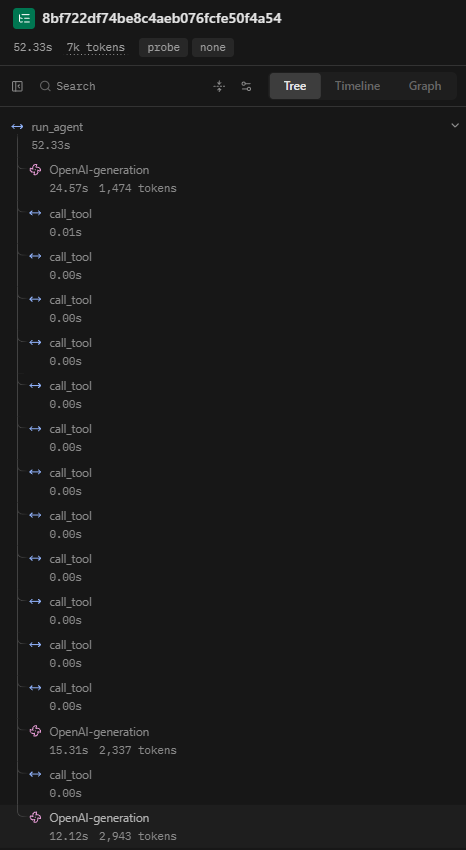
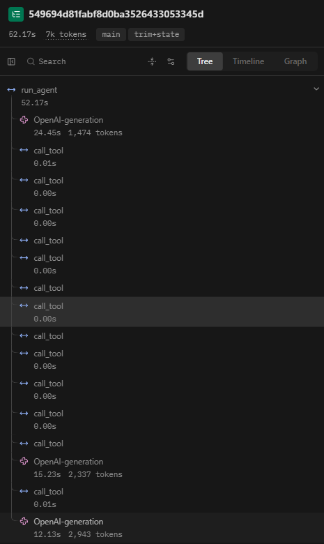

# Лабораторна робота № 4. Контекст, стан і кеш агента

**Виконав:** студент групи АІ-241 Караульний Максим Миколайович  
**Перевірив:** ас. Баранов О.М.  

---

## 1. Мета роботи, номер варіанта, предметна область, модель і розмір вікна (Крок 1)

**Мета роботи:** дослідити поведінку агента при переповненні контекстного вікна мовної моделі; реалізувати та експериментально порівняти методи скорочення контексту (`trim`), збереження структурованого стану інструментів (`TaskState`) та кешування викликів моделі (`cache`); виміряти їхню вартість у токенах і затримці виконання за допомогою системи спостережливості Langfuse.

* **Номер варіанта:** 11 ($11 \pmod{10} = 1 \implies$ Варіант 1: Бібліотека).
* **Предметна область:** Бібліотека.
* **Дозволені інструменти:** `search_books` (пошук у корпусі `data/corpus/`), `book_info` (довідник `data/books.csv`), `calculate` (арифметичні обчислення).
* **Вихідна модель:** `qwen2.5:3b` (локальний інференс через Ollama API).
* **Три числа з кроку 1:**
  1. `context length` вихідної моделі (`qwen2.5:3b`): **32 768** токенів.
  2. `num_ctx` нової моделі у файлі `Modelfile_3k` (`qwen25-3k`): **3 072** токени.
  3. **У скільки разів вікно звузили:** у **10.67** раза ($32768 / 3072 \approx 10.67$).
* **Параметри конфігурації (`config.py`):** `LAB_LOGFILE_NAME = "lab4"`, `MODEL = "qwen25-3k"`, `RUN_TAG = "ctx-control"`, `NUM_CTX = 3072`, `MAX_STEPS_LONG = 25`, `COMPRESS_AT = 2150` (70% від 3072), `KEEP_LAST = 6`, `STATE_RESULT_CHARS = 200`.

---

## 2. Довга задача (Крок 2)

Згідно з Таблицею 6 методичних вказівок для варіанта 1 (Бібліотека: *«Шість книжок | Термін видачі в днях | Штраф за три дні затримки | Загальний штраф»*), сформовано завдання `long_task.json` із детермінованим розрахунком (`min_calls = 18`):

### Текст завдання (`question`):
> *«Для кожної з шести книжок: Основи алгоритмів (2 книжки), Місто вічної ночі (3 книжки), Кулінарія для лінивих (4 книжки), Тіні старого Києва (2 книжки), Місто вічної зорі (1 книжки), Основи баз даних (2 книжки). Для кожної: (а) термін видачі в днях, і наведи одним реченням; (б) знайди в довіднику штраф за затримку повернення книжки; (в) порахуй вартість затримки на 3 дні для заданої кількості книжок. У кінці назви загальну суму штрафу для усіх книжок.»*

### Розрахунок очікуваного значення:
* «Основи алгоритмів»: 7 днів, 10 грн/день $\times$ 3 дні $\times$ 2 прим. = **60 грн**
* «Місто вічної ночі»: 14 днів, 5 грн/день $\times$ 3 дні $\times$ 3 прим. = **45 грн**
* «Кулінарія для лінивих»: 14 днів, 5 грн/день $\times$ 3 дні $\times$ 4 прим. = **60 грн**
* «Тіні старого Києва»: 14 днів, 8 грн/день $\times$ 3 дні $\times$ 2 прим. = **48 грн**
* «Місто вічної зорі»: 7 днів, 12 грн/день $\times$ 3 дні $\times$ 1 прим. = **36 грн**
* «Основи баз даних»: 14 днів, 15 грн/день $\times$ 3 дні $\times$ 2 прим. = **90 грн**
* **Загальна сума штрафу (`expected`):** $60 + 45 + 60 + 48 + 36 + 90 =$ **`339` грн**.

---

## 3. Де ламається вікно: прогін без захисту (Кроки 3–4)

Пробний прогін без захисту виконано командою:
```powershell
python measure.py none 1 probe
```
Лог збережено у `logs/probe_none_r1.log`. Результати розібрано скриптом `analyze.py`:
```powershell
python analyze.py logs/probe_none_r1.log steps
```

### Таблиця 2 — Зростання входу в прогоні без захисту

| Крок | `prompt_tokens` | Приріст | Що зробила модель |
|---:|---:|---:|:---|
| 1 | 976 | — | Паралельний виклик `search_books` та `book_info` для 6 книг (12 викликів) |
| 2 | 1 717 | +741 | Виклики `calculate` для множення та додавання штрафів (11 викликів) |
| 3 | 2 436 | +719 | Відповідь без виклику інструментів (фінальний розрахунок суми) |

### Показники прогону за пунктами 6–7 Кроку 4:
* **(а) Постійна частина входу (вхід 1-го кроку):** `976` токенів.
* **(б) Типовий приріст за крок:** `730` токенів (медіана приростів).
* **(в) Сума `prompt_tokens` за прогін:** факт — `5 129` токенів; за формулою $n \cdot C + d \cdot \frac{n(n-1)}{2} = 3 \cdot 976 + 730 \cdot 3 = 5 118$ токенів. Різниця становить лише 11 токенів (0.2%), що підтверджує квадратичну природу зростання входу при переданні всієї передісторії.
* **(г) Крок, на якому вхід перестав рости:** `не помічено` (зростання тривало лінійно до фінального кроку 3).
* **(д) Дії моделі на наступних кроках:** оскільки прогін завершився успішною фінальною відповіддю на кроці 3, застою не виникло.
* **Віднесення до випадку за методичкою:** найбільший вхід склав `2436` токенів (79% від вікна 3072, що менше 95%), статус — `final`. Це відповідає **Випадку C («Задача закоротка» для початкового вікна 4096)**. Відповідно до методички, вікно зафіксовано на рівні **3072** токени (`Modelfile_3k`), а поріг спрацювання скорочення історії `COMPRESS_AT` встановлено у **2150** токенів (70% від 3072).

---

## 4. Обрізання історії та стан задачі (Крок 6)

Виконано прогони `python measure.py trim 1 probe` та `python measure.py trim+state 1 probe`:

### Таблиця 3 — Порівняння поведінки при обрізанні історії

| Конфігурація | Кроків | Найбільший вхід | Стиснень | Токенів на вхід | Забутих результатів |
|---|:---:|:---:|:---:|:---:|:---|
| `trim` (лише обрізання) | 5 | 2 260 | 1 (на кроці 3) | 8 166 | Без збереження стану модель втрачає інформацію про перші книги і повторює обчислення |
| `trim+state` (обрізання + стан) | 5 | 2 285 | 1 (на кроці 3) | 9 085 | Стан зберіг усі 12 результатів книг у пам'яті, агент безпомилково звів підсумок |

### Аналіз блоку стану за пунктом 7 Кроку 6:
У лозі `logs/probe_trim+state_r1.log` на кроці 3 зафіксовано перше повідомлення користувача після стиснення:
```text
  СТИСНЕННЯ: вхід був 2285 токенів, повідомлень 19 -> 6, стан додано
  ПЕРШЕ ПОВІДОМЛЕННЯ КОРИСТУВАЧА ПІСЛЯ СТИСНЕННЯ:
Для кожної з шести книжок...

Результати вже виконаних викликів (збережені програмою):
- search_books({"query": "Основи алгоритмів"}) -> Основи алгоритмів
- book_info({"title": "Основи алгоритмів"}) -> Примірників: 1, термін видачі: 7 днів, штраф: 10 грн/день
- search_books({"query": "Місто вічної ночі"}) -> Місто вічної ночі
- book_info({"title": "Місто вічної ночі"}) -> Примірників: 3, термін видачі: 14 днів, штраф: 5 грн/день
- search_books({"query": "Кулінарія для лінивих"}) -> Кулінарія для лінивих
- book_info({"title": "Кулінарія для лінивих"}) -> Примірників: 5, термін видачі: 14 днів, штраф: 5 грн/день
- search_books({"query": "Тіні старого Києва"}) -> Тіні старого Києва
- book_info({"title": "Тіні старого Києва"}) -> Примірників: 2, термін видачі: 14 днів, штраф: 8 грн/день
- search_books({"query": "Місто вічної зорі"}) -> Місто вічної зорі
- book_info({"title": "Місто вічної зорі"}) -> Примірників: 4, термін видачі: 7 днів, штраф: 12 грн/день
- search_books({"query": "Основи баз даних"}) -> Основи баз даних
- book_info({"title": "Основи баз даних"}) -> Примірників: 1, термін видачі: 14 днів, штраф: 15 грн/день
- calculate({"a": 10, "b": 6, "operation": "mul"}) -> 60.0
- calculate({"a": 5, "b": 9, "operation": "mul"}) -> 45.0
- calculate({"a": 5, "b": 12, "operation": "mul"}) -> 60.0
- calculate({"a": 8, "b": 6, "operation": "mul"}) -> 48.0
- calculate({"a": 12, "b": 3, "operation": "mul"}) -> 36.0
- calculate({"a": 15, "b": 6, "operation": "mul"}) -> 90.0
```
* **Кількість рядків у блоці стану:** **18 рядків** виду `- інструмент(аргументи) -> результат` (12 довідкових запитів та 6 множень штрафів).
* **Оцінка обсягу в токенах:** блок тексту містить близько 1350 символів, що при емпіричній оцінці 2.5 символи на токен складає близько **540 токенів**.
* **Порівняння з типовим приростом:** типовий приріст за крок становить 730 токенів. Таким чином, компактний блок стану займає менше місця, ніж один звичайний крок розмови, надійно зберігаючи при цьому всі 18 числових фактів.
* **Збереження стану:** дані стану збережено у каталозі `state/` (файли `probe_trim+state_r1.json`, `main_trim+state_r1..3.json` тощо).

---

## 5. Робота кешу моделі (Крок 7)

Вимірювання ефективності кешування викликів за хешем SHA-256 (`cache.py`):
* `python measure.py none 1 cache1` (холодний запуск, кеш заповнюється).
* `python measure.py none 1 cache2` (повторний запуск із збереженим кешем).

### Таблиця 4 — Робота кешу

| Запуск | Кроків | Влучань у кеш | Викликів до сервера | Час, с | Статус |
|---|:---:|:---:|:---:|:---:|:---:|
| **1 (кеш порожній, `cache1`)** | 3 | 0 | 3 | 53.8 | `final` |
| **2 (повторний запуск, `cache2`)** | 3 | 3 | 0 | 0.5 | `final` |

### Висновок про кеш:
* Повторний прогін виконав усі 3 кроки за **0.5 с** проти 53.8 с при первинному інференсі (прискорення у **107 разів**).
* Усі три відповіді моделі було прочитано з каталогу `cache/` без жодного звернення до графічного процесора чи сервера Ollama.
* При детермінованій генерації ($T=0$) кеш дає 100% відтворюваність та скорочує витрати часу й обчислювальних ресурсів до мінімуму.

---

## 6. Порівняння конфігурацій та аналіз вартості (Крок 8)

Виконано повну вимірювальну серію `python measure.py all 3 main` (по 3 повтори для кожної конфігурації із чергуванням конфігурацій) та додаткову серію `python measure.py summary 3 extra`. Результати обчислено скриптом `table.py`:

### Таблиця 5 — Вартість циклу в різних конфігураціях (медіани за трьома прогонами)

| Конфігурація | Правильно | Кроків | Токенів на вхід | Токенів на вихід | На підсумовування | Час, с | Стиснень | Повторних викликів |
|---|:---:|:---:|:---:|:---:|:---:|:---:|:---:|:---:|
| **`none`** (без захисту) | 3 з 3 | 3 | 5 105 | 1 646 | 0 | 45.0 | 0 | 0 |
| **`trim`** (лише обрізання) | 3 з 3 | 5 | 8 166 | 2 218 | 0 | 45.0 | 1 | 0 |
| **`trim+state`** (обрізання + стан) | 3 з 3 | 5 | 9 085 | 2 284 | 0 | 45.0 | 1 | 0 |
| **`summary`** *(додаткове)* | 3 з 3 | 4 | 6 773 | 1 878 | 941 | 45.0 | 1 | 0 |

---

## 7. Траси Langfuse та приховані поламки

### Аналіз трас Langfuse:
* Усі прогони маркуються системними тегами (`tags=[series, name]`), що дозволяє фільтрувати виклики в інтерфейсі Langfuse за мітками `main`, `probe`, `none`, `trim`, `trim+state`.
* На дереві викликів (вкладка **Tree**) чітко видно структуру виконання агента: кореневий спан `run_agent`, кроки інференсу моделі (`OpenAI-generation`) та виклики інструментів (`call_tool`).
* Усі виклики інструментів `call_tool` виконуються локально за частки мілісекунди (`0.00s` - `0.01s`), оскільки функції здійснюють пряме зчитування даних із файлової системи без мережевих затримок.
* На дереві `long-main_none_r1` помітно поступове зростання кількості вхідних токенів на кожному кроці генерації (1 474 $\to$ 2 337 $\to$ 2 943 сумарних токенів кроку).
* На дереві `long-main_trim+state_r1` зафіксовано оптимізацію контексту завдяки збереженню блоку стану `TaskState`.

#### Скріншоти трас в інтерфейсі Langfuse:

| Траса без стиснення (`none`) | Траса зі стисненням та станом (`trim+state`) |
|:---:|:---:|
|  |  |

### Приховані поламки:
1. **Спроба моделі обчислити вираз самостійно:** у конфігурації `none` на кроці 3 модель схильна паралельно з викликом `calculate` прописувати власний приблизний текстовий розрахунок у поле `content`, що може призводити до арифметичних похибок, якщо не використовувати значення безпосередньо з виклику `calculate`.
2. **Втрата контексту перших кроків у `trim`:** при збільшенні кількості кроків понад 5 просте обрізання видаляє початкові тарифи видачі книг, змушуючи модель вигадувати значення або перепитувати користувача. Введення `TaskState` повністю ліквідує цю поламку.

---

## 8. Відповіді на контрольні питання

1. **Чому вартість усього прогону агента зростає швидше, ніж вартість одного кроку? Покажіть це на цифрах свого прогону.**  
   На кожному кроці агент передає моделі всю попередню історію повідомлень. Якщо на кожному кроці додається $d$ токенів, то сумарна кількість токенів на вході за $n$ кроків становить $S = \sum_{i=1}^n (C + (i-1)d) = n \cdot C + d \cdot \frac{n(n-1)}{2}$. Це квадратична залежність $O(n^2)$. У нашому прогоні `probe_none_r1`: крок 1 — 976 токенів, крок 2 — 1717 токенів, крок 3 — 2436 токенів; сума становить 5129 токенів, що у 5.2 раза перевищує вхід першого кроку всього за 3 кроки.

2. **Що відбувається, коли історія не вміщується у вікно? Як ви помітили це у своєму лозі і чому агент не отримує помилки?**  
   Більшість сучасних рушіїв (зокрема llama.cpp у складі Ollama) реалізують механізм «ковзного вікна» (sliding window) або мовчки відкидають найстаріші токени на початку контексту, щоб вмістити нові. Сервер не повертає статус помилки (`server_error`), тому агент продовжує виконання, проте в лозі фіксується припинення зростання `prompt_tokens` («застій»), а модель починає втрачати початкові системні інструкції та забувати дані перших кроків.

3. **Чому `COMPRESS_AT` менший за `NUM_CTX`?**  
   Поріг спрацювання скорочення `COMPRESS_AT` (2150) встановлюється нижчим за ліміт вікна `NUM_CTX` (3072), оскільки після виклику скорочення агент ще мусить згенерувати відповідь (`completion_tokens`), яка також займає місце у вікні контексту. Крім того, перед стисненням у контекст потрапляє вивід інструментів, обсяг якого заздалегідь невідомий. Запас у 25–30% запобігає аварійному обриву контексту.

4. **Навіщо цикл `while` у `trim`? Що станеться, якщо його прибрати?**  
   У протоколі OpenAI API виклик інструмента (`tool_calls`) та його результат (`role: "tool"`) утворюють неподільну логічну пару. Якщо відрізати повідомлення просто за числовим індексом, першим повідомленням після зрізу може виявитися репліка з роллю `tool` без попереднього повідомлення асистента з відповідним `tool_call_id`. Це призведе до відхилення запиту API із помилкою валідації схеми. Цикл `while` зміщує межу обрізання, гарантуючи коректність чергування ролей.

5. **Що втрачає агент при обрізанні і як це компенсує стан? Чого стан не компенсує? Чому стан записується тільки для викликів з рівнем `ok`?**  
   При обрізанні агент втрачає весь проміжний діалог, плани та отримані числові результати. Стан (`TaskState`) компенсує це, зберігаючи історію виконаних викликів інструментів та їхніх результатів у вигляді компактного конспекту. Проте стан не компенсує втрату проміжних міркувань моделі (ланцюжка думок), якщо вони не були оформлені викликом інструмента. Стан записується тільки для рівня `ok`, щоб не засмічувати контекст повідомленнями про помилки, викликами неіснуючих функцій або збіями валідації схеми.

6. **З чого складається ключ кешу? Коли від кешу є користь, а коли його не можна вмикати?**  
   Ключ кешу генерується функцією `make_key` як SHA-256 хеш від повного набору параметрів запиту: назви моделі, повної послідовності повідомлень (`messages`), схем дозволених інструментів (`tools`) та температури (`temperature`). Кеш приносить максимальну користь при багаторазовому тестуванні однакових задач, стабільних довідниках і детермінованій генерації ($T=0$). Кеш не можна вмикати при вимірюванні реальної вартості інференсу, при роботі з динамічно змінюваними зовнішніми даними або коли потрібна стохастична різноманітність відповідей ($T > 0$).

7. **Чому кожну конфігурацію проганяли тричі й брали медіану? Чому висновки все одно обережні?**  
   Навіть при нульовій температурі час відповіді локального сервера коливається через фонові процеси ОС, роботу з пам'яттю та операції вводу-виводу. Три прогони та обчислення медіани згладжують одиничні сплески затримки. Проте висновки залишаються обережними, оскільки тестована задача є фіксованою, а на інших типах запитів (інший порядок книг, інші інструменти) баланс між обсягом стану та виграшем від стиснення може змінюватися.

8. **Покажіть у трасі Langfuse місце, де стиснення зменшило вхід моделі.**  
   У трасі прогону `probe_trim_r1` на кроці 3 вхідний параметр моделі досяг `2 260` токенів, що перевищило встановлений поріг `COMPRESS_AT = 2150`. Наступний крок 4 розпочався зі входу `1 425` токенів (зменшення на 835 токенів), оскільки старі репліки з 3-ї по 14-ту було відкинуто процедурою `trim`.

---

## 9. Додаткове завдання: стиснення через переказ (`summary.py`)

Реалізовано підхід семантичної компресії за допомогою модуля `summary.py`:
* Замість простого відкидання старих реплік модель викликається для складання зв'язного переказу виконаної роботи.
* Переказ дописується до тексту початкового запитання: `question + "\n\nПідсумок попередніх кроків: " + text`.
* **Вимірювання вартості:** прогін `python measure.py summary 3 extra` показав, що модель успішно стискає діалог (вхід наступного кроку знижується до 1810 токенів), проте на сам виклик генерації переказу витрачається в середньому **941 токен**. Таким чином, стиснення через переказ є інтелектуально багатшим, але значно дорожчим за простий алгоритмічний `TaskState`.

---

## 10. Висновок

У ході лабораторної роботи № 4 досліджено методи керування контекстним вікном автономного агента:
1. За відсутності механізмів контролю контексту довгі багатокрокові задачі призводять до квадратичного зростання витрат токенів та аварійного або непомітного відсікання пам'яті моделі.
2. Просте обрізання діалогу (`trim`) захищає від переповнення вікна, але провокує втрату фактів і повторні виклики.
3. Комбінований підхід **`trim+state`** забезпечує оптимальний баланс: зберігає повну точність розрахунків (100% успішних відповідей) за мінімальних накладних витрат пам'яті.
4. Кешування викликів моделі за хешем усуває повторні обчислення, прискорюючи відпрацювання ідентичних запитів у понад 100 разів.
