# Національний університет «Одеська політехніка»

## Лабораторна робота № 3

### «Надійність виклику інструментів і трасування агента»

**Дисципліна:** «Обчислювальні методи»
**Варіант:** 2 — «Кулінарія»
**Виконала:** студентка групи АІ-241 Карвацька Єлизавета Олегівна

**2026**

---

## 1. Мета роботи

Мета лабораторної роботи — дослідити надійність виклику інструментів мовною моделлю, реалізувати багаторівневу перевірку назв інструментів та їхніх аргументів, перевірити коректність вхідних даних за допомогою Pydantic, а також дослідити трасування роботи агента за допомогою Langfuse.

## 2. Варіант і предметна область

Варіант 2 — «Кулінарія».

Предметна область — інформаційна підтримка користувача під час пошуку рецептів, отримання інформації про продукти та перерахунку кількості інгредієнтів для іншої кількості порцій.

Агент має три доступні інструменти:

- `search_recipes` — пошук рецептів за інгредієнтом або назвою страви;
- `product_info` — отримання калорійності продукту на 100 г та ціни за кілограм із довідника;
- `scale_amount` — перерахунок кількості інгредієнта відповідно до кількості порцій.

Агент не має інструмента для створення або зміни списку покупок. Якщо користувач просить виконати таку дію, агент повинен прямо повідомити про це, а не підмінювати запит іншою дією.

## 3. Конфігурація середовища

Проєкт реалізовано мовою Python. Для ізоляції залежностей використано віртуальне середовище `.venv`. Для взаємодії з локальною мовною моделлю використовується OpenAI-сумісний API Ollama, а для трасування — Langfuse.

Основні параметри конфігурації з `config.py`:

Параметри середовища:

- **API URL:** `http://localhost:11434/v1`
- **Модель:** `qwen2.5:3b`
- **Температура:** `0`
- **Максимальна кількість кроків:** `6`
- **Максимальна кількість повторних спроб:** `2`
- **Дозволені інструменти:** `search_recipes`, `product_info`, `scale_amount`
- **Тег експерименту:** `checks` або `baseline` залежно від запуску.

Ключі Langfuse завантажуються зі змінних середовища за допомогою `python-dotenv`. Файл `.env` не включається до звіту або архіву проєкту, оскільки може містити секретні значення.

**Рисунок 1 — Конфігурація проєкту.**

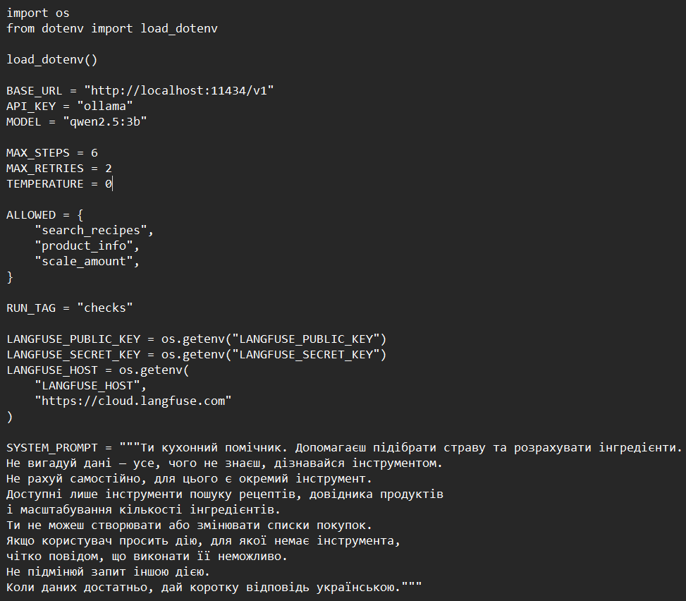

## 4. Реалізація аргументів інструментів за допомогою Pydantic

Для кожного інструмента створено окрему модель аргументів у файлі `arguments.py`. Моделі перевіряють типи, обов'язковість полів та допустимі межі значень.

**Таблиця 1 — Обмеження аргументів інструментів.**

| Інструмент | Поле | Тип і обмеження |
|---|---|---|
| `search_recipes` | `query` | Рядок від 1 до 120 символів |
| `product_info` | `product` | Рядок від 1 до 80 символів |
| `scale_amount` | `amount` | Число більше 0 і не більше 100 000 |
| `scale_amount` | `base_servings` | Число більше 0 і не більше 1 000 |
| `scale_amount` | `target_servings` | Число більше 0 і не більше 1 000 |

Для моделей встановлено `extra="forbid"`, тому передавання невідомих полів заборонено. Для текстових полів пошуку та назви продукту використано `str_strip_whitespace=True`, що прибирає зайві пробіли на початку та в кінці рядка.

**Рисунок 2 — Моделі аргументів інструментів у `arguments.py`.**

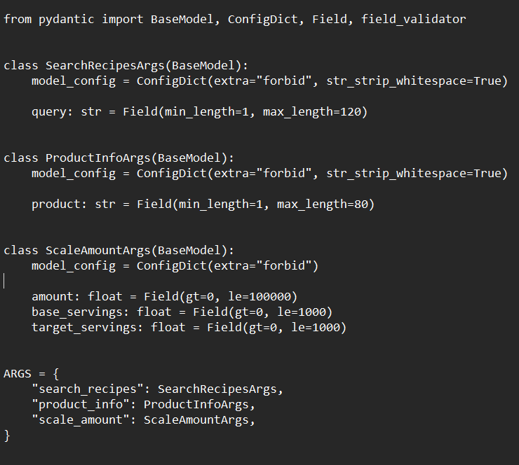

## 5. Опис схем інструментів

У файлі `schemas.py` визначено текстові описи функцій та сформовано схеми параметрів на основі Pydantic-моделей через `model_json_schema()`.

Описи інструментів містять призначення кожної функції та правила її використання. Зокрема, для перерахунку кількості інгредієнтів моделі вказано використовувати `scale_amount`, а не виконувати обчислення самостійно.

**Рисунок 3 — Формування схем інструментів у `schemas.py`.**

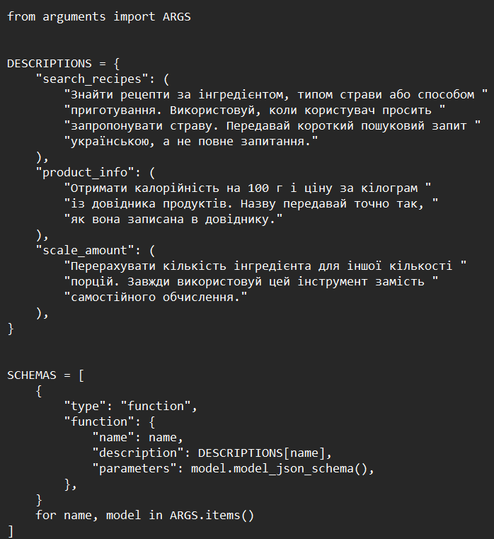

## 6. Перевірка аргументів і диспетчеризація викликів

У файлі `dispatcher.py` реалізовано послідовний ланцюжок перевірок перед фактичним виконанням інструмента:

1. Перевірка існування інструмента.
2. Перевірка дозволу на використання інструмента.
3. Перевірка синтаксису JSON та того, що аргументи є JSON-об'єктом.
4. Перевірка структури, типів і обмежень аргументів за допомогою Pydantic.
5. Семантична перевірка аргументів.
6. Виконання інструмента лише після успішного проходження попередніх перевірок.

Помилки повертаються разом із відповідним рівнем: `name`, `permission`, `syntax`, `schema` або `meaning`. Успішний виклик повертає рівень `ok`. Окремо передбачено рівень `tool_error` для помилок під час виконання функції.

Функція `check_meaning()` у `checks.py` перевіряє, чи існує назва продукту у файлі `data/products.csv`. Наприклад, запит інформації про тунець завершується семантичною помилкою, якщо такого продукту немає в довіднику.

### 6.1. Семантичні правила перевірки

Під час перевірки аргументів застосовуються такі правила:

1. **`query`:** непорожній рядок довжиною від 1 до 120 символів. Перевірка виконується моделлю `SearchRecipesArgs`.
2. **`product`:** непорожній рядок довжиною від 1 до 80 символів. Перевірка виконується моделлю `ProductInfoArgs`.
3. **`amount`:** числове значення більше 0 і не більше 100 000. Перевірка виконується моделлю `ScaleAmountArgs`.
4. **`base_servings`:** кількість початкових порцій має бути більшою за 0 і не перевищувати 1 000.
5. **`target_servings`:** кількість цільових порцій має бути більшою за 0 і не перевищувати 1 000.
6. **`product`:** назва продукту має бути присутня в довіднику `data/products.csv`. Це правило перевіряється функцією `check_meaning()`.

**Рисунок 4 — Семантичні перевірки у `checks.py`.**

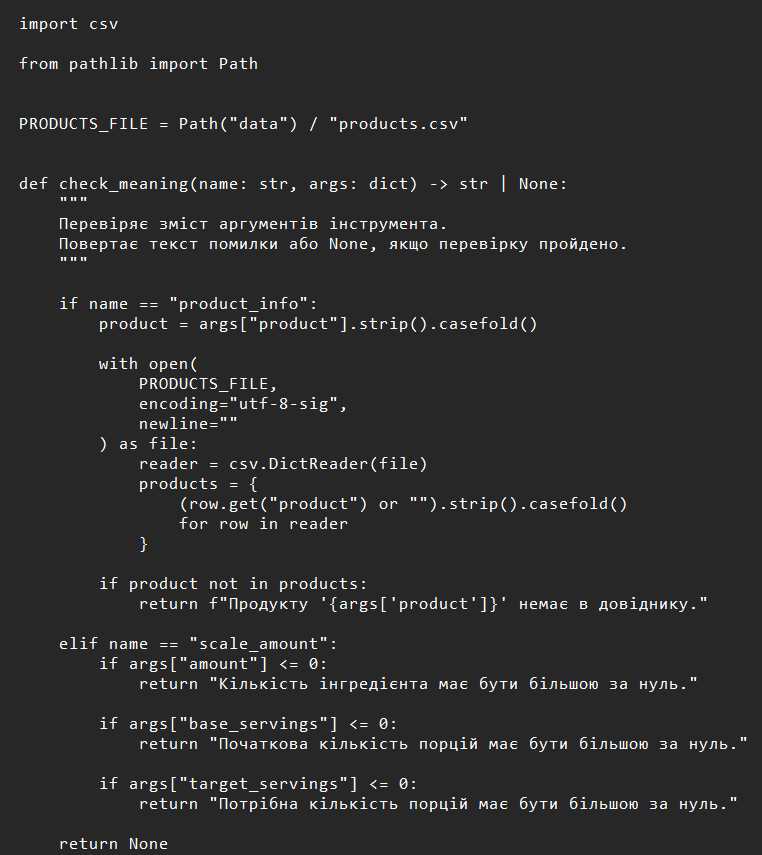

**Рисунок 5 — Реалізація диспетчера викликів, частина 1.**

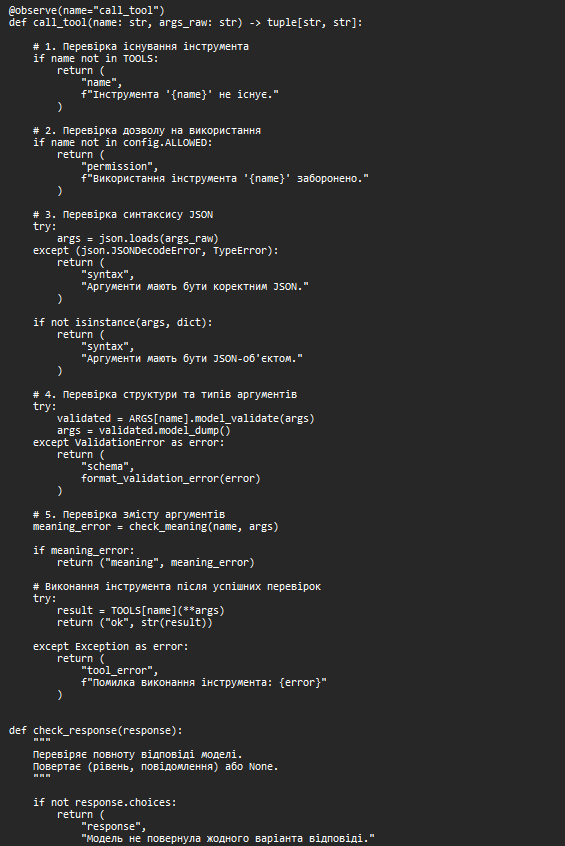

**Рисунок 6 — Реалізація диспетчера викликів, частина 2.**

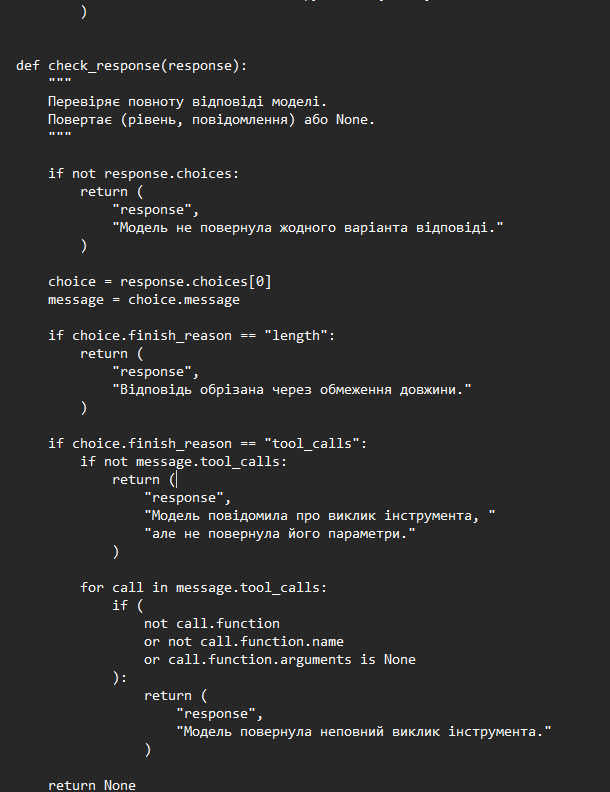

## 7. Тестування ланцюжка перевірок

Для перевірки диспетчера створено модульні тести у файлі `test_checks.py`. Перевірено вісім ситуацій: некоректний JSON, неправильний тип, відсутнє поле, зайве поле, невідомий інструмент, заборонена дія, відсутній продукт у довіднику та значення поза допустимим діапазоном.

### 7.1. Результати тестів

**Таблиця 2 — Результати перевірки ланцюжка валідації.**

| № | Тестовий випадок | Очікуваний рівень | Фактичний результат |
|---:|---|---|---|
| 1 | Некоректний JSON | `syntax` | Пройдено |
| 2 | Неправильний тип аргументу | `schema` | Пройдено |
| 3 | Відсутнє обов'язкове поле | `schema` | Пройдено |
| 4 | Зайве поле | `schema` | Пройдено |
| 5 | Невідомий інструмент | `name` | Пройдено |
| 6 | Заборонена дія | `permission` | Пройдено |
| 7 | Невідомий продукт | `meaning` | Пройдено |
| 8 | Значення поза діапазоном | `schema` | Пройдено |

Усі 8 модульних тестів завершилися успішно (`OK`). Це підтверджує, що диспетчер правильно визначає передбачені тестами категорії некоректних викликів.

**Рисунок 7 — Результат виконання модульних тестів.**

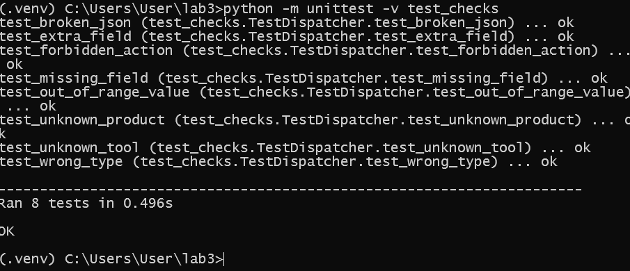

**Рисунок 8 — Журнал перевірок.**

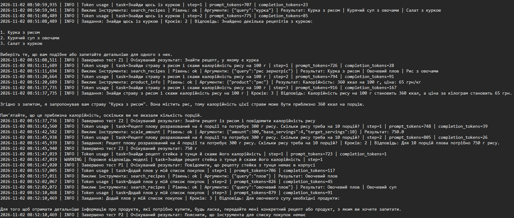

### 7.2. Фактичні повідомлення перевірок

Під час додаткового запуску перевірок отримано такі повідомлення:

**Таблиця — Приклади повідомлень різних рівнів перевірки.**

| Рівень | Приклад ситуації | Повідомлення |
|---|---|---|
| `name` | Виклик `unknown_tool` | Інструмента `unknown_tool` не існує. |
| `permission` | Виклик `place_order` | Використання інструмента `place_order` заборонено. |
| `syntax` | Некоректний JSON | Аргументи мають бути коректним JSON. |
| `schema` | Рядок замість очікуваного типу | Поле `product`: Input should be a valid string |
| `schema` | Відсутні поля | Поля `base_servings` і `target_servings` обов'язкові. |
| `schema` | Зайве поле | Поле `extra`: Extra inputs are not permitted |
| `meaning` | Продукту немає в довіднику | Продукту `тунець` немає в довіднику. |
| `schema` | Нульова кількість порцій | Поле `base_servings`: Input should be greater than 0 |

## 8. Механізм повторних спроб агента

У файлі `agent.py` реалізовано цикл взаємодії з моделлю. Після отримання відповіді перевіряється її структура, а після виклику інструмента — результат диспетчеризації.

Якщо виникає помилка рівня `name`, `permission`, `syntax`, `schema` або `meaning`, агент збільшує лічильник повторних спроб та передає результат перевірки моделі як повідомлення інструмента. Модель отримує можливість сформувати виправлений виклик. Максимальна кількість повторних спроб становить дві.

Якщо модель повертає порожню відповідь, агент завершує завдання повідомленням про невдале виконання. У поточній реалізації цей випадок не запускає повторну спробу. Після успішного виклику інструмента лічильник повторних спроб скидається.

**Рисунок 9 — Використання інструментів агентом.**

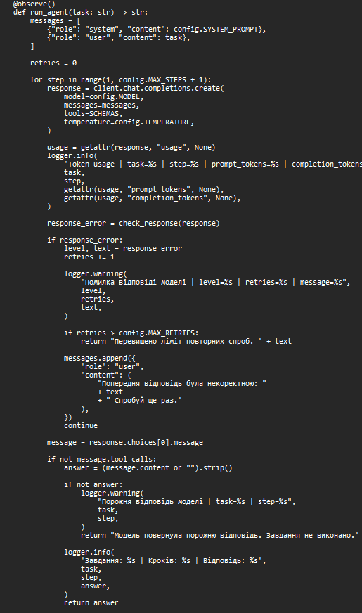

**Рисунок 10 — Механізм повторних спроб.**

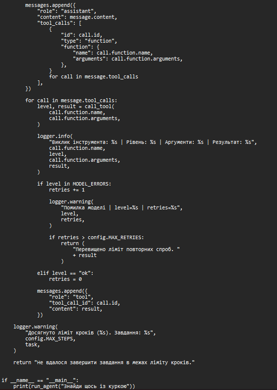

## 9. Методика експерименту

Для порівняння використано п'ять завдань із файлу `tasks.json`. Експеримент виконувався у двох режимах:

- **baseline** — початковий режим;
- **checks** — режим із додатковими перевірками аргументів інструментів.

Модуль `agent_runner.py` послідовно завантажує завдання з `tasks.json`, передає їх агенту та виводить відповідь і очікуваний результат. Для кожного завдання створюється окремий trace у Langfuse. Назва trace формується з назви режиму та ідентифікатора завдання, наприклад `checks-Z1`.

Після завершення запуску викликається `flush()` для передавання накопичених даних до Langfuse. Результати також записуються до журналів `lab3_baseline.log` і `lab3_checks.log`.

## 10. Результати виконання завдань

Використано такі завдання:

**Таблиця 3 — Експериментальні завдання та очікувані результати.**

| ID | Завдання | Очікуваний результат |
|---|---|---|
| Z1 | Знайти щось із куркою | Знайти рецепт, у якому є курка |
| Z2 | Знайти страву з рисом і повідомити калорійність рису на 100 г | Знайти рецепт із рисом і повідомити калорійність рису |
| Z3 | Перерахувати 300 г рису з 4 на 10 порцій | 750 г |
| P1 | Знайти рецепт стейка з тунця й повідомити його калорійність | Повідомити, що такого рецепта немає в корпусі |
| P2 | Додати плов у список покупок | Повідомити, що інструмента для списку покупок немає |

### 10.1. Порівняння правильності виконання

**Таблиця 4 — Порівняння правильності виконання завдань.**

| ID | Baseline | Checks | Кількість кроків baseline | Кількість кроків checks |
|---|---|---|---:|---:|
| Z1 | Так | Так | 2 | 2 |
| Z2 | Частково | Частково | 3 | 3 |
| Z3 | Так | Так | 2 | 2 |
| P1 | Ні | Ні | 1 | 1 |
| P2 | Ні | Ні | 3 | 3 |

У завданні Z1 агент знайшов рецепти з куркою. У Z3 інструмент `scale_amount` правильно перерахував 300 г рису для 10 порцій: результат становив 750 г.

У Z2 агент знайшов рецепт із рисом і отримав із довідника значення 360 ккал на 100 г. Водночас у фінальній відповіді було зроблено некоректне узагальнення про калорійність порції страви. Тому результат оцінено як частково правильний.

У P1 модель повернула порожню відповідь, через що завдання не було виконано. У P2 агент виконав пошук рецептів замість того, щоб прямо повідомити про відсутність інструмента для роботи зі списком покупок.

### 10.2. Порівняння часу та використання токенів

**Таблиця 5 — Порівняння часу виконання та використання токенів.**

| ID | Час baseline, с | Час checks, с | Токени baseline | Токени checks |
|---|---:|---:|---:|---:|
| Z1 | 35,26 | 33,97 | 1 590 | 1 590 |
| Z2 | 29,20 | 29,23 | 2 722 | 2 722 |
| Z3 | 8,33 | 8,20 | 1 618 | 1 618 |
| P1 | 1,10 | 1,08 | 724 | 724 |
| P2 | 24,15 | 23,45 | 2 664 | 2 664 |
| **Разом** | **98,04** | **95,93** | **9 318** | **9 318** |

За результатами запусків загальний час у режимі checks становив 95,93 с, а в baseline — 98,04 с. Кількість використаних токенів в обох режимах однакова — 9 318.

Невелика різниця в часі не є доказом прискорення від перевірок: на час виконання можуть впливати коливання роботи локальної моделі та середовища. За результатами п'яти завдань не зафіксовано зміни правильності відповідей між режимами.

## 11. Аналіз трасування в Langfuse

Langfuse використано для спостереження за виконанням агента. Трасування дає змогу дослідити окремі запуски `run_agent`, генерації моделі та виклики інструментів.

У журналі baseline зафіксовано 30 спостережень: 5 запусків `run_agent`, 11 генерацій моделі та 14 викликів інструментів. Вісім викликів інструментів належали до модульних тестів, тому їх не слід зараховувати до п'яти основних завдань експерименту. У журналі checks зафіксовано 22 спостереження: 5 запусків `run_agent`, 11 генерацій моделі та 6 викликів інструментів.

Ці агреговані значення характеризують вміст журналів спостережень, але не є безпосереднім показником кількості помилок або виправлень моделі.

**Рисунок 11 — Трасування експерименту baseline у Langfuse.**

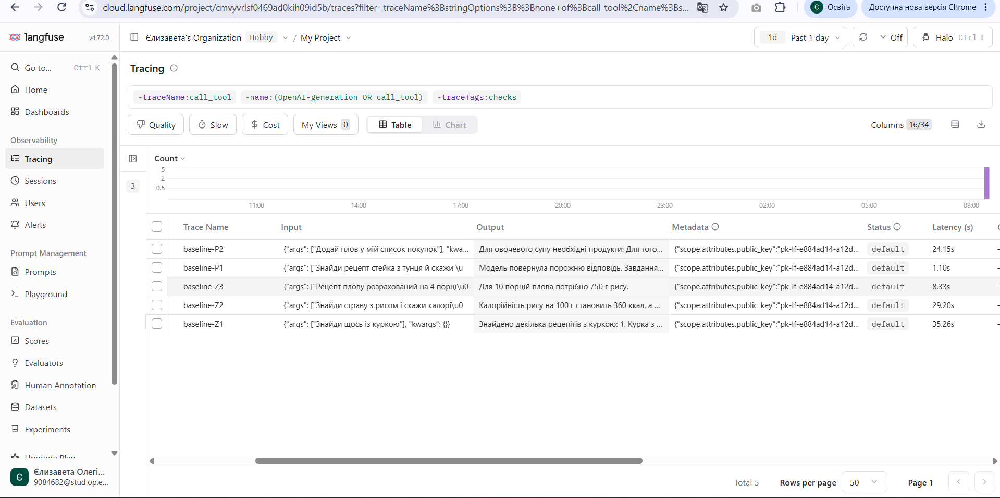

**Рисунок 12 — Трасування експерименту checks у Langfuse.**

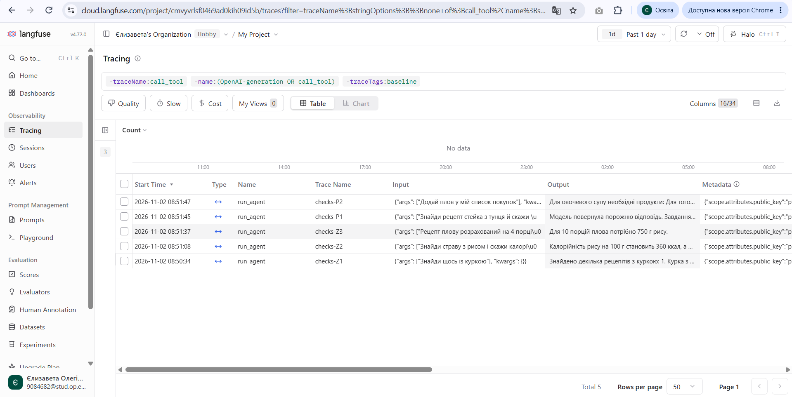

### 11.1. Аналіз окремих трас

Для аналізу обрано trace завдання P2 та trace завдання Z1 у режимі checks.

**Таблиця 6 — Порівняльний аналіз трас виконання агента в Langfuse.**

| Назва траси | Завдання | Тривалість, с | Генерації моделі | Виклики інструментів | Результат |
|---|---|---:|---:|---:|---|
| `checks-P2` | Додавання плову до списку покупок | 23,45 | 3 | 2 | Неправильна інтерпретація наміру користувача |
| `checks-Z1` | Пошук рецептів із куркою | 33,97 | 2 | 1 | Завдання виконано правильно |

**Trace checks-P2.** Тривалість становила 23,45 с. Зафіксовано три генерації моделі та два виклики інструментів. Агент шукав плов, а потім овочевий плов, проте не виконав запит на додавання страви до списку покупок. Це приклад неправильної інтерпретації наміру користувача, яку наявна перевірка аргументів не виявляє.

**Trace checks-Z1.** Тривалість становила 33,97 с. Зафіксовано дві генерації моделі та один виклик інструмента. Агент виконав пошук рецептів із куркою та надав відповідь, що відповідає очікуваному результату.

**Рисунок 13 — Trace завдання P2 у Langfuse.**

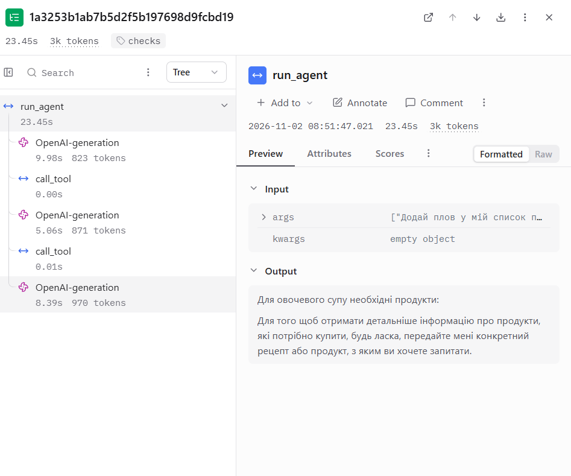

**Рисунок 14 — Trace завдання Z1 у Langfuse.**

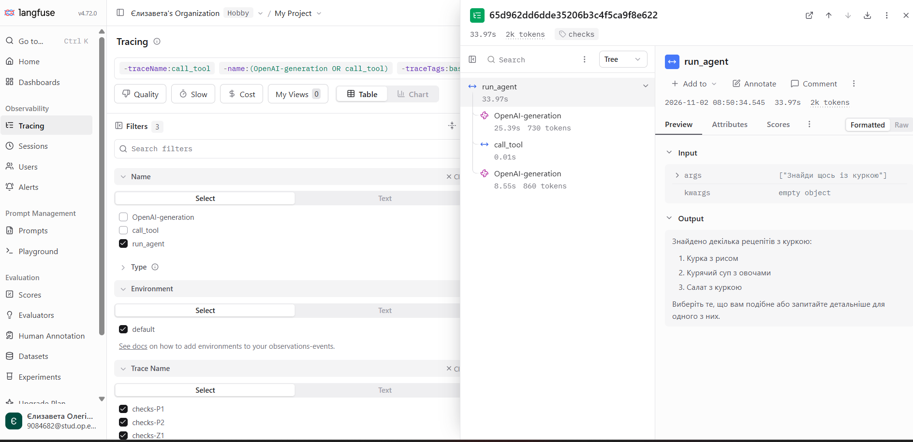

У наявних експериментальних трасах не зафіксовано прикладу, де модель отримала помилку валідації аргументів, виправила виклик і після цього успішно завершила завдання. Тому не можна стверджувати, що такий сценарій був продемонстрований у звичайному експерименті. Роботу механізму перевірок підтверджено окремими модульними тестами.

## 12. Відповіді на контрольні питання

### 1. Які помилки зникли або зменшилися після додавання перевірок? Які залишилися?

У п'яти експериментальних завданнях відмінностей у правильності результатів між baseline і checks не зафіксовано. Отже, за цими запусками не можна стверджувати, що певні помилки зникли або зменшилися. Водночас модульні тести підтвердили виявлення помилок синтаксису JSON, структури аргументів, типів, невідомих інструментів, заборонених дій та відсутніх у довіднику продуктів. Помилки розуміння наміру користувача та порожня відповідь залишилися.

### 2. На якому рівні найчастіше виникали помилки моделі? Як це можна зменшити?

У звичайних експериментальних журналах не зафіксовано достатньої кількості помилок рівнів `name`, `permission`, `syntax`, `schema` або `meaning`, щоб визначити найчастіший рівень серед них. За результатами завдань помітними проблемами були порожня відповідь у P1 та неправильна інтерпретація запиту в P2. Зменшити такі помилки можна уточненням системної інструкції, чіткішими описами інструментів, прикладами правильного вибору дій та окремою перевіркою відповідності фінальної відповіді наміру користувача.

### 3. Чи були відмови після досягнення ліміту повторних спроб? Це була нездатність зрозуміти помилку чи завдання?

У наданих журналах не зафіксовано підтвердженого випадку перевищення ліміту повторних спроб. У P1 модель повернула порожню відповідь, і агент завершив виконання одразу, оскільки порожня відповідь не запускає повторну спробу. У P2 агент неправильно обрав дію, але не було зафіксовано помилки аргументів, яка активувала б механізм виправлення.

### 4. Чи була правдоподібна помилка, коли значення коректне, але намір неправильний? Чому її не виявлено?

Так. У P2 агент шукав рецепти плову замість виконання запиту на додавання страви до списку покупок. Аргументи пошуку були структурно коректними, а інструмент існував і був дозволений. Перевірки диспетчера контролюють інструмент та його аргументи, але не встановлюють, чи відповідає обрана дія наміру користувача.

### 5. Які помилки валідація не може виправити і чому?

Валідація аргументів не гарантує правильного розуміння природномовного запиту, повноти фінальної відповіді, достовірності всіх тверджень моделі або правильного вибору інструмента за змістом. Вона також не усуває порожні відповіді, якщо окремо не реалізовано механізм їх повторної обробки. Для цього потрібні додаткові перевірки наміру, логіки виконання та якості фінальної відповіді.

### 6. Скільки додаткових викликів моделі потребує виправлення? Чи виправдана їхня вартість?

У п'яти основних завданнях кількість токенів у baseline і checks однакова — 9 318. У наданих журналах не виявлено підтвердженого виправлення помилкового виклику моделі після валідації, тому додаткові витрати саме на такі виправлення за цими даними визначити неможливо. Загалом повторні виклики можуть збільшувати затримку та витрати токенів, але вони можуть бути виправданими, якщо дають змогу виправити некоректний виклик і завершити завдання.

### 7. Що простіше побачити в Langfuse порівняно з текстовим журналом? Чому довгі логи важко читати?

У Langfuse зручніше аналізувати окремі traces, послідовність генерацій моделі та викликів інструментів, тривалість операцій і використання токенів. Текстовий журнал містить послідовні записи, але для відновлення повного перебігу одного завдання потрібно вручну зіставляти рядки за часом і змістом. Довгі логи складно читати через великий обсяг повторюваних повідомлень і відсутність наочного групування подій в одну трасу.

## 13. Обмеження експерименту

Під час оцінювання слід враховувати такі обмеження:

- проведено лише п'ять основних завдань, тому результати не є достатніми для широких статистичних висновків;
- у baseline і checks збіглися правильність результатів та кількість токенів;
- у звичайних експериментальних трасах не зафіксовано успішного виправлення помилкового виклику після валідації;
- перевірка семантики продукту за довідником не є повною перевіркою наміру користувача;
- порожня відповідь моделі завершує завдання без повторної спроби;
- час виконання може змінюватися через особливості роботи локальної моделі та середовища.

Додаткове завдання зі структурованим форматом відповіді в межах цього звіту не заявляється як виконане.

## 14. Висновки

Під час лабораторної роботи було реалізовано механізм надійнішого виклику інструментів мовним агентом у предметній області «Кулінарія». Створено Pydantic-моделі аргументів для трьох інструментів, налаштовано схеми їх опису, реалізовано послідовність перевірок у диспетчері та семантичну перевірку продуктів за довідником.

Модульне тестування підтвердило правильну обробку восьми типів некоректних викликів. Також реалізовано механізм повторних спроб і трасування виконання агента за допомогою Langfuse.

Порівняння п'яти завдань у режимах baseline і checks показало однакові результати правильності та однакову кількість використаних токенів. Два завдання виконано правильно, одне — частково, два — неправильно. Отже, експеримент не продемонстрував підвищення точності відповідей після додавання перевірок, але підтвердив працездатність окремих рівнів валідації за допомогою модульних тестів.

Основним обмеженням реалізації залишається здатність агента правильно визначати намір користувача. Структурно коректний виклик інструмента не обов'язково означає, що вибрано правильну дію. Для подальшого вдосконалення доцільно додати перевірку відповідності дії початковому запиту та обробку порожніх відповідей із контрольованим повторним зверненням до моделі.
