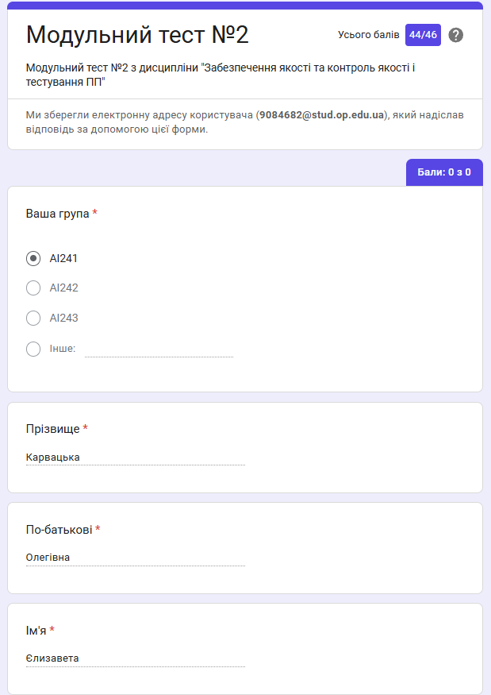
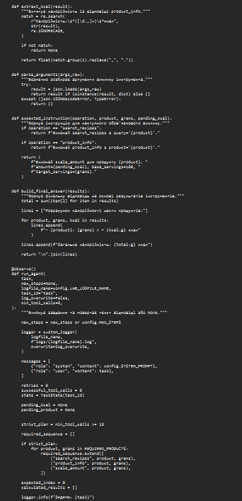
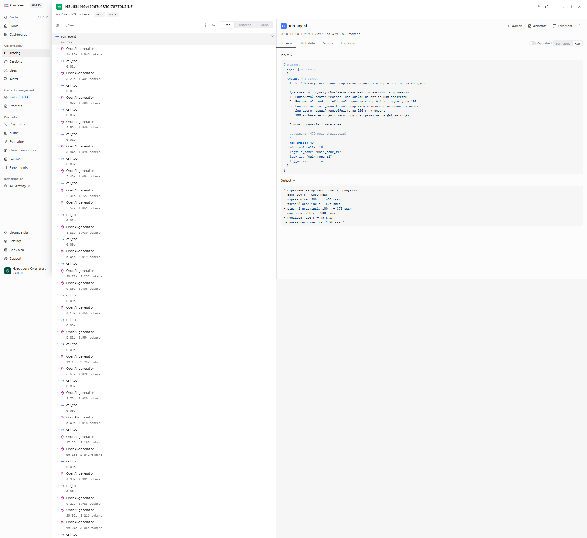
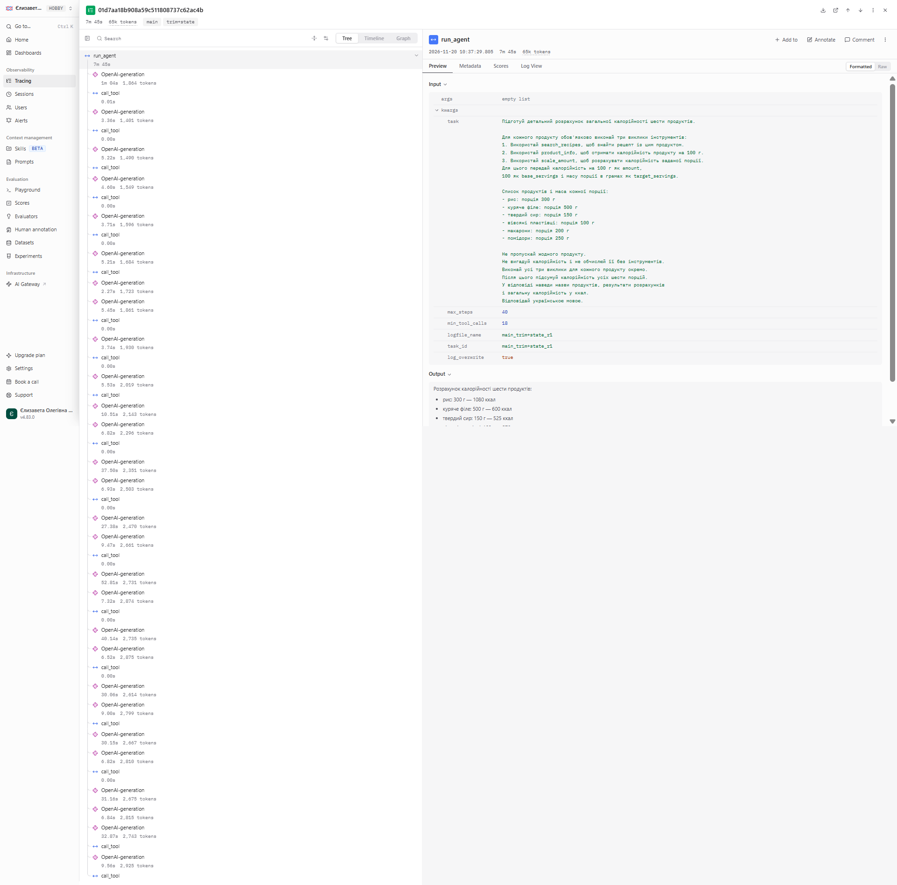

# Національний університет «Одеська політехніка»

## Лабораторна робота № 4

### Дослідження керування контекстом, стиснення історії діалогу та кешування мовного агента

**Дисципліна:** «Обчислювальні методи»\
**Варіант:** 2 --- «Кулінарія»\
**Виконала:** студентка групи АІ-241 Карвацька Єлизавета Олегівна\
**2026**

------------------------------------------------------------------------

## 1. Мета роботи

Дослідити вплив контекстного вікна на виконання довгого завдання мовним
агентом, реалізувати та порівняти стиснення історії діалогу, збереження
стану завдання й кешування відповідей моделі. Оцінити правильність
виконання, кількість кроків, використання токенів і тривалість роботи.

## 2. Варіант і предметна область

Варіант 2 --- «Кулінарія». Агент має знаходити рецепти, отримувати
калорійність продуктів із довідника та перераховувати калорійність
заданих порцій.

Для довгого завдання використано шість продуктів. Для кожного необхідно
було виконати три виклики інструментів: `search_recipes`, `product_info`
та `scale_amount`. Загалом завдання передбачало 18 успішних викликів.

  Продукт               Маса порції
  ------------------- -------------
  Рис                         300 г
  Куряче філе                 500 г
  Твердий сир                 150 г
  Вівсяні пластівці           100 г
  Макарони                    200 г
  Помідори                    250 г

Очікуваний результат, визначений у `long_task.json`, --- 3320 ккал.

## 3. Конфігурація середовища

Проєкт реалізовано мовою Python. Для взаємодії з локальною моделлю
використано Ollama через OpenAI-сумісний API, для трасування ---
Langfuse.

Фактичні параметри `config.py`:

  Параметр                       Значення
  ------------------------------ -----------------------------
  API URL                        `http://localhost:11434/v1`
  Модель                         `qwen25-3k`
  `NUM_CTX`                      3072
  `MAX_STEPS`                    6
  `MAX_STEPS_LONG`               40
  `MAX_RETRIES`                  2
  Температура                    0
  `RUN_TAG`                      `ctx-control`
  `COMPRESS_AT`                  2150
  `KEEP_LAST`                    6
  `USE_CACHE` за замовчуванням   `False`

Дозволені інструменти: `search_recipes`, `product_info`, `scale_amount`.
Ключі Langfuse завантажуються зі змінних середовища; секретні значення
`.env` до звіту не включаються.

**Примітка:** у фактичній конфігурації використано контекст 3072 токени
та `MAX_STEPS_LONG = 40`. У звіті наведено саме фактичні параметри
виконаних експериментів, а не інші значення з початкового плану.

**Рисунок 1 --- Конфігурація проєкту.**

## 4. Контроль виконання довгого завдання

У `agent.py` реалізовано додатковий контроль послідовності обов'язкових
операцій. Коли для завдання задано щонайменше 18 викликів інструментів,
активується `strict_plan`. Агент контролює перелік продуктів і порядок
необхідних операцій. Передчасна спроба сформувати фінальну відповідь не
завершує завдання: агент повертається до наступного обов'язкового
виклику.

Цей механізм важливо враховувати під час інтерпретації результатів:
успішне завершення забезпечувалося як роботою моделі, так і програмним
контролем плану.

**Рисунок 2 --- Контроль послідовності викликів у `agent.py`.**

## 5. Результат розрахунку

Усі дев'ять основних запусків сформували однакову фінальну відповідь:

  Продукт               Калорійність на 100 г    Маса   Калорійність порції
  ------------------- ----------------------- ------- ---------------------
  Рис                                360 ккал   300 г             1080 ккал
  Куряче філе                        120 ккал   500 г              600 ккал
  Твердий сир                        350 ккал   150 г              525 ккал
  Вівсяні пластівці                  370 ккал   100 г              370 ккал
  Макарони                           350 ккал   200 г              700 ккал
  Помідори                            18 ккал   250 г               45 ккал
  **Разом**                                                   **3320 ккал**

Перевірка журналів підтвердила, що кожна з дев'яти відповідей містила ті
самі значення для шести продуктів і загальну суму 3320 ккал.

**Рисунок 3 --- Фінальна відповідь агента.**

## 6. Дослідження стиснення контексту

Порівнювалися три режими:

-   `none` --- історія діалогу не стискається;
-   `trim` --- скорочується історія повідомлень;
-   `trim+state` --- історія стискається із додатковим збереженням
    структурованого стану завдання.

Порогове значення стиснення --- 2150 токенів, параметр `KEEP_LAST` ---
6.

### 6.1. Пробні запуски

У пробному `none` отримано 18 кроків, максимальний вхід 3065 токенів
(майже все вікно 3072), суму `prompt_tokens` 43053 та нуль стиснень.

У пробному `trim` перше стиснення відбулося на кроці 10: 2208 токенів,
22 повідомлення було скорочено до 8. Загалом зафіксовано п'ять стиснень;
максимальний вхід --- 2411 токенів (78% вікна).

У пробному `trim+state` перше стиснення відбулося на кроці 12: 2376
токенів, 26 повідомлень було скорочено до 8. Загалом зафіксовано дев'ять
стиснень; максимальний вхід --- 2989 токенів (97% вікна).

**Таблиця 1 --- Перше стиснення у пробних запусках.**

  --------------------------------------------------------------------------
  Конфігурація             Крок        Вхід до    Повідомлень      Повторних
                                     стиснення   було → стало       викликів
  -------------- -------------- -------------- -------------- --------------
  `trim`                     10           2208         22 → 8              0

  `trim+state`               12           2376         26 → 8              0
  --------------------------------------------------------------------------

**Рисунок 4 --- Пробний запуск без стиснення.**

**Рисунок 5 --- Стиснення в режимі trim.**

**Рисунок 6 --- Стиснення зі збереженням стану.**

### 6.2. Основні запуски `trim`

  Показник                         Запуск 1   Запуск 2   Запуск 3
  ------------------------------ ---------- ---------- ----------
  Кроків                                 30         30         29
  Максимальний вхід                    2572       2297       2411
  Сума `prompt_tokens`                57019      55544      54145
  Крок першого стиснення                 12         12         10
  Вхід перед першим стисненням         2266       2296       2208
  Кількість стиснень                      4          4          5
  Повторні виклики                        0          0          0

### 6.3. Основні запуски `trim+state`

  Показник                         Запуск 1   Запуск 2   Запуск 3
  ------------------------------ ---------- ---------- ----------
  Кроків                                 28         28         28
  Максимальний вхід                    2882       2928       2687
  Сума `prompt_tokens`                62129      61432      60354
  Крок першого стиснення                 12         12         12
  Вхід перед першим стисненням         2266       2365       2354
  Повідомлень було → стало           26 → 8     26 → 8     26 → 8
  Кількість стиснень                      8          8          8
  Повторні виклики                        0          0          0

## 7. Порівняння основних експериментів

Наведено медіани трьох запусків кожної конфігурації.

**Таблиця 2 --- Підсумкові результати основних експериментів.**

  --------------------------------------------------------------------------------------------------------
  Конфігурація     Правильно   Кроків   Токенів   Токенів               На   Час, с   Стиснень   Повторних
                                        на вхід  на вихід   підсумовування                        викликів
  -------------- ----------- -------- --------- --------- ---------------- -------- ---------- -----------
  `none`               3 з 3       24     54777      1794                0    421,4          0           0

  `trim`               3 з 3       30     55544      2272                0    314,6          4           0

  `trim+state`         3 з 3       28     61432      2950                0    471,1          8           0
  --------------------------------------------------------------------------------------------------------

Усі конфігурації забезпечили правильний результат у трьох із трьох
запусків. Найменший медіанний час показав `trim` --- 314,6 с. Режим
`trim+state` мав найбільшу медіанну суму вхідних токенів --- 61432 ---
та найбільший медіанний час --- 471,1 с.

Отже, стиснення не обов'язково зменшує сумарну кількість токенів за весь
прогін. Його основна роль у цьому експерименті --- обмежувати розмір
окремого запиту до моделі.

**Рисунок 7 --- Підсумкова таблиця експериментів.**

## 8. Аналіз помилок і передчасних завершень

У всіх дев'яти основних запусках були зафіксовані передчасні спроби
сформувати фінальну відповідь до виконання всіх 18 операцій. Контроль
плану повертав агента до необхідних викликів інструментів.

Помилки формування аргументів рівня `meaning` були зафіксовані у двох
запусках `none` та одному запуску `trim`. У `trim+state` таких помилок
не було.

  -----------------------------------------------------------------------
  Конфігурація           Запуски з передчасними        Запуски з помилкою
                            спробами завершення                 `meaning`
  ------------------- ------------------------- -------------------------
  `none`                                  3 з 3                     2 з 3

  `trim`                                  3 з 3                     1 з 3

  `trim+state`                            3 з 3                     0 з 3
  -----------------------------------------------------------------------

Попри попередження та помилки, усі дев'ять основних запусків завершилися
успішно та повернули правильний результат 3320 ккал.

## 9. Експеримент із кешуванням

Було виконано два послідовні запуски однакового завдання. Перед першим
запуском кеш очищено.

**Таблиця 3 --- Результати кешування.**

  ---------------------------------------------------------------------------
  Запуск            Кроків    Влучань у  Викликів до       Час, с Правильно
                                    кеш      сервера
  ----------- ------------ ------------ ------------ ------------ -----------
  1 ---                 18            0           18        382,5 Так
  порожній
  кеш

  2 ---                 18           18            0          0,6 Так
  повторний
  запит
  ---------------------------------------------------------------------------

Перший запуск виконав 18 звернень до сервера. Під час другого всі 18
відповідей було отримано з кешу, тому звернень до сервера не було. Обидва
запуски повернули 3320 ккал. Сума вхідних токенів становила 43053, вихідних —
1108 в обох запусках. За виміряним часом повторний запуск був приблизно у
637,5 раза швидшим (382,5 с проти 0,6 с). Це прискорення стосується саме
повторення однакового запиту за наявності заповненого кешу.

**Рисунок 8 --- Перший запуск із порожнім кешем.**

**Рисунок 9 --- Повторний запуск із кешем.**

## 10. Трасування в Langfuse

Langfuse використовувався для перегляду окремих запусків агента та
аналізу перебігу виконання.

Для `none` було переглянуто trace `long-main_none_r1`: правильний
результат 3320 ккал, тривалість приблизно 408,5 с.

Для `trim+state` було переглянуто trace `long-main_trim+state_r1`:
правильний результат 3320 ккал, тривалість приблизно 465,9 с. Ці два
trace є окремими додатковими запусками, тому їхній час не слід
ототожнювати з медіанами трьох основних прогонів у таблиці 2.

**Рисунок 10 --- Trace режиму none у Langfuse.**

**Рисунок 11 --- Trace режиму trim+state у Langfuse.**

## 11. Відповіді на контрольні питання

### 1. Для чого потрібне контекстне вікно?

Контекстне вікно визначає максимальний обсяг токенів, який модель може
врахувати під час одного звернення. До нього входять інструкції, історія
діалогу, результати інструментів і поточний запит. У довгих завданнях
важливо контролювати розмір історії, щоб не наблизитися до обмеження.

### 2. Для чого потрібне стиснення історії?

Стиснення зменшує обсяг повідомлень, що передаються моделі на наступному
кроці. Це допомагає обмежувати розмір окремого запиту в межах
контекстного вікна.

### 3. Чим відрізняються `trim` і `trim+state`?

`trim` скорочує історію повідомлень. `trim+state` додатково зберігає
структурований стан завдання, щоб важливі результати попередніх операцій
залишалися доступними після стиснення. У цьому експерименті `trim+state`
виконував по вісім стиснень у кожному основному запуску, а `trim` ---
від чотирьох до п'яти.

### 4. Чи завжди стиснення зменшує сумарну кількість токенів?

Ні. Воно може зменшити розмір окремого запиту, але повторне передавання
збереженої інформації також потребує токенів. У вимірюваннях медіана
вхідних токенів становила 54777 для `none`, 55544 для `trim` і 61432 для
`trim+state`.

### 5. Для чого потрібне збереження стану?

Збереження стану фіксує важливі результати вже виконаних операцій. Після
стиснення агент може використати цей структурований стан, щоб продовжити
завдання без втрати ключових даних.

### 6. Для чого потрібне кешування?

Кешування зберігає результати попередніх однакових запитів. Якщо запит
повторюється, система може повернути збережену відповідь без нового
звернення до моделі. У другому запуску експерименту всі 18 звернень
були обслуговані кешем.

### 7. Які обмеження має кешування?

Кешування найефективніше для повторних однакових запитів. Якщо вхідні
дані змінюються, ключ кешу може бути іншим і збережена відповідь не буде
використана. Актуальність результату залежить від правильного формування
ключа та політики оновлення кешу.

### 8. Яку роль відіграє Langfuse?

Langfuse дає змогу переглядати траси виконання агента, генерації моделі,
виклики інструментів, тривалість операцій та інші параметри. Це полегшує
аналіз довгих запусків.

## 12. Обмеження експерименту

-   Виконано по три основні запуски кожної конфігурації, тому висновки
    стосуються цих вимірювань.
-   Фактичне контекстне вікно становило 3072 токени.
-   Фактичне значення `MAX_STEPS_LONG` становило 40.
-   На результат впливав програмний контроль обов'язкової послідовності
    18 викликів інструментів.
-   Час роботи локальної моделі може змінюватися між запусками.
-   Додаткові траси Langfuse не є тими самими прогонами, за якими
    розраховано медіани.
-   Результат кешування отримано для повторного однакового запиту, тому
    його не слід узагальнювати на всі завдання.

## 13. Висновки

Під час лабораторної роботи досліджено керування контекстом мовного
агента на довгому завданні з предметної області «Кулінарія». Агент мав
виконати 18 обов'язкових викликів інструментів для шести продуктів і
визначити загальну калорійність порцій.

Порівняно конфігурації `none`, `trim` і `trim+state`. Усі дев'ять
основних запусків завершилися успішно та повернули правильний результат
--- 3320 ккал. Режими зі стисненням обмежували розмір історії перед
наступними зверненнями до моделі. Найменший медіанний час у цьому
експерименті показав `trim` --- 314,6 с. Водночас найменша медіанна сума
вхідних токенів була в режимі `none`.

Окремий експеримент підтвердив ефективність кешування для повторного
однакового запиту: кількість звернень до сервера зменшилася з 18 до
нуля, а час --- з 382,5 до 0,6 с. Повторний запуск був приблизно у
637,5 раза швидшим. Langfuse забезпечив можливість аналізувати окремі
траси та перебіг виконання агента.

Отже, стиснення корисне для контролю розміру контексту, збереження стану
допомагає підтримувати багатокрокове виконання, а кешування суттєво
прискорює повторні однакові запити.

------------------------------------------------------------------------

## Додаток. Перелік скриншотів

У документі наведено власні скриншоти виконання лабораторної роботи.
Зображення збережені в папці `screenshots_lab4` та відповідають
наведеному нижче переліку:

1.  `01_config.png` --- параметри `config.py`.
2.  `02_agent_plan.png` --- контроль плану в `agent.py`.
3.  `03_final_answer.png` --- фінальна відповідь агента.
4.  `12_probe_none_success.png` --- успішний пробний запуск `none`.
5.  `05_trim.png` --- стиснення `trim`.
6.  `06_trim_state.png` --- стиснення `trim+state`.
7.  `07_main_table.png` --- підсумкова таблиця експериментів.
8.  `08_cache_first.png` --- перший запуск із порожнім кешем.
9.  `09_cache_second.png` --- повторний запуск із кешем.
10. `10_langfuse_none.png` --- trace `none`.
11. `11_langfuse_trim_state.png` --- trace `trim+state`.
