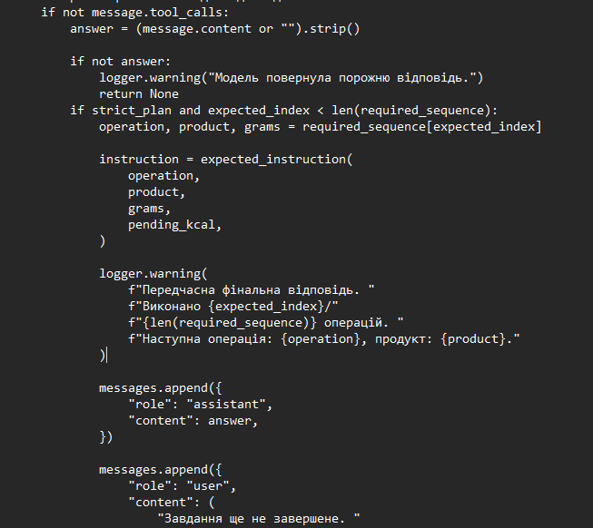
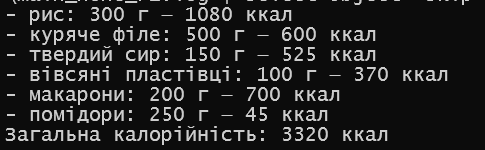
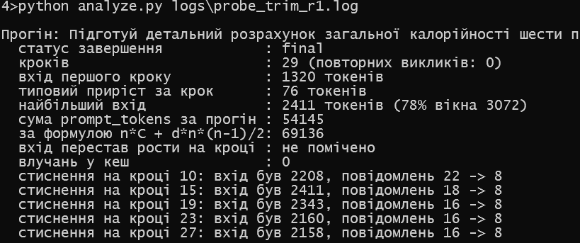
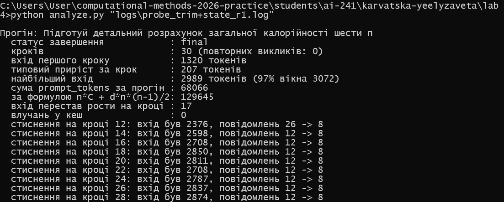
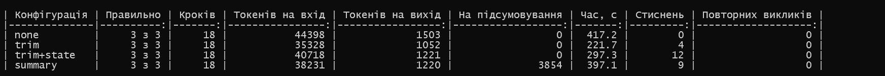
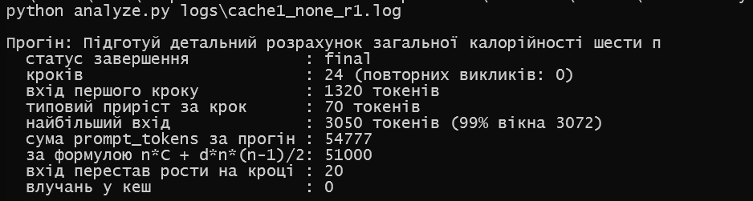
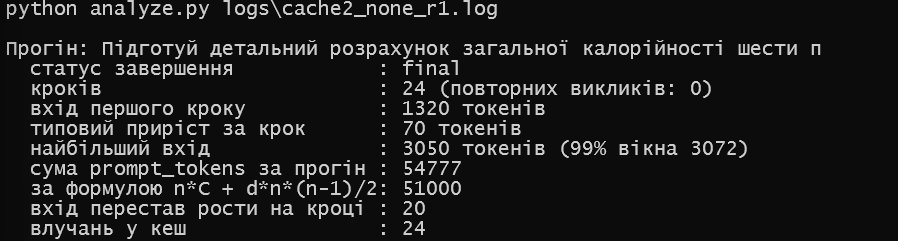
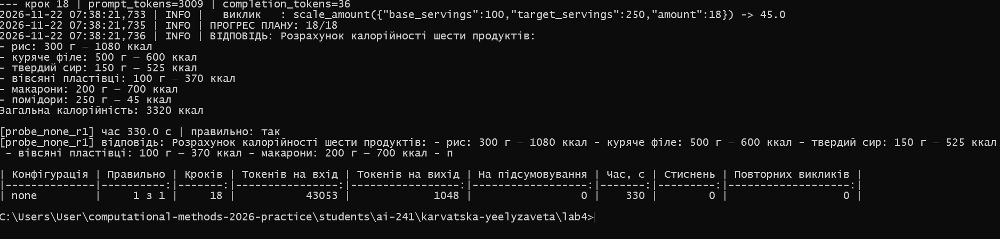

# Лабораторна робота № 4
# Контекст, стан і кеш агента

**Національний університет «Одеська політехніка»**  
**Інститут комп’ютерних систем, кафедра інформаційних систем**  
**Виконала:** студентка групи АІ-241 Карвацька Є.О.  
**Варіант 2 — Кулінарія, 2026**

## 1. Мета роботи

Дослідити поведінку агента за обмеженого контекстного вікна, реалізувати обрізання історії, збереження стану задачі та кешування викликів моделі, порівняти витрати токенів і час виконання для різних конфігурацій.

## 2. Проєкт і модель

У роботі використано локальну модель `qwen2.5:3b` та експериментальну конфігурацію `qwen25-3k`. Для експериментальної моделі встановлено обмежене контекстне вікно — 3072 токени.

Основні параметри конфігурації:

| Параметр | Значення |
|---|---:|
| Базова модель | `qwen2.5:3b` |
| Експериментальна модель | `qwen25-3k` |
| Контекстне вікно `NUM_CTX` | 3072 токени |
| Поріг стиснення `COMPRESS_AT` | 2150 токенів |
| Кількість останніх повідомлень `KEEP_LAST` | 6 |
| Максимальна кількість кроків для довгої задачі | 25 |
| Кількість повторів основного експерименту | 3 |
| Температура | 0 |
| Кешування за замовчуванням | вимкнено |

Початковий розмір контекстного вікна базової моделі становить 32768 токенів. Отже, експериментальне вікно було зменшено приблизно у 10,67 раза, або на 90,625%.

## 3. Довга задача за варіантом 2

Предметна область — кулінарія. Агент повинен знайти інформацію про шість продуктів, отримати їхню калорійність на 100 г та розрахувати калорійність порції заданої маси.

Для кожного продукту необхідно виконати три інструментальні виклики:

1. `search_recipes` — пошук рецепта;
2. `product_info` — отримання калорійності продукту;
3. `scale_amount` — розрахунок калорійності заданої порції.

Таким чином, повне виконання задачі передбачає 18 інструментальних викликів.

| Продукт | Маса порції | Калорійність на 100 г | Калорійність порції |
|---|---:|---:|---:|
| Рис | 300 г | 360 ккал | 1080 ккал |
| Куряче філе | 500 г | 120 ккал | 600 ккал |
| Твердий сир | 150 г | 350 ккал | 525 ккал |
| Вівсяні пластівці | 100 г | 370 ккал | 370 ккал |
| Макарони | 200 г | 350 ккал | 700 ккал |
| Помідори | 250 г | 18 ккал | 45 ккал |
| **Разом** | | | **3320 ккал** |

Очікуваний результат — **3320 ккал**.

## 4. Дослідження зростання контексту без захисту

Для дослідження поведінки агента без механізмів стиснення використано конфігурацію `none`. Під час виконання довгої задачі аналізувалися кількість токенів на вході, зміна розміру історії, кількість кроків і результат завершення.

### Таблиця 2 — Зростання контексту в режимі none

| Крок | Токенів на вході | Зміна | Дія агента |
|---:|---:|---:|---|
| 1 | 1474 | — | `search_recipes`: рис |
| 2 | 1596 | +122 | `product_info`: рис |
| 3 | 1752 | +156 | `scale_amount`: рис |
| 4 | 1880 | +128 | `search_recipes`: куряче філе |
| 5 | 2018 | +138 | `product_info`: куряче філе |
| 6 | 2185 | +167 | `scale_amount`: куряче філе |
| 7 | 2310 | +125 | `search_recipes`: твердий сир |
| 8 | 2426 | +116 | `product_info`: твердий сир |
| 9 | 2590 | +164 | `scale_amount`: твердий сир |
| 10 | 2723 | +133 | `search_recipes`: вівсяні пластівці |
| 11 | 2856 | +133 | `product_info`: вівсяні пластівці |
| 12 | 3032 | +176 | `scale_amount`: вівсяні пластівці |
| 13 | 2664 | −368 | `search_recipes`: макарони |
| 14 | 2782 | +118 | `product_info`: макарони |
| 15 | 2946 | +164 | `scale_amount`: макарони |
| 16 | 3049 | +103 | `search_recipes`: помідори |
| 17 | 3064 | +15 | `product_info`: помідори |
| 18 | 3051 | −13 | `scale_amount`: помідори |

Перший запит містив 1474 токени. Максимальний розмір вхідного контексту становив 3064 токени, що відповідає приблизно 99,74% доступного вікна. Сума `prompt_tokens` за весь прогін — 44398 токенів.

За результатами аналізу типовий позитивний приріст становив приблизно 133 токени за крок. Теоретична оцінка за формулою зростання контексту відрізняється від фактичної, оскільки довжина повідомлень і склад історії змінювалися під час виконання.

На 13-му кроці спостерігалося зменшення кількості токенів на 368. Після цього вхід знову зростав. Отже, це зменшення саме по собі не доводить постійного припинення зростання контексту.

Утиліта `analyze.py` позначила 13-й крок як можливу ознаку зупинки зростання. Це евристичний сигнал для подальшої перевірки, а не безпосередній доказ того, що сервер обрізав історію.

**Класифікація випадків A–D:**

- **A — помилка сервера:** не підтверджено, оскільки прогін завершився зі статусом `final`, а повідомлення `server_error` не зафіксовано.
- **B — ознака зупинки зростання входу:** діагностика `analyze.py` позначила крок 13. Водночас наступні кроки показують відновлення зростання, тому цей результат потрібно трактувати як евристичну ознаку.
- **C — контекст менший за 95% вікна:** не підходить, оскільки максимальний вхід становив 99,74% вікна.
- **D — незавершений статус без помилки сервера та ознаки зупинки:** не підходить, оскільки статус завершення був `final`, а діагностика позначила крок 13.

Після 13-го кроку агент продовжив роботу: отримав інформацію про макарони, розрахував їхню порцію, знайшов рецепт помідорів, отримав довідкові дані та виконав розрахунок. Повторних викликів інструментів у цьому прогоні не зафіксовано. Фінальний результат — 3320 ккал.

## 5. Обрізання історії та збереження стану

Для порівняння було використано три конфігурації:

| Конфігурація | COMPRESS | USE_STATE | Призначення |
|---|---|---|---|
| `none` | `none` | `False` | Історія не обрізається |
| `trim` | `trim` | `False` | Старі повідомлення видаляються |
| `trim+state` | `trim` | `True` | Старі повідомлення видаляються, результати інструментів зберігаються окремо |

Режим `trim` зменшує обсяг історії, залишаючи останні повідомлення. Режим `trim+state` додатково зберігає успішні результати інструментів у зовнішньому стані, щоб їх можна було використати після скорочення діалогу.

### Таблиця 3 — Події обрізання історії

**а) Режим trim**

| Крок | Вхід до стиснення | Повідомлень було → стало | Повторних викликів |
|---:|---:|---:|---:|
| 6 | 2185 | 19 → 10 | 0 |
| 9 | 2184 | 19 → 10 | 0 |
| 12 | 2196 | 19 → 10 | 0 |
| 15 | 2192 | 19 → 10 | 0 |

**б) Режим trim+state**

| Крок | Вхід до стиснення | Повідомлень було → стало | Повторних викликів |
|---:|---:|---:|---:|
| 6 | 2185 | 19 → 10 | 0 |
| 7 | 2278 | 13 → 10 | 0 |
| 8 | 2282 | 13 → 10 | 0 |
| 9 | 2327 | 13 → 10 | 0 |
| 10 | 2374 | 13 → 10 | 0 |
| 11 | 2426 | 13 → 10 | 0 |
| 12 | 2492 | 13 → 10 | 0 |
| 13 | 2525 | 13 → 10 | 0 |
| 14 | 2536 | 13 → 10 | 0 |
| 15 | 2572 | 13 → 10 | 0 |
| 16 | 2611 | 13 → 10 | 0 |
| 17 | 2673 | 13 → 10 | 0 |

У режимі `trim` зафіксовано чотири події стиснення. Максимальний вхід становив 2196 токенів, а сумарна кількість вхідних токенів — 35328.

У режимі `trim+state` зафіксовано 12 подій стиснення. Максимальний вхід становив 2717 токенів, а сумарна кількість вхідних токенів — 40718. Стан містив 18 записів і займав 3318 байтів.

Обидві конфігурації завершили задачу зі статусом `final`, виконали 18 кроків і повернули правильний результат — 3320 ккал. Повторних викликів не було.

## 6. Експеримент із кешуванням

Кешування використовувалося для повторного застосування результатів однакових запитів. Ключ кешу формується за допомогою `SHA-256` від серіалізованого запиту. Якщо змінюється модель, повідомлення, інструменти або параметри запиту, формується інший ключ.

### Таблиця 4 — Результати кешування

| Показник | Перший запуск, кеш порожній | Другий запуск, кеш заповнений |
|---|---:|---:|
| Кількість кроків | 18 | 18 |
| Влучання в кеш | 0 | 18 |
| Виклики до сервера | 18 | 0 |
| Час виконання | 382,5 с | 0,6 с |
| Фінальна відповідь | 3320 ккал | 3320 ккал |

Під час першого запуску всі 18 викликів були виконані через сервер. Під час повторного запуску всі результати були отримані з кешу.

Прискорення становило приблизно 637,5 раза. Отже, кешування значно зменшує час виконання повторюваних ідентичних запитів. Водночас для практичного використання потрібно враховувати актуальність збережених результатів: за зміни даних або умов виконання кеш може містити застарілу інформацію.

## 7. Основне порівняння конфігурацій

Для основного порівняння використано три конфігурації: `none`, `trim` і `trim+state`. Для кожної виконано три повтори. У таблиці наведено результати вимірювань.

### Таблиця 5 — Порівняння вартості виконання довгої задачі

| Конфігурація | Правильно | Кроків | Токенів на вхід | Токенів на вихід | На підсумовування | Час, с | Стиснень | Повторних викликів |
|---|---:|---:|---:|---:|---:|---:|---:|---:|
| `none` | 3/3 | 18 | 44398 | 1503 | 0 | 417,2 | 0 | 0 |
| `trim` | 3/3 | 18 | 35328 | 1052 | 0 | 221,7 | 4 | 0 |
| `trim+state` | 3/3 | 18 | 40718 | 1221 | 0 | 297,3 | 12 | 0 |

Усі три конфігурації правильно виконали задачу в трьох повторах. Кожен прогін містив 18 кроків, а фінальна відповідь дорівнювала 3320 ккал.

Режим `trim` показав найменшу кількість вхідних токенів і найменший час виконання серед основних конфігурацій. Порівняно з `none` кількість вхідних токенів зменшилася на 9070, або приблизно на 20,43%.

Режим `trim+state` також зменшив витрати порівняно з `none`, але використав на 5390 вхідних токенів більше, ніж `trim`. Це пояснюється додатковою роботою зі збереженням і передаванням стану.

Отже, для цієї задачі звичайне обрізання історії виявилося економнішим за витратами токенів і часу. Додавання зовнішнього стану забезпечує збереження результатів інструментів, але має додаткову вартість.

## 8. Додатковий експеримент із підсумовуванням історії

Окремо перевірено режим `summary`, у якому стара частина історії стискається за допомогою текстового підсумку. Цей режим розглядався як додатковий експеримент і не включався до основної таблиці порівняння.

Було виконано три повтори. У кожному з них агент зробив 18 викликів інструментів і повернув правильний фінальний результат — 3320 ккал.

### Результати режиму summary

| Показник | Результат |
|---|---:|
| Правильні відповіді | 3/3 |
| Кількість кроків | 18 |
| Токенів на вхід | 36960 |
| Токенів на вихід | 1256 |
| Додаткові токени на підсумовування | 3435 |
| Час виконання | 469,6 с |
| Кількість стиснень | 7 |
| Повторні виклики | 0 |

Режим `summary` зменшив кількість вхідних токенів порівняно з `trim`, однак потребував додаткових токенів для створення підсумків і мав більший час виконання.

Під час аналізу журналів було виявлено неточності в окремих проміжних підсумках: деякі числові значення та послідовність попередніх операцій передавалися неправильно. Попри це, у всіх трьох запусках фінальна відповідь залишилася правильною.

Це показує, що підсумовування історії може зменшувати її обсяг, але створює ризик втрати або спотворення проміжних фактів. Тому для задач, у яких важливо зберігати точні числові результати, підсумки потрібно перевіряти.

## 9. Аналіз точності та обмежень

Усі основні конфігурації (`none`, `trim`, `trim+state`) завершили три повтори з правильною відповіддю. Додатковий режим `summary` також повернув правильний фінальний результат у всіх трьох запусках.

Під час оцінювання важливо розрізняти правильність фінальної відповіді та точність проміжних даних. Перевірка фінального числа 3320 сама по собі не гарантує, що кожен проміжний крок був виконаний без помилок.

Для режиму `summary` було виявлено неточності в проміжних переказах. Це підтверджує необхідність окремої перевірки числових значень, отриманих від інструментів, і значень, які потрапляють до підсумку історії.

Також слід враховувати, що результати отримано на одній моделі та одному наборі даних. Тому висновки стосуються саме проведеного експерименту й не є універсальним порівнянням усіх моделей або агентних систем.

## 10. Трасування в Langfuse

Langfuse використовувався для перегляду трас виконання агента та аналізу послідовності викликів.

У наявних матеріалах збережено знімки попередніх трас для режимів `none` і `trim+state`:

- рисунок 10 — trace режиму `none`;
- рисунок 11 — trace режиму `trim+state`.

Під час основної серії `main25` та додаткових запусків `summary` з'являлося повідомлення про відсутній `public_key`:

`Authentication error: Langfuse client initialized without public_key. Client will be disabled.`

Через це клієнт Langfuse був вимкнений, а нові траси для цих запусків не записувалися. Тому збережені знімки не слід ототожнювати з трасами основної серії вимірювань.

Для повного трасування наступних експериментів потрібно налаштувати `LANGFUSE_PUBLIC_KEY` і `LANGFUSE_SECRET_KEY` та повторити відповідні запуски.

## 11. Відповіді на контрольні питання

**1. Чому вартість прогону зростає швидше за вартість одного кроку?**

На кожному кроці модель отримує не лише нове повідомлення, а й попередню історію діалогу. Через це наступний запит може містити дедалі більше токенів. У режимі `none` сумарна кількість вхідних токенів у дослідженому прогоні становила 44398.

**2. Що відбувається, коли історія наближається до межі контекстного вікна?**

Модель може отримати помилку через перевищення обмеження або система може скоротити частину історії. У дослідженні максимальний вхід у режимі `none` становив 3064 токени за доступного вікна 3072 токени.

**3. Чому поріг COMPRESS_AT має бути меншим за NUM_CTX?**

Після стиснення необхідно залишити запас місця для наступного повідомлення, системних інструкцій, результатів інструментів і відповіді моделі. Якщо запускати стиснення лише після досягнення повної межі контексту, наступний запит може не поміститися.

**4. Для чого потрібне видалення осиротілих результатів інструментів?**

Після обрізання історії можуть залишитися повідомлення з результатами інструментів, але відповідні виклики асистента вже будуть видалені. Видалення таких повідомлень допомагає зберегти коректну структуру діалогу та уникнути некоректної послідовності повідомлень.

**5. Що втрачається під час обрізання історії та яку роль відіграє стан?**

Обрізання видаляє старі повідомлення та може прибрати результати попередніх інструментальних операцій. Зовнішній стан дає змогу зберігати важливі результати окремо від тексту діалогу та повторно використовувати їх після стиснення. Однак стан не замінює повну історію та не гарантує правильності міркувань агента.

**6. Як формується ключ кешу?**

Ключ кешу формується за допомогою `SHA-256` від серіалізованого запиту. До нього входять параметри, що визначають запит, зокрема модель, повідомлення, інструменти та налаштування. Зміна цих параметрів може призвести до створення іншого ключа.

**7. Навіщо виконувати кілька повторів і використовувати медіану?**

Час виконання та інші вимірювані показники можуть змінюватися між запусками через навантаження системи й особливості генерації. Кілька повторів дають змогу зменшити вплив випадкових коливань, а медіана є стійкішою до окремих нетипових значень.

**8. Яку інформацію можна отримати з Langfuse?**

Langfuse дає змогу переглядати послідовність виконання агента, окремі виклики моделі та інструментів, тривалість операцій і використання токенів. У цій роботі нові траси основної серії не були записані через відсутність ключа `public_key`.

## 12. Висновок

Під час лабораторної роботи досліджено вплив обмеженого контекстного вікна на роботу агента та порівняно кілька способів керування історією діалогу.

У режимі `none` кількість вхідних токенів зростала до значення, близького до межі контекстного вікна. Режим `trim` забезпечив найменші витрати вхідних токенів і найменший час виконання серед основних конфігурацій. Режим `trim+state` давав змогу зберігати результати інструментів окремо від історії, але потребував більших витрат порівняно зі звичайним обрізанням.

Окремий експеримент із `summary` показав, що текстове підсумовування може зменшити обсяг історії, проте створює ризик втрати точних проміжних значень. Тому числові результати інструментів доцільно зберігати у структурованому стані, а не покладатися лише на текстовий переказ.

Експеримент із кешуванням продемонстрував значне прискорення повторного виконання ідентичних запитів: час зменшився з 382,5 до 0,6 секунди. Водночас необхідно контролювати актуальність кешованих результатів.

Отже, для довгих задач доцільно використовувати контрольоване обрізання історії, за потреби доповнюючи його зовнішнім станом для збереження важливих результатів інструментів. Кешування ефективне для повторюваних запитів, а підсумовування історії потребує додаткової перевірки точності. Подальше вдосконалення системи має включати повне налаштування трасування Langfuse та контроль правильності проміжних даних.

## Додаток А. Скріншоти виконання лабораторної роботи

**Рисунок 1 — Конфігурація експериментального середовища.**

**Рисунок 2 — План виконання задачі агентом.**

**Рисунок 3 — Приклад дострокового завершення агента.**

**Рисунок 4 — Фінальна відповідь агента.**

**Рисунок 5 — Робота механізму обрізання історії.**

**Рисунок 6 — Робота механізму обрізання зі збереженням стану.**

**Рисунок 7 — Результати основного порівняння конфігурацій.**

**Рисунок 8 — Перший запуск із порожнім кешем.**

**Рисунок 9 — Повторний запуск із використанням кешу.**

**Рисунок 10 — Траса виконання агента в режимі none у Langfuse.**

**Рисунок 11 — Траса виконання агента в режимі trim+state у Langfuse.**

**Рисунок 12 — Результат пробного запуску без обрізання історії.**

