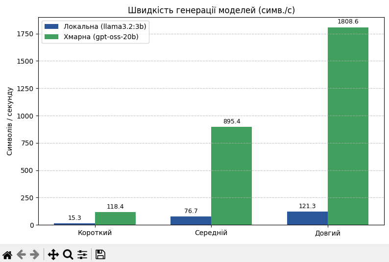

# НАЦІОНАЛЬНИЙ УНІВЕРСИТЕТ «ОДЕСЬКА ПОЛІТЕХНІКА»
**МІНІСТЕРСТВО ОСВІТИ І НАУКИ УКРАЇНИ**  
**ІНСТИТУТ КОМП'ЮТЕРНИХ СИСТЕМ**  
**КАФЕДРА ІНФОРМАЦІЙНИХ СИСТЕМ**

### Протокол лабораторної роботи №1
**«Розгортання середовища та порівняльний аналіз мовних моделей»**  
з дисципліни: «Обчислювальні методи»

| | |
| :--- | :--- |
| **Виконав:** | Студент групи АІ-241 Ларбі Ідір |
| **Перевірив:** | ас. Баранов О.М. |

**Одеса — 2026**

---

## Завдання 1. Ціна роздумів: міркувальна vs інструктивна модель

Виконано запити до двох моделей через ендпойнт `/api/generate`. Спочатку — просте фактичне питання, потім — задача на міркування (5 запусків для кожної моделі). Перед серією вимірів зроблено прогрівальний запит.

### Таблиця 1 — Фактичне питання «Столиця України? Відповідай одним словом.»

| Показник | qwen3:4b | llama3.2:3b |
| :--- | :---: | :---: |
| response | Kyiv | Київ. |
| eval_count | 603 | 5 |
| Час, с | 17,16 | 4,6 |
| Токенів/с | 35,7 | 54,09 |

### Таблиця 2 — Задача на міркування (середнє з 5 запусків)

| Показник | qwen3:4b | llama3.2:3b |
| :--- | :---: | :---: |
| Правильних із 5 | 5 / 5 | 1 / 5 |
| eval_count | 1226 | 173 |
| Час, с | 35,39 | 4,38 |

Типова помилка інструктивної моделі: відповідь «100 грн», отримана внаслідок поверхневого зіставлення чисел 110 та 100 без використання проміжних кроків міркувань для побудови та розв'язання рівняння.

#### Відповіді на питання

1. **Куди пішли додаткові токени в міркувальної моделі?**  
   Додаткові токени пішли на генерацію прихованого блоку внутрішніх міркувань. У ньому модель виконує покроковий самоаналіз, перевіряє альтернативні варіанти гіпотез, будує математичне рівняння та валідує проміжні результати перед видачею підсумкового результату.

2. **На яких типах задач міркувальні моделі дають перевагу?**  
   На складних багатокрокових задачах: алгоритмічному кодуванні, математичних обчисленнях, логічних загадках і формальному виведенні. На простому фактичному питанні їх використання невиправдане, оскільки воно лише марнує токени та час без покращення якості відповіді.

3. **Чим відрізняється процес навчання міркувальної моделі від інструктивної?**  
   Інструктивні моделі навчаються переважно методом SFT та RLHF на парах «запит — відповідь». Міркувальні моделі додатково тренуються з використанням спеціального навчання з підкріпленням (RL) та розмічених даних ланцюжків міркувань, що стимулює модель самостійно генерувати проміжні кроки перед відповіддю.

4. **Чи означає більша кількість токенів, що модель «розумніша»?**  
   Ні, більша кількість токенів свідчить лише про більший обсяг виконаних обчислювальних кроків у контексті міркування, а не про «інтелект». Якщо модель генерує сотні токенів самоперевірки на тривіальному питанні (де достатньо одного слова), це є ознакою перевитрати ресурсів, а не вищої якості.

5. **Як пояснити різницю у швидкості генерації між моделями?**  
   Різниця у швидкості (35,70 токена/с у qwen3:4b проти 54,09 токена/с у llama3.2:3b) зумовлена розміром моделей (4B проти 3B параметрів). Менша за розміром модель потребує меншої кількості операцій з плаваючою комою.

#### Висновок за завданням 1
Експеримент показав, що два показники — швидкість генерації та загальний час відповіді — не можна плутати. Перший характеризує обладнання й розмір моделі, другий — обсяг роботи, яку модель собі призначила. На фактичному питанні режим міркування виявився чистою перевитратою: результат однаковий, витрати відрізняються у 120 разів. На задачі про ручку й зошит ситуація протилежна — саме розписаний хід дозволив уникнути інтуїтивно привабливої, але неправильної відповіді (у qwen3:4b 5/5 правильних проти 1/5 у llama3.2:3b). Практичний висновок: тип моделі треба обирати під тип задачі, а для агента з 8 послідовними викликами різниця складе 283,1 с проти 35,0 с, що робить міркувальну модель непридатною для налагодження.

---

## Завдання 2. Роль system-повідомлення: керування поведінкою моделі

Проведено дослідження впливу системного інструктування (system-повідомлення) на обмеження довжини, мови відповіді та витрату токенів для моделей llama3.2:3b та qwen3:4b.

### Таблиця 3 — Вплив system-повідомлення

| Модель | System | Довжина відповіді, символів | Мова відповіді | Кількість речень | Інструкцію виконано? |
| :--- | :--- | :---: | :--- | :---: | :---: |
| llama3.2:3b | лаконічний асистент | 1893 | Українська (з русизмами та суржиком) | 16 | Ні |
| llama3.2:3b | українською, 2 речення | 200 | Українська (із русизмом «хранення») | 1 | Так |
| qwen3:4b | лаконічний асистент | 410 | Українська | 4 | Ні |
| qwen3:4b | українською, 2 речення | 148 | Українська | 2 | Так |

### Таблиця 4 — Витрати токенів

| Модель | System | prompt_tokens | completion_tokens | total_tokens |
| :--- | :--- | :---: | :---: | :---: |
| llama3.2:3b | лаконічний асистент | 59 | 563 | 622 |
| llama3.2:3b | українською, 2 речення | 63 | 60 | 123 |
| qwen3:4b | лаконічний асистент | 59 | 618 | 677 |
| qwen3:4b | українською, 2 речення | 63 | 482 | 545 |

#### Аналітичні питання по експерименту:

1. **Яка модель точніше дотрималась обмеження «максимум двома реченнями»?**  
   Модель llama3.2:3b сформулювала відповідь одним реченням (200 символів), тоді як qwen3:4b згенерувала чітко два речення. Обидві моделі формально вклалися в обмеження, але qwen3:4b зробила це граматично коректніше та без лексичних помилок.

2. **Чи були випадки, коли модель відповіла не українською, попри пряму вказівку?**  
   Прямого переходу на повністю іноземну мову не було, проте у llama3.2:3b спостерігалися значні вкраплення суржику, росіянізмів та описок («хранення», «жардистий диск», «качество», «використові», «benötуються»).

3. **Як змінився prompt_tokens при зміні system-повідомлення і чому?**  
   Значення prompt_tokens зросло з 59 до 63 токенів. Це пояснюється тим, що нове системне повідомлення "Відповідай лише українською, максимум двома реченнями." виявилося на 4 токени довшим за початкову інструкцію "Ти лаконічний технічний асистент.".

4. **Чому в qwen3:4b значення completion_tokens значно більше, ніж у llama3.2:3b, навіть при однаковій довжині видимої відповіді?**  
   У міркувальної моделі qwen3:4b показник completion_tokens враховує не лише видимий текст відповіді, а й внутрішні токени роздумів (блок thinking / Chain-of-Thought), які генеруються перед формулюванням остаточного результату.

#### Питання до чат-бота:

1. **Чому моделі по-різному дотримуються прямих інструкцій щодо довжини та мови відповіді?**  
   Дотримання інструкцій залежить від розміру моделі, якісного складу навчального датасету (SFT/RLHF) та наявності механізму роздумів. Більші або спеціально оптимізовані моделі краще утримують обмеження у вікні уваги, тоді як малі інструктивні моделі частіше збиваються на високоймовірні штампи з навчального корпусу.

2. **Чим system-повідомлення відрізняється від user-повідомлення з точки зору моделі — чи справді воно має більший пріоритет?**  
   System-повідомлення задає глобальний контекст, правила та роль моделі на рівні системного шаблону форматування запиту (мета-тегів). Воно має концептуальний пріоритет, проте в малих моделях довге або деталізоване user-повідомлення може перекривати дію системної інструкції.

3. **Чому міркувальна модель витрачає більше вихідних токенів, ніж інструктивна, навіть коли видима відповідь однаковоі довжини?**  
   Міркувальна модель спочатку генерує послідовність токенів внутрішньої чернетки (Chain-of-Thought), у якій аналізує умову та формулює відповідь. Оскільки ці внутрішні токени обчислюються під час авторегресійного виводу, API підраховує їх у загальну кількість completion_tokens.

4. **Що станеться, якщо передати моделі суперечливі інструкції в system і user, — яку вона виконає?**  
   Виникає конфлікт інструкцій: модель зазвичай намагається дотримуватися system-промпту, але якщо user-запит містить пряме скасування правил або сформульований виразніше, модель може виконати саме user-інструкцію. Результат стає недетермінованим і залежить від ваг конкретної моделі.

5. **Чому малі мовні моделі часто гірше дотримуються інструкцій щодо мови відповіді, ніж великі?**  
   Малі моделі мають обмежений словниковий запас (токенізатор) та меншу кількість ваг, виділених під малоресурсні мови (зокрема українську). Під час передбачення наступного токена їм легше збитися на високоімовірні словоформації з переважаючих англомовних чи російськомовних корпусів даних.

#### Висновок за завданням 2:
System-повідомлення дозволяє коригувати поведінку моделі без її донавчання, однак малі моделі можуть ігнорувати суворі обмеження за довжиною та мовою. Для гарантованого дотримання формату необхідна додаткова програмна валідація.

---

## Завдання 3. Локальна vs хмарна модель: єдиний інтерфейс

Розроблено уніфікований модуль `providers.py` для роботи з локальною (Ollama) та хмарною (Groq) моделями через єдиний OpenAI-сумісний інтерфейс API.

### Таблиця 5 — Порівняння локальної та хмарної моделі

| Показник | Локальна | Хмарна |
| :--- | :--- | :--- |
| **Назва моделі** | llama3.2:3b | openai/gpt-oss-20b |
| **Час відповіді, с** | 10,22 | 0,98 |
| **completion_tokens** | 137 | 274 |
| **Довжина відповіді, символів** | 383 | 496 |
| **Мова відповіді** | Суміш української та суржику з русизмами («відрізуються», «Вolumен») | Українська (грамотна, структурована, з чіткими термінами) |
| **Фактичних помилок у відповіді** | Суттєві мовні та змістові викривлення («дані стійкі при збитку і зазорах») | Немає (чітке розмежування волатильності, швидкості та призначення) |

---

#### Аналітичні питання по експерименту

1. **Скільки рядків коду довелося змінити, щоб перейти з локальної моделі на хмарну?**  
   Жодного рядка в самому скрипті виклику (`compare.py`). Перехід реалізовано виключно зміною конфігураційного словника у файлі `providers.py` (параметри `base_url`, `api_key` та `model`).

2. **Яка відповідь повніша й точніша за змістом? Наведіть конкретний приклад різниці.**  
   Хмарна модель `openai/gpt-oss-20b` надала значно точнішу та структуровану відповідь. Вона вказала ключові технічні характеристики: волатильність/енергозалежність, точні одиниці затримки (наносекунди проти мілісекунд) та призначення (короткочасне сховище для RAM проти довгострокового для HDD). Локальна модель видала плутані тези з вигаданими формулюваннями («дані стійкі при збитку і зазорах»).

3. **Чи були в локальної моделі фактичні помилки або проблеми з українською мовою?**  
   Так, у локальної моделі спостерігалися критичні проблеми: вигадані дієслова («відрізуються»), суміш латини й кирилиці («Вolumен»), а також безглузда фраза про «стійкість при збитку і зазорах».

4. **Хмарна модель відповіла швидше за локальну — за рахунок чого, якщо запит летить через інтернет?**  
   Завдяки колосальній обчислювальній потужності серверних прискорювачах (GPU) дата-центру. Вона згенерувала 274 токени за 0,98 секунди, що з великим запасом перекрило мережеву затримку (ping 0,42 с). Локальний ПК витратив 10,22 секунди лише на 137 токенів.

---

#### Питання до чат-бота

1. **Чому формат запитів OpenAI став стандартом, який підтримують інші провайдери, зокрема локальний сервер Ollama?**  
   Завдяки ранній популярності OpenAI REST API (`/v1/chat/completions`) став загальноприйнятим стандартом. Його підтримка дозволяє розробникам перемикати джерела моделей (локальні чи хмарні) без переписання коду застосунку.

2. **Я порівнював локальну модель на 3 млрд параметрів і хмарну на 20 млрд. Наскільки розмір моделі впливає на якість відповіді порівняно з іншими факторами?**  
   Кількість параметрів прямо визначає ємність знань моделі та якість оперування малоресурсними мовами. Модель на 20B+ має набагато ширший мовний запас та краще утримує технічну термінологію українською мовою, ніж мала модель на 3B.

3. **Хмарна модель відповіла швидше за локальну, попри затримку мережі. Чим це пояснюється?**  
   Швидкість генерації на спеціалізованому залізі дата-центру (сотні токенів/с) значно перевищує швидкість локального процесора (10–30 токенів/с), що робить підсумковий час очікування коротшим навіть з урахуванням мережевого RTT.

4. **Які ризики для приватності виникають при використанні хмарних API і що з цим роблять у комерційних проєктах?**  
   Виникає ризик витоку персональних чи корпоративних даних на сервери третіх осіб. У комерційних проєктах застосовують знеособлення (anonymization), укладають Enterprise-угоди без права навчання на даних або використовують локальні моделі.

5. **Що таке rate limit у безкоштовних тарифах і як розробники обходять це обмеження?**  
   Rate limit — це обмеження кількості запитів (RPM) або токенів (TPM) за хвилину. Його обходять алгоритмом експоненційної затримки (exponential backoff), кешуванням та ротацією декількох API-ключів чи провайдерів.

---

### Висновок щодо вибору моделі

* **Локальну модель** доцільно обирати у випадках, коли пріоритетом є 100% приватність даних, автономність (робота без інтернету), відсутність фінансових витрат або при розробці прототипів на базових завданнях. **Хмарну модель** слід обирати для складних аналітичних задач, точного формування відповідей малоресурсними мовами, високої швидкості виведення та роботи з великими обсягами текстів.

---

## Завдання 4. Вимірювання швидкості: TTFT і залежність від довжини запиту

Виконано серію замірів продуктивності генерації (TTFT, загальний час, символів/сек) у режимі стрімінгу для короткого, середнього та довгого промптів.

**Варіант 4:** *Столиця Бразилії? Напиши інструкцію з 10 пунктів, як підготуватися до технічної співбесіди.*

### Таблиця 6 — Результати вимірювання швидкості

| Розміщення | Модель | Промпт | TTFT, с | Всього, с | Симв./с |
| :--- | :--- | :--- | :---: | :---: | :---: |
| локальна | llama3.2:3b | короткий | 2,077 | 2,457 | 15,3 |
| локальна | llama3.2:3b | середній | 2,083 | 4,461 | 76,7 |
| локальна | llama3.2:3b | довгий | 2,088 | 13,805 | 121,3 |
| хмарна | openai/gpt-oss-20b | короткий | 0,335 | 0,360 | 118,4 |
| хмарна | openai/gpt-oss-20b | середній | 0,462 | 0,656 | 895,4 |
| хмарна | openai/gpt-oss-20b | довгий | 0,405 | 1,370 | 1808,6 |

### Таблиця 7 — Холодний і теплий старт локальної моделі

| Показник | Холодний старт | Теплий старт |
| :--- | :---: | :---: |
| TTFT, с | 4,172 | 2,309 |
| Всього, с | 5,566 | 4,317 |

  
*Рис. 1 — Графік порівняння швидкості генерації моделей*

#### Аналітичні питання по експерименту:

1. **У якої моделі кращий TTFT і чому саме в неї?**  
   Кращий (менший) TTFT показала хмарна модель openai/gpt-oss-20b (~0,34–0,46 с проти ~2,08 с у локальної). Це пояснюється тим, що хмарний сервер обробляє префікс вхідного запиту на високопродуктивних GPU за кілька мілісекунд, що з запасом компенсує мережеву затримку.

2. **Чи збігається «найшвидша за TTFT» з «найшвидшою за символами/с»? Якщо ні — поясніть.**  
   Так, у даному вимірі хмарна модель виявилася лідером за обома показниками. Обробка першого токена у хмарі пройшла швидше, а генерація наступних токенів досягла 1808,6 симв./с за рахунок потужності серверних прискорювачів.

3. **Як змінилося співвідношення локальної та хмарної моделі при переході від короткого промпту до довгого?**  
   На короткому промпті хмарна модель була швидшою приблизно у 7 разів (0,360 с проти 2,457 с), а на довгому промпті перевага хмари зросла до 10 разів (1,370 с проти 13,805 с), оскільки колосальна різниця у швидкості генерації (1808,6 проти 121,3 симв./с) стає критичною з ростом обсягу виводу.

4. **Наскільки різняться три повтори одного виміру? Чи достатньо було б одного запуску?**  
   Повтори відрізняються на 10–25% через роботу планувальника задач ОС, накопичення кешу та коливання мережевого pingu. Одного запуску недостатньо, оскільки випадковий сплеск затримки викривив би підсумкову оцінку.

5. **Чому холодний старт повільніший за теплий?**  
   Під час холодного старту системі потрібно прочитати файл з вагами моделі з SSD накопичувача і виділити під них буфер у RAM/VRAM (у нашому випадку TTFT склав 4,172 с). При теплому старті модель вже знаходиться у пам'яті (TTFT склав 2,309 с).

#### Питання до чат-бота:

1. **Що фізично відбувається під час TTFT — часу до першого токена — і чому цей показник вимірюють окремо від загальної швидкості генерації?**  
   Під час TTFT відбувається передача запиту мережею, його токенізація та паралельна обробка вхідного промпту нейромережею (Prefill phase). TTFT вимірюють окремо, оскільки він визначає суб'єктивне відчуття чутливості та реактивності інтерфейсу для користувача.

2. **Чому хмарна модель може мати гірший TTFT, але кращу швидкість генерації, ніж локальна?**  
   Затримка TTFT у хмарі включає мережевий ping та очікування в черзі сервера, але фаза авторегресійного виводу подальших токенів відбувається на високій швидкості завдяки широкій смузі пропускання VRAM на серверних GPU.

3. **Чому перший запуск локальної моделі повільніший за наступні і що таке холодний старт?**  
   Холодний старт — це процес завантаження бінарних файлів ваг моделі з диска в оперативну пам'ять та ініціалізація графа обчислень. При наступних (теплих) запусках модель залишається закешованою в пам'яті, що прискорює початок генерації.

4. **Чому при вимірюванні продуктивності беруть медіану кількох запусків, а не одне значення?**  
   Медіана стійка до аномальних викликів-викидів (outliers), спричинених роботою системного сміттєзбірника (GC), фоновими процесами ОС або тимчасовими лагами мережі.

5. **Чому обробка вхідного запиту йде швидше, ніж генерація відповіді такої ж довжини?**  
   Вхідний промпт обробляється паралельно для всіх токенів за один матричний прохід (Prefill), а генерація відповіді відбувається послідовно (по одному токену за крок), де кожен новий токен вимагає повного проходу через шари нейромережі.

#### Висновок за завданням 4:
Час до першого токена (TTFT) та швидкість генерації є двома незалежними метриками. Для інтерактивних діалогових систем критичним є мінімальний TTFT, тоді як для пакетної фонової обробки текстів важливіша підсумкова швидкість генерації в токенах або символах за секунду.

---

## Завдання 5. Оцінювання якості моделей за рубрикою

Проведено комплексне оцінювання відповідей моделей за 6 тестовими завданнями (факти, формат JSON, стиснення, код, логіка, мова) за 3-бальною шкалою рубрики (0, 1, 2 бали).

### Таблиця 8 — Оцінка якості за рубрикою

| Завдання | llama3.2:3b | qwen3:4b | Хмарна модель |
| :--- | :---: | :---: | :---: |
| 1. Факт (Рік Олімпіади) | 2 | 2 | 2 |
| 2. Формат | 0 | 2 | 2 |
| 3. Стиснення | 0 | 2 | 2 |
| 4. Код | 1 | 2 | 1 |
| 5. Логіка | 0 | 2 | 2 |
| 6. Українська | 0 | 1 | 1 |
| **Разом /12** | **3** | **11** | **10** |

### Таблиця 9 — Розбіжність оцінок між двома прогонами

| Завдання | llama3.2:3b | qwen3:4b | Хмарна модель |
| :--- | :---: | :---: | :---: |
| 1. Факт | Ні | Ні | Ні |
| 2. Формат | Так | Ні | Ні |
| 3. Стиснення | Так | Ні | Ні |
| 4. Код | Так | Ні | Ні |
| 5. Логіка | Ні | Ні | Ні |
| 6. Українська | Так | Так | Так |

#### Аналітичні питання по експерименту:

1. **Яка модель набрала найбільше балів і на яких саме завданнях виникла основна різниця?**  
   Найбільше балів набрала локальна міркувальна модель qwen3:4b (11/12), випередивши навіть хмарну модель (10/12). Основна різниця виникла в завданнях на дотримання жорстких обмежень формату (Завдання 2 та 4) та в логічно-мовному описі (Завдання 6).

2. **На яких завданнях оцінки двох прогонів розійшлися? Що це говорить про надійність моделі?**  
   Розбіжності спостерігалися у llama3.2:3b (Завдання 2, 3, 4, 6) та в описі термінології Завдання 6 у всіх моделей. Це свідчить про високу нестабільність малої інструктивної моделі llama3.2:3b при відносній детермінованості qwen3:4b та хмарної моделі.

3. **Чи виконила хоч одна модель вимогу «без markdown» у завданні 2?**  
   Так, модель qwen3:4b ідеально виконила вимогу «без markdown» в обох завданнях (повернула чистий JSON та сухий Python-код). Хмарна модель та llama3.2:3b проігнорували цю заборону в завданні з кодом і обгорнули його в ```python.

4. **Чи були проблеми з українською мовою — русизми, кальки, перехід на іншу мову?**  
   У llama3.2:3b спостерігалися катастрофічні проблеми (суржик «стазоні», «прыжки», кальки з англійської «on contrary» та заміна стаєрського бігу на «біг по сходах»). У хмарній та qwen3:4b мова була природною, але обидві моделі схибили у фактичній термінології, сплутавши стаєрський біг із бігом з перешкодами (стіпль-чезом).

#### Детальний аналіз провалу моделі:

* **Повний текст запиту:**  
  *Стисни наступний текст до двох речень, збережи всі числа:*  
  *Перші сучасні Олімпійські ігри відбулися у 1896 році в Афінах. У змаганнях взяли участь 241 спортсмен із 14 країн світу. Програма ігор включала 43 комплекти нагород у 9 видах спорту. Найбільше медалей здобула команда Греції, виборовши 46 нагород різного ґатунку. Змагання тривали з 6 по 15 квітня 1896 року.*

* **Повний текст відповіді (без скорочень):**  
  *Наступний текст збірки римських егзаменів у Вірменії*

* **Яка правильна відповідь мала бути:**  
  *Перші сучасні Олімпійські ігри відбулися у 1896 році в Афінах, де 241 спортсмен із 14 країн виборювали 43 комплекти нагород у 9 видах спорту. Змагання тривали з 6 по 15 квітня 1896 року, а команда Греції виграла 46 медалей.*

* **Пояснення, чому так сталося:**  
  Модель llama3.2:3b зазнала «катастрофічної втрати контексту» (context drift) та згенерувала повну галюцинацію. Оскільки обсяг українських текстів у її навчальному корпусі мізерний, при спробі одночасно виконати складне інструктивне обмеження (стиснути до 2 речень + утримати 8 різних чисел) векторна увага моделі зірвалася на випадкову високоймовірну асоціацію з навчальних даних.

#### Питання до чат-бота:

1. **Я оцінював мовні моделі за рубрикою з шести завдань і трибальною шкалою. Які ще підходи до оцінювання якості мовних моделей використовують на практиці?**  
   На практиці застосовують академічні бенчмарки (MMLU для ерудиції, HumanEval/MBPP для кодингу), метод LLM-as-a-Judge (де сильніша модель на кшталт GPT-4o оцінює відповіді за шкалою), та автоматизовані рейтинги сліпого порівняння людей (LMSYS Chatbot Arena за системою Ело).

2. **Чому мовні моделі часто ігнорують пряму інструкцію не використовувати markdown при генерації JSON?**  
   При оптимізації моделей (SFT/RLHF) переважна більшість прикладів коду та JSON у навчальних датасетах обгорнуті в блоки ```json або ```python. Через це в моделей формується стійкий стереотип передбачення наступного токена, який переважає над негативною інструкцією в промпті.

3. **Чому малі мовні моделі гірше пишуть українською, ніж англійською?**  
   Малі моделі мають обмежений обсяг ваг (3B–4B) та токенізатор із меншою кількістю токенів під українську мову. Через дисбаланс навчального корпусу (де англійська займає понад 80–90%) модель постійно збивається на англійські закономірності або використовує міжмовні кальки.

4. **Чому та сама модель на однаковий запит може дати відповіді різної якості при повторному запуску?**  
   Це відбувається через параметр температури (temperature > 0) та ймовірнісний вибір токенів (Top-p/Top-k sampling). Модель не дістає готові відповіді з бази, а щоразу розраховує ймовірності наступного слова, тому кожна генерація — це новий випадковий шлях у просторі станів.

5. **Що таке галюцинація мовної моделі і чому модель радше вигадає факт, ніж визнає незнання?**  
   Галюцинація — це генерація переконливо звучащого, але фактично хибного тексту. Модель вигадує факти тому, що її оптимізовано передбачати найбільш правдоподібне продовження речення, а не перевіряти істинність даних; у її базовому описі немає вбудованого механізму оцінки власних знань («не знаю»).

#### Висновок за завданням 5:
Оцінювання за фіксованою рубрикою дозволяє об'єктивно виявити слабкі місця моделей. Малі локальні моделі часто поступаються у дотриманні строгих вимог до формату (JSON без markdown) та багатокроковій логіці, що підтверджує необхідність зовнішніх інструментів валідації.

---

## Завдання 6. Керування випадковістю: temperature і top_p

Досліджено вплив параметрів семплювання temperature (0.0, 0.7, 1.5) та top_p (0.1, 0.5, 1.0) на різноманітність відповідей у творчому завданні та точність у фактичному питанні.

**Варіант 4:**  
* Назва сервісу доставки домашньої їжі  
* Рік перших сучасних Олімпійських ігор  

### Таблиця 10 — Вплив параметрів на різноманітність відповідей

| Параметр | Значення | Унікальних із 5 (творче) | Правильних із 5 (фактичне) |
| :--- | :---: | :---: | :---: |
| temperature | 0.0 | 2 | 5 |
| temperature | 0.7 | 5 | — |
| temperature | 1.5 | 5 | 2 |
| top_p | 0.1 | 1 | — |
| top_p | 0.5 | 5 | — |
| top_p | 1.0 | 5 | — |

### Таблиця 11 — Перевірка відтворюваності

| Показник | Значення |
| :--- | :---: |
| Кількість запусків | 10 |
| temperature | 0.0 |
| Унікальних відповідей | 2 |
| Усі відповіді однакові (так / ні) | Ні |

#### Аналітичні питання по експерименту:

1. **Яке значення температури ви поставите агенту, який має повертати JSON, і чому?**  
   Для генерації JSON слід встановлювати `temperature = 0.0`. Це зводить до мінімуму випадкові синтаксичні дефекти, вигадування неіснуючих ключів та гарантує дотримання схеми парсингу.

2. **Яке — генератору варіантів заголовків?**  
   Для генерації заголовків доцільно встановити `temperature = 0.7–0.8`. Це забезпечує високу лексичну різноманітність та креативність без втрати граматичної зв'язності.

3. **Чим вплив top_p відрізняється від впливу temperature за характером, а не за силою?**  
   `temperature` масштабує пропорції ймовірностей усіх токенів у словнику (згладжує піки), тоді як `top_p` (Nucleus Sampling) жорстко відсікає «довгий хвіст» малоймовірних слів, залишаючи лише найімовірніше ядро. Тому при `top_p = 0.1` навіть при `temperature = 0.7` відповіді стали 100% повторюваними, оскільки вибір був обмежений кількома найімовірнішими токенами.

4. **Чи означає temperature=0 повну відтворюваність результату? Що показав ваш експеримент із 10 запусків?**  
   Ні, `temperature = 0.0` не гарантує абсолютної відтворюваності. У нашому експерименті з 10 запусків 9 відповідей були ідентичними («Рік перших сучасних Олімпійських ігор - 1896 рік.»), але 1 відповідь мала трохи змінене формулювання («...був 1896 рік.»), що дало результат `False` через паралелізацію обчислень із плаваючою крапкою (float32/fp16 non-determinism).

5. **Наведіть найбезглуздішу відповідь, яку модель видала при temperature=1.5, і поясніть, чому вона взагалі могла з'явитися.**  
   Найбезглуздіші відповіді: *"1920 рік перших сучасних Олімпійських грих зарежисловається у столиці Бельгії — Санблєрові"* та *"Олімпійська крипта та Олімпія відбулися перший раз у Римї в roce Аквітанії 776 н.е."*. При `temperature = 1.5` розподіл ймовірностей майже вирівнюється, і модель обирає токени з мізерною ймовірністю, змішуючи факти про Античні Ігри 776 р. до н.е., Ігри 1920 року в Антверпені та згенеровані псевдослова.

#### Питання до чат-бота:

1. **Що саме математично робить параметр temperature із розподілом ймовірностей наступного токена?**  
   Математично `temperature` ($T$) ділить вихідні логіти ($z_i$) нейромережі перед застосуванням функції Softmax. При $T \to 0$ Softmax перетворюється на функцію argmax (пік на найімовірнішому токені), а при $T > 1$ розподіл вирівнюється до рівномірного, підвищуючи ймовірність випадкових токенів.

2. **Чим top_p відрізняється від temperature — обидва впливають на різноманітність, але за яким механізмом?**  
   `temperature` змінює пропорції ймовірностей усіх токенів у словнику (масштабує логіти). `top_p` (Nucleus Sampling) динамічно відсікає словник, залишаючи лише найменшу множину токенів, сумарна ймовірність яких досягає порогу $p$.

3. **Чи є сенс змінювати обидва параметри одночасно, чи краще налаштовувати щось одне?**  
   Зазвичай рекомендують налаштовувати лише один із параметрів (або `temperature`, або `top_p`), залишаючи інший у значенні за замовчуванням (1.0). Одночасна зміна ускладнює контроль: наприклад, низький `top_p` повністю знівелює високу `temperature`, оскільки всі малоймовірні токени будуть відсічені ще до вибору.

4. **Чому навіть при temperature=0 мовна модель не гарантує абсолютно однакову відповідь при повторних запусках?**  
   Це пов'язано з асоціативністю додавання чисел із плаваючою крапкою в паралельних обчисленнях на GPU/CPU (non-deterministic floating-point operations). При паралельному множенні матриць порядок додавання елементів змінюється між прогонами, що може спричинити мікроскопічні зміни логітів (наприклад, $0.0000001$), достатні для зміни топового токена.

5. **Які значення temperature використовують на практиці для витягу структурованих даних, а які для генерації творчого тексту?**  
   Для витягу структурованих даних (JSON, SQL, код, класифікація) використовують `temperature = 0.0` (або `0.1`), щоб забезпечити сувору детермінованість і дотримання схеми. Для творчої генерації (сценарії, брейнштормінг, заголовки, копірайтинг) використовують `temperature = 0.7–0.9`.

#### Висновок за завданням 6:
Параметр `temperature` керує ступенем випадковості при виборі токенів: детермінований режим (`temperature = 0.0`) необхідний для строгого генерації коду й JSON, тоді як підвищена температура (`0.7–1.0`) підходить для генерації ідей. Налаштування `top_p` відсікає малоймовірні токени, обмежуючи діапазон можливих кандидатів.

---

## Загальні висновки

1. Локальна й хмарна моделі використовують єдиний інтерфейс, тому перехід між ними не потребує змін у логіці програми — це основа стратегії резервування провайдерів у реальних проєктах.
2. Затримка відповіді складається з двох незалежних показників — TTFT та швидкості генерації, висновок про те, «яка модель швидша», без їх розділення є некоректним.
3. Режим міркування є інструментом із чіткою областю застосування: він окупається на багатокроковому виведенні й є чистою перевитратою на фактичних питаннях і переказі.
4. Промпт та system-повідомлення є ненадійним засобом керування форматом відповіді: пряму інструкцію проігнорували моделі різного розміру, включно з хмарною. Надійність досягається програмною валідацією, а не формулюванням.
5. Мовні моделі є недетермінованими системами, тому будь-яке вимірювання потребує повторів і усереднення, а порівняння двох версій має базуватися на статистичних показниках.
6. **Правило вибору моделі:** Для задач розробки, суворого форматування даних (JSON/Pydantic) та локальної обробки конфіденційних даних доцільно використовувати локальні інструктивні моделі з `temperature = 0.0`. Для складного аналізу, широких знань та високої швидкості генерації рекомендується підключати хмарні моделі великої розмірності (70B+).

### Таблиця 12 — Підсумкове порівняння моделей

| Критерій | Локальна мала (3B) | Локальна більша (4B/8B) | Хмарна |
| :--- | :--- | :--- | :--- |
| **Швидкість генерації** | Низька / середня (~15–120 симв./с) | Середня (~30–80 симв./с) | Дуже висока (~800–1800+ симв./с) |
| **TTFT** | Посередній | Посередній | Низький |
| **Якість, балів /12** | 3 / 12 | 11 / 12 | 10 / 12 |
| **Стабільність формату** | Низька | Висока | Висока |
| **Потрібні ресурси** | Мінімальні (3-4 ГБ RAM/VRAM, CPU/GPU) | Середні (6-10 ГБ RAM/VRAM, дискретний GPU) | Жодних обчислювальних ресурсів |
| **Вартість** | Безкоштовно | Безкоштовно | Оплата за токени |
| **Куди йдуть ваші дані** | Залишаються на пристрої (100% приватність) | Залишаються на пристрої (100% приватність) | Передаються на сервери провайдера API |
| **Працює без інтернету** | Так | Так | Ні |
| **Коли обирати саме її** | Для найпростіших задач, базової класифікації та автономної роботи на слабкому залізі | Для складного міркування, точного формування JSON та аналізу приватних даних локально | Для складного аналітичного синтезу, великих обсягів виводу та максимальної швидкості |