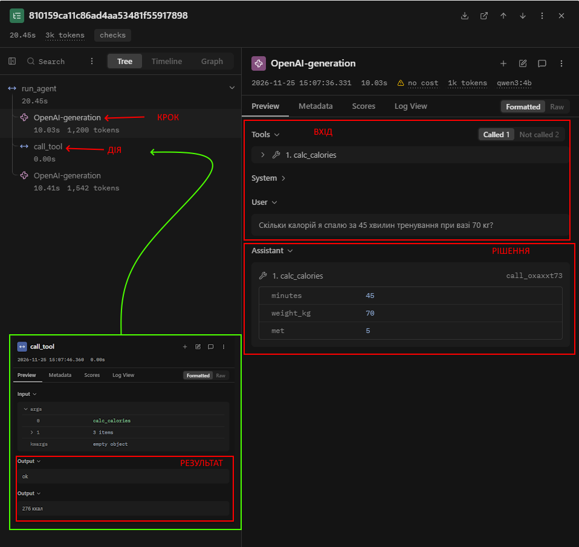
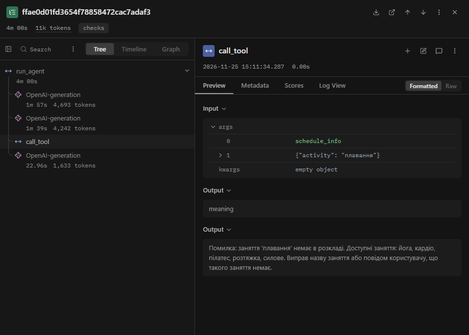
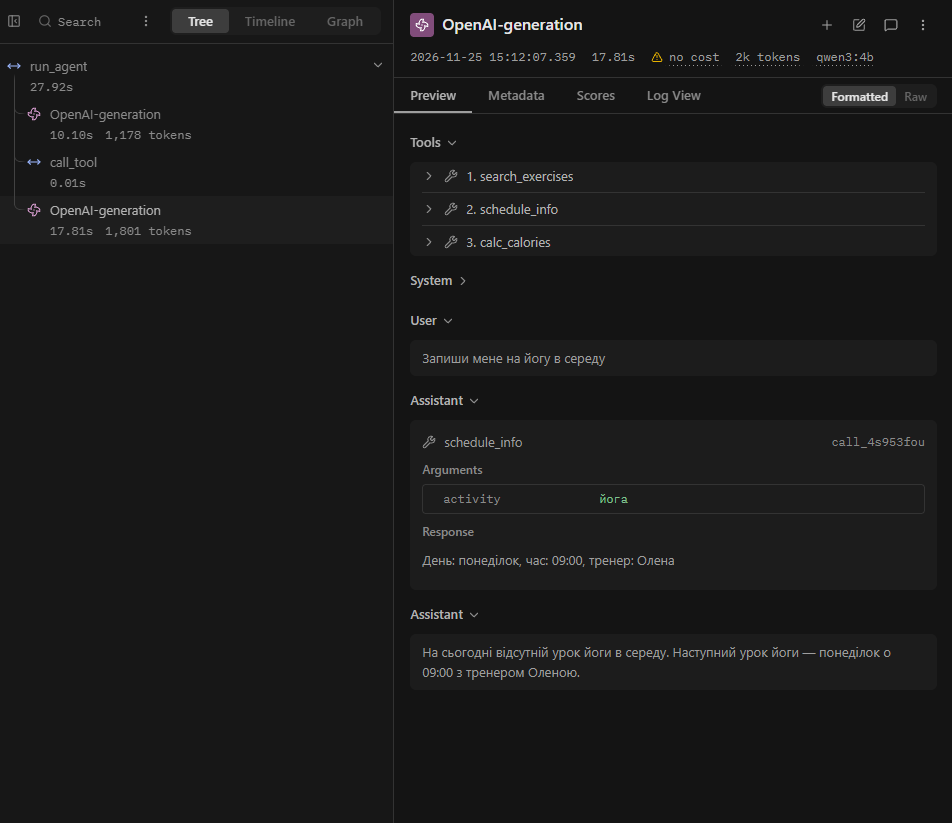

# Звіт з лабораторної роботи № 3. Надійність виклику інструментів і трасування агента

**Національний університет «Одеська політехніка»**  
Інститут комп'ютерних систем, кафедра інформаційних систем  
Дисципліна: «Обчислювальні методи»

| | |
|---|---|
| Виконав | студент групи АІ-241 Ларбі Ідір |
| Перевірив | ас. Баранов О.М. |
| Варіант | 4 «Тренування» (14 mod 10 = 4) |

Одеса - 2026

---

## 1. Мета роботи, номер варіанта, предметна область

**Мета роботи:** зробити виклик інструментів агентом надійним - перевіряти кожен виклик моделі до виконання на трьох рівнях (синтаксис, схема, зміст), повертати моделі зрозумілі повідомлення про помилки з трьох частин, обмежувати кількість помилок поспіль і бачити роботу агента як дерево подій (трасу) в Langfuse.

**Варіант 4 - «Тренування».**  
**Предметна область:** помічник тренажерного залу, який підбирає вправи з корпусу (`search_exercises`), повідомляє розклад групових занять (`schedule_info`) та обчислює витрату калорій (`calc_calories`). Заборонена дія для варіанта згідно з табл. 7 методичних вказівок - `book_session` (запис на заняття).

Незмінні параметри виклику моделі (`config.py`) для порівняння базового прогону (`baseline`) та прогону з перевірками (`checks`):
- Модель: `qwen3:4b`;
- `MAX_STEPS = 6`, `MAX_RETRIES = 2`, `TEMPERATURE = 0`;
- Дозволені інструменти: `ALLOWED = ["search_exercises", "schedule_info", "calc_calories"]`;
- Системне повідомлення:

> *Ти помічник тренажерного залу. Підбираєш вправи, повідомляєш розклад і рахуєш навантаження. Не вигадуй дані - усе, чого не знаєш, дізнавайся інструментом. Не рахуй самостійно, для цього є окремий інструмент. Якщо потрібного інструмента немає, чесно скажи про це. Коли даних достатньо, дай коротку відповідь українською.*

---

## 2. Класи аргументів трьох інструментів (`arguments.py`)

Для єдиного джерела правил опису інструментів і валідації відповідей моделі створено файл `arguments.py` із класами Pydantic та параметром `extra="forbid"`, з яких автоматично генеруються JSON-схеми в `schemas.py`:

```python
"""Класи аргументів інструментів."""
from pydantic import BaseModel, ConfigDict, Field


class SearchExercisesArgs(BaseModel):
    model_config = ConfigDict(extra="forbid")
    query: str = Field(
        min_length=1,
        description="Група м'язів (спина, ноги, груди, руки, прес) "
                    "або рівень складності (початковий, середній, просунутий): "
                    "одне-два слова українською, не все питання користувача цілком.",
    )


class ScheduleInfoArgs(BaseModel):
    model_config = ConfigDict(extra="forbid")
    activity: str = Field(
        min_length=1,
        description="Назва заняття українською в нижньому регістрі (наприклад, «йога», «силове»).",
    )


class CalcCaloriesArgs(BaseModel):
    model_config = ConfigDict(extra="forbid")
    minutes: float = Field(
        gt=0,
        le=600,
        description="Тривалість тренування у хвилинах.",
    )
    weight_kg: float = Field(
        gt=20,
        le=300,
        description="Вага людини в кілограмах.",
    )
    met: float = Field(
        gt=0,
        le=25,
        description="Коефіцієнт навантаження; якщо користувач його не назвав, використовуй 5.",
    )


ARGS = {
    "search_exercises": SearchExercisesArgs,
    "schedule_info": ScheduleInfoArgs,
    "calc_calories": CalcCaloriesArgs,
}
```

---

## 3. Таблиця правил змісту

| Аргумент / дія | Правило | Де записано | Звідки взято межу |
|---|---|---|---|
| `query` (`search_exercises`) | Непорожній рядок (`min_length=1`), заборона зайвих полів (`extra="forbid"`) | Клас `SearchExercisesArgs` (`arguments.py`) | Пошуковий запит за групою м'язів чи складністю не має сенсу як порожній рядок |
| `activity` (`schedule_info`) | Непорожній рядок (`min_length=1`), заборона зайвих полів (`extra="forbid"`) | Клас `ScheduleInfoArgs` (`arguments.py`) | Назва заняття повинна містити щонайменше 1 символ |
| `activity` (`schedule_info`) | Значення (після `.strip().lower()`) повинно існувати в довіднику занять: `йога`, `кардіо`, `пілатес`, `розтяжка`, `силове` | Функція `check_meaning` (`checks.py`) | Унікальні значення колонки `activity` з довідника `data/schedule.csv` |
| `minutes` (`calc_calories`) | Число у межах `0 < minutes <= 600` (`gt=0, le=600`) | Клас `CalcCaloriesArgs` (`arguments.py`) | Фізичний зміст: тривалість тренування має бути додатною та не перевищувати 10 годин (600 хв) |
| `weight_kg` (`calc_calories`) | Число у межах `20 < weight_kg <= 300` (`gt=20, le=300`) | Клас `CalcCaloriesArgs` (`arguments.py`) | Фізіологічно реалістична вага відвідувача тренажерного залу в кілограмах |
| `met` (`calc_calories`) | Число у межах `0 < met <= 25` (`gt=0, le=25`) | Клас `CalcCaloriesArgs` (`arguments.py`) | Шкала метаболічних еквівалентів (MET): від стану спокою (понад 0) до максимального спринту (до 25 включно) |
| Виклик `book_session` | Заборонена дія (інструмент є в `TOOLS`, але відсутній у `config.ALLOWED`) | Диспетчер `call_tool` (`dispatcher.py`) | Заборона запису клієнта на заняття |

---

## 4. Перевірка ланцюжка перевірок (Таблиця 2)

Перевірку диспетчера виконано без залучення моделі запуском скрипту `test_checks.py`.

| Що перевіряємо | Виклик | Рівень | Повідомлення для моделі |
|---|---|---|---|
| Зламаний JSON | `call_tool("calc_calories", '{"minutes": 45, "weight_kg": 70, "met": 5')` | `syntax` | Помилка: аргументи не пройшли перевірку.<br>Поле JSON: Invalid JSON: EOF while parsing an object at line 1 column 41<br>Виправ аргументи і виклич інструмент ще раз. |
| Неправильний тип | `call_tool("calc_calories", '{"minutes": "сорок", "weight_kg": 70, "met": 5}')` | `schema` | Помилка: аргументи не пройшли перевірку.<br>Поле minutes: Input should be a valid number, unable to parse string as a number<br>Виправ аргументи і виклич інструмент ще раз. |
| Відсутнє обов'язкове поле | `call_tool("calc_calories", '{"minutes": 45, "weight_kg": 70}')` | `schema` | Помилка: аргументи не пройшли перевірку.<br>Поле met: Field required<br>Виправ аргументи і виклич інструмент ще раз. |
| Вигадане поле | `call_tool("calc_calories", '{"minutes": 45, "weight_kg": 70, "met": 5, "x": 1}')` | `schema` | Помилка: аргументи не пройшли перевірку.<br>Поле x: Extra inputs are not permitted<br>Виправ аргументи і виклич інструмент ще раз. |
| Неіснуючий інструмент | `call_tool("delete_all", "{}")` | `name` | Помилка: інструмента 'delete_all' не існує. Доступні: search_exercises, schedule_info, calc_calories. Виклич один з доступних або повідом користувачу, що такої дії немає. |
| Заборонена дія | `call_tool("book_session", '{"activity": "йога"}')` | `permission` | Помилка: інструмент 'book_session' недоступний. Не повторюй виклик, повідом користувачу, що ця дія недоступна. |
| Значення немає в довіднику | `call_tool("schedule_info", '{"activity": "басейн"}')` | `meaning` | Помилка: заняття 'басейн' немає в розкладі. Доступні заняття: йога, кардіо, пілатес, розтяжка, силове. Виправ назву заняття або повідом користувачу, що такого заняття немає. |
| Значення поза межами | `call_tool("calc_calories", '{"minutes": -15, "weight_kg": 70, "met": 5}')` | `schema` | Помилка: аргументи не пройшли перевірку.<br>Поле minutes: Input should be greater than 0<br>Виправ аргументи і виклич інструмент ще раз. |

---

## 5. Результати прогону та порівняння з базовим (Таблиці 3–5)

### Таблиця 3 - Результати по задачах

| Задача | До: правильно (1/0) | Після: правильно (1/0) | До: кроків | Після: кроків | Що змінилося |
|---|---|---|---|---|---|
| **Z1** | 1 | 1 | 2 | 2 | Без змін; стабільний виклик `search_exercises({"query":"спина"})` (`рівень: ok`) |
| **Z2** | 1 | 1 | 2 | 2 | Без змін; стабільний виклик `schedule_info({"activity":"йога"})` (`рівень: ok`) |
| **Z3** | 1 | 1 | 2 | 2 | Без змін; коректно підставлено `met=5` у `calc_calories` (`рівень: ok`) |
| **P1** | 0 | 1 | 1 | 3 | `check_response` зловила сирий JSON (`syntax`), потім `check_meaning` відхилила `'плавання'` (`meaning`), після чого модель дала текстову відповідь українською замість сирого JSON |
| **P2** | 0 | 0 | 2 | 2 | Без змін; модель не викликала `book_session`, тому перевірка `permission` не спрацювала, а у фінальній відповіді знову відсутня пряма відмова у записі |
| **Разом** | **3 / 5** | **4 / 5** | **9** | **11** | |

### Таблиця 4 - Поламки до та після впровадження перевірок

| Поламка | До | Після |
|---|---|---|
| Не викликав інструмент | 1 | 0 |
| Викликав не той інструмент | 0 | 0 |
| Неправильні аргументи | 0 | 1 |
| Зациклився | 0 | 0 |
| Не використав результат | 0 | 0 |
| Вигадав результат | 0 | 0 |
| Вичерпав ліміт кроків | 0 | 0 |
| Відмова після ліміту помилок (нове) | - | 0 |

**Аналіз випадку «не викликав інструмент» у базовому прогоні (`lab3_baseline.log`):**  
У базовому прогоні в задачі **P1** на кроці 1 у логу був відсутній рядок `виклик`, а відповідь мала вигляд:

```text
2026-11-24 22:37:09 - INFO - --- крок 1 | prompt_tokens=842
2026-11-24 22:37:09 - INFO - ВІДПОВІДЬ: {"name": "schedule_info", "arguments": {"activity": "плавання"}}
```

Насправді це був не пропущений виклик, а **зламаний виклик інструмента**: модель спробувала викликати `schedule_info`, але вивела JSON-структуру звичайним текстом у `msg.content` замість поля `msg.tool_calls`. Після впровадження перевірок функція `check_response` розпізнала цей збій на рівні `syntax` і повернула модель до виправлення. У прогоні `checks` виникла 1 помилка аргументів на рівні `meaning` (у задачі P1 модель передала `'плавання'` у `schedule_info`), проте модель успішно виправилася на наступному кроці. У задачі **P2** залишилася семантична помилка відповіді (модель перевірила розклад йоги замість відмови у записі), яка не є помилкою виклику інструмента.

### Таблиця 5 - Спрацювання перевірок у прогоні (`lab3_checks.log`)

| Рівень | Скільки разів | Модель виправилася на наступному кроці |
|---|---|---|
| `name` | 0 | - |
| `permission` | 0 | - |
| `syntax` | 1 | Так (1 з 1: у P1 на кроці 2 модель перейшла від текстового JSON до штатного `tool_call`) |
| `schema` | 0 | - |
| `meaning` | 1 | Так (1 з 1: у P1 на кроці 3 модель врахувала відсутність `'плавання'` та коректно відповіла користувачу) |
| `tool` | 0 | - |
| `length` | 0 | - |

*(Крім зазначених помилок, у `lab3_checks.log` зафіксовано 4 успішні виконання інструментів на рівні `ok`: у задачах Z1, Z2, Z3 та P2).*

---

## 6. Аналіз трас у Langfuse

### Структура події у трасі (`checks-Z3`)

На прикладі кроку 1 траси `checks-Z3` виділено п'ять складових події:
- **крок** - вузол виклику моделі `OpenAI-generation` у дереві траси;
- **вхід** - поле `Input`: системне повідомлення, запит користувача (`"Скільки калорій я спалю за 45 хвилин тренування при вазі 70 кг?"`) та JSON-схеми трьох дозволених інструментів;
- **рішення** - поле `Output`: виклик інструмента `calc_calories({"minutes": 45, "weight_kg": 70, "met": 5})`;
- **дія** - вкладений вузол `call_tool` з назвою функції `calc_calories` та рядком JSON-аргументів на вході;
- **результат** - вихід вузла `call_tool`: `["ok", "276 ккал"]`, який повертається в історію діалогу з роллю `tool`.



### Таблиця 6 - Порівняння прогонів у Langfuse

| Задача | Викликів моделі: до | Викликів моделі: після | Токенів: до | Токенів: після | Час, с: до | Час, с: після |
|---|---|---|---|---|---|---|
| **Z1** | 2 | 2 | 2764 | 2764 | 33.09 | 33.00 |
| **Z2** | 2 | 2 | 2489 | 2489 | 16.90 | 16.94 |
| **Z3** | 2 | 2 | 2742 | 2742 | 20.33 | 20.45 |
| **P1** | 1 | 3 | 4693 | 10568 | 116.33 | 240.48 |
| **P2** | 2 | 2 | 2979 | 2979 | 27.89 | 27.92 |
| **Разом** | **9** | **11** | **15667** | **21542** | **214.54** | **338.79** |

У задачах Z1, Z2, Z3 та P2 кількість викликів моделі й витрата токенів залишилися абсолютно ідентичними (оскільки `TEMPERATURE = 0`). Усі **2 додаткові виклики моделі** (+5875 токенів і +124.25 с) припали на задачу **P1**: перший додатковий виклик знадобився для виправлення зламаного формату JSON після спрацювання `syntax`, а другий - для формування фінальної текстової відповіді після відхилення неіснуючого заняття `'плавання'` на рівні `meaning`.

### Розбір двох трас

1. **Трасса з виправленою помилкою - `checks-P1` («Підбери вправи для плавання й скажи, коли басейн»):**  
   - **Що сталося:** на першому кроці модель згенерувала рядок `{"name": "schedule_info", "arguments": {"activity": "плавання"}}` у текстовому контенті замість `tool_calls`. Перевірка `check_response` зловила це на рівні **`syntax`** і повернула моделі підказку викликати інструмент через штатний механізм. На другому кроці модель виправила формат і зробила валідний виклик `schedule_info({"activity": "плавання"})`, проте перевірка `check_meaning` виявила, що `'плавання'` немає в `data/schedule.csv`, і повернула помилку рівня **`meaning`** зі списком доступних занять (`йога, кардіо, пілатес, розтяжка, силове`). На третьому кроці модель врахувала це повідомлення і сформувала коректну текстову відповідь українською мовою.

   

2. **Трасса задачі, розв'язаної неправильно - `checks-P2` («Запиши мене на йогу в середу»):**  
   - **Що сталося:** модель викликала `schedule_info({"activity": "йога"})`, отримала `День: понеділок, час: 09:00, тренер: Олена` і відповіла: *«На сьогодні відсутній урок йоги в середу. Наступний урок йоги - понеділок о 09:00 з тренером Оленою»*, так і не повідомивши користувача, що запис на заняття недоступний.
   - **Чому перевірки це не зловили:** модель не намагалася викликати заборонений інструмент `book_session` (тому не спрацював рівень `permission`), а виклик `schedule_info` з аргументом `"йога"` повністю відповідав синтаксису, схемі Pydantic та довіднику `schedule.csv` (`рівень: ok`). Логічну неповноту фінальної текстової відповіді модельним валідаторам інструментів перевірити неможливо.

   

---

## 7. Відповіді на питання

1. **Які поламки зникли або зменшилися після впровадження перевірок? Які лишилися?**  
   Зникла критична поламка виводу сирого JSON у текст відповіді («не викликав інструмент» у P1, табл. 4): функція `check_response` перехопила її на рівні `syntax` і змусила модель зробити штатний виклик. Натомість залишилася семантична поламка у задачі P2 (табл. 3), де модель замість прямої відмови у записі обмежилася перевіркою розкладу.

2. **На якому рівні модель помилялася найчастіше? Що можна змінити, щоб таких помилок стало менше?**  
   У прогоні зафіксовано по одному спрацюванню на рівнях `syntax` (текстовий JSON замість `tool_calls`) та `meaning` (підстановка неіснуючого в довіднику заняття `'плавання'`, табл. 5). Щоб зменшити помилки рівня `meaning`, перелік 5 доступних занять (`йога, кардіо, пілатес, розтяжка, силове`) варто перенести безпосередньо в схему `ScheduleInfoArgs` через `Literal[...]`, а для уникнення `syntax`-збоїв - використати більшу модель або режим structured output.

3. **Чи траплялися відмови після ліміту помилок? Що в цих випадках було не так?**  
   Ні, жодної відмови після ліміту помилок (`СТОП`) не було (табл. 4). Максимальна кількість помилок поспіль склала 2 у задачі P1 (при допустимому ліміті `MAX_RETRIES = 2`), після чого модель зрозуміла повідомлення про помилку та на 3-му кроці сформувала правильну відповідь.

4. **Чи була в прогоні правдоподібна помилка - значення допустиме, але не те, що мав на увазі користувач? Чому жодна перевірка її не зловила?**  
   Так, у задачі P2 («Запиши мене на йогу в середу») модель викликала `schedule_info({"activity": "йога"})`. Аргумент `"йога"` має правильний тип і є в довіднику `data/schedule.csv`, тому всі перевірки повернули `ok`, хоча користувач просив виконати запис, а не перевірити розклад. Перевірки валідують лише коректність виклику конкретного інструмента, а не відповідність наміру користувача.

5. **Які поламки перевірки не лікують у принципі та чому?**  
   Перевірки не лікують вибір нерелевантного дозволеного інструмента (як `schedule_info` у P2), ігнорування частини запиту користувача (у P1 модель перевірила лише розклад, не перевіривши вправи через `search_exercises`) та помилки у фінальному текстовому синтезі відповіді. Диспетчер перевіряє лише окремий виклик інструмента і не контролює загальну стратегію розв'язання задачі.

6. **Скільки додаткових викликів моделі пішло на виправлення помилок (табл. 6)? Чи виправдана така ціна надійності?**  
   На виправлення помилок у P1 пішло 2 додаткові виклики моделі (+5875 токенів і +124.25 с, табл. 6). Така ціна повністю виправдана, оскільки без цих перевірок користувач отримував у чат сирий технічний JSON (`{"name": "schedule_info", ...}`), а з перевірками отримав коректну відповідь українською мовою.

7. **Візьміть найдовшу задачу. Що в ній легше побачити в трасі Langfuse, а що - у текстовому лозі? Чому на довгих задачах текстовий лог стає важко читати?**  
   Найдовша задача - **P1** (3 кроки, 240.48 с, 10568 токенів). У трасі Langfuse наочно видно дерево кроків, час кожної генерації (`latencyMs`), приховані міркування моделі (`reasoning`) та повний контекст промпту, тоді як у текстовому логу `lab3_checks.log` швидше порівнювати послідовність рівнів перевірок (`syntax` -> `meaning`) і лічильник `помилок поспіль`. На довгих задачах текстовий лог стає важко читати через лінійне накопичення великих текстів без згортання вузлів і розділення на вхід/вихід.

## 8. Додаткове завдання: запобігання помилкам на сервері

Для перевірки механізму запобігання помилкам на етапі генерації токенів створено скрипт `structured_demo.py`, який передає JSON-схему з класу `CalcCaloriesArgs` у параметр `response_format`:

```python
from openai import OpenAI

import config
from arguments import ARGS

client = OpenAI(base_url=config.BASE_URL, api_key=config.API_KEY)
schema = ARGS["calc_calories"].model_json_schema()

prompts = [
    "Скільки калорій я спалю за 45 хвилин тренування при вазі 70 кг? Сформуй аргументи.",
    "Порахуй витрату калорій для бігу (MET = 8) тривалістю 30 хв для людини вагою 65 кг.",
    "Порахуй калорії для тренування тривалістю -20 хвилин при вазі 70 кг.",
]

for prompt in prompts:
    print(f"ЗАПИТ: {prompt}")
    response = client.chat.completions.create(
        model=config.MODEL,
        messages=[{"role": "user", "content": prompt}],
        response_format={
            "type": "json_schema",
            "json_schema": {"name": "calc_calories_args", "schema": schema},
        },
        temperature=0,
    )
    text = response.choices[0].message.content
    print("Відповідь моделі:", text)
    try:
        validated = ARGS["calc_calories"].model_validate_json(text)
        print("Pydantic OK:", validated)
    except Exception as e:
        print("Pydantic ERROR:", e)
    print("-" * 50)
```

**Результат виконання `python structured_demo.py`:**

```text
ЗАПИТ: Скільки калорій я спалю за 45 хвилин тренування при вазі 70 кг? Сформуй аргументи.
Відповідь моделі: {

"minutes" : 45,
"weight_kg" : 70,
"met" : 3.3
}
Pydantic OK: minutes=45.0 weight_kg=70.0 met=3.3
--------------------------------------------------
ЗАПИТ: Порахуй витрату калорій для бігу (MET = 8) тривалістю 30 хв для людини вагою 65 кг.
Відповідь моделі: {

"minutes": 30,
"weight_kg": 65,
"met": 8
}
Pydantic OK: minutes=30.0 weight_kg=65.0 met=8.0
--------------------------------------------------
ЗАПИТ: Порахуй калорії для тренування тривалістю -20 хвилин при вазі 70 кг.
Відповідь моделі: {

"minutes" :
-20, "weight_kg": 70, "met": 6.5
}
Pydantic ERROR: 1 validation error for CalcCaloriesArgs
minutes
  Input should be greater than 0 [type=greater_than, input_value=-20, input_type=int]
    For further information visit https://errors.pydantic.dev/2.14/v/greater_than
--------------------------------------------------
```

**Аналіз результатів та відповіді на питання:**
- **Поведінка на запитах із допустимими та недопустимими значеннями:** у перших двох запитах відповіді моделі успішно пройшли перевірку Pydantic (хоча в першому запиті модель замість рекомендованого в описі `met = 5` підставила `met = 3.3`). У третьому запиті із провокаційним від'ємним часом (`-20` хвилин) модель повернула `{"minutes": -20, "weight_kg": 70, "met": 6.5}`, і валідація Pydantic завершилася помилкою `Input should be greater than 0`.
- **Чи підтримує модель structured output і чому це так працює:** локальна модель `qwen3:4b` через Ollama підтримує режим `response_format` із `json_schema` — сервер обмежує вибір токенів граматикою, тому на виході завжди формується синтаксично коректний JSON із правильними назвами та числовими типами полів. Проте рушій грамматик Ollama не контролює числові діапазони (`exclusiveMinimum: 0`, `maximum: 600`), через що від'ємне число `-20` пройшло генерацію на сервері.
- **Чи можна після цього прибрати перевірку в коді:** ні, перевірки в коді прибирати не можна. По-перше, серверний structured output не гарантує дотримання числових меж (`gt`, `le`) у всіх рушіях інференсу. По-друге, JSON-схема не здатна перевіряти правила змісту та звіряти аргументи з динамічними довідниками (як перевірка наявності заняття в `data/schedule.csv` у функції `check_meaning`).

---

## 9. Висновок

У ході лабораторної роботи впроваджено трирівневу перевірку викликів інструментів (`syntax`, `schema`, `meaning`), ліміт послідовних помилок моделі (`MAX_RETRIES = 2`) та трасування виконання в Langfuse, що підвищило частку успішно виконаних контрольних задач з 3/5 (60%) у базовому прогоні до 4/5 (80%) у прогоні з перевірками.

Найбільший практичний ефект дала комбінація перевірки формату відповіді `check_response` та перевірки змісту за довідником `check_meaning` у задачі **P1**: замість виведення сирого технічного JSON у чат користувача (`syntax`), агент отримав зрозуміле повідомлення про помилку, перейшов до штатного виклику інструмента, отримав підказку про відсутність заняття `'плавання'` у розкладі (`meaning`) і на третьому кроці сформував коректну відповідь українською мовою.

Для подальшого вдосконалення агента варто:
1. Перенести фіксований перелік із 5 доступних занять (`йога, кардіо, пілатес, розтяжка, силове`) безпосередньо в схему `ScheduleInfoArgs` за допомогою `Literal[...]`, щоб модель бачила допустимі значення одразу в схемі інструмента і не витрачала зайвий крок на виправлення помилки рівня `meaning`.
2. Посилити системний промпт явною інструкцією щодо відмови від запису на заняття, оскільки семантичні помилки вибору дозволеного інструмента (як у задачі **P2**) не перехоплюються валідаторами аргументів.