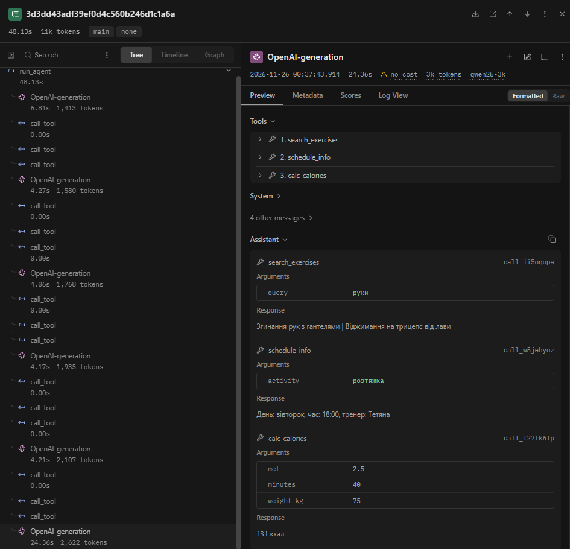
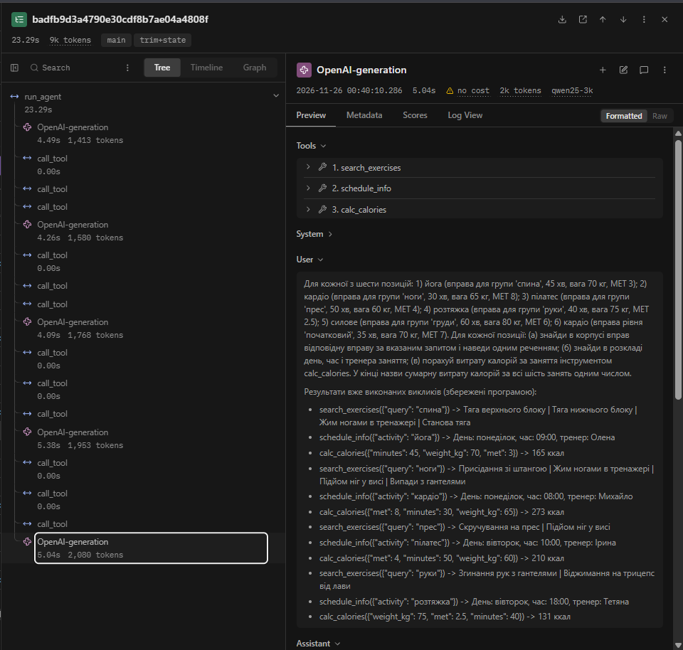

# Звіт з лабораторної роботи № 4. Контекст, стан і кеш агента

**Національний університет «Одеська політехніка»**  
Інститут комп'ютерних систем, кафедра інформаційних систем  
Дисципліна: «Обчислювальні методи»

| | |
|---|---|
| Виконав | студент групи АІ-241 Ларбі Ідір |
| Перевірив | ас. Баранов О.М. |
| Варіант | 4 «Тренування» (14 mod 10 = 4) |

Одеса - 2026

---

## 1. Мета роботи, номер варіанта, предметна область, модель і розмір вікна

**Мета роботи:** дослідити поведінку агента, коли історія діалогу наближається до межі контекстного вікна моделі; реалізувати та порівняти три механізми керування контекстом і вартістю виконання - обрізання історії (`trim`), зовнішній стан задачі (`trim+state`) та кешування викликів моделі (`cache`), а також оцінити додатковий підхід із підсумовуванням історії (`summary`).

**Варіант 4 - «Тренування».**  
**Предметна область:** помічник тренажерного залу з трьома дозволеними інструментами з лабораторної роботи № 3: пошук вправ у корпусі (`search_exercises`), отримання розкладу занять (`schedule_info`) та обчислення витрати калорій (`calc_calories`).

Для експериментів створено копію локальної моделі через `Modelfile` зі звуженим контекстним вікном:

```
FROM qwen2.5:7b
PARAMETER num_ctx 3072
```

`num_ctx` = 3072<br>
`context_length` = 32768<br>
Контекстне вікно було зменшено у 10.67 разів

Основні параметри конфігурації (`config.py`) для вимірювань:
- `NUM_CTX = 3072` (звужене контекстне вікно);
- `MAX_STEPS_LONG = 25` (ліміт кроків для довгої задачі);
- `COMPRESS_AT = 1650` (поріг запуску стиснення історії в токенах);
- `KEEP_LAST = 6` (кількість останніх повідомлень, що зберігаються під час обрізання);
- `STATE_RESULT_CHARS = 200` (обмеження довжини одного результату в записнику стану);
- `TEMPERATURE = 0`, `RUN_TAG = "ctx-control"`.

---

## 2. Довга задача

Відповідно до варіанта 4 у таблиці 6 методичних вказівок сформовано задачу на 6 позицій тренувань (`make_task.py` -> `long_task.json`), кожна з яких потребує виклику всіх трьох інструментів (`MIN_CALLS = 18`): пошук вправи в корпусі, перевірка розкладу заняття та розрахунок витрати калорій.

**Питання (`question` з `long_task.json`):**

> Для кожної з шести позицій: 1) йога (вправа для групи 'спина', 45 хв, вага 70 кг, MET 3); 2) кардіо (вправа для групи 'ноги', 30 хв, вага 65 кг, MET 8); 3) пілатес (вправа для групи 'прес', 50 хв, вага 60 кг, MET 4); 4) розтяжка (вправа для групи 'руки', 40 хв, вага 75 кг, MET 2.5); 5) силове (вправа для групи 'груди', 60 хв, вага 80 кг, MET 6); 6) кардіо (вправа рівня 'початковий', 35 хв, вага 70 кг, MET 7). Для кожної позиції: (а) знайди в корпусі вправ відповідну вправу за вказаним запитом і наведи одним реченням; (б) знайди в розкладі день, час і тренера заняття; (в) порахуй витрату калорій за заняття інструментом calc_calories. У кінці назви сумарну витрату калорій за всі шість занять одним числом.

**Еталонне обчислення (`expected`):**
1. Йога (`45 хв`, `70 кг`, `MET 3`): `165 ккал`;
2. Кардіо (`30 хв`, `65 кг`, `MET 8`): `273 ккал`;
3. Пілатес (`50 хв`, `60 кг`, `MET 4`): `210 ккал`;
4. Розтяжка (`40 хв`, `75 кг`, `MET 2.5`): `131 ккал`;
5. Силове (`60 хв`, `80 кг`, `MET 6`): `504 ккал`;
6. Кардіо, початковий (`35 хв`, `70 кг`, `MET 7`): `300 ккал`.

**Правильна відповідь (`expected`):** `1583`.

---

## 3. Аналіз прогону без захисту

Пробний запуск без стиснення виконано командами `python measure.py none 1 probe` та `python analyze.py logs\probe_none_r1.log steps` при вікні `NUM_CTX = 3072`.

### Таблиця 2 - Зростання входу в прогоні без захисту

Пробний запуск без стиснення виконано командами `python measure.py none 1 probe` та `python analyze.py logs\probe_none_r1.log steps` при вікні `NUM_CTX = 3072` (час виконання прогону - `51.0 с`, відповідь правильна: `так`, отримано `1583 ккал`).

| Крок | prompt_tokens | Приріст | Що зробила модель |
|---:|---:|---:|---|
|    1 | 1332 |     | search_exercises({"query":"спина"})<br> schedule_info({"activity":"йога"})<br> calc_calories({"weight_kg":70,"met":3,"minutes":45})   |
|    2 | 1512 | 180 | search_exercises({"query":"ноги"})<br> schedule_info({"activity":"кардіо"})<br> calc_calories({"met":8,"minutes":30,"weight_kg":65})   |
|    3 | 1701 | 189 | search_exercises({"query":"прес"})<br> schedule_info({"activity":"пілатес"})<br> calc_calories({"met":4,"minutes":50,"weight_kg":60})   |
|    4 | 1867 | 166 | search_exercises({"query":"руки"})<br> schedule_info({"activity":"розтяжка"}) <br> calc_calories({"met":2.5,"minutes":40,"weight_kg":75}) |
|    5 | 2039 | 172 | search_exercises({"query":"груди"})<br> schedule_info({"activity":"силове"})<br> calc_calories({"met":6,"minutes":60,"weight_kg":80})   |
|    6 | 2205 | 166 | calc_calories({"met":7,"minutes":35,"weight_kg":70})   |
|    7 | 2260 |  55 | відповідь без виклику                                  |


### Показники прогону

- **(а) Постійна частина входу (вхід першого кроку, C):** `1332` токенів (системна інструкція, опис схем трьох інструментів і текст довгої задачі, що займає 43.4% вікна `3072`).
- **(б) Типовий приріст за крок (d):** `169` токенів (медіана приросту від додавання повідомлення моделі з трьома викликами та трьох відповідей інструментів за один крок).
- **(в) Сума `prompt_tokens` за прогін та значення за формулою:** на повному 7-кроковому прогоні без захисту сума `prompt_tokens` становить `12 916` токенів, а значення за формулою арифметичної прогресії $S = n \cdot C + d \cdot \frac{n(n-1)}{2} = 7 \cdot 1332 + 169 \cdot \frac{7 \cdot 6}{2} = 12\,873$ токенів. Розбіжність становить лише `43` токени (0.33%) і пояснюється тим, що на передостанньому кроці модель викликає менше інструментів (1 замість 3), тому приріст на останньому кроці зменшується з `169` до `55` токенів. 
- **(г) Крок, на якому вхід перестав рости:** `не помічено` - найбільший вхід сягнув `2260` токенів (74% вікна `3072`), тому поріг тихого обрізання з боку сервера (80% вікна) не перетинався.
- **(д) Аналіз завершення прогону:** зупинки росту входу не відбулося, прогін завершився зі статусом `final`. В аналогічних 6-крокових прогонах `none` (як у `main_none_r1.log`) модель пропускала пошук вправи для 6-ї позиції (`початковий`) і підставляла у відповідь `273 ккал` замість `300 ккал` (сума `1556 ккал` замість `1583 ккал`), тоді як у 7-кроковому прогоні вона викликала `calc_calories` для 6-ї позиції (`300 ккал`) і отримала точну суму `1583 ккал` без вигаданих чисел.

**Класифікація за таблицею випадків A-D:** прогін належить до **випадку C** («Найбільший вхід менший за 95% вікна, статус `final`»). Після первинного звуження вікна до `3072` токенів пікове заповнення склало 74%, тому для наочного тестування механізмів стиснення поріг у `config.py` встановлено на рівні `COMPRESS_AT = 1650` токенів (спрацьовує одразу після 3-го кроку, де `prompt_tokens = 1701`).

---

## 4. Обрізання історії та стан задачі

Для порівняння режимів `trim` та `trim+state` виконано пробні запуски `python measure.py trim 1 probe` і `python measure.py trim+state 1 probe`.

### Таблиця 3 - Стиснення історії

| Конфігурація | Крок стиснення | Вхід до стиснення, токенів | Повідомлень було -> стало | Повторних викликів за прогін |
|---|---:|---:|---|---:|
| `trim` | 3 | 1701 | 14 -> 6 | 63 |
| `trim` | 5 | 1678 | 14 -> 6 | 63 |
| `trim` | 7 | 1678 | 14 -> 6 | 63 |
| `trim` | 9 | 1678 | 14 -> 6 | 63 |
| `trim` | 11 | 1678 | 14 -> 6 | 63 |
| `trim` | 13 | 1678 | 14 -> 6 | 63 |
| `trim` | 15 | 1678 | 14 -> 6 | 63 |
| `trim` | 17 | 1678 | 14 -> 6 | 63 |
| `trim` | 19 | 1678 | 14 -> 6 | 63 |
| `trim` | 21 | 1678 | 14 -> 6 | 63 |
| `trim` | 23 | 1678 | 14 -> 6 | 63 |
| `trim` | 25 | 1678 | 14 -> 6 | 63 |
| `trim+state` | 3 | 1701 | 14 -> 6 | 0 |
| `trim+state` | 4 | 1885 | 10 -> 6 | 0 |

**Аналіз стану задачі після першого стиснення (`logs\probe_trim+state_r1.log`, пункт 7 кроку 6):**

```
2026-11-26 00:40:04 - INFO -   ПЕРШЕ ПОВІДОМЛЕННЯ КОРИСТУВАЧА ПІСЛЯ СТИСНЕННЯ:
Для кожної з шести позицій: 1) йога (вправа для групи 'спина', 45 хв, вага 70 кг, MET 3); 2) кардіо (вправа для групи 'ноги', 30 хв, вага 65 кг, MET 8); 3) пілатес (вправа для групи 'прес', 50 хв, вага 60 кг, MET 4); 4) розтяжка (вправа для групи 'руки', 40 хв, вага 75 кг, MET 2.5); 5) силове (вправа для групи 'груди', 60 хв, вага 80 кг, MET 6); 6) кардіо (вправа рівня 'початковий', 35 хв, вага 70 кг, MET 7). Для кожної позиції: (а) знайди в корпусі вправ відповідну вправу за вказаним запитом і наведи одним реченням; (б) знайди в розкладі день, час і тренера заняття; (в) порахуй витрату калорій за заняття інструментом calc_calories. У кінці назви сумарну витрату калорій за всі шість занять одним числом.

Результати вже виконаних викликів (збережені програмою):
- search_exercises({"query": "спина"}) -> Тяга верхнього блоку | Тяга нижнього блоку | Жим ногами в тренажері | Станова тяга
- schedule_info({"activity": "йога"}) -> День: понеділок, час: 09:00, тренер: Олена
- calc_calories({"minutes": 45, "weight_kg": 70, "met": 3}) -> 165 ккал
- search_exercises({"query": "ноги"}) -> Присідання зі штангою | Жим ногами в тренажері | Підйом ніг у висі | Випади з гантелями
- schedule_info({"activity": "кардіо"}) -> День: понеділок, час: 08:00, тренер: Михайло
- calc_calories({"met": 8, "minutes": 30, "weight_kg": 65}) -> 273 ккал
- search_exercises({"query": "прес"}) -> Скручування на прес | Підйом ніг у висі
- schedule_info({"activity": "пілатес"}) -> День: вівторок, час: 10:00, тренер: Ірина
- calc_calories({"met": 4, "minutes": 50, "weight_kg": 60}) -> 210 ккал
```

- **Кількість записів у блоці стану:** після 3-го кроку виконано по 3 інструменти для перших трьох позицій (йога/спина, кардіо/ноги, пілатес/прес), тому блок містить **9 рядків** виду `- інструмент(аргументи) -> результат`.
- **Оцінка розміру блоку в токенах:** сумарна довжина 9 рядків стану становить орієнтовно `720-780` символів, що за оцінкою `2.5` символа на токен відповідає приблизно **290-310 токенам**. Це у **1.7-1.8 раза більше** за типовий приріст одного кроку (`169` токенів), проте все одно суттєво менше за повну історію повідомлень діалогу (замість 12 проміжних повідомлень діалогу записник компактно зберігає лише фактичні результати викликів, зменшуючи вхід 4-го кроку до `1885` токенів проти `2039+` без стиснення).

---

## 5. Кешування викликів моделі

Перевірку дискового кешу (`cache.py`, SHA-256 від словника запиту) виконано двома послідовними запусками `cache1` (після очищення каталогу `cache/`) та `cache2` на тій самій задачі в конфігурації `none`.

### Таблиця 4 - Робота кешу

| Запуск | Кроків | Влучань у кеш | Викликів до сервера | Час, с | Правильно |
|---|---:|---:|---:|---:|---|
| 1 (кеш порожній) | 7 | 0 | 7 | 47.1 | так |
| 2 (той самий запит) | 7 | 7 | 0 | 0.8 | так |

**Висновок про роботу кешу:**
- **Прискорення:** другий запуск (`cache2`) виконався за `0.8 с` проти `47.1 с` у першому запуску (`cache1`), тобто у **58.9 раза швидше** (скорочення часу на 98.3%). Усі 7 кроків прогону були взяті з локального кешу (`0` звернень до сервера Ollama), причому детермінованість відповіді повністю збереглася (`1583 ккал`, `так`).
- **Вплив зміни `SYSTEM` у `config.py`:** ключ кешу в `make_key(request)` формується як хеш `sha256` від усього JSON-представлення запиту, першим елементом якого є системне повідомлення `messages[0]` (`SYSTEM`). Якби перед запуском 2 змінили хоча б один символ у `SYSTEM`, відбиток запиту на кроці 1 змінився б, стався б промах кешу (`cache miss`), а за ним - промахи на всіх наступних кроках (`0` влучань із 7), і весь прогін знову виконувався б на сервері за повний час (~47 с).

---

## 6. Вимірювання вартості циклу та аналіз трас у Langfuse

Основне вимірювання виконано серією `main` по 3 повтори на кожну конфігурацію (`python measure.py all 3 main`, кеш вимкнений).

### Таблиця 5 - Вартість циклу в трьох конфігураціях (медіани по трьох повторах)

| Конфігурація | Правильно | Кроків | Токенів на вхід | Токенів на вихід | На підсумовування | Час, с | Стиснень | Повторних викликів |
|---|---:|---:|---:|---:|---:|---:|---:|---:|
| `none` | 1 з 3 | 6 | 10 656 | 769 | 0 | 45.8 | 0 | 0 |
| `trim` | 0 з 3 | 25 | 39 711 | 1 685 | 0 | 103.8 | 12 | 61 |
| `trim+state` | 0 з 3 | 5 | 8 436 | 358 | 0 | 23.3 | 2 | 0 |
| `summary` | 0 з 3 | 4 | 6 640 | 897 | 1 137 | 79.8 | 1 | 0 |

### Поламки, яких не видно лише з медіанної таблиці

Перевірка логів `logs\main_*.log` виявила три типи прихованих поламок у прогонах:
1. **Передчасна відповідь із неповною кількістю викликів (`< 19` кроків) та вигадане число в `none` (у 2 з 3 прогонів `none`):** у `main_none_r1.log` та `main_none_r3.log` модель зупинилася на 6-му кроці (зробивши 16 викликів інструментів замість 18), пропустила розрахунок калорій для 6-ї позиції (`початковий`) і підставила у відповідь число `273 ккал` із 2-ї позиції (`1556 ккал` замість `1583 ккал`). Лише у `main_none_r2.log` (7 кроків) модель виконала потрібний розрахунок і дала правильну відповідь `1583 ккал`.
2. **Нескінченний цикл із повторними викликами через втрату історії в `trim` (у всіх 3 з 3 прогонів `trim`):** після обрізання на 3-му кроці (`14 -> 6` повідомлень) з історії зникли результати 1-ї та 2-ї позицій. На 4-му кроці агент повторно викликав інструменти для 1-ї позиції (`спина/йога`), на 5-му - для 2-ї (`ноги/кардіо`), знову перевищив поріг `1650` і зациклився до вичерпання ліміту `MAX_STEPS_LONG = 25` (медіана `61` повторний виклик, `12` стиснень).
3. **Синтаксичний збій формату виклику інструмента в `trim+state` (у всіх 3 з 3 прогонів `trim+state`):** записник стану повністю усунув повторні виклики (`0` повторів) і зменшив витрату вхідних токенів на 20.8% відносно `none` (`8436` проти `10 656`). Проте на 5-му кроці (`2006` токенів) компактна модель зламала початковий XML-тег виклику інструмента (вивела `ilor` замість `<tool_call>`), через що цикл завершив роботу достроково на 5-му кроці без обчислення позицій 4-6.

### Порівняння трас у Langfuse (`long-main_none_r1` та `long-main_trim+state_r1`)





- **Порівняння токенів входу після стиснення:** у прогоні `main_trim+state_r1` стиснення спрацювало наприкінці **3-го кроку** (при вході `1701` токен), після чого вхід 4-го кроку (першого виклику після стиснення) склав **`1885` токенів** (`1 953` токени разом із відповіддю моделі на скріншоті Langfuse), тоді як у прогоні `main_none_r1` на тому самому 4-му кроці без стиснення вхід дорівнював **`1867` токенів** (`1 935` токенів разом із відповіддю на скріншоті). Різниця пояснюється тим, що стиснення відбулося рано, і компактний 9-рядковий стан на 4-му кроці мав майже такий самий обсяг, як видалені повідомлення 
(натомість на 5-му кроці з 12-рядковим станом вхід становить уже 2006 токенів проти 2039 у none).
- **Перевага візуальної траси Langfuse над текстовим логом:** у дереві траси Langfuse одразу видно ієрархію кожного кроку (вузол генерації моделі та вкладені виклики `call_tool`), час кожної генерації та динаміку `prompt_tokens` на шкалі викликів без потреби вручну шукати рядки в лінійному текстовому лозі.

---

## 7. Відповіді на питання

1. **На якому кроці агент без захисту дійшов до межі вікна і як ви це побачили (таблиця 2, пункти (г) і (д) кроку 4)? Що в його поведінці змінилося після цього?**  
   При звуженому вікні `NUM_CTX = 3072` агент без захисту не дійшов до жорсткої межі тихого обрізання сервера (80% вікна, або `2458` токенів): максимальний вхід на 7-му кроці склав `2260` токенів (74% вікна), тому в таблиці 2 та виведенні `analyze.py` зафіксовано `вхід перестав рости на кроці: не помічено`. Відповідно, поведінка агента не змінилася через переповнення вікна, а прогін завершився штатно зі статусом `final`.

2. **Порівняйте суму `prompt_tokens` за прогін із формулою (пункти (а)-(в) кроку 4). Чи збігається зростання з очікуваним?**  
   Так, зростання вхідного контексту майже точно збігається з теоретичною квадратичною оцінкою: для 7 кроків сума `prompt_tokens` становить `12 916` токенів, а значення за формулою $n \cdot C + d \cdot \frac{n(n-1)}{2}$ при C = 1332 і d = 169 дорівнює `12 873` токенів (похибка 0.33%). Невелике відхилення виникає тому, що на передостанньому кроці модель робить 1 виклик замість 3, і приріст на останньому кроці зменшується до `55` токенів.

3. **Що втрачає агент при обрізанні? Наведіть приклад повторного виклику після стиснення. Що змінилося в `trim+state` (таблиці 3 і 5)?**  
   При звичайному обрізанні (`trim`) агент втрачає старі повідомлення з результатами вже виконаних інструментів: після скорочення історії на 3-му кроці (`14 -> 6` повідомлень) модель забула перші дві позиції й на 4-му кроці повторно викликала `search_exercises({"query":"спина"})`, `schedule_info({"activity":"йога"})` та `calc_calories({"minutes":45,"weight_kg":70,"met":3})`, зациклившись на `61-63` повторних викликів. У режимі `trim+state` записник стану повернув результати у запитання користувача, що повністю прибрало повторні виклики (`0` проти `61` у таблиці 5) та зменшило медіанну витрату вхідних токенів у 4.7 раза (`8436` проти `39 711`).

4. **Яка конфігурація найдешевша за токенами, найшвидша, найточніша (таблиця 5)? Чому висновок за трьома повторами однієї задачі обережний?**  
   За таблицею 5 найдешевшою за вхідними токенами й найшвидшою серед основних трьох конфігурацій виявилася `trim+state` (`8436` вхідних токенів, `23.3 с`), тоді як найточнішою залишилася `none` (`1 з 3` правильних відповідей, оскільки у `trim+state` модель обірвала роботу на 5-му кроці через синтаксичний збій тегу виклику). Висновок за трьома повторами однієї задачі є обережним, бо низька вибірка (n = 3) на одній структурі запиту чутлива до стохастичних збоїв форматування малої моделі та не охоплює задачі з іншою довжиною відповідей інструментів.

5. **Чому під час вимірювання вартості кеш вимкнено? Що станеться з кешем, якщо інструмент поверне інші дані або ви замініть модель під тією самою назвою?**  
   Під час вимірювання вартості (`main`) кеш вимкнено, оскільки повтори `r1`, `r2`, `r3` мають ідентичні вхідні повідомлення, і з увімкненим кешем повтори `r2` та `r3` поверталися б миттєво без викликів моделі та реального часу обчислень. Якщо інструмент на проміжному кроці поверне інші дані, зміниться `messages` для наступного кроку, хеш `sha256` не збіжиться і кеш промахнеться; якщо ж замінити ваги моделі в Ollama під тією самою назвою (`config.MODEL`), ключ `make_key` залишиться незмінним і кеш помилково віддаватиме старі відповіді попередньої моделі, доки каталог `cache/` не очистять вручну.

6. **Які поламки довгого прогону скорочення історії не лікує в принципі?**  
   Скорочення історії не лікує помилки планування та логіки самої моделі: пропуск частини підзадач (як пропуск пошуку вправи для 6-ї позиції у `none`), вибір неправильного інструмента чи аргументів, галюцинації під час арифметичного підсумовування у фінальній відповіді, а також синтаксичні збої генерації токенів виклику інструментів (як у `trim+state` на 5-му кроці).

---

## 8. Додаткове завдання: підсумовування історії

Для перевірки стратегії стиснення переказом реалізовано модуль `summary.py` (`COMPRESS = "summary"`), у якому після перевищення порогу `COMPRESS_AT = 1650` окремий виклик моделі переказує відкинуту частину історії. Результати трьох повторів наведено в останньому рядку таблиці 5.

**Фрагмент переказу історії з логу (`ПІДСУМОК ІСТОРІЇ`):**

```log
2026-11-26 00:45:54 - INFO -   ПІДСУМОК ІСТОРІЇ:
У цій роботі були виконані наступні дії:

1. Пошук вправ за запитом "спина" (call_z2r9u7o0).
2. Отримання інформації про планування тренування за запитом "йога" (call_p5frvl97).
3. Розрахунок калорій за 45 хвилин тренування з масою тіла 70 кг та інтенсивністю 3 MET (call_sihipk8l).

Додатково було вказано інструменти для тренування:
- Тяга верхнього блоку
- Тяга нижнього блоку
- Жим ногами в тренажері
- Станова тяга

Другий день:
1. Пошук вправ за запитом "ноги" (call_957jgvlh).
2. Отримання інформації про планування кардіоваскулярного тренування за запитом "кардіо" (call_95rf8a4c).
3. Розрахунок калорій за 30 хвилин тренування з масою тіла 65 кг та інтенсивністю 8 MET (call_53k1wyis).

Додатково було вказано інструменти для тренування:
- Присідання зі штангою
- Жим ногами в тренажері
- Підйом ніг у висі
- Випади з гантелями

Планування тренувань:
- Понеділок, 08:00 - тренер Михайло
- Понеділок, 09:00 - тренер Олена

Розрахунок калорій:
- 45 хвилин тренування з 70 кг та інтенсивністю 3 MET: 165 ккал
- 30 хвилин тренування з 65 кг та інтенсивністю 8 MET: 273 ккал
```

**Аналіз результатів додаткового завдання:**
- **Вартість підсумовування:** окремий виклик моделі-сумаризатора витратив у середньому **`1137` токенів** (`На підсумовування` в таблиці 5), причому в одному з прогонів (`r1`) при повторному спрацюванні на 4-му кроці модель замість стислого переказу повернула мета-відмову («Для того щоб стисло переказати... потрібен саме текст»), додатково спаливши `229` токенів і збільшивши вхід 5-го кроку до `2754` токенів.
- **Економія вхідних токенів порівняно з `trim`:** у робочому циклі агента вхідні токени зменшилися з `39 711` (`trim`) до `6 640` (`summary`), тобто на **`33 071` токенів** (-83.3%), а з урахуванням витрат на сам переказ (`6640 + 1137 = 7777` токенів) чиста економія склала **`31 934` токенів**.
- **Збереження точних чисел та надійність:** перевірка блоків `ПІДСУМОК ІСТОРІЇ` показала, що 7B-модель спотворює фактичні дані під час переказу: переплутує тренерів і вправи між позиціями, а після підстановки такого переказу на 4-му кроці припиняє викликати інструменти для позицій 4-6 і вигадує неіснуючі дані з пам'яті (наприклад, тренера `Володимир` та суми `1278 ккал` / `245 ккал`, яких немає в результатах інструментів), через що правильність склала `0 з 3`.

---

## 9. Висновок

У ході лабораторної роботи досліджено роботу агента в умовах вузького контекстного вікна (`NUM_CTX = 3072`) на довгій 18-викликовій задачі та порівняно три підходи до керування контекстом і кешем:

1. **Кешування викликів (`cache`)** дало найбільший практичний виграш під час розробки та відтворюваних прогонів: прискорення у **58.9 раза** (`0.8 с` проти `47.1 с`) при 100% збереженні правильності відповіді (`1583 ккал`).
2. **Зовнішній стан задачі (`trim+state`)** виявився найефективнішим способом стиснення історії: він повністю усунув амнезію агента та повторні виклики (`0` повторів проти `61` у звичайному `trim`) і скоротив витрату вхідних токенів на 20.8% відносно базового режиму `none` (`8436` проти `10 656` токенів) та на 78.8% відносно `trim` (`39 711` токенів), не витрачаючи додаткових токенів на генерацію переказу, як у `summary` (`1137` токенів на підсумовування з ризиком спотворення чисел).
3. **Напрямки подальшого вдосконалення:** оскільки компактна модель у режимі `trim+state` зупинялася на 5-му кроці через пошкодження синтаксису виклику інструмента (`ilor` замість `<tool_call>`), доцільно поєднати `trim+state` із рівнем перевірки формату відповіді `check_response` із лабораторної роботи № 3 або використати модель із надійнішим підтриманням tool-calling у стиснутому контексті.