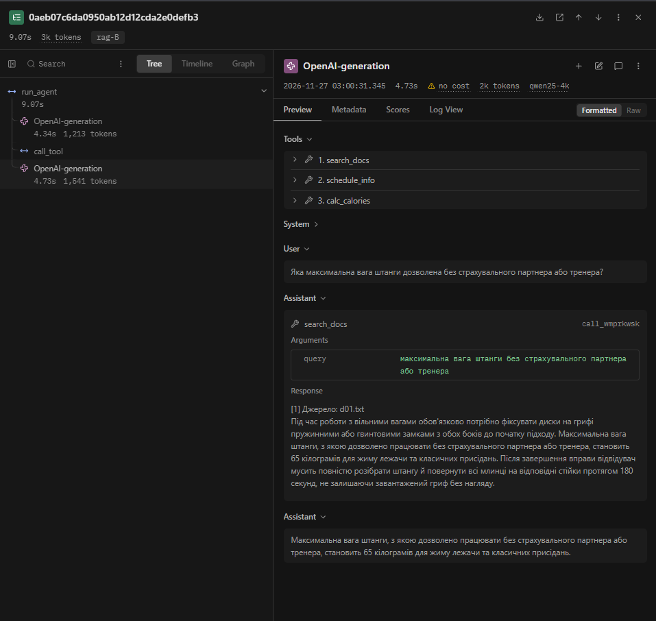
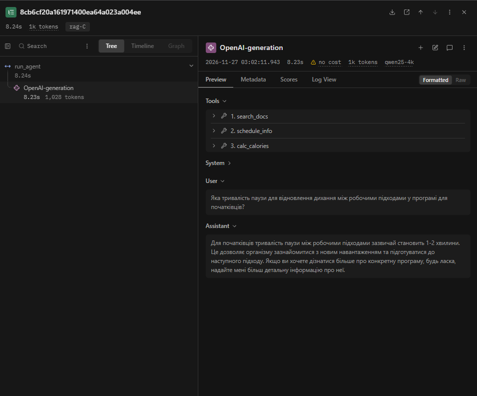

# Лабораторна робота № 5. RAG-агент: пошук по документах як інструмент

**Виконав:** студент групи AI-241 Ларбі Ідір  
**Перевірив:** викладач курсу  
**Навчальний заклад:** Національний університет «Одеська політехніка»  
**Рік:** 2026  

---

## 2. Мета роботи та конфігурація системи

**Мета роботи:** замінити примітивний пошук підрядком із лабораторної роботи № 2 векторним пошуком на базі FAISS, під'єднати його до агента як звичайний інструмент `search_docs`, перевірити якість пошуку окремо від агента та виміряти вплив розміру чанка, порогу схожості й опису інструмента на поведінку агента у трьох повторах.

* **Номер варіанта:** 4
* **Предметна область:** Тренування (вигадана організація — фітнес-клуб «Олімп-Фітнес»)
* **Модель чату:** `qwen25-4k` (Ollama, `temperature = 0`)
* **Розмір контекстного вікна:** `4096` токенів (`NUM_CTX = 4096`, `COMPRESS = "none"`, `USE_STATE = False`, `USE_CACHE = False`)
* **Модель ембедингів:** `bge-m3` (`EMBED_MODEL = "bge-m3"`)

---

## 3. Дані: документи, контрольні питання та перевірка без документів

### Теми п'яти документів (`data/docs/d01.txt` – `d05.txt`)

1. **`d01.txt` — Техніка безпеки в залі:** первинний інструктаж 14 хв, самостійні заняття з 17 років, максимальна вага штанги без страхувального партнера `65 кілограмів`, розбирання штанги за 180 с, дистанція 185 см / 240 см від дзеркал, штраф за пошкодження дзеркала або покриття `1450 гривень`, останній вхід за 35 хв до закриття.
2. **`d02.txt` — Програма для початківців:** розминка 12 хв (пульс до 118 уд/хв), 7 вправ по 2×13–15 повторень, пауза для відновлення дихання між робочими підходами `75 секунд`, тривалість тренування до 52 хв, статична розтяжка 330 с (по 22 с на сторону).
3. **`d03.txt` — Відновлення й харчування:** режим сну та харчування після навантажень, рекомендована порція чистого білка в коктейлі одразу після силового заняття — `27 грамів`.
4. **`d04.txt` — Правила абонементів і заморожування:** адміністративна послуга з перереєстрації картки на нового власника коштує `380 гривень` (за наявності щонайменше 29 днів до кінця терміну), заморожування заднім числом за медичною довідкою після госпіталізації — до `44 днів`.
5. **`d05.txt` — Користування обладнанням:** безперервний час бігу на доріжці у вечірній час пік обмежений `32 хвилинами`, гранична допустима вага користувача для бігових доріжок комерційної серії — `155 кілограмів`.

### Обсяг корпусу (`python check_cases.py`)

* **Документів усього:** `17` (12 базових у `data/corpus/` та 5 довгих у `data/docs/`)
* **Загальний обсяг у символах:** `19 273` символи
* **Оцінка обсягу в токенах (2,5 символа/токен):** `7 709` токенів (майже вдвічі перевищує вікно `4096` токенів, тому весь корпус не вміщується в контекст за один раз)

### Список десяти контрольних питань (`rag_cases.json`)

| ID | Вид | Питання | `must_contain` | `expected` |
| :--- | :--- | :--- | :--- | :---: |
| `D1` | `direct` | Яка максимальна вага штанги дозволена без страхувального партнера або тренера? | `становить 65 кілограмів` | `65` |
| `D2` | `direct` | Яка тривалість паузи для відновлення дихання між робочими підходами у програмі для початківців? | `становить рівно 75 секунд` | `75` |
| `D3` | `direct` | Скільки коштує адміністративна послуга з перереєстрації картки на нового власника? | `становить 380 гривень` | `380` |
| `D4` | `direct` | Яка гранична допустима вага користувача для бігових доріжок комерційної серії? | `становить 155 кілограмів` | `155` |
| `P1` | `paraphrase` | Скільки грошей доведеться заплатити відвідувачу, якщо він розбив дзеркало кинутою гантеллю? | `становить 1450 гривень` | `1450` |
| `P2` | `paraphrase` | Скільки грамів чистого білка варто випити за один раз у коктейлі одразу після силового заняття? | `становить 27 грамів` | `27` |
| `P3` | `paraphrase` | На скільки максимум днів продовжать клубну картку через лікарняний після госпіталізації? | `на 44 дні` | `44` |
| `P4` | `paraphrase` | Скільки хвилин поспіль дозволено бігати на доріжці у вечірній час пік? | `обмежений 32 хвилинами` | `32` |
| `N1` | `none` | Скільки коштує індивідуальна оренда персональної шафки на місяць у роздягальні клубу? | `null` | `null` |
| `N2` | `none` | З якого віку дозволено відвідувати дитячу секцію плавання в басейні фітнес-клубу? | `null` | `null` |

### Результат перевірки «чи вгадує модель без документів»

* **Питання (`D1`):** *«Яка максимальна вага штанги дозволена без страхувального партнера або тренера?»*  
  **Відповідь моделі без документів:** відповіла загальною фразою, що максимальна вага залежить від конкретної групи м'язів та типу вправи, і попросила уточнити вправу (вигадане/неточне значення, реальне число `65` не названо).
* **Питання (`D2`):** *«Яка тривалість паузи для відновлення дихання між робочими підходами у програмі для початківців?»*  
  **Відповідь моделі без документів:** *«Для початківців тривалість паузи між робочими підходами зазвичай становить 1-2 хвилини»* (модель вгадала типове загальновідоме значення замість унікального регламенту клубу `75 секунд`).
* **Питання (`P1`):** *«Скільки грошей доведеться заплатити відвідувачу, якщо він розбив дзеркало кинутою гантеллю?»*  
  **Відповідь моделі без документів:** зазначила, що для відповіді потрібна ціна заміни або ремонту дзеркала, тому суму визначити неможливо (реальний штраф `1450 гривень` не вгадано).

---

## 4. Результат перевірки моделі ембедингів (`embed_check.py`)

* **Час виконання:** `0.1 с` (після прогріву моделі)
* **Довжина вектора:** `1024`
* **Довжина (норма) першого вектора:** `1.000` (вектори вже нормалізовані)
* **Косинусна близькість до запиту `'Скільки коштує відправити посилку?'`:**
  * `'Тариф на доставку'`: `0.732`
  * `'Графік роботи кур'єрів'`: `0.568` (запит суттєво ближчий до фрази про тариф, ніж до графіка роботи)

---

## 5. Нарізання одного документа (`show_chunks.py`)

Дослідження виконано на файлі `data/docs/d01.txt` («Техніка безпеки в залі»).

Таблиця 1 - Нарізання одного документа

| Спосіб                       | Чанків | Закінчуються посеред речення | Довжина найбільшого, символів |
|------------------------------|--------|------------------------------|-------------------------------|
| `fixed`, 200, перекриття 0   | 19     | 18                           | 200                           |
| `fixed`, 500, перекриття 100 | 10     | 8                            | 500                           |
| `paragraphs`, 800            | 8      | 0                            | 780                           |

**Приклад розрізаного факту:** у режимі `fixed 200 0` правило про віковий ценз відвідувачів розрізане між чанком 1 (*«...тривалістю 14 хвилин. До самостійних»*) і чанком 2 (*« занять у тренажерній зоні допускаються особи, яким виповнилося 17 років...»*), через що числовий факт `17 років` відокремлюється від початку речення та контексту умови допуску.

---

## 6. Якість векторного пошуку та поріг схожості (`check_retrieval.py`)

Таблиця 2 - Пошук при різному нарізанні

| Конфігурація           | Чанків | Сер. довжина | hit@1 | hit@3 | hit@5 | hit@3 прямі | hit@3 перефр. | Токенів (k=3) |
|------------------------|--------|--------------|-------|-------|-------|-------------|---------------|---------------|
| `fixed-200-0`          | 108    | 178          | 0.38  | 0.88  | 0.88  | 0.75        | 1.00          | 214           |
| `fixed-500-0`          | 48     | 402          | 0.75  | 1.00  | 1.00  | 1.00        | 1.00          | 482           |
| `fixed-500-100`        | 55     | 418          | 0.75  | 1.00  | 1.00  | 1.00        | 1.00          | 502           |
| `fixed-1500-0`         | 27     | 714          | 0.88  | 0.88  | 1.00  | 1.00        | 0.75          | 857           |
| `paragraphs-800`       | 47     | 409          | 1.00  | 1.00  | 1.00  | 1.00        | 1.00          | 491           |
| `paragraphs-800+title` | 47     | 426          | 1.00  | 1.00  | 1.00  | 1.00        | 1.00          | 511           |

**Вибір конфігурації та обґрунтування:** обрано `paragraphs-800` (`CHUNK_METHOD = "paragraphs"`, `CHUNK_SIZE = 800`, `CHUNK_OVERLAP = 0`, `WITH_TITLE = False`). Серед усіх конфігурацій із максимальним `hit@3 = 1.00` вона забезпечує найкращий `hit@1 = 1.00` (потрібний фрагмент завжди на першому місці) і найменший розмір контексту на один виклик (`491` токен при `k=3`). Для всіх 8 питань з відповіддю в обраній конфігурації `hit@3` досягло повного результату (`1.00`).

Таблиця 3 - Схожість першого результату

| id  | Вид        | Схожість | Перший результат містить потрібну фразу |
|-----|------------|----------|-----------------------------------------|
| D1  | direct     | 0.705    | так                                     |
| D2  | direct     | 0.685    | так                                     |
| D3  | direct     | 0.770    | так                                     |
| D4  | direct     | 0.770    | так                                     |
| P1  | paraphrase | 0.568    | так                                     |
| P2  | paraphrase | 0.678    | так                                     |
| P3  | paraphrase | 0.733    | так                                     |
| P4  | paraphrase | 0.617    | так                                     |
| N1  | none       | 0.573    | -                                       |
| N2  | none       | 0.630    | -                                       |

* **Найнижча схожість серед питань з відповіддю:** `0.568` (`P1`).
* **Найвища схожість серед питань без відповіді:** `0.630` (`N2`).
* **Вибраний `MIN_SCORE` та обґрунтування компромісу:** `MIN_SCORE = 0.599`. Межі перекриваються (`[0.568; 0.770]` для питань з відповіддю проти `[0.573; 0.630]` для питань без відповіді), оскільки питання `N2` (про вік для дитячої секції плавання) семантично перетинається з абзацом про вікове обмеження `17 років` у `d01.txt`. Значення `0.599` обрано як компроміс на користь захисту від хибних підказок і галюцинацій: воно надійно відсікає нерелевантне питання `N1` (`0.573`), зберігаючи `7` із `8` еталонних питань із відповіддю (`0.617–0.770`).

---

## 7. Перевірка інструмента без моделі (`try_tool.py D1`, `try_tool.py N1`)

1. **`python try_tool.py D1`:**
   * **Рівень:** `ok`
   * **Вивід:** повернуто чанк `[1] Джерело: d01.txt` із точним фрагментом про максимальну вагу штанги без страхувального партнера або тренера (`становить 65 кілограмів для жиму лежачи та класичних присідань`).
   * **Перевірка короткого запиту (`{"query": "а"}`):** рівень `schema`, повідомлення `Помилка: аргументи не пройшли перевірку. Поле query: String should have at least 3 characters`.
2. **`python try_tool.py N1`:**
   * **Рівень:** `ok`
   * **Вивід:** `У документах нічого схожого не знайдено.` (поріг `MIN_SCORE = 0.599` успішно відфільтрував нерелевантні чанки).

---

## 8. Агент із трьома описами інструмента (`rag_report.py`)

Таблиця 5 - Агент з трьома описами інструмента (дані за всіма повторами; питань з відповіддю 8, у трьох повторах 24 прогони)

| Опис | Правильно (з 24) | Викликав пошук (з 24) | Кроків, медіана | Токенів входу, медіана | Час, с, медіана |
|------|------------------|-----------------------|-----------------|------------------------|-----------------|
| `A`  | 0/24             | 1/24                  | 1.0             | 943                    | 9.5             |
| `B`  | 15/24            | 24/24                 | 2.0             | 2628                   | 8.5             |
| `C`  | 6/24             | 6/24                  | 1.0             | 880                    | 10.6            |

Таблиця 6 - Куди ламається відповідь (кількість прогонів; питань з відповіддю 24 на опис, без відповіді 6)

| Категорія                                          | `A` | `B` | `C` |
|----------------------------------------------------|-----|-----|-----|
| Правильно                                          | 0   | 15  | 6   |
| Не шукав і відповів неправильно                    | 23  | 0   | 18  |
| Шукав, але потрібного фрагмента в результаті немає | 1   | 9   | 0   |
| Фрагмент був у результаті, відповідь неправильна   | 0   | 0   | 0   |
| Питання без відповіді: визнав, що не знає          | 3   | 6   | 0   |
| Питання без відповіді: вигадав відповідь           | 3   | 0   | 6   |

**Примітка щодо ручної перевірки `results/rag.csv`:** під час перегляду колонки `answer` виявлено неточності автоматичного класифікатора `admits_unknown` на питаннях `none`:
* у прогонах `B-r1..r3-N2` (3 прогони) автоперевірка поставила `refused` через фразу *«Це не зазначено напряму»*, хоча далі модель вигадала вік *«від 4 років»*;
* у прогонах `C-r1..r3-N2` (3 прогони) автоперевірка поставила `invented`, хоча модель викликала пошук і чесно відповіла *«На жаль, в документах не було знайдено інформації...»* (фрази немає у списку `UNKNOWN`).

---

## 9. Розбір прогонів у логах і трасах Langfuse (крок 8)

### Аналіз текстових логів (`logs/rag_*.log`)

1. **Агент не шукав (`no_search`):** у прогоні `##### C-r1-D2` (мінімальний опис `C`) агент одразу відповів за 1 крок без виклику `search_docs` і вигадав загальне значення замість `75 секунд`:
   > *«Для початківців тривалість паузи між робочими підходами зазвичай становить 1-2 хвилини. Це дозволяє організму зазнайомитися з новим навантаженням та підготуватися до наступного підходу.»*
2. **Який запит написала модель:** при `temperature = 0` модель у всіх 3 повторах формувала однакові запити. На прямих питаннях вона зберігала ключові слова користувача, що давало високу схожість (`B-r1-D1`: `query = "максимальна вага штанги без страхувального партнера або тренера"`, `top_score = 0.675`; `B-r1-D4`: `top_score = 0.722`). На перефразованих питаннях модель невдало переписувала запит і спотворювала слова (`B-r1-P2`: `query = "чайнику чистого білка після силового заняття"`, `top_score = 0.595`; `B-r1-P4`: `query = "доволення бігати на доріжці вечірній час пік"`, `top_score = 0.522`).
3. **Шукав, але не знайшов (`miss`):** усі 9 промахів в описі `B` припали на перефразовані питання `P1`, `P2`, `P4` (по 3 повтори). Причина: поєднання перефразування в самому питанні та спотворення слів моделлю під час генерації `query` знизило схожість до `0.522–0.595`, через що поріг `MIN_SCORE = 0.599` відфільтрував чанки.
4. **Знайшов, але не використав (`ignored`):** зафіксовано `0` випадків у всіх 90 прогонах (`ignored = 0` для `A`, `B`, `C`). Кожного разу, коли потрібний фрагмент потрапляв у контекст (`hit = 1`), модель давала точну відповідь.
5. **Питання без відповіді (`none`):** в описі `A` агент жодного разу не викликав пошук (`3` відмови на `N1`, `3` вигадки на `N2`). В описі `B` поріг `MIN_SCORE = 0.599` заблокував нерелевантний пошук на `N1` (`top_score = 0.487`) і агент чесно відмовився, але на `N2` пройшов нерелевантний чанк `d01.txt` (`top_score = 0.621 > 0.599`), після чого модель вигадала вік `від 4 років`.

### Аналіз трас у Langfuse (`rag-B` та `rag-C`)

* **Скріншот дерева траси `rag-B` (`rag-B-r1-D1`):**  
  

* **Скріншот дерева траси `rag-C` (`rag-C-r1-D2`):**  
  

1. **Вузол `call_tool` для `search_docs` (`rag-B-r1-D1`):** на вході вузла передається JSON `{"query": "максимальна вага штанги без страхувального партнера або тренера"}`, на виході — рядок із знайденими фрагментами `[1] Джерело: d01.txt ... становить 65 кілограмів ...`. У трасі `rag-C-r1-D2` вузол `search_docs` у дереві взагалі відсутній.
2. **Вхід першого виклику моделі (опис `search_docs`):** у трасі `rag-B` у секції `tools` передається розгорнутий опис з переліком тем документів клубу, забороною відповідати без пошуку та інструкцією формулювати запит українською; у `rag-C` передається лише короткий рядок `"Шукає інформацію."`.
3. **Перевага траси над текстовим логом:** у дереві Langfuse одразу візуально видно структуру кроків (наявність або відсутність дочірнього спану інструмента), затримку кожного кроку в секундах і точний розподіл токенів між промптом і відповіддю без ручного пошуку по текстовому файлу.

---

## 10. П'ять звичайних задач до і після (`tasks.json`)

Таблиця 7 - П'ять задач до і після заміни пошуку

| Задача | Відповідь у лабораторній № 4 | Відповідь тепер (`logs/run_rag.log`) | Чи викликав `search_docs` | Що змінилося |
|--------|------------------------------|--------------------------------------|---------------------------|--------------|
| 1 (`Z1`: вправи на спину) | Назвав 4 вправи зі старого довідника (`search_exercises`) | Повідомив, що в документах немає списку вправ на спину | Так (`query="спина"`) | Замість старого довідника вправ викликано `search_docs`; оскільки у новому корпусі немає каталогу вправ, модель коректно повідомила про відсутність даних |
| 2 (`Z2`: розклад йоги) | Понеділок, 09:00, тренер Олена | Понеділок, 09:00, тренер Олена | Ні (`schedule_info`) | Нічого не змінилося, детермінований інструмент працює коректно |
| 3 (`Z3`: розрахунок калорій) | `276 ккал` (`calc_calories`) | `276 ккал` (`calc_calories`) | Ні (`calc_calories`) | Нічого не змінилося |
| 4 (`P1`: плавання і басейн) | Повідомив, що вправ і занять у басейні немає | Повідомив, що занять у басейні немає, і перелічив доступні | Ні (`schedule_info`) | Нічого не змінилося, помилка рівня `meaning` опрацьована так само |
| 5 (`P2`: запис на йогу в середу) | Відмова, заняття лише у понеділок | Відмова, заняття лише у понеділок о 09:00 | Ні (`schedule_info`) | Нічого не змінилося |

---

## 11. Відповіді на питання

1. **Табл. 1 (нарізання за символами та за абзацами):** при нарізанні фіксованою довжиною `fixed 200 0` розірваними виявилися `18` із `19` чанків (`94,7 %`), при `fixed 500 100` — `8` із `10` (`80 %`), тоді як нарізання за абзацами `paragraphs 800` дало `0` розірваних речень із `8` чанків. Наприклад, у `fixed 200 0` умова допуску до самостійних занять розрізана між 1-м і 2-м чанками перед словами *«занять у тренажерній зоні допускаються особи, яким виповнилося 17 років»*, через що агент може отримати число без контексту правила або пропустити фрагмент під час пошуку.
2. **Табл. 2 (найкраща конфігурація та вплив параметрів):** найкращою виявилася `paragraphs-800`, оскільки вона досягла `hit@1 = 1.00` і `hit@3 = 1.00` при найменшому обсязі контексту (`491` токен). Збільшення чанка з `200` до `1500` підняло `hit@1` з `0.38` до `0.88`, але погіршило `hit@3` на перефразах з `1.00` до `0.75` через розмиття вектора великого фрагмента; перекриття `100` і додавання заголовка `+title` не покращили `hit@3 = 1.00`, лише збільшили витрату токенів (з `482` до `502` і з `491` до `511`). Ціна більшого чанка — швидше заповнення контекстного вікна (`857` токенів за 1 виклик при `1500` символах проти `214` при `200`).
3. **Порівняння `hit@3` для прямих і перефразованих питань:** у конфігурації `paragraphs-800` показник `hit@3` становить `1.00` як для прямих, так і для перефразованих питань (на відміну від пошуку підрядком із ЛР2, який на перефразах без точного збігу слів не знаходить нічого). Це підтверджує, що векторні ембединги `bge-m3` кодують семантичний зміст фрази, а не буквальний збіг лексем.
4. **Табл. 3 (поріг `MIN_SCORE`):** межі схожості перекриваються (`0.568–0.770` для питань з відповіддю проти `0.573–0.630` для питань без відповіді), тому поріг `0.599` розділяє їх лише частково. Якщо поріг поставити надто високим (наприклад, `> 0.65`), пошук почне відкидати правильні чанки для перефразованих запитів (`P1`, `P4`); якщо надто низьким (наприклад, `0.40`), у контекст постійно потраплятимуть сторонні фрагменти на питаннях `none`, провокуючи модель на галюцинації.
5. **Табл. 5 і 6 (порівняння описів `A`, `B`, `C`):** найбільше правильних відповідей дав опис `B` (`15/24` проти `0/24` в `A` і `6/24` в `C`). Агент не звертався до пошуку на питаннях із відповіддю у `23/24` випадків в `A`, `18/24` в `C` і `0/24` в `B`. Поведінку змінили три елементи опису `B`: явна вказівка *«ЄДИНЕ джерело даних... Викликай ЗАВЖДИ»*, заборона відповідати без попереднього виклику інструмента та перелік конкретних тем документів клубу.
6. **Табл. 6 (найчастіша категорія помилок в описі `B`):** найчастіша помилка в `B` — *«Шукав, але потрібного фрагмента в результаті немає»* (`9/24`, усі на перефразах `P1`, `P2`, `P4`). Цю помилку неможливо виправити текстом опису інструмента, бо агент і так викликає пошук у 100 % випадків; її вирішує налаштування пошуку (зниження порогу `MIN_SCORE`, гібридний пошук або переписування запиту). Це розрізнення важливе, бо помилки вибору інструмента лікуються промптом/схемою, а промахи пошуку — параметрами ретривера.
7. **Питання без відповіді:** за ручною перевіркою агент вигадав відповідь у `6` прогонах із `18` (`3` рази на `N2` в `A` без пошуку та `3` рази на `N2` в `B` через нерелевантний чанк `d01.txt`). У системі є два захисти: числовий поріг `MIN_SCORE` у `search_docs` та інструкція в описі `B` відповідати лише за знайденими фрагментами. Поріг `MIN_SCORE = 0.599` успішно спрацював на `N1` (`top_score = 0.487`), а текстова інструкція в `B` спрацювала, коли пошук повертав порожній результат, проте не втримала 7B-модель від домислу, коли в контекст потрапив частково схожий чанк (`score = 0.621`).
8. **Витрата токенів на один виклик `search_docs`:** у логах `B` перший крок займає близько `1203` токенів промпту, а сумарний `prompt_tokens` за 2 кроки становить `2628` (медіана), отже на другому кроці промпт має ~`1425` токенів — один виклик додає в середньому `~222` токени (від `237` у `D1` до `1015` у `D2` з довшими абзацами), що узгоджується за порядком величини з оцінкою `491` токен у Табл. 2. За формулою з лекції 7 ($N \approx \frac{W - P_0}{\Delta P}$, де $W = 4096$, $P_0 \approx 1203$, $\Delta P \approx 491$), у вікно `4096` токенів вміщується максимум $5$ викликів пошуку.
9. **Табл. 7 (п'ять звичайних задач):** новий пошук не зламав жодної з п'яти задач: задачі `Z2`, `Z3`, `P1`, `P2` відпрацювали ідентично до ЛР4, а в `Z1` агент коректно викликав `search_docs` і повідомив про відсутність каталогу вправ у новому корпусі. Це сталося тому, що описи й схеми `schedule_info` та `calc_calories` залишилися незмінними, а детальний опис `search_docs` чітко обмежив його сферу застосування документами клубу.
10. **Поламка, яку не вилікує опис інструмента:** жодна зміна опису не вилікує помилки категорії `miss` (коли модель викликала пошук, але через невдале перефразування запиту або жорсткий поріг потрібний фрагмент не повернувся) та галюцинації на частково схожих нерелевантних чанках (`B-N2`). Для їх усунення варто застосувати гібридний пошук (векторний + ключові слова BM25), реранкер результатів або потужнішу мовну модель.

---

## 12. Додаткове завдання: той самий індекс на Chroma

Результат запуску порівняльного скрипту для питання `D1` на одних і тих самих нормалізованих векторах ($||u|| = ||v|| = 1$):

* **FAISS, схожість (`IndexFlatIP`):** `0.7045`
* **Chroma cosine, відстань (`space="cosine"`):** `0.2955`
* **Chroma за замовчуванням (`space=None` → `l2`):** `0.5909`

**Пояснення результатів:**
1. **Зв'язок між трьома числами:** FAISS обчислює скалярний добуток одиничних векторів, тобто косинусну подібність $s = u \cdot v = 0.7045$. Chroma у режимі `cosine` повертає косинусну відстань $d_{\cos} = 1 - s = 1 - 0.7045 = 0.2955$. Стандартна метрика Chroma (`l2`) обчислює квадрат евклідової відстані, який для L2-нормалізованих векторів дорівнює $d_{L2}^2 = ||u - v||^2 = 2 - 2s = 2 - 2 \cdot 0.7045 = 0.5910 \approx 0.5909$.
2. **Збіг знайдених чанків:** усі три індекси повернули абсолютно однаковий перший чанк (`d01.txt`), оскільки для нормалізованих векторів косинусна подібність, косинусна відстань і квадрат евклідової відстані пов'язані лінійними монотонними перетвореннями й дають ідентичне ранжування.
3. **Наслідки перенесення `MIN_SCORE = 0.599` на Chroma за замовчуванням без зміни логіки:** у Chroma значення в полі `distances` є **відстанню** (чим менше, тим краще), а не подібністю. Якби умову `score >= 0.599` залишили без змін, усі релевантні чанки з малою відстанню (`d < 0.599`, зокрема правильний чанк із `d = 0.5909`) були б відкинуті як «несхожі», а в контекст агента потрапляли б лише далекі нерелевантні фрагменти з `d >= 0.599`.

---

## 13. Висновок

1. **Що найбільше вплинуло на якість відповідей агента:** вирішальний вплив мав **опис інструмента `search_docs`** (перехід від мінімального опису `C` до детального опису `B` підняв частоту звернення до пошуку з `25 %` до `100 %`, а точність відповідей — з `6/24` до `15/24`) та **спосіб нарізання на чанки** (`paragraphs 800` усунув розриви речень і забезпечив `hit@1 = 1.00`). Поріг `MIN_SCORE = 0.599` дозволив відсікати явно нерелевантні запити (`N1`), але потребує точного балансування.
2. **Розподіл помилок між пошуком та агентом:** у найкращій конфігурації `B` `100 %` помилок на питаннях із відповіддю (`9/24` прогонів у категорії `miss`) виникли на межі між генерацією пошукового запиту моделлю та векторним пошуком (через невдале перефразування запитів моделлю `top_score` опускався нижче порогу `0.599`). Коли ж потрібний фрагмент потрапляв у результат пошуку (`hit = 1`), агент відповідав безпомилково у `15/15` випадках (`ignored = 0`). На питаннях без відповіді (`none`) основним джерелом помилок (`3/6` в `B`) стала схильність 7B-моделі до вигадування фактів при потраплянні частково схожого чанка.
3. **Що варто змінити для подальшого покращення:** додати гібридний пошук (поєднання векторного пошуку FAISS із лексичним пошуком BM25 для стійкості до перефразувань), реалізувати крок переписування запиту (`query rewriting`) або перевірку релевантності знайдених чанків перед генерацією фінальної відповіді.