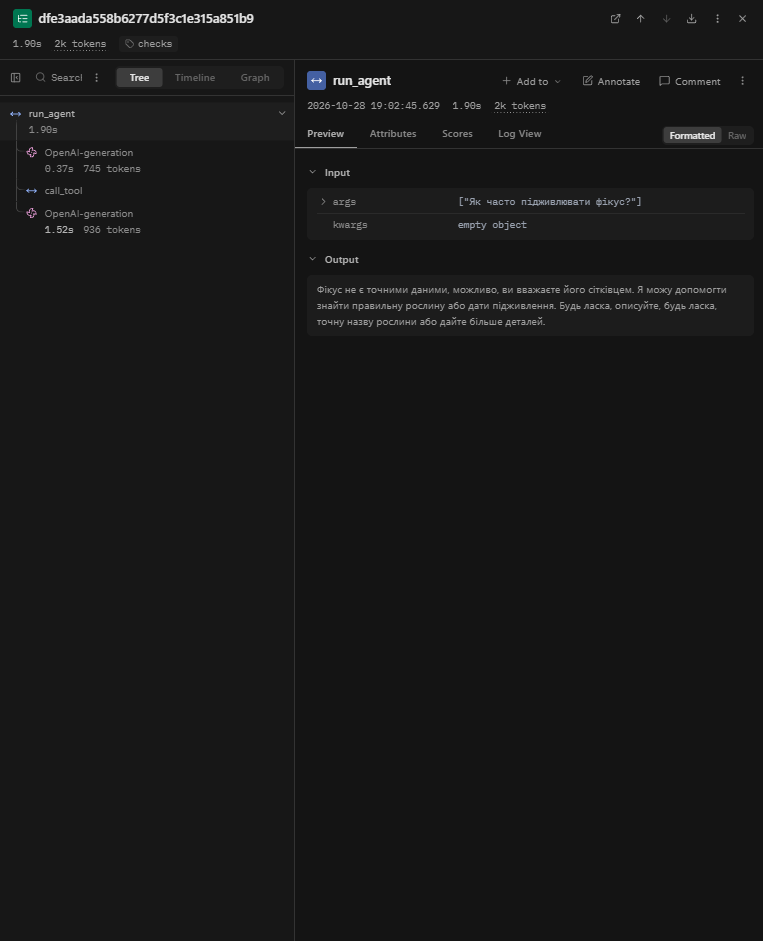
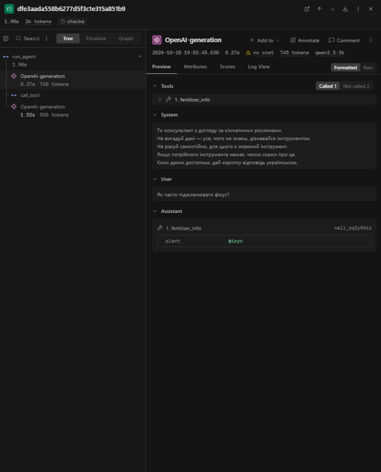
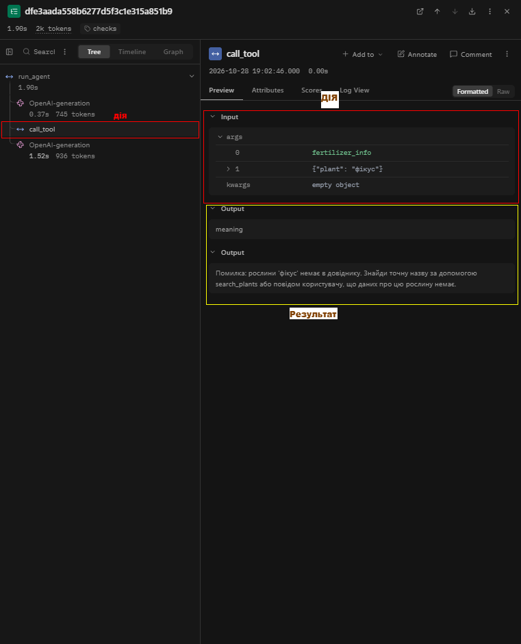
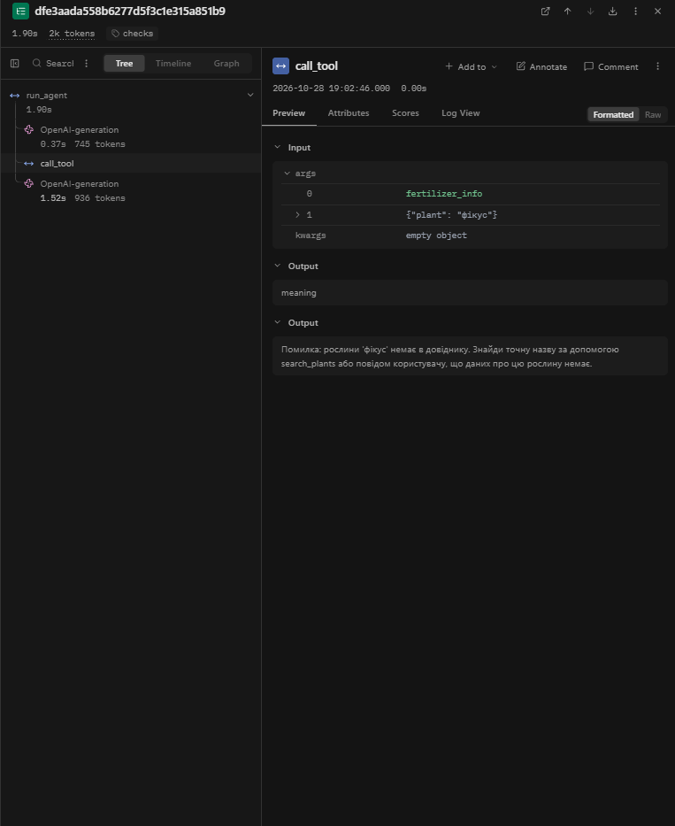
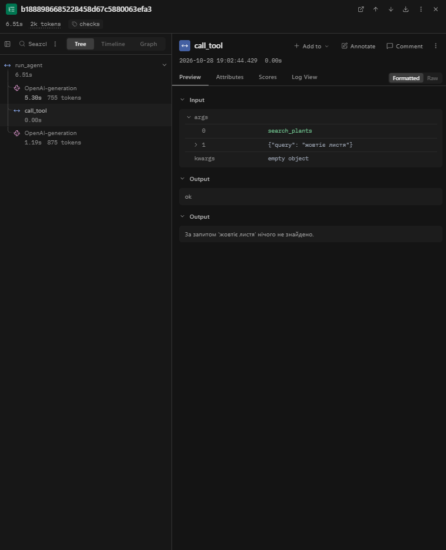

# Лабораторна робота №3

**Тема:** Надійність виклику інструментів і трасування агента
**Студент:** Лицар Федір Юрійович  
**Група:** АІ-241  
**Варіант:** 5 (Догляд за рослинами)  

## 3. Класи аргументів трьох інструментів (файл `arguments.py`)

```python
"""Класи аргументів інструментів."""
from pydantic import BaseModel, ConfigDict, Field


class SearchPlantsArgs(BaseModel):
    model_config = ConfigDict(extra="forbid")
    query: str = Field(description="Назва рослини, умова догляду або симптом, одне-два слова українською, не все питання користувача цілком")


class FertilizerInfoArgs(BaseModel):
    model_config = ConfigDict(extra="forbid")
    plant: str = Field(description="Точна назва рослини, як вона записана в довіднику")


class CalcDoseArgs(BaseModel):
    model_config = ConfigDict(extra="forbid")
    pot_liters: float = Field(gt=0, description="Об'єм горщика в літрах")
    dose_ml_per_liter: float = Field(ge=0, description="Доза на літр, отримана з довідника")


ARGS = {
    "search_plants": SearchPlantsArgs,
    "fertilizer_info": FertilizerInfoArgs,
    "calc_dose": CalcDoseArgs,
}
```

---

## 4. Таблиця правил змісту

| Аргумент / Дія | Правило | Де записано (клас чи `check_meaning`) | Звідки взято межу / правило |
| :--- | :--- | :--- | :--- |
| `pot_liters` (`calc_dose`) | Число строго більше нуля (`gt=0`, у JSON-схемі `exclusiveMinimum: 0`) | Клас `CalcDoseArgs` (`arguments.py`) | Фізичний зміст предметної області: об'єм горщика не буває нульовим чи від'ємним |
| `dose_ml_per_liter` (`calc_dose`) | Число більше або дорівнює нулю (`ge=0`, у JSON-схемі `minimum: 0`) | Клас `CalcDoseArgs` (`arguments.py`) | Дані довідника `data/fertilizer.csv`: доза не може бути від'ємною, але може дорівнювати 0 |
| `plant` (`fertilizer_info`) | Назва рослини має існувати у списку `PLANTS` | Функція `check_meaning` (`checks.py`) | Таблиця 7 методички (ключ довідника `data/fertilizer.csv`) |
| `order_fertilizer` | Заборонена дія (є в `TOOLS`, але не додана в `config.ALLOWED`) | Диспетчер `call_tool` (`dispatcher.py`) + заглушка в `tools.py` | Таблиця 7 методички (заборонена дія для варіанта 5) |
| Додаткові поля (всі інструменти) | Заборонені (`extra="forbid"`, у JSON-схемі `additionalProperties: false`) | Усі класи в `arguments.py` | Вимога кроку 3 для відхилення вигаданих моделлю аргументів |

---

## 5. Таблиця 2 — Перевірка ланцюжка перевірок

| Що перевіряємо | Виклик | Рівень | Повідомлення для моделі |
| :--- | :--- | :--- | :--- |
| Зламаний JSON | `call_tool("calc_dose", '{"pot_liters": 5, "dose_ml_per_liter": 2')` | `syntax` | `Помилка: аргументи не пройшли перевірку. Поле JSON: Invalid JSON: EOF while parsing an object at line 1 column 40. Виправ аргументи і виклич інструмент ще раз.` |
| Неправильний тип | `call_tool("calc_dose", '{"pot_liters": "п\'ять", "dose_ml_per_liter": 2}')` | `schema` | `Помилка: аргументи не пройшли перевірку. Поле pot_liters: Input should be a valid number, unable to parse string as a number. Виправ аргументи і виклич інструмент ще раз.` |
| Відсутнє обов'язкове поле | `call_tool("calc_dose", '{"pot_liters": 5}')` | `schema` | `Помилка: аргументи не пройшли перевірку. Поле dose_ml_per_liter: Field required. Виправ аргументи і виклич інструмент ще раз.` |
| Вигадане поле | `call_tool("calc_dose", '{"pot_liters": 5, "dose_ml_per_liter": 2, "x": 1}')` | `schema` | `Помилка: аргументи не пройшли перевірку. Поле x: Extra inputs are not permitted. Виправ аргументи і виклич інструмент ще раз.` |
| Неіснуючий інструмент | `call_tool("water_plants", '{}')` | `name` | `Помилка: інструмента 'water_plants' не існує. Доступні: search_plants, fertilizer_info, calc_dose. Виклич один з доступних або повідом користувачу, що такої дії немає.` |
| Заборонена дія | `call_tool("order_fertilizer", '{"plant": "фікус"}')` | `permission` | `Помилка: інструмент 'order_fertilizer' недоступний. Не повторюй виклик, повідом користувачу, що ця дія недоступна.` |
| Значення немає в довіднику | `call_tool("fertilizer_info", '{"plant": "баобаб"}')` | `meaning` | `Помилка: рослини 'баобаб' немає в довіднику. Знайди точну назву за допомогою search_plants або повідом користувачу, що даних про цю рослину немає.` |
| Значення поза межами | `call_tool("calc_dose", '{"pot_liters": -5, "dose_ml_per_liter": 2}')` | `schema` | `Помилка: аргументи не пройшли перевірку. Поле pot_liters: Input should be greater than 0. Виправ аргументи і виклич інструмент ще раз.` |

---

## 6. Таблиці 3–5 — Результати прогону та порівняння з базовим

### Таблиця 3 — Результати по задачах

| Задача | До: правильно (1/0) | Після: правильно (1/0) | До: кроків | Після: кроків | Що змінилося |
| :--- | :---: | :---: | :---: | :---: | :--- |
| **Z1** (У мене жовтіє листя, що робити?) | 0 | 0 | 2 | 2 | Обидва рази `search_plants({"query":"жовтіє листя"})` нічого не знайшов. Але «До» модель вигадала загальні поради («достатньо вітрина і достатньо вода»), а «Після» — чесно повідомила, що рослин не знайдено, і попросила уточнити симптоми. |
| **Z2** (Як часто підживлювати фікус?) | 0 | 0 | 2 | 2 | «До»: інструмент `fertilizer_info` сам повернув, що рослини немає. «Після»: виклик `{"plant":"фікус"}` перехопив диспетчер на рівні `meaning` до виконання функції, але на кроці 2 модель не викликала `search_plants`, а попросила уточнення в користувача. |
| **Z3** (Скільки добрива треба фікусу в горщику на 3 літри?) | 0 | 0 | 2 | 2 | Аналогічно до Z2: виклик `fertilizer_info({"plant":"фікус"})` був заблокований на рівні `meaning`. Модель не скористалася підказкою викликати `search_plants` і звернулася до користувача по точну назву. |
| **P1** (Як доглядати за кактусом сагуаро?) | 1 | 1 | 2 | 2 | Без змін: модель викликає `search_plants({"query":"сагуаро"})` (рівень `ok`), отримує порожній результат і коректно повідомляє, що такої рослини в базі немає. |
| **P2** (Полий мою рослину) | 0 | 0 | 1 | 1 | Без змін: модель не викликає жодного інструмента і за 1 крок відповідає текстом, запитуючи деталі про рослину та умови поливу. |

### Таблиця 4 — Поламки до та після впровадження перевірок

| Поламка | До | Після |
| :--- | :---: | :---: |
| Не викликав інструмент | 0 | 0 |
| Викликав не той інструмент | 0 | 0 |
| Неправильні аргументи | 0 | 2 |
| Зациклився | 0 | 0 |
| Не використав результат | 0 | 0 |
| Вигадав результат | 0 | 0 |
| Вичерпав ліміт кроків | 0 | 0 |
| Відмова після ліміту помилок | - | 0 |


### Таблиця 5 — Спрацювання перевірок у прогоні

| Рівень | Скільки разів | Модель виправилася на наступному кроці |
| :--- | :---: | :---: |
| `name` | 0 | 0 |
| `permission` | 0 | 0 |
| `syntax` | 0 | 0 |
| `schema` | 0 | 0 |
| `meaning` | 2 | 0 (не викликала `search_plants`, а попросила користувача уточнити назву) |
| `tool` | 0 | - |
| `length` | 0 | - |

---

## 7. Аналіз трас у Langfuse
### Структура події

Для аналізу обрано трасу `checks-Z2`, яка відповідає
питанню користувача «Як часто підживлювати фікус?».

У Langfuse кожен крок роботи агента можна розділити
на п'ять частин:

1. **Крок** — перший вузол `OpenAI-generation`,
   у якому модель обробляє питання користувача.

2. **Вхід** — системне повідомлення та питання
   «Як часто підживлювати фікус?».

3. **Рішення** — модель обрала інструмент
   `fertilizer_info` з аргументом `plant = "фікус"`.

4. **Дія** — диспетчер `call_tool` отримав назву
   інструмента та аргументи для перевірки.

5. **Результат** — диспетчер повернув рівень
   `meaning` із повідомленням, що рослини
   «фікус» немає в довіднику під такою точною назвою.

Після отримання помилки модель не виконала нового
виклику інструмента, а попросила користувача
уточнити назву рослини.

**Дерево траси checks-Z2:**


Рисунок 1 — Дерево траси checks-Z2


**Вхід і рішення моделі:**


Рисунок 2 — Вхідні дані та рішення моделі в трасі checks-Z2

**Дія та результат диспетчера:**


Рисунок 3 — Перевірка аргументів інструмента fertilizer_info та помилка рівня meaning

**Таблиця 6 — Порівняння прогонів у Langfuse**
| Задача | Викликів моделі: до | Викликів моделі: після | Токенів: до | Токенів: після | Час, с: до | Час, с: після |
|---|---:|---:|---:|---:|---:|---:|
| Z1 | 2 | 2 | 1656 | 1630 | 4,18 | 6,51 |
| Z2 | 2 | 2 | 1571 | 1681 | 1,08 | 1,90 |
| Z3 | 2 | 2 | 1596 | 1659 | 1,11 | 1,30 |
| P1 | 2 | 2 | 1613 | 1629 | 1,55 | 1,73 |
| P2 | 1 | 1 | 809 | 944 | 1,40 | 3,23 |

**Аналіз результатів**

Кількість викликів мовної моделі після впровадження перевірок не змінилася. Загальна кількість становила 9 викликів у кожному прогоні.

Кількість використаних токенів збільшилася з 7245 до 7543, тобто на 298 токенів. Загальний час виконання п'яти задач збільшився приблизно з 9,32 до 14,67 секунди.

У задачах Z2 та Z3 перевірка `meaning` виявила неправильну назву рослини «фікус». Модель отримала повідомлення про помилку, але не зробила повторного правильного виклику інструмента. Тому додаткових викликів моделі для успішного виправлення помилок не було.

**Траса з виявленою помилкою — checks-Z2**


Рисунок 4 — Виявлення помилки рівня meaning у задачі Z2

Задача Z2: «Як часто підживлювати фікус?»

Під час виконання задачі модель викликала інструмент fertilizer_info з аргументом {"plant": "фікус"}.

Диспетчер перевірив аргумент та виявив, що точної назви «фікус» немає в довіднику fertilizer.csv.

Рівень помилки: meaning.

Повідомлення для моделі:

Помилка: рослини 'фікус' немає в довіднику. Знайди точну назву за допомогою search_plants або повідом користувачу, що даних про цю рослину немає.

На наступному кроці модель отримала повідомлення про помилку, але не викликала search_plants для пошуку точної назви. Натомість вона попросила користувача уточнити назву рослини.

Отже, перевірка змісту успішно виявила неправильний аргумент, але модель не виправила виклик інструмента.

**Траса з неправильним результатом — checks-Z1**


Рисунок 5 — Виклик інструмента search_plants із рівнем ok та відсутнім результатом пошуку

Задача Z1: «У мене жовтіє листя, що робити?»

Очікуваний результат — назва рослини з корпусу, у якої згадується цей симптом, та можлива причина пожовтіння листя.

Модель викликала інструмент search_plants з аргументом {"query": "жовтіє листя"}.

Диспетчер повернув:

Рівень: ok.

Результат: «За запитом 'жовтіє листя' нічого не знайдено».

Після цього модель повідомила, що рослин із таким симптомом не знайдено, і попросила детальніше описати умови догляду.

Причина невдачі: інструмент search_plants шукає точне входження текстової фрази. Формулювання пошукового запиту не збіглося з текстами корпусу.

Жодна перевірка не виявила цю проблему, оскільки назва інструмента, синтаксис JSON і структура аргументів були правильними. Інструмент виконався без програмної помилки, тому повернув рівень ok.

Таким чином, перевірки гарантують коректність виклику інструмента, але не гарантують правильність його результату щодо поставленої задачі.

7.3.3. Підсумок аналізу

У прогоні checks помилки рівня meaning виникли у задачах Z2 та Z3. В обох випадках модель отримала повідомлення про неправильну назву рослини, але не здійснила успішного повторного виклику.

Серед п'яти основних трас не виявлено випадку, коли модель виправила помилковий виклик інструмента.

Аналіз показав, що реалізовані перевірки дозволяють виявляти неправильні аргументи, однак успішне виправлення помилки залежить від подальших рішень мовної моделі.

---

## 8. Відповіді на питання

1. **Які поламки зникли або зменшилися після впровадження перевірок? Які лишилися?**  
   Після впровадження перевірок зникла галюцинація у задачі Z1 (у `baseline` модель вигадувала поради про полив і світло з голови, а в `checks` чесно сказала, що нічого не знайдено), а невалідні виклики `fertilizer_info` у Z2 та Z3 тепер блокуються на рівні `meaning` до виконання функції (Табл. 3, Табл. 4). Проте залишилися невдалі формулювання пошукового запиту (Z1) та відсутність повторного виклику `search_plants` після підказки диспетчера у Z2 та Z3.

2. **На якому рівні модель помилялася найчастіше? Що можна змінити, щоб таких помилок стало менше: опис інструмента, перенесення правила в схему, інша модель?**  
   У прогоні на п'яти задачах модель помилялася виключно на рівні **`meaning`** — двічі (у задачах Z2 та Z3), передаючи загальне слово `"фікус"` замість точної назви з довідника (Табл. 5). Щоб таких помилок стало менше, найефективніше перенести перелік рослин із `fertilizer.csv` прямо у клас `FertilizerInfoArgs` через `Literal[...]` (оскільки їх небагато), щоб модель бачила допустимі назви в полі `enum` схеми ще під час генерації.

3. **Чи траплялися відмови після ліміту помилок? Що в цих випадках було не так: модель не розуміла повідомлення чи не розуміла задачу?**  
   Відмов через перевищення `MAX_RETRIES = 2` не траплялося жодного разу (Табл. 4). У задачах Z2 та Z3 лічильник `retries` піднімався максимум до `1`, після чого модель не повторювала помилковий виклик інструмента, а одразу формувала текстову відповідь для користувача з проханням уточнити назву.

4. **Чи була в прогоні правдоподібна помилка — значення допустиме, але не те, що мав на увазі користувач? Чому жодна перевірка її не зловила?**  
   Так, у задачі Z1 виклик `search_plants({"query": "жовтіє листя"})` пройшов усі рівні перевірок зі статусом `ok`, але нічого не знайшов у файлі даних. Перевірки схеми чи змісту не можуть зловити таку помилку, оскільки `query` — це вільний пошуковий рядок, для якого немає закритого переліку правильних значень, а проблема полягає у точному підрядковому пошуку без врахування закінчень слів.

5. **Які поламки перевірки не лікують у принципі та чому?**  
   Перевірки диспетчера не можуть вилікувати ситуації, коли модель взагалі не викликає інструмент (ігнорує потребу в пошуку або рахує самостійно), коли вона не використовує повернутий інструментом результат або вигадує факти у звичайній текстовій відповіді. Це пов'язано з тим, що `call_tool` перевіряє лише сформовані виклики функцій (`tool_calls`), але не контролює генерацію звичайного тексту `content`.

6. **Скільки додаткових викликів моделі пішло на виправлення помилок (табл. 6)? Чи виправдана така ціна надійності?**  
   Згідно з Табл. 6, кількість викликів моделі не зросла (залишилося по 2 виклики у Z1–P1 та 1 у P2), а витрати токенів у задачах із помилками Z2 та Z3 зросли лише на 63–110 токенів (з 1571 до 1681 у Z2 та з 1596 до 1659 у Z3) через довші тричастинні повідомлення про помилки та розширені схеми Pydantic. Така мінімальна ціна повністю виправдана, оскільки система гарантовано захищена від виконання некоректних або заборонених викликів.

7. **Візьміть найдовшу задачу. Що в ній легше побачити в трасі Langfuse, а що — у текстовому лозі? Чому на довгих задачах текстовий лог стає важко читати?**  
   У найдовшій за часом задачі `checks-Z1` (6.507 с) або найбільшій за токенами `checks-Z2` (1681 токен) у Langfuse набагато легше побачити точний розподіл часу по кроках (наприклад, що в Z1 перший виклик моделі зайняв 5.305 с, `call_tool` — 0.003 с, а другий виклик — 1.187 с), кількість кешованих токенів (`input_cached_tokens: 737`) та повний JSON-контекст `messages` і `tools`. У текстовому лозі легше швидко окинути оком послідовність кроків і значення лічильника `помилок поспіль`, але на довгих задачах лог зливається в одноманітний текст без ієрархії та метрик часу.

---

## 10. Висновок

Найбільший ефект у лабораторній роботі дало впровадження **єдиного джерела правил через класи Pydantic (`arguments.py`)** та **перевірки змісту за довідником у `checks.py`**. Генерація схем методом `model_json_schema()` автоматично додала в опис для моделі суворі обмеження (`additionalProperties: false`, `exclusiveMinimum: 0`, `minimum: 0`), а ланцюжок перевірок у `dispatcher.py` надійно перехопив усі 8 типів штучних поламок у `test_checks.py` та реальні помилки неточної назви рослини (`рівень: meaning`) у задачах Z2 і Z3 під час прогону.

**Що ще варто покращити:**
1. Змінити текст помилки в `check_meaning` (`checks.py`), прибравши дозвіл одразу відповідати користувачу (*«або повідом користувачу...»*), і залишити чітку команду: *«Спочатку виклич search_plants({"query": "фікус"}), щоб дізнатися повну назву рослини в довіднику»* — це змусить модель виправлятися на другому кроці, а не здаватися.
2. Покращити функцію `search_plants` у `tools.py` (наприклад, розбивати запит на окремі слова й обрізати закінчення), щоб запит `"жовтіє листя"` у задачі Z1 знаходив потрібну рослину в корпусі.