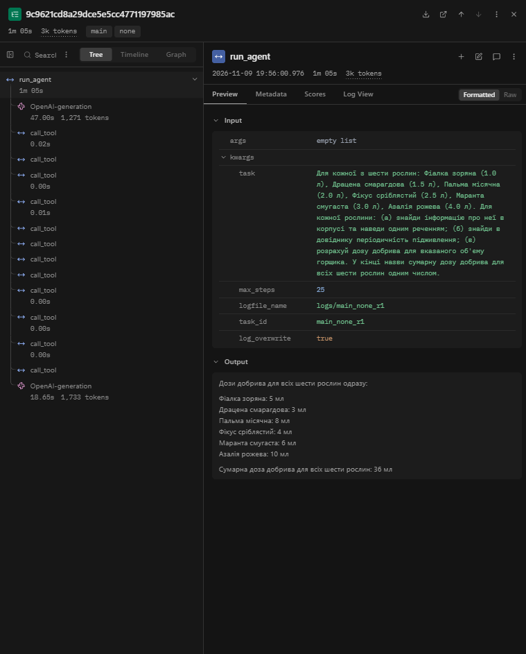
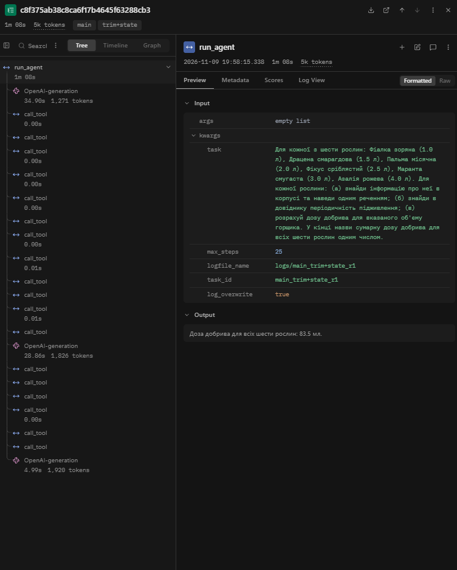

# Лабораторна робота №4

**Тема:** Надійність виклику інструментів і трасування агента
**Студент:** Лицар Федір Юрійович  
**Група:** АІ-241  
**Варіант:** 5 (Догляд за рослинами)  

### Мета роботи

Дослідити роботу агента з обмеженим контекстним вікном, реалізувати скорочення історії повідомлень, збереження стану задачі та кешування відповідей моделі. Порівняти результати роботи агента в різних конфігураціях.

### Довга задача

Для перевірки агента створено задачу, у якій потрібно визначити дозування добрив для шести кімнатних рослин.

**Текст завдання:**

Для кожної з шести рослин: Фіалка зоряна (1.0 л), Драцена смарагдова (1.5 л), Пальма місячна (2.0 л), Фікус сріблястий (2.5 л), Маранта смугаста (3.0 л), Азалія рожева (4.0 л):

1. Знайти інформацію про рослину в корпусі та навести її одним реченням.
2. Визначити періодичність підживлення за довідником.
3. Розрахувати дозу добрива для вказаного об'єму горщика.

Наприкінці потрібно визначити сумарну дозу добрива для всіх шести рослин.

**Очікувана кількість викликів інструментів:** 18 (по три для кожної рослини).

**Правильний розрахунок:**

| Рослина | Об'єм горщика, л | Доза, мл/л | Кількість добрива, мл |
|---|---:|---:|---:|
| Фіалка зоряна | 1,0 | 5 | 5 |
| Драцена смарагдова | 1,5 | 3 | 4,5 |
| Пальма місячна | 2,0 | 8 | 16 |
| Фікус сріблястий | 2,5 | 4 | 10 |
| Маранта смугаста | 3,0 | 6 | 18 |
| Азалія рожева | 4,0 | 10 | 40 |
| **Разом** | | | **93,5** |

Правильна відповідь становить **93,5 мл**. Її отримано за допомогою інструментів із файлу `tools.py`. Для створення завдання використано `make_task.py`, який записав умову та очікуваний результат у `long_task.json`.

### Аналіз роботи агента без захисту контексту

Спочатку агент працював із контекстним вікном 4096 токенів. Для аналізу використано файл `probe_none_r1.log`.

**Таблиця 2 — Зростання входу в прогоні без захисту**

| Крок | prompt_tokens | Приріст | Що зробила модель |
|---|---:|---:|---|
| 1 | 927 | — | Викликала 18 інструментів |
| 2 | 1907 | 980 | Надала відповідь без виклику |

За результатами аналізу отримано:

- **(а)** Вхід першого кроку — 927 токенів.
- **(б)** Типовий приріст за крок — 980 токенів.
- **(в)** Сума `prompt_tokens` — 2834. Значення за формулою також становить 2834.
- **(г)** Крок, на якому вхід перестав рости, не виявлено.
- **(д)** Аналіз трьох кроків після зупинки зростання неможливий, оскільки такого моменту не було.

Найбільший вхід становив 1907 токенів, або 47% контекстного вікна. Агент завершив роботу зі статусом `final`, але замість правильних 93,5 мл відповів 2200 мл.

За класифікацією методички це **випадок C — задача закоротка**.

### Повторний запуск із вікном 3072 токени

За вимогами методички контекстне вікно було зменшено до 3072 токенів. Для повторного запуску використано модель `qwen25-3k`.

| Крок | prompt_tokens | Приріст | Що зробила модель |
|---|---:|---:|---|
| 1 | 927 | — | Викликала 12 інструментів |
| 2 | 1609 | 682 | Надала відповідь без виклику |

Результати повторного аналізу:

- **(а)** Вхід першого кроку — 927 токенів.
- **(б)** Типовий приріст — 682 токени.
- **(в)** Сума `prompt_tokens` — 2536, що збігається зі значенням за формулою.
- **(г)** Зупинки зростання входу не виявлено.
- **(д)** Трьох кроків після зупинки зростання немає.

Найбільший вхід становив 1609 токенів, або 52% вікна. Агент завершив роботу зі статусом `final`, проте неправильно виконав завдання: не використав `calc_dose` і вказав сумарну дозу 46 мл.

Отже, навіть після зменшення вікна ознак його переповнення не виявлено. Помилки пов'язані з неправильним використанням інструментів та обчисленнями, а не з підтвердженою втратою контексту.

### Стиснення історії та стан задачі

Для перевірки скорочення історії було використано два режими: `trim` і `trim+state`. Контекстне вікно моделі становило 3072 токени, а поріг стиснення — 2150 токенів.

**Таблиця 3 — Стиснення історії**

| Конфігурація | Крок стиснення | Вхід до стиснення, токенів | Повідомлень було → стало | Повторних викликів за прогін |
|---|---|---|---|---:|
| `trim` | Не відбулося | — | — | 0 |
| `trim+state` | Не відбулося | — | — | 0 |

У режимі `trim` найбільший вхід становив 1896 токенів, а в `trim+state` — 1609 токенів. Обидва значення менші за встановлений поріг 2150 токенів, тому історія повідомлень не скорочувалася.

У режимі `trim+state` програма зберегла результати успішних викликів інструментів у файл `state/probe3k_trim+state_r1.json`. У файлі містяться назви інструментів, їхні аргументи та отримані результати.

Блок «ПЕРШЕ ПОВІДОМЛЕННЯ КОРИСТУВАЧА ПІСЛЯ СТИСНЕННЯ» у логах відсутній, оскільки стиснення не виконувалося. Тому кількість рядків і розмір доданого до контексту стану визначити неможливо.

Отже, збереження стану працює, але в цих запусках перевірити його вплив на відновлення інформації після обрізання історії не вдалося.

### Кешування відповідей моделі

Для перевірки кешування виконано два запуски однакової задачі. Перший запуск проводився з порожнім кешем, а другий — зі збереженими відповідями моделі.

**Таблиця 4 — Порівняння запусків із кешем**

| Показник | Порожній кеш (`cache1`) | Заповнений кеш (`cache2`) |
|---|---:|---:|
| Час виконання, с | 79,8 | 0,6 |
| Кроків агента | 3 | 3 |
| Звернень до моделі | 3 | 0 |
| Влучань у кеш | 0 | 3 |
| Викликів інструментів | 18 | 18 |
| Правильна відповідь | Так | Так |

У першому запуску агент звертався до моделі та зберігав її відповіді в кеш. Під час другого запуску всі три відповіді були отримані з кешу, що підтверджують позначки «з кешу» в журналі.

Час виконання скоротився з 79,8 до 0,6 секунди, тобто приблизно у 133 рази. При цьому обидва запуски завершилися правильною відповіддю — 93,5 мл.

Кешування дозволило уникнути повторних звернень до моделі. Водночас виклики інструментів виконувалися повторно, оскільки кеш зберігає саме відповіді моделі.

Якщо змінити системну інструкцію, повідомлення або параметри запиту, ключ кешу зміниться. У такому випадку відповідь потрібно буде отримати від моделі знову.

Отже, кешування значно прискорило повторне виконання однакового завдання без зміни результату.

### Підсумкове порівняння конфігурацій

Для порівняння роботи агента виконано по три запуски в режимах `none`, `trim` і `trim+state`. Усього проведено 9 запусків без використання кешу. Для числових показників обчислено медіани.

**Таблиця 5 — Підсумкові результати вимірювань**

| Показник | none | trim | trim+state |
|---|---:|---:|---:|
| Правильних відповідей | 0 з 3 | 0 з 3 | 0 з 3 |
| Кількість кроків | 2 | 3 | 3 |
| Вхідні токени | 2815 | 4432 | 4432 |
| Вихідні токени | 617 | 585 | 585 |
| Час виконання, с | 72,3 | 71,6 | 68,8 |
| Кількість стиснень | 0 | 0 | 0 |
| Повторні виклики | 0 | 0 | 0 |

У всіх дев'яти запусках агент надав неправильну відповідь. Найменший медіанний час виконання отримано в режимі `trim+state` — 68,8 секунди.

Стиснення історії не відбулося в жодному режимі, оскільки встановлений поріг не було перевищено. Тому результати не підтверджують перевагу обрізання історії або додавання стану до контексту.

### Аналіз помилок основних запусків

Під час перевірки дев'яти запусків встановлено, що у восьми випадках агент виконав усі 18 очікуваних викликів інструментів. Лише в запуску `main_none_r1` було виконано 12 викликів замість 18.

| Конфігурація | Запусків із неповною кількістю викликів |
|---|---:|
| `none` | 1 із 3 |
| `trim` | 0 із 3 |
| `trim+state` | 0 із 3 |

Попри те, що у восьми запусках агент виконав усі необхідні виклики, правильну підсумкову відповідь не було отримано в жодному випадку. Отже, виконання потрібної кількості викликів інструментів саме по собі не гарантує правильності результату.

### Аналіз трас у Langfuse

Для детальнішого аналізу переглянуто траси `long-main_none_r1` та `long-main_trim+state_r1`.

У режимі `none` агент виконав два звернення до моделі та 12 викликів інструментів. Підсумкова відповідь становила 36 мл замість правильних 93,5 мл.

У режимі `trim+state` зафіксовано три звернення до моделі та 18 викликів інструментів. Агент надав відповідь 83,5 мл, яка також була неправильною.

В обох випадках у трасах видно послідовність звернень до моделі та виконання інструментів. Основні помилки пов'язані з виконанням розрахунків і формуванням підсумкової відповіді.

Оскільки стиснення не виконувалося, вплив механізму відновлення стану після обрізання історії оцінити не вдалося.

**Рисунок 1 — Дерево викликів агента в режимі `none`.**

**Рисунок 2 — Дерево викликів агента в режимі `trim+state`.**

### Відповіді на контрольні питання

**1. На якому кроці агент без захисту дійшов до межі контекстного вікна?**

Агент не досяг межі контекстного вікна. За таблицею 2 найбільший вхід становив 1907 токенів із 4096, а після зменшення вікна — 1609 із 3072. Зупинки зростання входу не виявлено, тому змін поведінки через переповнення не спостерігалося.

**2. Чи збігається сума prompt_tokens із розрахунком за формулою?**

Так, для першого запуску сума `prompt_tokens` становила 2834 токени, що збігається з результатом за формулою. Приріст між двома кроками дорівнював 980 токенам, як показано в таблиці 2.

**3. Що втрачає агент при обрізанні історії та що змінилося в trim+state?**

Під час обрізання агент може втратити попередні результати інструментів і повторно виконувати ті самі виклики. У наших запусках стиснення не відбулося, а повторних викликів було 0 (таблиця 3). У режимі `trim+state` результати зберігалися в JSON-файлі, але їхнє відновлення після стиснення перевірити не вдалося.

**4. Яка конфігурація найдешевша, найшвидша та найточніша?**

За таблицею 5 найменшу медіанну кількість вхідних токенів мав режим `none` — 2815, а найшвидшим був `trim+state` — 68,8 с. За точністю всі режими однакові: 0 правильних відповідей із 3. Трьох повторів однієї задачі недостатньо для загального висновку про перевагу певного режиму.

**5. Чому під час вимірювання вартості кеш вимкнено?**

Кеш вимикають, щоб виміряти реальні витрати токенів і час звернення до моделі. Якщо дані інструментів зміняться або модель замінять під тією самою назвою, кеш може повернути застарілу відповідь, оскільки його ключ залежить від параметрів запиту, а не від усіх зовнішніх змін.

**6. Які помилки довгого прогону не усуває скорочення історії?**

Скорочення історії не виправляє неправильні аргументи інструментів, арифметичні помилки та помилкові рішення моделі. Наприклад, у наших запусках агент неправильно розраховував дозування добрив навіть без переповнення контекстного вікна.

### Висновки

Під час лабораторної роботи було досліджено роботу агента з обмеженим контекстним вікном. Для моделі `qwen2.5:3b` створено окремі конфігурації з вікнами 4096 і 3072 токени. Також реалізовано обрізання історії повідомлень, збереження стану задачі та кешування відповідей моделі.

У проведених експериментах агент не досяг порога стиснення, тому оцінити вплив обрізання історії на його роботу не вдалося. Результати викликів інструментів успішно зберігалися у файлі стану. Під час основних вимірювань усі три конфігурації дали неправильні відповіді, переважно через помилки в розрахунках.

Найпомітніший результат отримано під час перевірки кешу. Час повторного виконання задачі скоротився з 79,8 до 0,6 секунди, а правильна відповідь залишилася незмінною — 93,5 мл. Отже, кешування виявилося ефективним для повторних однакових запитів, тоді як переваги скорочення історії в цих експериментах не підтвердилися.
