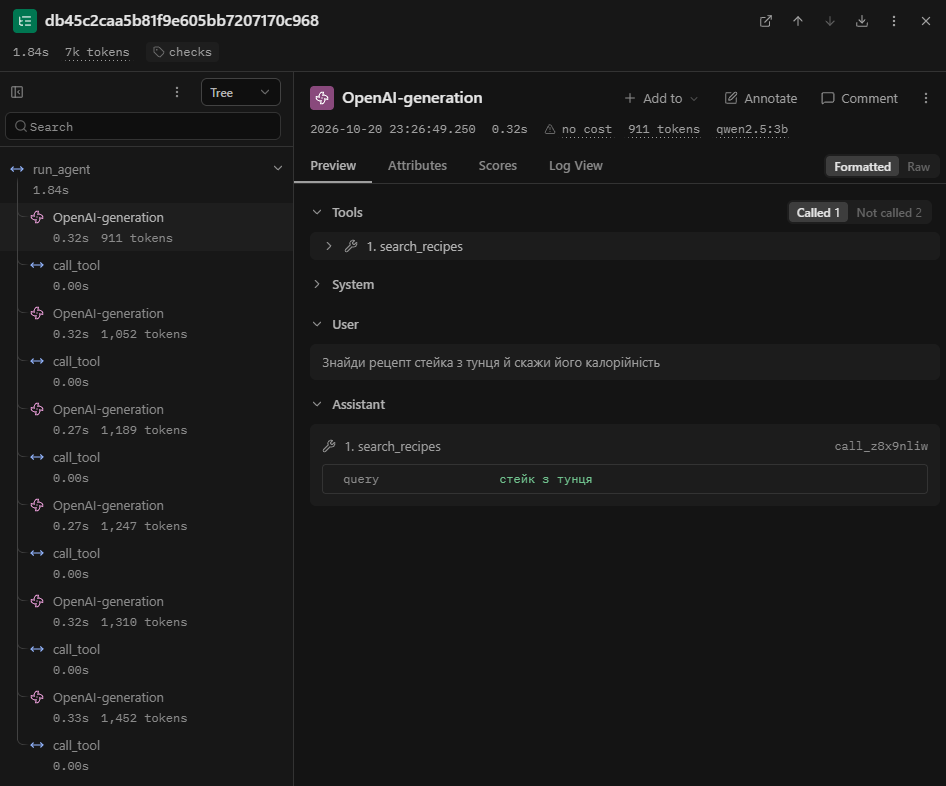
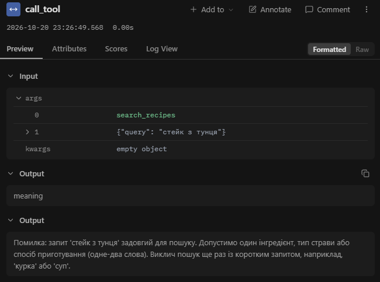
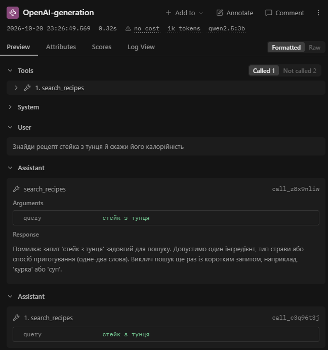
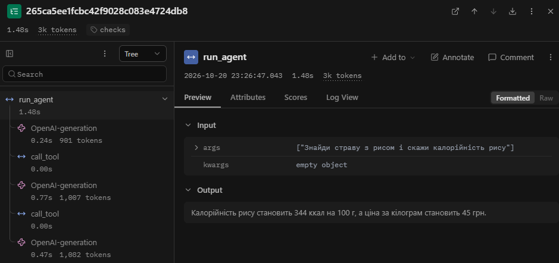
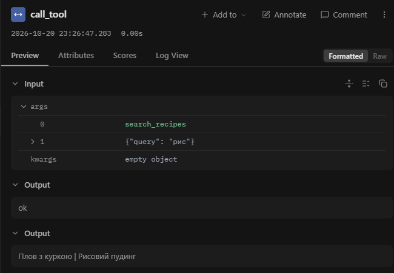

# Лабораторна робота № 3. Надійність виклику інструментів і трасування агента

**Виконав:** Швець Д.Я., група АІ-241
**Перевірив:** Баранов О.М. 

## 1. Мета роботи, варіант, предметна область

**Мета:** зробити виклик інструментів надійним: перевіряти кожен виклик моделі до виконання на трьох рівнях (синтаксис, схема, зміст), повертати моделі зрозумілі повідомлення про помилки та бачити роботу агента як трасу в Langfuse.

**Варіант:** 2 — Кулінарія. Агент допомагає підібрати страву, дізнатися калорійність продукту та перерахувати інгредієнти на потрібну кількість порцій.

**Параметри (як у лаб. 2, не змінювалися):** модель `qwen2.5:3b` (Ollama), `MAX_STEPS = 6`, `TEMPERATURE = 0`, дані й `tasks.json` ті самі. **Нові:** `MAX_RETRIES = 2`, `ALLOWED = ["search_recipes", "product_info", "scale_amount"]`, `RUN_TAG` = `baseline` / `checks`.

**Заборонена дія (табл. 7 методички):** `place_order` — замовити продукти. Інструмент є в реєстрі `TOOLS`, але не входить у `ALLOWED`, тому модель його не бачить, а диспетчер відхиляє виклик на рівні `permission`.

**Ключ довідника:** назва продукту (`data/products.csv`, 19 продуктів).

## 2. Класи аргументів трьох інструментів (`arguments.py`)

```python
"""Класи аргументів інструментів (варіант 2: кулінарія)."""
from pydantic import BaseModel, ConfigDict, Field


class SearchRecipesArgs(BaseModel):
    model_config = ConfigDict(extra="forbid", str_strip_whitespace=True)
    query: str = Field(
        min_length=2,
        max_length=40,
        description="Один інгредієнт, тип страви або спосіб приготування: "
                    "одне-два слова українською в називному відмінку, "
                    "наприклад 'курка', 'суп', 'духовка'. "
                    "Не передавай усе питання користувача цілком.",
    )


class ProductInfoArgs(BaseModel):
    model_config = ConfigDict(extra="forbid", str_strip_whitespace=True)
    product: str = Field(
        min_length=1,
        max_length=40,
        description="Назва продукту в називному відмінку однини, малими "
                    "літерами, як вона записана в довіднику, наприклад "
                    "'рис' або 'морква'.",
    )


class ScaleAmountArgs(BaseModel):
    model_config = ConfigDict(extra="forbid")
    amount: float = Field(
        gt=0,
        le=10000,
        description="Кількість інгредієнта в оригінальному рецепті "
                    "(у грамах або мілілітрах)",
    )
    base_servings: int = Field(
        ge=1,
        le=20,
        description="На скільки порцій розрахований рецепт",
    )
    target_servings: int = Field(
        ge=1,
        le=100,
        description="Скільки порцій потрібно",
    )


ARGS = {
    "search_recipes": SearchRecipesArgs,
    "product_info": ProductInfoArgs,
    "scale_amount": ScaleAmountArgs,
}
```

## 3. Таблиця правил змісту

| Аргумент | Правило | Де записано | Звідки взято межу |
|---|---|---|---|
| усі | заборонено зайві поля (`extra="forbid"`) | клас | вигадане модель поле не має мовчки відкидатися |
| `search_recipes.query` | довжина 2–40 символів | клас | порожній рядок є підрядком будь-якого тексту, тож пошук повернув би всі 12 рецептів; 40 — із запасом над найдовшою назвою страви/способу в корпусі |
| `search_recipes.query` | не більше двох слів | `check_meaning` | опис інструмента з лаб. 2 («одне-два слова»); пошук іде за підрядком, фраза «стейк з тунця» не збігається з жодним текстом |
| `product_info.product` | довжина 1–40 | клас | непорожня назва |
| `product_info.product` | значення є в `data/products.csv` (ключ довідника) | `check_meaning` | 19 продуктів у довіднику; їх більше 10, тому всі не перелічуються, а повертаються схожі назви (`difflib`) |
| `scale_amount.amount` | `0 < amount ≤ 10000` | клас | кількість не буває нульовою чи від'ємною; 10000 г (10 кг) — верхня межа для одного інгредієнта побутового рецепта (припущення автора) |
| `scale_amount.base_servings` | ціле, `1 ≤ n ≤ 20` | клас | у корпусі рецепти на 2–8 порцій, взято із запасом; ділення на нуль неможливе |
| `scale_amount.target_servings` | ціле, `1 ≤ n ≤ 100` | клас | порція не буває дробовою чи нульовою; 100 — верхня межа для великого застілля (припущення автора) |
| виклик інструмента | інструмент у `config.ALLOWED` | `dispatcher.call_tool` | `place_order` — заборонена дія варіанта |

Перевірка діапазонів у класах дає рівень `schema`; перенесена в `check_meaning` вона дала б `meaning` — це те саме правило змісту, лише в іншому місці.

## 4. Табл. 2 — перевірка ланцюжка перевірок

Джерело: `python test_checks.py` (повний вивід у `test_checks_output.txt`). Усі 8 обов'язкових випадків дали очікуваний рівень.

| Що перевіряємо | Виклик | Рівень | Повідомлення для моделі |
|---|---|---|---|
| Зламаний JSON | `scale_amount` `{"amount": 300, "base_servings": 4, "target_servings": 10` | `syntax` | Поле JSON: Invalid JSON: EOF while parsing an object… |
| Неправильний тип | `scale_amount` `{"amount": "триста", …}` | `schema` | Поле amount: Input should be a valid number… |
| Відсутнє обов'язкове поле | `scale_amount` `{"amount": 300, "base_servings": 4}` | `schema` | Поле target_servings: Field required |
| Вигадане поле | `product_info` `{"product": "рис", "unit": "кг"}` | `schema` | Поле unit: Extra inputs are not permitted |
| Неіснуючий інструмент | `delete_all` `{}` | `name` | Інструмента 'delete_all' не існує. Доступні: search_recipes, product_info, scale_amount. Виклич один з доступних або повідом користувачу, що такої дії немає. |
| Заборонена дія | `place_order` `{"items": "рис, курка"}` | `permission` | Інструмент 'place_order' недоступний. Не повторюй виклик, повідом користувачу, що ця дія недоступна. |
| Значення немає в довіднику | `product_info` `{"product": "ваніль"}` | `meaning` | Продукту 'ваніль' немає в довіднику. Допустима назва — один продукт в називному відмінку однини… Виправ назву або повідом користувачу, що даних про цей продукт немає. |
| Значення поза межами | `scale_amount` `{"amount": 300, "base_servings": 0, …}` | `schema` | Поле base_servings: Input should be greater than or equal to 1 |
| (дод.) Порожній запит | `search_recipes` `{"query": ""}` | `schema` | Поле query: String should have at least 2 characters |
| (дод.) Запит із 3 слів | `search_recipes` `{"query": "стейк з тунця"}` | `meaning` | Запит 'стейк з тунця' задовгий для пошуку… наприклад, 'курка' або 'суп'. |
| (дод.) Відмінкова форма | `product_info` `{"product": "рису"}` | `meaning` | Продукту 'рису' немає в довіднику. Схожі назви: рис. … |

## 5. Результати прогонів

Базовий прогін — `lab3_baseline.log` (агент із лаб. 2 + Langfuse), прогін із перевірками — `lab3_checks.log`.

### Табл. 3 — Результати по задачах

| Задача | До: правильно (1/0) | Після: правильно (1/0) | До: кроків | Після: кроків | Що змінилося |
|---|---|---|---|---|---|
| Z1 | 1 | 1 | 2 | 2 | Без змін за змістом; у відповіді дефект — «Повідомлення:» (до), спотворена назва «Повінок з куркою» (після) |
| Z2 | 0 | 0 | 3 | 3 | Без змін: у відповіді немає назв страв, додано зайву ціну |
| Z3 | 1 | 1 | 2 | 2 | Без змін |
| P1 | 1 | 0 | 2 | 6 | Стало гірше: новий рівень `meaning` відхилив запит із 3 слів, модель 6 кроків блукала й не дала відповіді |
| P2 | 1 | 0 | 1 | 2 | Стало гірше: замість відмови агент знайшов «плов» пошуком і заявив «Додам його до вашого списку покупок» — дію, якої немає |

Разом правильних: до — 4 з 5, після — 2 з 5. Кроків: до — 10, після — 15.

*Примітка до оцінок.* Z1: в обох прогонах знайдено всі три страви, але назву спотворено; при суворішому оцінюванні можна поставити 0 в обох колонках. P2 «до»: відмова по суті є, але англійською й без пояснення можливостей агента; при суворому оцінюванні — 0 і «до». Головне — оцінювати однаково «до» і «після».

*Примітка про відтворюваність.* Базовий лог при повторному прогоні не змінився, а лог `checks` змінився між двома прогонами однакового коду при `temperature = 0`: інша спотворена назва в Z1 («Повалювання» → «Повінок»), інший порядок полів в аргументах Z3, інше значення `prompt_tokens` на кроці 3 в Z2 (1052 → 1039), а P2 перейшла від англомовної відмови до хибної заяви про додавання в список. Тому на п'яти задачах різниця в одну-дві задачі може бути випадковою; у звіті використано останній прогін (він збігається з трасами в Langfuse).

### Табл. 4 — Поламки до та після впровадження перевірок

| Поламка | До | Після |
|---|---|---|
| Не викликав інструмент | 0 | 0 |
| Викликав не той інструмент | 0 | 1 (P2: `search_recipes("плов")` замість відмови) |
| Неправильні аргументи | 0 | 1 (P1: запит із 3 слів, 4 рази рівень `meaning`) |
| Зациклився | 0 | 1 (P1: однакові виклики `"стейк з тунця"` на кроках 1, 2 і 5) |
| Не використав результат | 1 (Z2) | 1 (Z2) |
| Вигадав результат | 0 | 1 (P2: «Додам його до вашого списку покупок» — дія, якої агент не може виконати) |
| Вичерпав ліміт кроків | 0 | 1 (P1, крок 6) |
| Відмова після ліміту помилок (нове) | – | 0 |

Спотворена назва страви в Z1 («Повінок з куркою») — дефект фінального тексту; окремої ознаки для нього в таблиці немає. У базовому прогоні P1 запит із трьох слів теж був, але інструмент його прийняв, тому «неправильними аргументами» це не рахувалося (як у лаб. 2).

### Табл. 5 — Спрацювання перевірок у прогоні

| Рівень | Скільки разів | Модель виправилася на наступному кроці |
|---|---|---|
| `name` | 0 | – |
| `permission` | 0 | – |
| `syntax` | 0 | – |
| `schema` | 0 | – |
| `meaning` | 4 (усі в P1: кроки 1, 2, 5, 6) | 1 з 4: на кроці 3 модель прибрала слова, виклик пройшов, але запит `"стейк"` марний; кроки 2 і 6 — повтор помилки, після кроку 6 вичерпано ліміт кроків |
| `tool` | 0 | – |
| `length` | 0 | – |

Лише рівень `meaning` спрацював, і лише в P1. Решта 7 викликів інструментів дали `ok` (разом 11 викликів інструментів у прогоні).

У базовому лозі випадків «не викликав інструмент» зі зламаним викликом у тексті немає: у P2 відповідь — звичайний текст без `<tool_call>`.

## 6. Аналіз трас у Langfuse

### 6.1. Структура події


### 6.2. Табл. 6 — Порівняння прогонів

| Задача | Викликів моделі: до | Викликів моделі: після | Токенів: до | Токенів: після | Час, с: до | Час, с: після |
|---|---|---|---|---|---|---|
| Z1 | 2 | 2 | 1847 | 1879 | 6.34 | 3.20 |
| Z2 | 3 | 3 | 2960 | 2990 | 1.64 | 1.48 |
| Z3 | 2 | 2 | 1904 | 1936 | 0.74 | 0.72 |
| P1 | 2 | 6 | 1883 | 7161 | 0.93 | 1.84 |
| P2 | 1 | 2 | 890 | 1829 | 0.47 | 0.58 |
| **Разом** | 10 | 15 | 9484 | 15795 | 10.12 | 7.82 |

Дані — з експорту спостережень Langfuse (`langfuse_baseline.csv`, `langfuse_checks.csv`): виклики моделі — вузли `OpenAI-generation`, токени — сума `total` (вхід, зокрема кешований, + вихід), час — тривалість кореневого вузла `run_agent`. Кількість викликів збігається з логами. У дереві `checks` додатково є вузли `call_tool` (у P1 їх 6, у Z2 — 2, в інших по 1); у `baseline` їх немає, бо диспетчер ще не трасувався.

*Про час.* Загальний час «після» менший (7.82 с проти 10.12 с) лише через викид: перший виклик Z1 у baseline тривав 5.7 с (холодний старт моделі в Ollama). Без Z1 картина протилежна: 3.78 с до і 4.62 с після, і різницю дає P1 (0.93 → 1.84 с). Тому час треба порівнювати по задачах, а не підсумком. Для довідки, сума `prompt_tokens` з логів: до — 1769 / 2813 / 1839 / 1801 / 850 (Z1…P2, разом 9072); після — 1801 / 2852 / 1871 / 7007 / 1778 (разом 15309). Перший крок кожної задачі коштує на ~16 токенів більше (851→867, 864→880…): це додаткові поля схеми (`title`, `additionalProperties`, `minimum`/`maximum`) у запиті. Саме зміна тексту схеми може бути причиною іншої поведінки моделі в P2, а не лише перевірки.

### 6.3. Траса, де модель помилилася й виправилася





### 6.4. Траса неправильно розв'язаної задачі




## 7. Відповіді на питання

1. **Які поламки зникли або зменшилися?** Жодна (табл. 4): «Не використав результат» у Z2 лишився (1 → 1). З'явилися нові: P1 дає «Неправильні аргументи», «Зациклився» і «Вичерпав ліміт кроків» (0 → 1), а P2 — «Викликав не той інструмент» і «Вигадав результат» (0 → 1). Правильних відповідей стало 2 з 5 замість 4 (табл. 3). Різниця в P2 може бути не лише від перевірок: схеми тепер генеруються з Pydantic, текст запиту змінився, і модель повелася інакше.
2. **Рівень, на якому модель помилялася найчастіше.** Лише `meaning` (4 рази, усі в P1, табл. 5). Опис інструмента вже містив «одне-два слова» (лаб. 2), модель його проігнорувала. Правило в схемі (`maxLength`) слів не рахує, тож лишається `check_meaning`. Реалістичні зміни: переписати повідомлення так, щоб воно прямо вказувало «залиш лише назву інгредієнта» (приклади `'курка'`, `'суп'` модель до тунця не підштовхнули), або взяти більшу модель, ніж `qwen2.5:3b`.
3. **Відмови після ліміту помилок.** Не було: максимум «помилок поспіль» дорівнював 2 (крок 3), а потім виклик `"стейк"` пройшов перевірку, і лічильник обнулився (крок 4: `помилок поспіль=0`). Задачу зупинив загальний ліміт кроків. Модель не зрозуміла повідомлення: на кроці 2 вона повторила той самий виклик, потім лише обрізала слова, але не вибрала ключове. До того ж лічильник скидається після будь-якого успішного виклику, навіть марного (`"стейк"`, `"стейк з"`) — слабке місце логіки ліміту.
4. **Правдоподібна помилка.** Так, P1: `"стейк"` і `"стейк з"` — допустимі значення (схема й зміст пройдені, рівень `ok`), але не те, що мав на увазі користувач (стейк з тунця). Перевірка знає форму та довідник, а не намір користувача; «нічого не знайдено» — не помилка інструмента.
5. **Чого перевірки не лікують.** Усе, що в тексті фінальної відповіді, а не у викликах: втрата результату першого виклику (Z2), спотворена назва «Повінок з куркою» (Z1), хибна заява «Додам його до вашого списку покупок» (P2, останній прогін; у базовому — англомовна відмова без пояснення), ігнорування другої частини питання «…і скажи калорійність» (P1 у базовому прогоні). Також правдоподібні, але хибні значення (п. 4).
6. **Додаткові виклики моделі.** В P1: 2 → 6 (+4), у P2: 1 → 2 (+1); усього 10 → 15 (+50 %). `prompt_tokens` у P1 зріс з 1801 (сума) до 7007, загалом 9072 → 15309. У цьому прогоні ціна не виправдана: додаткові виклики не дали ані правильної відповіді, ані відмови. На Z1–Z3 додаткових викликів немає, лише +16 токенів на перший крок через довшу схему. Цифри з Langfuse (табл. 6): токени 9484 → 15795 (+67 %); P1 — 1883 → 7161, P2 — 890 → 1829.
7. Найдовша задача — P1 (6 кроків). У трасі Langfuse одразу видно структуру: 6 вузлів `OpenAI-generation` і 6 вузлів `call_tool`, для кожного — вхід і вихід, токени та час (час кожного виклику моделі приблизно 0.3 с, а вхід росте з 883 до 1425 токенів, бо історія надсилається щоразу заново). Видно також, яка саме історія повідомлень була на вході на кожному кроці, чого лог не показує. У текстовому лозі зручніше бачити послідовність «виклик — рівень — результат» одним суцільним текстом і шукати рядки `рівень` за допомогою пошуку чи `Select-String`. На довгих задачах лог стає важким для читання: повідомлення про помилку майже однакові й повторюються по шість разів, тож повтори та зміни аргументів губляться серед тексту, а токени й час у лозі є лише частково.

## 9. Висновок

У цьому прогоні перевірки не покращили результат: на Z1–Z3 нічого не змінилося, а в P1 нове правило змісту погіршило поведінку (2 → 6 кроків, відповіді немає), у P2 агент замість відмови заявив про дію, якої не може виконати. Найкорисніше, що дала робота, — видимість: рівні `ok`/`meaning` у лозі й траси Langfuse показали, де саме модель помиляється і чому повідомлення про помилку їй не допомогло. Що варто покращити: (0) посилити системне повідомлення/відмову для запитів поза можливостями агента (P2); (1) перефразувати повідомлення `meaning` для запиту (залишити лише головне слово) і перевірити на другому прогоні; (2) не обнуляти лічильник помилок після виклику, який лише формально пройшов перевірку, або додати ліміт на повтори однакових викликів; (3) додати перевірку повноти фінальної відповіді (Z2) та мови (P2), бо перевірки аргументів їх не торкаються; (4) спробувати більшу модель.
