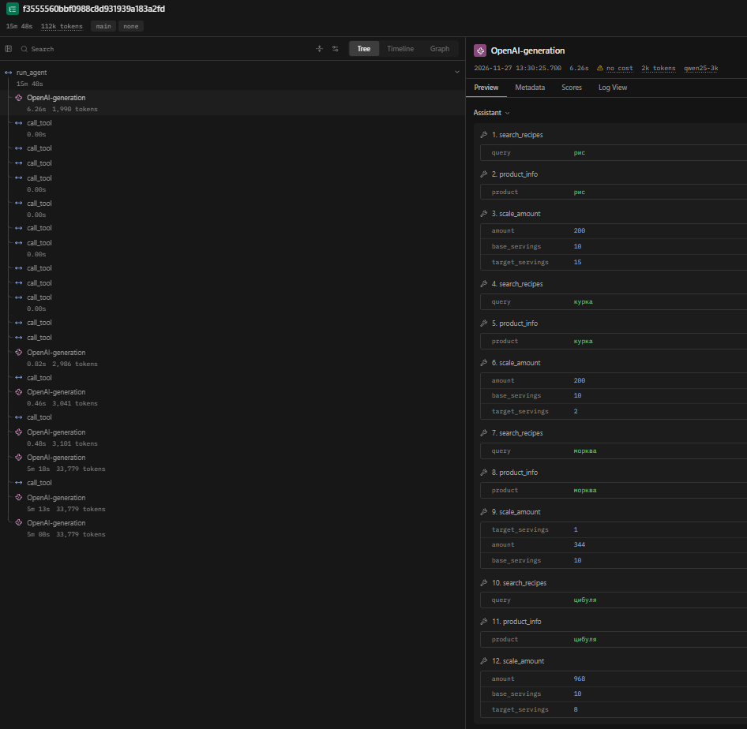
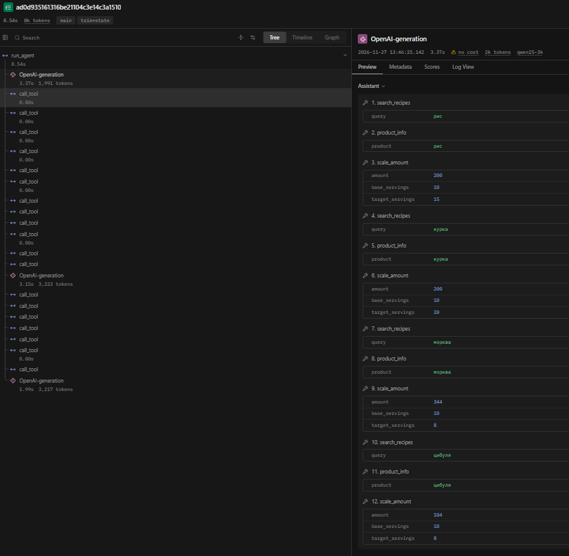

# Лабораторна робота № 4

**Тема:** Контекст, стан і кеш агента  
**Студент:** Швець Дмитро  
**Група:** АІ-241  
**Варіант:** 2 — Кулінарія  
**Дата експериментів:** 27.11.2026

## 1. Мета та модель

Дослідити зростання контексту агента, обрізання історії, збереження стану та кешування. Вихідна модель Ollama `qwen2.5:3b`: context length 32768; початкове вікно `qwen25-4k` — 4096 (звуження у 8 разів). Після випадку C (2355 токенів, 57,5% вікна, статус final) створено `qwen25-3k` з num_ctx=3072 (звуження у 10,67 раза), COMPRESS_AT=2150. Усі наведені нижче нові експерименти виконано з вікном 3072.

## 2. Довга задача

```text
Для шести продуктів розрахуй калорійність:

1. рис — 150 г
2. курка — 200 г
3. морква — 100 г
4. цибуля — 80 г
5. картопля — 250 г
6. яйце — 120 г

Для КОЖНОГО продукту обов'язково виконай:

1. search_recipes — знайди рецепти з продуктом.
2. product_info — отримай калорійність на 100 г.
3. scale_amount — розрахуй калорійність порції.

ВАЖЛИВО: scale_amount приймає:
- amount = калорійність продукту на 100 г,
  отримана саме з product_info;
- base_servings = 10;
- target_servings = вага продукту в грамах / 10.

Приклад ТІЛЬКИ для пояснення:
якщо продукт має 200 ккал на 100 г,
а порція важить 150 г, викликай:
scale_amount(
    amount=200,
    base_servings=10,
    target_servings=15
)

Не передавай вагу продукту без ділення на 10.
Не використовуй однакове amount для різних продуктів.
Не повторюй уже успішно виконані виклики.

Після отримання результатів усіх шести продуктів
вкажи сумарну калорійність у ккал.
```

Правильна відповідь: 1344.7 ккал; мінімум викликів: 18.

## 3–4. Пробний прогін без захисту

`probe_none_r1.log`: повторний завершений пробний прогін тривав 938,7 с (15 хв 38,7 с), правильність — ні, статус retry_limit. Прийнятої відповіді немає; 7 кроків, 19842 вхідних і 92613 вихідних токенів, 0 стиснень, 0 повторних викликів, 0 влучань у кеш. Попередній перерваний прогін замінено завершеним вимірюванням.

**Таблиця 2 — Зростання контексту**

| Крок | prompt_tokens | Приріст | Що зробила модель |
|---:|---:|---:|---|
| 1 | 1650 | — | search_recipes, product_info, scale_amount для рису, курки, моркви та цибулі (12 викликів); amount у scale_amount: 200, 200, 344, 968 відповідно |
| 2 | 2947 | 1297 | scale_amount (amount=41) |
| 3 | 3004 | 57 | scale_amount (amount=315.7) |
| 4 | 3064 | 60 | scale_amount (amount=978.7) |
| 5 | 3059 | -5 | Відхилено перевіркою |
| 6 | 3059 | 0 | Відхилено перевіркою |
| 7 | 3059 | 0 | Відхилено перевіркою |

- (а) C = 1650 токенів.
- (б) d = 60 токенів (медіана додатних приростів 1297, 57, 60).
- (в) Фактично 19842; формула 7 × 1650 + 60 × 7 × 6 / 2 = 12810. Розбіжність 7032 (54,9%) через нерівномірне зростання, зокрема великий пакет викликів на першому кроці.
- (г) Застій на кроці 5: 3064 → 3059 → 3059 → 3059, максимум 99,74% вікна.
- (д) На кроках 5–7 генерації відхилено перевіркою. Після кроку 5 є лише два наступні кроки (6 і 7); крок 8 відсутній через retry_limit. Прийнятої фінальної відповіді немає, тому перевірити її числа неможливо. У попередньому перерваному прогоні спостерігалося повторення тексту та неправильна сума 959,5 ккал; це окреме спостереження, а не результат нового прогону.

Випадок B: вхід перестав зростати біля межі вікна; це відповідає ознаці мовчазного обрізання в методичці. Повторний пробний прогін завершився retry_limit, як і три основні прогони none. Аргументи в таблиці наведено в межах видимого виводу аналізатора, який обрізає довгі рядки.

## 5–6. Обрізання історії та стан

**Таблиця 3 — Стиснення історії**

| Конфігурація | Крок стиснення | Вхід до стиснення, токенів | Повідомлень було → стало | Повторних викликів за прогін |
|---|---:|---:|---|---:|
| trim | 2 | 2930 | 16 → 4 | 58 |
| trim | 5 | 2574 | 16 → 6 | 58 |
| trim | 7 | 2468 | 14 → 6 | 58 |
| trim | 8 | 2260 | 10 → 6 | 58 |
| trim | 9 | 2177 | 10 → 6 | 58 |
| trim | 11 | 2468 | 14 → 6 | 58 |
| trim | 12 | 2260 | 10 → 6 | 58 |
| trim | 13 | 2177 | 10 → 6 | 58 |
| trim | 15 | 2468 | 14 → 6 | 58 |
| trim | 16 | 2260 | 10 → 6 | 58 |
| trim | 17 | 2177 | 10 → 6 | 58 |
| trim | 19 | 2468 | 14 → 6 | 58 |
| trim | 20 | 2260 | 10 → 6 | 58 |
| trim | 21 | 2177 | 10 → 6 | 58 |
| trim | 23 | 2468 | 14 → 6 | 58 |
| trim | 24 | 2260 | 10 → 6 | 58 |
| trim | 25 | 2177 | 10 → 6 | 58 |
| trim+state | 2 | 2930 | 16 → 4 | 0 |
| trim+state | 3 | 2518 | 6 → 6 | 0 |

`trim`: 29,8 с, 25 кроків, 56057 вхідних і 2232 вихідних токенів, 17 стиснень, step_limit, неправильно. Після стиснення на кроці 2 на кроці 3 повторено `search_recipes({"query":"рис"})` та `product_info({"product":"рис"})`.

`trim+state`: 8,5 с, 4 кроки, 9711 вхідних і 465 вихідних токенів, 2 стиснення, final, відповідь 1103 ккал (неправильно). За аналізатором 0 повторів; однак у повному лозі `scale_amount` з amount=344, base_servings=10, target_servings=10 повторено з іншим порядком ключів. Отже, лічильник може недооцінювати семантичні повтори. Збереження стану не виправляє неправильні аргументи: для рису використано 200 замість 344, для курки 200 замість 190.

**Пункт 7 кроку 6.** Перший блок повідомлення після стиснення (рядки 129–192 `probe_trim+state_r1.log`) містить 12 рядків результатів: по 4 для кожного інструмента. Повний блок разом із задачею — 2647 символів (переноси LF), приблизно 2647 / 2,5 = 1058,8 токена, у 17,65 раза більше за типовий приріст 60. Блок великий, хоча дозволяє зберегти попередні результати.

## 7. Кешування

**Таблиця 4 — Холодний і теплий кеш**

| Запуск | Кроків | Влучань у кеш | Викликів до сервера | Час, с | Правильно |
|---|---:|---:|---:|---:|---|
| cache1 | 7 | 2 | 5 | 338,4 | Ні |
| cache2 | 7 | 7 | 0 | 0,5 | Ні |

Обидва прогони завершилися retry_limit. Холодний кеш мав 2 влучання через повторення запиту всередині прогону. Прискорення 338,4 / 0,5 = 676,8 раза. Кеш відтворює й помилкові відповіді; наведені в логах токени теплого запуску є метаданими кешованих відповідей, а не новими витратами сервера. Зміна SYSTEM змінює повідомлення і ключ кешу, тому старі відповіді для зміненого запиту не використовуються. USE_CACHE в measure.py встановлюється через series.startswith("cache"); в main кеш вимкнено (0 влучань у кожному лозі).

## 8. Основна серія

**Таблиця 5 — Медіани трьох повторів**

| Конфігурація | Правильно (з 3) | Кроків | Токенів на вхід | Токенів на вихід | Час, с | Стиснень | Повторних викликів |
|---|---:|---:|---:|---:|---:|---:|---:|
| none | 0/3 | 7 | 19842 | 92613 | 934,1 | 0 | 0 |
| trim | 0/3 | 9 | 17889 | 940 | 10,4 | 1 | 0 |
| trim+state | 0/3 | 3 | 7658 | 773 | 8,5 | 1 | 1 |

Усі дев'ять прогонів виконано без кешу. Час none: 949,4; 930,9; 934,1 с. Великий час і 92613 вихідних токенів пов'язані з трьома генераціями по 30720 токенів, відхиленими перевіркою. trim+state зменшив вхідні токени на 61,4% та час у 109,9 раза відносно none; правильність не покращилась.

**Приховані поламки.** Методичка в пункті 5 згадує 12 прогонів, але команда all 3 для трьох конфігурацій дає 9. Аналізуємо саме 9 нових логів, без старих кешованих експериментів.

| Логи | Статус | Кроків | Викликів (ok) | Фінальне число, ккал | Прихована невдача за критерієм <19 кроків |
|---|---|---:|---|---|---|
| main_none_r1–r3 | retry_limit | 7 | 15 (15) | немає | Ні (явна) |
| main_trim_r1–r3 | final | 9 | 19 (18) | 1353,9 | Так, 3 |
| main_trim+state_r1 | final | 3 | 19 (19) | 361,0 | Так |
| main_trim+state_r2 | final | 3 | 19 (19) | 1908,5 | Так |
| main_trim+state_r3 | final | 3 | 19 (19) | 2456,5 | Так |

За буквальним критерієм методички — 6 із 9 прихованих невдач, 3 явні. Фактична кількість викликів не дорівнює кількості кроків через пакетні виклики; у всіх шести фінальних прогонах відсутні пошук рецептів та product_info для картоплі й яйця. У п'яти фінальних прогонах підсумкове число відсутнє в рядках `результат:` (три trim та trim+state r2, r3). Це не автоматично вигадане число: 1353,9 є правильною сумою наведених у відповіді, але неправильно отриманих значень. У trim+state r1 число 361,0 є в результатах, але це не сума всіх продуктів. Таким чином, усі фінальні відповіді неправильні.

**Langfuse.**



Рисунок 1 — режим none: близько 15 хв 48 с, три генерації тривалістю близько 5 хв кожна.



Рисунок 2 — режим trim+state: 8,54 с, три генерації.

Стиснення в main_trim+state_r1 після кроку 2: 2948 токенів, 23 → 10 повідомлень. На першому виклику після стиснення (крок 3) prompt_tokens = 3060, у main_none_r1 на тому самому кроці — 3004. Різниця +56 токенів (+1,86%): у цьому випадку стан і збережені повідомлення не зменшили вхід на конкретному кроці, хоча загальна сума за прогін зменшилася. Langfuse одразу показує дерево генерацій та інструментів, тривалість і токени; у текстових логах доводиться вручну зіставляти кроки й підраховувати виклики. Числа токенів у дереві є сумарними, тому для порівняння входу використано саме prompt_tokens з логів.

## 9. Відповіді на питання

**1. На якому кроці агент без захисту дійшов до межі вікна і як ви це побачили (таблиця 2, пункти (г) і (д) кроку 4)? Що в його поведінці змінилося після цього?**

На кроці 5 вхід перестав рости: 3064 → 3059 → 3059 → 3059 (таблиця 2). На кроках 5–7 генерації відхилено перевіркою; прогін завершився зі статусом retry_limit.

**2. Порівняйте суму `prompt_tokens` за прогін із формулою (пункти (а)-(в) кроку 4). Чи збігається зростання з очікуваним?**

За таблицею 2 фактична сума 19842, теоретична 12810. Зростання нерівномірне: після першого пакета викликів приріст 1297, а типовий лише 60, тому формула недооцінює суму.

**3. Що втрачає агент при обрізанні? Наведіть приклад повторного виклику після стиснення. Що змінилося в `trim+state` (таблиці 3 і 5)?**

При обрізанні втрачаються результати попередніх викликів: на кроці 3 probe_trim повторено пошук і product_info для рису. За таблицею 3 лічильник повторів знизився з 58 до 0 у пробному trim+state, хоча можливі невраховані повтори з іншим порядком аргументів; у таблиці 5 медіана становить 1.

**4. Яка конфігурація найдешевша за токенами, найшвидша, найточніша (таблиця 5)? Чому висновок за трьома повторами однієї задачі обережний?**

За таблицею 5 trim+state найдешевша (7658 вхідних і 773 вихідних токени) та найшвидша (8,5 с). Усі конфігурації мають 0/3 правильних відповідей, а три повтори однієї задачі не дозволяють узагальнювати результат на інші задачі.

**5. Чому під час вимірювання вартості кеш вимкнено? Що станеться з кешем, якщо інструмент поверне інші дані або ви замініть модель під тією самою назвою?**

Кеш вимкнено, щоб вимірювати реальні виклики моделі, а не читання готових відповідей. Змінений результат інструмента змінює наступні повідомлення і ключ; заміна моделі під тією самою назвою може залишити старий ключ, тому кеш потрібно очистити.

**6. Які поламки довгого прогону скорочення історії не лікує в принципі?**

Скорочення історії не усуває неправильні аргументи, арифметичні помилки, пропущені обов’язкові дії та вигадані результати. Наприклад, у probe_trim+state збережено неправильний розрахунок рису, а в main_trim+state агент не отримав product_info для картоплі та яйця.

## Висновок

Обрізання історії зменшило час і кількість токенів, але у пробному прогоні призвело до повторних викликів. Збереження стану дало найкращу ефективність серед конфігурацій без кешу, а кеш — найбільше прискорення повторного ідентичного прогону (676,8 раза), не покращуючи правильності. Надалі варто перевіряти залежності між викликами, аргументи та повноту виконання задачі, а також дослідити контроль довжини генерації окремо від основного експерименту. Додаткове завдання summary не виконувалося.
