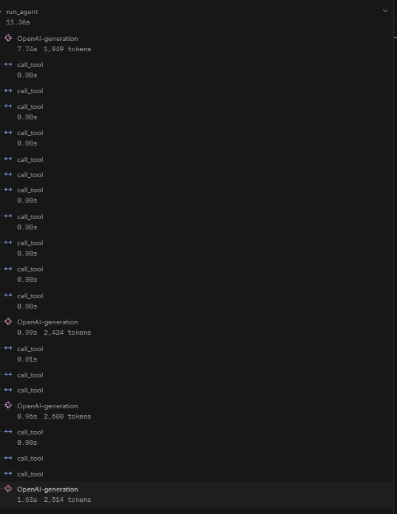
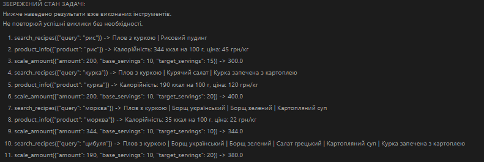
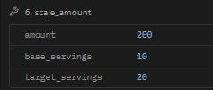

# Лабораторна робота №4

**Тема:** Контекст, стан і кеш агента  
**Варіант:** 2 — Кулінарія  
**Студент:** Швець Дмитро 
**Група:** АІ-241  
**Дата експериментів:** 23.11.2026

## Мета роботи

Дослідити зростання історії викликів агента за обмеженого контекстного вікна, застосувати обрізання історії, зовнішнє збереження стану та кешування відповідей локальної мовної моделі; порівняти кількість токенів, викликів інструментів, час і правильність виконання.

## 1. Модель та обмеження контексту

Використано локальну модель Ollama `qwen2.5:3b` (Qwen2, 3.1B, Q4_K_M). Створено похідну `qwen25-4k` через `Modelfile` з параметром `PARAMETER num_ctx 4096`. За виводом `ollama show` вихідна модель має `context length = 32768`; налаштоване вікно похідної — `num_ctx = 4096`. Отже, робоче контекстне вікно звужено у **32768 / 4096 = 8 разів**. Поле `context length = 32768` у `ollama show qwen25-4k` характеризує можливості архітектури, а не скасовує обмеження `num_ctx`.

## 2. Довга задача та еталон

Завдання: для шести продуктів знайти рецепти через `search_recipes`, отримати калорійність на 100 г через `product_info` та обчислити калорійність заданої маси через `scale_amount`; наприкінці подати суму. Кожен продукт вимагає трьох викликів, отже `min_calls = 18`.

| Продукт | Маса, г | Калорійність на 100 г | Калорійність порції, ккал |
|---|---:|---:|---:|
| Рис | 150 | 344 | 516 |
| Курка | 200 | 190 | 380 |
| Морква | 100 | 35 | 35 |
| Цибуля | 80 | 41 | 32,8 |
| Картопля | 250 | 77 | 192,5 |
| Яйце | 120 | 157 | 188,4 |
| **Разом** | | | **1344,7** |

Еталон зафіксовано в `long_task.json`: `expected = "1344.7"`. Для обчислення використовується `scale_amount(amount=калорійність_на_100г, base_servings=10, target_servings=маса_в_грамах/10)`.

## 3. Пробний прогін без захисту

Для `probe_none_r1.log`: статус `final`, 2 кроки, 12 викликів інструментів, 4005 вхідних токенів сумарно, максимальний вхід 2355. Агент завершив роботу раніше від мінімальних 18 викликів, тому повноту виконання не підтверджено. Пробний прогін показав, що фінальна відповідь не є доказом виконання всіх операцій.

## 4. Зростання контексту та типи збоїв

| Прогін | Кроки | Вхідні токени по кроках | Найбільший вхід | Виклики інструментів | Спостереження |
|---|---:|---|---:|---:|---|
| `probe_none_r1.log` | 2 | 1650, 2355 | 2355 | 12 | Без стиснення |
| `main_none_r1.log` | 4 | 1650, 2345, 2728, 2909 | 2909 | 17 | Без стиснення |
| `optimized_trim+state_r1.log` | 4 | 1650, 2345, 2528, 2365 | 2528 | 17 | Є записи про стиснення |

Збої у досліджених прогонах переважно **семантичні**: неправильні назви продуктів, невірні аргументи інструментів, передчасне завершення або помилкове підсумовування. Сам факт помилки відповіді не доводить переповнення контексту. У наведених журналах не встановлено однозначного випадку серверної відмови через довжину входу.

## 5. Обрізання історії та зовнішній стан

В `compress.py` передбачено `COMPRESS="trim"`, поріг `COMPRESS_AT=2800`, `KEEP_LAST=6`. Режим `trim+state` зберігає результати успішних інструментів у `state/*.json` і після обрізання додає до контексту блок «ЗБЕРЕЖЕНИЙ СТАН ЗАДАЧІ». На діагностичному прогоні `optimized_trim+state_r1` журнал містить записи `СТИСНЕННЯ`, а в Langfuse видно зміну обсягу повідомлень. У цьому прогоні стан містив 11 записів інструментів; скриншот `03_state.png` підтверджує його передачу моделі.

**Таблиця 3. Основні вимірювання (три повтори; медіани)**

| Конфігурація | Правильно | Медіана часу, с | Медіана кроків | Медіана викликів | Медіана суми prompt_tokens | Медіана max prompt_tokens | Подій стиснення у трьох прогонах |
|---|---:|---:|---:|---:|---:|---:|---:|
| `none` | 0/3 | 8.2 | 2 | 18 | 4502 | 2852 | 0 |
| `trim` | 0/3 | 8.0 | 2 | 18 | 4502 | 2852 | 0 |
| `trim+state` | 0/3 | 8.0 | 2 | 18 | 4502 | 2852 | 0 |

У головній серії всі три режими дали 0/3 правильних відповідей. В основних прогонах `trim` і `trim+state` **стиснення не активувалося**: модель завершувала задачу за два кроки; тому однакові метрики не свідчать про неефективність механізмів, а лише про те, що умова їх застосування в цій серії не настала. Окремий діагностичний прогін демонструє роботу стиснення й стану.

## 6. Кешування моделі

Дисковий кеш використовує ключ на основі моделі, повідомлень, інструментів і температури. Порівняно два послідовні запуски конфігурації `cache` без стиснення та стану; перед першим каталог `cache/` очищено, між запусками — збережено.

**Таблиця 4. Холодний і теплий кеш**

| Показник | `cold_cache_r1` | `warm_cache_r1` |
|---|---:|---:|
| Статус | final | final |
| Час, с | Не підтверджено в наданому виводі | 0,1 |
| Влучання в кеш | 0 | 3 |
| Кроки | 3 | 3 |
| Виклики інструментів | 29 | 29 |
| Повторні виклики за аналізатором | 7 | 7 |
| Сума prompt_tokens у збережених відповідях | 7540 | 7540 |
| Максимальний вхід | 3545 | 3545 |
| Правильність | Ні | Ні |

Час холодного запуску `cold_cache_r1` потрібно взяти з консольного рядка `measure.py`: журнал містить часи окремих подій, але не підсумковий час запуску. Раніше повідомлені 13,7 с стосувалися іншого прогону `cache1_none_r1` без кешування.

У теплому прогоні всі 3 звернення до моделі обслуговано з кешу. Вказані в журналі `prompt_tokens` для кешованих відповідей — збережені метадані первинних відповідей, а не нове споживання Ollama. Інструменти при цьому виконувалися повторно. Результат залишився неправильним: кеш прискорює повторення, але не перевіряє коректність відповіді.

## 7. Додаткове порівняння з кешем і типові помилки

У трьох прогонах `main_trim+state+cache_r1..r3` зафіксовано по 2 влучання в кеш; час у консолі — 0,0 с після округлення. В усіх трьох випадках відповідь неправильна. Ця конфігурація є додатковою й не замінює три основні режими.

Приклад помилки аргументів: для курки `product_info` повертає 190 ккал на 100 г, проте агент викликав `scale_amount(amount=200, base_servings=10, target_servings=20)`, одержавши 400 ккал замість правильних 380 ккал. Також траплялися російські назви `картофель`, `яйцо`, які не збігалися з ключами українського довідника. У діагностичному стані помилковий результат інструмента міг бути збережений і повторно поданий моделі; стан — це пам’ять, а не валідатор.

## 8. Ілюстрації Langfuse

**Рисунок 1.** Траса без захисту: дерево викликів, модель і кількість токенів.

**Рисунок 2.** Діагностична траса зі стисненням історії.

**Рисунок 3.** Збережений стан із результатами попередніх викликів інструментів.

**Рисунок 4.** Приклад некоректного аргументу `scale_amount`.

## 9. Відповіді на контрольні питання (за темами лабораторної)

1. **Що таке контекстне вікно?** Максимальний обсяг токенів, доступних моделі для обробки одного запиту, включно з історією, інструкціями та результатами інструментів.
2. **Чому зростає вартість довгого діалогу?** Кожний наступний виклик повторно передає накопичену історію, тому сума вхідних токенів зростає швидше за кількість кроків.
3. **Як виявити втрату контексту?** Аналізувати `prompt_tokens`, зміну вхідних повідомлень, помилки сервера й повторення вже виконаних дій; стабілізація входу за зростання історії може бути непрямою ознакою обрізання.
4. **Що дає `trim`?** Прибирає старі повідомлення, зменшуючи обсяг контексту, але може втратити потрібні факти.
5. **Навіщо потрібен зовнішній стан?** Зберігати структуровані результати інструментів поза історією, щоб повертати їх після стиснення.
6. **Яка небезпека збереження стану?** Помилкові або застарілі результати можуть зберігатися та впливати на наступні рішення.
7. **Що кешує агент?** Відповідь моделі для тотожного запиту; ключ враховує параметри запиту, тому навіть незначна зміна повідомлень може призвести до промаху.
8. **Чи гарантує кеш правильну відповідь?** Ні. Він повторює результат і скорочує час, але не виправляє помилки моделі.

## 10. Висновок

У роботі створено похідну локальну модель із вікном 4096 токенів, що у 8 разів менше за контекстну довжину вихідної моделі. Реалізовано й перевірено три механізми: обрізання історії, зовнішній стан та дисковий кеш. У головній серії всі три режими завершилися без правильної відповіді, а стиснення не спрацьовувало через раннє завершення. Діагностична траса окремо підтвердила використання стану після скорочення історії. Повторний запуск із заповненим кешем дав три влучання та час 0,1 с. Отже, методи керування контекстом і кешування допомагають з ресурсами та відтворюваністю, але для надійної правильності потрібні перевірки аргументів, результатів і умов завершення агента.
