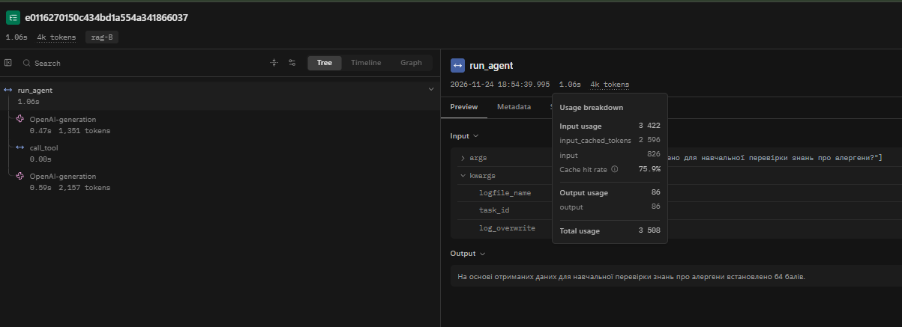
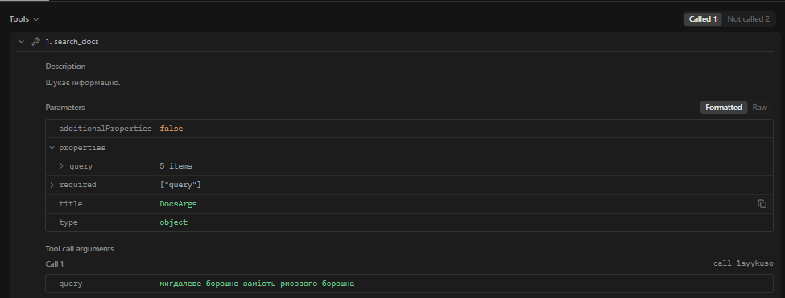
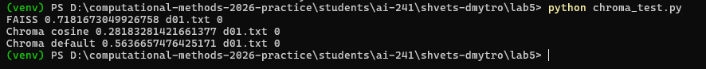

# Лабораторна робота № 5

**Тема:** RAG-агент: пошук по документах як інструмент  
**Варіант:** 2 — Кулінарія  
**Студент:** Швець Дмитро Ярославович  
**Група:** АІ-241

## Мета
Замінити пошук підрядком векторним, оцінити пошук окремо від агента та вплив нарізання, порога й опису інструмента. Модель qwen25-4k, вікно 4096, температура 0, ембединги bge-m3. SYSTEM збережено без змін; він містить інструкції довгої задачі та стару назву пошуку, що може впливати на результат.

## Дані
Вигадана навчальна кухня «Смакова майстерня». Умовні числа не є рекомендаціями з харчової безпеки.
| Документ | Символів |
|---|---:|
| Техніки приготування | 3358 |
| Зберігання продуктів і терміни придатності | 3237 |
| Заміна інгредієнтів | 3181 |
| Кухонне обладнання й догляд за ним | 3166 |
| Безпека на кухні й алергени | 3228 |

П’ять нових документів: 16170 символів, приблизно 6468 токенів. Усього 17 документів, 18497 символів, приблизно 7399 токенів. Перевірка check_cases.py: Усе гаразд.
| ID | Вид | Питання | must_contain | expected |
|---|---|---|---|---|
| D1 | direct | Яка контрольна тривалість навчального режиму томління? | контрольна тривалість становить 47 хвилин | 47 |
| D2 | direct | Який термін придатності сухої суміші в навчальних контейнерах? | термін придатності становить 53 години | 53 |
| D3 | direct | Скільки рисового борошна видають у вправі із заміни мигдалевого борошна? | видають 68 грамів рисового борошна | 68 |
| D4 | direct | Скільки балів встановлено для навчальної перевірки знань про алергени? | встановлено 64 бали | 64 |
| P1 | paraphrase | Як довго треба зачекати після того, як масу для десерту зробили пухкою? | передбачено паузу 13 секунд | 13 |
| P2 | paraphrase | Скільки часу не викидають старі позначення на тарі? | зберігають протягом 71 доби | 71 |
| P3 | paraphrase | Скільки змінних деталей є в запасному наборі приладу? | комплект містить 18 насадок | 18 |
| P4 | paraphrase | Скільки часу учасник може витратити на оформлення повідомлення про небезпечну подію? | відведено 12 хвилин | 12 |
| N1 | none | Яка вартість оренди фритюрниці?  | — | — |
| N2 | none | Яка місткість посудомийної машини в літрах? | — | — |

Перевірка трьох питань без документів: D1 та D2: точні числа 47 і 53 не названо. D4: модель припустила діапазон 50–100, але не назвала 64.

## Перевірка ембедингів
Довжина 1024, норма 1,000; схожість 0,731 («Тариф на доставку») та 0,568 («Графік роботи кур’єрів»). Час 21,1 с.

## Таблиця 1 — Нарізання одного документа
| Спосіб | Чанків | Посеред речення | Максимум символів |
|---|---:|---:|---:|
| fixed, 200, 0 | 17 | 16 | 200 |
| fixed, 500, 100 | 9 | 8 | 500 |
| paragraphs, 800, 0 | 6 | 0 | 771 |

Межа чанків 1 і 2: `ольна тривалість становить 47 ` / `хвилин. Це внутрішній показник`. Фіксоване нарізання може розділити число та одиницю виміру.

## Таблиця 2 — Пошук при різному нарізанні
| Конфігурація | Чанків | Сер. довжина | hit@1 | hit@3 | hit@5 | hit@3 прямі | hit@3 перефр. | Токенів |
|---|---|---|---|---|---|---|---|---|
| fixed-200-0 | 99 | 187 | 0.75 | 0.75 | 0.75 | 0.75 | 0.75 | 224 |
| fixed-500-0 | 47 | 394 | 0.75 | 1.00 | 1.00 | 1.00 | 1.00 | 472 |
| fixed-500-100 | 55 | 403 | 0.75 | 1.00 | 1.00 | 1.00 | 1.00 | 484 |
| fixed-1500-0 | 27 | 685 | 0.75 | 0.88 | 1.00 | 1.00 | 0.75 | 822 |
| paragraphs-800-0 | 40 | 461 | 0.75 | 0.88 | 1.00 | 1.00 | 0.75 | 554 |
| paragraphs-800-0+title | 40 | 478 | 0.75 | 1.00 | 1.00 | 1.00 | 1.00 | 574 |

Конфігурація і поріг: fixed-500-0, TOP_K=3, без заголовків: hit@3=1,00 при 472 токенах, найменше серед конфігурацій із таким hit@3. Індекс: 47 чанків, середня довжина 394, мінімум 165, максимум 500.

## Таблиця 3 — Схожість
| ID | Вид | Схожість | Перший результат містить фразу |
|---|---|---|---|
| D1 | direct | 0.718 | так |
| D2 | direct | 0.773 | так |
| D3 | direct | 0.762 | так |
| D4 | direct | 0.744 | так |
| P1 | paraphrase | 0.545 | так |
| P2 | paraphrase | 0.520 | ні |
| P3 | paraphrase | 0.537 | так |
| P4 | paraphrase | 0.546 | ні |
| N1 | none | 0.398 | — |
| N2 | none | 0.451 | — |

## Перевірка інструмента
Межі порога: 0,451 < MIN_SCORE ≤ 0,520 для перших результатів. У фінальному експерименті обрано MIN_SCORE = 0,46; значення слід звірити з локальним config.py. D1: ok, d01.txt містить 47 хвилин. N1 і N2: нічого схожого не знайдено. P2: другий чанк містить 71 добу; P4: третій містить 12 хвилин, початок речення обрізано. Короткий запит відхилено схемою (мінімум 3 символи).

## Таблиця 4 — Конфігурації
| Опис | Зміст |
|---|---|
| A | Старий опис search_recipes |
| B | Докладний опис |
| C | Шукає інформацію. |

## Таблиця 5 — Агент
| Опис | Правильно з 24 | Шукав з 24 | Кроки | Токени | Час |
|---|---|---|---|---|---|
| A | 1/24 | 1/24 | 1,0 | 1195 | 1,4 |
| B | 15/24 | 15/24 | 2,0 | 3028 | 1,5 |
| C | 0/24 | 3/24 | 1,0 | 1111 | 1,2 |

## Таблиця 6 — Поламки
| Категорія | A | B | C |
|---|---|---|---|
| ok | 1 | 15 | 0 |
| no_search | 23 | 9 | 21 |
| miss | 0 | 0 | 0 |
| ignored | 0 | 0 | 3 |
| refused | 0 | 0 | 0 |
| invented | 6 | 6 | 6 |

## Аналіз логів і Langfuse
Виконано 90 прогонів. Пробний B (3/8 правильних, 4/8 пошуків) не включено до основної таблиці.

**B-r3-D4:** агент скоротив питання до «балів встановлено для навчальної перевірки знань про алергени». Перший чанк d05.txt містить 64 бали, фінальна відповідь також 64. Опис B вимагає завжди шукати правила і не відповідати з пам’яті.

**C-r3-D3:** запит «мигдалеве борошно замість рисового борошна» змінив напрям заміни, але d03.txt містить 68 грамів. Output run_agent — undefined; правильної фінальної відповіді немає. Це приклад ignored. Опис C — «Шукає інформацію.».

**No_search:** у трасі C-r3-D1 видно генерацію без пошуку, відповідь починається «Ваш запит повинен бути застосованим рецепта…». Повного тексту немає. Miss не зафіксовано. Для N1/N2 прямий пошук порожній, але автоматична оцінка не зарахувала жодної відмови. Без rag.csv і дев’яти логів rag_*-r*.log неможливо вручну перевірити всі відмови та top_score переформульованих запитів.

Langfuse показує дерево, аргументи, чанки, опис інструмента, токени та час; у лозі їх треба шукати вручну.

Фрагмент логу D1:
```text
крок 1 | prompt_tokens=1297 | completion_tokens=40
виклик: search_docs({"query":"контрольна тривалість навчального режиму томління"})
результат: d01.txt ... 47 хвилин
крок 2 | prompt_tokens=1836 | completion_tokens=204
ВІДПОВІДЬ: ... становить 47 хвилин.
```






## Таблиця 7 — Звичайні задачі
| ID | Лабораторна 4 | Лабораторна 5 | Виклик пошуку | Зміни |
|---|---|---|---|---|
| Z1 | Плов з куркою | Порожня відповідь | Ні | Регресія |
| Z2 | Плов з куркою або рисовий пудинг; 344 ккал/100 г | Порожня відповідь | Ні | Регресія |
| Z3 | 750 г рису | 750 г рису | Ні | Без змін |
| P1 | 6 невдалих пошуків, ліміт кроків | Англомовний намір шукати без виклику | Ні | Обидва не виконали очікувану відмову |
| P2 | Запропоновано допомогу зі списком продуктів | Запитано продукт і калорійність | Ні | Список не змінено в обох випадках |

Порівняно останній повний прогін lab4 (19:44:56–19:45:07) із run_rag.log (19:40:30–19:40:39). Успішність за останнім повним прогоном: ЛР4 — 3/5 (60%), ЛР5 — 1/5 (20%). Жодна нова задача не викликала search_docs. Старий SYSTEM вимагає search_recipes, якого немає серед дозволених інструментів; це ймовірна, але не доведена окремим тестом причина регресії.

## Відповіді на питання

1. Fixed-200 дає 17 чанків, абзацне — 6, на 11 менше. Розрив між 47 та хвилинами може втратити одиницю виміру.
2. Fixed-500-0 має hit@3=1,00 при 472 токенах. Збільшення 200 до 1500 підняло hit@3 з 0,75 до 0,88, витрати з 224 до 822; перекриття не покращило hit@3, заголовок для абзаців підняв його з 0,88 до 1,00.
3. Для fixed-500-0 обидва види питань мають hit@3=1,00. Векторний пошук знаходить змістовно близькі фрагменти без точного збігу слів.
4. Межі 0,451 та 0,520 не перекриваються. Високий поріг відкидає корисні чанки, низький пропускає зайві.
5. B дав 15/24 правильних (62,5%), A — 1/24, C — 0/24. Не шукали відповідно 9, 23 і 21 раз; B наказує завжди шукати правила.
6. У B найчастіша помилка no_search (9). Зміна опису може допомогти; miss потребує зміни пошуку, ignored — поліпшення використання контексту.
7. Автоматично зараховано 18 invented. Поріг спрацював у прямих тестах N1/N2, але опис не забезпечив зарахованих відмов; потрібна ручна перевірка.
8. Приріст 1836 − 1297 = 539 токенів, на 67 більше оцінки 472. 1 + floor((4096 − 1297)/539) = 6 викликів, приблизна межа без резерву генерації.
9. Z1 і Z2 погіршилися, Z3 правильна; P1 та P2 не виконали очікувань і раніше. У новому лозі немає викликів search_docs.
10. Опис не відновить факт, розрізаний або відкинутий пошуком. Потрібно змінити нарізання, перекриття, TOP_K чи поріг.

## Додаткове завдання — ChromaDB

| Індекс | Метрика | Значення | Джерело | Чанк |
|---|---|---:|---|---:|
| FAISS | Косинусна подібність | 0,718167 | d01.txt | 0 |
| Chroma cosine | Косинусна відстань | 0,281833 | d01.txt | 0 |
| Chroma default | Квадрат евклідової відстані | 0,563666 | d01.txt | 0 |

Для нормалізованих векторів d_cos = 1 − s = 0,281833; d_L2² = 2 − 2s = 0,563666. Усі три індекси повернули однаковий чанк. Поріг s ≥ t для стандартної Chroma треба перетворити на d ≤ 2 − 2t; пряме перенесення порога та нерівності дасть неправильну фільтрацію.



## Висновок

Реалізовано RAG-агента з FAISS та bge-m3. Fixed-500-0 забезпечив hit@3=1,00 до фільтрації. Найбільший вплив на правильність мав опис B: 15 правильних із 24 проти 1 та 0. Серед 56 неправильних прогонів із питаннями з відповіддю 53 не зверталися до пошуку, 3 не використали знайдений факт, miss не спостерігалася. Потрібно узгодити SYSTEM із новим інструментом, поліпшити відмову за відсутності даних та повторити регресійні тести. Підтверджено зв’язок метрик FAISS і ChromaDB.
