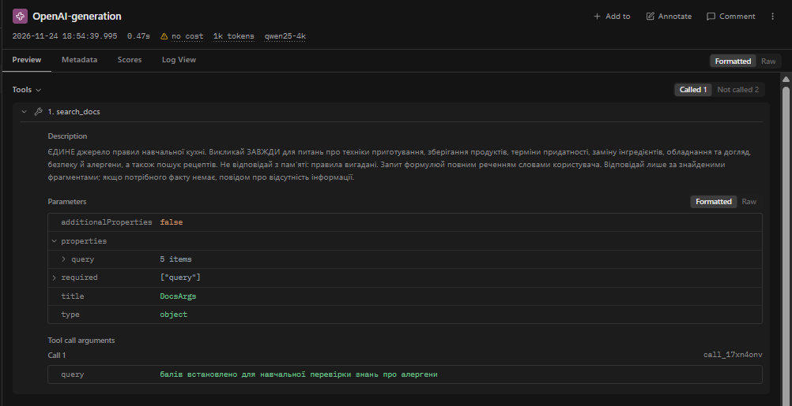
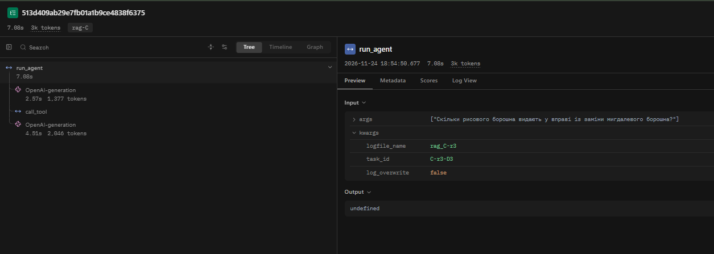

# Лабораторна робота № 5

**Тема:** RAG-агент: пошук по документах як інструмент  
**Варіант:** 2 — Кулінарія  
**Студент:** Швець Дмитро Ярославович  
**Група:** АІ-241

## Мета
Замінити пошук підрядком векторним, оцінити пошук окремо від агента та вплив нарізання, порога й опису інструмента. Модель qwen25-4k, вікно 4096, температура 0, ембединги bge-m3. SYSTEM збережено без змін; він містить інструкції довгої задачі та стару назву пошуку, що може впливати на результат.

## Дані
Вигадана навчальна кухня «Смакова майстерня». Умовні числа не є рекомендаціями з харчової безпеки.
| Документ | Символів |
|---|---:|
| Техніки приготування | 3358 |
| Зберігання продуктів і терміни придатності | 3237 |
| Заміна інгредієнтів | 3181 |
| Кухонне обладнання й догляд за ним | 3166 |
| Безпека на кухні й алергени | 3228 |

П’ять нових документів: 16170 символів, приблизно 6468 токенів. Усього 17 документів, 18497 символів, приблизно 7399 токенів. Перевірка check_cases.py: Усе гаразд.
| ID | Вид | Питання | must_contain | expected |
|---|---|---|---|---|
| D1 | direct | Яка контрольна тривалість навчального режиму томління? | контрольна тривалість становить 47 хвилин | 47 |
| D2 | direct | Який термін придатності сухої суміші в навчальних контейнерах? | термін придатності становить 53 години | 53 |
| D3 | direct | Скільки рисового борошна видають у вправі із заміни мигдалевого борошна? | видають 68 грамів рисового борошна | 68 |
| D4 | direct | Скільки балів встановлено для навчальної перевірки знань про алергени? | встановлено 64 бали | 64 |
| P1 | paraphrase | Як довго треба зачекати після того, як масу для десерту зробили пухкою? | передбачено паузу 13 секунд | 13 |
| P2 | paraphrase | Скільки часу не викидають старі позначення на тарі? | зберігають протягом 71 доби | 71 |
| P3 | paraphrase | Скільки змінних деталей є в запасному наборі приладу? | комплект містить 18 насадок | 18 |
| P4 | paraphrase | Скільки часу учасник може витратити на оформлення повідомлення про небезпечну подію? | відведено 12 хвилин | 12 |
| N1 | none | Яка вартість оренди фритюрниці?  | — | — |
| N2 | none | Яка місткість посудомийної машини в літрах? | — | — |

### Крок 2 — перевірка без RAG

Повторна перевірка виконана 27.11.2026 командою `ollama run qwen25-4k` без підключення корпусу та інструментів. Нижче наведено повні відповіді моделі зі збереженням її мовних помилок.

**D1. Яка контрольна тривалість навчального режиму томління?**

```text
Як особа, яка працює з доступом до широкого кола знань, я можу сказати, що помилка у запиті. Томління - це навчальний метод, а не предмет з викладанням. "Томління" - це польське слово, яке в Росії часто вживаниється у контексті помилок у українсько-русько перекладі. Ім'я відомого психолога и навчальних методів існує, назва "Эрл Гленн Клементс" (Erly Glenn Clements).

Важливо зазначити, що викладання навчального режиму томління знаходиться у дійсності на російській інформації, а точніші дані є на російській мові, тому я не можу надати конкретну контрольну тривалість навчального режиму томління. Для цієї інформації вище-навіть на російській, зазначується, що викладання томління може тривати від 1 до 3 годин. Ви можете знайти цікавіше визначення у відповідних російських матеріалах.
```

Очікується 47 хвилин. Модель назвала нерелевантний діапазон 1–3 години. Оцінка: 0.

**D2. Який термін придатності сухої суміші в навчальних контейнерах?**

```text
В контексті навчальних контейнерів і сухої суміші, придатність часто виражається через кількість учнів, які зроблять учасництво в контейнерах за період. Термін "працездатність сухої суміші" використовується для оцінки продуктивності учасників в контейнерах, а не для сферизованих металів або відсутності відходів.

Якщо ви говорите про "працездатність сухої суміші", часто це вказує на високий загальний рівень відповідності, дійсності і професійної готовності учнів до різних обладнань і занять в навчальному процесі.

Цей термін часто використовується у контексті підготовки вчителів і викладачів, щоб вони могли визнати, які контейнери перекладуть своїм учням найкраще і як вибрати потрібні схеми навчання.
```

Очікується 53 години. Модель не назвала терміну. Оцінка: 0.

**D4. Скільки балів встановлено для навчальної перевірки знань про алергени?**

```text
Варто подивитися в спеціальних стандартизаціях та програмах для оцінки знань про алергени. Наприамень, в США, програма Certified Clinical Laboratory Science (CCLS) визначає, що перевірка знань про алергени вважається ключевим компетентним вмінням для учасників лабораторної кінцевої перевірки (CLP).

Однак, вибачте, як особа, яка має доступ до широкого міцного знання, я не можу навіть вказати конкретні бали, які встановлені для цієї перевірки. Вона визначається конкретною програмою викладання та вимогами, які вимагаються для завершення курсу алергії.

Якщо ви шукаєте конкретні бали або методи перевірки, вам потрібно бути в контексті висновків для конкретних програм навчання про алергію. Вони зазвичай залежать від конкретних викладачів і програм.
```

Очікується 64 бали. Модель не назвала кількості балів. Оцінка: 0.

Результат: 0/3 (0%). Модель не відтворила жодного специфічного факту вигаданого корпусу. Наведені твердження моделі не є перевіреними фактами. Питання поставлено послідовно в одному сеансі Ollama.

## Перевірка ембедингів
Довжина 1024, норма 1,000; схожість 0,731 («Тариф на доставку») та 0,568 («Графік роботи кур’єрів»). Час 21,1 с.

## Таблиця 1 — Нарізання одного документа
| Спосіб | Чанків | Посеред речення | Максимум символів |
|---|---:|---:|---:|
| fixed, 200, 0 | 17 | 16 | 200 |
| fixed, 500, 100 | 9 | 8 | 500 |
| paragraphs, 800, 0 | 6 | 0 | 771 |

Межа чанків 1 і 2: `ольна тривалість становить 47 ` / `хвилин. Це внутрішній показник`. Фіксоване нарізання може розділити число та одиницю виміру.

## Таблиця 2 — Пошук при різному нарізанні
| Конфігурація | Чанків | Сер. довжина | hit@1 | hit@3 | hit@5 | hit@3 прямі | hit@3 перефр. | Токенів |
|---|---|---|---|---|---|---|---|---|
| fixed-200-0 | 99 | 187 | 0.75 | 0.75 | 0.75 | 0.75 | 0.75 | 224 |
| fixed-500-0 | 47 | 394 | 0.75 | 1.00 | 1.00 | 1.00 | 1.00 | 472 |
| fixed-500-100 | 55 | 403 | 0.75 | 1.00 | 1.00 | 1.00 | 1.00 | 484 |
| fixed-1500-0 | 27 | 685 | 0.75 | 0.88 | 1.00 | 1.00 | 0.75 | 822 |
| paragraphs-800-0 | 40 | 461 | 0.75 | 0.88 | 1.00 | 1.00 | 0.75 | 554 |
| paragraphs-800-0+title | 40 | 478 | 0.75 | 1.00 | 1.00 | 1.00 | 1.00 | 574 |

Конфігурація і поріг: fixed-500-0, TOP_K=3, без заголовків: hit@3=1,00 при 472 токенах, найменше серед конфігурацій із таким hit@3. Індекс: 47 чанків, середня довжина 394, мінімум 165, максимум 500.

## Таблиця 3 — Схожість
| ID | Вид | Схожість | Перший результат містить фразу |
|---|---|---|---|
| D1 | direct | 0.718 | так |
| D2 | direct | 0.773 | так |
| D3 | direct | 0.762 | так |
| D4 | direct | 0.744 | так |
| P1 | paraphrase | 0.545 | так |
| P2 | paraphrase | 0.520 | ні |
| P3 | paraphrase | 0.537 | так |
| P4 | paraphrase | 0.546 | ні |
| N1 | none | 0.398 | — |
| N2 | none | 0.451 | — |

## Перевірка інструмента
Поріг MIN_SCORE = 0,46 підтверджено у config.py. Межі за прямими запитами: 0,451 < MIN_SCORE ≤ 0,520. P2 і P4 потребують кількох чанків.

Нижче наведено фактичні повні консольні виводи повторної перевірки 27.11.2026. Обидва запуски також перевіряють відхилення аргументу `{"query": "а"}`.

**D1 — `python try_tool.py D1`**

```text
ПИТАННЯ: Яка контрольна тривалість навчального режиму томління? 

рівень: ok
[1] Джерело: d01.txt
Техніки приготування

Перед початком вправи наставник пояснює учасникам порядок спостереження за процесом і правила ведення журналу. Для навчального режиму томління контрольна тривалість становить 47 хвилин. Це внутрішній показник вигаданої навчальної кухні «Смакова майстерня», який застосовується лише під час відповідної вправи. Викладач пояснює призначення показника перед початком заняття, а учасники записують спостереження у власний робочий зошит. Результат обговорюють після завершення практи

[2] Джерело: d05.txt
ту відведено 12 хвилин. Відповідальний за заняття готує матеріали заздалегідь та перевіряє їх відповідність картці вправи. Учасники отримують однакові умови, щоб порівняння результатів було справедливим і не залежало від попереднього досвіду. Якщо виникає відхилення від сценарію, його фіксують у журналі та пояснюють під час спільного обговорення.

Комплект навчальних позначок містить 46 наліпок. Усі матеріали цієї вправи мають навчальне призначення і використовуються під наглядом викладача. Післ

[3] Джерело: d02.txt
Зберігання продуктів і терміни придатності

Для навчальних контейнерів із сухою сумішшю термін придатності становить 53 години. Це внутрішній показник вигаданої навчальної кухні «Смакова майстерня», який застосовується лише під час відповідної вправи. Викладач пояснює призначення показника перед початком заняття, а учасники записують спостереження у власний робочий зошит. Результат обговорюють після завершення практичної частини, не переносячи умовні правила на побутове приготування їжі.

Архів 

Занадто короткий запит -> рівень: schema
Помилка: аргументи не пройшли перевірку.
Поле query: String should have at least 3 characters
Виправ аргументи і виклич інструмент ще раз.
```

**N1 — `python try_tool.py N1`**

```text
ПИТАННЯ: Яка вартість оренди фритюрниці?  

рівень: ok
У документах нічого схожого не знайдено.

Занадто короткий запит -> рівень: schema
Помилка: аргументи не пройшли перевірку.
Поле query: String should have at least 3 characters
Виправ аргументи і виклич інструмент ще раз.
```

D1 повернув три чанки, перший містить 47 хвилин. N1 повернув повідомлення про відсутність схожих документів із рівнем ok. В обох запусках короткий запит відхилено на рівні schema: мінімальна довжина query — 3 символи.

## Таблиця 4 — Конфігурації
| Опис | Зміст |
|---|---|
| A | Старий опис search_recipes |
| B | Докладний опис |
| C | Шукає інформацію. |

## Таблиця 5 — Агент
| Опис | Правильно з 24 | Шукав з 24 | Кроки | Токени | Час |
|---|---|---|---|---|---|
| A | 1/24 | 1/24 | 1,0 | 1195 | 1,4 |
| B | 15/24 | 15/24 | 2,0 | 3028 | 1,5 |
| C | 0/24 | 3/24 | 1,0 | 1111 | 1,2 |

## Таблиця 6 — Поламки
| Категорія | A | B | C |
|---|---|---|---|
| ok | 1 | 15 | 0 |
| no_search | 23 | 9 | 21 |
| miss | 0 | 0 | 0 |
| ignored | 0 | 0 | 3 |
| refused | 3 | 3 | 3 |
| invented | 3 | 3 | 3 |

## Ручна перевірка (крок 7)

Переглянуто 56 неправильних відповідей на питання з відповіддю та всі 18 none (74 прогони). Повні відповіді й рішення для кожного наведено у [manual_review.md](results/manual_review.md). Дев’ять N1 перекласифіковано в refused (correct=1): ціни не вигадано, повідомлено про відсутність у довіднику, хоча викликано product_info замість search_docs. N2 в A/C — уточнення без явної відмови, залишено correct=0; назва invented у таблиці є залишковою категорією, а не доказом вигаданого числа. N2 в B — справжнє хибне приписування 86 грамів. Таблиця 5 не змінюється, бо охоплює лише питання з відповіддю.

## Аналіз логів і Langfuse (крок 8)

### 1. Не шукав
C-r3-D1: один крок, жодного виклику, модель просить кулінарний контекст, числа не вигадує.

```text
2026-11-24 18:54:48,313 - INFO - 
============================================================
2026-11-24 18:54:48,313 - INFO - ЗАДАЧА: Яка контрольна тривалість навчального режиму томління?
2026-11-24 18:54:48,313 - INFO - РЕЖИМ: none | USE_STATE=False | COMPRESS_AT=2800
2026-11-24 18:54:49,800 - INFO - 
--- крок 1 | помилок поспіль=0 | prompt_tokens=1102 | completion_tokens=148
2026-11-24 18:54:49,800 - INFO - ВІДПОВІДЬ: Ваш запит повинен бути заспоживаним рецептами або інформацією для кулінарного проекту. Замість цього, ви поставили запит про контрольну тривалість навчального режиму томління. Це не відповідає правилам, які ви вказали. Будь ласка, надайте детальніше інформацію про кулінарний проект або рецепт, на який потрібно отримати допомогу.
2026-11-24 18:54:49,802 - INFO -
```

### 2. Переформулювання запитів
Порівняння останнього повтору (прямі оцінки з табл. 3, оцінки агента з CSV).

| Прогін | Питання користувача | query | Пряма схожість | top_score |
|---|---|---|---:|---:|
| B-r3-D1 | Яка контрольна тривалість навчального режиму томління? | контрольна тривалість навчального режиму томління | 0.718 | 0.729 |
| B-r3-D2 | Який термін придатності сухої суміші в навчальних контейнерах? | термін придатності сухої суміші в навчальних контейнерах | 0.773 | 0.771 |
| B-r3-D4 | Скільки балів встановлено для навчальної перевірки знань про алергени? | балів встановлено для навчальної перевірки знань про алергени | 0.744 | 0.732 |
| B-r3-P2 | Скільки часу не викидають старі позначення на тарі? | скільки часу не викидають старі позначення на тарі | 0.520 | 0.51 |
| B-r3-P4 | Скільки часу учасник може витратити на оформлення повідомлення про небезпечну подію? | час учасника на оформлення повідомлення про небезпечну подію | 0.546 | 0.576 |
| C-r3-D3 | Скільки рисового борошна видають у вправі із заміни мигдалевого борошна? | мигдалеве борошно замість рисового борошна | 0.762 | 0.644 |
| B-r3-N2 | Яка місткість посудомийної машини в літрах? | місткість посудомійної машини літра | 0.451 | 0.462 |

B переважно скорочує питання; D1 і P4 отримали вищу схожість, D2/D4/P2 — нижчу. C змінив напрям заміни борошна, схожість впала до 0,644. N2 після переформулювання перевищив поріг 0,46, хоча початковий запит був нижче нього.

### 3. Шукав, але не знайшов
Категорії miss серед питань з відповіддю немає (0 у кожному описі). Не вигадуємо приклад. P4 демонструє ризик нарізання: потрібна фраза у третьому чанку, перший результат не містить її.

### 4. Знайшов, але не використав
C-r3-D3: знайдено 68 грамів, але фінальна відповідь порожня; альтернативного числа модель не надала.

```text
2026-11-24 18:54:50,678 - INFO - 
============================================================
2026-11-24 18:54:50,678 - INFO - ЗАДАЧА: Скільки рисового борошна видають у вправі із заміни мигдалевого борошна?
2026-11-24 18:54:50,678 - INFO - РЕЖИМ: none | USE_STATE=False | COMPRESS_AT=2800
2026-11-24 18:54:53,250 - INFO - 
--- крок 1 | помилок поспіль=0 | prompt_tokens=1116 | completion_tokens=261
2026-11-24 18:54:53,250 - INFO -   виклик   : search_docs({"query":"мигдалеве борошно замість рисового борошна"})
2026-11-24 18:54:53,250 - INFO -   рівень   : ok
2026-11-24 18:54:53,250 - INFO -   результат: [1] Джерело: d03.txt
Заміна інгредієнтів

У вправі із заміни мигдалевого борошна видають 68 грамів рисового борошна. Це внутрішній показник вигаданої навчальної кухні «Смакова майстерня», який застосовується лише під час відповідної вправи. Викладач пояснює призначення показника перед початком заняття, а учасники записують спостереження у власний робочий зошит. Результат обговорюють після завершення практичної частини, не переносячи умовні правила на побутове приготування їжі.

Для демонстрації альтернативного загус
2026-11-24 18:54:57,761 - INFO - 
--- крок 2 | помилок поспіль=0 | prompt_tokens=1595 | completion_tokens=451
2026-11-24 18:54:57,761 - INFO - ВІДПОВІДЬ: 
2026-11-24 18:54:57,761 - INFO -
```

### 5. Питання без відповіді
N1 в усіх описах викликає product_info і повертає помилку довідника, а не ціну. N2 в A/C не викликає search_docs і просить уточнення; B викликає пошук, отримує нерелевантний фрагмент. Поріг не допоміг B, оскільки top_score=0,462.

```text
2026-11-24 18:54:46,427 - INFO - 
============================================================
2026-11-24 18:54:46,427 - INFO - ЗАДАЧА: Яка місткість посудомийної машини в літрах?
2026-11-24 18:54:46,427 - INFO - РЕЖИМ: none | USE_STATE=False | COMPRESS_AT=2800
2026-11-24 18:54:46,824 - INFO - 
--- крок 1 | помилок поспіль=0 | prompt_tokens=1297 | completion_tokens=37
2026-11-24 18:54:46,824 - INFO -   виклик   : search_docs({"query":"місткість посудомійної машини літра"})
2026-11-24 18:54:46,824 - INFO -   рівень   : ok
2026-11-24 18:54:46,824 - INFO -   результат: [1] Джерело: d01.txt
ліміт 86 грамів овочів. Усі матеріали цієї вправи мають навчальне призначення і використовуються під наглядом викладача. Після завершення учасник описує послідовність виконаних дій, пояснює власні спостереження та повертає видані матеріали на відповідну станцію. Відповідальний працівник перевіряє записи й готує робоче місце до наступної групи.

Під час показу глазурування викладач видає 19 мілілітрів сиропу. Правило внесено до внутрішнього регламенту для забезпечення однакових умов практичного з
2026-11-24 18:54:48,312 - INFO - 
--- крок 2 | помилок поспіль=0 | prompt_tokens=1609 | completion_tokens=143
2026-11-24 18:54:48,312 - INFO - ВІДПОВІДЬ: На основі отриманого відповіді з джерела, місткість посудомійної машини становить 86 грамів. Це значення вказується для опису матеріалів, але не місткість машини в літрах. Для отримання правильного відповіді потрібно було б знайти інший джерело чи джерело, яке містить цю інформацію.
```

### 6. Langfuse
B-r3-D4: дерево run_agent → генерація → call_tool → генерація; 1,06 с, 3422 вхідних токени, 86 вихідних, 2596 кешованих (75,9%). Вхід call_tool — query про бали; вихід — три чанки d05, d03, d01. Перший містить 64 бали, фінальна відповідь правильна.

```text
2026-11-24 18:54:39,995 - INFO - 
============================================================
2026-11-24 18:54:39,995 - INFO - ЗАДАЧА: Скільки балів встановлено для навчальної перевірки знань про алергени?
2026-11-24 18:54:39,995 - INFO - РЕЖИМ: none | USE_STATE=False | COMPRESS_AT=2800
2026-11-24 18:54:40,462 - INFO - 
--- крок 1 | помилок поспіль=0 | prompt_tokens=1307 | completion_tokens=44
2026-11-24 18:54:40,462 - INFO -   виклик   : search_docs({"query":"балів встановлено для навчальної перевірки знань про алергени"})
2026-11-24 18:54:40,463 - INFO -   рівень   : ok
2026-11-24 18:54:40,463 - INFO -   результат: [1] Джерело: d05.txt
Безпека на кухні й алергени

Для навчальної перевірки знань про алергени встановлено 64 бали. Це внутрішній показник вигаданої навчальної кухні «Смакова майстерня», який застосовується лише під час відповідної вправи. Викладач пояснює призначення показника перед початком заняття, а учасники записують спостереження у власний робочий зошит. Результат обговорюють після завершення практичної частини, не переносячи умовні правила на побутове приготування їжі.

На тренувальне заповнення картки інциден

[2] Джерело: d03.txt
а побутове приготування їжі.

Для оцінювання текстури встановлено максимум 43 бали. Відповідальний за заняття готує матеріали заздалегідь та перевіряє їх відповідність картці вправи. Учасники отримують однакові умови, щоб порівняння результатів було справедливим і не залежало від попереднього досвіду. Якщо виникає відхилення від сценарію, його фіксують у журналі та пояснюють під час спільного обговорення.

На обговорення альтернатив відведено 32 хвилини. Усі матеріали цієї вправи мають навчальне

[3] Джерело: d01.txt
енарію, його фіксують у журналі та пояснюють під час спільного обговорення.

Для оцінювання подачі відведено 39 балів. Усі матеріали цієї вправи мають навчальне призначення і використовуються під наглядом викладача. Після завершення учасник описує послідовність виконаних дій, пояснює власні спостереження та повертає видані матеріали на відповідну станцію. Відповідальний працівник перевіряє записи й готує робоче місце до наступної групи.

Повторну демонстрацію проводять після запису спостережень 
2026-11-24 18:54:41,052 - INFO - 
--- крок 2 | помилок поспіль=0 | prompt_tokens=2115 | completion_tokens=42
2026-11-24 18:54:41,052 - INFO - ВІДПОВІДЬ: На основі отриманих даних для навчальної перевірки знань про алергени встановлено 64 балів.
2026-11-24 18:54:41,052 - INFO -
```

C-r3-D3: 7,08 с, дві генерації та один call_tool. Вхід — «мигдалеве борошно замість рисового борошна», вихід — один чанк d03 з 68 грамами рисового борошна (повний фрагмент вище). Output run_agent undefined. Причину порожнього фіналу траса не доводить.

Опис B у першій генерації вимагає завжди шукати правила навчальної кухні, не відповідати з пам’яті та визнавати відсутність факту. C містить лише «Шукає інформацію.». SYSTEM в обох містить стару назву search_recipes. У Langfuse видно ієрархію, тривалість, токени, аргументи, результати й опис інструмента в одному інтерфейсі; у логах потрібно вручну знайти ідентифікатор прогону та зіставити кроки. Траси стосуються різних питань, тому різницю часу не можна приписати лише опису.







## Таблиця 7 — Звичайні задачі
| ID | Лабораторна 4 | Лабораторна 5 | Виклик пошуку | Зміни |
|---|---|---|---|---|
| Z1 | Плов з куркою | Порожня відповідь | Ні | Регресія |
| Z2 | Плов з куркою або рисовий пудинг; 344 ккал/100 г | Порожня відповідь | Ні | Регресія |
| Z3 | 750 г рису | 750 г рису | Ні | Без змін |
| P1 | 6 невдалих пошуків, ліміт кроків | Англомовний намір шукати без виклику | Ні | Обидва не виконали очікувану відмову |
| P2 | Запропоновано допомогу зі списком продуктів | Запитано продукт і калорійність | Ні | Список не змінено в обох випадках |

Порівняно останній повний прогін lab4 (19:44:56–19:45:07) із run_rag.log (19:40:30–19:40:39). Успішність за останнім повним прогоном: ЛР4 — 3/5 (60%), ЛР5 — 1/5 (20%). Жодна нова задача не викликала search_docs. Старий SYSTEM вимагає search_recipes, якого немає серед дозволених інструментів; це ймовірна, але не доведена окремим тестом причина регресії.

## Відповіді на питання

1. Fixed-200 дає 17 чанків, абзацне — 6, на 11 менше. Розрив між 47 та хвилинами може втратити одиницю виміру.
2. Fixed-500-0 має hit@3=1,00 при 472 токенах. Збільшення 200 до 1500 підняло hit@3 з 0,75 до 0,88, витрати з 224 до 822; перекриття не покращило hit@3, заголовок для абзаців підняв його з 0,88 до 1,00.
3. Для fixed-500-0 обидва види питань мають hit@3=1,00. Векторний пошук знаходить змістовно близькі фрагменти без точного збігу слів.
4. Межі 0,451 та 0,520 не перекриваються. Високий поріг відкидає корисні чанки, низький пропускає зайві.
5. B дав 15/24 правильних (62,5%), A — 1/24, C — 0/24. Не шукали відповідно 9, 23 і 21 раз; B наказує завжди шукати правила.
6. У B найчастіша помилка no_search (9). Зміна опису може допомогти; miss потребує зміни пошуку, ignored — поліпшення використання контексту.
7. Після ручної перевірки 9 відповідей N1 зараховано як refused, 9 відповідей N2 залишено неправильними: 3 у B містять хибне число 86 грамів, 6 у A/C є уточненнями без явної відмови. Поріг спрацював для прямих запитів N1/N2, але переформулювання N2 у B підняло top_score до 0,462, вище порога 0,46.
8. Приріст 1836 − 1297 = 539 токенів, на 67 більше оцінки 472. 1 + floor((4096 − 1297)/539) = 6 викликів, приблизна межа без резерву генерації.
9. Z1 і Z2 погіршилися, Z3 правильна; P1 та P2 не виконали очікувань і раніше. У новому лозі немає викликів search_docs.
10. Опис не відновить факт, розрізаний або відкинутий пошуком. Потрібно змінити нарізання, перекриття, TOP_K чи поріг.

## Додаткове завдання — ChromaDB

| Індекс | Метрика | Значення | Джерело | Чанк |
|---|---|---:|---|---:|
| FAISS | Косинусна подібність | 0,718167 | d01.txt | 0 |
| Chroma cosine | Косинусна відстань | 0,281833 | d01.txt | 0 |
| Chroma default | Квадрат евклідової відстані | 0,563666 | d01.txt | 0 |

Для нормалізованих векторів d_cos = 1 − s = 0,281833; d_L2² = 2 − 2s = 0,563666. Усі три індекси повернули однаковий чанк. Поріг s ≥ t для стандартної Chroma треба перетворити на d ≤ 2 − 2t; пряме перенесення порога та нерівності дасть неправильну фільтрацію.


## Висновок

Реалізовано RAG-агента з FAISS та bge-m3. Fixed-500-0 забезпечив hit@3=1,00 до фільтрації. Найбільший вплив на правильність мав опис B: 15 правильних із 24 проти 1 та 0. Серед 56 неправильних прогонів із питаннями з відповіддю 53 не зверталися до пошуку, 3 не використали знайдений факт, miss не спостерігалася. Потрібно узгодити SYSTEM із новим інструментом, поліпшити відмову за відсутності даних та повторити регресійні тести. Підтверджено зв’язок метрик FAISS і ChromaDB.
