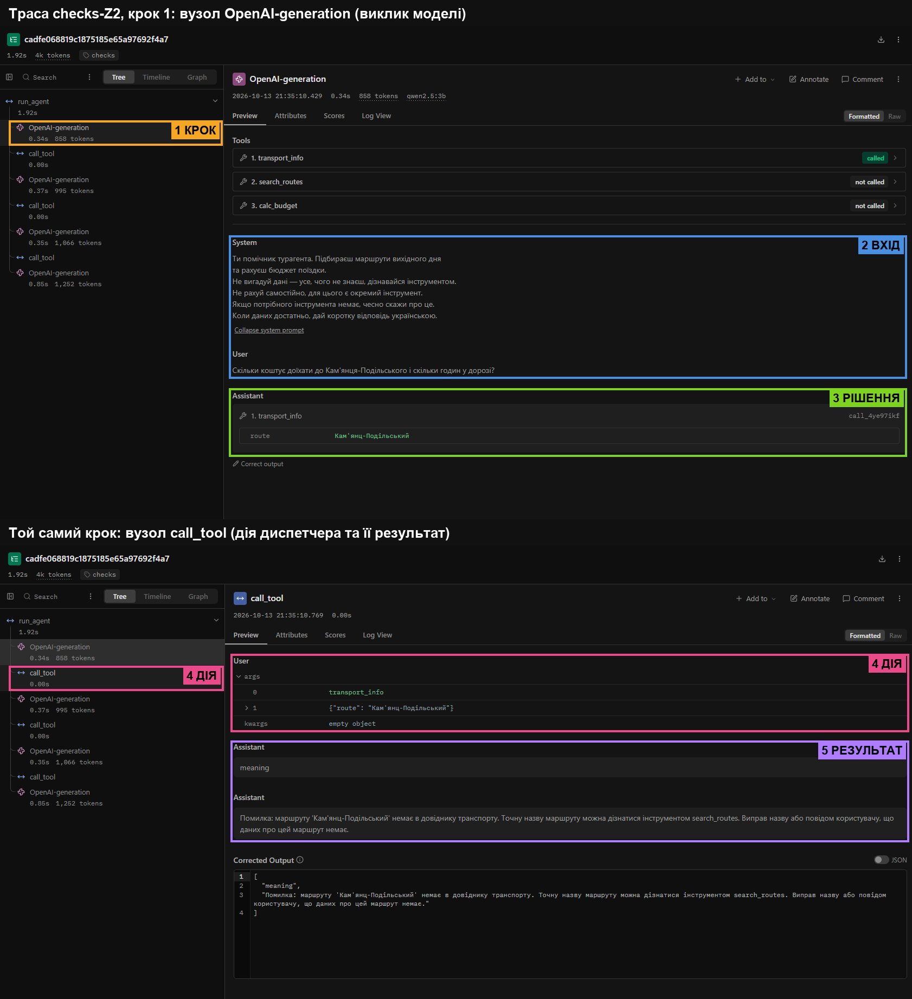
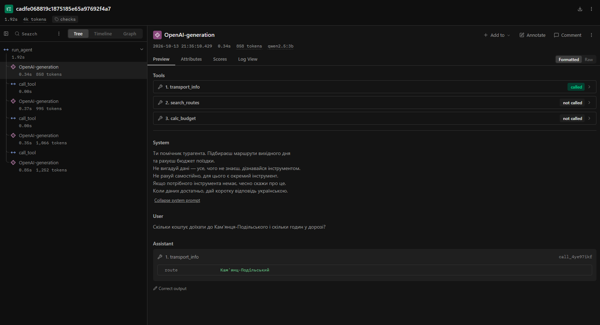
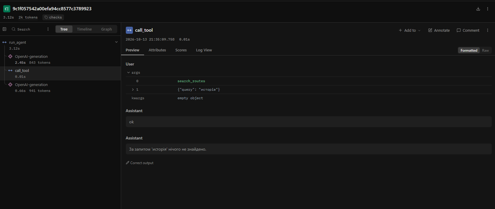

# Звіт з лабораторної роботи № 3. Надійність виклику інструментів і трасування агента

**Національний університет «Одеська політехніка»**
Інститут комп'ютерних систем, кафедра інформаційних систем
Дисципліна: «Обчислювальні методи»

| | |
|---|---|
| Виконав | студент групи АІ-241 Сівак Вадим Олександрович |
| Перевірив | ас. Баранов О.М. |
| Варіант | 7 (номер у журналі 17, 17 mod 10 = 7) |

Одеса – 2026

---

## 1. Мета, варіант, предметна область

**Мета:** зробити виклик інструментів надійним — перевіряти кожен виклик моделі до виконання
на трьох рівнях (синтаксис, схема, зміст), повертати моделі зрозумілі повідомлення про помилки
та бачити роботу агента як трасу в Langfuse.

**Варіант 7 — «Подорожі».** Агент підбирає маршрут вихідного дня, повідомляє вартість і
тривалість дороги та рахує бюджет поїздки на групу. Дані, задачі й параметри виклику —
ті самі, що в лабораторній № 2: модель `qwen2.5:3b` (Ollama 0.40.3), `MAX_STEPS = 6`,
`TEMPERATURE = 0.2`, нове — `MAX_RETRIES = 2`. Заборонена дія (табл. 7) — `buy_ticket`
(купити квиток), звіряється з довідником — маршрут.

## 2. Класи аргументів (`arguments.py`)

```python
class SearchRoutesArgs(BaseModel):
    model_config = ConfigDict(extra="forbid")
    query: str = Field(min_length=2, max_length=30,
                       description="Тип відпочинку (природа, історія, гори, море, гастрономія) "
                                   "або назва місця: одне-два слова українською, "
                                   "не все питання користувача.")


class TransportInfoArgs(BaseModel):
    model_config = ConfigDict(extra="forbid")
    route: str = Field(min_length=2, max_length=50,
                       description="Точна назва маршруту, як вона записана в довіднику, "
                                   "у називному відмінку (наприклад, «Львів», а не «Львова»).")


class CalcBudgetArgs(BaseModel):
    model_config = ConfigDict(extra="forbid")
    price_per_person: float = Field(gt=0, le=1200,
                                    description="Вартість проїзду на одну особу, грн.")
    people: int = Field(ge=1, le=50,
                        description="Кількість людей у групі.")
    extra: float = Field(ge=0, le=100000,
                         description="Додаткові витрати на всю групу, грн; якщо їх немає, передавай 0.")


class BuyTicketArgs(BaseModel):
    model_config = ConfigDict(extra="forbid")
    route: str = Field(description="Назва маршруту.")
```

Описи для моделі тепер генеруються з цих класів (`schemas.py`, `model_json_schema()`):
у кожному з'явилися `"additionalProperties": false`, `required`, а межі стали
`minLength/maxLength`, `exclusiveMinimum/maximum`, `minimum/maximum`.

## 3. Правила змісту

| Аргумент | Правило | Де записано | Звідки взято межу |
|---|---|---|---|
| усі аргументи | заборона вигаданих полів | клас (`extra="forbid"`) | вимога методички |
| `search_routes.query` | рядок 2–30 символів | клас (`min_length`, `max_length`) | опис варіанта: «одне-два слова, не все питання»; найдовша назва в корпусі — 21 символ |
| `transport_info.route` | рядок 2–50 символів | клас | найдовша назва в довіднику — 21 символ, з запасом |
| `transport_info.route` | маршрут є в `transport.csv` (без урахування регістру); інакше — підказка «точну назву можна дізнатися `search_routes`» | `check_meaning` | ключ довідника (табл. 7: «маршрут або рейс»); маршрутів 11 > 10, тому не перелічуються |
| `calc_budget.price_per_person` | 0 < ціна ≤ 1200 | клас (`gt`, `le`) | у довіднику ціни 200–1200 грн (промпт генерації довідника) |
| `calc_budget.price_per_person` | збігається з однією з цін у довіднику | `check_meaning` | правило між інструментами: ціну дає `transport_info`, модель не має її вигадувати (поламка «вигадав результат» з лаб. № 2) |
| `calc_budget.people` | ціле, 1–50 | клас (`int`, `ge`, `le`) | у групі хоча б одна людина; 50 — місткість туристичного автобуса |
| `calc_budget.extra` | 0 ≤ сума ≤ 100 000 | клас | витрати не від'ємні; верхня межа — запобіжник від абсурдних сум |
| `buy_ticket` | виклик заборонено | `config.ALLOWED` + диспетчер (рівень `permission`) | табл. 7, варіант 7 |

## 4. Табл. 2 — Перевірка ланцюжка перевірок (`test_checks.py`)

| Що перевіряємо | Виклик | Рівень | Повідомлення для моделі |
|---|---|---|---|
| Коректний виклик (контроль) | `transport_info({"route": "Кам'янець-Подільський"})` | `ok` | Вартість проїзду: 420 грн, у дорозі: 6 год, рейсів на день: 3 |
| Зламаний JSON | `transport_info({"route": "Львів")` | `syntax` | Помилка: аргументи не пройшли перевірку. Поле JSON: Invalid JSON: EOF while parsing an object at line 1 column 22. Виправ аргументи і виклич інструмент ще раз. |
| Неправильний тип | `calc_budget({"price_per_person": "чотириста", "people": 3, "extra": 500})` | `schema` | … Поле price_per_person: Input should be a valid number, unable to parse string as a number … |
| Відсутнє обов'язкове поле | `calc_budget({"price_per_person": 420, "people": 3})` | `schema` | … Поле extra: Field required … |
| Вигадане поле | `transport_info({"route": "Львів", "date": "субота"})` | `schema` | … Поле date: Extra inputs are not permitted … |
| Неіснуючий інструмент | `delete_all({})` | `name` | Помилка: інструмента 'delete_all' не існує. Доступні: search_routes, transport_info, calc_budget. Виклич один з доступних або повідом користувачу, що такої дії немає. |
| Заборонена дія | `buy_ticket({"route": "Львів"})` | `permission` | Помилка: інструмент 'buy_ticket' недоступний. Не повторюй виклик, повідом користувачу, що ця дія недоступна. |
| Значення немає в довіднику | `transport_info({"route": "Париж"})` | `meaning` | Помилка: маршруту 'Париж' немає в довіднику транспорту. Точну назву маршруту можна дізнатися інструментом search_routes. Виправ назву або повідом користувачу, що даних про цей маршрут немає. |
| Значення поза межами (клас) | `calc_budget({"price_per_person": 420, "people": 0, "extra": 500})` | `schema` | … Поле people: Input should be greater than or equal to 1 … |
| Значення поза межами (код): ціни немає в довіднику | `calc_budget({"price_per_person": 450, "people": 3, "extra": 500})` | `meaning` | Помилка: вартості проїзду 450 грн немає в довіднику. Спершу дізнайся вартість інструментом transport_info і передай її в price_per_person без змін. |

Останні два рядки ілюструють примітку методички: межа, записана в класі, спрацьовує на рівні
`schema`, а правило, записане в `check_meaning`, — на рівні `meaning`.

Кожне повідомлення має три частини: що не так → що допустимо → що робити далі
(«виправ і виклич ще раз» для помилок моделі, «не повторюй, повідом користувачу» для
забороненої дії).

## 5. Результати прогону та порівняння з базовим

**Як отримано логи.** Базовий прогін (кроки 1–2 методички: код лабораторної № 2 + трасування
Langfuse, `RUN_TAG = "baseline"`) записано в `lab3_baseline.log`, прогін із перевірками
(`RUN_TAG = "checks"`) — у `lab3_checks.log`. Щоб не перейменовувати файли вручну, ім'я логу
задано в `config.py` як `LAB_LOGFILE_NAME = f"lab3_{RUN_TAG}"`. Обидва прогони — на тих самих
п'яти задачах, моделі `qwen2.5:3b` і параметрах. Кожен прогін виконано один раз.

### Табл. 3 — Результати по задачах

| Задача | До: правильно (1/0) | Після: правильно (1/0) | До: кроків | Після: кроків | Що змінилося |
|---|---|---|---|---|---|
| Z1 | 0 | 0 | 2 | 2 | Нічого: обидва рази `search_routes("исторія")` → «нічого не знайдено». Рядок валідний, тож жодна перевірка не спрацювала (рівень `ok`). |
| Z2 | 0 | 0 | 2 | 4 | До: `transport_info("Кам'янць-Подільський")` → «немає в довіднику» → відповідь «маршруту немає». Після: рівень `meaning` з підказкою «точну назву можна дізнатися `search_routes`» → модель послухалась і викликала пошук, але з тією самою спотвореною назвою; після другої помилки чесно відповіла, що даних немає (почавши відповідь російським «К сожалению»). |
| Z3 | 0 | 0 | 2 | 6 | До: `calc_budget(price_per_person=250, …)` без жодного звернення до довідника → **«1250 гривень»** — вигадана ціна й упевнена хибна відповідь. Після: вигадану ціну (100 грн) двічі заблокував `meaning`; агент не зміг отримати правильну ціну через спотворену назву, зациклився й зупинився за лімітом кроків — **хибної відповіді немає, але немає й правильної**. |
| P1 | 1 | 1 | 2 | 2 | Без змін: «довідник не містить маршрути до Парижу». |
| P2 | 0 | 0 | 1 | 1 | Без змін: агент не викликав жодного інструмента (і не пробував `buy_ticket`, тож рівень `permission` не знадобився), але й не сказав, що купівля недоступна — попросив уточнити, куди їхати. |
| **Разом** | **1/5** | **1/5** | **9** | **15** | |

### Табл. 4 — Поламки до та після впровадження перевірок

| Поламка | До | Після |
|---|---|---|
| Не викликав інструмент | 0* | 0* |
| Викликав не той інструмент | 1 (Z3: `calc_budget` без `transport_info`) | 0 |
| Неправильні аргументи | 2 (Z1, Z2) | 3 (Z1, Z2, Z3) |
| Зациклився | 0 | 2 (Z2: `transport_info` двічі з тими самими аргументами; Z3: трійка `search_routes` → `transport_info` → `calc_budget(100)` повторюється) |
| Не використав результат | 0 | 0 |
| Вигадав результат | 1 (Z3: ціна 250 грн → «1250 грн») | 0 (2 спроби з ціною 100 грн заблоковано на рівні `meaning`) |
| Вичерпав ліміт кроків | 0 | 1 (Z3) |
| Відмова після ліміту помилок (нове) | — | 0 |
| Інше: не повідомив, що дія недоступна | 1 (P2) | 1 (P2) |

\* Формально в P2 немає рядка «виклик», але інструмента купівлі немає, тож правильна поведінка
теж без виклику; поламка P2 — відсутність чесної відмови (рядок «Інше»).

### Табл. 5 — Спрацювання перевірок у прогоні (`lab3_checks.log`)

| Рівень | Скільки разів | Модель виправилася на наступному кроці |
|---|---|---|
| `name` | 0 | — |
| `permission` | 0 | — |
| `syntax` | 0 | — |
| `schema` | 0 | — |
| `meaning` | 6 | 1 з 6 — так (Z2, крок 3 → чесне «даних немає»); 1 — частково (Z2, крок 1 → перейшла до `search_routes` за підказкою, але з тією ж назвою); 4 — ні (Z3: після помилки маршруту — знову вигадана ціна, після помилки ціни — пошук замість довідника) |
| `tool` | 0 | — |
| `length` | 0 | — |
| `ok` | 6 | — |

`qwen2.5:3b` жодного разу не зламала форму виклику: JSON аргументів завжди коректний, поля
відповідають схемі. Усі помилки моделі — **змістові**: спотворена назва маршруту й вигадана
ціна. Випадків «не викликав інструмент», за якими ховався б зламаний виклик у тексті
(`check_response`), у базовому прогоні не було.

## 6. Аналіз трас у Langfuse

Проєкт `agents-lab3` у хмарному Langfuse: 5 трас із міткою `baseline`, 5 — `checks`, 2 — `demo`
(назви трас `baseline-Z1 … checks-P2`, `demo-D1`, `demo-D2`).

### Структура події



На скріншоті траса `checks-Z2`, перший крок агента (вгорі вибрано вузол `OpenAI-generation`,
внизу — вузол `call_tool` того самого кроку):

1. **крок** — вузол `OpenAI-generation` у дереві `run_agent` (0,34 с, 858 токенів);
2. **вхід** — історія повідомлень, яку отримала модель: System (системне повідомлення) і User (питання);
   над ними — список із трьох інструментів, переданих у `tools`;
3. **рішення** — відповідь моделі (Assistant): виклик `transport_info` з аргументом
   `route = "Кам'янц-Подільський"` (вже спотвореним);
4. **дія** — вузол `call_tool`: на вході `args[0] = transport_info`, `args[1] = {"route": "Кам'янц-Подільський"}`;
5. **результат** — вихід `call_tool`: рівень `meaning` і текст «Помилка: маршруту 'Кам'янц-Подільський' немає
   в довіднику транспорту. Точну назву маршруту можна дізнатися інструментом search_routes. …»,
   який повернувся моделі з роллю `tool`.

### Табл. 6 — Порівняння прогонів у Langfuse

Дані отримано з API Langfuse (`/api/public/v2/observations`): кількість вузлів `GENERATION`
у трасі, сума `totalUsage` по них і `latency` кореневого вузла `run_agent`.

| Задача | Викликів моделі: до | Викликів моделі: після | Токенів: до | Токенів: після | Час, с: до | Час, с: після |
|---|---|---|---|---|---|---|
| Z1 | 2 | 2 | 1795 | 1784 | 5,59* | 3,12* |
| Z2 | 2 | 4 | 1822 | 4171 | 1,04 | 1,92 |
| Z3 | 2 | 6 | 1819 | 7319 | 0,87 | 2,64 |
| P1 | 2 | 2 | 1742 | 1738 | 0,79 | 0,81 |
| P2 | 1 | 1 | 882 | 929 | 0,80 | 1,35 |
| **Разом** | **9** | **15** | **8060** | **15 941** | **9,09** | **9,85** |

\* Перша задача кожного прогону включає «розігрів» (завантаження моделі в пам'ять після інших моделей).

Додаткові виклики після впровадження перевірок (+6) пішли на повторні спроби після помилок
рівня `meaning`: у Z2 — повторний пошук і повторний запит до довідника (+2), у Z3 — три
повтори циклу «пошук → довідник → бюджет» (+4). Токени зросли вдвічі, бо кожен крок передає
всю історію заново (prompt_tokens у Z3: 841 → 1042 → 1154 → 1226 → 1363 → 1475).

### Траса 1: помилка → повідомлення → зміна поведінки (`checks-Z2`)



- **Помилка:** модель передала в `transport_info` спотворену назву `Кам'янц-Подільський`
  (загублено «е»; у питанні назва в родовому відмінку).
- **Рівень:** `meaning` — значення пройшло схему (рядок 2–50 символів), але його немає серед ключів довідника.
- **Повідомлення:** «Помилка: маршруту 'Кам'янц-Подільський' немає в довіднику транспорту. Точну назву
  маршруту можна дізнатися інструментом search_routes. Виправ назву або повідом користувачу, що даних
  про цей маршрут немає.»
- **Що змінила модель:** на кроці 2 виконала підказку — викликала `search_routes`, але з тим самим
  спотвореним рядком, тож пошук нічого не дав; після другої помилки `meaning` (крок 3) обрала другу
  гілку повідомлення — чесно повідомила, що даних немає, замість вигадувати. Тобто модель
  виправила **дію**, але не змогла виправити **аргумент**: правильне написання назви вона не
  відтворює (у lab2 і в обох прогонах lab3 — `Кам'янць`/`Кам'янц`).

### Траса 2: задача розв'язана неправильно, і жодна перевірка цього не зловила (`checks-Z1`)



Модель викликала `search_routes({"query": "исторія"})` — суміш російського «история» й
українського «історія». Рядок має 7 символів, тож проходить `SearchRoutesArgs` (2–30 символів);
для `search_routes` немає правила змісту (вільний пошук), тому рівень — `ok`. Інструмент чесно
повернув «нічого не знайдено», і агент відповів, що історичних маршрутів немає, хоча в корпусі їх
чотири. Перевірки валідують **форму й допустимість** значення, але не те, чи правильно модель
зрозуміла намір користувача.

Ще два приклади тієї ж природи дав прогін `demo` (`demo_trace.py`, `lab3_demo.log`):
- **D1:** «Скільки вийде поїздка вдвох до Яремче, плюс 400 грн на їжу?» — модель знайшла маршрут, але,
  не запитавши довідник, викликала `calc_budget(price_per_person=300, people=2, extra=400)` →
  «1000 грн». Ціна 300 грн є в довіднику (це Затока), тож `check_meaning` її пропустив; правильно —
  580 × 2 + 400 = **1560 грн**.
- **D2:** «…втрьох до Коблева, якщо ще 900 грн на житло» — знову ціна 300 замість 320 (Коблево) →
  «1800 грн» замість **1860 грн**, а назву в `transport_info` модель записала як `Коблєва`.

Посилання на траси (проєкт `cmv70a3ff01fpad0k8147ej0n`): `checks-Z2` — trace `cadfe068819c1875185e65a97692f4a7`,
`checks-Z1` — `9c1f057542a00efa94cc8577c3789923`, `checks-Z3` — `066ea1c168ff9cc24302c94c33141475`.

## 7. Відповіді на питання

1. **Які поламки зникли або зменшилися? Які лишилися?** Зникла найнебезпечніша — «вигадав результат»:
   у базовому прогоні Z3 агент підставив ціну 250 грн і впевнено відповів «1250 гривень», після
   перевірок обидві спроби з вигаданою ціною 100 грн зупинив рівень `meaning` (табл. 4). Зник і
   «не той інструмент». Лишилися неправильні аргументи (спотворені назви), Z1 і P2, а натомість
   з'явилися зациклення та вичерпання ліміту кроків у Z3 — ціна того, що хибну дію заблоковано,
   а правильної модель не знайшла.
2. **На якому рівні модель помилялася найчастіше? Що змінити?** Лише на рівні `meaning` (6 з 6):
   синтаксис і схему `qwen2.5:3b` тримає бездоганно, а зміст — ні. Допомогли б: (а) у повідомленні
   `meaning` давати 3 найближчі назви з довідника (нечітке порівняння, напр. `difflib.get_close_matches`)
   — модель отримала б готове правильне написання; (б) перенести маршрут у схему як `Literal[…]` з
   11 значень, щоб модель обирала з `enum`, а не відтворювала слово з апострофом; (в) нечутливий до
   апострофів і закінчень пошук у `search_routes`; (г) більша модель.
3. **Чи траплялися відмови після ліміту помилок?** У прогоні `checks` — ні, хоча в Z3 модель помилилася
   4 рази. Лічильник «помилок поспіль» щоразу обнулявся, бо між помилковими кроками стояв
   «успішний» `search_routes` з рівнем `ok` (порожній результат — не помилка моделі з погляду
   диспетчера). Модель розуміла повідомлення (виконувала підказку викликати пошук), але не могла
   розв'язати задачу — правильно написати назву; тому агент дійшов до загального ліміту кроків.
4. **Чи була правдоподібна помилка?** Так — у прогоні `demo`: `calc_budget(price_per_person=300, …)`
   для Яремче (580 грн) і Коблева (320 грн). 300 грн — реальна ціна з довідника (Затока), тож правило
   «ціна має бути в довіднику» її пропустило; перевірка не знає, до якого маршруту належить ціна.
   Вилікувати можна лише перевіркою зі станом (ціна має збігатися з тією, що `transport_info`
   повернув раніше в цій розмові) або зміною інструмента: `calc_budget(route, people, extra)` сам
   бере ціну з довідника.
5. **Які поламки перевірки не лікують у принципі?** Ті, що не проходять через виклик інструмента:
   відповідь без виклику (P2 — диспетчер нічого не бачить), невикористаний результат, мова й зміст
   фінальної відповіді. І ті, де значення допустиме, але не те, що мав на увазі користувач (Z1
   «исторія», D1/D2 «300 грн»): перевірка бачить форму й допустимість, а не намір.
6. **Скільки додаткових викликів пішло на виправлення?** +6 викликів моделі (9 → 15) і вдвічі більше
   токенів (8060 → 15 941) — усе в Z2 і Z3; сумарний час зріс мало (9,1 → 9,9 с), бо модель
   локальна й швидка. Для бюджету поїздки «не знаю» краще за впевнене «1250 грн», тож ціна
   виправдана, але без кращих підказок (п. 2) блокування не перетворюється на правильну відповідь.
7. **Найдовша задача (Z3) у трасі vs у лозі.** У Langfuse одразу видно дерево: 6 генерацій і 7 вузлів
   `call_tool`, паралельні виклики в одному кроці (крок 1: пошук і довідник), повну історію
   повідомлень на вході кожної генерації, токени й час кожного кроку. У текстовому лозі видно
   послідовність і рівні, але 70+ рядків однакових повторів важко читати: не видно, що саме модель
   отримала на вході, паралельні виклики перемішані з результатами, немає розкладу токенів і часу
   за кроками.

## 8. Додаткове завдання: structured output

`structured_demo.py` просить модель сформувати аргументи `calc_budget` із `response_format =
json_schema` (схема з `CalcBudgetArgs`) і перевіряє відповідь Pydantic. Лог — `lab3_structured.log`.

| Питання | Відповідь моделі | Pydantic | Коментар |
|---|---|---|---|
| Квиток 420 грн, троє, ще 500 на їжу | `{price_per_person: 420, people: 3, extra: 500}` | OK | правильно |
| Вчотирьох, проїзд 350, додаткових витрат немає | `{350, people: 10, extra: 0}` | OK | **people = 10 замість 4** — валідно за схемою, але хибно |
| Двоє, по 610, плюс 1200 на готель | `{610, 2, 1200}` | OK | правильно |
| Нас 120 людей, квиток 420 | `{420, people: 12, extra: 600}` | OK | **120 → 12** і вигадані extra = 600 |
| Квиток 2500 грн, нас двоє | `{2500, 2, 0}` | **ПОМИЛКА**: price ≤ 1200 | межу дробного поля сервер не дотримав |

Висновки:

- **Чи підтримує модель structured output?** Так: усі п'ять відповідей — чистий JSON із рівно трьома
  полями потрібних типів, без markdown і зайвих полів; сервер Ollama не дав порушити структуру.
- **Межі значень дотримуються не всі.** Межу дробного поля (`price_per_person ≤ 1200`) сервер не
  застосував — 2500 пройшло і було зловлено лише Pydantic у коді. Для цілого поля `people ≤ 50`,
  імовірно, спрацювало обмеження граматики: на «нас 120 людей» модель видала **12** — значення,
  яке проходить і схему, і Pydantic. Тобто обмеження на сервері може непомітно перетворити
  неприпустиме значення на правдоподібне хибне.
- **Чи можна прибрати перевірку в коді?** Ні. Structured output гарантує форму, але не межі (для
  дробних) і тим паче не зміст (4 → 10 людей, вигадані extra) і не правила змісту (`check_meaning`:
  чи є маршрут і ціна в довіднику). Крім того, не всі провайдери й моделі підтримують цей режим.
  Запобігання на сервері зменшує кількість синтаксичних і схемних помилок, а перевірка в коді
  лишається останньою лінією захисту.

(У прикладі методички перевіряється валюта поза `Literal`; у класах варіанта 7 `Literal` немає,
тому аналогічний експеримент виконано для числових меж.)

## 9. Висновок

Найбільший ефект дало правило змісту `check_meaning` для `calc_budget` («ціна має бути з
довідника»): воно прибрало найнебезпечнішу поламку — вигаданий результат, який у базовому прогоні
виглядав як упевнена правильна відповідь «1250 гривень». Схемні перевірки (Pydantic) у цьому
прогоні не спрацювали жодного разу — `qwen2.5:3b` тримає форму виклику; її слабке місце — зміст.

Що варто покращити: (1) повідомлення `meaning` з конкретними найближчими назвами замість загальної
підказки; (2) маршрут як `enum` у схемі; (3) лічильник помилок, який не обнуляється «порожнім»
успіхом, щоб агент чесно відмовляв раніше, ніж вичерпає всі кроки; (4) перевірка зі станом або
`calc_budget` за назвою маршруту, щоб ловити правдоподібні помилки на кшталт «300 грн для Яремче»;
(5) окрема перевірка фінальної відповіді (мова, відмова на запити без інструмента, як у P2).

## Склад здачі

```
lab3/
├── agent.py, agent_runner.py, arguments.py, checks.py, config.py
├── dispatcher.py, schemas.py, tools.py, tasks.json, data/
├── test.py, test_checks.py          перевірка описів і ланцюжка перевірок
├── structured_demo.py               додаткове завдання
├── demo_trace.py                    провокаційні питання для розбору трас (крок 9)
├── lab2.log                         лог лабораторної № 2
├── lab3_baseline.log                базовий прогін (код lab2 + Langfuse)
├── lab3_checks.log                  прогін із перевірками
├── lab3_demo.log, lab3_structured.log
├── screenshots/                     скріншоти трас Langfuse
└── report.md
```
