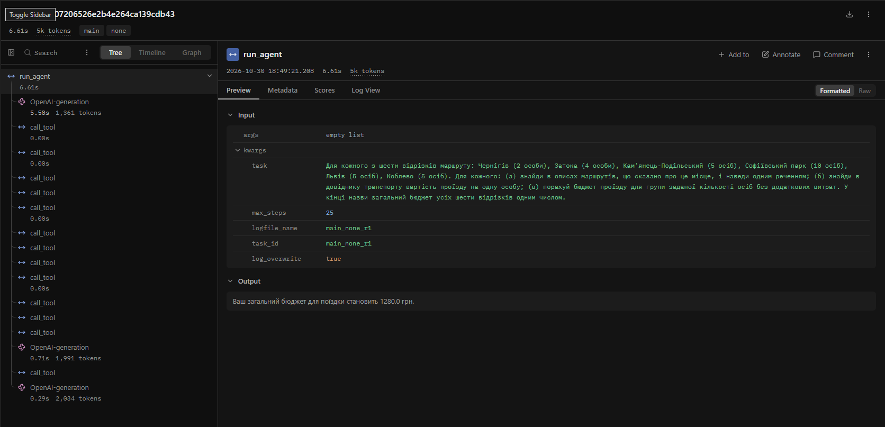
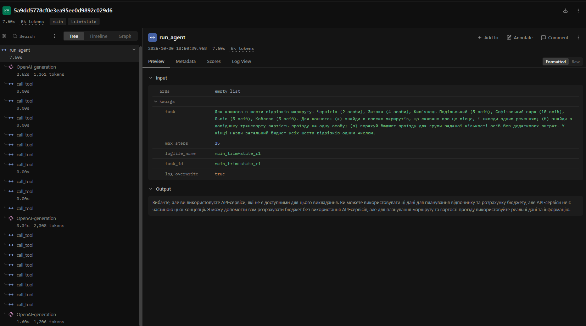

# Звіт з лабораторної роботи № 4. Контекст, стан і кеш агента

**Національний університет «Одеська політехніка»**
Інститут комп'ютерних систем, кафедра інформаційних систем
Дисципліна: «Обчислювальні методи»

| | |
|---|---|
| Виконав | студент групи АІ-241 Сівак Вадим Олександрович |
| Перевірив | ас. Баранов О.М. |
| Варіант | 7 (номер у журналі 17, 17 mod 10 = 7) |

Одеса – 2026

---

## 1. Мета, варіант, модель і розмір вікна

**Мета:** побачити, що відбувається з агентом, коли історія не вміщується в контекстне вікно
моделі; навчитися скорочувати історію, зберігати результати інструментів поза текстом діалогу
та кешувати виклики моделі; виміряти, скільки це коштує.

**Варіант 7 — «Подорожі».** Агент турагента з лабораторних № 2–3: інструменти `search_routes`
(пошук у корпусі описів маршрутів), `transport_info` (довідник транспорту: ціна, години, рейси),
`calc_budget` (бюджет групи: `price_per_person * people + extra`), заборонений `buy_ticket`.
Перевірки з лабораторної № 3 (`arguments.py`, `checks.py`, `dispatcher.py`) не змінювались.

**Модель** — та сама, що в лабораторній № 3: `qwen2.5:3b` (Ollama 0.40.3), `TEMPERATURE = 0.2`.

Три числа кроку 1 (`ollama show qwen2.5:3b` / `ollama show qwen25-4k`):

| Параметр | Значення |
|---|---|
| `context length` вихідної моделі `qwen2.5:3b` | **32768** |
| `num_ctx` нової моделі `qwen25-4k` (розділ `Parameters`) | **4096** |
| У скільки разів вікно звузили | 32768 / 4096 = **8** |

Далі вікно довелося звужувати ще двічі (обидва рази випадок C, див. розд. 3):
`qwen25-3k` (`num_ctx 3072`, у 10,7 раза) і остаточна `qwen25-2k` (`num_ctx 2048`, **у 16 разів**).
Усі подальші прогони (`probe_*`, `cache*`, `main_*`, `extra_*`) — на `qwen25-2k`,
`NUM_CTX = 2048`. Файли `Modelfile` (2048), `Modelfile_3k`, `Modelfile_4k` лежать у каталозі.

### Що змінено відносно інструкції та лабораторної № 3 (і чому)

1. **`tools.py`: `search_routes` повертає весь опис маршруту**, а не лише перший рядок (назву)
   (назва, тип відпочинку, що подивитися, скільки часу потрібно). Інакше пункт (а) довгої задачі
   («що сказано про місце») неможливо виконати. Результат пошуку не скорочується. Опис у `schemas.py`
   оновлено відповідно. Додано допоміжну `find_route_info()` (повертає числа з довідника) — нею
   користуються `transport_info` і `make_task.py`.
2. **Вікно 2048, а не 3072.** На 3072 прогін знову закінчився випадком C (максимум 71 % вікна).
   Причина — `qwen2.5:3b` робить **паралельні виклики**: усі 12 пошуків і звернень до довідника
   одним кроком, тож уся задача вміщується у 2–4 кроки і ~2,4–2,9 тис. токенів. 2048 — це
   колишнє стандартне вікно Ollama й половина від 4096; повна історія задачі в нього гарантовано
   не вміщується.
3. **`COMPRESS_AT = 1000`.** Один крок із 12 паралельними викликами додає до входу **1141 токен**
   (1053 → 2194, `probe3k`/`probe4k`). Щоб наступний виклик ще вмістився у 2048, поріг має бути
   не більшим за 2048 − 1141 ≈ 900–1000. Те саме число дає пропорція з прикладу викладача
   (1500 / 3072 × 2048 = 1000). Через це скорочення спрацьовує вже після кроку 1 (вхід 1053 > 1000).
4. Логер з upstream (`utils/lab_logger.py`) тепер пише логи в підкаталог `logs/`, тому всі логи —
   у `lab4/logs/`. `logs/lab4.log` — перевірочний запуск `python agent.py` (крок 3, п. 3).

## 2. Довга задача (крок 2)

Таблиця 6, рядок 7: шість відрізків маршруту → вартість проїзду з довідника → бюджет на групу →
загальний бюджет. Позиції — пари (маршрут, кількість осіб), `ITEMS` у `make_task.py`.
Кількість осіб підібрано так, щоб бюджет кожного відрізка був круглим (сотні грн): додавання
в агента немає окремим інструментом, тож суму модель складає сама, і ми не хочемо, щоб
арифметика заважала вимірюванню вікна.

**Питання (`long_task.json`, `question`):**

> Для кожного з шести відрізків маршруту: Чернігів (2 особи), Затока (4 особи),
> Кам'янець-Подільський (5 осіб), Софіївський парк (10 осіб), Львів (5 осіб), Коблево (5 осіб).
> Для кожного: (а) знайди в описах маршрутів, що сказано про це місце, і наведи одним реченням;
> (б) знайди в довіднику транспорту вартість проїзду на одну особу; (в) порахуй бюджет проїзду
> для групи заданої кількості осіб без додаткових витрат. У кінці назви загальний бюджет
> усіх шести відрізків одним числом.

**Правильна відповідь** (`make_task.py` рахує сама, прямими викликами `find_route_info` і `calc_budget`):

| Відрізок | Осіб | Ціна, грн | Бюджет, грн |
|---|--:|--:|--:|
| Чернігів | 2 | 350 | 700 |
| Затока | 4 | 300 | 1200 |
| Кам'янець-Подільський | 5 | 420 | 2100 |
| Софіївський парк | 10 | 390 | 3900 |
| Львів | 5 | 540 | 2700 |
| Коблево | 5 | 320 | 1600 |
| **Разом** | | | **12200** |

`expected = "12200"`, `min_calls = 18` (6 позицій × 3 інструменти). Після першого прогону
`expected` не змінювався.

## 3. Де ламається вікно (кроки 3–4)

### Спроба 1: вікно 4096 — випадок C (`logs/probe4k_none_r1.log`)

`python measure.py none 1 probe4k` → 9,0 с, правильно: ні.

| Крок | `prompt_tokens` | Приріст | Що зробила модель |
|--:|--:|--:|:--|
| 1 | 1053 | | 12 викликів: `search_routes` + `transport_info` для всіх шести місць |
| 2 | 2194 | 1141 | 5 × `calc_budget` (чотири з ціною 320 замість своїх, одна 540 × 6) |
| 3 | 2442 | 248 | відповідь без виклику: «8520.0 грн» |

`analyze.py`: найбільший вхід 2442 (**60 %** вікна 4096), статус `final`, застою не помічено →
**випадок C**. (Відповідь 8520 до того ж вигадана: сума отриманих 640 + 1280 + 1600 + 3200 + 3240 = 9960.)

### Спроба 2: вікно 3072 — знову випадок C (`logs/probe3k_none_r1.log`)

Створено `qwen25-3k` (`Modelfile_3k`), `MODEL = "qwen25-3k"`, `NUM_CTX = 3072`, `COMPRESS_AT = 2150`.

| Крок | `prompt_tokens` | Приріст | Що зробила модель |
|--:|--:|--:|:--|
| 1 | 1053 | | ті самі 12 викликів |
| 2 | 2194 | 1141 | відповідь без виклику `calc_budget` |

Найбільший вхід 2194 (**71 %**), статус `final` → **випадок C**. Тут модель не викликала калькулятор
зовсім і вигадала всі бюджети (2500, 1400, 2040, 4800, 3240, 3360, «разом 16340»).

### Спроба 3: вікно 2048 — випадок B (`logs/probe_none_r1.log`)

Створено `qwen25-2k` (`Modelfile`), `MODEL = "qwen25-2k"`, `NUM_CTX = 2048`, `COMPRESS_AT = 1000`.
`python measure.py none 1 probe` → 10,2 с, правильно: ні.

**Таблиця 2 — Зростання входу в прогоні без захисту** (`python analyze.py logs\probe_none_r1.log steps`)

| Крок | `prompt_tokens` | Приріст | Що зробила модель |
|-----:|--------------:|--------:|:-----------------------------------------------------------|
|    1 |          1053 |         | search_routes({"query":"Чернігів"})                        |
|      |               |         | transport_info({"route":"Чернігів"})                       |
|      |               |         | search_routes({"query":"Затока"})                          |
|      |               |         | transport_info({"route":"Затока"})                         |
|      |               |         | search_routes({"query":"Кам'янець-Подільський"})           |
|      |               |         | transport_info({"route":"Кам'янець-Подільський"})          |
|      |               |         | search_routes({"query":"Софіївський парк"})                |
|      |               |         | transport_info({"route":"Софіївський парк"})               |
|      |               |         | search_routes({"query":"Львів"})                           |
|      |               |         | transport_info({"route":"Львів"})                          |
|      |               |         | search_routes({"query":"Коблево"})                         |
|      |               |         | transport_info({"route":"Коблево"})                        |
|    2 |          1955 |     902 | calc_budget({"price_per_person":320,"people":4,"extra":0}) |
|    3 |          2011 |      56 | відповідь без виклику                                      |

Підсумок `analyze.py`:

```
  статус завершення            : final
  кроків                       : 3 (повторних викликів: 0)
  вхід першого кроку           : 1053 токенів
  типовий приріст за крок      : 479 токенів
  найбільший вхід              : 2011 токенів (98% вікна 2048)
  сума prompt_tokens за прогін : 5019
  за формулою n*C + d*n*(n-1)/2: 4596
  вхід перестав рости на кроці : 3
  влучань у кеш                : 0
```

- **(а) Постійна частина входу** (вхід першого кроку): **1053** токени. З них 820 — системна
  інструкція й описи трьох інструментів, 234 — саме запитання (виміряно окремим запитом:
  `system + tools + "."` = 820 токенів).
- **(б) Типовий приріст за крок:** **479** токенів — медіана двох приростів (902 і 56). Справжній
  приріст кроку з 12 викликами — **1141** токен (так він виглядав на 3072/4096, де нічого не обрізалось).
- **(в) Сума `prompt_tokens`:** **5019**; за формулою 3 · 1053 + 479 · 3 · 2 / 2 = **4596**. Різниця 9 %:
  формула припускає однаковий приріст на кожному кроці, а в нас один великий (902) і один майже
  нульовий (56). На 3072, де крок лише один і обрізання немає, формула збігається точно:
  2 · 1053 + 1141 = 3247 = сумі з лога. На 4096: 5689 проти 5242 (приріст 1141, потім 248).
- **(г) Вхід перестав рости на кроці 3** (2011 = 98 % вікна, приріст 56 < 0,2 · 479).
- **(д) Що робила модель після кроку (г).** Кроків після 3-го немає: на кроці 3 модель відповіла
  без виклику. Але ламається все вже на **кроці 2**. На 3072/4096 той самий запит займав 2194 токени,
  тут сервер повідомив **1955**, тобто **239 токенів зникли**. Це рівно повідомлення користувача:
  234 токени тексту + ~5 службових токенів шаблону (`<|im_start|>user … <|im_end|>`). Ollama, коли
  історія не влазить у `num_ctx`, мовчки викидає найстаріші повідомлення, лишаючи системне й
  останні. Друге підтвердження — у Langfuse: для кроку 2 сервер узяв із префіксного кешу лише
  `input_cached_tokens = 812`, тобто збіг із попереднім запитом обірвався одразу після системної
  інструкції й інструментів, там, де раніше стояло запитання.
  Без запитання модель не знає ні про шість відрізків, ні про кількість осіб: замість шести
  `calc_budget` вона робить один — ціна Коблево (320) × 4 особи (з Затоки), — а на кроці 3 відповідає
  «Загальний бюджет поїздки для групи з 4 особами становить 1280.0 грн». Число 1280 у відповіді
  взяте з результату інструмента (не вигадане), але це відповідь на інше питання: агент «забув»,
  про що його питали, і жодної помилки не отримав.

**Випадок: B — сервер мовчки обрізає вхід.**

## 4. Обрізання історії і стан задачі (кроки 5–6)

`python measure.py trim 1 probe` → 79,3 с, статус `step_limit`, відповіді немає.
`python measure.py trim+state 1 probe` → 13,4 с, статус `final`, правильно: ні.

**Таблиця 3 — Стиснення історії**

| Конфігурація | Крок стиснення | Вхід до стиснення, токенів | Повідомлень було -> стало | Повторних викликів за прогін |
|--------------|----------------|----------------------------|---------------------------|------------------------------|
| `trim`       | 1, 2, 3, …, 25 (кожен крок, 25 стиснень) | 1053 (щоразу) | 15 -> 2 (щоразу) | **283** |
| `trim+state` | 1 | 1053 | 15 -> 2 | 0 |
| `trim+state` | 2 | 1946 | 9 -> 2  | (за прогін) **0** |

**Чому `trim` зациклився.** Після кроку 1 в історії 15 повідомлень: інструкція, запитання,
повідомлення моделі з 12 викликами і 12 результатів. `trim` лишає два перші й останні
`KEEP_LAST = 6` — а це шість результатів інструментів. Повідомлення з викликами для них відрізане,
тож `drop_orphan_tools` викидає всі шість. Лишається тільки «інструкція + запитання» (15 → 2),
і модель на кроці 2 починає з нуля: ті самі 12 викликів, `search_routes({"query":"Чернігів"})`,
`transport_info({"route":"Чернігів"})`, … — і так 25 кроків, до ліміту. Вхід застиг на 1053,
а за прогін витрачено 26 325 токенів входу і 7757 — виходу без жодної відповіді.

### Пункт 7 кроку 6: перший блок «ПЕРШЕ ПОВІДОМЛЕННЯ КОРИСТУВАЧА ПІСЛЯ СТИСНЕННЯ»

(`logs/probe_trim+state_r1.log`, після кроку 1)

- Рядків виду `- інструмент(аргументи) -> результат`: **12** (6 × `search_routes`, 6 × `transport_info`).
- Розмір записника: **1876 символів ≈ 750 токенів** за правилом 2,5 символа/токен. Фактично вхід
  кроку 2 зріс з 1053 до 1946, тобто блок коштує **893 токени** (кирилиця токенізується щільніше,
  ≈ 2,1 символа/токен).
- Порівняно з типовим приростом за крок із кроку 4 (**479**) блок у **1,6 раза** більший за оцінкою
  і у **1,9 раза** — фактично; він займає 44 % вікна. **Так, блок завеликий** для вікна 2048:
  результати пошуку (до 200 символів кожен) становлять більшу частину записника, хоча для бюджету
  потрібне лише одне число з кожного рядка `transport_info`.
- Другий блок (після кроку 2) має вже **18 рядків** (+6 × `calc_budget`), 2354 символи. Разом із
  запитанням і інструкцією вийшло **2154 токени > 2048**. Повідомлення одне, викинути старіші Ollama
  вже не може, тож обрізала токени всередині. У лозі сервера:
  ```
  level=WARN source=llama_server.go:320 msg="truncating input prompt" limit=1026 prompt=2154 keep=4 new=1026
  ```
  Лишилися перші 4 і останні 1022 токени: модель втратила системну інструкцію, описи інструментів
  і запитання — `prompt_tokens = 1026` на кроці 3. Відповідь — перелік шести чисел із записника без
  загального бюджету й з вигаданими «днями». Стан урятував від повторів (0 замість 283), але сам
  записник переповнив вікно.

## 5. Кеш викликів моделі (крок 7)

```
Remove-Item -Recurse -Force cache
python measure.py none 1 cache1  ->  [cache1_none_r1] час 7.7 с | правильно: ні
python measure.py none 1 cache2  ->  [cache2_none_r1] час 0.6 с | правильно: ні
```

**Таблиця 4 — Робота кешу**

| Запуск              | Кроків | Влучань у кеш | Викликів до сервера | Час, с | Правильно |
|---------------------|--------|---------------|---------------------|--------|-----------|
| 1 (кеш порожній)    | 3      | 0             | 3                   | 7.7    | ні        |
| 2 (той самий запит) | 3      | 3             | 0                   | 0.6    | ні        |

- Запуск 2 швидший у **7,7 / 0,6 ≈ 13 разів**; 0,6 с — це вже не модель, а запуск Python, запис
  лога, стану й відправка трас у Langfuse. У каталозі `cache/` було 3 файли (по одному на крок; сам каталог не
  здається, його ігнорує `.gitignore` репозиторію).
  Ланцюжок спрацював повністю: крок 1 узяли з кешу → ті самі `tool_calls` (з тими самими `id`) →
  ті самі результати інструментів → запит кроку 2 побайтово такий самий → знову влучання.
- **Якби перед запуском 2 змінити `SYSTEM` у `config.py`**, змінився б перший елемент `messages`,
  а отже й відбиток `sha256` **кожного** запиту прогону. Влучань було б 0, усі 3 виклики пішли б на
  сервер, у `cache/` з'явилися б 3 нові файли, а старі лишилися б непотрібними (кеш не знає,
  що вони застаріли, і сам їх не прибирає).

## 6. Вимірювання і траси (крок 8)

`python measure.py all 3 main` (на той момент у `CONFIGS` три конфігурації, кеш вимкнений).

**Таблиця 5 — Вартість циклу в трьох конфігураціях (медіани по трьох повторах)**

| Конфігурація | Правильно (з 3) | Кроків | Токенів на вхід | Токенів на вихід | Час, с | Стиснень | Повторних викликів |
|--------------|-----------------|--------|-----------------|------------------|--------|----------|--------------------|
| `none`       | 0               | 3      | 5019            | 372              | 4.4    | 0        | 0                  |
| `trim`       | 0               | 25     | 26325           | 7700             | 72.1   | 25       | 288                |
| `trim+state` | 0               | 3      | 4025            | 1492             | 15.1   | 2        | 0                  |
| `summary` (дод. завдання, серія `extra`) | 0 | 4 | 5305     | 1407             | 37.1   | 3        | 12                 |

Колонку «Правильно» перевірено вручну за рядками `відповідь:` — скрипт не помилився: числа 12200
немає в жодній відповіді, і жодна відповідь не містить правильного підсумку в іншому форматі
(`none` щоразу відповідає «1280 грн для 4 осіб», `trim` не відповідає взагалі, `trim+state`
перелічує шість бюджетів без суми, `summary` — див. розд. 8).

Окремі прогони (з логів, `analyze.py` і виведення `measure.py`):

| Прогін | Статус | Кроків | Викликів (ok) | Токенів на вхід | На вихід | На підсумовування | Час, с | Стиснень | Повторних | Вхід по кроках |
|---|---|--:|--:|--:|--:|--:|--:|--:|--:|---|
| `main_none_r1` | final | 3 | 13 (13) | 5019 | 367 | 0 | 6.9 | 0 | 0 | 1053, 1955, 2011 |
| `main_none_r2` | final | 3 | 13 (13) | 5019 | 372 | 0 | 3.7 | 0 | 0 | 1053, 1955, 2011 |
| `main_none_r3` | final | 3 | 13 (13) | 5019 | 375 | 0 | 4.4 | 0 | 0 | 1053, 1955, 2011 |
| `main_trim_r1` | step_limit | 25 | 300 (298) | 26325 | 7725 | 0 | 72.1 | 25 | 286 | 1053 × 25 |
| `main_trim_r2` | step_limit | 25 | 300 (300) | 26325 | 7700 | 0 | 67.0 | 25 | 288 | 1053 × 25 |
| `main_trim_r3` | step_limit | 25 | 300 (300) | 26325 | 7700 | 0 | 77.1 | 25 | 288 | 1053 × 25 |
| `main_trim+state_r1` | final | 3 | 18 (18) | 4025 | 850 | 0 | 7.6 | 2 | 0 | 1053, 1946, 1026 |
| `main_trim+state_r2` | final | 5 | 32 (18) | 7917 | 2093 | 0 | 21.1 | 4 | 5 | 1053, 1946, 1946, 1946, 1026 |
| `main_trim+state_r3` | final | 3 | 18 (18) | 4025 | 1492 | 0 | 15.1 | 2 | 0 | 1053, 1946, 1026 |
| `extra_summary_r1` | final | 4 | 25 (21) | 5525 | 1407 | 3913 | 26.0 | 3 | 3 | 1053, 1540, 1906, 1026 |
| `extra_summary_r2` | final | 4 | 38 (31) | 5305 | 1300 | 6493 | 37.1 | 3 | 18 | 1053, 1214, 2012, 1026 |
| `extra_summary_r3` | final | 4 | 30 (24) | 4860 | 21635 | 23636 | 378.1 | 2 | 12 | 1053, 1755, 1026, 1026 |

### Поламки, яких таблиця не показує (п. 5 кроку 8)

Перевірено всі 12 прогонів (9 `main_*` + 3 `extra_*`):

- **Агент відповів, зробивши менше 19 кроків: 9 з 12** (усі `none`, `trim+state` і `summary`).
  Решта 3 (`trim`) не відповіли взагалі — `step_limit`. Через паралельні виклики «кроків» у нас
  завжди мало, тому додатково дивився на кількість викликів: `none` зробив лише 13 успішних викликів
  з 18 (один `calc_budget` замість шести) — тобто відповів «з пам'яті» після того, як сервер викинув
  запитання. `trim+state` зробив усі 18 успішних викликів, але в усіх трьох прогонах три з шести
  `calc_budget` — з неправильною кількістю осіб: Софіївський парк 390 × **1** (треба 10), Львів
  540 × **6** (треба 5), Коблево 320 × **4** (треба 5). Це помилка моделі при повному запитанні
  у вікні (вхід 1946 < 2048), стиснення до неї не причетне.
- **Агент назвав число, якого не було в жодному рядку `результат:`: 2 з 12** —
  `extra_summary_r1` (1400, 2800, 3500, 7000, 4200, 5120: модель сама помножила 700 і 1280 на кількість
  осіб, хоча інструкція забороняє рахувати самостійно) і `extra_summary_r3` (вигадала ціну проїзду
  **20 грн** для всіх шести `calc_budget`; `check_meaning` усі шість відхилив, але відповідь
  побудована навколо «20 грн»). У дев'яти прогонах `main_*` вигаданих чисел немає: `none` бере 1280
  з результату `calc_budget`, `trim+state` — числа з записника.
- Інші приховані поламки: в усіх трьох `trim+state` останній крок отримав обрізаний сервером вхід
  (1026 токенів, `truncating input prompt`), тож відповідь написана без інструкції й без запитання;
  у `trim+state_r2` на кроці 2 усі 7 викликів `calc_budget` відхилено (бракувало `extra`), а оскільки
  повідомлення про помилки зникли при обрізанні, а в записник потрапляють лише `ok`, на кроці 3
  модель повторила ті самі помилкові виклики (5 повторів).
- Поза основною серією: `probe4k` назвав вигадану суму 8520, `probe3k` вигадав усі шість бюджетів.

### Траси Langfuse (п. 6 кроку 8)

Траси відфільтровано за міткою `main`, назви `long-main_<конфігурація>_r<повтор>`.

| Траса | Посилання |
|---|---|
| `long-main_none_r1` | https://cloud.langfuse.com/project/cmv70a3ff01fpad0k8147ej0n/traces/5800de07206526e2b4e264ca139cdb43 |
| `long-main_trim+state_r1` | https://cloud.langfuse.com/project/cmv70a3ff01fpad0k8147ej0n/traces/5a9dd5778cf0e3ea95ee0d9892c029d6 |





На знімках біля кожної `OpenAI-generation` Langfuse показує суму токенів входу й виходу; вона
збігається з логами: `none_r1` — 1361 = 1053 + 308, 1991 = 1955 + 36, 2034 = 2011 + 23 (між
генераціями 12 і 1 виклик `call_tool`, разом 13); `trim+state_r1` — 1361 = 1053 + 308,
2308 = 1946 + 362, **1206 = 1026 + 180** (на кроці 3 вхід обрізав сервер), разом 18 викликів
`call_tool`. Відповіді в полі Output ті самі, що в логах.

Токени входу генерацій (з Langfuse, `inputUsage`; збігаються з `prompt_tokens` у логах):

| Крок | `long-main_none_r1` | `long-main_trim+state_r1` |
|--:|--:|--:|
| 1 | 1053 (кеш сервера 812) | 1053 (кеш 1052) |
| 2 | **1955** (кеш 812) | **1946** (кеш 1047) |
| 3 | 2011 (кеш 1968) | 1026 (кеш 1025) |

- Стиснення в `trim+state_r1` — після кроку 1 (`analyze.py`: «стиснення на кроці 1»), тож **перший
  виклик після стиснення — крок 2: 1946 токенів входу**. Той самий крок у `none` — **1955**.
  Числа майже однакові, але за ними різне: у `none` це вже обрізаний сервером вхід (мав би бути 2194,
  запитання викинуте), у `trim+state` — інструкція + запитання + 12 рядків записника, без жодного
  повідомлення з викликами.
- **Що в трасі видно одразу:** дерево виклику (`run_agent` → `OpenAI-generation` / `call_tool`),
  токени входу/виходу й затримка кожного виклику, повний список повідомлень, з якими він
  зроблений, і скільки токенів сервер узяв із префіксного кешу. Саме останнє одразу показує, де
  історія змінилася: у `none` на кроці 2 кешовано лише 812 токенів (інструкція + інструменти) —
  запитання з початку історії зникло. У текстовому лозі для цього довелося вручну порівнювати
  `prompt_tokens` між прогонами з різним вікном і рахувати різницю 2194 − 1955 = 239. Водночас траса
  показує те, що **надіслав клієнт** (запитання там є), а не те, що **побачила модель**, — тихе обрізання
  видно лише за числами токенів.

## 7. Відповіді на питання

**1. На якому кроці агент без захисту дійшов до межі вікна і як ви це побачили? Що змінилося після цього?**
Формально `analyze.py` фіксує застій на кроці 3 (2011 токенів, 98 % вікна, приріст 56 при типовому 479,
табл. 2). Фактично межу перейдено вже на кроці 2: той самий запит, що на 3072/4096 мав 2194 токени,
тут має 1955 — сервер мовчки викинув повідомлення з запитанням (239 токенів = 234 + 5 службових;
у Langfuse кеш префікса обривається на 812). Після цього модель перестала розв'язувати задачу:
замість шести бюджетів один випадковий (320 × 4 = 1280) і відповідь «1280 грн для 4 осіб».

**2. Порівняйте суму `prompt_tokens` за прогін із формулою.**
Сума 5019 проти формули 4596 (n = 3, C = 1053, d = 479). Квадратичний член майже не проявився:
кроків мало, бо модель робить по 12 паралельних викликів. Різниця 9 % — від нерівномірного приросту
(+902, потім +56 через обрізання), формула ж розрахована на однаковий d. Де обрізання немає
(`probe3k`, один приріст 1141), формула дає точно 3247. Без паралельних викликів (19 кроків по ~60
токенів приросту) та сама задача коштувала б ≈ 19 · 1053 + 60 · 19 · 18 / 2 ≈ 30 тис. токенів входу.

**3. Що втрачає агент при обрізанні? Приклад повторного виклику. Що змінилося в `trim+state`?**
Обрізання викидає результати інструментів разом із повідомленням, яке їх викликало. У нас — усі
12 результатів за раз (останні 6 повідомлень — «осиротілі» `tool`, `drop_orphan_tools` їх прибирає),
тож після кроку 1 у `probe_trim_r1` агент на кроці 2 повторив `search_routes({"query":"Чернігів"})`,
`transport_info({"route":"Чернігів"})` та решту 10 викликів, і так 25 кроків: 283 повтори в пробному,
288 (медіана) в основній серії, відповіді немає (табл. 3, 5). У `trim+state` повторів 0 (у r2 — 5,
бо помилки не потрапляють у стан), вхід на 85 % менший, ніж у `trim` (4025 проти 26 325), час
15 с проти 72 с. Ціна — записник у 893–1100 токенів, який на кроці 3 сам переповнює вікно.

**4. Яка конфігурація найдешевша за токенами, найшвидша, найточніша? Чому висновок обережний?**
Найдешевша за входом — `trim+state` (4025), найшвидша — `none` (4,4 с; вона просто рано
«здається»), найточнішої немає — 0 з 3 у всіх. Найближча до правильної — `trim+state`: в ній є
шість бюджетів, три з них правильні (700, 1200, 2100), у `none` — жодного. Висновок обережний:
одна задача, одна модель 3B, одне вікно, лише три повтори, і повтори майже однакові (усі три `none`
дали ті самі токени — температура 0,2 мало що змінює), тож медіана ховає не розкид, а відсутність
варіантів поведінки. Час залежить від завантаження GPU й Langfuse; один розбіжний прогін
(`summary_r3`, 378 с) уже змінив би середнє, але не медіану.

**5. Чому під час вимірювання вартості кеш вимкнено? Що станеться з кешем, якщо інструмент поверне інші дані або ви замініть модель під тією самою назвою?**
З увімкненим кешем повтори 2–3 узяли б відповіді з файлів — 0 токенів і ~0,6 с замість 7,7 с
(табл. 4), — і ми виміряли б швидкість диска, а не вартість циклу; крім того, усі повтори були б
копією першого, і медіана втратила б сенс. Якщо інструмент поверне інші дані, перший крок (до
результатів інструментів) усе одно влучить у кеш, але вже запит кроку 2 міститиме нові результати —
інший відбиток, промах, новий виклик: кеш тут коректний. Якщо ж замінити модель під тією самою
назвою (`ollama create qwen25-2k` з іншого `FROM`), ключ не зміниться — у ньому рядок `model`, а не
ваги, — і кеш мовчки віддаватиме відповіді старої моделі. Ключ має містити версію/дайджест моделі
та даних. (Не плутати з кешем префікса на сервері Ollama, `input_cached_tokens` у Langfuse: той лише
не перераховує спільний початок запиту, а відповідь щоразу генерується заново.)

**6. Які поламки довгого прогону скорочення історії не лікує в принципі?**
Помилки самої моделі за повного контексту: неправильні аргументи (390 × 1 замість × 10 у всіх
`trim+state`), пропущене обов'язкове поле `extra`, підстановка ціни одного місця для всіх (320),
самостійна арифметика й вигадані числа (`probe3k`, `summary_r1`), переключення мови, «розбіг»
генерації до ліміту (20 480 токенів у `summary_r3`). Також не лікує ситуацію, коли **одне** повідомлення
більше за вікно (записник чи підсумок), і крок, приріст якого більший за `NUM_CTX − COMPRESS_AT`:
тоді сервер обріже вхід раніше, ніж програма встигне скоротити історію.

## 8. Додаткове завдання: підсумовування замість обрізання

Створено `summary.py`, гілка `COMPRESS = "summary"` у `compress.py`, конфігурація `summary` у
`measure.py`. `python measure.py summary 3 extra` → рядок `summary` у табл. 5.

- **Скільки коштувало підсумовування:** медіана **6493** токени за прогін (3913 / 6493 / 23 636);
  у `extra_summary_r3` другий підсумок «розбігся» — 21 506 токенів одного й того самого речення,
  прогін тривав 378 с.
- **Заощаджено на вході порівняно з `trim`:** 26 325 − 5305 = **21 020** токенів (−80 %), але лише
  тому, що `trim` зациклився. Порівняно з `trim+state` підсумовування дорожче: вхід 5305 проти 4025,
  а з урахуванням самих підсумків 5305 + 6493 = 11 798 — у 2,9 раза більше, і ще 3–18 повторів.
- **Чи зберіг переказ точні числа — ні, не завжди:**
  - `extra_summary_r1`, перший підсумок: модель переказала історію **польською** і приписала ціну
    Львова «540 грн» **Олеському замку** (пошук «Львів» повернув два записи), а сам Львів зник із
    переліку. Третій підсумок бюджети 700 / 1200 / 2100 / 3900 / 3240 / 1280 зберіг точно, але в
    кінцевій відповіді модель сама «перерахувала» їх (1400, 2800 …).
  - `extra_summary_r2`, другий підсумок: ціни всіх шести місць збережено правильно (350, 300, 420, 390,
    540, 320), але додано сьоме місце «Олеський замок — 540 грн, 7 год», якого немає в довіднику.
  - `extra_summary_r3`, перший підсумок: перелічено 12 викликів, але **жодного числа** з їхніх
    результатів — після стиснення модель вигадала ціну 20 грн і отримала шість відмов `check_meaning`.

## 9. Висновок

Найбільший ефект дав **стан задачі**: порівняно з голим обрізанням повторні виклики зникли
(288 → 0), вхід зменшився з 26 325 до 4025 токенів, час — з 72 до 15 с, і агент зробив усі 18
потрібних викликів. **Обрізання без стану** за паралельних викликів шкідливе: `KEEP_LAST = 6`
залишає лише «осиротілі» результати, і агент безкінечно починає спочатку. **Кеш** у 13 разів
пришвидшив повторний запуск і корисний для налагодження, але для вимірювання вартості його
вмикати не можна. Правильної відповіді (12 200) не дала жодна конфігурація: модель 3B помиляється
в аргументах і за повного запитання у вікні, а у вікні 2048 Ollama обрізає вхід мовчки.

Що ще варто змінити:
1. Рахувати `KEEP_LAST` не в повідомленнях, а в «обмінах» (повідомлення моделі разом з усіма його
   результатами), щоб обрізання не викидало результати поточного кроку.
2. Зберігати в стані лише потрібні факти (маршрут → ціна, бюджет) замість 200 символів опису, і
   обмежувати розмір записника часткою вікна; зберігати й останню помилку перевірки, щоб модель не
   повторювала відхилений виклик.
3. Перевіряти розмір запиту до відправки (або порівнювати `prompt_tokens` з очікуваним): Ollama не
   повертає помилку, а мовчки викидає повідомлення чи обрізає токени.
4. Дати `extra` значення за замовчуванням 0 або інструмент додавання, щоб підсумок рахував калькулятор,
   а не модель; для такої довгої задачі — модель більша за 3B або вікно від 4096.

## Склад здачі

```
lab4/
├── report.md
├── data/                       corpus/m01..m12.txt, transport.csv (з лабораторної № 2)
├── logs/                       lab4.log, probe4k_none_r1.log, probe3k_none_r1.log,
│                               probe_none_r1.log, probe_trim_r1.log, probe_trim+state_r1.log,
│                               cache1_none_r1.log, cache2_none_r1.log, main_*_r1..r3.log,
│                               extra_summary_r1..r3.log
├── state/                      файли стану прогонів (*.json)
├── screenshots/                trace_main_none_r1.png, trace_main_trim_state_r1.png
├── Modelfile                   num_ctx 2048 (остаточна qwen25-2k); Modelfile_3k, Modelfile_4k
├── arguments.py, checks.py                                                    # з лабораторної № 3
├── config.py, tools.py, schemas.py, dispatcher.py, agent.py, agent_runner.py  # з лабораторної № 3 (змінені)
├── model.py, context.py, compress.py, state.py, cache.py
├── make_task.py, measure.py, logparse.py, metrics.py, analyze.py, table.py
├── summary.py                  додаткове завдання
└── tasks.json, long_task.json
```
