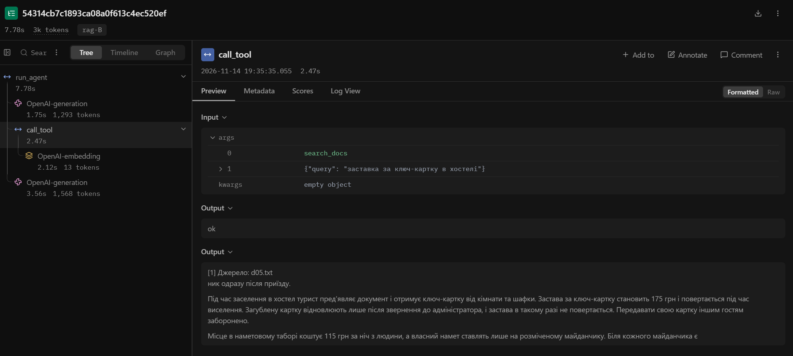
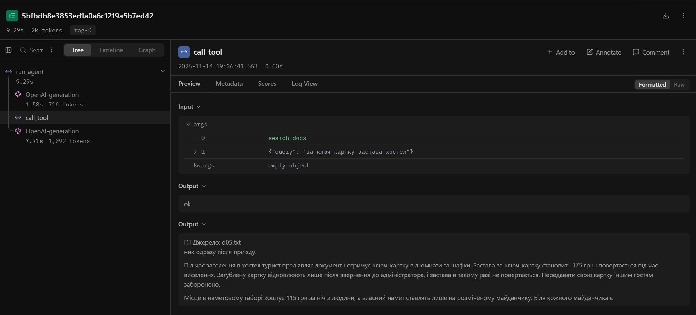

# Звіт з лабораторної роботи № 5. RAG-агент: пошук по документах як інструмент

**Національний університет «Одеська політехніка»**
Інститут комп'ютерних систем, кафедра інформаційних систем
Дисципліна: «Обчислювальні методи»

| | |
|---|---|
| Виконав | студент групи АІ-241 Сівак Вадим Олександрович |
| Перевірив | ас. Баранов О.М. |
| Варіант | 7 (номер у журналі 17, 17 mod 10 = 7) |

Одеса – 2026

---

## 1. Мета, варіант, моделі

**Мета:** замінити пошук підрядком з лабораторної № 2 векторним пошуком, під'єднати його до агента
звичайним інструментом `search_docs`, перевірити якість пошуку окремо від агента і виміряти,
як розмір чанка, поріг схожості та опис інструмента впливають на поведінку агента.

**Варіант 7 — «Подорожі».** Агент турагента з лабораторних № 2–4. Інструменти:
`search_docs` (новий, векторний пошук по корпусу й документах), `transport_info` (довідник транспорту),
`calc_budget` (бюджет групи), заборонений `buy_ticket`. Старий `search_routes` лишився в `tools.py`,
але в `ALLOWED` його замінено на `search_docs`, тож агентові він недоступний.

| Параметр | Значення |
|---|---|
| Модель чату | `qwen2.5:3b` (та сама, що в лабораторних № 3–4), обгортка **`qwen25-4k`** (`Modelfile`: `FROM qwen2.5:3b`, `PARAMETER num_ctx 4096`) |
| Розмір вікна | **4096** (`NUM_CTX = 4096`) |
| Модель ембедингів | **`bge-m3`** (вектор 1024) |
| Сервер | Ollama 0.40.3, лише CPU (дискретної відеокарти немає), `OLLAMA_MAX_LOADED_MODELS=2` |
| Температура, ліміт кроків | `TEMPERATURE = 0.2`, `MAX_STEPS = 6` (з лабораторної № 4, не змінювались) |
| Скорочення, стан, кеш | вимкнено: `COMPRESS = "none"`, `USE_STATE = False`, `USE_CACHE = False` |
| Траси | Langfuse (мітки `rag-A`, `rag-B`, `rag-C`, `rag`, `lab4-4k`; додатковий експеримент — `rag-qwen3-A/B/C`) |

### Що змінено відносно інструкції та лабораторної № 4 (і чому)

1. **Модель і вікно.** В інструкції — `llama32-4k`; у мене в лабораторній № 4 була `qwen2.5:3b`, тож беру її ж.
   Остаточне вікно лабораторної № 4 було 2048: його звужували, щоб *довга задача* переповнила вікно.
   Тут довгої задачі немає, а інструкція прямо задає вікно 4096, тому використано `qwen25-4k`
   (ця модель уже була в лабораторній № 4 для проби `probe4k`). Чому 2048 тут не годиться, видно з чисел
   розд. 10 (питання 8): вхід першого кроку з описом `B` — 1270 токенів, кожен пошук додає ще ~300.
2. **База для кроку 9.** `lab4/logs/lab4.log` скопійовано в `logs/run_lab4.log`, як вимагає крок 1,
   але в ньому лише **одна** задача (Z3): у лабораторній № 4 цей лог — перевірочний запуск `python agent.py`.
   Щоб табл. 7 мала відповіді лабораторної № 4 на всі п'ять задач і відрізнялася від нового прогону
   **лише пошуком**, я запустив код лабораторної № 4 без змін (копія в окремому каталозі) з тією самою моделлю
   `qwen25-4k`: `python agent_runner.py` → `logs/run_lab4_4k.log` (так само, як `lab3_baseline.log` у лабораторній № 3).
3. **Склад файлів.** З `lab4` скопійовано код агента (`agent.py`, `agent_runner.py`, `arguments.py`, `cache.py`,
   `checks.py`, `compress.py`, `config.py`, `context.py`, `dispatcher.py`, `model.py`, `schemas.py`, `state.py`,
   `summary.py`, `tasks.json`, `tools.py`), `data/` і `Modelfile` (вікно 4096). Скрипти, потрібні лише для вимірювань
   лабораторної № 4 (`measure.py`, `analyze.py`, `logparse.py`, `metrics.py`, `table.py`, `make_task.py`, `long_task.json`),
   а також її звіт і скріншоти не копіювались: так само складено приклад викладача `docs/lab5/python_example`.
4. **`measure_rag.py`** — дослівно з інструкції (список `UNKNOWN` теж з інструкції). Автоматичну оцінку всіх
   неправильних відповідей і всіх відповідей на питання `none` переглянуто вручну (розд. 7).
5. **`chroma_test.py`** доповнено трьома рядками: окрім чисел, він друкує, які саме чанки повернули три індекси
   (потрібно для відповіді на п. 2 додаткового завдання).

## 2. Дані

### Документи

Вигадана організація — турагенція **«Лелечий шлях»**. П'ять документів за темами варіанта 7 (табл. 8)
написано за шаблоном запиту з кроку 2: перший рядок — назва, 9 абзаців по 3–4 речення, без списків і розмітки,
у кожному документі 7–10 вигаданих нетипових значень цифрами, жодне значення не повторюється між документами.

| Файл | Назва (перший рядок) | Символів | ≈ токенів (2,5 симв./токен) |
|---|---|---|---|
| `data/docs/d01.txt` | Правила перевезення багажу в турах агенції «Лелечий шлях» | 3394 | 1358 |
| `data/docs/d02.txt` | Правила безпеки в пішохідних і гірських походах | 3262 | 1305 |
| `data/docs/d03.txt` | Прокат і вимоги до туристичного спорядження | 3134 | 1254 |
| `data/docs/d04.txt` | Документи й туристичне страхування | 3237 | 1295 |
| `data/docs/d05.txt` | Правила проживання в наметових таборах і хостелах | 3015 | 1206 |
| `data/corpus/m01–m12.txt` | 12 описів маршрутів з лабораторної № 2 (без змін) | 1736 | 694 |
| **Разом** | 17 документів | **17778** | **7111** |

`python check_cases.py`:

```
Документів: 17; символів: 17778; приблизно токенів: 7111 (вікно 4096)
Питань: 10 ({'direct': 4, 'paraphrase': 4, 'none': 2})
Усе гаразд
```

Усі документи разом (~7100 токенів) у вікно 4096 не вміщуються — пошук потрібен.

### Десять питань (`rag_cases.json`, зафіксовано до першого прогону)

| id | Вид | Питання | `must_contain` | `expected` |
|---|---|---|---|---|
| D1 | direct | Скільки коштує перевезення велосипеда в турі? | Перевезення велосипеда коштує 260 грн | 260 |
| D2 | direct | Яка застава за намет у пункті прокату? | Застава за намет становить 1900 грн | 1900 |
| D3 | direct | Протягом скількох годин турист повідомляє страховика про страховий випадок? | повідомляє страховика протягом 36 годин | 36 |
| D4 | direct | Яка застава за ключ-картку в хостелі? | Застава за ключ-картку становить 175 грн | 175 |
| P1 | paraphrase | Наскільки завчасно треба попередити агенцію, якщо я везу з собою дуже громіздку річ? | менеджера не пізніше ніж за 52 години | 52 |
| P2 | paraphrase | Наскільки сильно має дути в горах, щоб інструктор не повів групу на гребінь? | пориви вітру перевищують 17 м/с | 17 |
| P3 | paraphrase | Скільки доведеться доплатити, якщо після походу віддати прокатні речі замурзаними, у багнюці? | збір за чищення 85 грн | 85 |
| P4 | paraphrase | Скільки доведеться заплатити, якщо засмалити цигарку просто у своїй спальні в хостелі? | стягується штраф 1350 грн | 1350 |
| N1 | none | Скільки коштує прокат GPS-навігатора на добу? | null | null |
| N2 | none | Скільки коштує трансфер з аеропорту до хостелу? | null | null |

Перефразовані питання не містять ключових слів речення з відповіддю: «громіздка річ» замість «негабаритний багаж»,
«дути … гребінь» замість «пориви вітру … хребет», «замурзаними, у багнюці» замість «брудним … чищення»,
«засмалити цигарку … у спальні» замість «куріння в кімнатах … штраф». Слів «GPS», «навігатор», «трансфер»,
«аеропорт» у текстах немає (перевірено пошуком по всіх файлах `data/`).

### Чи вгадує модель без документів

Замість трьох я поставив `qwen25-4k` напряму (`ollama run qwen25-4k "<питання>"`, без інструментів і документів)
усі вісім питань з відповіддю. Жодного значення модель не вгадала:

| id | Відповідь моделі (скорочено) | Вгадала? |
|---|---|---|
| D1 (260) | «Ціни на перевезення велосипеда залежать від кількох факторів… не можу надати точну ціну» | ні |
| D2 (1900) | «На жаль, я не маю точних даних щодо застави за намету у конкретному пункті прокату» | ні |
| D3 (36) | «…може бути від 20 хвилин (при електронному заповненні заявки) до 24 годин (при телефонних зв'язках)» | ні (вигадала 24) |
| D4 (175) | «Застава за ключ-картку в хостелі залежить від конкретного хостела та регіону» | ні |
| P1 (52) | «Не завжди потрібно попередити агенцію…» (про «річну зброю»; питання не зрозуміла) | ні |
| P2 (17) | міркування про «грудові» і «рефлюкс», числа немає | ні |
| P3 (85) | «потрібно би знати ціну прокатних речей та їхній вартості замурзання» | ні |
| P4 (1350) | «На жаль, я не можу надати конкретну суму…» | ні |

## 3. Модель ембедингів (`python embed_check.py`)

```
Час: 5.5 с (з кешем буде майже 0)
Довжина вектора: 1024
Довжина (норма) першого вектора: 1.000  (1.000 - вектори вже нормалізовані)
Запит - 'Тариф на доставку'      : 0.731
Запит - 'Графік роботи кур'єрів' : 0.568
```

Довжина вектора **1024**, норма **1.000** (Ollama повертає для `bge-m3` уже нормалізовані вектори; `rag.py`
все одно нормалізує їх сам, щоб не залежати від моделі). Запит про вартість відправлення ближчий до фрази
про тариф (**0.731**), ніж до фрази про графік кур'єрів (**0.568**) — модель розрізняє зміст.

`python build_index.py` (остаточний, після вибору параметрів у розд. 5):

```
Чанків: 55; середня довжина 390 символів; найкоротший 37, найдовший 500
Модель: bge-m3; довжина вектора: 1024
```

## 4. Нарізання одного документа (крок 3, `show_chunks.py data/docs/d01.txt …`)

Таблиця 1 - Нарізання одного документа (`d01.txt`, 3394 символи, 9 абзаців)

| Спосіб                       | Чанків | Закінчуються посеред речення | Довжина найбільшого, символів |
|------------------------------|--------|------------------------------|-------------------------------|
| `fixed`, 200, перекриття 0   | 17     | 15                           | 200                           |
| `fixed`, 500, перекриття 100 | 9      | 8                            | 500                           |
| `paragraphs`, 800            | 5      | 0                            | 795                           |

**Розрізаний факт** (`fixed`, 200, 0): чанки 15 і 16 —

```
--- чанк 15, 200 символів  [закінчується посеред речення]
дає супровідник перед посадкою, і зберігати корінець бірки треба до кінця туру. Без корінця бірки агенція
не може підтвердити, що річ здавали до багажного відсіку.

Якщо багаж утрачено або пошкоджено
--- чанк 16, 200 символів  [закінчується посеред речення]
з вини перевізника, агенція виплачує компенсацію до 2850 грн за одне місце. Претензію подають письмово ...
```

Сума компенсації **2850 грн** опинилася в чанку 16, а умова, за якої її платять («якщо багаж утрачено або пошкоджено»),
— у чанку 15. Так само чанки 11/12: «В одному автобусі перевозять не більше 3 в» | «елосипедів» — число відірване
навіть від слова, до якого належить. У `fixed-500-0` на всьому корпусі розрізано факт з питання D2:
`d03.txt#0` закінчується «Застава за намет ста», а `d03.txt#1` починається «новить 1900 грн і повертається…»
(через це D2 у табл. 2 для `fixed-500-0` — промах, розд. 5).

## 5. Пошук без агента (крок 5)

### Нарізання і hit rate (`python check_retrieval.py`)

```
конфігурація           чанків сер.довжина  hit@1  hit@3  hit@5  hit@3 прямі  hit@3 перефр.  токенів (k=3)
fixed-200-0                95         187   0.75   0.88   0.88         1.00           0.75            225
fixed-500-0                47         378   0.75   0.75   0.75         0.75           0.75            454
fixed-500-100              55         390   0.75   1.00   1.00         1.00           1.00            469
fixed-1500-0               27         658   1.00   1.00   1.00         1.00           1.00            790
paragraphs-800             37         479   1.00   1.00   1.00         1.00           1.00            575
paragraphs-800+title       37         505   1.00   1.00   1.00         1.00           1.00            606
```

Таблиця 2 - Пошук при різному нарізанні

| Конфігурація           | Чанків | Сер. довжина | hit@1 | hit@3 | hit@5 | hit@3 прямі | hit@3 перефр. | Токенів (k=3) |
|------------------------|--------|--------------|-------|-------|-------|-------------|---------------|---------------|
| `fixed-200-0`          | 95     | 187          | 0.75  | 0.88  | 0.88  | 1.00        | 0.75          | 225           |
| `fixed-500-0`          | 47     | 378          | 0.75  | 0.75  | 0.75  | 0.75        | 0.75          | 454           |
| `fixed-500-100`        | 55     | 390          | 0.75  | **1.00** | 1.00 | 1.00     | 1.00          | **469**       |
| `fixed-1500-0`         | 27     | 658          | 1.00  | 1.00  | 1.00  | 1.00        | 1.00          | 790           |
| `paragraphs-800`       | 37     | 479          | 1.00  | 1.00  | 1.00  | 1.00        | 1.00          | 575           |
| `paragraphs-800+title` | 37     | 505          | 1.00  | 1.00  | 1.00  | 1.00        | 1.00          | 606           |

**Вибір: `fixed-500-100`** (`CHUNK_METHOD = "fixed"`, `CHUNK_SIZE = 500`, `CHUNK_OVERLAP = 100`, `WITH_TITLE = False`).
За правилом кроку 5: найвищий `hit@3` (1.00) мають чотири конфігурації, з них найменший результат (469 токенів на три чанки)
— у `fixed-500-100`. Ціна цього вибору — `hit@1` лише 0.75 (у `paragraphs-800` 1.00 за 575 токенів) і чанки,
що майже всі закінчуються посеред речення.

Чому промахувались інші конфігурації (перші три результати, аналіз допоміжним скриптом):

- `fixed-200-0`, **P2**: у найближчому чанку `d02.txt#8` є число, але він починається з «у перевищують 17 м/с» —
  слова «пориви вітр» лишились у попередньому чанку. Фраза `must_contain` розрізана, жоден чанк її не містить.
- `fixed-500-0`, **D2**: «Застава за намет ста|новить 1900 грн» (розд. 4); **P3**: «стягується з|бір за чищення 85 грн».
- Перекриття 100 символів у `fixed-500-100` лікує всі три випадки: кінець попереднього чанка повторюється на початку
  наступного, і фраза цілком потрапляє хоча б в один чанк.

У вибраній конфігурації `hit@3` повний, але для двох питань потрібний чанк — **другий**, а не перший:

- **D2** (0.636): першим іде вступ документа про прокат `d03.txt#0` (0.665: «…видає учасникам походів спорядження
  з власного пункту прокату… після внесення застави») — він містить ті самі загальні слова «прокат», «застава», але без суми.
- **P2** (0.6088): першим іде `d02.txt#4` (0.6092), де число 17 м/с є, але знову без «пориви вітр» (розрізано);
  цілу фразу містить попередній чанк `d02.txt#3` завдяки перекриттю.

### Поріг схожості (`python check_retrieval.py scores`)

```
Параметри: fixed, розмір 500, перекриття 100, заголовок False

id   вид         схожість першого результату   чи містить потрібну фразу
D1   direct      0.727                         так
D2   direct      0.665                         НІ
D3   direct      0.699                         так
D4   direct      0.742                         так
P1   paraphrase  0.640                         так
P2   paraphrase  0.609                         НІ
P3   paraphrase  0.613                         так
P4   paraphrase  0.623                         так
N1   none        0.600                         -
N2   none        0.621                         -

Найнижча схожість серед питань з відповіддю: 0.609
Найвища схожість серед питань без відповіді: 0.621
Межі перекриваються: жоден поріг не розділяє питання ідеально, виберіть компроміс і опишіть його
```

Таблиця 3 - Схожість першого результату (`fixed-500-100`)

| id  | Вид        | Схожість | Перший результат містить потрібну фразу |
|-----|------------|----------|-----------------------------------------|
| D1  | direct     | 0.727    | так                                     |
| D2  | direct     | 0.665    | ні (потрібний чанк другий, 0.636)       |
| D3  | direct     | 0.699    | так                                     |
| D4  | direct     | 0.742    | так                                     |
| P1  | paraphrase | 0.640    | так                                     |
| P2  | paraphrase | 0.609    | ні (потрібний чанк другий, 0.6088)      |
| P3  | paraphrase | 0.613    | так                                     |
| P4  | paraphrase | 0.623    | так                                     |
| N1  | none       | 0.600    | -                                       |
| N2  | none       | 0.621    | -                                       |

Межі перекриваються: N2 (трансфер до *хостелу*, 0.621) схожий на чанк про заселення в хостел сильніше,
ніж P2, P3, P4 на свої правильні чанки. Ось що дає кожен поріг (фільтр у `search_docs` діє на кожен із трьох чанків,
тому рахую, чи лишається саме **потрібний** чанк):

| `MIN_SCORE` | Питань з відповіддю, де потрібний чанк проходить поріг | Питань `none`, де пошук скаже «нічого не знайдено» |
|---|---|---|
| 0.600 | 8/8 | 1/2 (N1 0.5997) |
| **0.605** | **8/8** | **1/2** |
| 0.610 | 7/8 (втрачено P2) | 1/2 |
| 0.615–0.620 | 6/8 | 1/2 |
| 0.625 | 5/8 | 2/2 |

**Вибрано `MIN_SCORE = 0.605`** — посередині між N1 (0.5997) і найслабшим потрібним чанком (P2, 0.6088).
Мені важливіше не загубити відповідь, яка в документах є: поріг 0.625 відсік би обидва питання `none`,
але й три з восьми правильних відповідей. N2 порогом не відсікається; від вигаданої відповіді на нього
має захищати текст опису `B` («якщо потрібного там немає, так і скажи користувачу»). Обидва запаси дуже малі
(0.005 і 0.004), тож поріг крихкий — у кроці 7 це підтвердилось (розд. 7, 8).

## 6. Інструмент `search_docs` без моделі і з моделлю (крок 6)

`checks.py` не змінювався: `check_meaning` має правила лише для `transport_info` і `calc_budget`,
для `search_docs` вона доходить до `return None` (перевірено: виклик через диспетчер дає рівень `ok`).

`python try_tool.py D1`:

```
ПИТАННЯ: Скільки коштує перевезення велосипеда в турі?

рівень: ok
[1] Джерело: d01.txt
Велосипеди приймають лише зі знятими педалями та повернутим кермом, у щільному чохлі. Перевезення велосипеда
коштує 260 грн незалежно від тривалості поїздки. В одному автобусі перевозять не більше 3 велосипедів, тому місця
для них бронюють у порядку черги. Електровелосипеди не приймаються через вимоги до перевезення великих акумуляторів.

У багажі заборонено перевозити пальне, піротехніку, отруйні речовини та гострі предмети без чохлів. Газові картриджі
для пальників турист передає супровідников

Занадто короткий запит -> рівень: schema
Помилка: аргументи не пройшли перевірку.
Поле query: String should have at least 3 characters
Виправ аргументи і виклич інструмент ще раз.
```

Повернуто один фрагмент: два інші кандидати (0.580 і 0.568) нижчі за поріг 0.605 і відкинуті.

`python try_tool.py N1`:

```
ПИТАННЯ: Скільки коштує прокат GPS-навігатора на добу?

рівень: ok
У документах нічого схожого не знайдено.

Занадто короткий запит -> рівень: schema
Помилка: аргументи не пройшли перевірку.
Поле query: String should have at least 3 characters
Виправ аргументи і виклич інструмент ще раз.
```

`python ask.py D1` (весь ланцюжок з моделлю; цей лог `logs/lab5.log` за інструкцією кроку 9 видалено перед прогоном
`agent_runner.py`, вивід збережено тут):

```
ЗАДАЧА: Скільки коштує перевезення велосипеда в турі?
--- крок 1 | помилок поспіль=0 | prompt_tokens=1270 | completion_tokens=30
  виклик   : search_docs({"query":"перевезення велосипеда"})
  рівень   : ok
  результат: [1] Джерело: d01.txt
Велосипеди приймають лише зі знятими педалями … Перевезення велосипеда коштує 260 грн …
--- крок 2 | помилок поспіль=0 | prompt_tokens=1567 | completion_tokens=22
ВІДПОВІДЬ: Перевезення велосипеда коштує 260 грн.
```

Модель скоротила питання до двох слів «перевезення велосипеда» — і тут цього вистачило.

## 7. Агент з трьома описами інструмента (крок 7)

Пробний прогін `python measure_rag.py B 1` спрацював (10 питань, без помилок у коді); його лог і рядки CSV
перезаписав повний прогін. Повне вимірювання `python measure_rag.py`: 3 описи × 3 повтори × 10 питань = 90 запусків
агента, 19:34–19:42, усі 90 завершились зі статусом `final` (жодного `server_error`, `retry_limit`, `step_limit`).
Логи: `logs/rag_A-r1.log` … `logs/rag_C-r3.log`, підсумки: `results/rag.csv`.

Підсумок `measure_rag.py`:

```
A: правильно 3/24 | викликали пошук у 9/24 | кроків (медіана) 2.0
B: правильно 3/24 | викликали пошук у 12/24 | кроків (медіана) 2.0
C: правильно 5/24 | викликали пошук у 5/24 | кроків (медіана) 1.0
```

### Ручна перевірка автоматичної оцінки

- **Питання з відповіддю** (усі 61 рядок з `correct = 0`): у жодній відповіді немає правильного значення в іншому
  форматі (словами, з комою тощо). Числа, які там трапляються, — вигадані або чужі (`200`, `1300.0`, `540`, `10`, `63`, `0`).
  Змін немає.
- **Питання без відповіді** (усі 18 рядків): автоматика позначила `invented` 13 з 18, бо список `UNKNOWN` не знає фраз
  «немає в довіднику», «не маю доступу», «не знаєм», «не можу обчислити». Вручну перевірено, що **жодна** з 16 непорожніх
  відповідей не називає ціну чи інше значення, тому правило таке: є значення → `invented`; значення не назване
  (агент каже, що даних немає, що не може відповісти, або просить уточнити) → `refused`; порожня відповідь → нова категорія `empty` (агент нічого не вигадав, але й нічого
  не сказав). У `results/rag.csv` змінено 13 рядків:
  `A-r1/r2/r3-N1`, `A-r1/r2/r3-N2`, `B-r1/r2-N2`, `B-r3-N1`, `C-r1/r2-N2`: `invented` → `refused`;
  `B-r1-N1`, `B-r2-N1` (порожні відповіді): `invented` → `empty`.

`python rag_report.py` після ручної перевірки (категорії `empty` скрипт не друкує — вона додана в табл. 6 окремим рядком):

```
Підсумок за описами (по всіх повторах)
опис   правильно    шукав  кроків  токенів входу  час, с
A        3/24      9/24       2.0           1674     5.7
B        3/24     12/24       2.0           2673     6.1
C        5/24      5/24       1.0            716     5.3

Поламки (кількість прогонів)
                                                               A     B     C
Правильно (питання з відповіддю)                               3     3     5
Не шукав і відповів неправильно                               15    12    19
Шукав, але потрібного фрагмента в результаті немає             6     9     0
Фрагмент у результаті був, відповідь неправильна               0     0     0
Питання без відповіді: визнав, що не знає                      6     4     6
Питання без відповіді: вигадав відповідь                       0     0     0
```

(До ручної перевірки два останні рядки були `0 1 4` і `6 5 2`.)

Таблиця 5 - Агент з трьома описами інструмента (дані за всіма повторами; питань з відповіддю 8, у трьох повторах 24 прогони)

| Опис | Правильно (з 24) | Викликав пошук (з 24) | Кроків, медіана | Токенів входу, медіана | Час, с, медіана |
|------|------------------|-----------------------|-----------------|------------------------|-----------------|
| `A`  | 3                | 9                     | 2.0             | 1674                   | 5.7             |
| `B`  | 3                | 12                    | 2.0             | 2673                   | 6.1             |
| `C`  | **5**            | 5                     | 1.0             | 716                    | 5.3             |

За повторами (r1/r2/r3; медіана трьох — середнє значення після відкидання найменшого й найбільшого):
правильно `A` 1/1/1 (медіана 1), `B` 1/1/1 (1), `C` 1/2/2 (2); викликав пошук `A` 3/3/3 (3), `B` 4/4/4 (4), `C` 1/2/2 (2).
«Токенів входу» — сума `prompt_tokens` за прогін; у `B` вона найбільша, бо сам опис `B` (1185 символів) додає до **кожного**
виклику моделі ~575 токенів: вхід першого кроку `A` 794–830, `B` 1262–1298, `C` 686–722.

Таблиця 6 - Куди ламається відповідь (кількість прогонів; питань з відповіддю 24 на опис, без відповіді 6)

| Категорія                                          | `A` | `B` | `C` |
|----------------------------------------------------|-----|-----|-----|
| Правильно                                          | 3   | 3   | 5   |
| Не шукав і відповів неправильно                    | 15  | 12  | 19  |
| Шукав, але потрібного фрагмента в результаті немає | 6   | 9   | 0   |
| Фрагмент був у результаті, відповідь неправильна   | 0   | 0   | 0   |
| Питання без відповіді: визнав, що не знає          | 6   | 4   | 6   |
| Питання без відповіді: вигадав відповідь           | 0   | 0   | 0   |
| Питання без відповіді: порожня відповідь (`empty`, додано вручну) | 0 | 2 | 0 |

Ті самі дані по питаннях (з трьох повторів):

| id | `A` | `B` | `C` |
|---|---|---|---|
| D1 | не шукав 3 | miss 3 | не шукав 3 |
| D2 | не шукав 2, miss 1 | не шукав 3 | ok 2, не шукав 1 |
| D3 | не шукав 3 | miss 3 | не шукав 3 |
| D4 | ok 3 | ok 3 | ok 3 |
| P1 | miss 2, не шукав 1 | miss 3 | не шукав 3 |
| P2 | не шукав 3 | не шукав 3 | не шукав 3 |
| P3 | не шукав 3 | не шукав 3 | не шукав 3 |
| P4 | miss 3 | не шукав 3 | не шукав 3 |
| N1 | refused 3 | empty 2, refused 1 | refused 3 |
| N2 | refused 3 | refused 3 | refused 3 |

Коли агент не шукав, він здебільшого викликав **не той інструмент**: за всі 90 прогонів `search_docs` — 26 викликів,
`transport_info` — 18, `calc_budget` — 15 (`A`: 9/4/3, `B`: 12/9/8, `C`: 5/5/4). Системне повідомлення каже моделі,
що вона «підбирає маршрути й рахує бюджет», і питання про заставу чи штраф вона перетворює на «маршрут» або «бюджет».

## 8. Розбір у логах і трасах Langfuse (крок 8)

### 8.1. Агент не шукав (`no_search`)

`C-r1-D1` (`logs/rag_C-r1.log`) — модель навіть не пробувала шукати, а сприйняла питання як задачу на бюджет:

```
ЗАДАЧА: Скільки коштує перевезення велосипеда в турі?
--- крок 1 | помилок поспіль=0 | prompt_tokens=694 | completion_tokens=168
ВІДПОВІДЬ: Для обчислення ціни перевезення велосипеда в турі, потрібно знати ціну проїзду на одну особу та кількість
людей у групі. ...
```

Значення тут не вигадано. Але є прогони, де модель **вигадала** числа й «порахувала» їх. `B-r3-P3` (`logs/rag_B-r3.log`):

```
ЗАДАЧА: Скільки доведеться доплатити, якщо після походу віддати прокатні речі замурзаними, у багнюці?
--- крок 1 | помилок поспіль=0 | prompt_tokens=1298 | completion_tokens=38
  виклик   : calc_budget({"price_per_person":300,"people":4,"extra":100})
  рівень   : ok
  результат: 1300.0 грн
--- крок 2 | помилок поспіль=0 | prompt_tokens=1356 | completion_tokens=66
ВІДПОВІДЬ: Доплати, якщо після походу віддати прокатні речі замурзаними, у багнюці, становить 1300.0 грн для групи з 4 людьми.
```

Ціну 300, 4 людей і 100 грн модель вигадала; перевірка змісту з лабораторної № 3 це пропустила, бо 300 випадково є
в довіднику (ціна до Затоки). У `B-r2-P3` модель викликала `calc_budget(extra=200, price_per_person=0)`, отримала помилку
схеми, і все одно відповіла «доплатити 200 гривень». Обидва прогони автоматика правильно віднесла до `no_search`.

### 8.2. Який запит пише модель

Модель **жодного разу** не скопіювала питання дослівно, хоча опис `DocsArgs` просить «одне-два речення… словами
користувача», а опис `B` — «запит формулюй повним реченням». Вона стискає питання до 1–5 слів, переставляє й перекручує
їх («за намету»), і схожість падає (колонка `top_score` у `results/rag.csv` порівняно з табл. 3):

| Прогін | Питання користувача (схожість у табл. 3) | `query` моделі | `top_score` | Результат |
|---|---|---|---|---|
| `B-r*-D1` | Скільки коштує перевезення велосипеда в турі? (0.727) | `велосипед` | 0.584 | < 0.605 → «нічого не знайдено», `miss` |
| `ask.py D1` | те саме | `перевезення велосипеда` | 0.666 | знайдено, 260 грн |
| `A-r1-D2` | Яка застава за намет у пункті прокату? (0.665) | `за намету застава` | 0.568 | < 0.605, `miss` |
| `C-r2-D2` | те саме | `за намету застава пункт прокату` | 0.666 | знайдено, 1900 грн, `ok` |
| `B-r*-D3` | Протягом скількох годин турист повідомляє страховика…? (0.699) | `документи й страхування: відмову від туру` | 0.674 | не той чанк, `miss` |
| `A/C-r*-D4` | Яка застава за ключ-картку в хостелі? (0.742) | `за ключ-картку застава хостел` | 0.672 | знайдено, 175 грн, `ok` |
| `B-r*-P1` | Наскільки завчасно треба попередити агенцію…? (0.640) | `громіздка річ` | 0.428 | «нічого не знайдено», `miss` |
| `A-r1/r2-P4` | Скільки доведеться заплатити, якщо засмалити цигарку…? (0.623) | `засмалитися в хостелі` | 0.597 | < 0.605, `miss` |

Що коротший запит, то нижча схожість: з 0.70–0.74 на повних питаннях до 0.43–0.60 на ключових словах. А поріг 0.605 я
підбирав саме на повних питаннях (крок 5). Окремий випадок — `D3` в описі `B`: запит
`документи й страхування: відмову від туру` модель узяла не з питання, а **з тексту опису `B`**
(«…документи й страхування: паспорти, неповнолітніх, страховий поліс, страховий випадок, відмову від туру…»).
Довгий перелік тем в описі став для маленької моделі джерелом слів для запиту.

### 8.3. Шукав, але не знайшов (`miss`)

`B-r1-D1` (`logs/rag_B-r1.log`):

```
--- крок 1 | помилок поспіль=0 | prompt_tokens=1270 | completion_tokens=23
  виклик   : search_docs({"query":"велосипед"})
  рівень   : ok
  результат: У документах нічого схожого не знайдено.
--- крок 2 | помилок поспіль=0 | prompt_tokens=1324 | completion_tokens=65
ВІДПОВІДЬ: Документи не містять інформації про ціну перевезення велосипеда в турі. Ви повинні звернутися до конкретної агенції...
```

Без порога на запит `велосипед` пошук повернув би першим саме потрібний чанк `d01.txt#5` (0.584). Причина — **поріг**.
Я перевірив кожен прогін `miss`, повторивши пошук з тим самим `query`, але без порога (допоміжний скрипт поза здачею):
потрібний фрагмент був би в top-3 у **4 з 6** `miss` опису `A` (D2 `за намету застава`, P4 ×3) і в **3 з 9** опису `B`
(D1 ×3). Решта `miss` — через сам запит: `громіздка річ` (0.428, перефразування плюс два слова — потрібного немає навіть у
top-3 без порога) і запит з опису для D3 (`B-r2-D3`, повернувся чанк про відмову від туру, модель відповіла
«менше ніж за 10 днів», а правильно — 36 годин). Нарізання тут ні до чого: в усіх цих випадках потрібна фраза
цілою лежить в одному чанку.

### 8.4. Знайшов, але не використав (`ignored`)

Таких прогонів **немає** в жодному описі. Щоразу, коли потрібний фрагмент був у результаті (D4 — 9 разів, D2 у `C` —
2 рази), модель відповіла правильно. Навіть розрізаний факт не завадив — `C-r2-D2`: фрагмент `[1]` закінчується
«Застава за намет ста», фрагмент `[2]` (перекриття 100 символів) містить «Застава за намет становить 1900 грн», відповідь
«…застава за намет, яка коштує 1900 грн».

### 8.5. Питання без відповіді

У жодному з 18 прогонів N1/N2 агент **не викликав** `search_docs`, тож поріг не мав нагоди спрацювати (у `try_tool.py N1`
без моделі він працює). Вигаданих відповідей немає, але «відмови» взялися не звідти, звідки задумано:
N2 (трансфер з аеропорту) — модель викликала `transport_info("Аеропорт")` і переказала повідомлення про помилку
(«Маршрут «Аеропорт до Хостелу» немає в нашому довіднику транспорту…»); N1 (GPS-навігатор) в `A` і `C` — власна
обережність моделі («Я не маю доступу до цін GPS-навігатора…»). У `B` двічі на N1 — порожня відповідь після двох
відхилених викликів (`B-r1-N1`):

```
  виклик   : calc_budget({"price_per_person":200,"people":1,"extra":0})
  рівень   : meaning
  результат: Помилка: вартості проїзду 200 грн немає в довіднику. ...
  виклик   : transport_info({"route":"GPS-навігатор"})
  рівень   : meaning
  результат: Помилка: маршруту 'GPS-навігатор' немає в довіднику транспорту. Точну назву маршруту можна дізнатися
             інструментом search_routes. ...
--- крок 3 | помилок поспіль=2 | prompt_tokens=1509 | completion_tokens=24
ВІДПОВІДЬ:
```

**Знайдений дефект:** повідомлення `checks.py` для `transport_info` (з лабораторної № 3) радить моделі
«інструмент `search_routes`», якого в `ALLOWED` більше немає. Модель кілька разів переказала цю пораду користувачеві
(`<tool_name>search_routes</tool_name>`, `B-r1-N2`, `B-r2-N2`, а також у кроці 9). Інструкція кроку 6 каже, що `checks.py`
змінювати не треба, і всі виміри вже пройшли з цим текстом, тому я його не правив, але його треба замінити на
`search_docs` (розд. 10, питання 10).

### 8.6. Траси Langfuse

Траси `rag-B-r1-D4` і `rag-C-r1-D4` (питання D4, в обох описах агент шукав і відповів правильно).





Що видно в трасах (перевірено і через API Langfuse `/api/public/v2/observations`):

1. **Дерево:** корінь `run_agent`, під ним по черзі `OpenAI-generation` (крок 1, модель просить `search_docs`),
   `call_tool` і ще один `OpenAI-generation` (крок 2, відповідь). Вузол `call_tool`: вхід `["search_docs", "{\"query\":\"заставка за ключ-картку в хостелі\"}"]`
   (`B`) і `["search_docs", "{\"query\":\"за ключ-картку застава хостел\"}"]` (`C`); вихід в обох однаковий:
   `["ok", "[1] Джерело: d05.txt\nник одразу після приїзду.\n\nПід час заселення в хостел турист пред'являє документ і
   отримує ключ-картку… Застава за ключ-картку становить 175 грн і повертається під час виселення…"]` — один фрагмент,
   два інші кандидати нижчі за поріг. У `B` всередині `call_tool` є ще вузол **`OpenAI-embedding`** (2,1 с, 1024 виміри):
   такого запиту ще не було в `index/embeddings_cache.json`. У `C` цього вузла немає, і `call_tool` триває 0 с: той самий
   запит `A-r1-D4` уже порахував раніше, і вектор узято з кешу.
2. **Опис інструмента** у вході першого виклику моделі (поле `tools`): у `B` опис `search_docs` — 1185 символів
   («ЄДИНЕ джерело даних про правила турів агенції. Викликай ЗАВЖДИ…»), у `C` — 17 символів («Шукає інформацію.»).
   Описи `transport_info` і `calc_budget` однакові. Через цю різницю вхід першого кроку `B` більший на ~575 токенів:
   у цих двох трасах 1262 проти 686 (на скріншотах перший `OpenAI-generation` показує вхід + вихід: 1 293 і 716).
3. **Що в трасі видно одразу, а в лозі треба шукати:** повний вхід кожного виклику моделі разом з описами інструментів
   (у лозі описів немає взагалі); який саме крок моделі породив який виклик інструмента; час кожного вузла окремо
   (генерація 1,6–7,7 с, ембединг запиту 2,1 с); сам виклик ембедингів, якого в лозі немає. У лозі ж треба знайти рядок
   `##### B-r1-D4` серед десяти питань і вручну зіставити кроки, результати й відповідь.

## 9. Звичайні задачі після зміни пошуку (крок 9)

`DOCS_DESCRIPTION = "B"`, `RUN_TAG = "rag"`; `logs/lab5.log` (там був `ask.py D1`) видалено, `python agent_runner.py`,
лог перейменовано в `logs/run_rag.log`. База — код лабораторної № 4 без змін з тією самою моделлю `qwen25-4k`
(`logs/run_lab4_4k.log`, розд. 1, п. 2); `logs/run_lab4.log` (вікно 2048) містить лише Z3, і там та сама помилка, що
в `run_lab4_4k.log`.

Таблиця 7 - П'ять задач до і після заміни пошуку

| Задача | Відповідь у лабораторній № 4 (`run_lab4_4k.log`) | Відповідь тепер (`run_rag.log`) | Чи викликав `search_docs` | Що змінилося |
|--------|------------------------------|-----------------|---------------------------|--------------|
| Z1 (історичні місця) | `search_routes("исторія")` (помилка в слові) → нічого; «не знайдено жодних маршрути» | `search_docs("історичні місця")` → «нічого схожого не знайдено»; «Здати не знайшли історичні місця…» | так | Запит тепер правильний, і top-3 правильні (Чернігів 0.519, Кам'янець-Подільський 0.498, Чернівці 0.466), але всі нижчі за поріг 0.605. Ламає **поріг** |
| Z2 (ціна й час до Кам'янця) | `transport_info("Кам'янць-Подільський")` → помилка → `search_routes` → нічого; «даних немає» | `transport_info("Кам'янц-Подільський")` → помилка; переказує пораду «інструмент search_routes» | ні | Обидва рази помилка в назві маршруту; тепер ще й порада про недоступний інструмент |
| Z3 (бюджет утрьох) | `search_routes("Кам'янц-Подільський")` → нічого; «не знайдено місця…» | `transport_info("Кам'янць-Подільський")` → помилка; порожня відповідь | ні | Та сама помилка в назві; новий пошук не задіяний |
| P1 (Париж) | `search_routes("Париж")` → нічого; «ми не знайшли результатів для пошуку маршруту до Парижа» (≈ правильно) | `transport_info("Париж")` → помилка; «ви можете використати інструмент search_routes…» | ні | **Гірше**: замість «маршруту немає» — порада про недоступний інструмент (застарілий текст у `checks.py`) |
| P2 (купи квитки) | без інструментів: «Для цього я потрібно більше даних…» (відмови немає) | `search_docs("квитки на субота")` → нічого; «На суботу немає доступних маршрутів…» | так | Відмови немає ні тоді, ні тепер |

Жодна з п'яти задач не була правильною і в базовому прогоні: модель пише назву маршруту з помилкою, а точна перевірка
назви в `transport_info` її відхиляє. Новий пошук нічого не виправив. Z1 тепер ламається з іншої причини: модель уже
шукає правильно, але поріг, підібраний на довгих документах, відкидає короткі описи маршрутів. P1 погіршився через
застарілу пораду в `checks.py`.

## 10. Відповіді на питання

**1. Нарізання за символами проти абзаців (табл. 1).** На `d01.txt` `fixed-200` дав 17 чанків, з них 15 обірвані посеред
речення; `fixed-500/100` — 9 і 8; `paragraphs-800` — 5 чанків і жодного обірваного (межа чанка завжди на межі абзацу).
Приклад розрізаного факту: «Якщо багаж утрачено або пошкоджено» | «з вини перевізника, агенція виплачує компенсацію до
2850 грн» — число в одному чанку, умова в іншому; у корпусі — «Застава за намет ста|новить 1900 грн». Агент тоді або
не знаходить фрагмент (у ньому немає слів запиту), або отримує число без того, до чого воно належить, і може приписати
його іншому.

**2. Найкраща конфігурація (табл. 2).** `hit@3 = 1.00` мають `fixed-500-100`, `fixed-1500-0`, `paragraphs-800`,
`paragraphs-800+title`. Вибрано `fixed-500-100` як найдешевшу (469 токенів на результат). Від 200 до 1500 символів `hit@1`
зріс з 0.75 до 1.00, `hit@3` — з 0.88 до 1.00 (менше розрізаних фактів, у чанку більше контексту), але результат
подорожчав з 225 до 790 токенів, у 3,5 раза. Перекриття (`fixed-500-0` → `fixed-500-100`) підняло `hit@3` з 0.75 до 1.00
за +15 токенів: воно склеїло розрізані D2 і P3. Назва документа (`paragraphs-800+title`) нічого не змінила (`hit` уже був
1.00) і коштувала +31 токен. Ціна більшого чанка — більше токенів в історії (менше кроків вміщується у вікно) і більше
«шуму» навколо потрібного числа.

**3. Прямі і перефразовані.** `hit@3` прямих і перефразованих однаковий (1.00/1.00) у чотирьох конфігураціях, різниця є
лише в `fixed-200-0` (1.00 проти 0.75). Векторний пошук знаходить перефразовані питання без спільних слів: «засмалити
цигарку… у спальні» → «За куріння в кімнатах стягується штраф 1350 грн» (перший, 0.623). Пошук підрядком на P1–P4
не знайшов би нічого: «громіздка річ», «замурзаними», «цигарку» в документах немає. Але схожість перефразованих нижча
(0.609–0.640 проти 0.665–0.742 у прямих), тож саме вони першими страждають від порога.

**4. Поріг (табл. 3).** Не розділяє: найвище питання без відповіді (N2, 0.621) вище за найнижче з відповіддю (P2, 0.609).
Надто високий поріг (0.625) відсік би обидва `none`, але й 3 з 8 правильних фрагментів (агент казав би «нічого не
знайдено» про факти, які є); у прогонах агента навіть 0.605 виявився зависоким для коротких запитів моделі
(«велосипед» 0.584, Z1 0.519). Надто низький (0) — пошук завжди повертає три чанки, і на N1 модель отримала б
«Прокат спальника коштує 68 грн за добу» — готове число для вигаданої відповіді.

**5. Який опис кращий (табл. 5, 6).** Найбільше правильних у `C` — 5/24 (медіана за повторами 2), у `A` і `B` — по 3/24
(медіана 1). Різниця — 1–2 прогони на повтор, вибірка мала, тож висновок обережний. Не шукав агент у `A` 15 разів з 24,
у `B` 12, у `C` 19. Опис `B` змінив поведінку в бік пошуку («Викликай ЗАВЖДИ, коли питання стосується будь-якої ціни,
суми, застави…», «Ніколи не відповідай „немає інформації“, не викликавши спершу цей інструмент»): пошуків більше, ніж
в `A` і `C`. Але правильних відповідей від цього не побільшало: усі додаткові пошуки `B` (D1, D3, P1) закінчились `miss`.
Крім того, з `B` модель частіше кликала `calc_budget` (8 викликів проти 3–4) — імовірно, через слова «ціна, сума»
в описі (у цьому прогоні це лише спостереження, окремо я його не перевіряв); а для D3 вона списала запит з самого опису. У `C` модель шукала лише на найпростіших прямих питаннях з іменником у питанні (D2, D4),
і там кожен пошук влучав.

**6. Найчастіша помилка найкращого опису.** У `C` — «не шукав» (19/24). Це лікується описом (саме це й зробив `B`:
12/24). Але в `B` друга за частотою — «шукав, але не знайшов» (9/24), і її описом не вилікувати: треба міняти пошук
(поріг, підібраний на реальних запитах агента, а не на повних питаннях; пошук ще й за текстом питання користувача)
або модель, яка пише кращі запити. Розрізнення важливе, бо ліки протилежні: зміна опису не допоможе `miss`,
а зниження порога не допоможе `no_search`.

**7. Питання без відповіді.** Вигадав відповідь агент у **0** з 18 прогонів (автоматика казала 13 — помилка її словника).
Захистів два: поріг у `search_docs` і текст опису `B` («якщо потрібного там немає, так і скажи»). У моїх прогонах
не спрацював **жоден**: на N1/N2 агент не викликав `search_docs` взагалі. Від вигадування вберегли повідомлення про
помилки `transport_info` і власна обережність моделі. Поріг до того ж не захистив би N2 (0.621 > 0.605).

**8. Скільки токенів додає один пошук.** З логів: один фрагмент — +297 (`ask.py D1`: 1270 → 1567), +273 (`B-r2-D3`);
два фрагменти — +528 (`C-r2-D2`: 686 → 1214); «нічого не знайдено» — +58. Медіана за 14 пошуками з фрагментами — +284
(у цю різницю входить і повідомлення моделі з викликом, ~25–40 токенів). Оцінка з табл. 2 — 469 токенів на три чанки,
тобто ~156 на чанк при 2,5 символа на токен. Насправді фрагмент ~500 символів займає ~245 токенів, тобто ~2 символи на
токен: для української в токенізаторі qwen2.5 оцінка занижена приблизно в 1,5 раза. Скільки пошуків вміщується:
N ≈ (вікно − вхід першого кроку) / приріст за пошук. З описом `B` і повним результатом (3 фрагменти ≈ 3·245 + 40 ≈ 775):
(4096 − 1280) / 775 ≈ 3,6 → **3 пошуки**; з одним фрагментом, як найчастіше в моїх прогонах, — (4096 − 1280) / 284 ≈ 9.
При вікні 2048 з лабораторної № 4 — (2048 − 1280) / 775 ≈ 1: уже другий повний пошук не вмістився б. Тому й узято 4096.
Найбільший вхід за всі 90 прогонів — 1548 токенів, далеко від межі.

**9. Чи зламав новий пошук звичайні задачі (табл. 7).** Правильних не було ні до, ні після, але дві задачі погіршились
через заміну пошуку. Z1: модель тепер пише правильний запит, і правильні маршрути є в top-3, але поріг 0.605 їх відкидає:
описи маршрутів короткі (120–170 символів), і їхня схожість із запитом ~0.5. P1: у підказці `checks.py` лишилась назва
`search_routes`, і модель переадресовує користувача до недоступного інструмента. Z2, Z3, P2 з пошуком не пов'язані
(помилка в назві маршруту, немає відмови купувати квитки).

**10. Чого не вилікує опис і що змінити.** Опис не вилікує `miss` через поріг: поріг підібрано на повних питаннях,
а модель пише 1–3 ключові слова, і схожість падає нижче 0.605 навіть для правильного чанка (D1, D2, P4, Z1). Що б я
змінив: (1) підбирати `MIN_SCORE` на запитах, які реально пише агент (вони є в `rag.TRACE`), і окремо для коротких
описів маршрутів, або знизити його приблизно до 0.5 і від вигаданих відповідей захищатися текстом опису; (2) шукати і за
запитом моделі, і за оригінальним питанням користувача, і об'єднувати результати; (3) додати пошук за ключовими словами
до векторного (гібридний пошук); (4) замінити в `checks.py` пораду `search_routes` на `search_docs`; (5) взяти сильнішу
модель: `qwen2.5:3b` більшість помилок робить ще до пошуку (не той інструмент, вигадані аргументи).

## 11. Додаткове завдання: той самий індекс на Chroma

`chromadb` 1.5.9; `python chroma_test.py` (ті самі 55 чанків `fixed-500-100` і ті самі вектори з кешу, питання D1):

```
FAISS, схожість           : 0.7271
Chroma cosine, відстань   : 0.2729
Chroma за замовчуванням   : 0.5458
FAISS                   : d01.txt#5, d03.txt#2, d04.txt#2
Chroma cosine           : d01.txt#5, d03.txt#2, d04.txt#2
Chroma за замовчуванням : d01.txt#5, d03.txt#2, d04.txt#2
```

1. **Зв'язок чисел.** Косинусна відстань = 1 − схожість: 1 − 0.7271 = 0.2729. За замовчуванням Chroma бере квадрат
   евклідової відстані (`l2`), а для нормалізованих векторів ‖a − b‖² = 2 − 2·cos: 2 − 2·0.7271 = 0.5458. Усі три числа —
   одна й та сама близькість у трьох шкалах.
2. **Чанки збігаються:** усі три індекси повернули ті самі три чанки в тому самому порядку (`d01.txt#5` — потрібний).
   Для нормалізованих векторів усі три міри монотонно пов'язані, тож порядок однаковий.
3. **Перенесений поріг.** Умова `score >= 0.605` на Chroma за замовчуванням означала б «відстань ≥ 0.605», тобто
   схожість ≤ 1 − 0.605/2 ≈ 0.70. Пошук відкидав би найближчі чанки (для D1 потрібний чанк має відстань 0.5458 і
   був би викинутий) і пропускав би далекі. Помилки при цьому не було б жодної: агент просто казав би «нічого не знайдено»
   на найкращі збіги і отримував би сміття на питання без відповіді (N1, N2 з відстанню ~0.76–0.80 проходили б завжди).

## 12. Додатковий експеримент: сильніша модель (`qwen3:4b-instruct`)

**Що зробив.** В основному прогоні агент найчастіше помилявся ще до пошуку: не викликав `search_docs` або писав
занадто короткий запит. Щоб перевірити, чи винна в цьому модель, я замінив **тільки модель** на `qwen3:4b-instruct`
(вікно теж 4096, файл `Modelfile_qwen3`) і повторив крок 7. Питання, документи, індекс, поріг 0.605 і температура 0.2
ті самі. Щоб не зіпсувати основні результати, запускав з копії каталогу. Логи лежать у `logs/extra_qwen3/`,
таблиця — у `results/rag_qwen3.csv`. Відповіді на N1 і N2 перевірив вручну так само, як у розд. 7: 14 позначок
`invented` виправив на `refused`, бо жодна відповідь не називає числа. Без документів ця модель теж не вгадала
жодного значення.

**Результат** (правильних відповідей з 24):

| Опис | `qwen2.5:3b` (основний прогін) | `qwen3:4b-instruct` |
|---|---|---|
| `A` | 3 | 0 |
| `B` | 3 | **11** |
| `C` | 5 | 0 |

Вивід `python rag_report.py` для `qwen3:4b-instruct` (після ручної перевірки):

```
Підсумок за описами (по всіх повторах)
опис   правильно    шукав  кроків  токенів входу  час, с
A        0/24      0/24       1.0            881     7.2
B       11/24     13/24       2.0           2809    10.7
C        0/24      0/24       1.0            773     6.9

Поламки (кількість прогонів)
                                                               A     B     C
Правильно (питання з відповіддю)                               0    11     0
Не шукав і відповів неправильно                               24    11    24
Шукав, але потрібного фрагмента в результаті немає             0     2     0
Фрагмент у результаті був, відповідь неправильна               0     0     0
Питання без відповіді: визнав, що не знає                      6     6     6
Питання без відповіді: вигадав відповідь                       0     0     0
```

**Що видно:**

1. **Сильніша модель слухається опису.** З описами `A` і `C` вона жодного разу не шукала (відповідала «Ця інформація
   не доступна в інструментах, які я маю»), а з описом `B` шукала 13 разів з 24. Отже, опис інструмента справді
   вирішує, чи піде агент шукати. На `qwen2.5:3b` цього не було видно, бо вона кликала інструменти майже навмання.
2. **Запити стали нормальними.** `qwen3` пише запит цілим реченням («яка застава за намет у пункті прокату»),
   а не одним словом («велосипед»), і поріг такі запити пропускає. Тому з описом `B` правильних відповідей стало
   11 замість 3.
3. **Чому не більше 11.** 11 разів модель не шукала (питання P2, P3, P4 і D3): вирішила, що питання про вітер,
   куріння чи брудні речі не стосуються турів, і відповіла сама («цигарку не можна засмалити у хостелі»).
   Ще 2 рази (P1) потрібний фрагмент відкинув поріг.
4. **Вигаданих відповідей немає.** На питання без відповіді модель кілька разів шукала, отримувала «нічого схожого
   не знайдено» і так і казала користувачу. Тут поріг спрацював як треба.

**Висновок.** Слабкі результати основного прогону — переважно через модель: із сильнішою моделлю опис `B` дав 11/24
замість 3/24. Решту помилок дають роль у системному повідомленні («маршрути й бюджет»), загальні слова в описі `B`
і поріг. Слова з тестових питань («вітер», «куріння») я в опис `B` навмисно не додавав, щоб не підганяти його під тест.

## 13. Висновок

- **Пошук без агента працює добре.** При нарізанні `fixed-500-100` потрібний фрагмент у top-3 для всіх 8 питань,
  зокрема для 4 перефразованих, на яких пошук підрядком не знайшов би нічого. Нарізання мало вплив: без перекриття
  факти розрізаються («ста|новить 1900 грн»), і `hit@3` падав до 0.75; перекриття 100 символів це виправило.
- **Поріг схожості вплинув сильніше за нарізання, і в гірший бік.** Межі «є відповідь / немає відповіді» перекриваються
  (0.609 проти 0.621), і компромісний поріг 0.605, підібраний на повних питаннях, виявився зависоким для коротких запитів,
  які пише модель (0.43–0.60), і для коротких описів маршрутів (Z1, 0.52). Через поріг загубились 7 з 15 `miss` в `A`
  і `B` і задача Z1.
- **Опис інструмента впливає на те, чи шукає агент** (`B` — 12 пошуків з 24, `A` — 9, `C` — 5), але сам по собі
  правильних відповідей не додав. У цьому прогоні найкращий результат у мінімального `C` (5/24), бо там агент шукав
  лише на простих питаннях. Довгий опис `B` коштує ~575 токенів на кожен виклик моделі і дав маленькій моделі слова,
  з яких вона склала невдалий запит.
- **Де помилки:** «фрагмент був, але не використаний» — 0 випадків, тобто коли пошук приносить фрагмент, модель
  відповідає правильно. Більшість помилок в агенті (`no_search`: 46 з 72 прогонів з відповіддю; модель кличе
  `transport_info`/`calc_budget` і інколи вигадує аргументи), решта — у пошуку (`miss`: 15, з них щонайменше 7 через поріг).
  Вигаданих відповідей на питання без відповіді немає, але не завдяки RAG-захистам: до пошуку агент на них не дійшов.
- **Додатковий експеримент** (розд. 12): із сильнішою моделлю `qwen3:4b-instruct` опис `B` дав 11/24 замість 3/24,
  а з `A` і `C` модель узагалі не шукала (0/24). Отже, головна проблема основного прогону — модель, а на сильнішій
  моделі найбільше важить опис інструмента.
- **Що ще змінити:** калібрувати поріг на реальних запитах агента (або знизити до ~0.5), шукати і за питанням
  користувача, виправити застарілу пораду `search_routes` у `checks.py`, а для вибору інструмента взяти сильнішу модель.
  Вибірка мала (10 питань × 3 повтори), тож усі висновки стосуються саме цього прогону.

## Склад здачі

```
lab5/
├── report.md
├── .gitignore                  index/embeddings_cache.json, chroma_db/ (+ chroma_cos/, chroma_default/, .env, cache/, state/)
├── Modelfile                   FROM qwen2.5:3b, num_ctx 4096 (модель qwen25-4k)
├── Modelfile_qwen3             FROM qwen3:4b-instruct, num_ctx 4096 (додатковий експеримент, розд. 12)
├── data/
│   ├── corpus/                 m01–m12 з лабораторної № 2 (без змін)
│   ├── docs/                   d01–d05, п'ять довгих документів
│   └── transport.csv           довідник транспорту (без змін)
├── logs/
│   ├── run_lab4.log            копія lab4/logs/lab4.log (крок 1)
│   ├── run_lab4_4k.log         код лабораторної № 4 з qwen25-4k на п'яти задачах (база для табл. 7)
│   ├── run_rag.log             agent_runner.py з search_docs (крок 9)
│   ├── rag_{A,B,C}-r{1,2,3}.log  логи вимірювання (дев'ять файлів)
│   └── extra_qwen3/            ті самі дев'ять логів на qwen3:4b-instruct (розд. 12)
├── results/
│   ├── rag.csv                 після ручної перевірки (розд. 7)
│   └── rag_qwen3.csv           додатковий експеримент, після ручної перевірки (розд. 12)
├── index/                      docs.faiss, chunks.json, meta.json (fixed-500-100, bge-m3), без embeddings_cache.json
├── screenshots/                trace_B_D4.png, trace_C_D4.png
├── agent.py, agent_runner.py, arguments.py, cache.py, checks.py, compress.py, config.py, context.py,
│   dispatcher.py, model.py, schemas.py, state.py, summary.py, tasks.json, tools.py     # з лабораторної № 4 (змінені за кроками 1, 6, 7)
├── chunking.py, show_chunks.py, check_cases.py, rag_cases.json, embedder.py, embed_check.py, rag.py,
│   build_index.py, check_retrieval.py, try_tool.py, ask.py, measure_rag.py, rag_report.py
└── chroma_index.py, chroma_test.py                                                   # додаткове завдання
```

Каталоги `venv/`, `cache/`, `state/`, `chroma_cos/`, `chroma_default/`, файл `.env` і `index/embeddings_cache.json`
до здачі не входять.
