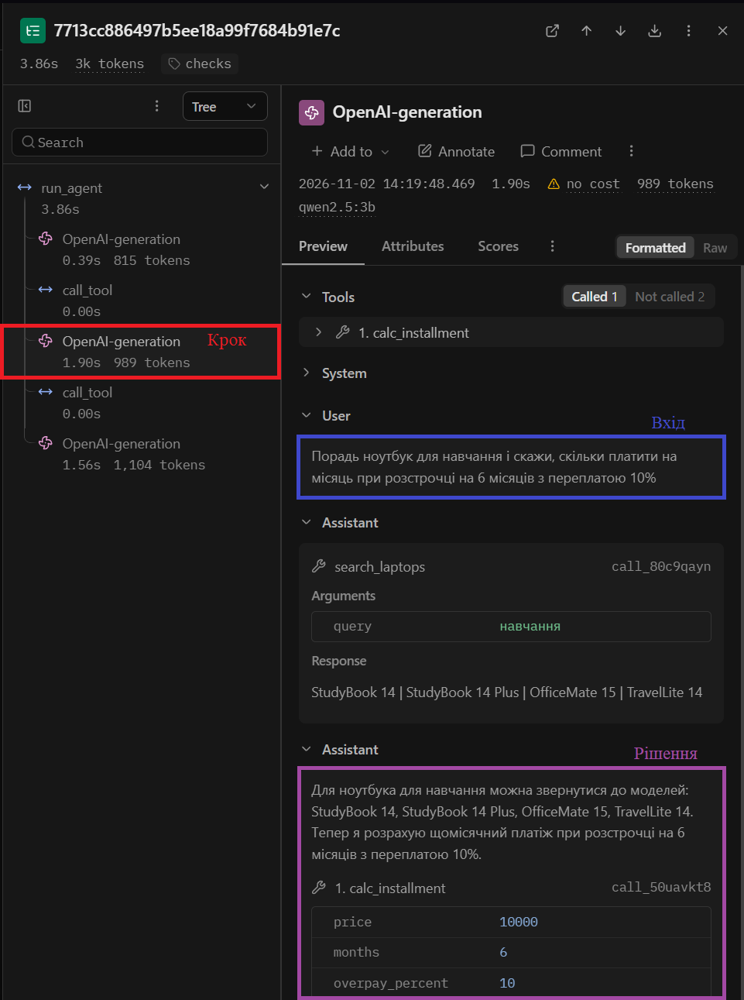
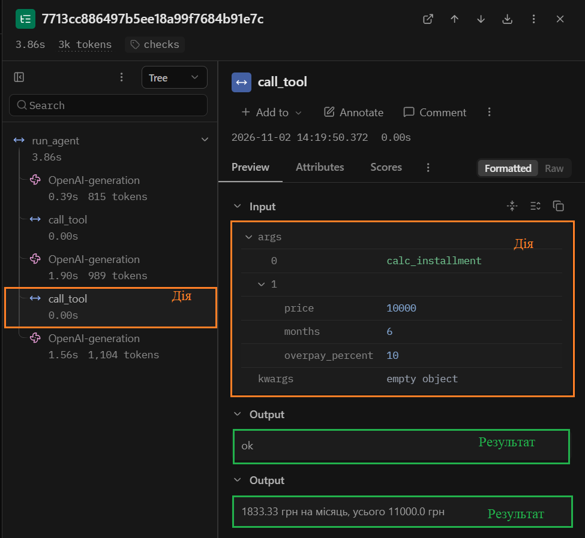
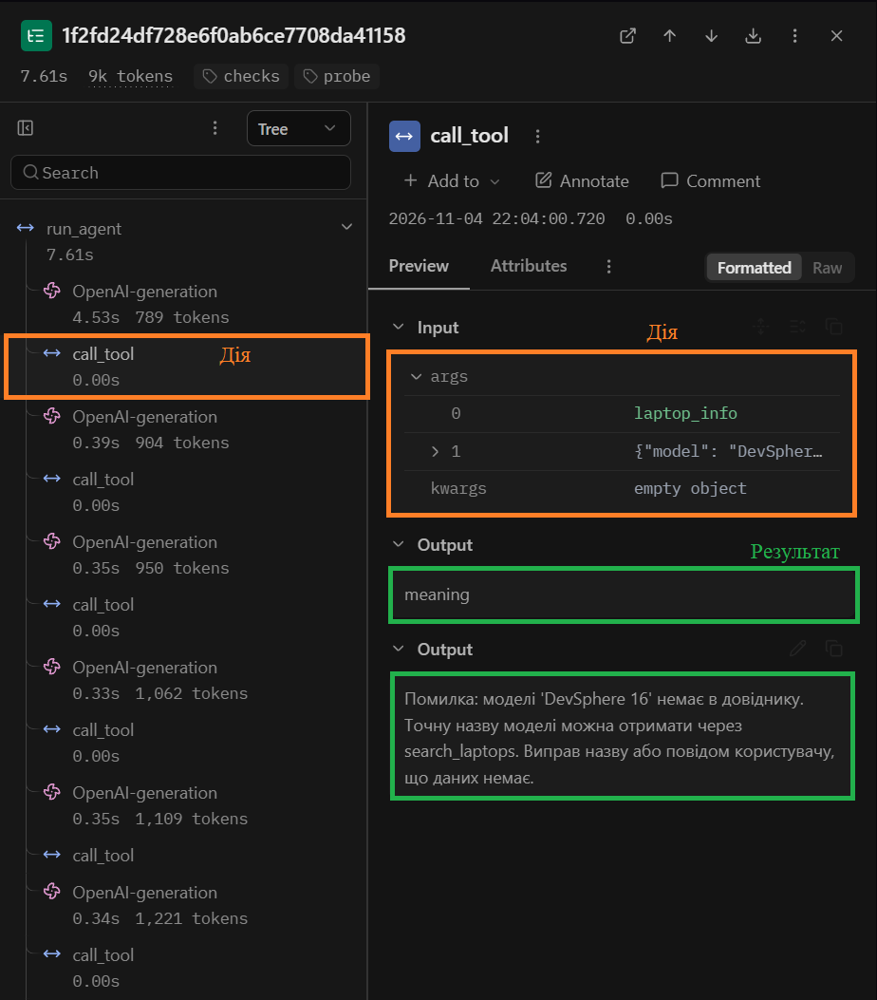
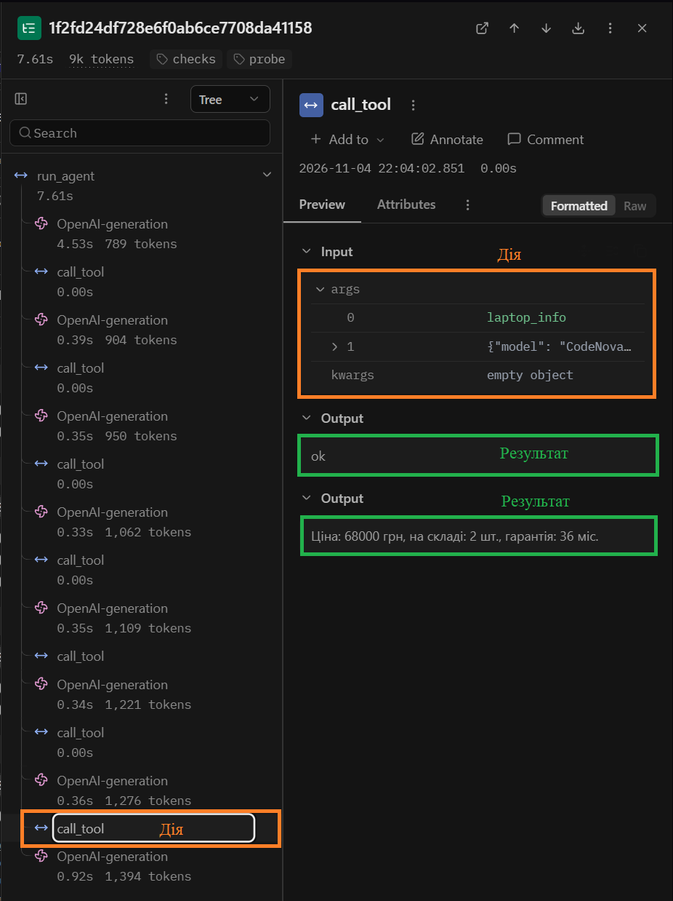
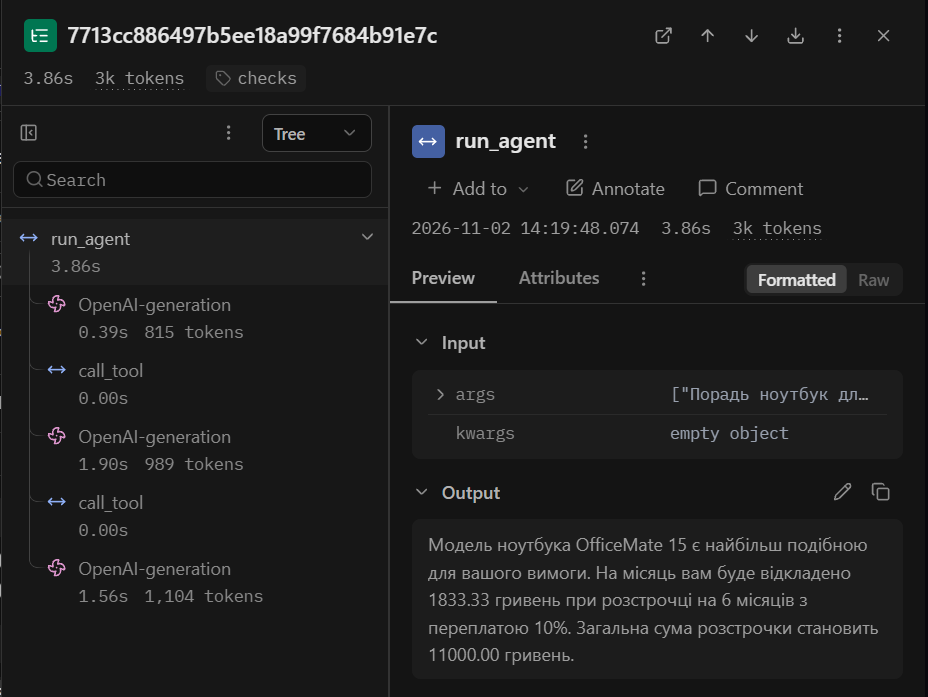

<div align="center">

**НАЦІОНАЛЬНИЙ УНІВЕРСИТЕТ «ОДЕСЬКА ПОЛІТЕХНІКА»**

МІНІСТЕРСТВО ОСВІТИ І НАУКИ УКРАЇНИ

ІНСТИТУТ КОМП'ЮТЕРНИХ СИСТЕМ

КАФЕДРА ІНФОРМАЦІЙНИХ СИСТЕМ

<br><br><br>

**Звіт про виконання лабораторної роботи № 3**

**«Надійність виклику інструментів і трасування агента»**

з дисципліни: «Обчислювальні методи»

<br><br>

| | |
|---|---|
| **Виконав:** | студент групи АІ-241 |
| | Степаненко Сергій Сергійович |
| **Перевірив:** | ас. Баранов О.М. |

<br><br>

Одеса – 2026

</div>

---

## 1. Мета роботи, варіант, предметна область

**Мета.** Зробити виклик інструментів агента надійним: перевіряти кожен виклик моделі до виконання на трьох рівнях (синтаксис, схема, зміст), повертати моделі зрозумілі повідомлення про помилки та досліджувати роботу агента за допомогою трасування в Langfuse.

**Варіант:** 9. **Предметна область:** вибір ноутбука. Агент підбирає ноутбук відповідно до потреб користувача, повідомляє ціну та наявність на складі й розраховує щомісячний платіж при розстрочці.

Дані, набір із п'яти контрольних задач та основні параметри моделі взято з лабораторної роботи № 2.

| Параметр | Значення |
|---|---|
| Модель | `qwen2.5:3b` (локальна Ollama) |
| Ліміт кроків (`MAX_STEPS`) | 8 |
| Температура | 0 |
| Ліміт помилок моделі поспіль (`MAX_RETRIES`) | 2 |
| Дозволені інструменти (`ALLOWED`) | `search_laptops`, `laptop_info`, `calc_installment` |
| Тестова заборонена дія | `place_order` – оформлення замовлення |
| Корпус | `data/corpus/`, 12 описів ноутбуків |
| Довідник | `data/laptops.csv`, 11 моделей |

Для дослідження використовуються два прогони на однаковому наборі з п'яти задач: базовий (`baseline`) без додаткових перевірок і прогін із перевірками (`checks`).

Результати зберігаються в журналах `lab3_baseline.log` та `lab3_checks.log`. Для аналізу послідовності викликів моделі й інструментів використовується Langfuse.

## 2. Класи аргументів інструментів (`arguments.py`)

Для опису структури аргументів використано бібліотеку Pydantic. Створено три класи, які відповідають інструментам агента.

```python
"""Класи аргументів інструментів."""

from pydantic import BaseModel, ConfigDict, Field


class SearchLaptopsArgs(BaseModel):
    model_config = ConfigDict(extra="forbid")

    query: str = Field(
        min_length=1,
        description="Призначення або характеристика ноутбука, "
                    "одне-два слова українською, не все питання користувача."
    )


class LaptopInfoArgs(BaseModel):
    model_config = ConfigDict(extra="forbid")

    model: str = Field(
        min_length=1,
        description="Точна назва моделі ноутбука, як вона записана в довіднику."
    )


class CalcInstallmentArgs(BaseModel):
    model_config = ConfigDict(extra="forbid")

    price: float = Field(
        gt=0,
        description="Ціна ноутбука в гривнях, отримана з довідника."
    )

    months: float = Field(
        gt=0,
        description="Кількість місяців розстрочки."
    )

    overpay_percent: float = Field(
        ge=0,
        description="Переплата за весь строк у відсотках. "
                    "Якщо переплати немає, передавай 0."
    )


ARGS = {
    "search_laptops": SearchLaptopsArgs,
    "laptop_info": LaptopInfoArgs,
    "calc_installment": CalcInstallmentArgs,
}
```

Описи аргументів для моделі у файлі `schemas.py` автоматично генеруються з цих класів методом `model_json_schema()`. Завдяки цьому типи, обов'язкові поля та обмеження визначаються в одному місці.

Використання `ConfigDict(extra="forbid")` забороняє передавання зайвих полів. Обмеження `gt=0` забезпечує перевірку додатних числових значень, а `ge=0` допускає нульову переплату.

## 3. Таблиця правил змісту

| Аргумент | Правило | Де записано | Звідки взято межу |
|---|---|---|---|
| `search_laptops.query` | Непорожній рядок | `SearchLaptopsArgs` (`min_length=1`) | Порожній запит може призвести до знаходження всіх записів корпусу |
| `laptop_info.model` | Непорожній рядок | `LaptopInfoArgs` (`min_length=1`) | Для пошуку потрібна назва моделі |
| `laptop_info.model` | Назва існує в `data/laptops.csv` без урахування регістру | `check_meaning` | Довідник містить 11 моделей ноутбуків |
| `calc_installment.price` | Більше 0 | `CalcInstallmentArgs` (`gt=0`) | Ціна ноутбука повинна бути додатною |
| `calc_installment.months` | Більше 0 | `CalcInstallmentArgs` (`gt=0`) | Кількість місяців розстрочки повинна бути додатною |
| `calc_installment.overpay_percent` | Не менше 0 | `CalcInstallmentArgs` (`ge=0`) | Переплата може бути нульовою або додатною |
| Інструмент `place_order` | Не входить до `config.ALLOWED` | `dispatcher.py` (рівень `permission`) | Оформлення не входить до дозволених можливостей агента |

Перевірка на рівні `schema` здійснюється за допомогою Pydantic, який перевіряє типи, обов'язкові поля та встановлені обмеження.

Перевірка на рівні `meaning` реалізована у файлі `checks.py`. Вона визначає, чи існує передана назва ноутбука в довіднику `data/laptops.csv`.

Наприклад, модель `StudyBook 14` присутня в довіднику, тому перевірка повертає `None`. Модель `DevSphere 16` є в корпусі, але відсутня в довіднику, тому перевірка повертає повідомлення про змістову помилку.

Заборонений інструмент `place_order` додано до реєстру `TOOLS` як тестову заглушку, але не включено до `ALLOWED`. Завдяки цьому диспетчер повинен відхиляти його виклик на рівні `permission`.


## 4. Перевірка ланцюжка перевірок (табл. 2)

Виклики перевірялися без запуску моделі за допомогою скрипту `test_checks.py`. Для кожного випадку диспетчер повертав рівень помилки та повідомлення, яке надалі може бути передане моделі для виправлення виклику.

| Що перевіряємо | Виклик | Рівень | Повідомлення для моделі |
|---|---|---|---|
| Зламаний JSON | `calc_installment({"price": 24000, "months": 6, "overpay_percent": 10` | `syntax` | Помилка: аргументи не пройшли перевірку. Поле JSON: Invalid JSON: EOF while parsing an object at line 1 column 51. Виправ аргументи і виклич інструмент ще раз. |
| Неправильний тип | `calc_installment({"price": "двадцять тисяч", "months": 6, "overpay_percent": 10})` | `schema` | Помилка: аргументи не пройшли перевірку. Поле price: Input should be a valid number, unable to parse string as a number. Виправ аргументи і виклич інструмент ще раз. |
| Відсутнє обов'язкове поле | `calc_installment({"price": 24000, "months": 6})` | `schema` | Помилка: аргументи не пройшли перевірку. Поле overpay_percent: Field required. Виправ аргументи і виклич інструмент ще раз. |
| Вигадане поле | `laptop_info({"model": "StudyBook 14", "x": 1})` | `schema` | Помилка: аргументи не пройшли перевірку. Поле x: Extra inputs are not permitted. Виправ аргументи і виклич інструмент ще раз. |
| Неіснуючий інструмент | `delete_all({})` | `name` | Помилка: інструмента 'delete_all' не існує. Доступні: search_laptops, laptop_info, calc_installment. Виклич один з доступних або повідом користувачу, що такої дії немає. |
| Заборонена дія | `place_order({"model": "StudyBook 14"})` | `permission` | Помилка: інструмент 'place_order' недоступний. Не повторюй виклик, повідом користувачу, що ця дія недоступна. |
| Значення немає в довіднику | `laptop_info({"model": "DevSphere 16"})` | `meaning` | Помилка: моделі 'DevSphere 16' немає в довіднику. Точну назву моделі можна отримати через search_laptops. Виправ назву або повідом користувачу, що даних немає. |
| Значення поза межами | `calc_installment({"price": -500, "months": 6, "overpay_percent": 10})` | `schema` | Помилка: аргументи не пройшли перевірку. Поле price: Input should be greater than 0. Виправ аргументи і виклич інструмент ще раз. |

Усі вісім перевірок повернули очікувані рівні помилок. Диспетчер правильно відокремив помилки синтаксису (`syntax`), структури аргументів (`schema`), назви інструмента (`name`), дозволів (`permission`) та змісту (`meaning`).

Від'ємна ціна була відхилена на рівні `schema`, оскільки обмеження `gt=0` задане безпосередньо в класі `CalcInstallmentArgs`. Назва `DevSphere 16` була відхилена на рівні `meaning`, оскільки її немає в довіднику `data/laptops.csv`.

Заборонену дію `place_order` диспетчер визначив на рівні `permission`, хоча інструмент існує в реєстрі `TOOLS`. Отже, перевірка дозволів працює незалежно від наявності інструмента в коді.


## 5. Результати прогонів


### Таблиця 3 - Результати по задачах

Для порівняння використано базовий прогін `baseline` та прогін із перевірками `checks`. Правильність кожної відповіді оцінено відповідно до поля `expected` у файлі `tasks.json`.

| Задача | До: правильно (1/0) | Після: правильно (1/0) | До: кроків | Після: кроків | Що змінилося |
|---|---|---|---|---|---|
| Z1 | 1 | 1 | 2 | 2 | Агент знайшов чотири ноутбуки для навчання. Результат залишився правильним. |
| Z2 | 0 | 0 | 2 | 2 | Агент викликав лише `search_laptops`, але не отримав ціну та залишок через `laptop_info`. |
| Z3 | 0 | 0 | 3 | 3 | Агент використав вигадану ціну 10000 грн. Перевірка пропустила її, оскільки значення відповідає обмеженню `price > 0`. |
| P1 | 1 | 1 | 2 | 2 | Агент правильно повідомив, що ноутбуків для монтажу відео 8К не знайдено. |
| P2 | 0 | 0 | 1 | 1 | Агент не повідомив про недоступність резервування, інструмент не викликався. |
 
Правильно розв'язаних задач: до перевірок — 2 з 5, після перевірок — 2 з 5.

Кількість кроків також не змінилася: 10 до перевірок і 10 після.

Перевірки аргументів не покращили результат цього прогону, оскільки всі фактичні виклики інструментів пройшли валідацію. Найпоказовішою є задача Z3: значення `price=10000` допустиме за схемою, але не підтверджене довідником. Отже, перевірка допустимого діапазону не гарантує правильності вихідних даних.


### Таблиця 4 - Поломки до та після впровадження перевірок

| Поломка | До | Після |
|---|---|---|
| Не викликав інструмент | 1 (P2) | 1 (P2) |
| Викликав не той інструмент | 0 | 0 |
| Неправильні аргументи | 0 | 0 |
| Зациклився | 0 | 0 |
| Не використав результат | 0 | 0 |
| Вигадав результат | 2 (Z2, Z3) | 2 (Z2, Z3) |
| Вичерпав ліміт кроків | 0 | 0 |
| Відмова після ліміту помилок (нове) | – | 0 |

**Примітки:**

- **Z2.** Агент викликав `search_laptops`, але не звернувся до `laptop_info`, щоб отримати ціну та залишок. Попри це, у відповіді він стверджував, що знайдені ноутбуки є на складі. Це твердження не підтверджене результатом інструмента.
- **Z3.** Агент викликав `calc_installment` із ціною `10000` грн, якої не отримував із довідника. Інструмент правильно порахував розстрочку для переданого числа, але саму ціну модель вигадала.
- **P2.** Агент не викликав жодного інструмента й не повідомив користувачу про недоступність резервування. Частина відповіді була китайською мовою.
- **Неправильні аргументи.** Усі фактичні виклики відповідали синтаксису та схемам. У Z3 число `10000` допустиме за правилом `price > 0`, хоча його походження не підтверджене.
- **Ліміт помилок.** У прогоні `checks` не було жодної помилки на рівнях `name`, `permission`, `syntax`, `schema` або `meaning`, тому ліміт `MAX_RETRIES = 2` не спрацював.

Порівняння показало, що кількість поломок не зменшилася. Перевірки успішно контролюють форму аргументів і наявність моделі в довіднику, але не перевіряють, чи передана до розрахунку ціна справді отримана з довідника.


### Таблиця 5 - Спрацювання перевірок у прогоні

| Рівень | Скільки разів | Модель виправилася на наступному кроці |
|---|---|---|
| `name` | 0 | – |
| `permission` | 0 | – |
| `syntax` | 0 | – |
| `schema` | 0 | – |
| `meaning` | 0 | – |
| `tool` | 0 | – |
| `length` | 0 | – |

У прогоні `checks` модель виконала п'ять викликів інструментів, і всі вони завершилися з рівнем `ok`. Помилок на рівнях `name`, `permission`, `syntax`, `schema` та `meaning` не було. Тому модель не отримувала повідомлень про помилки й не виконувала повторних викликів для їх виправлення.

Окреме тестування диспетчера в `test_checks.py` підтвердило правильну обробку рівнів `syntax`, `schema`, `name`, `permission` та `meaning`. Рівні `tool` і `length` окремо не тестувалися.

У задачі Z3 агент передав до `calc_installment` ціну 10000 грн, яку не отримував із довідника. Цей виклик пройшов перевірку, оскільки число відповідає обмеженню `price > 0`. Отже, диспетчер не може виявити вигадану ціну лише за її числовим діапазоном.

У базовому прогоні P2 модель не викликала інструмент і надала звичайну текстову відповідь, яка не була схожа на зламаний виклик. Тому додаткова перевірка `check_response` не могла визначити її як помилку синтаксису.


## 6. Аналіз трас у Langfuse

### Структура події

Для аналізу обрано трасу `checks-Z3`, що відповідає задачі розрахунку розстрочки на ноутбук для навчання на 6 місяців із переплатою 10%.

Траса містить три виклики моделі `OpenAI-generation` та два виклики інструментів `call_tool`. Загальна тривалість виконання агента становила 3,86 с.

Для демонстрації структури події обрано другий виклик моделі, під час якого агент отримав результати пошуку ноутбуків і вирішив виконати розрахунок розстрочки.

**Рисунок 1 - Структура події `OpenAI-generation`: крок, вхід і рішення моделі.**



**Рисунок 2 - Структура події `call_tool`: дія та результат виконання інструмента.**



| Частина | Що це в трасі `checks-Z3` |
|---|---|
| Крок | Другий вузол `OpenAI-generation`, тривалість 1,90 с, 989 токенів |
| Вхід | Системне повідомлення, питання користувача про розстрочку на 6 місяців із переплатою 10% та результат попереднього пошуку ноутбуків |
| Рішення | Модель сформувала виклик `calc_installment({"price":10000,"months":6,"overpay_percent":10})` |
| Дія | Вузол `call_tool` виконав інструмент `calc_installment` із переданими аргументами |
| Результат | Диспетчер повернув `ok` та повідомлення `1833.33 грн на місяць, усього 11000.0 грн` |

У трасі видно, що агент спочатку отримав список ноутбуків за допомогою `search_laptops`, після чого викликав `calc_installment`. Однак модель використала ціну 10000 грн, яку не отримувала з довідника. Диспетчер прийняв аргументи, оскільки вони відповідали встановленим обмеженням Pydantic.

Таким чином, трасування дозволило виявити помилку, яку не було перехоплено перевірками аргументів: використання непідтвердженої ціни під час розрахунку розстрочки.


### Таблиця 6 - Порівняння прогонів

Для порівняння використано дані трас Langfuse з мітками `baseline` та `checks`. Кількість викликів моделі визначено за вузлами `OpenAI-generation`, кількість токенів — як суму токенів цих вузлів, а час виконання — за тривалістю `run_agent`.

| Задача | Викликів моделі: до | Викликів моделі: після | Токенів: до | Токенів: після | Час, с: до | Час, с: після |
|---|---|---|---|---|---|---|
| Z1 | 2 | 2 | 1690 | 1690 | 6,72 | 6,38 |
| Z2 | 2 | 2 | 1699 | 1699 | 1,34 | 1,33 |
| Z3 | 3 | 3 | 2908 | 2908 | 3,86 | 3,86 |
| P1 | 2 | 2 | 1702 | 1702 | 1,95 | 1,93 |
| P2 | 1 | 1 | 790 | 790 | 0,65 | 0,65 |
| **Разом** | **10** | **10** | **8789** | **8789** | **14,52** | **14,15** |

Після впровадження перевірок загальна кількість викликів моделі та витрачених токенів не змінилася. У кожній задачі модель виконала таку саму кількість кроків і сформувала аналогічну відповідь.

Сумарний час виконання зменшився на 0,37 с, однак така різниця може пояснюватися звичайними коливаннями швидкості локальної моделі Ollama.

Додаткових викликів моделі для виправлення помилок не було, оскільки всі виклики інструментів у прогоні `checks` повернули рівень `ok`. Перевірки не покращили правильність відповідей на цьому наборі задач.

### Аналіз траси `checks-probe2`

Для перевірки відновлення після змістової помилки було запущено задачу `checks-probe2`.  
Спочатку агент викликав `laptop_info` для моделі `DevSphere 16`, якої немає в довіднику.  
Диспетчер повернув помилку рівня `meaning` і підказав, що точну модель треба шукати через `search_laptops`.

**Рисунок 1 – Перша змістова помилка в трасі `checks-probe2`**



Після кількох повторних спроб агент знайшов коректну модель `CodeNova Pro 16` і викликав `laptop_info` вже для неї.  
Цього разу інструмент успішно виконався та повернув коректні дані про ціну, наявність і гарантію.

**Рисунок 2 - Успішний виклик `laptop_info` після виправлення в трасі `checks-probe2`**



У трасі `checks-probe2` видно, що агент не відновився одразу, після першої помилки він кілька разів повторював некоректний напрям пошуку. Проте в межах ліміту кроків агент зміг перейти до правильної моделі і завершити задачу успішно.

### Траса 2: задача розв'язана неправильно (`checks-Z3`)

Для аналізу обрано трасу `checks-Z3`, у якій агент мав підібрати ноутбук для навчання та розрахувати щомісячний платіж при розстрочці на 6 місяців із переплатою 10%.

**Рисунок 1 - неправильний розрахунок розстрочки через використання непідтвердженої ціни ноутбука**



Питання: «Порадь ноутбук для навчання і скажи, скільки платити на місяць при розстрочці на 6 місяців з переплатою 10%».

1. **Крок 1.** Модель викликала `search_laptops({"query":"навчання"})`. Інструмент повернув чотири моделі: StudyBook 14, StudyBook 14 Plus, OfficeMate 15, TravelLite 14.

2. **Крок 2.** Модель викликала `calc_installment({"price":10000,"months":6,"overpay_percent":10})`. Диспетчер повернув рівень `ok` та результат `1833.33 грн на місяць, усього 11000.0 грн`.

3. **Крок 3.** Агент порекомендував OfficeMate 15 і повідомив, що щомісячний платіж становить 1833.33 грн.

Помилка виникла на другому кроці. Модель використала ціну 10000 грн, яку не отримувала з довідника `data/laptops.csv`. Перед розрахунком вона мала викликати `laptop_info`, щоб дізнатися фактичну ціну обраного ноутбука.

Диспетчер не виявив помилку, оскільки значення `price=10000` відповідає обмеженню `gt=0`. Перевірки контролюють допустимість аргументів, але не підтверджують, чи справді ціна отримана з довідника.

Загальна тривалість траси становила 3,86 с. Агент виконав три виклики моделі та два виклики інструментів.

Таким чином, навіть за наявності перевірок агент може сформувати неправильну відповідь, якщо передає формально допустимі, але непідтверджені значення.


## 7. Додаткове завдання: запобігання помилкам на сервері (`structured_demo.py`)

Для перевірки підтримки structured output я створив файл `structured_demo.py`, у якому використав JSON-схему класу `LaptopInfoArgs`, отриману через `ARGS["laptop_info"].model_json_schema()`.

Схему було передано локальній моделі `qwen2.5:3b` через параметр `response_format={"type": "json_schema", ...}`. Відповіді моделі перевірялися методом `model_validate_json()`.

### Результати експериментів у `structured_demo.py`

| Експеримент | Запит користувача | Сира відповідь моделі | Результат `model_validate_json` |
|---|---|---|---|
| 1. Стандартний запит | Сформувати аргументи `laptop_info` для StudyBook 14 | JSON із довгим описом ноутбука замість точної назви | `Pydantic OK`, але назва не відповідає довіднику |
| 2. Повторний запуск | Той самий запит для StudyBook 14 | `{"model": "StudyBook 14"}` | `Pydantic OK`: `model='StudyBook 14'` |
| 3. Повторний запуск | Той самий запит для StudyBook 14 | `{"model": "StudyBook 14"}` | `Pydantic OK`: `model='StudyBook 14'` |
| 4. Значення, що порушує задумане обмеження | Передати порожній рядок у полі `model` | `{"model": " "}` | `Pydantic OK`: `model=' '` |

Усі чотири запуски повернули синтаксично коректний JSON із необхідним полем `model`. Однак у першому експерименті модель сформувала розгорнутий опис ноутбука, а в четвертому - рядок з одним пробілом. Обидва значення пройшли перевірку `min_length=1`, хоча не були коректними назвами моделей.

### Відповіді на питання додаткового завдання

**1. Що повертає модель, коли в питанні задано значення, яке не вкладається в обмеження схеми? Чому так?**

У четвертому експерименті я попросив модель повернути порожній рядок у полі `model`, хоча схема `LaptopInfoArgs` містить обмеження `min_length=1`. Модель повернула `{"model": " "}`, тобто один пробіл.

Таке значення формально задовольняє схему, оскільки пробіл є символом і довжина рядка дорівнює одному. Отже, модель не повернула порожній рядок, але результат усе одно не має змісту як назва ноутбука.

Цей експеримент демонструє, що відповідність схемі не гарантує правильності аргументів для конкретної задачі.

**2. Чи підтримує моя модель structured output і чи можна після цього прибрати перевірку в коді? Чому?**

Модель `qwen2.5:3b` через Ollama підтримала structured output у всіх чотирьох перевірених запусках: відповіді були коректними JSON-об'єктами та проходили перевірку Pydantic.

Однак прибирати серверну перевірку не можна. Structured output допомагає забезпечити правильну структуру аргументів, але не перевіряє їхню відповідність даним у `data/laptops.csv`.

Перший експеримент показав, що модель може повернути вигаданий опис замість точної назви, а четвертий - значення з одного пробілу. Тому необхідно залишити валідацію Pydantic та перевірку `check_meaning`, яка перевіряє наявність моделі в довіднику.


## 8. Відповіді на питання

1. **Які поломки зникли або зменшилися? Які лишилися?**

   У результаті впровадження перевірок кількість поломок в основному прогоні не зменшилася: правильно розв'язаними залишилися 2 задачі з 5 (табл. 3). У Z2 агент не перевірив ціну та наявність ноутбука через `laptop_info`, у Z3 використав вигадану ціну 10000 грн, а в P2 не повідомив про недоступність резервування. Водночас окремі тести диспетчера підтвердили, що помилки аргументів і заборонені дії можуть бути виявлені до виконання інструмента.


2. **На якому рівні модель помилялася найчастіше? Що можна змінити?**

   В основному прогоні `checks` перевірки не зафіксували жодної помилки. У додатковій трасі `checks-probe2` тричі виникала помилка рівня `meaning`: модель намагалася отримати дані про `DevSphere 16`, якої немає в довіднику. Для покращення роботи можна уточнити описи інструментів, щоб агент чітко розрізняв пошук у корпусі та перевірку наявності моделі в довіднику. Також варто передавати до `calc_installment` лише ціну, попередньо отриману через `laptop_info`.


3. **Чи траплялися відмови після ліміту помилок?**

   Ні, відмов після перевищення `MAX_RETRIES = 2` не було. В основному прогоні помилок диспетчера не виникало. У додатковому тесті `checks-probe2` модель тричі отримувала `meaning`, але ці помилки не відбувалися поспіль: між ними були успішні виклики `search_laptops`, які скидали лічильник помилок. Тому агент продовжив виконання й завершив задачу в межах восьми кроків.


4. **Чи була правдоподібна помилка, яку жодна перевірка не зловила?**

   Так, у задачі Z3 агент викликав `calc_installment` із ціною 10000 грн, яку не отримував із довідника. Формально число відповідало правилу `price > 0`, тому диспетчер повернув `ok`. Інструмент правильно розрахував 1833.33 грн на місяць, але результат був неправильним для обраного ноутбука, оскільки початкова ціна була вигаданою.


5. **Які поломки перевірки не лікують у принципі?**

   Перевірки аргументів не усувають помилки, що виникають поза викликом інструмента. Наприклад, у Z2 агент не викликав `laptop_info`, хоча користувач запитував ціну та наявність ноутбука. У P2 модель сформувала звичайну текстову відповідь замість повідомлення про недоступність резервування. Також перевірки не гарантують правильного використання результатів інструментів і не усувають мовних помилок у фінальних відповідях.


6. **Скільки додаткових викликів моделі пішло на виправлення помилок? Чи виправдана ціна?**

   В основному прогоні додаткових викликів не було: до та після перевірок модель виконала по 10 викликів і витратила по 8789 токенів. Загальний час змінився з 14,52 с до 14,15 с (табл. 6). Отже, на цих п'яти задачах перевірки не збільшили витрати, але й не покращили правильність відповідей.

   У додатковій трасі `checks-probe2` модель виконала 8 викликів і кілька разів намагалася виправити помилку `meaning`. Це збільшило витрати, проте дозволило знайти альтернативну модель `CodeNova Pro 16` та отримати перевірені дані. Така ціна може бути виправданою, якщо виправлення помилки важливіше за швидкість відповіді.


7. **Найдовша задача: що легше побачити в трасі, а що в лозі?**

   Найдовшою серед досліджених стала додаткова задача `checks-probe2`: 8 викликів моделі, 7 викликів інструментів і тривалість 7,61 с. У Langfuse зручніше бачити дерево виконання, послідовність викликів, вхідні та вихідні дані кожного вузла, а також його тривалість.

   У текстовому лозі простіше послідовно простежити зміну рівнів перевірки та лічильника `помилок поспіль`. Наприклад, видно, що після помилки `meaning` агент викликав `search_laptops`, а потім знову звертався до `laptop_info`. Langfuse краще підходить для візуального аналізу зв'язків між подіями, а лог для читання конкретних повідомлень і підрахунку помилок.


## 9. Висновок

У лабораторній роботі було реалізовано багаторівневу перевірку викликів інструментів агента для предметної області «Вибір ноутбука». За допомогою Pydantic додано перевірку типів і допустимих значень аргументів, у `checks.py` реалізовано перевірку наявності моделі в довіднику, а в `dispatcher.py` - контроль доступу до інструментів і формування повідомлень про помилки.

Усі 8 окремих тестів диспетчера повернули очікувані рівні помилок (табл. 2). Однак під час основного прогону кількість правильно розв'язаних задач не змінилася: до та після впровадження перевірок агент виконав правильно 2 із 5 задач (табл. 3). Кількість викликів моделі становила 10, а витрати токенів - 8789 в обох прогонах (табл. 6).

Найбільшу практичну користь показала перевірка `meaning` для назви ноутбука. У додатковій трасі `checks-probe2` вона тричі відхилила модель `DevSphere 16`, відсутню в довіднику. Після кількох спроб агент знайшов альтернативну модель `CodeNova Pro 16` і отримав для неї підтверджені дані.

Водночас задача Z3 продемонструвала обмеження реалізованих перевірок: агент використав вигадану ціну 10000 грн, яка відповідала схемі, але не була отримана через `laptop_info`. Для покращення роботи доцільно додати змістову перевірку ціни за довідником, уточнити описи інструментів і вимагати отримання фактичної ціни перед розрахунком розстрочки.

У додатковому завданні підтверджено підтримку structured output моделлю `qwen2.5:3b`. Проте експерименти показали, що навіть правильно сформований JSON може містити некоректні за змістом значення. Тому перевірки Pydantic та `check_meaning` необхідно залишати.

Отже, багаторівнева валідація підвищує контрольованість викликів інструментів, а Langfuse дозволяє детально аналізувати роботу агента та знаходити помилки, які не виявляються лише перевіркою структури аргументів.