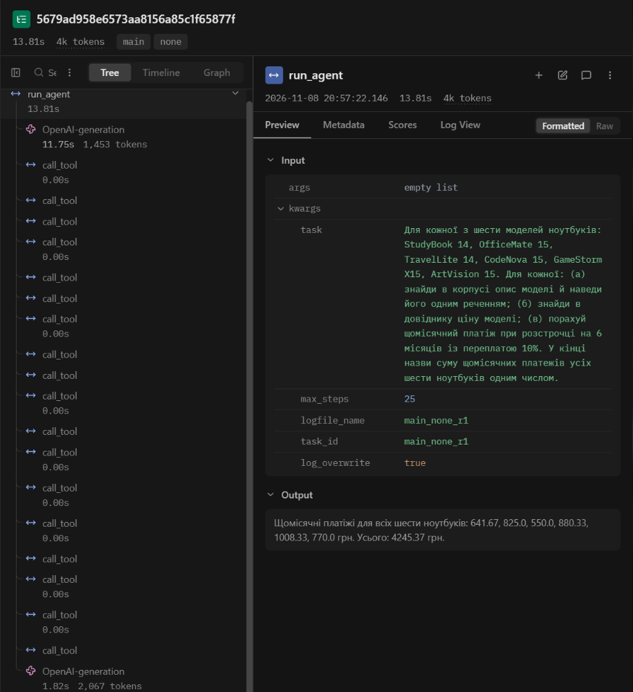
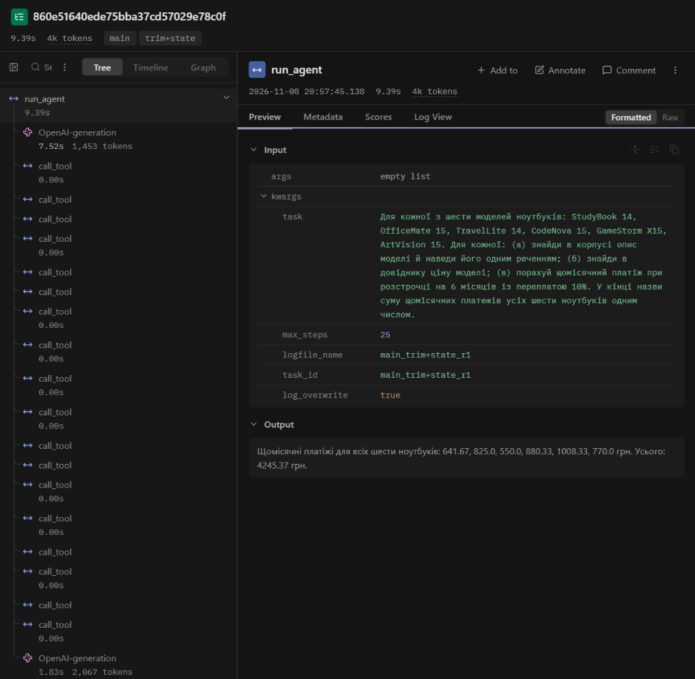

<div align="center">

**НАЦІОНАЛЬНИЙ УНІВЕРСИТЕТ «ОДЕСЬКА ПОЛІТЕХНІКА»**

МІНІСТЕРСТВО ОСВІТИ І НАУКИ УКРАЇНИ

ІНСТИТУТ КОМП'ЮТЕРНИХ СИСТЕМ

КАФЕДРА ІНФОРМАЦІЙНИХ СИСТЕМ

<br><br><br>

**Звіт про виконання лабораторної роботи № 4**

**«Контекст, стан і кеш агента»**

з дисципліни: «Обчислювальні методи»

<br><br>

| | |
|---|---|
| **Виконав:** | студент групи АІ-241 |
| | Степаненко Сергій Сергійович |
| **Перевірив:** | ас. Баранов О.М. |

<br><br>

Одеса – 2026

</div>

---

## 1. Мета роботи, варіант, предметна область, модель і розмір вікна

**Мета.** Побачити, що відбувається з агентом, коли історія не вміщується в контекстне вікно моделі; навчитися скорочувати історію, зберігати результати інструментів поза текстом діалогу та кешувати виклики моделі; виміряти, скільки це коштує.

**Варіант:** 9. **Предметна область:** вибір ноутбука. Агент підбирає ноутбук відповідно до потреб користувача, повідомляє ціну та наявність на складі й розраховує щомісячний платіж при розстрочці.

Для виконання лабораторної роботи використано агента з лабораторної №3, реалізованого мовою Python із локальною моделлю Ollama та трасуванням у Langfuse.

Для обмеження контекстного вікна створено файл `Modelfile`:

```text
FROM qwen2.5:3b
PARAMETER num_ctx 4096
```

На його основі командою `ollama create qwen25-4k -f Modelfile` створено модель `qwen25-4k`.

| Параметр | Значення |
|---|---|
| Вихідна модель | `qwen2.5:3b` |
| Довжина контексту вихідної моделі | 32768 токенів |
| Розмір вікна нової моделі (`num_ctx`) | 4096 токенів |
| Коефіцієнт звуження контекстного вікна | 8 разів |

Коефіцієнт звуження:

$$
K = \frac{32768}{4096} = 8.
$$

У файлі `config.py` встановлено `MODEL = "qwen25-4k"`, `NUM_CTX = 4096`, `MAX_STEPS_LONG = 25`, `RUN_TAG = "ctx-control"` та `LAB_LOGFILE_NAME = "lab4"`.

Початкові експерименти виконано з контекстним вікном 4096 токенів. Оскільки задача виявилася закороткою (випадок C), вікно зменшено до 3072 токенів. Для подальших експериментів використовується модель `qwen25-3k`.


## 2. Довга задача: питання і правильна відповідь

Для дослідження роботи агента з обмеженим контекстним вікном створено скрипт `make_task.py`, який формує файл `long_task.json`.

**Питання:**

Для кожної з шести моделей ноутбуків: StudyBook 14, OfficeMate 15, TravelLite 14, CodeNova 15, GameStorm X15, ArtVision 15. Для кожної:

(а) знайди в корпусі опис моделі й наведи його одним реченням;

(б) знайди в довіднику ціну моделі;

(в) порахуй щомісячний платіж при розстрочці на 6 місяців із переплатою 10%.

У кінці назви суму щомісячних платежів усіх шести ноутбуків одним числом.

**Мінімальна кількість викликів інструментів:** 18 (по три виклики для кожної з шести моделей).

**Правильна відповідь:** 42716.7 грн.

Правильну відповідь обчислено програмно за допомогою функцій `laptop_info` і `calc_installment`, без використання мовної моделі. Результат записано у файл `long_task.json` у поле `expected`.


### Пробний запуск без захисту контексту

Для перевірки роботи агента без захисту контекстного вікна виконано команду `python measure.py none 1 probe`.

| Показник | Значення |
|---|---|
| Конфігурація | `none` |
| Час виконання | 14,5 с |
| Кількість викликів моделі | 2 |
| Кількість викликів інструментів | 18 |
| Правильна відповідь | 42716.7 грн |
| Відповідь агента | 4245.37 грн |
| Правильність | Ні |

Агент виконав усі 18 викликів інструментів, однак під час розрахунку розстрочки використовував ціни, що не відповідали значенням із довідника. Усі виклики пройшли перевірки та повернули рівень `ok`.

На першому кроці вхід становив 919 токенів, на другому 1981 токен. Помилки переповнення контекстного вікна не виникло, проте відповідь агента була неправильною.


## 3. Аналіз зростання контексту без захисту

Для аналізу пробного прогону виконано команду `python analyze.py logs\probe_none_r1.log steps`.


**Таблиця 2 — Зростання входу в прогоні без захисту**

| Крок | `prompt_tokens` | Приріст | Що зробила модель |
|---|---:|---:|---|
| 1 | 919 | — | Виконала по 3 виклики інструментів для кожного з 6 ноутбуків (усього 18 викликів) |
| 2 | 1981 | +1062 | Сформувала фінальну відповідь без виклику інструментів |

На першому кроці модель викликала `search_laptops`, `laptop_info` та `calc_installment` для кожного із шести ноутбуків. Усі виклики завершилися з рівнем `ok`, проте під час розрахунків модель використала неправильні значення цін.


**(а) Постійна частина входу:** 919 токенів.

**(б) Типовий приріст за крок:** 1062 токени.

**(в) Сума `prompt_tokens` за прогін:** 2900 токенів.

Розрахунок за формулою:

$$
nC + d\frac{n(n-1)}{2}
= 2 \cdot 919 + 1062 \cdot \frac{2(2-1)}{2}
= 2900
$$

Розраховане значення збігається з фактичною сумою `prompt_tokens`.

**(г) Крок, на якому вхід перестав рости:** не виявлено. Максимальний вхід становив 1981 токен, тобто 48% контекстного вікна.

**(д) Поведінка моделі після зупинки зростання:** не досліджувалася, оскільки зупинки зростання не було. На другому кроці агент сформував фінальну відповідь без виклику інструмента. Водночас він використав для розрахунків ціни, які не відповідали даним довідника.

**Випадок C — задача закоротка.**

Прогін завершився зі статусом `final`, а найбільший вхід не досяг 95% контекстного вікна. Тому відповідно до методички потрібно зменшити розмір вікна до 3072 токенів і повторити дослідження.


### Повторний прогін із контекстним вікном 3072 токени

Оскільки перший прогін завершився випадком C, відповідно до методички контекстне вікно було зменшено до 3072 токенів. Створено модель `qwen25-3k` та виконано повторний запуск `python measure.py none 1 probe3k`.

| Крок | `prompt_tokens` | Приріст | Що зробила модель |
|---|---:|---:|---|
| 1 | 919 | — | Виконала 18 викликів інструментів для шести ноутбуків |
| 2 | 1981 | 1062 | Сформувала фінальну відповідь |

**Результати аналізу:**

- Постійна частина входу — 919 токенів.
- Типовий приріст — 1062 токени.
- Сума `prompt_tokens` — 2900 токенів.
- Значення за формулою — 2900 токенів.
- Максимальний вхід — 1981 токен (64% вікна).
- Зупинки зростання входу не виявлено.
- Повторних викликів інструментів — 0.

Прогін завершився за 15,6 с зі статусом `final`. Агент виконав усі 18 викликів інструментів, але повернув неправильну суму 4245.37 грн замість 42716.7 грн.

**Висновок:** повторний прогін також відповідає випадку C. Зменшення контекстного вікна з 4096 до 3072 токенів не змінило кількість викликів моделі, витрати токенів або правильність відповіді. Ознак переповнення контексту не виявлено.

Для подальших експериментів використовується модель `qwen25-3k` із контекстним вікном 3072 токени.


## 4. Скорочення історії повідомлень

Для перевірки скорочення історії було реалізовано функції `trim()` та `compress_history()`. Використано модель `qwen25-3k` із контекстним вікном 3072 токени, порогом скорочення 2150 токенів і параметром `KEEP_LAST = 6`.


**Таблиця 3 — Стиснення історії**

| Конфігурація | Крок стиснення | Вхід до стиснення, токенів | Повідомлень було → стало | Повторних викликів за прогін |
|---|---|---|---|---:|
| `trim` | Не відбулося | — | — | 0 |
| `trim+state` | Не відбулося | — | — | 0 |

### Аналіз використання стану

У конфігурації `trim+state` агент виконав 18 успішних викликів інструментів за два кроки моделі. Максимальний вхід становив 1981 токен при порозі стиснення 2150 токенів.

Оскільки стиснення історії не відбулося, блок `ПЕРШЕ ПОВІДОМЛЕННЯ КОРИСТУВАЧА ПІСЛЯ СТИСНЕННЯ` у журналі відсутній. Тому оцінити його розмір у токенах і порівняти з типовим приростом 1062 токени неможливо.

Збереження стану не вплинуло на результат: агент повернув 4245.37 грн замість 42716.7 грн. Кількість кроків, викликів інструментів і витрати токенів залишилися такими самими, як у конфігураціях `none` та `trim`.

Файл `state/probe_trim+state_r1.json` містить 18 записів про успішні виклики інструментів: по шість викликів `search_laptops`, `laptop_info` та `calc_installment`. Кожен запис містить назву інструмента, аргументи та результат виконання.

Отже, механізм збереження стану працює правильно. Проте під час цього прогону стан не використовувався для відновлення контексту, оскільки скорочення історії не відбулося.


## 5. Кешування викликів моделі

Для дослідження кешування реалізовано модуль `cache.py`, який зберігає відповіді мовної моделі за ключем SHA-256, сформованим із параметрів запиту.

Було виконано два однакові прогони. Перед першим запуском кеш очищено. Перший прогін `cache1` заповнив кеш, а другий `cache2` використав збережені відповіді.

**Таблиця 4 — Результати кешування**

| Показник | Без готового кешу (`cache1`) | Із готовим кешем (`cache2`) |
|---|---:|---:|
| Час виконання, с | 14,3 | 0,9 |
| Кроків моделі | 2 | 2 |
| Звернень до сервера моделі | 2 | 0 |
| Влучань у кеш | 0 | 2 |
| Сума `prompt_tokens` у журналі | 2900 | 2900 |
| Викликів інструментів | 18 | 18 |
| Правильна відповідь | Ні | Ні |

Коефіцієнт прискорення:

$$
K = \frac{14.3}{0.9} \approx 15.9
$$

Другий прогін виконався приблизно у 15,9 раза швидше за перший.

У журналі `cache2_none_r1.log` обидва кроки містять позначку `з кешу`. Це означає, що відповіді моделі було отримано з локальних файлів без повторного звернення до сервера.

У двох прогонах зафіксовано однакову суму `prompt_tokens` — 2900, оскільки під час читання кешу повертаються збережені об'єкти відповідей разом із показниками використання токенів. У другому прогоні ці токени не генерувалися повторно.

**Висновок:** кешування значно зменшило час виконання повторного запиту та усунуло необхідність повторних звернень до мовної моделі. Проте кеш зберіг також неправильну відповідь 4245.37 грн замість 42716.7 грн. Отже, кеш покращує швидкість, але не гарантує правильності результату.


## 6. Порівняння конфігурацій агента

Для порівняння конфігурацій `none`, `trim` та `trim+state` виконано команду `python measure.py all 3 main`. Кожну конфігурацію перевірено тричі. Для кількісних показників обчислено медіани.

**Таблиця 5 — Вартість циклу в трьох конфігураціях (медіани по трьох повторах)**

| Конфігурація | Правильно (з 3) | Кроків | Токенів на вхід | Токенів на вихід | Час, с | Стиснень | Повторних викликів |
|---|---:|---:|---:|---:|---:|---:|---:|
| `none` | 0 | 2 | 2900 | 620 | 9,4 | 0 | 0 |
| `trim` | 0 | 2 | 2900 | 620 | 9,2 | 0 | 0 |
| `trim+state` | 0 | 2 | 2900 | 620 | 9,2 | 0 | 0 |

### Аналіз результатів

У всіх дев'яти прогонах агент виконав 18 викликів інструментів і завершив роботу за два кроки моделі. Жоден прогін не дав правильної відповіді: модель повертала 4245.37 грн замість 42716.7 грн.

Сума вхідних токенів становила 2900, вихідних — 620 для кожної конфігурації. Скорочення історії не відбулося, тому конфігурації `trim` і `trim+state` не продемонстрували економії токенів.

Найменша медіана часу становила 9,2 с для `trim` і `trim+state`, проте різниця з `none` (9,4 с) не доводить переваги механізмів скорочення, оскільки вони не активувалися.

Основною причиною неправильних відповідей було використання моделлю некоректних цін у викликах `calc_installment`. Отже, помилка виникала під час передавання аргументів інструментам, а не внаслідок переповнення контекстного вікна.


### Аналіз помилок агента

Для аналізу журналів виконано команди:

- `python analyze.py logs\main_none_r1.log`
- `python analyze.py logs\main_trim_r1.log`
- `python analyze.py logs\main_trim+state_r1.log`

Усі три прогони завершилися зі статусом `final` за два кроки моделі. Максимальний вхід становив 1981 токен (64% контекстного вікна 3072 токени). Зупинки зростання контексту, повторних викликів інструментів і влучань у кеш не виявлено.

Агент виконав усі 18 необхідних викликів інструментів, тому передчасного завершення з пропущеними викликами не було.

Водночас модель передавала у `calc_installment` неправильні ціни, хоча `laptop_info` повертав правильні дані. Через це остаточна відповідь становила 4245.37 грн замість 42716.7 грн.

Таким чином, причиною помилки стало неправильне формування аргументів інструментів, а не втрата контексту чи неправильна робота механізму кешування.


### Аналіз трас Langfuse

Для перевірки роботи агента проаналізовано дві траси Langfuse: `long-main_none_r1` та `long-main_trim+state_r1`.

**Рисунок 1 — Траса `long-main_none_r1` у Langfuse.**


**Рисунок 2 — Траса `long-main_trim+state_r1` у Langfuse.**


#### Порівняння трас

| Показник | `none` | `trim+state` |
|---|---:|---:|
| Час виконання, с | 13,81 | 9,39 |
| Кількість генерацій моделі | 2 | 2 |
| Кількість викликів інструментів | 18 | 18 |
| Токенів першої генерації | 1453 | 1453 |
| Токенів другої генерації | 2067 | 2067 |
| Загальна кількість токенів | 3520 | 3520 |
| Вхідних токенів | 2900 | 2900 |
| Вихідних токенів | 620 | 620 |
| Скорочень історії | 0 | 0 |
| Повторних викликів інструментів | 0 | 0 |
| Правильність відповіді | Ні | Ні |

#### Структура виконання агента

У кожній трасі кореневим спостереженням є `run_agent`, яке охоплює весь процес оброблення задачі.

Перша генерація `OpenAI-generation` містить 1453 токени: 919 вхідних і 534 вихідних. На цьому кроці модель сформувала 18 викликів інструментів: шість `search_laptops`, шість `laptop_info` і шість `calc_installment`.

Усі виклики відображаються у дереві траси як окремі спостереження `call_tool`. Кожен виклик містить аргументи, передані інструменту, та результат його виконання.

Друга генерація `OpenAI-generation` містить 2067 токенів: 1981 вхідний і 86 вихідних. На цьому кроці модель використала результати попередніх викликів і сформувала остаточну відповідь без додаткових звернень до інструментів.

Загальна кількість токенів за одну трасу:

$$
T_{\text{input}} = 919 + 1981 = 2900
$$

$$
T_{\text{output}} = 534 + 86 = 620
$$

$$
T_{\text{total}} = 2900 + 620 = 3520
$$

У верхній частині інтерфейсу Langfuse відображається округлене значення `4k tokens`, тоді як фактична сума становить 3520 токенів.

#### Аналіз впливу скорочення історії та стану

Конфігурація `none` передбачає збереження повної історії повідомлень без застосування скорочення. У конфігурації `trim+state` реалізовано механізм скорочення історії з можливістю відновлення результатів інструментів зі збереженого стану.

Проте під час виконаних експериментів максимальний вхід становив лише 1981 токен при контекстному вікні 3072 токени та порозі скорочення 2150 токенів.

Тому механізм скорочення не активувався в жодній конфігурації. Збережений стан не додавався до запиту мовної моделі, а кількість генерацій, викликів інструментів і витрати токенів залишилися однаковими.

Отже, результати цього експерименту не дають змоги оцінити реальну ефективність скорочення історії та відновлення контексту зі стану.

#### Аналіз помилок

У двох трасах агент завершив роботу зі статусом `final` і сформував однакову відповідь — 4245.37 грн замість правильних 42716.7 грн.

Причиною помилки стало використання неправильних значень цін під час викликів `calc_installment`.

Наприклад, для ноутбука `StudyBook 14` інструмент `laptop_info` повернув ціну 24000 грн, проте модель передала до `calc_installment` значення `price=3500`. У результаті було розраховано платіж 641.67 грн замість 4400 грн.

Аналогічні помилки спостерігалися для інших п'яти моделей ноутбуків. Це свідчить про неправильне формування аргументів інструментів мовною моделлю навіть за наявності достатнього контекстного вікна.

Водночас модель виконала всі 18 необхідних викликів інструментів. Повторних викликів, передчасного завершення та помилок переповнення контексту не зафіксовано.

#### Висновок за результатами трасування

Аналіз трас Langfuse підтвердив, що обидві конфігурації мають однакову структуру виконання та однакові витрати токенів. Різниця в тривалості виконання (13,81 с проти 9,39 с) не пов'язана з фактичним скороченням історії, оскільки воно не відбувалося.

Основним обмеженням агента в цьому експерименті виявилася не місткість контекстного вікна, а неправильне використання даних інструментів під час формування наступних викликів.

Таким чином, механізм збереження стану реалізовано, але його переваги не вдалося продемонструвати на вибраній задачі через недостатнє зростання історії повідомлень.


## 7. Додаткове завдання: підсумовування замість обрізання

У додатковому завданні реалізовано альтернативний спосіб скорочення історії повідомлень — підсумовування за допомогою мовної моделі.

На відміну від `trim`, який видаляє старі повідомлення, механізм `summary` передбачає створення короткого текстового переказу попередніх кроків. Для цього у файлі `summary.py` реалізовано функції `split_history()`, `render_messages()`, `summarize()` та `compress_by_summary()`.

Для перевірки виконано команду:

`python measure.py summary 3 extra`

**Таблиця 6 — Результати конфігурації `summary` (медіани трьох прогонів)**

| Показник | Значення |
|---|---:|
| Правильно | 0 з 3 |
| Кроків | 2 |
| Токенів на вхід | 2900 |
| Токенів на вихід | 620 |
| Токенів на підсумовування | 0 |
| Час, с | 9,4 |
| Стиснень | 0 |
| Повторних викликів | 0 |

### Аналіз результатів

У всіх трьох прогонах агент завершив роботу за два кроки моделі. На першому кроці було виконано 18 викликів інструментів, а на другому сформовано фінальну відповідь.

Максимальний вхід становив 1981 токен при порозі скорочення 2150 токенів. Тому підсумовування історії не активувалося, а додаткові витрати на нього дорівнювали нулю.

Відповідь агента становила 4245.37 грн замість правильних 42716.7 грн. Отже, конфігурація `summary` не покращила точність виконання задачі.

### Порівняння з основними конфігураціями

| Конфігурація | Правильно (з 3) | Вхідних токенів | Вихідних токенів | Токенів на підсумовування | Час, с | Стиснень |
|---|---:|---:|---:|---:|---:|---:|
| `none` | 0 | 2900 | 620 | 0 | 9,4 | 0 |
| `trim` | 0 | 2900 | 620 | 0 | 9,2 | 0 |
| `trim+state` | 0 | 2900 | 620 | 0 | 9,2 | 0 |
| `summary` | 0 | 2900 | 620 | 0 | 9,4 | 0 |

Усі конфігурації продемонстрували однакові витрати токенів і правильність відповідей. Незначні відмінності в часі виконання не можна пов'язувати зі способом скорочення історії, оскільки жоден із механізмів не активувався.

### Висновок до додаткового завдання

Механізм підсумовування історії реалізовано та підключено до агента. Однак через недостатнє зростання контексту він не був задіяний під час експериментів.

Тому фактичну економію токенів, вартість створення переказу та вплив підсумовування на якість відповідей у цих прогонах оцінити не вдалося. Для такого порівняння потрібна задача, яка активує скорочення історії.


## 8. Відповіді на питання

**1. На якому кроці агент без захисту дійшов до межі вікна і як ви це побачили? Що в його поведінці змінилося після цього?**

У виконаному експерименті агент без захисту не досяг межі контекстного вікна. Перший виклик моделі використав 919 вхідних токенів, другий — 1981 токен. Максимальний вхід становив 64% вікна розміром 3072 токени.

Зупинки зростання `prompt_tokens` не виявлено. Агент завершив роботу за два кроки зі статусом `final`, виконавши всі 18 необхідних викликів інструментів. Змін у поведінці через переповнення контексту не спостерігалося.

Водночас агент повернув неправильну відповідь, оскільки передав до `calc_installment` ціни, що не відповідали даним `laptop_info`.

**2. Порівняйте суму `prompt_tokens` за прогін із формулою. Чи збігається зростання з очікуваним?**

Постійна частина входу становила 919 токенів, типовий приріст за крок — 1062 токени, кількість кроків — 2.

За формулою:

$$
T = nC + d\frac{n(n-1)}{2}
$$

$$
T = 2 \cdot 919 + 1062 \cdot \frac{2(2-1)}{2}
$$

$$
T = 1838 + 1062 = 2900
$$

Фактична сума `prompt_tokens` також становила 2900 токенів. Отже, для виконаного прогону розрахунок повністю збігся з експериментальним значенням. Проте через невелику кількість кроків довготривале зростання вартості контексту не спостерігалося.

**3. Що втрачає агент при обрізанні? Наведіть приклад повторного виклику після стиснення. Що змінилося в `trim+state`?**

При обрізанні історії агент втрачає старі повідомлення, зокрема попередні виклики інструментів, їхні аргументи та результати. Через це він може повторно виконувати вже здійснені дії або забути отримані значення.

У конфігурації `trim+state` результати успішних викликів зберігаються окремо у файлі JSON. Після скорочення історії вони можуть бути додані до повідомлення користувача, щоб агент зберіг доступ до важливих даних.

У нашому експерименті скорочення історії не відбулося, тому прикладів повторного виклику після стиснення немає. У всіх конфігураціях кількість повторних викликів дорівнювала нулю.

Для `trim+state` було успішно збережено 18 результатів інструментів, однак стан не додавався до контексту моделі. Тому відмінностей у витратах токенів або правильності відповіді не виявлено.

**4. Яка конфігурація найдешевша за токенами, найшвидша, найточніша? Чому висновок за трьома повторами однієї задачі обережний?**

За результатами таблиці 5 усі три конфігурації використали однакову кількість токенів: 2900 вхідних і 620 вихідних. Отже, жодна конфігурація не мала переваги за витратами токенів.

Найменша медіана часу виконання становила 9,2 с для `trim` і `trim+state`. Для `none` вона дорівнювала 9,4 с.

За точністю всі конфігурації показали однаковий результат: 0 правильних відповідей із 3 повторів.

Висновки є обмеженими, оскільки експеримент проводився лише на одній задачі, кількість повторів була невеликою, а скорочення історії не активувалося. Тому різницю в часі не можна вважати підтвердженням переваги `trim` або `trim+state`.

**5. Чому під час вимірювання вартості кеш вимкнено? Що станеться з кешем, якщо інструмент поверне інші дані або ви заміните модель під тією самою назвою?**

Під час основного вимірювання кеш вимкнено, щоб оцінити реальну кількість звернень до моделі, витрати токенів і час генерації. Інакше повторні запити могли б використовувати збережені відповіді та спотворювати результати порівняння.

Якщо дані інструментів зміняться, але запит до мовної моделі залишиться ідентичним, кеш може повернути застарілу відповідь. Аналогічна проблема можлива після заміни моделі під тією самою назвою, оскільки ключ кешу враховує назву моделі, а не її фактичну версію.

Тому після зміни моделі або даних, які впливають на відповіді, кеш потрібно очищати або забезпечувати його оновлення.

**6. Які поламки довгого прогону скорочення історії не лікує в принципі?**

Скорочення історії не усуває помилки у формуванні аргументів інструментів, неправильні обчислення, вигадані дані, логічні помилки моделі та некоректні результати зовнішніх сервісів.

У нашому експерименті агент передавав неправильні ціни до `calc_installment`, хоча довідник містив правильні значення. Наприклад, для `StudyBook 14` замість 24000 грн використовувалося 3500 грн.

Ця помилка виникла без переповнення контексту, тому скорочення історії не могло її виправити.

Отже, скорочення історії допомагає керувати обсягом контексту, але не гарантує правильності логіки агента чи результатів обчислень.


## 9. Висновок

Під час виконання лабораторної роботи №4 було досліджено керування контекстом, станом і кешем агента на основі локальної мовної моделі `qwen2.5:3b` та предметної області «Вибір ноутбука» (варіант 9). Для експериментів створено моделі `qwen25-4k` та `qwen25-3k` з обмеженими контекстними вікнами 4096 і 3072 токени відповідно. Розроблено довгу задачу, яка передбачала пошук інформації про шість ноутбуків, отримання їхніх цін, розрахунок щомісячних платежів і визначення загальної суми. Було реалізовано та перевірено три основні конфігурації агента: `none`, `trim` і `trim+state`. У кожній конфігурації виконано по три прогони. Також у додатковому завданні реалізовано конфігурацію `summary`, яка передбачає скорочення історії шляхом створення її текстового підсумку. За результатами експериментів усі конфігурації завершували роботу за два кроки моделі, виконували 18 викликів інструментів і використовували 2900 вхідних та 620 вихідних токенів. Максимальний вхід становив 1981 токен, тому поріг скорочення 2150 токенів не було досягнуто. Через це механізми `trim`, `trim+state` і `summary` не активувалися. Збереження стану працювало правильно: у JSON-файлі зафіксовано 18 результатів інструментів, проте ці дані не використовувалися для відновлення контексту. Додаткові витрати на підсумовування становили 0 токенів. В усіх експериментах агент повертав неправильну відповідь 4245.37 грн замість правильних 42716.7 грн. Аналіз журналів і трас Langfuse показав, що причиною стало неправильне передавання цін до інструмента `calc_installment`, а не переповнення контекстного вікна. Окремо досліджено кешування відповідей мовної моделі. Перший прогін із порожнім кешем тривав 14,3 с, а повторний — 0,9 с. Таким чином, кешування забезпечило прискорення приблизно у 15,9 раза та дозволило уникнути повторних звернень до сервера моделі. Водночас воно не виправило неправильну відповідь, оскільки кеш зберігає результати незалежно від їхньої правильності. За допомогою Langfuse підтверджено структуру виконання агента: дві генерації моделі та 18 викликів інструментів. Загальна кількість використаних токенів за прогін становила 3520.  Під час лабораторної роботи було реалізовано механізми скорочення історії, збереження стану, підсумовування та кешування. Практично підтверджено ефективність кешування повторних запитів. Оцінити економію токенів від скорочення історії та підсумовування не вдалося, оскільки агент завершував задачу до досягнення встановленого порогу. Також встановлено, що керування контекстом не усуває логічних помилок мовної моделі під час роботи з інструментами.