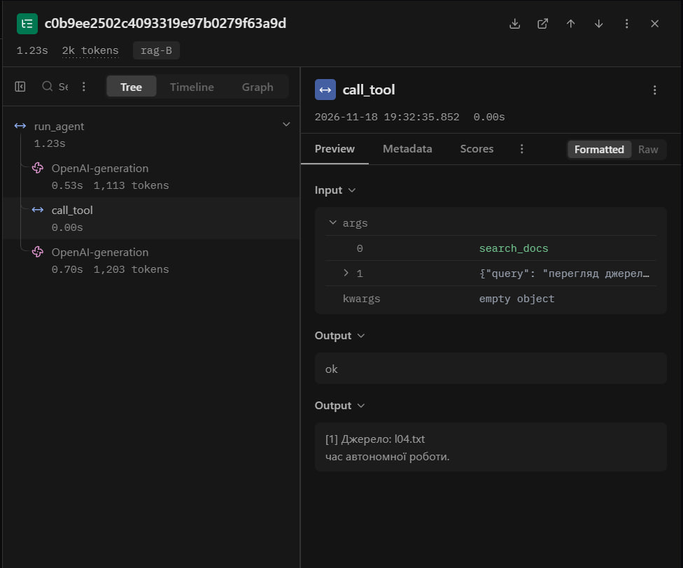
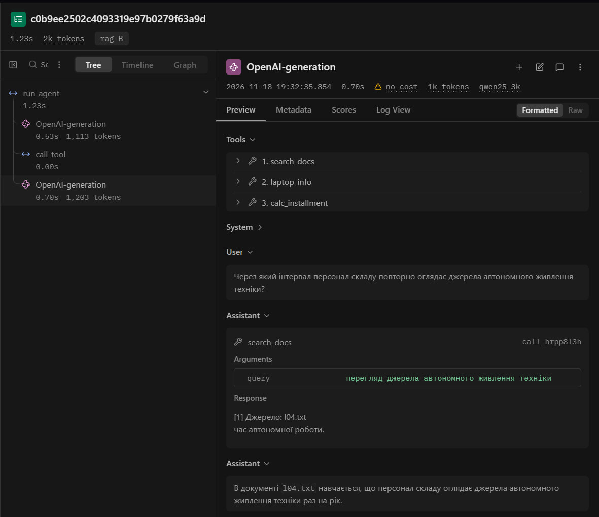
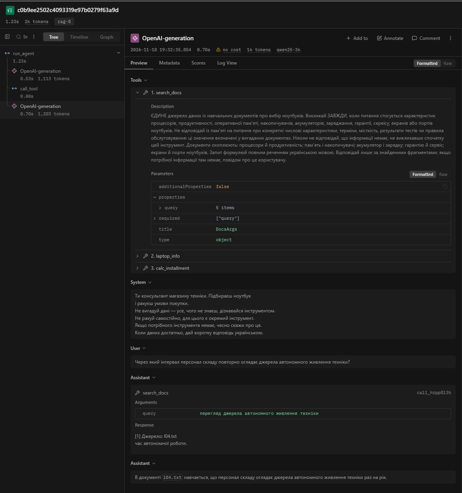
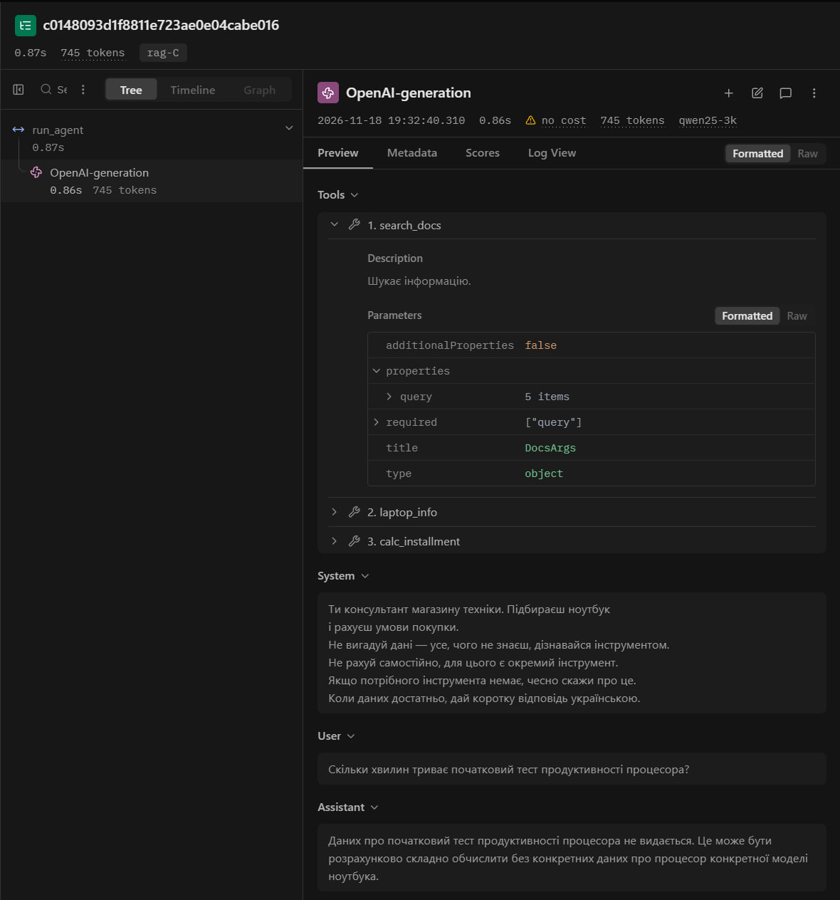

<div align="center">

**НАЦІОНАЛЬНИЙ УНІВЕРСИТЕТ «ОДЕСЬКА ПОЛІТЕХНІКА»**

МІНІСТЕРСТВО ОСВІТИ І НАУКИ УКРАЇНИ

ІНСТИТУТ КОМП'ЮТЕРНИХ СИСТЕМ

КАФЕДРА ІНФОРМАЦІЙНИХ СИСТЕМ

<br><br><br>

**Звіт про виконання лабораторної роботи № 5**

**«RAG-агент: пошук по документах як інструмент»**

з дисципліни «Обчислювальні методи»

<br><br>

| | |
|---|---|
| **Виконав:** | студент групи АІ-241 |
| | Степаненко Сергій Сергійович |
| **Перевірив:** | ас. Баранов О. М. |

<br><br>

Одеса — 2026

</div>

---

## 1. Мета роботи, варіант і вихідні параметри

**Мета роботи.** Дослідити використання векторного пошуку по документах в агенті на основі великої мовної моделі, підключити пошук як інструмент `search_docs`, перевірити якість знаходження фактів і вплив нарізання тексту на підготовку даних для RAG.

**Варіант:** 9 — «Вибір ноутбука».

**Предметна область:** підбір ноутбуків з урахуванням характеристик пристроїв, умов купівлі та сервісного обслуговування.

Для виконання лабораторної роботи використано код агента з лабораторної роботи № 4. Створено окреме віртуальне середовище Python, встановлено бібліотеки `openai`, `pydantic`, `python-dotenv`, `langfuse`, `numpy`, `faiss-cpu` та завантажено модель ембедингів `bge-m3` за допомогою Ollama. У папці `logs` збережено журнал попередньої лабораторної роботи під назвою `run_lab4.log`.

**Вихідні параметри лабораторної роботи**

| Параметр | Значення |
|---|---|
| Модель чату | `qwen25-3k` |
| Параметр `NUM_CTX` у `config.py` | 4096 токенів |
| Модель ембедингів | `bge-m3` |
| Векторний індекс | FAISS, 107 чанків, розмірність 1024 |
| `DOC_DIRS` | `data/corpus`, `data/docs` |
| `INDEX_DIR` | `index` |
| `CHUNK_METHOD` | `fixed` |
| `CHUNK_SIZE` | 200 символів |
| `CHUNK_OVERLAP` | 0 |
| `WITH_TITLE` | `False` |
| `TOP_K` | 3 |
| `MIN_SCORE` | 0.55 |
| `DOCS_DESCRIPTION` | `B` |
| `COMPRESS` | `none` |
| `USE_STATE` | `False` |
| `USE_CACHE` | `False` |
| `LAB_LOGFILE_NAME` | `lab5` |

## 2. Документи та контрольні питання

### 2.1. Підготовка документів

Для варіанта № 9 «Вибір ноутбука» створено п'ять додаткових текстових документів у каталозі `data/docs`. Кожен документ складається із заголовка та восьми змістових абзаців і містить вигадані конкретні числові факти для перевірки пошуку.

**Створені документи**

| Файл | Тема | Кількість символів | Оцінка токенів | Кількість абзаців |
|---|---|---:|---:|---:|
| `d01.txt` | Процесори й продуктивність | 3327 | 1331 | 8 |
| `d02.txt` | Пам'ять і накопичувачі | 3788 | 1515 | 8 |
| `d03.txt` | Акумулятор і зарядка | 3886 | 1554 | 8 |
| `d04.txt` | Гарантія й сервіс | 3107 | 1243 | 8 |
| `d05.txt` | Екрани й порти | 3424 | 1370 | 8 |
| **Разом** | **5 документів** | **17532** | **7013** | **40** |

Оцінку кількості токенів обчислено за формулою:

$$
T \approx \frac{N}{2.5}
$$

де $N$ — кількість символів документа.

Разом із дванадцятьма документами з каталогу `data/corpus` підготовлений корпус містить 17 документів. Цифрові характеристики в доданих матеріалах є вигаданими навчальними значеннями, а не реальними характеристиками товарів.

### 2.2. Контрольні питання

Створено файл `rag_cases.json` з десятьма контрольними питаннями: чотири прямі (`direct`), чотири перефразовані (`paraphrase`) і два питання, відповідей на які немає в корпусі (`none`). Для перших восьми питань задано очікувані числові відповіді та дослівні фрагменти `must_contain`.

**Контрольні питання для RAG**

| ID | Тип | Питання | `must_contain` | `expected` |
|---|---|---|---|---|
| D1 | `direct` | Скільки хвилин триває початковий тест продуктивності процесора? | тест продуктивності триває 47 хвилин | 47 |
| D2 | `direct` | Яка місткість накопичувача серії Cedar у ГБ? | Cedar місткістю 1536 ГБ | 1536 |
| D3 | `direct` | За скільки хвилин ноутбук Meridian отримує 46 відсотків заряду? | заряду за 29 хвилин | 29 |
| D4 | `direct` | Який гарантійний строк встановлено для серії Atlas S? | гарантійний строк 27 місяців | 27 |
| P1 | `paraphrase` | Який показник отримала офісна конфігурація Alder M у випробуванні з текстами? | процесор отримав 1843 бали | 1843 |
| P2 | `paraphrase` | На який проміжок часу сервіс залишає тимчасовий архів матеріалів замовника? | не довше 17 діб | 17 |
| P3 | `paraphrase` | Через який інтервал персонал складу повторно оглядає джерела автономного живлення техніки? | кожні 53 доби | 53 |
| P4 | `paraphrase` | Скільки часу займає фінальне випробування Orion G після усунення несправності? | прогін триває 148 хвилин | 148 |
| N1 | `none` | Яку суму в гривнях покупець сплачує за доставку ноутбука кур'єром? | `null` | `null` |
| N2 | `none` | Скільки коштує щомісячна підписка на хмарне сховище компанії? | `null` | `null` |

Окремою перевіркою встановлено, що кожен із восьми фрагментів `must_contain` дослівно зустрічається у створених документах рівно один раз. Для запитань `N1` і `N2` у полях `must_contain` та `expected` зазначено `null`.

### 2.3. Перевірка документів і питань

Перевірку виконано командою:

```powershell
python check_cases.py
```

Результат запуску:

```text
Документів: 17; символів: 19939; приблизно токенів: 7976 (вікно 4096)
Питань: 10 ({'direct': 4, 'paraphrase': 4, 'none': 2})
Усе гаразд
```

Отже, скрипт підтвердив правильну кількість питань та наявність контрольних фактів. Загальний обсяг корпусу оцінено приблизно у 7976 токенів, що перевищує задане в `config.py` контекстне вікно 4096 токенів.

Це обґрунтовує використання пошуку релевантних фрагментів замість передавання всіх документів моделі одним запитом.

### 2.4. Перевірка мовної моделі без документів

Для перевірки того, чи може модель відповісти на питання без надання навчальних документів, виконано три запити без RAG у режимі `ollama run qwen25-3k`.

**Результати перевірки без RAG**

| № | Питання | Правильна відповідь | Відповідь моделі | Правильно |
|---|---|---|---|---|
| 1 | Скільки хвилин триває початковий тест продуктивності процесора? | 47 хвилин | Не назвала точного значення; пояснила, що час залежить від умов тестування, і навела загальний приклад із Intel XTU | Ні |
| 2 | Яка місткість накопичувача серії Cedar у ГБ? | 1536 ГБ | Помилково пов'язала Cedar з Alibaba Cloud та повідомила, що не може назвати точну місткість | Ні |
| 3 | За скільки хвилин ноутбук Meridian отримує 46 відсотків заряду? | 29 хвилин | Не назвала точного часу; надала загальні пояснення щодо заряджання акумулятора | Ні |

**Результат:** 0 правильних відповідей із 3.

**Висновок.** Без доступу до навчальних документів модель не відтворила жодного з трьох вигаданих числових фактів. Це демонструє необхідність отримувати відповіді з конкретного джерела, а не покладатися на загальні знання моделі. Водночас перевірка трьох питань сама по собі ще не доводить точності майбутнього RAG-агента.


### 2.5. Перевірка моделі ембедингів

Для перевірки моделі ембедингів `bge-m3` використано скрипт `embed_check.py`.

Команда запуску:

```powershell
python embed_check.py
```

Результат виконання:

```text
Час: 46.5 с (з кешем буде майже 0)
Довжина вектора: 1024
Довжина (норма) першого вектора: 1.000  (1.000 - вектори вже нормалізовані)
Запит - 'Тариф на доставку'      : 0.732
Запит - 'Графік роботи кур'єрів' : 0.568
```

Довжина вектора становить 1024 компоненти, а його норма дорівнює 1.000.

Косинусна схожість запиту «Скільки коштує відправити посилку?» з текстом «Тариф на доставку» становить 0.732, а з текстом «Графік роботи кур'єрів» — 0.568.

**Висновок.** Модель `bge-m3` формує нормалізовані вектори та демонструє вищу схожість між семантично близькими текстами. Отже, модель придатна для подальших експериментів із векторним пошуком.

## 3. Нарізання документів на чанки

Для порівняння способів нарізання використано документ `data/docs/d01.txt` обсягом 3327 символів і скрипт `show_chunks.py`. Перевірено три конфігурації з різними розмірами й перекриттям чанків.

Виконані команди:

```powershell
python show_chunks.py data/docs/d01.txt fixed 200 0
python show_chunks.py data/docs/d01.txt fixed 500 100
python show_chunks.py data/docs/d01.txt paragraphs 800
```

**Таблиця 1 — Нарізання одного документа**

| Спосіб | Чанків | Закінчуються посеред речення | Довжина найбільшого, символів |
|---|---:|---:|---:|
| `fixed`, 200, перекриття 0 | 17 | 16 | 200 |
| `fixed`, 500, перекриття 100 | 9 | 8 | 500 |
| `paragraphs`, 800 | 7 | 0 | 790 |

### 3.1. Фіксовані чанки без перекриття

Конфігурація `fixed 200 0` створила 17 чанків, із яких 16 закінчувалися посеред речення. Межі чанків проходили навіть усередині окремих слів: наприклад, слово «налаштуваннями» було розділено між двома сусідніми частинами.

Це ускладнює сприйняття окремого фрагмента без додаткового контексту.

### 3.2. Фіксовані чанки з перекриттям

Конфігурація `fixed 500 100` створила 9 чанків, із яких 8 закінчувалися посеред речення. Перекриття в 100 символів дублює частину тексту між сусідніми чанками, що дозволяє частково зберегти контекст на межах фрагментів. Проте розриви речень залишилися.

### 3.3. Нарізання за абзацами

Конфігурація `paragraphs 800` сформувала 7 чанків без розривів речень. Скрипт об'єднував сусідні абзаци, якщо їхній сумарний обсяг не перевищував встановленого розміру.

Найбільший отриманий чанк містив 790 символів.

### 3.4. Приклад розрізаного факту

Під час нарізання `fixed 200 0` п'ятий чанк закінчився словами:

> «Під час перевірки компіляції демонстраційного п»

Шостий чанк почався словами:

> «роєкту цей процесор завершив роботу за 73 секунди».

Отже, інформацію про тривалість компіляції було розділено між двома чанками.

У конфігурації `paragraphs 800` відповідне речення залишилося в одному чанку, що забезпечує збереження контексту для пошуку.

**Висновок до розділу.** Нарізання за абзацами (`paragraphs 800`) найкраще зберегло цілісність речень: отримано 7 чанків без розривів. Фіксоване нарізання (`fixed 200 0`) створило 17 чанків, із яких 16 містили розриви речень. Однак остаточну конфігурацію обрано за результатами оцінювання якості пошуку в розділі 4. Найкраще співвідношення `hit@3` та витрат контексту забезпечила конфігурація `fixed-200-0`.

## 4. Порівняння конфігурацій нарізання та якості пошуку

Для оцінювання якості векторного пошуку використано скрипт `check_retrieval.py`. Перевірено шість конфігурацій нарізання документів на восьми контрольних питаннях, що мають відповіді в корпусі.

Команда запуску:

```powershell
python check_retrieval.py
```

**Таблиця 2 — Порівняння конфігурацій нарізання та hit rate**

| Конфігурація | Чанків | Середня довжина | hit@1 | hit@3 | hit@5 | hit@3 прямі | hit@3 перефразовані | Токенів (k=3) |
|---|---:|---:|---:|---:|---:|---:|---:|---:|
| `fixed-200-0` | 107 | 186 | 0.88 | 1.00 | 1.00 | 1.00 | 1.00 | 224 |
| `fixed-500-0` | 49 | 407 | 0.75 | 0.75 | 0.75 | 0.75 | 0.75 | 488 |
| `fixed-500-100` | 58 | 414 | 1.00 | 1.00 | 1.00 | 1.00 | 1.00 | 497 |
| `fixed-1500-0` | 27 | 738 | 0.75 | 0.75 | 0.88 | 0.75 | 0.75 | 886 |
| `paragraphs-800` | 47 | 423 | 1.00 | 1.00 | 1.00 | 1.00 | 1.00 | 508 |
| `paragraphs-800+title` | 47 | 443 | 1.00 | 1.00 | 1.00 | 1.00 | 1.00 | 531 |

### Вибір конфігурації

Для подальших експериментів обрано конфігурацію `fixed-200-0` із такими параметрами:

- `CHUNK_METHOD = "fixed"`
- `CHUNK_SIZE = 200`
- `CHUNK_OVERLAP = 0`
- `WITH_TITLE = False`

Конфігурації `fixed-200-0`, `fixed-500-100`, `paragraphs-800` і `paragraphs-800+title` забезпечили однаковий показник `hit@3 = 1.00`.

За умови рівності `hit@3` обрано конфігурацію з найменшими витратами контексту — `fixed-200-0`, для якої оцінка становить 224 токени при `k = 3`.

Для обраної конфігурації отримано `hit@1 = 0.88`, `hit@3 = 1.00`, `hit@5 = 1.00`. Усі вісім контрольних фактів знаходяться серед трьох перших результатів пошуку.

Після повторної побудови індексу отримано 107 чанків із середньою довжиною 186 символів, мінімальною — 5 і максимальною — 200 символів. Довжина вектора ембедингів становить 1024 компоненти.

**Висновок.** Конфігурація `fixed-200-0` забезпечила максимальний показник `hit@3` за найменших оцінених витрат контексту серед конфігурацій із таким самим результатом. Недоліком є можливість розриву речень і фактів на межах чанків.

## 5. Аналіз схожості та вибір порога MIN_SCORE

Для оцінювання релевантності результатів векторного пошуку використано скрипт `check_retrieval.py` у режимі `scores`.

Для перевірки застосовано обрану конфігурацію `fixed-200-0`.

Команда запуску:

```powershell
python check_retrieval.py scores
```

**Таблиця 3 — Схожість першого результату пошуку**

| ID | Тип питання | Схожість | Містить потрібний факт |
|---|---|---:|---|
| D1 | direct | 0.742 | Так |
| D2 | direct | 0.744 | Так |
| D3 | direct | 0.795 | Так |
| D4 | direct | 0.722 | Так |
| P1 | paraphrase | 0.730 | Так |
| P2 | paraphrase | 0.702 | Так |
| P3 | paraphrase | 0.629 | Ні |
| P4 | paraphrase | 0.698 | Так |
| N1 | none | 0.539 | — |
| N2 | none | 0.487 | — |

Найнижча схожість першого результату серед питань, що мають відповідь у документах, становить **0.629** (P3).

Найвища схожість серед питань без відповіді становить **0.539** (N1).

**Обраний поріг: `MIN_SCORE = 0.55`.**

Це значення розташоване між 0.539 та 0.629. Для перевірених питань N1 і N2 поріг дозволяє відхиляти результати з низькою схожістю.

Водночас для питання P3 перший результат мав схожість 0.629, але не містив потрібного факту — 53 доби. Правильний фрагмент знаходився серед трьох перших результатів пошуку.

**Висновок.** Поріг `MIN_SCORE = 0.55` дозволяє відхиляти слабкі результати пошуку для контрольних питань без відповіді. Однак перевищення порога не гарантує наявності потрібного факту. Тому для якості RAG важливі як значення схожості, так і правильний вибір та використання знайдених фрагментів.


### 5.1. Перевірка інструмента search_docs через диспетчер

Для перевірки роботи інструмента `search_docs` без участі мовної моделі використано скрипт `try_tool.py`.

**Перевірка D1 — питання з відповіддю в документах**

Команда запуску:

```powershell
python try_tool.py D1
```

Основні результати виводу:

```text
ПИТАННЯ: Скільки хвилин триває початковий тест продуктивності процесора?

рівень: ok
[1] Джерело: d01.txt
початковий тест продуктивності триває 47 хвилин

Занадто короткий запит -> рівень: schema
Поле query: String should have at least 3 characters
```

Інструмент успішно знайшов документ `d01.txt` із потрібним фактом — 47 хвилин.

**Перевірка N1 — питання без відповіді в документах**

Команда запуску:

```powershell
python try_tool.py N1
```

Основні результати виводу:

```text
ПИТАННЯ: Яку суму в гривнях покупець сплачує за доставку ноутбука кур'єром?

рівень: ok
У документах нічого схожого не знайдено.

Занадто короткий запит -> рівень: schema
Поле query: String should have at least 3 characters
```

Для питання N1 інструмент не повернув нерелевантних фрагментів, оскільки результати пошуку не подолали поріг `MIN_SCORE = 0.55`.

В обох перевірках запит із одного символу був відхилений схемою аргументів.

**Висновок.** Інструмент `search_docs` правильно знаходить інформацію для D1, повертає повідомлення про відсутність результатів для N1 та перевіряє мінімальну довжину запиту через схему аргументів.


## 6. Порівняння описів інструмента search_docs

Для дослідження впливу опису інструмента на поведінку агента використано три варіанти опису: A, B і C. Для кожного варіанта виконано три повторення десяти тестових запитань, зокрема вісім запитань із відповідями в документах та два запитання без відповіді.

**Таблиця 4 — Конфігурації агента**

| Назва | Опис `search_docs` | Нарізання, `TOP_K`, `MIN_SCORE` |
|---|---|---|
| `A` | Опис старого інструмента пошуку `search_laptops` із лабораторної № 2 | `fixed-200-0`, `TOP_K = 3`, `MIN_SCORE = 0.55` |
| `B` | Докладний опис: де шукати, коли обов'язково використовувати інструмент і що робити, якщо нічого не знайдено | Ті самі |
| `C` | «Шукає інформацію.» | Ті самі |

Під час експериментів змінювався лише опис інструмента `search_docs`. Параметри нарізання документів, кількість результатів пошуку та поріг схожості залишалися однаковими для всіх трьох конфігурацій.

**Таблиця 5 — Результати роботи агента для трьох описів інструмента**

| Показник | A | B | C |
|---|---:|---:|---:|
| Правильні відповіді на запитання з корпусу | 3/24 | 15/24 | 3/24 |
| Виклики `search_docs` | 6/24 | 18/24 | 3/24 |
| Медіана кількості кроків | 1 | 2 | 1 |
| Медіана вхідних токенів | 759 | 2284 | 694 |
| Медіана часу виконання, с | 1.2 | 1.2 | 1.5 |

**Таблиця 6 — Класифікація помилок і відповідей**

| Категорія | A | B | C |
|---|---:|---:|---:|
| `ok` | 3 | 15 | 3 |
| `no_search` | 18 | 6 | 21 |
| `miss` | 3 | 3 | 0 |
| `ignored` | 0 | 0 | 0 |
| `refused` | 6 | 6 | 6 |
| `invented` | 0 | 0 | 0 |


### Перевірка та коригування результатів оцінювання

Після виконання експериментів результати збережено у файлі `results/rag.csv`. Для узагальнення використано скрипт `rag_report.py`.

Під час перевірки встановлено, що автоматичне оцінювання помилково віднесло частину відповідей на питання типу `none` до категорії `invented`, хоча агент не вигадував конкретних значень, а повідомляв про відсутність інформації.

Тому після аналізу журналів вручну скориговано 15 записів: для конфігурацій A і B — питання N1 та N2, для конфігурації C — питання N2, у трьох повтореннях кожної конфігурації.

Для цих записів встановлено `correct = 1` і категорію `refused`. Після коригування кожна конфігурація отримала 6 правильних відмов із 6 питань без відповіді.

Показники правильних відповідей на питання з корпусу при цьому становлять: A — 3/24, B — 15/24, C — 3/24.

Отже, оцінювання враховує не лише правильність знайдених фактів, а й здатність агента утримуватися від надання непідтверджених числових значень.

Найкращі результати отримано з описом B: агент викликав `search_docs` у 18 із 24 випадків і правильно відповів на 15 із 24 запитань, що мали відповіді в документах.

Для опису C, який містить лише коротке формулювання «Шукає інформацію.», агент викликав інструмент лише в 3 із 24 випадків. Це свідчить, що недостатньо інформативний опис інструмента знижує ймовірність його використання.

**Висновок.** Детальний опис B забезпечив найкращу якість відповідей, хоча збільшив медіанну кількість вхідних токенів і кроків агента. Для подальшого використання обрано опис B.

## 7. Аналіз журналів і трас Langfuse

Для аналізу поведінки агента використано журнали запусків із папки `logs` і траси Langfuse.

У конфігурації B агент частіше звертався до інструмента `search_docs`, тоді як у конфігурації C переважно намагався відповідати без пошуку.

Під час аналізу запитання P3 у трасі `rag-B-r3-P3` встановлено, що агент викликав `search_docs`, але отримав нерелевантний фрагмент із документа `l04.txt`, який не містив потрібного значення 53 доби. У результаті агент помилково відповів «раз на рік».

У трасі `rag-C-r3-D1` агент не викликав `search_docs`, тому не отримав із документів правильну відповідь — 47 хвилин.

Порівняння описів інструмента також підтверджено скриншотами Langfuse.

### 7.1. Скриншоти трас Langfuse

У трасі `rag-B-r3-P3` відкрито результат виклику інструмента `search_docs`. На рисунку 1 показано, що пошук повернув фрагмент із документа `l04.txt`, який стосується автономної роботи, але не містить потрібного значення 53 доби.

**Рисунок 1 — Результат виклику search_docs для питання P3**



На рисунку 2 наведено фінальну відповідь агента для цього самого питання. Замість правильного значення 53 доби модель повідомила «раз на рік». Це демонструє, як нерелевантний результат пошуку може призвести до неправильної відповіді.

**Рисунок 2 — Помилкова відповідь агента для питання P3**



На рисунку 3 показано детальний опис інструмента `search_docs` для конфігурації B. Цей опис пояснює призначення пошуку та правила його використання під час отримання інформації з документів.

**Рисунок 3 — Детальний опис інструмента search_docs у конфігурації B**



На рисунку 4 наведено опис інструмента для конфігурації C, який складається лише з речення «Шукає інформацію.». Такий опис не містить конкретних правил, коли агент повинен звертатися до пошуку.

**Рисунок 4 — Короткий опис інструмента search_docs у конфігурації C**



Порівняння рисунків 3 і 4 підтверджує відмінність між описами B і C. За результатами експериментів детальний опис B забезпечив 18 викликів пошуку з 24 можливих на питаннях із відповіддю, тоді як короткий опис C — лише 3 з 24.

### 7.2. Приклади поведінки агента за журналами

**Випадок `no_search` — конфігурація C, питання D1**

У журналі `logs/rag_C-r1.log` агент не викликав `search_docs` і повідомив про відсутність необхідних даних. Правильна відповідь — 47 хвилин — була в документі `d01.txt`, але агент не звернувся до пошуку.

Причина невдачі — відсутність виклику інструмента, а не помилка векторного індексу. Конкретне значення агент не вигадав.

**Успішний пошук — конфігурація B, питання D1**

У журналі `logs/rag_B-r1.log` агент сформував запит:

```text
search_docs({"query":"продуктивність тест процесора длительность"})
```

Запит відрізнявся від початкового формулювання користувача. Пошук повернув потрібний факт — 47 хвилин. Значення `top_score` становило приблизно 0.716.

Отже, модель змогла переформулювати питання та використати знайдену інформацію.

**Випадок `miss` — конфігурація B, питання P3**

У журналі `logs/rag_B-r1.log` агент викликав інструмент із запитом:

```text
search_docs({"query":"перегляд джерела автономного живлення техніки"})
```

Серед отриманих фрагментів був:

```text
[1] Джерело: l04.txt
час автономної роботи.
```

Потрібного факту «кожні 53 доби» у повернутому результаті не було. Незважаючи на це, агент відповів «раз на рік».

Значення `top_score` становило приблизно 0.631, що перевищувало поріг `MIN_SCORE = 0.55`.

Причина помилки — пошук повернув тематично схожий, але недостатній для відповіді фрагмент. Агент додатково сформував непідтверджене значення.

**Питання без відповіді — конфігурація B, питання N1**

У журналі `logs/rag_B-r1.log` агент не назвав вигаданої вартості доставки та утримався від конкретної відповіді. Пошук не викликався, тому цей випадок не доводить впливу порога схожості на рішення агента.

У підсумкових результатах для кожного опису A, B і C отримано по 6 правильних відмов із 6 перевірок питань без відповіді.

**Категорія `ignored`**

У проведених експериментах категорія `ignored` не зафіксована: 0 випадків для всіх трьох описів. Тому приклад помилки, коли потрібний факт знайдено, але модель його проігнорувала, у наявних журналах відсутній.

### 7.3. Порівняння текстових журналів і трас Langfuse

Текстові журнали дозволяють перевірити сформовані запити, результати викликів інструментів, помилки та кінцеві відповіді.

У Langfuse ці події відображаються в дереві траси. Це дозволяє окремо переглянути перший виклик моделі, виклик `search_docs`, повернуті чанки та фінальну відповідь.

Порівняння конфігурацій підтвердило, що детальний опис B частіше спрямовував агента до пошуку, ніж короткий опис C. Водночас навіть за наявності пошуку агент міг отримати нерелевантний результат і сформувати неправильну відповідь.

**Висновок.** Використання RAG дозволяє отримувати факти з документів, але правильність відповіді залежить не лише від виклику інструмента, а й від релевантності знайдених фрагментів та їх інтерпретації агентом.


## 8. Порівняння звичайних задач до та після RAG

Для порівняння роботи агента виконано п'ять задач із файлу `tasks.json`. Оскільки початковий журнал лабораторної № 4 містив лише першу задачу, 18.11.2026 проведено повторний контрольний запуск агента без RAG. Його результати порівняно з журналом `logs/run_rag.log`.

**Таблиця 7 — П'ять задач до і після заміни пошуку**

| Задача | Відповідь у лабораторній № 4 (контрольний запуск) | Відповідь тепер | Чи викликав `search_docs` | Що змінилося |
|---|---|---|---|---|
| Z1 | Запропоновано StudyBook 14, StudyBook 14 Plus, OfficeMate 15, TravelLite 14 | Запропоновано StudyBook 14 Plus і StudyBook 14 | Так | Новий пошук повернув дві релевантні моделі; задачу виконано |
| Z2 | Названо чотири моделі, але не надано ціну та кількість на складі | Порожня відповідь | Ні | Задача не виконана в обох випадках; після RAG відповідь погіршилася |
| Z3 | StudyBook 14, платіж 1466.67 грн/міс. за непідтвердженою ціною 8000 грн | Платіж 1466.67 грн/міс. за непідтвердженою ціною 8000 грн, без назви моделі | Ні | Обчислення виконано, але ціна не взята з довідника; задачу не виконано повністю |
| P1 | Повідомлено, що ноутбуків для монтажу відео 8К не знайдено | Запропоновано Meridian без підтвердження придатності для 8К | Так | Результат погіршився через нерелевантний знайдений фрагмент |
| P2 | Резервування не виконано, агент запросив уточнення моделі; відповідь частково китайською мовою | Резервування не виконано, агент запросив уточнення моделі | Ні | Відповідь стала зрозумілішою, але агент не повідомив прямо про недоступність резервування |

### Аналіз результатів

Задача Z1 успішно виконана як до, так і після підключення RAG. В обох випадках агент запропонував ноутбуки для навчання.

Для задачі Z2 після RAG агент не викликав жодного інструмента й повернув порожню відповідь. Тому необхідні відомості про ціну та залишок на складі не були отримані.

Для Z3 агент використав `calc_installment`, але вказав ціну 8000 грн без підтвердження через `laptop_info`. Отже, правильність арифметичного обчислення не означає правильності всієї відповіді.

У задачі P1 старий пошук не знайшов моделей для монтажу відео 8К, і агент коректно повідомив про це. Після підключення RAG пошук повернув фрагмент про екран ноутбука Meridian, але цей фрагмент не підтверджував придатності пристрою для монтажу 8К. Агент сформував необґрунтовану рекомендацію.

У задачі P2 жоден із варіантів не виконав резервування. При цьому в обох відповідях не було прямого пояснення, що відповідний інструмент недоступний.

**Висновок.** У контрольному прогоні підключення RAG не забезпечило загального покращення виконання звичайних задач. Пошук документів допоміг у Z1, але призвів до необґрунтованої рекомендації у P1. Для задач із цінами, залишками та розстрочкою важливим залишається правильний вибір спеціалізованих інструментів.

## 9. Відповіді на питання

1. За таблицею 1 нарізання `fixed 200 0` дало 17 чанків, а `paragraphs 800` — 7, тобто на 10 менше. Межа між п’ятим і шостим чанками розділила речення про компіляцію демонстраційного проєкту за 73 секунди. Через це пошук може повернути лише частину речення, і агенту бракуватиме контексту для відповіді.

2. У таблиці 2 чотири конфігурації дали `hit@3 = 1.00`. Обрано `fixed-200-0`, оскільки результат із трьох чанків займав орієнтовно 224 токени — найменше серед цих конфігурацій. Збільшення чанка з 200 до 1500 символів без перекриття знизило `hit@3` до `0.75` і збільшило оцінку до 886 токенів. Для чанків по 500 символів перекриття підвищило `hit@3` з `0.75` до `1.00`, а додавання назви до абзацних чанків залишило `hit@3 = 1.00` і збільшило оцінку з 508 до 531 токена.

3. Для обраної конфігурації `hit@3 = 1.00` і для прямих, і для перефразованих питань. У цьому наборі векторний пошук знаходив потрібний факт навіть за іншого формулювання запиту, де буквальний збіг підрядка був би менш імовірним.

4. У таблиці 3 найбільша схожість для питань без відповіді становить `0.539`, а найменша схожість першого результату для питань із відповіддю — `0.629`. Поріг `0.55` розділив ці групи на тестовому наборі, хоча для P3 перший чанк сам по собі не містив відповіді. Надто високий поріг може відкинути корисні фрагменти, а надто низький — пропустити нерелевантні.

5. За таблицями 5 і 6 найбільше правильних відповідей дав опис B — 15 із 24. Серед запитань із відповіддю агент не звернувся до пошуку 18 разів для A, 6 разів для B і 21 раз для C. Опис B конкретизував, коли потрібно викликати пошук і як використовувати знайдені фрагменти.

6. Для опису B найчастішою помилкою була `no_search` — 6 випадків, тоді як `miss` зафіксовано 3 рази. Для `no_search` потрібно уточнювати правила виклику інструмента. Для `miss` потрібно перевіряти сформований запит, нарізання, `TOP_K` і поріг, оскільки пошук уже відбувся, але потрібний факт не потрапив у результат.

7. Після ручної перевірки в таблиці 6 зафіксовано 0 вигаданих відповідей у 18 прогонах на питаннях без відповіді. Захист забезпечують поріг у `search_docs` і вказівки в описі інструмента. У перевірці `try_tool.py N1` спрацював поріг, а в прогоні B для N1 агент утримався від відповіді без виклику пошуку, тому в цьому випадку поріг не застосовувався.

8. У фрагменті журналу `B-r1-D1` після виклику `search_docs` значення `prompt_tokens` збільшилося з 1062 до 1229, тобто на 167 токенів. Це на 57 токенів менше за оцінку 224 з таблиці 2 для трьох чанків середньої довжини. Якщо кожен наступний крок додає ті самі 167 токенів, у вікно 4096 токенів теоретично вміщується `1 + floor((4096 − 1062) / 167) = 19` викликів моделі разом із першим. Ця оцінка враховує лише розмір вхідного контексту.

9. За таблицею 7 після заміни пошуку погіршилася задача P1. До заміни агент повідомив, що моделей для монтажу відео 8К не знайдено, а після заміни запропонував Meridian на основі фрагмента про екран, який не підтверджував придатності ноутбука для монтажу 8К. У Z2 також погіршилася відповідь: замість переліку моделей без ціни й наявності агент повернув порожню відповідь.

10. Зміна опису інструмента не відновить факт, якщо потрібні частини речення розділено між чанками й жоден із повернутих фрагментів не містить достатнього контексту. Для цього випадку варто перевірити нарізання з перекриттям або за абзацами й порівняти `hit@3` та обсяг контексту з результатами `fixed-200-0`.

## Додаткове завдання: той самий індекс на Chroma

За допомогою `chroma_test.py` порівняно FAISS і два варіанти Chroma на однакових чанках та ембедингах. Для перевірки використано запит D1 «Скільки хвилин триває початковий тест продуктивності процесора?».

| Індекс | Метрика | Значення | Файл | Чанк |
|---|---|---:|---|---:|
| FAISS | Косинусна схожість | 0,7425 | `d01.txt` | 1 |
| Chroma (`cosine`) | Косинусна відстань | 0,2575 | `d01.txt` | 1 |
| Chroma за замовчуванням | Квадрат евклідової відстані | 0,5151 | `d01.txt` | 1 |

Для нормалізованих векторів косинусна відстань дорівнює `1 − s`, а квадрат евклідової відстані — `2(1 − s)`, де `s` — косинусна схожість. Отримані значення узгоджуються з цими формулами з урахуванням округлення. У всіх трьох випадках першим знайдено чанк №1 із `d01.txt`, який містить відповідь — 47 хвилин.

У FAISS поріг `MIN_SCORE = 0.55` означає, що приймаються результати зі схожістю `s ≥ 0.55`. Якщо застосувати ту саму умову до стандартної відстані Chroma, потрібний чанк для D1 буде відкинуто, оскільки `0.5151 < 0.55`. Еквівалентна умова для стандартної метрики Chroma — `distance ≤ 2 × (1 − 0.55) = 0.90`.

## Висновок

У лабораторній роботі векторний пошук підключено до агента через `search_docs`. Конфігурація `fixed-200-0` забезпечила `hit@3 = 1.00` за оціненого обсягу 224 токени на три чанки. Поріг `MIN_SCORE = 0.55` відсіяв результати для двох тестових питань без відповіді під час окремої перевірки пошуку.

Найпомітнішу різницю в правильності відповідей агента за однакових параметрів пошуку дав опис інструмента. З описом B агент правильно відповів на 15 із 24 запитань із відповіддю, а з описами A і C — на 3 із 24 для кожного. З дев’яти помилок у конфігурації B шість виникли через відсутність виклику пошуку, а три — через відсутність потрібного фрагмента серед результатів. Для подальшого покращення варто точніше спрямовувати агента до потрібного інструмента й перевірити, як формулювання пошукового запиту впливає на знайдені чанки.