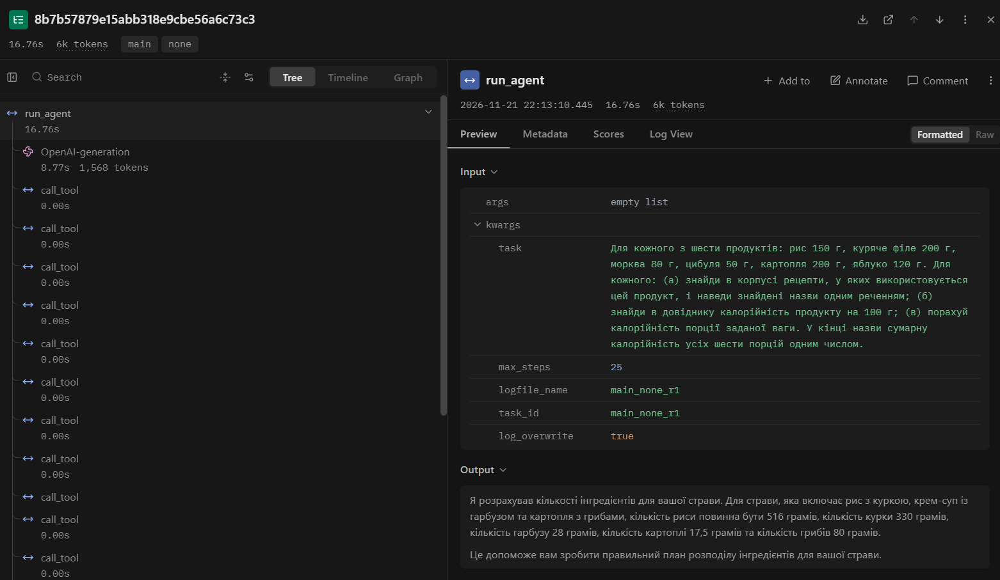
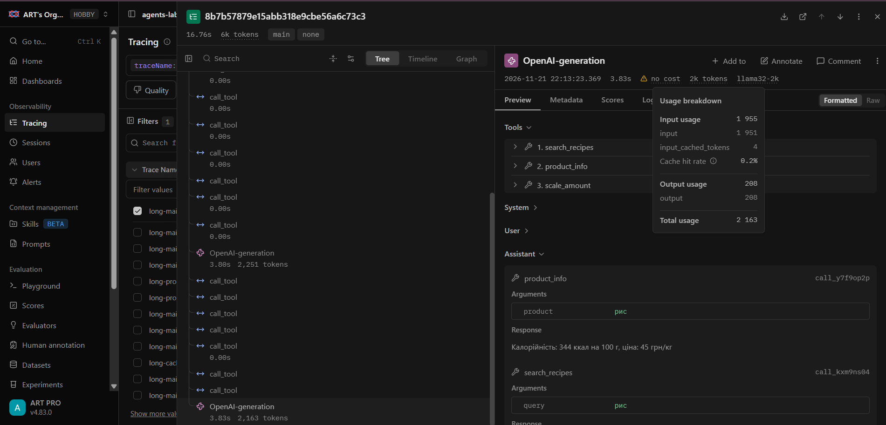

# Протокол лабораторної роботи № 4

## 1. Титульна сторінка

**Тема:** Контекст, стан і кеш агента

**Варіант:** 2

**Предметна область:** Кулінарія

**Виконав:** студент групи АІ-242  
Балик Артем

---

## 2. Мета роботи та вихідні дані

**Мета роботи:** Побачити, що відбувається з агентом, коли історія не вміщується в контекстне вікно моделі; навчитися скорочувати історію, зберігати результати інструментів поза текстом діалогу та кешувати виклики моделі; виміряти, скільки це коштує.

**Номер варіанта:** 2.

**Предметна область:** кулінарія.

**Базова модель:** qwen2.5:3b

**Розміри контекстного вікна:**
- `context length` базової моделі — 32768 токенів;
- 4096 токенів (`llama32-4k`) - початкове значення;
- 2048 токенів (`llama32-2k`) - остаточне значення, що дозволяє побачити обрізання контексного віка моделі (завдання 3);
- контекстне вікно було звужене у (32768/2048) = 16 разів.

## 3. Довга задача

**Питання:**

Для кожного з шести продуктів (рис — 150 г, куряче філе — 200 г, морква — 80 г, цибуля — 50 г, картопля — 200 г, яблуко — 120 г) необхідно:

1. Знайти рецепти з відповідними продуктами.
2. Отримати калорійність кожного продукту на 100 г.
3. Розрахувати калорійність зазначеної кількості кожного продукту.
4. Визначити загальну калорійність усіх шести порцій.

**Правильна відповідь:**

Загальна калорійність шести продуктів становить **1110,4 ккал**.

Розрахунок:

| Продукт     |  Вага | Калорійність на 100 г | Калорійність зазначеної ваги |
|-------------|------:|----------------------:|-----------------------------:|
| Рис         | 150 г |              344 ккал |                     516 ккал |
| Куряче філе | 200 г |              165 ккал |                     330 ккал |
| Морква      |  80 г |               35 ккал |                      28 ккал |
| Цибуля      |  50 г |               40 ккал |                      20 ккал |
| Картопля    | 200 г |               77 ккал |                     154 ккал |
| Яблуко      | 120 г |               52 ккал |                    62,4 ккал |
| **Разом**   |       |                       |              **1110,4 ккал** |

## 4. Аналіз результатів виконання довгої задачі

### 4.1. Аналіз прогону з контекстним вікном 4096

**Таблиця 2 — Зростання входу в прогоні без захисту**

| Крок | `prompt_tokens` | Приріст | Що зробила модель                                                                 |
|-----:|----------------:|--------:|-----------------------------------------------------------------------------------|
|    1 |            1172 |       — | Викликала 12 інструментів: `product_info` та `search_recipes` для шести продуктів |
|    2 |            1913 |    +741 | Надала фінальну відповідь без виклику інструментів                                |

**Результати аналізу:**

- **(а) Постійна частина входу:** 1172 токени — вхід першого кроку.
- **(б) Типовий приріст за крок:** 741 токен.
- **(в) Сума `prompt_tokens` за прогін:** 3085 токенів. Значення за формулою — 3085 токенів. Розбіжності між значеннями немає.
- **(г) Крок, на якому вхід перестав рости:** зупинки зростання входу не зафіксовано.
- **(д) Аналіз наступних кроків:** прогін завершився на другому кроці. На першому кроці модель викликала інструменти для отримання інформації про продукти та рецепти, на другому — сформувала фінальну відповідь без виклику інструментів. Наступних кроків після 3 немає.

**Визначення випадку:**

Найбільший вхід становить 1913 токенів, що менше ніж 95% контекстного вікна 4096 токенів. Статус виконання — `final`.

Отже, прогін належить до **випадку C — задача закоротка**.

Відповідно до методичних вказівок, необхідно зменшити розмір контекстного вікна до 3072 токенів і повторити відповідні пункти роботи. Я зменшив до 2048, бо 3072 не достатньо для заповнення понад 95% вікна, і покращив опис інструменту `scale_amount`.

### 4.2. Аналіз прогону з контекстним вікном 2048

**Таблиця 2 — Зростання входу в прогоні без захисту**

| Крок | `prompt_tokens` | Приріст | Що зробила модель                                                                                                |
|-----:|----------------:|--------:|------------------------------------------------------------------------------------------------------------------|
|    1 |            1317 |       — | Викликала інструменти `product_info` та `search_recipes` для продуктів. Для яблука викликала лише `product_info` |
|    2 |            2009 |    +692 | Викликала `scale_amount` 7 разів для розрахунку значень                                                          |
|    3 |            1955 |     -54 | Надала фінальну відповідь без виклику інструментів                                                               |

**Результати аналізу:**

- **(а) Постійна частина входу:** 1317 токенів — вхід першого кроку.
- **(б) Типовий приріст за крок:** 692 токени.
- **(в) Сума `prompt_tokens` за прогін:** 5281 токен. Значення за формулою — 6027 токенів. Різниця становить 746 токенів. Це пояснюється тим, що фактичний розмір входу змінювався нерівномірно: на третьому кроці він зменшився на 54 токени, тому лінійна оцінка за типовим приростом не збігається з фактичним підсумком.
- **(г) Крок, на якому вхід перестав рости:** крок 3.
- **(д) Аналіз наступних кроків:** після кроку 3 додаткових кроків у прогоні немає. На третьому кроці модель надала фінальну відповідь без виклику інструментів. У відповіді з'явилися некоректні назви продуктів та значення, які не відповідали результатам викликів інструментів. Зокрема, модель згадала гарбуз і гриби, хоча серед заданих продуктів їх не було. Отже, відповідь містить помилкові дані та не розв'язує поставлену задачу.

**Визначення випадку:**

У виведенні `analyze.py` зафіксовано повідомлення: «вхід перестав рости на кроці 3».

Отже, прогін належить до **випадку B — сервер мовчки обрізає вхід**.

Статус виконання — `final`, однак відповідь агента є неправильною.

## 5. Аналіз результатів стиснення історії

**Таблиця 3 — Стиснення історії**

| **Конфігурація** | **Крок стиснення** | **Вхід до стиснення, токенів** | **Повідомлень було → стало** | **Повторних викликів за прогін** |
|------------------|--------------------|--------------------------------|------------------------------|----------------------------------|
| `trim`           | Кожен 2 (2,4,6...) | 2009                           | 22 → 2                       | 199                              |
| `trim+state`     | 2                  | 2009                           | 22 → 2                       | 5                                |

**Результати аналізу:**

- **Конфігурація `trim`:** стиснення відбулося на другому кроці, коли розмір входу досяг 2009 токенів. Кількість повідомлень скоротилася з 22 до 2. Після стиснення результати попередніх викликів інструментів втрачалися, тому модель повторно виконувала ті самі операції. Цей цикл повторювався до досягнення обмеження у 25 кроків. Отже, звичайне стиснення не дозволило ефективно завершити задачу.

- **Конфігурація `trim+state`:** стиснення також відбулося на другому кроці при 2009 токенах, а кількість повідомлень скоротилася з 22 до 2. Однак додатково було збережено результати попередніх викликів інструментів. Завдяки цьому модель отримала необхідну інформацію після стиснення та на третьому кроці сформувала фінальну відповідь без повторного виклику інструментів.

### 5.2. Аналіз першого повідомлення після стиснення (`probe_trim+state_r1.log`)

У ньому міститься **18 рядків** із результатами попередніх викликів інструментів:

- 6 викликів `product_info`;
- 5 викликів `search_recipes`;
- 7 викликів `scale_amount`.

Таким чином, програма зберегла результати всіх виконаних викликів інструментів, які модель могла використати для продовження задачі.

**Оцінка розміру повідомлення:**

Для оцінки використовується співвідношення 2,5 символа на один токен. Розмір блоку становить приблизно 850–900 токенів.

Типовий приріст входу за крок із пункту 4 становив 692 токени.

Отже, збережений блок є досить великим і перевищує типовий приріст приблизно на 158–208 токенів. Проте його використання виправдане, оскільки він містить результати вже виконаних операцій і дозволяє уникнути повторних викликів інструментів.

## 6. Аналіз роботи кешу викликів моделі

**Таблиця 4 — Робота кешу**

| **Запуск**          | **Кроків** | **Влучань у кеш** | **Викликів до сервера** | **Час, с** | **Правильно** |
|---------------------|------------|-------------------|-------------------------|------------|---------------|
| 1 (кеш порожній)    | 3          | 0                 | 3                       | 19.4       | ні            |
| 2 (той самий запит) | 3          | 3                 | 0                       | 1.0        | ні            |

**Результати аналізу:**

- **Перший запуск:** кеш був порожній, тому всі три виклики моделі були виконані через сервер. Влучань у кеш не зафіксовано.
- **Другий запуск:** усі три виклики моделі були отримані з кешу. Звернень до сервера не було, оскільки відповіді на аналогічні запити вже були збережені.
- **Прискорення:** другий запуск виконується значно швидше, оскільки замість звернень до сервера програма читає готові відповіді з файлів кешу.

**Відповідь на пункт 7:**

Якби перед другим запуском змінити текст `SYSTEM` у файлі `config.py`, ключ кешу змінився б. Це відбувається тому, що системна інструкція є частиною запиту, з якого формується SHA-256. Відповідно, програма не знайшла б попередні відповіді за новими ключами та повторно звернулася б до сервера. Тому влучань у кеш не було б.

Експеримент показав, що кешування дозволяє уникнути повторних звернень до сервера для однакових запитів. У першому запуску було виконано три звернення до сервера, а в другому всі три відповіді були отримані з кешу. Це зменшує час виконання повторних запусків і навантаження на сервер з 19.4 до 1 секунди в нашому випадку (покращення в майже 20 разів).

## 7. Аналіз результатів вимірювань і трас

### 7.1. Порівняння конфігурацій

**Таблиця 5 — Результати вимірювання конфігурацій агента**

| **Конфігурація** | **Правильно** | **Кроків** | **Токенів на вхід** | **Токенів на вихід** | **На підсумовування** | **Час, с** | **Стиснень** | **Повторних викликів** |
|------------------|--------------:|-----------:|--------------------:|---------------------:|----------------------:|-----------:|-------------:|-----------------------:|
| `none`           |         0 з 3 |          3 |                5281 |                  701 |                     0 |       11.6 |            0 |                      0 |
| `trim`           |         0 з 3 |         25 |               41229 |                 6167 |                     0 |      102.5 |           12 |                    199 |
| `trim+state`     |         0 з 3 |          5 |                6977 |                  665 |                     0 |         11 |            2 |                      5 |
| `summary`        |         0 з 3 |          4 |                6120 |                 1121 |                  2835 |       39.4 |            2 |                      0 |

**Результати аналізу:**

- **Конфігурація `none`:** агент завершив виконання задачі за 3 кроки без стиснення історії та повторних викликів. Загальна кількість вхідних токенів становила 5281, вихідних — 701. Час виконання — 11,6 секунди.

- **Конфігурація `trim`:** агент досяг обмеження у 25 кроків. За цей час було виконано 12 стиснень історії та зафіксовано 199 повторних викликів. Під час кожного циклу стиснення вхід скорочувався з 2009 до 1317 токенів, а кількість повідомлень — з 22 до 2. Попри скорочення контексту, агент продовжував повторювати вже виконані операції. Загальна кількість вхідних токенів становила 41229, а час виконання — 102,5 секунди.

- **Конфігурація `trim+state`:** агент завершив задачу за 5 кроків. Було виконано 2 стиснення історії та зафіксовано 5 повторних викликів. На відміну від звичайного `trim`, ця конфігурація зберігала результати попередніх викликів інструментів, що дозволяло моделі використовувати їх після стиснення. Загальна кількість вхідних токенів становила 6977, а час виконання — 11 секунд.

Порівняння показує, що звичайне стиснення `trim` не забезпечило ефективного продовження виконання задачі, оскільки модель повторювала вже виконані операції. Натомість `trim+state` дозволив зберегти результати інструментів і завершити виконання за 5 кроків.

Водночас конфігурація `none` мала найменшу кількість кроків і повторних викликів, оскільки для цієї задачі їй не знадобилося стиснення історії.

### 7.2. Аналіз виявлених проблем

Під час перевірки логів необхідно було визначити прогони, у яких агент відповів менш ніж за 19 кроків або назвав число, якого не було серед результатів викликів інструментів.

За наданими логами можна встановити:

- У конфігурації `none` агент завершив виконання за 3 кроки. Числа у фінальній відповіді зустрічалися серед результатів викликів інструментів, хоча й відповіді були не у форматі єдиного числа.
- У конфігурації `trim` агент досяг обмеження у 25 кроків. Остаточної відповіді не було, адже був нескінчений цикл, який закінчився командою СТОП після 25 кроків.
- У конфігурації `trim+state` агент завершив виконання за 5 кроків. Число 513 у фінальніх відповідях також зустрічалося серед результатів викликів інструментів.

Отже, за наявними даними підтверджено передчасне завершення відносно встановленого порогу (менше 19 кроків) у 6 прогонах: трьох `none` і трьох `trim+state`.

### 7.3. Порівняння трас Langfuse

**Скріншот 1.1 — Траса `long-main_none_r1` у Langfuse**:

**Скріншот 1.2 — Траса `long-main_none_r1` у Langfuse на 3 кроці**:

**Скріншот 2.1 — Траса `long-main_trim+state_r1` у Langfuse**:

**Скріншот 2.2 — Траса `long-main_trim+state_r1` у Langfuse на 3 кроці**:

Для порівняння було вибрано траси `long-main_none_r1` та `long-main_trim+state_r1`.

У конфігурації `trim+state` перше стиснення історії відбулося після другого кроку. На цей момент розмір входу становив 2009 токенів, а кількість повідомлень скоротилася з 21 до 2. Тоді як `none` не має стиснення взагалі.

Перший виклик моделі після стиснення відбувся на третьому кроці.

**Порівняння кількості вхідних токенів:**

| **Конфігурація** | **Крок** | **prompt_tokens** |
|------------------|---------:|------------------:|
| `none`           | 3        | 1955              |
| `trim+state`     | 3        | 1026              |

Таким чином, після стиснення та збереження стану розмір входу на відповідному кроці зменшився на 929 токенів порівняно з конфігурацією `none`.

У трасі одразу видно повну історію на вході кожного виклику та токени кожного кроку, а також момент, де стиснення змінило вхід; у текстовому лозі довелося б вирахувати це з рядків prompt_tokens і СТИСНЕННЯ вручну.

### 8. Відповіді на питання

**1. На якому кроці агент без захисту дійшов до межі вікна і як ви це побачили? Що змінилося після цього?**

На другому кроці `prompt_tokens` досягло 2009, тобто приблизно 98% контекстного вікна розміром 2048 токенів, а на третьому зменшилося до 1955 (таблиця 2). Після цього агент надав фінальну відповідь без виклику інструментів, причому вона містила сторонні продукти — гарбуз і гриби — та не розв'язувала поставлену задачу; я визначив цей прогін як випадок B — сервер мовчки обрізає вхід. Хоча з більшим вікном це був випадок C, адже вікно було заповнене лише на 47%.

**2. Порівняйте суму `prompt_tokens` за прогін із формулою. Чи збігається зростання з очікуваним?**

Фактична сума `prompt_tokens` за прогін становила 5281 токен, тоді як розрахунок за формулою дав 6027 токенів (різниця — 746 токенів). Значення не збігаються, оскільки вхід зростав нерівномірно: після 1317 токенів на першому кроці він збільшився на 692 до 2009, але на третьому кроці зменшився на 54 до 1955 токенів (таблиця 2).

**3. Що втрачає агент при обрізанні? Наведіть приклад повторного виклику після стиснення. Що змінилося в `trim+state`?**

Під час обрізання агент втрачає попередню історію діалогу, зокрема результати викликів інструментів, тому повторно виконує вже зроблені операції. Наприклад, після стиснення в `trim` агент знову починає з `product_info` та `search_recipes`, хоча ці інструменти вже викликалися до стиснення; у `trim+state` результати зберігаються окремо, тому за таблицею 5 кількість повторних викликів зменшилася зі 199 до 5, а кількість кроків — із 25 до 5.

**4. Яка конфігурація найдешевша за токенами, найшвидша, найточніша? Чому висновок за трьома повторами однієї задачі обережний?**

За таблицею 5 найменшу кількість вхідних токенів має `none` — 5281, а найшвидшою є `trim+state` — 11 секунд. Найточнішої конфігурації немає: усі чотири варіанти отримали 0 правильних відповідей із 3; висновки попередні, оскільки три повтори однієї задачі не дають достатньої вибірки для оцінки поведінки на інших задачах.

**5. Чому під час вимірювання вартості кеш вимкнено? Що станеться з кешем, якщо інструмент поверне інші дані або ви заміните модель під тією самою назвою?**

Кеш вимикають, щоб вимірювання відображали реальні звернення до моделі, а не повторне використання збережених відповідей, яке спотворює час і кількість серверних викликів. Якщо інструмент поверне інші дані, кеш може віддати застарілу відповідь, оскільки результат інструмента не входить до ключа кешу; заміна моделі під тією самою назвою також може призвести до використання старої відповіді, якщо ключ кешу не змінився.

**6. Які поламки довгого прогону скорочення історії не лікує в принципі?**

Скорочення історії не виправляє помилки самої моделі: неправильний вибір інструментів, некоректні аргументи, неправильне тлумачення результатів і вигадування даних. Воно також не гарантує правильного завершення задачі: у проведених вимірюваннях `trim` повторював операції до 25 кроків, а `trim+state`, попри зменшення кількості повторів, не забезпечив правильної відповіді.

# 9. Додаткове завдання

Результат прогону додано як рядок `summary` у таблицю 5.

У extra_summary_r1 агент записував підсумування з помилками на перших двох кроках, зокрема те, що калорійність збільшилася або зменшилася замість просто значень.
Далі виправився і правильно підсумував на 3 кроці.
Потім надав відповідь російською.

У extra_summary_r2 агент вигадав про функції для зміни кількості продуктів на Х% у 2 кроці. Після не надав остаточну відповідь взагалі.

У extra_summary_r3 агент раз за разом давав не корисний підсумок, наприклад:

`"Ваша робота включає в себе використання певних інструментів для отримання даних про продукти. Ви отримали калорійність, ціну та список інструкцій для кожної продукції. Ці дані відображають, що вже були використані інструменти для отримання цієї інформації. Всі точні числа, назви й результати інструментів зберігаються без змін.`

Але на 7 кроці агент таки надав нормальний підсумок, який не використав для відповідь.

Отже, summary зменшив кількість вхідних токенів приблизно на 85,2% порівняно з trim (6120 vs 41229).

Водночас підсумовування потребувало додаткових 2835 токенів і збільшило час виконання до 39,4 секунди. Це більше, ніж у `none` (11,6 с) та `trim+state` (11 с), але значно менше, ніж у trim (102,5 с).

### Висновок

Під час виконання лабораторної роботи було досліджено вплив розміру контекстного вікна, скорочення історії діалогу, збереження стану агента, кешування та підсумовування історії на ефективність роботи локального AI-агента. Експерименти показали, що зі збільшенням історії діалогу кількість вхідних токенів зростає, а наближення до межі контекстного вікна може призводити до втрати частини контексту та некоректних відповідей.

Серед трьох розглянутих способів найбільший практичний ефект дало збереження стану (`trim+state`). Порівняно зі звичайним скороченням історії (`trim`) кількість кроків зменшилася з 25 до 5, кількість повторних викликів — зі 199 до 5, а час виконання — зі 102,5 до 11 секунд. Звичайне скорочення історії не забезпечило ефективного продовження роботи, оскільки агент втрачав результати попередніх викликів інструментів і повторював операції. Кешування також дало позитивний ефект: під час другого ідентичного прогону вдалося уникнути трьох серверних викликів моделі, однак цей механізм не вирішує проблем із правильністю відповідей і залежить від актуальності збережених результатів. Підсумовування історії (`summary`) зменшило кількість вхідних токенів порівняно з `trim` на 35109 токенів (приблизно 85,2%), проте потребувало додаткових 2835 токенів на підсумовування та 39,4 секунди виконання.

Водночас жодна з досліджених конфігурацій не забезпечила правильної відповіді в трьох повтореннях основної задачі. Це свідчить про те, що оптимізація контексту та зменшення кількості викликів самі по собі не усувають помилки моделі під час вибору інструментів, формування аргументів, опрацювання результатів і створення фінальної відповіді.

Отже, найкращий результат за ефективністю виконання в проведених експериментах показала конфігурація `trim+state`, оскільки вона значно скоротила час роботи та кількість повторних викликів. Проте для створення надійного агента необхідно поєднати оптимізацію контексту зі збереженням стану, контролем результатів інструментів і перевіркою правильності фінальних відповідей.
