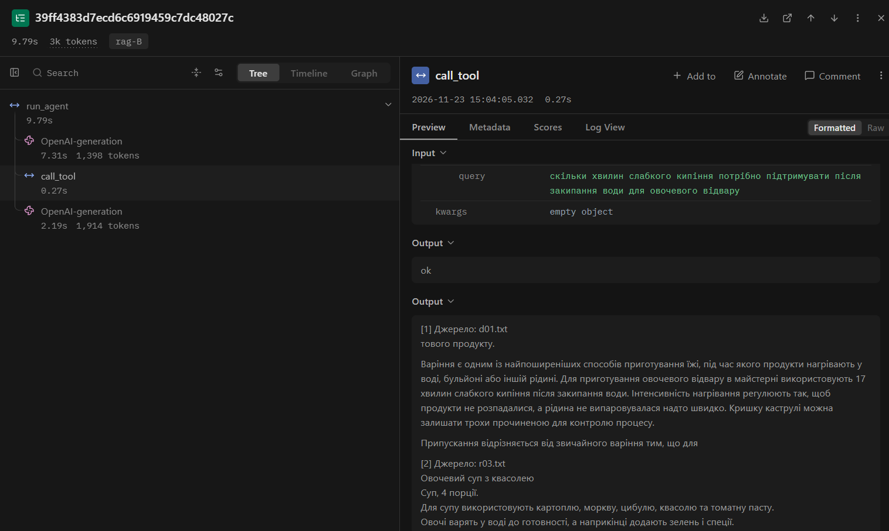
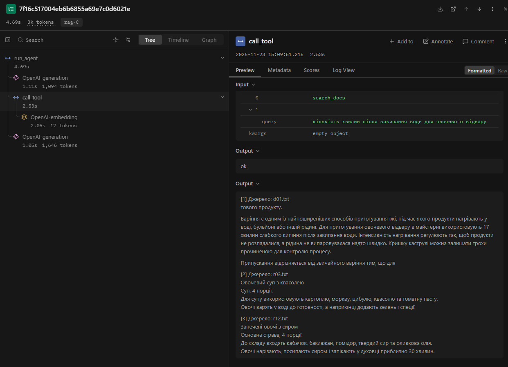

# Лабораторна робота № 5
## RAG-агент: пошук по документах як інструмент

**Виконав:** студент групи АІ-242 
Балик Артем

**Варіант:** 2 - Кулінарія

---

## 1. Мета роботи

Мета роботи: Замінити примітивний пошук підрядком з лабораторної роботи № 2 векторним. Під'єднати його до агента як звичайний інструмент. Перевірити якість пошуку окремо від агента. Побачити, як розмір чанка та опис інструмента впливають на поведінку агента, і виміряти це кількома повторами.

---

## 2. Вихідні дані

**Номер варіанта:** 2.

**Предметна область:** кулінарія.

**Модель чату:** qwen2.5:3b (`llama32-4k`).

**Розмір контекстного вікна:** 4096 токенів.

**Модель ембедингів:** `bge-m3`.

---

## 3. Дані

### 3.1. Теми документів

Для експерименту підготовлено п'ять додаткових документів предметної області «Кулінарія»:

1. `d01.txt` — Техніки приготування та організація кулінарного процесу.
2. `d02.txt` — Зберігання продуктів і контроль термінів придатності.
3. `d03.txt` — Правила заміни інгредієнтів і коригування кулінарних рецептур.
4. `d04.txt` — Кухонне обладнання, правила експлуатації та догляд.
5. `d05.txt` — Безпека на кухні, гігієна та контроль алергенів.

### 3.2. Обсяг корпусу документів

За результатами виконання `check_cases.py` отримано такі показники:

| Показник                      | Значення |
|-------------------------------|---------:|
| Загальна кількість документів |        5 |
| Загальна кількість символів   |   21 706 |
| Приблизна кількість токенів   |    8 682 |
| Розмір контекстного вікна     |    4 096 |

Результат перевірки тестових питань:

| Тип питання | Кількість |
|-------------|----------:|
| Direct      |         4 |
| Paraphrase  |         4 |
| None        |         2 |
| **Усього**  |    **10** |

Перевірка завершилася успішно: `Усе гаразд`.

### 3.3. Тестові питання

| ID | Тип        | Питання                                                                                                    | must_contain                      | expected |
|----|------------|------------------------------------------------------------------------------------------------------------|-----------------------------------|----------|
| D1 | Direct     | Скільки хвилин слабкого кипіння потрібно підтримувати після закипання води для овочевого відвару?          | `17 хвилин слабкого кипіння`      | `17`     |
| D2 | Direct     | Скільки мілілітрів води використовують на кожні 250 г риби під час припускання?                            | `43 мл води на кожні`             | `43`     |
| D3 | Direct     | Який контрольний строк використання відкритого борошна встановлено після пересипання в герметичну ємність? | `41 день після пересипання`       | `41`     |
| D4 | Direct     | Через скільки днів після закладання заморожених овочів потрібно провести контрольний огляд?                | `73 дні після закладання`         | `73`     |
| P1 | Paraphrase | Яку масу зв'язувального компонента рослинного походження додають до фаршу як альтернативу одному яйцю?     | `31 г густого картопляного пюре`  | `31`     |
| P2 | Paraphrase | Яка маса рідкого підсолоджувача замінює звичайний кристалічний компонент у навчальній заправці?            | `38 г сиропу`                     | `38`     |
| P3 | Paraphrase | Скільки часу пристрій може функціонувати без зупинки до необхідного охолодження?                           | `37 секунд із паузою для`         | `37`     |
| P4 | Paraphrase | Яку мінімальну тривалість гігієнічної процедури кистей встановлено внутрішньою інструкцією?                | `22 секунди з використанням мила` | `22`     |
| N1 | None       | Скільки грамів шафрану додають до тіста для круасанів?                                                     | `null`                            | `null`   |
| N2 | None       | Який тиск у барах рекомендовано встановлювати для приготування страв у пароконвектоматі?                   | `null`                            | `null`   |

### 3.4. Перевірка, чи вгадує модель без документів

**Модель:** 

**Питання, відповіді моделі і очікувані результати:**

1) Яка маса рідкого підсолоджувача замінює звичайний кристалічний компонент у навчальній заправці?

Відповідь: 
```
Ви не пояснили, які кристалічні компоненти використовуються в навчальній заправці. Можливо, рідкого підсолоджувача використовується для заміни різних компонентів в навчальній      
заправці, але це залежить від конкретної навчальної заправи та її складу. Будь ласка, уточніть деталі, щоб я можу більш точно отримати відповідь.
```
Очікувано: `38 г сиропу`

2) Який тиск у барах рекомендовано встановлювати для приготування страв у пароконвектоматі?

Відповідь: 
```
Для приготування страв у пароконвектоматі в барах рекомендовано встановлювати тиск талонів або тиск для стаканів. Це дозволяє гостям самостійно вистріляти страву і каву з 
конвектомату, без потрібності виходити з своєї кінотаєні. Такий тиск також може відкритись і закритися автоматично, щоб забезпечити екологічну чистоту кінотаєні.
```
Очікувано: `null`

3) Через скільки днів після закладання заморожених овочів потрібно провести контрольний огляд?

Відповідь: 
```
Зважаю на те, що заморожені овочі можуть зберігатися без змін більше ніж 3 місяців в усіх відомих умовах. Однак, є кілька факторів, які можуть впливати на розмір цієї 
періодичності, включаючи сорт овочів, технології заморозки, умови зберігання (температура, шкірність) та якщо ви використовуєте безперервний процес заморозки чи неперервний        
доступ до замороженого продукту.
Також мають впливати міжнародні стандарти та рекомендації. Наприклад, ФЕДІ (Фінансово-економічна сімейна розмірність у зв'язку з економічними рисками) звичайно рекомендuje         
виконання контрольних оглядів у кожному місяці при розмірі 10% від загальної кількості заморожених овочів.
Отже, кількість днях, через які потрібно виконати контрольний огляд, виходить з конкретної ситуації, тому я рекомендую звернутися до специалиста чи інших державних органів         
для виконання ць операції.
```
Очікувано: `73 дні після закладання`

**Результати відповідей моделі:**
В усіх випадках модель не вгадала відповідь, замість цього надала свою неправильну, вигадала коли мала сказати що відповіді немає або попросила уточнення інформації.

---

## 4. Перевірка моделі ембедингів (`embed_check.py` та ` build_index.py`)

**Довжина вектора:** 1024

**Норма вектора:** 1.000

**Запит - 'Тариф на доставку'      :** 0.732

**Запит - 'Графік роботи кур'єрів' :** 0.568

**Кількість чанків:** 53

**Середня довжина:** 408 символів

**Найкоротший:** 162

**Найдовший:** 569

Отримані результати відповідають очікуванням: близькість запиту до фрази про тариф доставки (0.732) більша, ніж до фрази про графік роботи кур'єрів (0.568). Це свідчить про здатність моделі визначати семантичну схожість текстів.

---

## 5. Нарізання одного документа

Для дослідження способів нарізання використано документ `data/docs/d01.txt`.

### Таблиця 1 — Нарізання одного документа

| Спосіб                       | Чанків | Закінчуються посеред речення | Довжина найбільшого, символів |
|------------------------------|-------:|-----------------------------:|------------------------------:|
| `fixed`, 200, перекриття 0   |     19 |                           18 |                           200 |
| `fixed`, 500, перекриття 100 |     10 |                            8 |                           500 |
| `paragraphs`, 800            |      8 |                            0 |                           475 |

**Приклад факту, розрізаного між чанками (спосіб fixed,200,перекриття 0):**

--- чанк 17, 200 символів  [закінчується посеред речення]

я кухар перевіряє смак, запах, колір, консистенцію та температуру готової страви. Для навчального контролю встановлено допустиму втрату маси овочевого супу під час контрольного підігрівання на рівні 8

--- чанк 18, 200 символів  [закінчується посеред речення]

 % від початкової маси. Результати заносять до технологічної картки, зазначаючи виявлені недоліки та можливі причини їх виникнення. Завершальним етапом є очищення інструментів, миття робочої поверхні

Опис: тут `на рівні 8` було розрізано від `% від початкової маси`.

## 6. Нарізання і hit rate

### Таблиця 2 — Пошук при різному нарізанні

| Конфігурація           | Чанків | Сер. довжина | hit@1 | hit@3 | hit@5 | hit@3 прямі | hit@3 перефр. | Токенів (k=3) |
|------------------------|-------:|-------------:|------:|------:|------:|------------:|--------------:|--------------:|
| `fixed-200-0`          |    114 |          190 |  0.62 |  0.62 |  0.62 |        0.75 |          0.50 |           228 |
| `fixed-500-0`          |     53 |          410 |  0.75 |  0.88 |  0.88 |        1.00 |          0.75 |           491 |
| `fixed-500-100`        |     64 |          411 |  0.62 |  0.75 |  0.88 |        1.00 |          0.50 |           493 |
| `fixed-1500-0`         |     27 |          804 |  0.75 |  0.88 |  0.88 |        1.00 |          0.75 |           965 |
| `paragraphs-800`       |     53 |          408 |  0.75 |  0.75 |  0.88 |        1.00 |          0.50 |           490 |
| `paragraphs-800+title` |     53 |          445 |  0.75 |  0.75 |  0.88 |        1.00 |          0.50 |           534 |

**Вибір конфігурації нарізання**

За результатами порівняння шести конфігурацій найкращими виявилися `fixed-500-0` та `fixed-1500-0`, які мають однаковий показник `hit@3 = 0.88`. Однак конфігурація `fixed-500-0` забезпечує менший розмір результату пошуку: приблизно 491 токен проти 965 токенів у `fixed-1500-0`. Тому для подальшої роботи обрано `fixed-500-0`, оскільки вона забезпечує таку саму частку влучань за меншого використання контекстного вікна.

**Аналіз результатів, для яких hit@3 не досяг повного значення (0.88 - означає такий 1 результат з 8)**

Для конфігурації `fixed-500-0` було додатково перевірено результати пошуку для питання P3. Пошук повернув три чанки: перший із `d04.txt` (схожість 0,588) містив загальні правила безпеки обладнання, другий із `d02.txt` (0,538) — інформацію про зберігання продуктів, третій із `d04.txt` (0,531) — правила використання блендера.

Потрібна інформація про 37 секунд безперервної роботи пристрою містилася саме в третьому чанку. Проте автоматична перевірка не зарахувала його, оскільки контрольна фраза «37 секунд із паузою для» не збігається дослівно з текстом документа, у якому використано формулювання «37 секунд із подальшою паузою для охолодження».

Отже, у цьому випадку потрібний за змістом чанк не був втрачений під час розбиття документа та потрапив до Top-3. Виявлена причина промаху — відмінність формулювання контрольної фрази від тексту документа. Це демонструє обмеження оцінювання `hit@3` за точним входженням підрядка: воно може не зарахувати семантично правильний результат через незначну текстову відмінність. Проблема саме в генерації питань ШІ на початку роботи.

Відповідь моделі(саме 3 фрагмент):
```
використовують для подрібнення овочів, приготування пюре, соусів, крем-супів та емульсій. Перед використанням необхідно переконатися, що ніж або насадка правильно закріплені, а робоча ємність не має тріщин. Для навчального занурювального блендера встановлено внутрішній орієнтир безперервної роботи 37 секунд із подальшою паузою для охолодження відповідно до інструкції. Моторний блок не можна занурювати у воду або очищувати під струменем рідини.
```

### Таблиця 3 — Результати перевірки схожості та вибору порога `MIN_SCORE`

| ID | Вид питання | Схожість | Перший результат містить потрібну фразу |
|----|-------------|---------:|-----------------------------------------|
| D1 | direct      |    0.706 | Так                                     |
| D2 | direct      |    0.605 | Так                                     |
| D3 | direct      |    0.697 | Так                                     |
| D4 | direct      |    0.719 | Так                                     |
| P1 | paraphrase  |    0.548 | Так                                     |
| P2 | paraphrase  |    0.459 | Ні                                      |
| P3 | paraphrase  |    0.588 | Ні                                      |
| P4 | paraphrase  |    0.630 | Так                                     |
| N1 | none        |    0.510 | –                                       |
| N2 | none        |    0.525 | –                                       |

**Висновок.** За результатами перевірки обрано поріг схожості `MIN_SCORE = 0.53`. Він дозволяє відсіяти обидва питання без відповіді (N1, N2), проте також відхиляє питання P2, для якого передбачена відповідь. Питання P3 проходить поріг схожості, але перший знайдений фрагмент не містить потрібної фрази. Отже, обраний поріг є компромісним і не гарантує повністю точного пошуку.

## 7. Перевірка інструмента без моделі

- Під час перевірки `try_tool.py D1` інструмент успішно знайшов потрібну інформацію (17 хвилин слабкого кипіння) у документі `d01.txt`. 
```
ПИТАННЯ: Скільки хвилин слабкого кипіння потрібно підтримувати після закипання води для овочевого відвару? 

рівень: ok
[1] Джерело: d01.txt
тового продукту.

Варіння є одним із найпоширеніших способів приготування їжі, під час якого продукти нагрівають у воді, бульйоні або іншій рідині. Для приготування овочевого відвару в майстерні використовують 17 хвилин слабкого кипіння після закипання води. Інтенсивність нагрівання регулюють так, щоб продукти не розпадалися, а рідина не випаровувалася надто швидко. Кришку каструлі можна залишати трохи прочиненою для контролю процесу.

Припускання відрізняється від звичайного варіння тим, що для

[2] Джерело: r03.txt
Овочевий суп з квасолею
Суп, 4 порції.
Для супу використовують картоплю, моркву, цибулю, квасолю та томатну пасту.
Овочі варять у воді до готовності, а наприкінці додають зелень і спеції.

[3] Джерело: d01.txt
 приготування використовується невелика кількість рідини. Продукти готуються переважно у власному соку, завдяки чому краще зберігають природний смак і частину поживних речовин. Для навчального приготування риби кухарі використовують 43 мл води на кожні 250 г продукту, накривають посуд кришкою та підтримують помірне нагрівання до готовності.

Смаження передбачає приготування продуктів на розігрітій поверхні з використанням жиру або олії. У навчальній майстерні для демонстрації смаження овочів вст
```
- Під час перевірки `try_tool.py N1` інструмент повідомив, що схожої інформації в документах не знайдено.
```
ПИТАННЯ: Скільки грамів шафрану додають до тіста для круасанів? 

рівень: ok
У документах нічого схожого не знайдено.

```

## 8. Порівняння трьох описів інструмента

### Таблиця 5 — Агент з трьома описами інструмента

| **Опис** | **Правильно (з 24)** | **Викликав пошук (з 24)** | **Кроків, медіана** | **Токенів входу, медіана** | **Час, с, медіана** |
|----------|----------------------|---------------------------|---------------------|----------------------------|---------------------|
| `A`      | 0                    | 3                         | 1,0                 | 1140                       | 2,0                 |
| `B`      | 12                   | 15                        | 2,0                 | 2712                       | 2,2                 |
| `C`      | 10                   | 12                        | 2,0                 | 2128                       | 3,2                 |

Опис B показав найкращий результат: агент правильно відповів на 12 із 24 питань і найчастіше викликав пошук. Опис A виявився найменш ефективним: лише 3 виклики пошуку та жодної правильної відповіді.

### Таблиця 6 — Класифікація помилок агента

| **Категорія**                                      | **`A`** | **`B`** | **`C`** |
|----------------------------------------------------|---------|---------|---------|
| Правильно                                          | 0       | 12      | 10      |
| Не шукав і відповів неправильно                    | 21      | 9       | 12      |
| Шукав, але потрібного фрагмента в результаті немає | 3       | 3       | 2       |
| Фрагмент був у результаті, відповідь неправильна   | 0       | 0       | 0       |
| Питання без відповіді: визнав, що не знає          | 6       | 6       | 3       |
| Питання без відповіді: вигадав відповідь           | 0       | 0       | 3       |

Найбільша проблема всіх трьох описів — агент не викликає пошук для частини питань, на які є відповіді в документах. Опис B зменшив кількість таких випадків порівняно з A та C. Випадків, коли потрібний фрагмент був знайдений, але модель неправильно сформулювала відповідь, не зафіксовано. Для питань без відповіді кожен опис дав по три відмови та три вигадані відповіді.

**Ручна перевірка результатів автоматичного оцінювання.**

Було вручну перевірено 54 рядки з `correct = 0` та всі 18 рядків із питаннями типу `none` з 90 рядків усього. Під час перевірки виявлено 6 помилок автоматичної класифікації: у трьох повтореннях конфігурації A для питання N2 (рядки 11, 41, 71) та у трьох повтореннях конфігурації B для питання N1 (рядки 20,50,80) модель фактично відмовилася надавати відповідь, повідомивши про відсутність необхідної інформації. Проте автоматична перевірка класифікувала ці відповіді як вигадані.

У файлі `results/rag.csv` для цих записів значення `correct` змінено з 0 на 1, а `category` — з `invented` на `refused`. Також вніс зміни у таблицю 6.

## 9. Розбір у логах і трасах Langfuse

### 9.1. Аналіз логів виконання (`logs/rag_*.log`)

#### 1. Агент не шукав (`no_search`)
Категорія `no_search` трапляється в усіх описах (`A`, `B`, `C`). Наприклад в конфігурації **`C-r1-D3`** модель не вигадала число, а відмовилася відповідати, сплутавши строк зберігання борошна з розрахунком його маси:

```text
##### C-r1-D3
============================================================
ЗАДАЧА: Який контрольний строк використання відкритого борошна встановлено після пересипання в герметичну ємність?
--- крок 1 | помилок поспіль=0 | prompt_tokens=1040 | completion_tokens=194
ВІДПОВІДЬ: Якщо ви маєте конкретні дані про кількість використаного відкритого борошна та її кількість перед пересипанням, я можу допомогти розрахувати кількість відкритого борошна після пересипання. Але без цих даних не можу надати точного відповіді. Можливо, потрібно звернутися до виробника або здійснити додаткові дослідження. Будь ласка, дайте мені ці дані або запитайте про інші вирішення.
```

Водночас без пошуку модель іноді вигадувала значення: у **`A-r1-D4`** вказала *«6 місяців»* замість 73 днів, а у **`B-r1-D2`** викликала `scale_amount` і відповіла *«0.4 мілілітрів води»*.

#### 2. Який запит написала модель (`query` у `search_docs` та `top_score`)

| Прогін      | Питання користувача                                                                                    | `query` у `search_docs`                                                                              | Підхід моделі                                 | `top_score` |
|:------------|:-------------------------------------------------------------------------------------------------------|:-----------------------------------------------------------------------------------------------------|:----------------------------------------------|:-----------:|
| **B-r1-D1** | Скільки хвилин слабкого кипіння потрібно підтримувати після закипання води для овочевого відвару?      | `"скільки хвилин слабкого кипіння потрібно підтримувати після закипання води для овочевого відвару"` | Майже дослівне копіювання                     |  **0.687**  |
| **C-r1-D1** | Скільки хвилин слабкого кипіння потрібно підтримувати після закипання води для овочевого відвару?      | `"кількість хвилин після закипання води для овочевого відвару"`                                      | Скорочення до ключових слів                   |  **0.682**  |
| **B-r1-D4** | Через скільки днів після закладання заморожених овочів потрібно провести контрольний огляд?            | `"контрольний огляд заморожених овочів"`                                                             | Виділення ключової фрази                      |  **0.664**  |
| **C-r1-P1** | Яку масу зв'язувального компонента рослинного походження додають до фаршу як альтернативу одному яйцю? | `"алтернатива одному яйцю зв'язувальному компоненту рослинного походження для фаршу"`                | Переформулювання зі збереженням *«для фаршу»* |  **0.532**  |
| **B-r1-P1** | Яку масу зв'язувального компонента рослинного походження додають до фаршу як альтернативу одному яйцю? | `"альтернатива одному яйцю зв'язувальному компоненту рослинного походження"`                         | Вилучено питальну частину та *«фаршу»*        |  **0.516**  |
| **C-r1-N2** | Який тиск у барах рекомендовано встановлювати для приготування страв у пароконвектоматі?               | `"recommended pressure for cooking in convection oven"`                                              | Переклад англійською                          |  **0.573**  |

* Прямі питання (`D`) мають високий `top_score` (`0.664–0.688`), незалежно від копіювання чи стиснення запиту.
* Перефразовані запити (`P`) мають нижчий `top_score` (`0.502–0.532`), де ключове слово може перевести результат через поріг (`C-r1-P1`: `0.532` vs `B-r1-P1`: `0.516`).
* Англомовний запит (`C-r1-N2`) дав `top_score = 0.573` на нерелевантному документі.

#### 3. Шукав, але не знайшов (`miss`)
Категорія `miss` виникає на перефразованому питанні **`P1`** (наприклад, `A-r1..3-P1`, `B-r1..3-P1`, `C-r2..3-P1`):

```text
##### B-r1-P1
============================================================
ЗАДАЧА: Яку масу зв'язувального компонента рослинного походження додають до фаршу як альтернативу одному яйцю?
--- крок 1 | помилок поспіль=0 | prompt_tokens=1321 | completion_tokens=48
  виклик   : search_docs({"query":"альтернатива одному яйцю зв'язувальному компоненту рослинного походження"})
  рівень   : ok
  результат: У документах нічого схожого не знайдено.
--- крок 2 | помилок поспіль=0 | prompt_tokens=1400 | completion_tokens=82
ВІДПОВІДЬ: На основі знайденої інформації немає конкретних даних про альтернативу одному яйцю зв'язувальному компоненту рослинного походження. Вибачте, але я не можу надати вам цю інформацію.
```

**Чому чанка немає у видачі:**
* **Перефразування:** у тексті `d03.txt` написано *«Для котлетної маси як пробний замінник одного яйця можна використати 31 г густого картопляного пюре»*, а запит містить абстрактне *«зв'язувального компонента рослинного походження»* без синонімів.
* **Поріг схожості:** оцінка збігу (`0.502–0.523`) виявилася нижчою за поріг відсікання (~`0.525–0.530`), тому чанк відфільтровано.

#### 4. Знайшов, але не використав (`ignored`)
Немає таких прогонів у моєму випадку.

#### 5. Питання без відповіді (`N1` і `N2`)
* **Опис A:** у `N1` агент шукає (`top_score = 0.379`) і відмовляється (`refused`), а у `N2` не шукає і вигадує відмовку про відсутність інструменту (`invented`).
* **Опис B:** у `N1` (`top_score = 0.379`) позначено як `invented` через пораду звернутися до «рецептових книг», а у `N2` (`top_score = 0.485`) модель відмовляється (`refused`).
* **Опис C:** у `N1` (`top_score = 0.379`) агент коректно відмовляється (`refused`), а у `N2` перекладає запит англійською (`top_score = 0.573`), проходить поріг і вигадує «тиск пательні 168 °C» (`invented`).

Поріг схожості допоміг у більшості випадків із низькою подібністю (`0.379–0.485`), але не спрацював у `C-N2`, де англомовний запит штучно підняв `top_score` до `0.573`.

---

### 9.2. Дерево траси та вузол `call_tool` (`search_docs`) у Langfuse

На прикладі питання **`D1`** у трасах **`rag-B-r1-D1`** та **`rag-C-r1-D1`**:
* **`rag-B-r1-D1`:** вхід `{"query": "скільки хвилин слабкого кипіння потрібно підтримувати після закипання води для овочевого відвару"}`; вихід — 2 чанки (`d01.txt` та `r03.txt`).
* **`rag-C-r1-D1`:** вхід `{"query": "кількість хвилин після закипання води для овочевого відвару"}`; вихід — 3 чанки (`d01.txt`, `r03.txt` та `r12.txt`).



рис.1 - Траса rag-B-r1-D1



рис.2 - Траса rag-C-r1-D1

---

### 9.3. Опис `search_docs` (B vs C) та переваги траси над логом

* **Відмінності між B і C на вході першого виклику моделі:** у конфігурації **B** базовий вхід більший (~`1320 prompt_tokens` vs ~`1035` у **C**), доступний ширший набір інструментів (зокрема `scale_amount`) і повертається менше чанків (`top_k = 2` у `B-r1-D1`). У **C** опис `search_docs` та інструкція лаконічніші, повертається більше чанків (`top_k = 3` у `C-r1-D1`), але через стислість модель у `C-r1-N2` переклала запит англійською.
* **Що у трасі видно одразу:**
  1. Повний текст системного промпту та схем інструментів (у лозі лише лічильник `prompt_tokens`).
  2. Візуальну шкалу часу/затримок по кожному спану без ручного віднімання часових міток.
  3. Зручну фільтрацію за тегами (`rag-B`, `rag-C`), ієрархію кроків і зведені метрики токенів/статусів без ручного перегляду файлів.

## 10. Перевірка звичайних задач після зміни пошуку

### Таблиця 7 — П'ять задач до і після заміни пошуку

| **Задача** | **Відповідь у лабораторній № 4**                                                     | **Відповідь тепер**                                                 | **Чи викликав `search_docs`** | **Що змінилося**                                                                         |
|------------|--------------------------------------------------------------------------------------|---------------------------------------------------------------------|-------------------------------|------------------------------------------------------------------------------------------|
| Z1         | Рецептів із куркою не знайдено, запропоновано уточнити запит.                        | Знайдено дві страви: «Рис з куркою» та «Рисова запіканка з куркою». | Так                           | Результат покращився: RAG знайшов відповідні рецепти.                                    |
| Z2         | Знайдено перелік із чотирьох рецептів, калорійність рису — 344 ккал на 100 г.        | Калорійність рису — 344 ккал на 100 г, додатково вказано ціну.      | Ні, викликав `product_info`   | Калорійність залишилася правильною, але назву страви з рецептурного корпусу не наведено. |
| Z3         | Неправильний розрахунок: 3440 г рису.                                                | Правильний розрахунок: 750 г рису.                                  | Ні, викликав `scale_amount`   | Результат покращився: модель правильно передала аргументи інструменту.                   |
| P1         | Повідомлено, що рецепт стейка з тунця не знайдено.                                   | Повідомлено, що рецепт стейка з тунця не знайдено.                  | Так                           | Результат не змінився: пошук не знайшов відповідного рецепта.                            |
| P2         | Модель погодилася додати плов до списку покупок і помилково розрахувала 516 калорій. | Модель повернула порожню відповідь після першого кроку.             | Ні                            | Модель не надала відповіді, але й не сформулювала очікуваної відмови.                    |

Після заміни пошуку результати Z1 і Z3 покращилися: агент знайшов відповідні рецепти та правильно виконав розрахунок. Для P1 поведінка залишилася правильною. У Z2 калорійність визначено правильно за допомогою `product_info`, а в P2 очікуваної відмови не отримано — це залишається проблемою агента.

## 11. Контрольні питання

**1. Табл. 1: на скільки відрізнялося нарізання за кількістю символів від нарізання за абзацами? Наведіть приклад чанка, у якому факт розрізано, і поясніть, чим це загрожує агентові.**

Нарізання `fixed, 200` створило 19 чанків, із яких 18 закінчувалися посеред речення, тоді як нарізання за абзацами створило 8 чанків без розривів речень. Наприклад, у чанку 17 фраза закінчується словами «на рівні 8», а в чанку 18 продовжується «% від початкової маси». Такий розрив може призвести до втрати частини факту під час пошуку, через що агент отримає неповну інформацію та надасть неправильну відповідь.

**2. Табл. 2: яка конфігурація виявилася найкращою за `hit@3` і чому? Як змінилися результати при збільшенні розміру чанка з 200 до 1500 символів, при додаванні перекриття, при додаванні назви документа? Яка ціна більшого чанка?**

Найкращою за співвідношенням якості пошуку та витрат виявилася конфігурація `fixed-500-0`: її `hit@3` становить 0,88, як і в `fixed-1500-0`, але вона передає значно менше тексту — 491 токен проти 965. При збільшенні чанка з 200 до 500 символів `hit@3` зріс із 0,62 до 0,88, а подальше збільшення до 1500 символів не покращило результат; перекриття знизило `hit@3` до 0,75, а додавання назви документа не змінило показник для нарізання за абзацами — 0,75. Ціна більшого чанка — збільшення кількості токенів у контексті моделі.

**3. Чи відрізняється `hit@3` для прямих і перефразованих питань? Що це говорить про пошук за змістом порівняно з пошуком підрядком (для якого перефразовані питання майже безнадійні)?**

Так, для конфігурації `fixed-500-0` показник `hit@3` для прямих питань становить 1,00, а для перефразованих — 0,75. Це свідчить, що пошук за змістом здатний знаходити релевантні фрагменти навіть тоді, коли формулювання запиту відрізняється від тексту документа. На відміну від пошуку підрядком, векторний пошук не вимагає буквального збігу слів, хоча перефразовані питання все одно можуть бути складнішими.

**4. Табл. 3: чи розділяє поріг `MIN_SCORE` питання з відповіддю й без неї? Що буде, якщо поріг поставити надто високим? Надто низьким?**

Поріг `MIN_SCORE = 0.53` відсіяв обидва питання без відповіді: N1 із результатом 0,510 і N2 із результатом 0,525, але водночас відхилив P2 із відповіддю та схожістю 0,459. Водночас P3 із результатом 0,588 пройшло поріг, хоча потрібної фрази в першому результаті не було. Надто високий поріг призведе до відхилення релевантних фрагментів, а надто низький — до передачі нерелевантних результатів моделі.

**5. Табл. 5 і 6: який з трьох описів дав найбільше правильних відповідей? Як часто агент не звертався до пошуку в кожному описі? Що в тексті опису `B` змінило поведінку порівняно з `A` і `C`?**

Найбільше правильних відповідей дав опис `B` — 12 із 24, тоді як опис `C` дав 10, а опис `A` — 0. Агент не звертався до пошуку та відповідав неправильно у 21 випадку для `A`, 9 випадках для `B` і 12 випадках для `C`. В описі `B` було чітко зазначено, що документи є єдиним джерелом даних, пошук потрібно викликати завжди для питань відповідної предметної області, не можна відповідати лише на основі пам'яті моделі, а відповідь має ґрунтуватися на знайдених фрагментах.

**6. Табл. 6: яка категорія помилок найчастіша в найкращому описі? Чи можна її виправити зміною опису, чи потрібно змінювати пошук (нарізання, `TOP_K`, поріг) або модель? Чому це розрізнення важливе?**

У найкращому описі `B` найчастішою категорією помилок було невикористання пошуку — 9 випадків; ще у 3 випадках агент викликав пошук, але потрібного фрагмента не було серед результатів. Першу проблему можна зменшити чіткішим описом інструмента та інструкціями для моделі, а другу потрібно виправляти налаштуванням пошуку: нарізанням документів, `TOP_K`, порогом `MIN_SCORE` або формулюванням запиту. Це розрізнення важливе, оскільки зміна параметрів пошуку не допоможе, якщо агент узагалі не викликає інструмент.

**7. Питання без відповіді: у скількох прогонах агент вигадав відповідь? Які два захисти є в системі (поріг у `search_docs` і текст опису) і який із них спрацював у ваших прогонах?**

У питаннях без відповіді агент вигадав відповідь у 9 прогонах із 18: по 3 для кожного з трьох описів. Перший захист — поріг `MIN_SCORE` у `search_docs`, який відсіює фрагменти з низькою схожістю; другий — опис `B`, який вимагає відповідати лише на основі знайдених документів і повідомляти про відсутність інформації. У перевірці схожості поріг відсіяв N1 і N2, але в повному експерименті вигадані відповіді все одно траплялися, тому жоден із цих захистів не гарантував повного усунення галюцинацій.

**8. Оцініть із логу, скільки токенів додає один виклик `search_docs` (різниця `prompt_tokens` між кроками). Порівняйте з оцінкою з табл. 2. Скільки викликів моделі вміщується у вікно 4096 при вашому `TOP_K` і розмірі чанка (формула з лекції 7, п. 7.5)?**

У логу для D1 кількість `prompt_tokens` зросла з 1329 на першому кроці до 1782 на другому, тобто різниця становить 453 токени. Це близько до оцінки з табл. 2 для трьох знайдених чанків — 491 токен; невелика різниця пояснюється особливостями фактичного запиту та його формування. За оцінкою 491 токен на один набір із трьох чанків у вікно 4096 теоретично поміщається приблизно 8 таких наборів, однак фактична кількість викликів буде меншою, оскільки частину контексту займають системні інструкції, історія діалогу та інші повідомлення.

**9. Табл. 7: чи зламав новий пошук якісь із п'яти звичайних задач? Чому так або чому ні?**

Новий пошук не зламав усі п'ять звичайних задач, але для P2 результат залишився некоректним: агент повернув порожню відповідь і не викликав інструмент. Водночас Z1 покращилася, оскільки агент знайшов відповідні рецепти, а Z3 тепер правильно розраховує 750 г; Z2 зберегла правильну калорійність завдяки `product_info`, а P1 залишилася без змін — рецепт стейка з тунця не знайдено. Отже, заміна пошуку не погіршила загальний результат, але проблема P2 залишилася.

**10. Яку з поламок цієї роботи не вилікує жодна зміна опису інструмента? Що б ви змінили в системі, щоб її виправити?**

Зміною опису інструмента не можна виправити ситуацію, коли пошук уже знайшов потрібний фрагмент, але модель його ігнорує або неправильно формулює відповідь. Для цього потрібно змінювати не опис інструмента, а логіку формування відповіді: посилити інструкції щодо використання знайденого контексту, вимагати відповідь у заданому форматі та перевіряти її відповідність знайденим фрагментам. У проведеному експерименті таких випадків (`ignored`) не зафіксовано, тому це загальна проблема, а не помилка, яка фактично проявилася в отриманих результатах.

## 12. Додаткове завдання. Порівняння FAISS і Chroma

Для порівняння векторних індексів FAISS і Chroma було створено `chroma_index.py` та тестовий скрипт `chroma_test.py`. Для обох індексів використовувалися однакові документи, чанки та вектори embeddings. Перевірку виконано на питанні D1.

### Таблиця 8 — Порівняння значень метрик трьох індексів

| **Індекс**                | **Метрика**         | **Отримане значення** |
|---------------------------|---------------------|----------------------:|
| FAISS                     | Cosine similarity   |                0.7062 |
| Chroma                    | Cosine distance     |                0.2938 |
| Chroma (за замовчуванням) | Squared L2 distance |                0.5876 |

Отримані значення відповідають математичним співвідношенням між метриками. FAISS повертає косинусну схожість нормалізованих векторів. Chroma з метрикою cosine повертає косинусну відстань, яка обчислюється за формулою:

`Cosine distance = 1 - Cosine similarity`

Для отриманого результату:

`1 - 0.7062 = 0.2938`

Chroma за замовчуванням використовує squared L2 distance. Для нормалізованих векторів вона пов'язана з косинусною схожістю таким співвідношенням:

`Squared L2 distance = 2 - 2 * Cosine similarity`

`2 - 2 * 0.7062 = 0.5876`

Таким чином, обидва значення відстані збігаються з результатами, отриманими під час експерименту.

### Порівняння знайдених чанків

Усі три індекси повернули однаковий результат:

| **Індекс**                | **Джерело** | **Номер чанка** |
|---------------------------|-------------|----------------:|
| FAISS                     | `d01.txt`   |               1 |
| Chroma (cosine)           | `d01.txt`   |               1 |
| Chroma (за замовчуванням) | `d01.txt`   |               1 |

У кожному випадку було знайдено однаковий фрагмент документа `d01.txt`, який містить інформацію про варіння овочевого відвару протягом 17 хвилин слабкого кипіння. Отже, для перевіреного питання всі три індекси повернули однаковий чанк.

### Вплив метрики на поріг MIN_SCORE

У конфігурації проєкту встановлено `MIN_SCORE = 0.53`. Цей поріг призначений для косинусної схожості, тому його не можна безпосередньо застосовувати до відстаней Chroma.

Для Chroma з метрикою cosine необхідно використовувати умову:

`Cosine distance <= 1 - MIN_SCORE`

`Cosine distance <= 1 - 0.53 = 0.47`

Для Chroma зі стандартною метрикою squared L2:

`Squared L2 distance <= 2 - 2 * MIN_SCORE`

`Squared L2 distance <= 2 - 2 * 0.53 = 0.94`

Якщо помилково залишити початковий поріг `0.53` і застосувати його до відстані як нижню межу, результати фільтруватимуться неправильно. Оскільки менша відстань означає більшу схожість, така умова може відхиляти релевантні результати та пропускати менш релевантні.

## Висновок

Під час виконання лабораторної роботи було розроблено RAG-механізм для локального кулінарного LLM-агента. Було підготовлено корпус документів, реалізовано їх поділ на чанки, створення embeddings та індексацію за допомогою FAISS. Також інтегровано інструмент `search_docs`, який забезпечує пошук інформації в документах і передає знайдені фрагменти агенту.

Експерименти з нарізанням показали, що найкращий баланс між якістю пошуку та кількістю токенів забезпечує конфігурація `fixed-500-0`: її показник `hit@3` становить 0.88, а витрати — 491 токен. Поріг `MIN_SCORE = 0.53` дозволив відсіяти питання без відповіді, але також відхилив деякі релевантні результати. Це показало, що поріг схожості не гарантує точного визначення наявності потрібної інформації.

Порівняння описів інструмента показало перевагу варіанта B, з яким агент надав 12 правильних відповідей із 24. Чітка вказівка обов'язково використовувати документи для тематичних питань покращила поведінку моделі. Водночас аналіз помилок виявив, що основна проблема полягає у невиклику пошуку: для варіанта B зафіксовано 9 таких випадків і 3 випадки, коли потрібного фрагмента не було серед результатів. Крім того, агент іноді вигадував відповіді на питання, інформації про які не було в документах.

Перевірка звичайних задач показала покращення для Z1 і Z3: агент знайшов рецепти з куркою та правильно розрахував 750 г рису. Проте залишилися проблеми з отриманням повної відповіді для Z2 та відсутністю відповіді для P2.

У додатковому завданні було реалізовано індекс Chroma та порівняно його з FAISS. Усі три варіанти пошуку повернули однаковий чанк для питання D1. Також підтверджено математичні співвідношення між косинусною схожістю та відстанями Chroma, що показало важливість правильного налаштування порога залежно від обраної метрики.

Для подальшого покращення агента варто вдосконалити правила вибору інструментів, експериментувати з `TOP_K`, розміром чанків і `MIN_SCORE`, а також додати перевірку відповідей на відповідність знайденим фрагментам. Це допоможе зменшити кількість пропущених пошукових запитів і вигаданих відповідей.

Таким чином, якість RAG-агента залежить не лише від налаштування векторного пошуку, а й від того, наскільки правильно модель використовує інструменти та формує відповіді на основі знайдених документів.