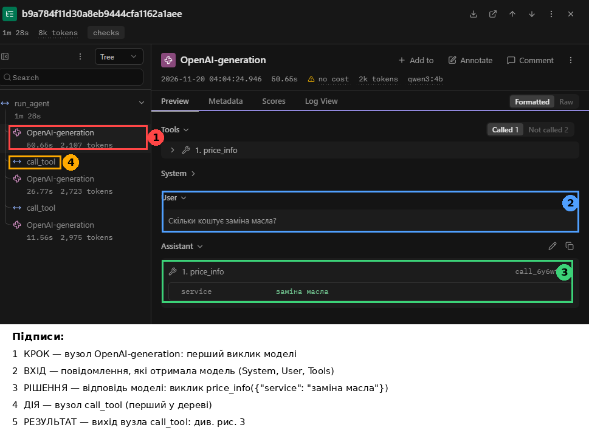
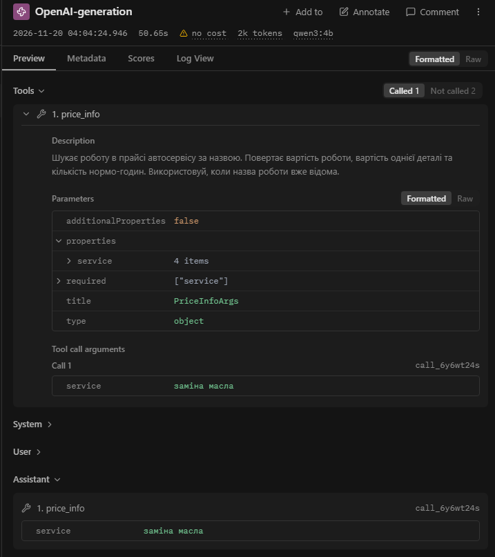
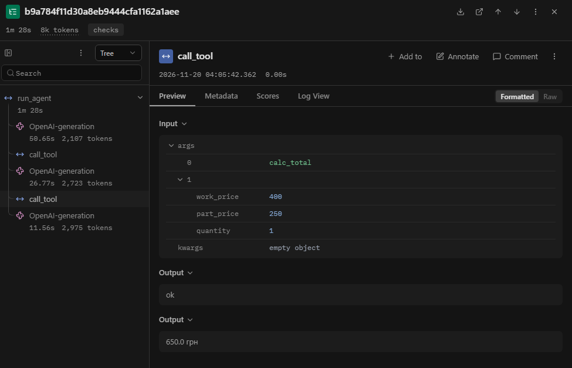
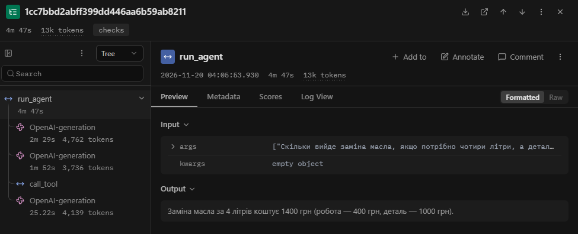
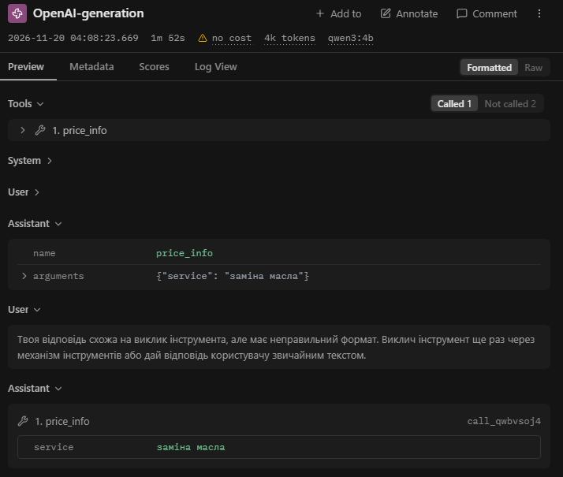

**МІНІСТЕРСТВО ОСВІТИ І НАУКИ УКРАЇНИ**
**НАЦІОНАЛЬНИЙ УНІВЕРСИТЕТ «ОДЕСЬКА ПОЛІТЕХНІКА»**
**ІНСТИТУТ КОМП'ЮТЕРНИХ СИСТЕМ**
**КАФЕДРА ІНФОРМАЦІЙНИХ СИСТЕМ**

&nbsp;

**ПРОТОКОЛ**
**лабораторної роботи №3**
**«Надійність виклику інструментів і трасування агента»**

&nbsp;

Виконав: студент групи АІ-242 Копитін І.Г.
Перевірив: Баранов О.М.

Одеса – 2026

---

## 2. Мета роботи, варіант, предметна область

**Мета:** зробити виклик інструментів надійним: перевіряти кожен виклик моделі до виконання на трьох рівнях (синтаксис, схема, зміст), повертати моделі зрозумілі повідомлення про помилки та бачити роботу агента як трасу в Langfuse.

**Варіант 8, предметна область «Обслуговування авто».** Агент визначає, які регламентні роботи потрібні автомобілю, повідомляє ціни з прайсу та рахує загальну вартість обслуговування. Інструменти: `search_service`, `price_info`, `calc_total`. Заборонена дія (табл. 7 методички): `book_service` — записати на сервіс. Ключ довідника для перевірки змісту: назва роботи (`data/prices.csv`, колонка `service`).

**Середовище.** Локальний Ollama, модель `qwen3:4b`, клієнт `openai` через OpenAI-сумісний інтерфейс, трасування — хмарний Langfuse, перевірки — `pydantic`. Параметри не змінювалися відносно лабораторної роботи №2: `MAX_STEPS = 6`, `TEMPERATURE = 0`, те саме системне повідомлення, ті самі п'ять задач і дані. Нові параметри: `MAX_RETRIES = 2`, `ALLOWED = ["search_service", "price_info", "calc_total"]`.

**Джерела чисел.** Результати задач і рівні перевірок взято з `lab3_baseline.log` і `lab3_checks.log` (у методичці підсумковий лог називається `lab3.log` до перейменування). Кількість викликів моделі, токени й час — з експорту подій Langfuse (мітки `baseline` і `checks`). Токени — сума поля `total` по всіх викликах моделі траси (токени промпта й відповіді, разом з міркуванням моделі). Час — тривалість вузла `run_agent`.

**Обмеження даних.** В експорті Langfuse трасу `baseline-Z2` збережено неповно: є лише перший виклик моделі (2107 токенів), решти викликів і вузла `run_agent` немає, хоча в `lab3_baseline.log` задача виконана до кінця (3 кроки). Тому для Z2 у табл. 6 токени «до» не наведено, а час «до» взято з міток логу. Рядок «Разом» у табл. 6 пораховано без Z2.

---

## 3. Класи аргументів трьох інструментів (файл `arguments.py`)

```python
"""Класи аргументів інструментів."""
from pydantic import BaseModel, ConfigDict, Field


class SearchServiceArgs(BaseModel):
    model_config = ConfigDict(extra="forbid")
    # Порожній рядок є підрядком будь-якого тексту, тому search_service("") повернув би всі роботи корпусу замість відповіді на питання
    query: str = Field(
        min_length=1,
        description="Вузол автомобіля або пробіг, одне-два слова українською, наприклад 'гальма', 'двигун', '60 тисяч'. Не передавай усе питання користувача.")


class PriceInfoArgs(BaseModel):
    model_config = ConfigDict(extra="forbid")
    # Порожня назва не може бути ключем прайсу; відсікаємо її схемою, до звернення до даних
    service: str = Field(
        min_length=1,
        description="Назва роботи в нижньому регістрі, як вона записана в прайсі, наприклад 'заміна масла'.")


class CalcTotalArgs(BaseModel):
    model_config = ConfigDict(extra="forbid")
    # Вартість роботи не буває від'ємною. У прайсі робота коштує від 300 до 3000 грн, 100000 грн — стеля з великим запасом. Межу вибрано самостійно
    work_price: float = Field(
        ge=0,
        le=100000,
        description="Вартість роботи в гривнях, отримана з прайсу через price_info.")
    # Нуль дозволений: у прайсі чистка дросельної заслінки має part_price = 0 (деталі немає). Від'ємна ціна безглузда; у прайсі максимум 4800 грн. Межу вибрано самостійно
    part_price: float = Field(
        ge=0,
        le=100000,
        description="Вартість однієї деталі в гривнях, отримана з прайсу через price_info.")
    # Кількість деталей — додатне число: у lab2 в описі сказано «якщо не назвав, передавай 1». Максимум у запитах — 4 літри масла; 100 — стеля з запасом. Межу вибрано самостійно
    quantity: float = Field(gt=0, le=100, description="Кількість деталей. Якщо користувач не назвав, передавай 1.")


ARGS = {
    "search_service": SearchServiceArgs,
    "price_info": PriceInfoArgs,
    "calc_total": CalcTotalArgs,
}
```

---

## 4. Таблиця правил змісту

| Аргумент / дія | Правило | Де записано | Звідки взято межу / правило |
| :--- | :--- | :--- | :--- |
| `query` (`search_service`) | рядок не порожній | Клас аргументів (`arguments.py`) | Порожній рядок є підрядком будь-якого тексту, тому search_service("") повернув би всі роботи корпусу замість відповіді на питання |
| `service` (`price_info`) | рядок не порожній | Клас аргументів (`arguments.py`) | Порожня назва не може бути ключем прайсу; відсікаємо її схемою, до звернення до даних |
| `work_price` (`calc_total`) | ≥ 0, ≤ 100000 | Клас аргументів (`arguments.py`) | Вартість роботи не буває від'ємною. У прайсі робота коштує від 300 до 3000 грн, 100000 грн — стеля з великим запасом. Межу вибрано самостійно |
| `part_price` (`calc_total`) | ≥ 0, ≤ 100000 | Клас аргументів (`arguments.py`) | Нуль дозволений: у прайсі чистка дросельної заслінки має part_price = 0 (деталі немає). Від'ємна ціна безглузда; у прайсі максимум 4800 грн. Межу вибрано самостійно |
| `quantity` (`calc_total`) | > 0, ≤ 100 | Клас аргументів (`arguments.py`) | Кількість деталей — додатне число: у lab2 в описі сказано «якщо не назвав, передавай 1». Максимум у запитах — 4 літри масла; 100 — стеля з запасом. Межу вибрано самостійно |
| `service` (`price_info`) | Значення має бути в `data/prices.csv` (колонка `service`) | Функція `check_meaning` (`checks.py`) | Табл. 7 методички: ключ довідника для варіанта 8 — назва роботи або деталі. Робіт у прайсі 11 (більше десяти), тому в повідомленні не перелічено всі: воно підказує форму назви й схожі за написанням назви (difflib). «діагностика електрообладнання» є в корпусі, але відсутня в прайсі — саме на таких назвах lab2 давав збій |
| `заборонена дія` | Заборонена дія: є в `TOOLS`, немає в `config.ALLOWED` | Диспетчер `call_tool` + заглушка в `tools.py` | Табл. 7 методички. Модель не бачить цього інструмента в `SCHEMAS`, але диспетчер перевіряє дозвіл сам |
| Додаткові поля (усі інструменти) | Заборонені | Усі класи в `arguments.py` (`extra="forbid"`) | Вимога кроку 3 методички: вигадане поле свідчить, що модель неправильно зрозуміла інструмент |

---

## 5. Таблиця 2 — Перевірка ланцюжка перевірок

Вивід `test_checks.py` на комп'ютері студента збігся з таблицею: усі вісім випадків спрацювали на очікуваному рівні. Правило межі (`work_price ≥ 0`) записано в класі `CalcTotalArgs`, тому рівень останнього випадку — `schema`, а не `meaning`.

| Що перевіряємо | Виклик | Рівень | Повідомлення для моделі |
| :--- | :--- | :--- | :--- |
| Зламаний JSON | `call_tool("calc_total", '{"work_price": 400, "part_price": 250, "quantity": 4')` | `syntax` | Помилка: аргументи не пройшли перевірку.<br>Поле JSON: Invalid JSON: EOF while parsing an object at line 1 column 52<br>Виправ аргументи і виклич інструмент ще раз. |
| Неправильний тип | `call_tool("calc_total", '{"work_price": "сто", "part_price": 250, "quantity": 4}')` | `schema` | Помилка: аргументи не пройшли перевірку.<br>Поле work_price: Input should be a valid number, unable to parse string as a number<br>Виправ аргументи і виклич інструмент ще раз. |
| Відсутнє обов'язкове поле | `call_tool("calc_total", '{"work_price": 400, "part_price": 250}')` | `schema` | Помилка: аргументи не пройшли перевірку.<br>Поле quantity: Field required<br>Виправ аргументи і виклич інструмент ще раз. |
| Вигадане поле | `call_tool("calc_total", '{"work_price": 400, "part_price": 250, "quantity": 4, "x": 1}')` | `schema` | Помилка: аргументи не пройшли перевірку.<br>Поле x: Extra inputs are not permitted<br>Виправ аргументи і виклич інструмент ще раз. |
| Неіснуючий інструмент | `call_tool("delete_all", '{}')` | `name` | Помилка: інструмента 'delete_all' не існує. Доступні: search_service, price_info, calc_total. Виклич один з доступних або повідом користувачу, що такої дії немає. |
| Заборонена дія | `call_tool("book_service", '{"date_time": "завтра о 10:00"}')` | `permission` | Помилка: інструмент 'book_service' недоступний. Не повторюй виклик, повідом користувачу, що ця дія недоступна. |
| Значення немає в довіднику | `call_tool("price_info", '{"service": "діагностика електрообладнання"}')` | `meaning` | Помилка: роботи 'діагностика електрообладнання' немає в довіднику. Назва має бути точно як у прайсі: нижній регістр, називний відмінок (наприклад, «заміна масла», а не «заміни масла»). Якщо назва невідома, спочатку скористайся search_service. Виправ значення або повідом користувачу, що даних про це немає. |
| Значення поза межами | `call_tool("calc_total", '{"work_price": -400, "part_price": 250, "quantity": 4}')` | `schema` | Помилка: аргументи не пройшли перевірку.<br>Поле work_price: Input should be greater than or equal to 0<br>Виправ аргументи і виклич інструмент ще раз. |

Додаткові випадки з `test_checks.py`:

| Що перевіряємо | Виклик | Рівень | Повідомлення для моделі |
| :--- | :--- | :--- | :--- |
| Не той відмінок | `call_tool("price_info", '{"service": "заміни масла"}')` | `meaning` | Помилка: роботи 'заміни масла' немає в довіднику. Схожі назви в довіднику: заміна масла. Назва має бути точно як у прайсі: нижній регістр, називний відмінок (наприклад, «заміна масла», а не «заміни масла»). Якщо назва невідома, спочатку скористайся search_service. Виправ значення або повідом користувачу, що даних про це немає. |
| Порожній запит | `call_tool("search_service", '{"query": ""}')` | `schema` | Помилка: аргументи не пройшли перевірку.<br>Поле query: String should have at least 1 character<br>Виправ аргументи і виклич інструмент ще раз. |
| Правильний виклик | `call_tool("calc_total", '{"work_price": 400, "part_price": 250, "quantity": 4}')` | `ok` | 1400.0 грн |

---

## 6. Таблиці 3–5 — Результати прогону та порівняння з базовим

Таблиця 3 — Результати по задачах

| Задача | До: правильно (1/0) | Після: правильно (1/0) | До: кроків | Після: кроків | Що змінилося |
| :--- | :---: | :---: | :---: | :---: | :--- |
| Z1 | 1 | 1 | 2 | 2 | Без змін: `search_service({"query":"гальма"})`, рівень `ok`, у відповіді обидві роботи з гальмами |
| Z2 | 0 | 0 | 3 | 3 | Без змін: `price_info`, потім зайвий `calc_total(400, 250, 1)`, обидва `ok`; відповідь «650 грн» замість окремих вартостей роботи й деталі |
| Z3 | 0 | 1 | 1 | 3 | До: на кроці 1 виклик потрапив у текст відповіді, користувач отримав сирий JSON. Після: `check_response` розпізнав зламаний виклик (`syntax`), модель на кроці 2 викликала `price_info` через `tool_calls`, відповідь «1400 грн» |
| P1 | 1 | 1 | 4 | 4 | Без змін: три `search_service` (`батарея`, `електромобіль`, `аккумулятор`), усі `ok`, нічого не знайдено; чесна відповідь, що роботи немає |
| P2 | 1 | 1 | 1 | 1 | Без змін: відмова без викликів, «Інструмент для запису на прийом не знайдено…» |

Правильно: 3 із 5 до і 4 із 5 після. Відповіді Z1, Z2, P1 і P2 побуквено збіглися в обох прогонах (температура 0).

Примітки до оцінок:

- **Z2.** Оцінка 0 за тим самим критерієм, що в лабораторній №2: очікувалися окремо вартість роботи (400 грн) і деталі (250 грн), а модель додатково викликала `calc_total` з `quantity = 1` і відповіла «650 грн».
- **Z3 після (спірна оцінка).** Підсумок 1400 грн збігається з очікуваним, тому оцінка 1. Але шлях неправильний: `calc_total` модель не викликала, а суму й вартість деталей (1000 грн) порахувала сама, попри вказівку в системному повідомленні «Не рахуй самостійно». Див. табл. 4.
- **P1.** Ціну модель не вигадала, відповідь чесна. Остання фраза («Необхідно додатково визначити назву роботи в прайсі») нечітка, але не хибна.

Таблиця 4 — Поламки до та після впровадження перевірок

| Поламка | До | Після |
| :--- | :---: | :---: |
| Не викликав інструмент | 1 | 0 |
| Викликав не той інструмент | 1 | 1 |
| Неправильні аргументи | 0 | 0 |
| Зациклився | 0 | 0 |
| Не використав результат | 0 | 0 |
| Вигадав результат | 0 | 1 |
| Вичерпав ліміт кроків | 0 | 0 |
| Відмова після ліміту помилок (нове) | - | 0 |

- «Не викликав інструмент» до — Z3: модель записала виклик `price_info` текстом, цикл прийняв його за відповідь (див. розд. 7.3). Після перевірок у Z3 перший крок так само без виклику (`syntax`), але на другому кроці виклик відбувся, тому в таблиці 0; помилку враховано в табл. 5. У P2 відсутність викликів не є поламкою: правильна поведінка — відмова.
- «Викликав не той інструмент» — Z2, і до, і після: зайвий `calc_total`.
- «Вигадав результат» після — Z3: у відповіді «робота — 400 грн, деталь — 1000 грн, разом 1400 грн» числа 1000 і 1400 немає в жодному результаті інструмента. За формальною ознакою це поламка, хоча арифметика правильна (400 + 250 × 4).

Таблиця 5 — Спрацювання перевірок у прогоні

| Рівень | Скільки разів | Модель виправилася на наступному кроці |
| :--- | :---: | :--- |
| `name` | 0 | 0 |
| `permission` | 0 | 0 |
| `syntax` | 1 | 1 (Z3: виклик `price_info` пройшов з рівнем `ok`) |
| `schema` | 0 | 0 |
| `meaning` | 0 | 0 |
| `tool` | 0 | - |
| `length` | 0 | - |

Рівень `syntax` спрацював один раз, у `check_response`, а не в `call_tool`. Усі виклики, що дійшли до диспетчера (Z1: 1, Z2: 2, Z3: 1, P1: 3), мали рівень `ok`. Лічильник помилок поспіль не піднімався вище 1 при `MAX_RETRIES = 2`. Рівні `name`, `permission`, `schema` і `meaning` у прогоні не спрацювали жодного разу: їх перевірено лише в `test_checks.py` (табл. 2).

---

## 7. Аналіз трас у Langfuse

### 7.1. Структура події

Для розбору структури обрано трасу `checks-Z2` («Скільки коштує заміна масла?»): у ній три виклики моделі й два вузли `call_tool`.



Рисунок 1 — Дерево траси checks-Z2 із підписаними частинами події



Рисунок 2 — Вхід і рішення першого виклику моделі в трасі checks-Z2



Рисунок 3 — Дія і результат другого вузла `call_tool` у трасі checks-Z2

Для кроку 1 цієї траси:

1. **Крок** — перший вузол `OpenAI-generation` у дереві `run_agent` (рис. 1).
2. **Вхід** — системне повідомлення, питання користувача «Скільки коштує заміна масла?» та описи інструментів, згенеровані з класів Pydantic (на рис. 2 видно `title: PriceInfoArgs` і `additionalProperties: false`).
3. **Рішення** — виклик `price_info({"service": "заміна масла"})` (рис. 2, Assistant).
4. **Дія** — перший вузол `call_tool`: на вході назва інструмента й рядок аргументів (рис. 1).
5. **Результат** — вихід `call_tool`: `["ok", "Робота: 400 грн, деталь: 250 грн за шт., нормо-годин: 1"]` (за логом). Цей текст модель отримала на кроці 2. На рис. 3 показано такий самий вузол для кроку 2: дія `calc_total` з аргументами `work_price = 400`, `part_price = 250`, `quantity = 1`, результат `ok` і `650.0 грн`.

### 7.2. Порівняння двох прогонів

Таблиця 6 — Порівняння прогонів у Langfuse

| Задача | Викликів моделі: до | Викликів моделі: після | Токенів: до | Токенів: після | Час, с: до | Час, с: після |
| :--- | :---: | :---: | :---: | :---: | :---: | :---: |
| Z1 | 2 | 2 | 6537 | 6537 | 209,1 | 187,1 |
| Z2 | 3* | 3 | н/д* | 7805 | 88* | 89,0 |
| Z3 | 1 | 3 | 4762 | 12637 | 156,3 | 287,3 |
| P1 | 4 | 4 | 13296 | 13296 | 131,7 | 134,5 |
| P2 | 1 | 1 | 1288 | 1288 | 16,4 | 17,3 |
| **Разом без Z2** | **8** | **10** | **25883** | **33758** | **513,5** | **626,2** |

\* Трасу `baseline-Z2` експортовано неповністю (розд. 2): кількість викликів (3) і час (88 с) взято з `lab3_baseline.log` за мітками часу, токени невідомі. У рядок «Разом» Z2 не входить.

Додаткові виклики моделі з'явилися лише в Z3: 8 → 10 викликів, +7875 токенів (+30 %), +112,7 с (+22 %) у сумі по чотирьох задачах. Тільки в Z3 різниця становить +2 виклики, +7875 токенів і +131,0 с. На що вони пішли (траса `checks-Z3`, рис. 4):

- виклик 1 (4762 токени, 150 с): той самий, що й у базовому прогоні; завершився зламаним викликом у тексті;
- виклик 2 (3736 токенів, 113 с): повторна спроба після повідомлення про помилку, результат — правильний виклик `price_info`;
- виклик 3 (4139 токенів, 25 с): відповідь користувачу після результату інструмента; у базовому прогоні до цього кроку справа не дійшла.

У Z1, P1 і P2 кількість токенів збіглася точно, тобто перевірки там нічого не додали. Диспетчер працює за долі мілісекунди (вузли `call_tool` у трасах мають тривалість 0,00 с). Різницю в часі Z1 (209,1 с проти 187,1 с) пояснюю прогрівом моделі в першому запуску (перший виклик базового прогону тривав 44 с проти 21 с у `checks` за мітками логу, при однакових 345 токенах відповіді); це припущення, окремо я його не перевіряв.

### 7.3. Дві траси

**Траса 1: модель помилилася й виправилася — `checks-Z3`.** Питання: «Скільки вийде заміна масла, якщо потрібно чотири літри, а деталлю вважається один літр масла?»



Рисунок 4 — Дерево траси checks-Z3: три виклики моделі й один вузол `call_tool`



Рисунок 5 — Вхід і вихід другого виклику моделі в трасі checks-Z3: повідомлення про помилку та виправлений виклик

*Що сталося.*
1. Крок 1 (3871 токен відповіді, 150 с): модель обрала правильний інструмент і аргумент, але записала виклик текстом: `{"name": "price_info", "arguments": {"service": "заміна масла"}}`, а не в поле `tool_calls`. У базовому прогоні цей самий крок завершив задачу: цикл вважав текст відповіддю й показав користувачу JSON.
2. `check_response` розпізнав текст як зламаний виклик (рівень `syntax`) і додав до історії повідомлення з роллю `user`: «Твоя відповідь схожа на виклик інструмента, але має неправильний формат. Виклич інструмент ще раз через механізм інструментів або дай відповідь користувачу звичайним текстом.»
3. Крок 2 (2736 токенів відповіді, 113 с): модель викликала `price_info({"service":"заміна масла"})` вже через `tool_calls`. Диспетчер повернув `ok` і «Робота: 400 грн, деталь: 250 грн за шт., нормо-годин: 1».
4. Крок 3 (388 токенів відповіді, 25 с): відповідь «Заміна масла за 4 літрів коштує 1400 грн (робота — 400 грн, деталь — 1000 грн).»

*Рівень, на якому зловлено помилку:* `syntax`, у `check_response`. У трасі немає вузла `call_tool` для цієї помилки: `check_response` не загорнута в `@observe`, а виклик через механізм інструментів тоді не відбувся. Тому в дереві (рис. 4) видно три вузли `OpenAI-generation` і лише один `call_tool` (для виправленого виклику), а повідомлення про помилку видно у вході другого виклику моделі (рис. 5).

*Що модель змінила:* аргументи лишилися тими самими; змінилася лише форма — виклик пішов через механізм інструментів. Повідомлення складається з трьох частин (що не так, що допустимо, що робити далі), і модель скористалася першим із двох запропонованих виходів.

*Що не виправилося.* `calc_total` модель так і не викликала: вартість деталей і підсумок вона порахувала сама, попри вказівку системного повідомлення. Підсумок збігся з очікуваним, але число не отримано від інструмента (табл. 4, «Вигадав результат»). Жодна перевірка цього не бачить: відповідь без викликів і без ознак зламаного виклику вважається чесною.

**Траса 2: задача розв'язана неправильно — `checks-Z2`.** Питання: «Скільки коштує заміна масла?» Очікувалися окремо вартість роботи (400 грн) і деталі (250 грн). Це та сама траса, що на рис. 1–3.

*Що пішло не так.* Після `price_info` (400 і 250) модель на кроці 2 викликала `calc_total(400, 250, 1)` і відповіла «Заміна масла коштує 650 грн» (рис. 3). Виклик формально бездоганний: аргументи пройшли схему (`quantity = 1` у межах `0 < quantity ≤ 100`), рівень `ok`, результат `650.0 грн` арифметично правильний. Помилка в тому, що модель прийняла кількість деталей без підстав у питанні: користувач її не називав.

*Чому жодна перевірка цього не зловила.* Перевірки відповідають на питання «чи правильно сформовано виклик», а не «чи потрібен цей виклик». Значення `quantity = 1` допустиме за схемою, і правила змісту для нього немає. До того ж саме опис `calc_total` каже «Якщо користувач не назвав, передавай 1», тобто модель діяла за інструкцією з нашого ж опису. Це поламка лабораторної №2 («викликав не той інструмент»), і перевірки аргументів її не лікують.

---

## 8. Відповіді на питання

1. **Які поламки зникли або зменшилися після впровадження перевірок? Які лишилися?**
   Зникла «Не викликав інструмент» (Z3, табл. 4): зламаний виклик у тексті розпізнано, і модель повторила його правильно. Правильних відповідей стало 4 із 5 замість 3 (табл. 3). Лишилася «Викликав не той інструмент» (Z2). З'явилася «Вигадав результат» (Z3): модель сама порахувала суму замість виклику `calc_total`, хоча підсумок правильний. Вибірка мала (п'ять задач, по одному прогону), тож зміну в одній задачі не варто вважати закономірністю.

2. **На якому рівні модель помилялася найчастіше? Що можна змінити, щоб таких помилок стало менше?**
   Єдина помилка моделі — `syntax` (1 раз, Z3; табл. 5); інші рівні в прогоні не спрацювали. Збій тієї самої форми був і в лабораторній №2 на цьому ж питанні, і відтворився в базовому прогоні: перший крок Z3 у двох прогонах збігається за кількістю токенів. Аргумент модель обрала правильний, тож опис інструмента, схоже, не причина: у Z2 той самий `price_info` модель викликала коректно. Гіпотези, які я не перевіряв: довге питання з умовою збиває формат виклику в `qwen3:4b`; допомогти може інша або більша модель чи примусовий вибір інструмента через `tool_choice`. Переносити правило в схему тут нема чого: помилка в формі відповіді, а не в значеннях.

3. **Чи траплялися відмови після ліміту помилок? Що в цих випадках було не так?**
   Ні (табл. 4). Лічильник `retries` досяг лише 1 при `MAX_RETRIES = 2`. У Z3 модель повідомлення зрозуміла: на наступному кроці виклик пішов через `tool_calls` з тими самими аргументами (рис. 5).

4. **Чи була в прогоні правдоподібна помилка — значення допустиме, але не те, що мав на увазі користувач? Чому жодна перевірка її не зловила?**
   Так. По-перше, Z2: `calc_total(400, 250, 1)` допустимий за схемою, але кількість деталей користувач не називав (розд. 7.3). По-друге, P1: пошук `аккумулятор` з помилкою в написанні (у прайсі слово «акумулятор»): рядок непорожній і пройшов схему, інструмент нічого не знайшов (рівень `ok`). Для `search_service` довідника-еталона немає, пошук іде за підрядком, тому перевірити такий запит нема з чим. По-третє, Z3: підсумок 1400 грн правильний, але отриманий без інструмента.

5. **Які поламки перевірки не лікують у принципі та чому?**
   Вибір не того інструмента або зайвий виклик (Z2), самостійне обчислення замість інструмента (Z3), невикористання результату та вигадування відповіді текстом. Усі вони стосуються рішень моделі, а не форми виклику: перевірка бачить виклик або текст, схожий на виклик, і не оцінює, чи спирається відповідь на дані інструмента. Також перевірки не знають, що мав на увазі користувач, якщо значення допустиме.

6. **Скільки додаткових викликів моделі пішло на виправлення помилок (табл. 6)? Чи виправдана така ціна надійності?**
   Два додаткові виклики (8 → 10), і обидва в Z3: один — повторна спроба після помилки (3736 токенів, 113 с), другий — відповідь користувачу, до якої в базовому прогоні справа не дійшла (4139 токенів, 25 с). У сумі +7875 токенів (+30 %) і +112,7 с (+22 %). Для Z3 це перехід від сирого JSON до правильного підсумку, тому ціна виправдана. Але це один випадок із п'яти, і додатковий успіх був неповним: `calc_total` модель так і не викликала. У задачах без помилок перевірки нічого не коштували: токени збіглися, диспетчер працює за долі мілісекунди.

7. **Візьміть найдовшу задачу. Що в ній легше побачити в трасі Langfuse, а що — у текстовому лозі?**
   Найдовша за часом — `checks-Z3` (287,3 с, три виклики моделі). У Langfuse одразу видно, що майже весь час пішов на виклики моделі (150, 113 і 25 с), токени відповіді кожного виклику (3871, 2736 і 388), вхід кожного виклику, повідомлення про помилку у вході другого виклику та відсутність вузла `call_tool` для помилки `syntax` (рис. 4–5). У текстовому лозі легше прочитати перебіг задачі підряд: рівень, текст помилки, виклик і відповідь в одному місці, і легко порахувати рядки «рівень». На довгих задачах лог стає важким для читання: це пласкі рядки без вкладеності, паралельні виклики одного кроку йдуть підряд, токени відповіді в лозі не видно (лише `prompt_tokens`), а час можна оцінити тільки за різницею міток. Показово, що `prompt_tokens` у лозі (1000 на кроці 2) дорівнює сумі некешованих і кешованих токенів входу з Langfuse (159 + 841), тож лог показує вхід цілком, а вихід бачить тільки трасу.

---

## 9. Висновок

У роботі реалізовано трирівневу перевірку викликів інструментів: класи Pydantic з правилами форми й меж (`arguments.py`), перевірку змісту за прайсом (`checks.py`), диспетчер-ланцюжок з повідомленнями з трьох частин і лічильник помилок моделі поспіль. Агента підключено до Langfuse, зроблено базовий прогін і прогін з перевірками на тих самих п'яти задачах. Додаткове завдання (structured output) не виконувалося.

Усі вісім випадків табл. 2 спрацювали на очікуваному рівні. У прогоні перевірки спрацювали один раз: у Z3 `check_response` розпізнав виклик, записаний текстом (`syntax`), і модель виправилася на наступному кроці. Це дало найбільший ефект: правильних відповідей стало 4 із 5 замість 3, а користувач більше не бачить сирий JSON. Ціна — +2 виклики моделі, +7875 токенів (+30 %) і +112,7 с (+22 %) у сумі по чотирьох задачах, розрахованих повністю (Z2 до експорту неповний). Водночас перевірки не вилікували поламки рішень моделі: зайвий `calc_total` у Z2 лишився, а в Z3 модель порахувала суму сама.

Що ще варто покращити:
1. Змінити опис `calc_total`: прибрати «Якщо користувач не назвав, передавай 1» і вказати викликати інструмент, лише коли кількість названа; це має прибрати зайвий виклик у Z2.
2. Додати перевірку фінальної відповіді: якщо в ній є числа, яких немає в результатах інструментів, не віддавати її користувачу (це зловило б Z3).
3. Додати в `check_response` конкретику: назвати виклик, який треба повторити, і не пропонувати відповісти текстом.
4. Спробувати іншу модель або `tool_choice`, бо збій формату виклику в Z3 відтворюється стабільно.
5. Повторити базовий прогін Z2 і заново експортувати трасу, щоб заповнити табл. 6 повністю.
