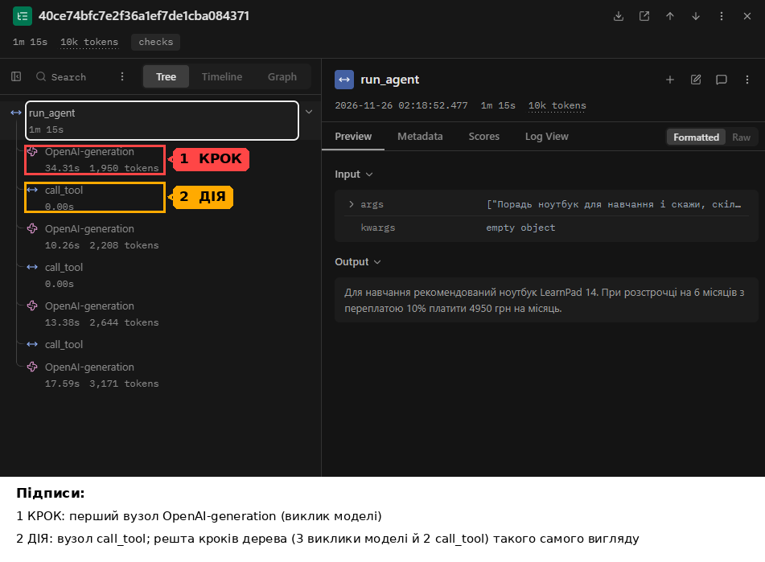
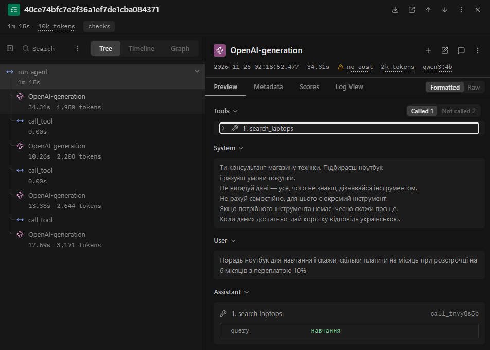
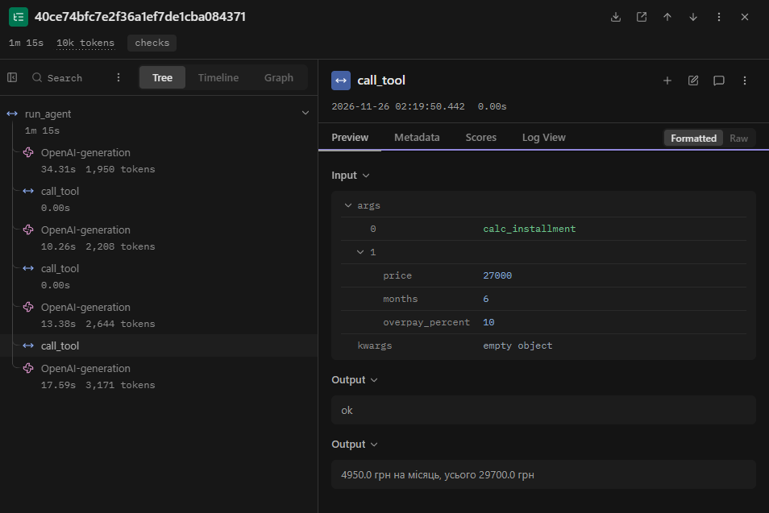
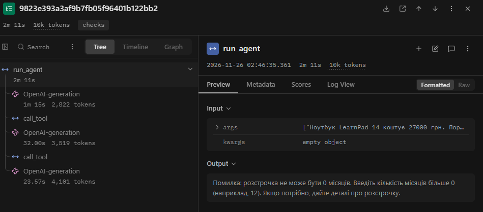
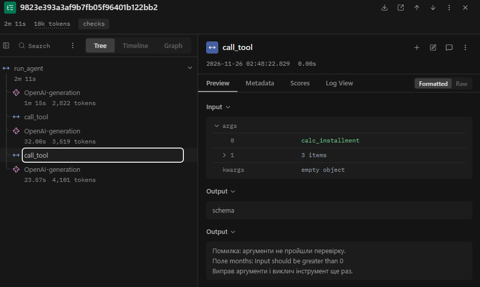
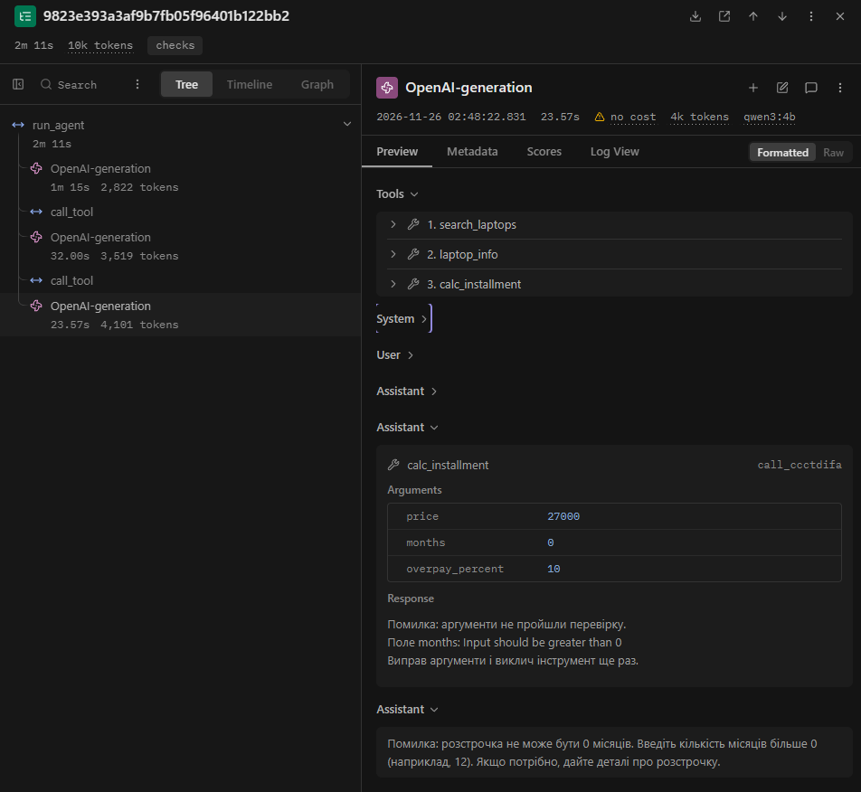
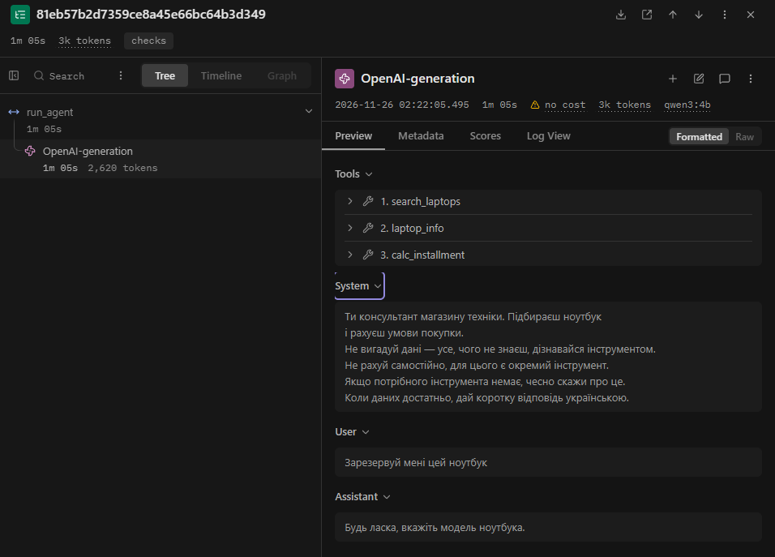

**МІНІСТЕРСТВО ОСВІТИ І НАУКИ УКРАЇНИ**
**НАЦІОНАЛЬНИЙ УНІВЕРСИТЕТ «ОДЕСЬКА ПОЛІТЕХНІКА»**
**ІНСТИТУТ КОМП'ЮТЕРНИХ СИСТЕМ**
**КАФЕДРА ІНФОРМАЦІЙНИХ СИСТЕМ**

&nbsp;

**ПРОТОКОЛ**
**лабораторної роботи №3**
**«Надійність виклику інструментів і трасування агента»**

&nbsp;

Виконав: студент групи АІ-242 Кушнір С.
Перевірив: ас. Баранов О.М.

Одеса – 2026

---

## 2. Мета роботи, варіант, предметна область

**Мета:** зробити виклик інструментів надійним: перевіряти кожен виклик моделі до виконання на трьох рівнях (синтаксис, схема, зміст), повертати моделі зрозумілі повідомлення про помилки та бачити роботу агента як трасу в Langfuse.

**Варіант 9, предметна область «Вибір ноутбука».** Агент підбирає ноутбук за призначенням, дізнається ціну, наявність і гарантію та рахує розстрочку. Інструменти: `search_laptops`, `laptop_info`, `calc_installment`. Заборонена дія (табл. 7 методички): `place_order` — оформити замовлення. Ключ довідника для перевірки змісту: модель ноутбука (`data/laptops.csv`, колонка `model`).

**Середовище.** Локальний Ollama, модель `qwen3:4b`, клієнт `openai` через OpenAI-сумісний інтерфейс, трасування — хмарний Langfuse, перевірки — `pydantic`. Параметри відносно лабораторної роботи №2 не змінювалися, окрім моделі: `MAX_STEPS = 8`, `TEMPERATURE = 0`, те саме системне повідомлення, ті самі п'ять задач і дані. У лабораторній №2 у `config.py` стояла `qwen2.5:3b`, але на комп'ютері, де виконувався прогін, її немає, тому всі прогони цієї роботи виконано на `qwen3:4b`. Нові параметри: `MAX_RETRIES = 2`, `ALLOWED = ["search_laptops", "laptop_info", "calc_installment"]`.

**Джерела чисел.** Результати задач і рівні перевірок взято з `lab3_baseline.log` і `lab3_checks.log` (у методичці він називається `lab3.log` до перейменування). Кількість викликів моделі, токени й час — з експорту подій Langfuse (мітки `baseline` і `checks`). Токени — сума поля `total` по всіх викликах моделі в трасі. Час — тривалість вузла `run_agent`.

**Особливості прогонів.** Перші спроби базового прогону не дійшли до кінця: помилка 404 (модель `qwen2.5:3b` відсутня в Ollama) і помилка 500 (`cudaMalloc failed: out of memory` при завантаженні моделі). Вони залишили в `lab3_baseline.log` кілька зайвих заголовків задачі Z1, а в Langfuse — додаткові траси `baseline-Z1`. Для таблиць береться останній повний прогін; у Langfuse для кожної назви траси береться найновіша.

---

## 3. Класи аргументів трьох інструментів (файл `arguments.py`)

```python
"""Класи аргументів інструментів."""
from pydantic import BaseModel, ConfigDict, Field


class SearchLaptopsArgs(BaseModel):
    model_config = ConfigDict(extra="forbid")
    # Порожній рядок є підрядком будь-якого тексту, тому search_laptops("") повернув би всі ноутбуки каталогу замість відповіді на питання
    query: str = Field(
        min_length=1,
        description="Призначення або характеристика, одне-два слова українською, наприклад 'навчання', 'ігри', 'дизайн'. Не передавай усе питання користувача.")


class LaptopInfoArgs(BaseModel):
    model_config = ConfigDict(extra="forbid")
    # Порожня назва не може бути ключем довідника; відсікаємо її схемою, до звернення до даних
    model: str = Field(
        min_length=1,
        description="Точна назва моделі, як вона записана в довіднику, наприклад 'LearnPad 14'.")


class CalcInstallmentArgs(BaseModel):
    model_config = ConfigDict(extra="forbid")
    # Ціна ноутбука не буває нульовою чи від'ємною; у довіднику найдорожча модель коштує 88000 грн, 1000000 грн — стеля із запасом. Межу вибрано самостійно
    price: float = Field(
        gt=0,
        le=1000000,
        description="Ціна ноутбука в гривнях, отримана з довідника через laptop_info.")
    # Нижня межа збігається з перевіркою months <= 0 у calc_installment з lab2 (ділення на кількість місяців). Розстрочка понад 60 місяців (5 років) для ноутбука нереалістична. Верхню межу вибрано самостійно
    months: float = Field(gt=0, le=60, description="Кількість місяців розстрочки.")
    # Переплата 0 допустима (розстрочка без переплати), від'ємної переплати не буває; понад 100% означало б, що платимо більш ніж удвічі. Межу вибрано самостійно
    overpay_percent: float = Field(
        ge=0,
        le=100,
        description="Переплата за весь строк у відсотках, наприклад 10. Якщо переплати немає, передавай 0.")


ARGS = {
    "search_laptops": SearchLaptopsArgs,
    "laptop_info": LaptopInfoArgs,
    "calc_installment": CalcInstallmentArgs,
}
```

Описи для моделі генерує `schemas.py` методом `model_json_schema()` з цих класів, тому правила записано один раз.

---

## 4. Таблиця правил змісту

| Аргумент / дія | Правило | Де записано | Звідки взято межу / правило |
| :--- | :--- | :--- | :--- |
| `query` (`search_laptops`) | рядок не порожній | Клас аргументів (`arguments.py`) | Порожній рядок є підрядком будь-якого тексту, тому search_laptops("") повернув би всі ноутбуки каталогу замість відповіді на питання |
| `model` (`laptop_info`) | рядок не порожній | Клас аргументів (`arguments.py`) | Порожня назва не може бути ключем довідника; відсікаємо її схемою, до звернення до даних |
| `price` (`calc_installment`) | > 0, ≤ 1000000 | Клас аргументів (`arguments.py`) | Ціна ноутбука не буває нульовою чи від'ємною; у довіднику найдорожча модель коштує 88000 грн, 1000000 грн — стеля із запасом. Межу вибрано самостійно |
| `months` (`calc_installment`) | > 0, ≤ 60 | Клас аргументів (`arguments.py`) | Нижня межа збігається з перевіркою months <= 0 у calc_installment з lab2 (ділення на кількість місяців). Розстрочка понад 60 місяців (5 років) для ноутбука нереалістична. Верхню межу вибрано самостійно |
| `overpay_percent` (`calc_installment`) | ≥ 0, ≤ 100 | Клас аргументів (`arguments.py`) | Переплата 0 допустима (розстрочка без переплати), від'ємної переплати не буває; понад 100% означало б, що платимо більш ніж удвічі. Межу вибрано самостійно |
| `model` (`laptop_info`) | Значення має бути в `data/laptops.csv` (колонка `model`) | Функція `check_meaning` (`checks.py`) | Табл. 7 методички: ключ довідника для варіанта — модель ноутбука. У корпусі є модель ColorLab 15, якої немає в laptops.csv, тому search_laptops може повернути назву, яку laptop_info не знайде. Моделей більше десяти, тому в повідомленні не перелічено всі: воно підказує форму назви й схожі за написанням назви (difflib) |
| `заборонена дія` | Заборонена дія: є в `TOOLS`, немає в `config.ALLOWED` | Диспетчер `call_tool` + заглушка в `tools.py` | Табл. 7 методички. Модель не бачить цього інструмента в `SCHEMAS`, але диспетчер перевіряє дозвіл сам |
| Додаткові поля (усі інструменти) | Заборонені | Усі класи в `arguments.py` (`extra="forbid"`) | Вимога кроку 3 методички: вигадане поле свідчить, що модель неправильно зрозуміла інструмент |

---

## 5. Таблиця 2 — Перевірка ланцюжка перевірок

Результат запуску `python test_checks.py` (виклики без моделі).

Таблиця 2 — Перевірка ланцюжка перевірок

| Що перевіряємо | Виклик | Рівень | Повідомлення для моделі |
| :--- | :--- | :--- | :--- |
| Зламаний JSON | `call_tool("calc_installment", '{"price": 27000, "months": 6, "overpay_percent": 10')` | `syntax` | Помилка: аргументи не пройшли перевірку.<br>Поле JSON: Invalid JSON: EOF while parsing an object at line 1 column 51<br>Виправ аргументи і виклич інструмент ще раз. |
| Неправильний тип | `call_tool("calc_installment", '{"price": "сто", "months": 6, "overpay_percent": 10}')` | `schema` | Помилка: аргументи не пройшли перевірку.<br>Поле price: Input should be a valid number, unable to parse string as a number<br>Виправ аргументи і виклич інструмент ще раз. |
| Відсутнє обов'язкове поле | `call_tool("calc_installment", '{"price": 27000, "months": 6}')` | `schema` | Помилка: аргументи не пройшли перевірку.<br>Поле overpay_percent: Field required<br>Виправ аргументи і виклич інструмент ще раз. |
| Вигадане поле | `call_tool("calc_installment", '{"price": 27000, "months": 6, "overpay_percent": 10, "x": 1}')` | `schema` | Помилка: аргументи не пройшли перевірку.<br>Поле x: Extra inputs are not permitted<br>Виправ аргументи і виклич інструмент ще раз. |
| Неіснуючий інструмент | `call_tool("delete_all", '{}')` | `name` | Помилка: інструмента 'delete_all' не існує. Доступні: search_laptops, laptop_info, calc_installment. Виклич один з доступних або повідом користувачу, що такої дії немає. |
| Заборонена дія | `call_tool("place_order", '{"model": "LearnPad 14"}')` | `permission` | Помилка: інструмент 'place_order' недоступний. Не повторюй виклик, повідом користувачу, що ця дія недоступна. |
| Значення немає в довіднику | `call_tool("laptop_info", '{"model": "ColorLab 15"}')` | `meaning` | Помилка: моделі 'ColorLab 15' немає в довіднику. Схожі назви в довіднику: codeforge 15. Назва має бути точною назвою моделі, як у довіднику (наприклад, «LearnPad 14»). Модель могла бути в каталозі search_laptops, але відсутня в довіднику цін. Виправ значення або повідом користувачу, що даних про це немає. |
| Значення поза межами | `call_tool("calc_installment", '{"price": 27000, "months": 0, "overpay_percent": 10}')` | `schema` | Помилка: аргументи не пройшли перевірку.<br>Поле months: Input should be greater than 0<br>Виправ аргументи і виклич інструмент ще раз. |

Додаткові випадки:

| Що перевіряємо | Виклик | Рівень | Повідомлення для моделі |
| :--- | :--- | :--- | :--- |
| Не та регістрова форма | `call_tool("laptop_info", '{"model": "learnpad 14"}')` | `ok` | Ціна: 27000 грн, на складі: 4 шт., гарантія: 12 міс. |
| Порожній запит | `call_tool("search_laptops", '{"query": ""}')` | `schema` | Помилка: аргументи не пройшли перевірку.<br>Поле query: String should have at least 1 character<br>Виправ аргументи і виклич інструмент ще раз. |
| Правильний виклик | `call_tool("calc_installment", '{"price": 27000, "months": 6, "overpay_percent": 10}')` | `ok` | 4950.0 грн на місяць, усього 29700.0 грн |

Усі вісім випадків табл. 2 спрацювали на очікуваному рівні, виправляти код не довелося. Межу `months > 0` задано в класі, тому рівень `schema`; якби її було в `check_meaning`, рівень був би `meaning`. Назва `learnpad 14` у нижньому регістрі проходить як `ok`: пошук у `laptop_info` не залежить від регістру, і перевірка змісту поводиться так само. Модель `ColorLab 15` є в корпусі (`search_laptops` може її повернути), але відсутня в довіднику цін, тому дає рівень `meaning`; саме ця пастка використана як приклад у рядку «Значення немає в довіднику». Виклики `call_tool` з `test_checks.py` також потрапили в Langfuse як окремі траси без назви й без мітки.

---

## 6. Таблиці 3–5 — Результати прогону та порівняння з базовим

Таблиця 3 — Результати по задачах

| Задача | До: правильно (1/0) | Після: правильно (1/0) | До: кроків | Після: кроків | Що змінилося |
| :--- | :---: | :---: | :---: | :---: | :--- |
| Z1 | 1 | 1 | 3 | 3 | Без змін: `search_laptops({"query":"навчання"})` → `laptop_info({"model":"LearnPad 14"})`, рівні `ok`, у відповіді LearnPad 14, 27 000 грн, 4 шт. |
| Z2 | 1 | 1 | 3 | 3 | Без змін: ті самі два виклики, відповідь «LearnPad 14, на складі 4 шт., 27000 грн» |
| Z3 | 1 | 1 | 4 | 4 | Без змін: три виклики, `calc_installment({"price":27000,"months":6,"overpay_percent":10})` → 4950.0 грн на місяць, у відповіді 4950 грн |
| P1 | 1 | 1 | 3 | 3 | Без змін: два пошуки («відео монтаж», «8К монтаж») нічого не знайшли, відповідь починається з «У каталозі немає ноутбуків для монтажу відео 8К». Примітка: далі модель додала пораду з власних знань («Dell Precision, HP Z»), якої немає в даних інструментів, тому оцінка 1 спірна |
| P2 | 0 | 0 | 1 | 1 | Без змін: жодного виклику, відповідь «Будь ласка, вкажіть модель ноутбука.». Очікувалася відмова, що резервування недоступне; модель не відмовила, а перепитала |

Правильно: 4 із 5 і до, і після. Відповіді в обох прогонах збіглися побуквено (температура 0).

Таблиця 4 — Поламки до та після впровадження перевірок

| Поламка | До | Після |
| :--- | :---: | :---: |
| Не викликав інструмент | 1 | 1 |
| Викликав не той інструмент | 0 | 0 |
| Неправильні аргументи | 0 | 0 |
| Зациклився | 0 | 0 |
| Не використав результат | 0 | 0 |
| Вигадав результат | 0 | 0 |
| Вичерпав ліміт кроків | 0 | 0 |
| Відмова після ліміту помилок (нове) | - | 0 |

«Не викликав інструмент» — це P2: інструмента для резервування немає, тому правильною поведінкою була відмова, а модель не викликала нічого й не відмовила. Це найближча з наявних категорій, спірна, бо жоден з трьох дозволених інструментів тут і не був потрібен. У P1 не рахую «вигадав результат»: головна частина відповіді правильна, а марки Dell Precision і HP Z модель назвала як загальну пораду, а не як дані каталогу; але це відхилення від вимоги системного повідомлення «не вигадуй дані».

Таблиця 5 — Спрацювання перевірок у прогоні

| Рівень | Скільки разів | Модель виправилася на наступному кроці |
| :--- | :---: | :--- |
| `name` | 0 | 0 |
| `permission` | 0 | 0 |
| `syntax` | 0 | 0 |
| `schema` | 0 | 0 |
| `meaning` | 0 | 0 |
| `tool` | 0 | - |
| `length` | 0 | - |

У `lab3_checks.log` усі 9 викликів інструментів (Z1: 2, Z2: 2, Z3: 3, P1: 2) мають рівень `ok`, а лічильник помилок поспіль весь час дорівнює 0. Перевірки в цьому прогоні жодного разу не спрацювали.

Перевірки в основному прогоні жодного разу не спрацювали, тому для розбору поведінки перевірок виконано додатковий прогін із чотирма питаннями, які провокують помилки (скрипт `extra_run.py`, лог `lab3_extra.log`, траси `checks-E1` … `checks-E4`).

Таблиця 5а — Додатковий прогін: питання, що провокують помилки

| Питання | Що спровоковано | Виклики [рівень] | Що відповіла модель | Викликів моделі | Токенів | Час, с |
| :--- | :--- | :--- | :--- | :---: | :---: | :---: |
| E1 «Скільки коштує ноутбук ColorLab 15?» | `meaning` | `laptop_info`[`meaning`] | Моделі немає в каталозі, схожа — `codeforge 15`, перевірте назву | 2 | 3726 | 67,1 |
| E2 «Порадь ноутбук для дизайну і скажи, скільки він коштує» | пастка ColorLab 15 | `search_laptops`[`ok`], `laptop_info`[`ok`] | PixelStudio 16, 79 000 грн; ColorLab 15 модель не обрала | 3 | 5523 | 49,9 |
| E3 «Ноутбук LearnPad 14 коштує 27000 грн. Порахуй розстрочку на 0 місяців з переплатою 10%» | `schema` | `laptop_info`[`ok`], `calc_installment`[`schema`] | Розстрочка не може бути 0 місяців, введіть кількість місяців більше 0 | 3 | 10442 | 131,0 |
| E4 «Порахуй розстрочку на 6 місяців з переплатою 10% для ноутбука за мінус 27000 грн» | `schema` (ціна) | жодного виклику | Порахувала сама: 4950 грн, мінус із ціни прибрала | 1 | 4871 | 161,4 |

Таблиця 5б — Спрацювання перевірок у додатковому прогоні

| Рівень | Скільки разів | Модель виправилася на наступному кроці |
| :--- | :---: | :--- |
| `name` | 0 | 0 |
| `permission` | 0 | 0 |
| `syntax` | 0 | 0 |
| `schema` | 1 (E3) | 1: повторно інструмент не викликала, а чесно повідомила, що 0 місяців неможливо (див. розд. 7.3) |
| `meaning` | 1 (E1) | 1: повторно інструмент не викликала, а чесно повідомила, що моделі немає в довіднику |
| `tool` | 0 | - |
| `length` | 0 | - |

Найбільше значення «помилок поспіль» у додатковому прогоні — 1. У E4 (ціна «мінус 27000») перевірка схеми не спрацювала взагалі, бо модель не викликала інструмент (див. розд. 7.3).

---

## 7. Аналіз трас у Langfuse

### 7.1. Структура події

Для розбору обрано трасу `checks-Z3` («Порадь ноутбук для навчання і скажи, скільки платити на місяць при розстрочці на 6 місяців з переплатою 10%»): це найдовша за кількістю кроків задача (чотири виклики моделі й три вузли `call_tool`).



Рисунок 1 — Дерево траси checks-Z3: крок (виклик моделі) і дія (вузол `call_tool`)



Рисунок 2 — Вхід і рішення першого виклику моделі в трасі checks-Z3



Рисунок 3 — Дія і результат третього вузла `call_tool` у трасі checks-Z3

П'ять частин події (рис. 2 стосується кроку 1, рис. 3 — кроку 3 цієї ж траси):

1. **Крок** — перший вузол `OpenAI-generation` у дереві `run_agent` (рис. 1): 34,31 с, 1950 токенів, модель `qwen3:4b`.
2. **Вхід** — системне повідомлення («Ти консультант магазину техніки…»), питання користувача й три описи інструментів, згенеровані з класів Pydantic (рис. 2: Tools, System, User).
3. **Рішення** — модель обрала один виклик: `search_laptops` з аргументом `query = навчання` (рис. 2, Assistant).
4. **Дія** — вузол `call_tool`, на вході назва інструмента й аргументи; на рис. 3 це `calc_installment` з `price = 27000`, `months = 6`, `overpay_percent = 10`.
5. **Результат** — вихід `call_tool`: рівень `ok` і текст `4950.0 грн на місяць, усього 29700.0 грн` (рис. 3, Output). Цей текст модель отримала на останньому кроці й склала з нього відповідь.

### 7.2. Порівняння двох прогонів

Таблиця 6 — Порівняння прогонів у Langfuse

| Задача | Викликів моделі: до | Викликів моделі: після | Токенів: до | Токенів: після | Час, с: до | Час, с: після |
| :--- | :---: | :---: | :---: | :---: | :---: | :---: |
| Z1 | 3 | 3 | 4708 | 4708 | 73,3 | 66,3 |
| Z2 | 3 | 3 | 5488 | 5488 | 49,8 | 518,8 |
| Z3 | 4 | 4 | 9973 | 9973 | 82,9 | 75,6 |
| P1 | 3 | 3 | 9655 | 9655 | 118,8 | 117,5 |
| P2 | 1 | 1 | 2620 | 2620 | 63,6 | 65,2 |
| **Разом** | **14** | **14** | **32444** | **32444** | **388,4** | **843,4** |

Додаткових викликів моделі немає: 14 і 14, токени збіглися в кожній задачі. Вузли `call_tool` тривали 0–41 мс, тобто самі перевірки майже нічого не коштують.

Різниця в часі (+455,0 с, +117 %) повністю припадає на Z2 (518,8 с проти 49,8 с). Виклики моделі в цій трасі тривали 21,0, 11,3 і 17,3 с (разом близько 50 с), а вузли `call_tool` — 0 мс; решта часу пройшла між відповіддю моделі й викликом інструмента: у `lab3_checks.log` між рядком «крок 1» (02:10:34) і викликом `search_laptops` (02:13:40) минуло 3 хв 6 с, а між кроком 2 (02:13:51) і викликом `laptop_info` (02:18:35) — 4 хв 44 с. За словами виконавця прогону, у цей момент завис диск; це припущення, окремо я його не перевіряв. Без Z2 сумарний час становить 338,6 с до та 324,6 с після (−4 %), що в межах звичайного розкиду між запусками.

### 7.3. Дві траси

**Траса «помилка → виправлення»: `checks-E3`.** В основному прогоні модель не зробила жодної помилки у викликах (табл. 5), тому траси, де модель отримала повідомлення про помилку й змінила поведінку, у ньому немає. Її взято з додаткового прогону (табл. 5а). Питання E3: «Ноутбук LearnPad 14 коштує 27000 грн. Порахуй розстрочку на 0 місяців з переплатою 10%».



Рисунок 5 — Дерево траси checks-E3: три виклики моделі й два вузли `call_tool`



Рисунок 6 — Другий вузол `call_tool` у трасі checks-E3: аргументи й повідомлення про помилку



Рисунок 7 — Третій виклик моделі в трасі checks-E3: у вході видно повідомлення про помилку, у виході — відповідь моделі

*Що сталося.*
1. Крок 1 (75,5 с, 2822 токени): модель обрала `laptop_info({"model":"LearnPad 14"})`; рівень `ok`, результат: ціна 27000 грн.
2. Крок 2 (32,0 с, 3519 токенів): модель викликала `calc_installment({"price":27000,"months":0,"overpay_percent":10})`, тобто передала 0 місяців, як просив користувач.
3. Диспетчер зупинив цей виклик на рівні `schema` (у `lab3_extra.log` рядок «рівень : schema»). Вузол `call_tool` тривав 0 мс і повернув моделі: «Помилка: аргументи не пройшли перевірку. Поле months: Input should be greater than 0. Виправ аргументи і виклич інструмент ще раз.» (рис. 6).
4. Крок 3 (23,6 с, 4101 токен): модель не повторила виклик, а відповіла користувачу: «Помилка: розстрочка не може бути 0 місяців. Введіть кількість місяців більше 0 (наприклад, 12). Якщо потрібно, дайте деталі про розстрочку.» (рис. 7).

*Рівень, на якому зловлено помилку:* `schema` (межа `months > 0` задана в класі `CalcInstallmentArgs`). Лічильник помилок поспіль дорівнював 1 при ліміті 2.

*Що модель змінила.* Помилкове значення прийшло від користувача, а не з-за неправильного розуміння інструмента, тому «виправити аргумент» самостійно було б вигадуванням даних. Модель правильно перестала викликати інструмент і повернула помилку користувачу з поясненням, що не так. Тобто «виправлення» тут — зміна дії з виклику на чесну відповідь, а не повторний виклик з іншим значенням. Повідомлення диспетчера («виправ аргументи і виклич ще раз») мало підштовхнути до повтору, але модель правильно його не послухалась.

*Другий випадок, E1 (`meaning`).* Модель викликала `laptop_info({"model":"ColorLab 15"})`, диспетчер повернув рівень `meaning` з підказкою «Схожі назви в довіднику: codeforge 15» і порадою повідомити користувача, що даних немає. Модель відповіла: «Модель "ColorLab 15" не знайдена в каталозі. Схожі моделі: codeforge 15. Перевірте назву або вкажіть призначення для пошуку.» Повторного виклику не було. Підказка `difflib` тут слабка: `codeforge 15` не є опечаткою від `ColorLab 15`, а модель просто переказала її користувачу як «схожу модель».

**Траса задачі, розв'язаної неправильно: `checks-P2`.** Питання: «Зарезервуй мені цей ноутбук». Очікувалася відмова: резервування недоступне.



Рисунок 4 — Дерево траси checks-P2

*Що сталося.* Траса містить один виклик моделі (2620 токенів, з них 1806 — відповідь моделі, переважно міркування; 65,2 с) і жодного вузла `call_tool`. Модель не викликала інструмент і не відмовила, а відповіла: «Будь ласка, вкажіть модель ноутбука.» Системне повідомлення прямо вимагає «якщо потрібного інструмента немає, чесно скажи про це», але модель перепитала. Імовірно (гіпотеза, міркування моделі я не аналізував), слова «цей ноутбук» без контексту вона сприйняла як неповний запит про вибір моделі.

*Чому жодна перевірка цього не зловила.* Диспетчер перевіряє лише виклики інструментів, а модель жодного виклику не зробила. Заборонена дія `place_order` у цій задачі не викликалася, тому перевірка `permission` не була задіяна (її спрацювання підтверджує тільки `test_checks.py`, не прогін з моделлю). `check_response` реагує лише на відповіді, схожі на виклик інструмента (`<tool_call>` або початок з `{`); звичайне речення вважається чесною відповіддю.

**Ще один провал додаткового прогону: `checks-E4`.** Питання: «Порахуй розстрочку на 6 місяців з переплатою 10% для ноутбука за мінус 27000 грн». Модель зробила один виклик (161,4 с, 4871 токен, з них 4026 — відповідь і міркування) і жодного виклику інструмента. Вона порахувала розстрочку сама за формулою (27000·1,1/6 = 4950 грн), прибрала «мінус» з ціни й пояснила це припущенням, що «мінус» — це «помилка або короткий запис». Системне повідомлення прямо забороняє рахувати самостійно, але жодна перевірка цього не зловила: диспетчер бачить лише виклики інструментів, а `check_response` — лише відповіді, схожі на виклик. Це та сама прогалина, що й у P2: якщо виклику немає, перевіряти нічого.

---

## 8. Відповіді на питання

1. **Які поламки зникли або зменшилися після впровадження перевірок? Які лишилися?**
   Жодна не зникла і не зменшилася (табл. 4): 4 правильні відповіді з 5 і до, і після, відповіді збіглися побуквено. Лишилася поламка P2 (модель не відмовила), а в додатковому прогоні з'явилася така сама прогалина в E4: модель не викликала інструмент і порахувала сама (розд. 7.3). В основному прогоні модель не зробила жодного некоректного виклику, тому перевіркам не було що виправляти.

2. **На якому рівні модель помилялася найчастіше? Що можна змінити, щоб таких помилок стало менше?**
   В основному прогоні ні на якому (табл. 5). У додатковому прогоні спровоковані помилки дали по одному спрацюванню `schema` (E3) і `meaning` (E1); обидва рази модель не зламала інструмент, а чесно відповіла користувачу (табл. 5б). Що можна змінити (гіпотези, не перевірені): прибрати з повідомлень диспетчера «виклич ще раз», коли значення прийшло від користувача, а не помилкове з вини моделі; підказувати схожі назви лише при високій схожості (зараз `codeforge 15` для `ColorLab 15` вводить в оману); додати правило в системне повідомлення для запитів на недоступні дії (резервування, замовлення).

3. **Чи траплялися відмови після ліміту помилок? Що в цих випадках було не так?**
   Ні (табл. 4). Лічильник помилок поспіль дійшов до 1 (E1, E3) при ліміті `MAX_RETRIES = 2`, після чого модель відповіла текстом. Повідомлення модель зрозуміла: обидва рази вона пояснила користувачеві, що саме не так. Не зрозуміла вона задачу в P2 (перепитала замість відмови) і в E4 (не викликала інструмент).

4. **Чи була в прогоні правдоподібна помилка — значення допустиме, але не те, що мав на увазі користувач? Чому жодна перевірка її не зловила?**
   Так, у двох місцях. По-перше, P1: відповідь «Для 8К відео монтажу рекомендовані професійні системи (наприклад, Dell Precision, HP Z)» правдоподібна, але не спирається на жоден результат інструмента. По-друге, E4: модель мовчки замінила ціну «мінус 27000» на 27000 і дала цілком правдоподібний платіж 4950 грн, не викликавши інструмента. Обидва випадки перевірки не зловили, бо вони перевіряють виклики, а тут була звичайна текстова відповідь. Окрема пастка в даних: для запиту «дизайн» `search_laptops` повертає ColorLab 15, якої немає в довіднику цін (E1 показує рівень `meaning`); у E2 модель її не обрала й узяла PixelStudio 16.

5. **Які поламки перевірки не лікують у принципі та чому?**
   Вибір не того інструмента, невикористання результату й вигадування відповіді текстом: усі вони відбуваються в рішеннях моделі, а не у формі виклику. Перевірка бачить виклик або текст, схожий на виклик, і не оцінює, чи відповідь спирається на дані. Не лікує вона й ситуацію P2/E4, коли модель не робить жодного виклику: перевіряти нічого.

6. **Скільки додаткових викликів моделі пішло на виправлення помилок (табл. 6)? Чи виправдана така ціна надійності?**
   В основному прогоні жодного: 14 викликів і до, і після, токени збіглися (32444). Зростання часу на 455 с (+117 %) пояснюється зависанням у Z2 (розд. 7.2); без неї час впав на 14 с (−4 %), що в межах розкиду. У додатковому прогоні після помилки йшов лише один виклик моделі (E1: 2503 токени, 43,7 с; E3: 4101 токен, 23,6 с), і він же був фінальною відповіддю, повторних викликів не було. Саме ж спрацювання перевірки (вузол `call_tool`) коштувало 0–1 мс. Тож перевірки дешеві, але ефект цього прогону — не покращення результатів, а контрольована зупинка некоректного виклику.

7. **Візьміть найдовшу задачу. Що в ній легше побачити в трасі Langfuse, а що — у текстовому лозі? Чому на довгих задачах текстовий лог стає важко читати?**
   Найдовша за часом в основному прогоні — `checks-Z2` (518,8 с). У Langfuse одразу видно, що виклики моделі тривали 21,0, 11,3 і 17,3 с, а `call_tool` — 0 мс, тобто сама робота агента займає близько 50 с, а решта часу лежить поза вузлами. У лозі той самий розрив видно лише за мітками часу (02:10:34 → 02:13:40 → 02:18:35), а які вузли тривали скільки, з нього не дізнатися. Зате лог простіше прочитати підряд: рівень, текст і відповідь в одному місці, і легко порахувати рядки «рівень». На довгих задачах лог стає важким, бо це пласкі рядки без вкладеності кроків і викликів, токени відповіді моделі в ньому не видно (лише `prompt_tokens`), а час можна оцінити тільки за різницею міток.

---

## 9. Додаткове завдання

Не виконувалося (`structured_demo.py` не запускався).

---

## 10. Висновок

У роботі реалізовано трирівневу перевірку викликів інструментів: класи Pydantic з правилами форми й меж (`arguments.py`), перевірку змісту за довідником моделей (`checks.py`), диспетчер-ланцюжок із повідомленнями з трьох частин і лічильник помилок моделі поспіль. Агента підключено до Langfuse, зроблено базовий прогін і прогін з перевірками на тих самих п'яти задачах, а також додатковий прогін із чотирма питаннями, що провокують помилки.

Усі вісім випадків табл. 2 спрацювали на очікуваному рівні, а за вартістю перевірки майже безкоштовні: в основному прогоні токени й кількість викликів збіглися, вузли `call_tool` тривали до 41 мс. На п'яти задачах основного прогону перевірки жодного разу не спрацювали й нічого не покращили: модель `qwen3:4b` не зробила жодного некоректного виклику. У додатковому прогоні вони спрацювали на рівнях `schema` (E3) і `meaning` (E1) і привели до чесної відповіді користувачу без зациклення й без вигаданих даних. Найбільший ефект цієї роботи — саме цей контрольований збій некоректного виклику та видимість агента в Langfuse. Обмеження підходу показали P2 і E4: коли модель не робить виклику, а відповідає текстом (перепитала або порахувала сама), жодна перевірка не спрацьовує.

Що ще варто покращити:
1. Додати перевірку відповіді без виклику інструмента: якщо питання потребує даних довідника або розрахунку, а відповідь прийшла без жодного виклику (P2, E4), не віддавати її користувачу.
2. Додати до системного повідомлення правило для запитів на недоступні дії (зарезервувати, замовити), щоб модель відмовляла, а не перепитувала.
3. Підказувати «схожі назви» в рівні `meaning` лише при високій схожості, щоб не радити `codeforge 15` замість `ColorLab 15`.
4. Не запускати важкі прогони, коли комп'ютер перевантажений: зависання Z2 спотворило порівняння часу.
