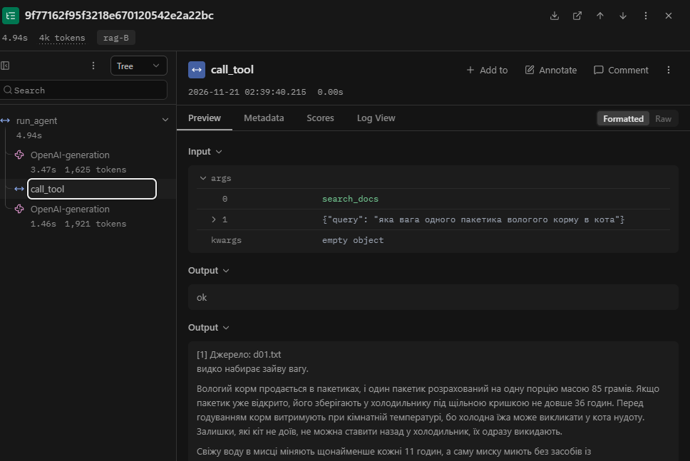
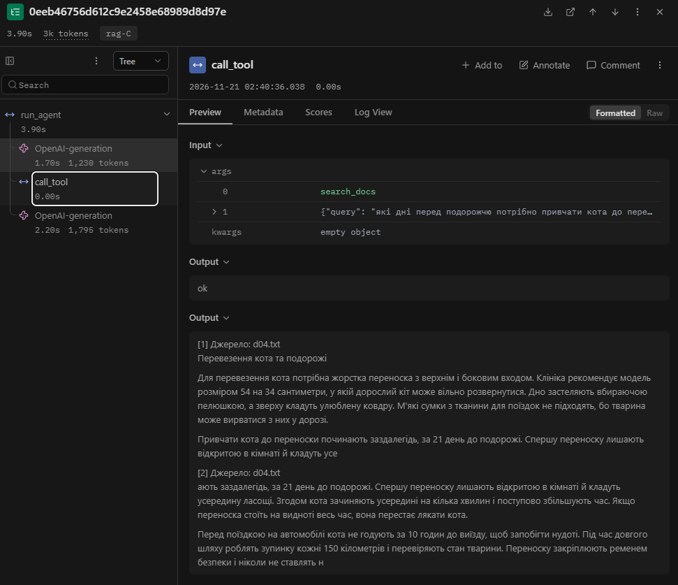

# Лабораторна робота № 5. RAG-агент: пошук по документах як інструмент

**Студент:** Левентій Д. О., група АІ-242
**Перевірили:** доц. Годовиченко М. А., Баранов О. М.
**Дисципліна:** «Обчислювальні методи»
**Одеса — 2026**

---

## 1. Мета, варіант, налаштування

**Мета.** Замінити пошук підрядком з лабораторної № 2 векторним, під'єднати його до агента як інструмент `search_docs`, виміряти якість пошуку окремо від агента, а потім виміряти агента з трьома описами інструмента й знайти, де саме ламається відповідь.

| Параметр | Значення |
|---|---|
| Варіант / область | 10 — «Догляд за котом» |
| Вигадана організація | «Пухнастий компас» |
| Модель чату | `qwen3-3k` (створена з `qwen3:4b-instruct`), температура 0 |
| Розмір вікна | `NUM_CTX = 2304` (з лабораторної № 4) |
| Модель ембедингів | `bge-m3` |
| Індекс | FAISS `IndexFlatIP`, вектори нормалізовані |
| Параметри пошуку (остаточні) | `fixed`, розмір 500, перекриття 100, `WITH_TITLE = False`, `TOP_K = 3`, `MIN_SCORE = 0.615` |
| Скорочення історії / стан / кеш викликів | вимкнено (`COMPRESS = "none"`, `USE_STATE = False`, `USE_CACHE = False`) |

## 2. Дані

**Теми п'яти документів** (рядок 10 табл. 8 методички):

| Файл | Назва | Символів |
|---|---|---|
| `d01.txt` | Годування дорослого кота | 3321 |
| `d02.txt` | Щеплення та захист від паразитів | 3031 |
| `d03.txt` | Поведінка кота та навчання | 3042 |
| `d04.txt` | Перевезення кота та подорожі | 3136 |
| `d05.txt` | Стерилізація та догляд після операції | 3059 |

**Обсяг.** П'ять нових документів: 15 589 символів (≈ 6 236 токенів за оцінкою 2,5 символа на токен). Разом зі старим корпусом (12 коротких статей `s01`–`s12`) — 17 документів, 18 945 символів (≈ 7 578 токенів). Це втричі більше за вікно 2304, тож усі документи в контекст не вміщуються і пошук потрібен. `check_cases.py` повернув «Усе гаразд».

**Питання** (`rag_cases.json`, зафіксовані до першого прогону й не змінювалися):

| id | Вид | Питання | `must_contain` | `expected` |
|---|---|---|---|---|
| D1 | direct | Скільки грамів важить один пакетик вологого корму? | порцію масою 85 грамів | 85 |
| D2 | direct | Скільки годин кота не годують напередодні стерилізації? | протягом 16 годин | 16 |
| D3 | direct | Яка мінімальна висота когтеточки в сантиметрах? | не нижчою за 77 сантиметрів | 77 |
| D4 | direct | За скільки днів до подорожі починають привчати кота до переноски? | за 21 день до подорожі | 21 |
| P1 | paraphrase | Скільки доведеться заплатити за захисний одяг для кота, якого щойно прооперували? | видає за 190 гривень | 190 |
| P2 | paraphrase | Як часто тварині треба давати засіб від гельмінтів? | раз на 83 дні | 83 |
| P3 | paraphrase | За який час до відходу господаря спати слід закінчувати активні розваги з улюбленцем, щоб він не будив вночі? | за 45 хвилин до сну | 45 |
| P4 | paraphrase | Яке мінімальне збільшення маси за тиждень вважається нормальним для маленького кошеняти? | щонайменше 70 грамів | 70 |
| N1 | none | Скільки коштує стерилізація кішки в клініці? | — | — |
| N2 | none | Скільки коштує вживлення мікрочіпа коту? | — | — |

**Чи вгадує модель без документів.** Три питання поставлено моделі напряму, без документів:

| Питання | Відповідь моделі | Значення в документі |
|---|---|---|
| D1 (вага пакетика) | «5 г» | 85 г |
| D2 (скільки годин не годують) | «24–48 годин» | 16 годин |
| D3 (висота когтеточки) | «3 см» | 77 см |

Жодне значення не вгадано, тож значення не типові й документи справді потрібні.

## 3. Перевірка моделі ембедингів (`embed_check.py`)

| Показник | Значення |
|---|---|
| Довжина вектора | 1024 |
| Норма першого вектора | 1.000 (вектори вже нормалізовані) |
| «Скільки коштує відправити посилку?» — «Тариф на доставку» | 0.732 |
| «Скільки коштує відправити посилку?» — «Графік роботи кур'єрів» | 0.568 |

Близький за змістом текст (тариф) має помітно вищу схожість, ніж далекий (графік), хоча спільних слів із запитом майже немає.

## 4. Нарізання одного документа (табл. 1)

Документ `d01.txt` (3321 символ), `show_chunks.py`:

| Спосіб | Чанків | Закінчуються посеред речення | Довжина найбільшого, символів |
|---|---|---|---|
| `fixed`, 200, перекриття 0 | 17 | 15 | 200 |
| `fixed`, 500, перекриття 100 | 9 | 8 | 500 |
| `paragraphs`, 800 | 6 | 0 | 746 |

**Приклад розрізаного факту.** У `d05.txt` при `fixed`, 500, перекриття 0 факт про 16 годин розрізано посередині слова між чанками 1 і 2:

```
чанк 1 закінчується: «...Напередодні операції кота не годують протягом 16 годи»
чанк 2 починається: «н. Воду забирають за 2 години до того, як тварину привезуть...»
```

Фраза `протягом 16 годин` не міститься цілою в жодному чанку, тож питання D2 при цьому нарізанні знаходиться гірше (див. табл. 2). Так само в `d01.txt` при `fixed`, 200 слово «швидко» розрізано між чанками 2 і 3 (чанк 3 починається з «видко набирає зайву вагу»). Агент отримує обрізок і не бачить, до чого належить число.

## 5. Нарізання, hit rate і поріг схожості (табл. 2, 3)

### Табл. 2. Пошук при різному нарізанні

| Конфігурація | Чанків | Сер. довжина | hit@1 | hit@3 | hit@5 | hit@3 прямі | hit@3 перефр. | Токенів (k=3) |
|---|---|---|---|---|---|---|---|---|
| `fixed-200-0` | 105 | 180 | 0.88 | 0.88 | 0.88 | 1.00 | 0.75 | 217 |
| `fixed-500-0` | 47 | 403 | 0.62 | 0.88 | 0.88 | 0.75 | 1.00 | 484 |
| `fixed-500-100` | 53 | 425 | 0.88 | **1.00** | 1.00 | 1.00 | 1.00 | **510** |
| `fixed-1500-0` | 27 | 702 | 0.75 | 1.00 | 1.00 | 1.00 | 1.00 | 842 |
| `paragraphs-800` | 38 | 497 | 1.00 | 1.00 | 1.00 | 1.00 | 1.00 | 597 |
| `paragraphs-800+title` | 38 | 514 | 1.00 | 1.00 | 1.00 | 1.00 | 1.00 | 617 |

**Вибір.** Найвищий `hit@3` = 1.00 мають чотири конфігурації. За правилом методички (за рівності — менший розмір результату) вибрано `fixed-500-100`: 510 токенів проти 597, 617 і 842. Назву документа не додавали (`WITH_TITLE = False`): `paragraphs-800` з назвою і без неї дає однаковий `hit@3`, а результат довшає з 597 до 617 токенів. Чесне застереження: `paragraphs-800` має кращий `hit@1` (1.00 проти 0.88) і жодного чанка, обірваного посеред речення; вибір `fixed-500-100` зроблено саме за розміром результату.

### Табл. 3. Схожість першого результату (`fixed-500-100`)

| id | Вид | Схожість | Перший результат містить потрібну фразу |
|---|---|---|---|
| D1 | direct | 0.630 | так |
| D2 | direct | 0.725 | ні |
| D3 | direct | 0.584 | так |
| D4 | direct | 0.762 | так |
| P1 | paraphrase | 0.630 | так |
| P2 | paraphrase | 0.624 | так |
| P3 | paraphrase | 0.624 | так |
| P4 | paraphrase | 0.687 | так |
| N1 | none | 0.610 | — |
| N2 | none | 0.595 | — |

Найнижча схожість серед питань з відповіддю — 0.584 (D3), найвища серед питань без відповіді — 0.610 (N1). **Межі перекриваються:** жоден поріг не розділяє питання ідеально. Вибрано `MIN_SCORE = 0.615` (трохи вище за N1, щоб питання без відповіді не отримували чанків). Ціна вибору: D3 (0.584) відсікається, а P1, P2, P3 (0.630, 0.624, 0.624) лишаються лише на 0.009–0.015 вище порога.

## 6. Інструмент без моделі (`try_tool.py`)

- `python try_tool.py D1` повернув фрагмент із `d01.txt`.
- `python try_tool.py N1` повернув «У документах нічого схожого не знайдено».

## 7. Агент із трьома описами інструмента (табл. 4–6)

### Табл. 4. Конфігурації агента

| Назва | Опис `search_docs` | Нарізання, `TOP_K`, `MIN_SCORE` |
|---|---|---|
| `A` | Старий опис пошуку з лабораторної № 2 («Шукає статті про догляд за котом… Повертає назви знайдених статей одним рядком…») | `fixed-500-100`, 3, 0.615 (не змінюється) |
| `B` | Докладний: «ЄДИНЕ джерело даних…», коли викликати ЗАВЖДИ (норма, доза, кількість, термін, вік, інтервал, ціна, ліміт, правило), перелік тем документів, «ніколи не відповідай "немає інформації", не викликавши інструмент», запит повним реченням, відповідати лише за знайденим | ті самі |
| `C` | «Шукає інформацію.» | ті самі |

Вимірювання: 3 описи × 3 повтори × 10 питань = 90 прогонів. У всіх прогонах статус `final`, без обривів вікна. Температура 0, тому повтори майже ідентичні.

### Табл. 5. Агент із трьома описами (дані за всіма повторами; питань з відповіддю 8, у трьох повторах 24 прогони)

| Опис | Правильно (з 24) | Викликав пошук (з 24) | Кроків, медіана | Токенів входу, медіана | Час, с, медіана |
|---|---|---|---|---|---|
| `A` | 9 | 9 | 1.0 | 1250 | 4.2 |
| `B` | 12 | 15 | 2.0 | 3247 | 4.0 |
| `C` | 9 | 9 | 1.0 | 1184 | 3.8 |

«Токенів входу» — сума `prompt_tokens` за всіма кроками прогону, тому в `B` (два кроки) значення втричі більше, ніж у `A` і `C` (один крок).

### Табл. 6. Куди ламається відповідь (кількість прогонів; питань з відповіддю 24 на опис, без відповіді 6)

| Категорія | `A` | `B` | `C` |
|---|---|---|---|
| Правильно | 9 | 12 | 9 |
| Не шукав і відповів неправильно | 15 | 9 | 15 |
| Шукав, але потрібного фрагмента в результаті немає | 0 | 3 | 0 |
| Фрагмент був у результаті, відповідь неправильна | 0 | 0 | 0 |
| Питання без відповіді: визнав, що не знає | 6 | 6 | 3 |
| Питання без відповіді: вигадав відповідь | 0 | 0 | 3 |

**Ручне виправлення класифікації.** Автоматична перевірка позначила відповіді `A` на N2 як вигадані (`invented`, 3 прогони з 3). Відповідь `A-N2` не містить числа: «ціна може варіюватися в залежності від місця та від кота». Тому вручну в `results/rag.csv` її позначено як `refused` (`correct = 1`), після чого перезапущено `rag_report.py`. До виправлення в `A` було 3 «визнав» і 3 «вигадав». Початковий файл збережено як `results/rag_auto.csv`. Застереження: це межовий випадок. Модель не сказала прямо, що не знає, а лише ухилилася від числа, і запропонувала «знайти інформацію про ціни в конкретній клініці», чого вона не вміє. У `C-N2` та сама відповідь містить число «від 150 до 500 грн», це справжня вигадка.

## 8. Розбір прогонів у логах і трасах Langfuse (крок 8)

Фрагменти з `logs/rag_*.log`. Позначення: `<опис>-r<повтор>-<id>`.

**1. Агент не шукав.** `C-r1-D1` (опис «Шукає інформацію.»): модель одразу відповіла, не викликавши жодного інструмента, і вигадала значення:

```
##### C-r1-D1
--- крок 1 | prompt_tokens=1174 | completion_tokens=131
ВІДПОВІДЬ: Один пакетик вологого корму важить зазвичай 100 грамів. Це стандартне значення...
```

Правильно 85 г. В `A-r1-D1` те саме питання дало «зазвичай 50 грамів». Це та сама поведінка, що й у перевірці «модель без документів» (там «5 г»). Не вигадує модель лише тоді, коли відповідає «не знаю», як у `A`/`C` для D2 («Не відомо, скільки годин…»). Окремий випадок у `B`: `B-r1-D3` не шукав, але й не вигадував: «Немає інформації про мінімальну висоту когтеточки… у доступних даних». Це суперечить тексту опису `B` («Ніколи не відповідай "немає інформації"… не викликавши спершу цей інструмент»), тобто опис не гарантує виклику.

**2. Який запит написала модель.** Прогони `B-r1` (`top_score` береться з `results/rag.csv`, у дужках схожість питання «як є» з табл. 3):

| id | Питання | Запит у `search_docs` | `top_score` |
|---|---|---|---|
| D1 | Скільки грамів важить один пакетик вологого корму? | яка вага одного пакетика вологого корму в кота | 0.700 (0.630) |
| D2 | Скільки годин кота не годують напередодні стерилізації? | які обмеження щодо годування кота напередодні стерилізації? | 0.684 (0.725) |
| D4 | За скільки днів до подорожі починають привчати кота до переноски? | які інтервали перед подорожчю для привчати кота до переноски | 0.712 (0.762) |
| P2 | Як часто тварині треба давати засіб від гельмінтів? | частота обробки кота від гельмінтів | 0.604 (0.624) |
| P4 | Яке мінімальне збільшення маси за тиждень… кошеняти? | мінімальне збільшення маси за тиждень для маленького кошеняти | 0.670 (0.687) |
| N1 | Скільки коштує стерилізація кішки в клініці? | ціна стерилізації кішки в клініці | 0.587 (0.610) |
| N2 | Скільки коштує вживлення мікрочіпа коту? | ціна вживлення мікрочіпа коту | 0.567 (0.595) |

Модель майже завжди переписує питання, а не копіює: перетворює «Скільки…» на іменник або на «які…», додає «кота», у D4 навіть спотворила слово («подорожчю»). Схожість при цьому здебільшого нижча, ніж у цілого питання (виняток D1: додане «в кота» підняло з 0.630 до 0.700). Запит без слова з питання («обмеження» замість «годин», D2) усе одно знаходить потрібний чанк, бо пошук іде за змістом. Для `P2` падіння до 0.604 опустило запит під поріг 0.615.

**3. Шукав, але не знайшов (`miss`).** `B-r1-P2`, у всіх трьох повторах однаково:

```
виклик   : search_docs({"query":"частота обробки кота від гельмінтів"})
результат: У документах нічого схожого не знайдено.
ВІДПОВІДЬ: Для котів обробку від гельмінтів рекомендується проводити раз на 3 місяці...
```

Потрібне речення («Таблетки від глистів дають дорослому коту раз на 83 дні») у `d02.txt` є, чанк в індексі є: `A-r1-P2` і `C-r1-P2` із запитом «частота дозування засобів від гельмінтів для котів» знайшли його зі схожістю 0.636 і відповіли правильно. Тобто причина не в нарізанні й не в перефразуванні питання, а в **формулюванні запиту** (слово «обробки» замість «дозування»/«гельмінтів… засіб») разом із **порогом**: 0.604 проти 0.615. Після порожнього результату модель відповіла з голови («раз на 3 місяці»), тобто пошук промахнувся, а захисту від вигадки на цьому кроці немає.

**4. Знайшов, але не використав (`ignored`).** У дев'яноста прогонах таких випадків немає (0 у всіх трьох описах). Щоразу, коли потрібний фрагмент потрапляв у результат, модель відповідала правильно (9 з 9 у `A` і `C`, 12 з 12 у `B`). Для вікна 2304 це важливо: найбільший вхід у другому кроці — 2199 токенів (`B-r1-D2`), тобто запас лише 105 токенів.

**5. Питання без відповіді.**

- `B`: обидва питання шукалися, пошук повернув «нічого схожого не знайдено» (схожість 0.587 і 0.567 нижча за поріг), модель відповіла «У документах не знайдено інформації…» (6 з 6). Спрацювали обидва захисти: опис змусив викликати пошук, поріг дав порожній результат.
- `A` і `C`: пошук для N1 і N2 не викликався (0 викликів), поріг не міг спрацювати. N1 у обох описах — чесна відмова («Не маю інформації про ціну стерилізації…»). N2 в `C` — вигадка (150–500 грн), в `A` — ухильна відповідь без числа (див. ручне виправлення в розд. 7).

### Траси Langfuse



*Рис. 1. Траса `rag-B-r1-D1` (мітка `rag-B`), вузол `call_tool` для `search_docs`.*



*Рис. 2. Траса `rag-C-r1-D4` (мітка `rag-C`), вузол `call_tool` для `search_docs`.*

Для опису `C` замість `C-r1-D1` взято `C-r1-D4`: у `C-r1-D1` модель не викликала пошук (див. п. 1), тому вузла `call_tool` там немає. `C-r1-D1` можна показати окремо як приклад траси без пошуку.

1. У вході `call_tool` видно запит, який написала модель, у виході — чанки з назвою файла (`B-r1-D1`: запит «яка вага одного пакетика вологого корму в кота», у виході чанк із `d01.txt` з реченням про 85 грамів).
2. Опис `search_docs` у вході першого виклику моделі: у `B` — довгий текст («ЄДИНЕ джерело даних…», перелік тем, «викликай ЗАВЖДИ»), у `C` — одне речення «Шукає інформацію.» Це видно і в кількості токенів першого кроку: `prompt_tokens` ≈1590 у `B` проти ≈1180 у `C` (у Langfuse біля вузла `OpenAI-generation` стоїть сума разом із відповіддю: 1 625 і 1 230).
3. У трасі одразу видно дерево викликів із вхідними й вихідними даними кожного вузла, повний текст запиту до моделі з описами інструментів, токени й час кожного кроку. У текстовому лозі це довелося б збирати вручну з окремих рядків, а опису інструмента, який бачила модель, у лозі немає зовсім.

## 9. П'ять звичайних задач до і після заміни пошуку (табл. 7)

Прогін `agent_runner.py` з `DOCS_DESCRIPTION = "B"`, лог `logs/run_rag.log`. У `run_lab4.log` з архіву є лише Z1, тому для Z2–P2 у колонці «лаб. № 4» вказано, що в логу їх немає (лог лабораторної № 4 містить лише Z1).

| Задача | Відповідь у лабораторній № 4 | Відповідь тепер | Чи викликав `search_docs` | Що змінилося |
|---|---|---|---|---|
| 1. Кіт дряпає меблі, що робити? | `search_articles("дряпає")` → «Чому кіт дряпає меблі»; відповідь про вертикальний простір і кіт-дерево | Загальна порада з п'яти пунктів (лоток, аромати, паразити), без інструмента | ні | Стало гірше: модель не звернулась до пошуку, відповідь загальна й місцями недоречна (лоток) |
| 2. У якому віці перше комплексне щеплення і скільки воно коштує? | у `run_lab4.log` відсутня | `vaccine_info("комплексне")` → «у 2 місяці, 650 грн» | ні | Не змінилося по суті: довідник, пошук не потрібен |
| 3. Скільки корму коту вагою 5 кг на 30 днів? | у `run_lab4.log` відсутня | `calc_food(5, 25, 30)` → 3750 г | ні | Не змінилося: правильний інструмент, норма 25 г/кг підставлена |
| 4. Що робити, якщо кіт проковтнув гумку? | у `run_lab4.log` відсутня | Загальна порада без інструмента, наприкінці «зверніться до ветеринара» | ні | Очікувалось «статті немає + до ветеринара»; повідомлення про відсутність статті немає, відповідь довга й загальна |
| 5. Запиши кота на щеплення в п'ятницю | у `run_lab4.log` відсутня | «Немає інструмента для запису… не виконую запис» | ні | Правильна відмова, без змін |

Усі п'ять прогонів без помилок і обривів, 1–2 кроки, `prompt_tokens` 1582–1671. Задачі Z1 і P1 погіршились (або не покращились) із тієї самої причини, що й «не шукав» у табл. 6: питання про тему кота без чисел модель не вважає потребою в пошуку, хоч опис `B` радить викликати його для норм, доз, строків і правил. Причина не в чанках (пошук узагалі не викликався) і не в зміні даних, а в агенті.

## 10. Відповіді на питання

**1. Табл. 1.** Нарізання за кількістю символів дає чанки однієї довжини (200 або 500), нарізання за абзацами — чанки різної довжини (до 746 символів у `d01`) і жодного, обірваного посеред речення, тоді як `fixed` обриває 15 з 17 (при 200) і 8 з 9 (при 500). Приклад — «протягом 16 годи | н.» у `d05` при `fixed-500-0`: агент отримає чанк із числом без слова «годин» (або навпаки) і не зможе відповісти впевнено.

**2. Табл. 2.** Найкращий `hit@3` = 1.00 у чотирьох конфігурацій; обрано `fixed-500-100` як найменшу за розміром результату (510 токенів). Чанки по 200 символів знизили `hit@3` до 0.88 (перефразовані 0.75: у малому чанку мало контексту), перекриття 100 при розмірі 500 підняло `hit@3` з 0.88 до 1.00 (факт про 16 годин перестав розрізатися), назва документа на `hit@3` не вплинула (1.00 в обох варіантів з абзацами). Ціна більшого чанка: результат росте з 217 до 842 токенів на три чанки, і в обмежене вікно вміщується менше викликів.

**3. Прямі й перефразовані.** При вибраному нарізанні `hit@3` однаковий (1.00 і 1.00). Різниця є лише в окремих конфігураціях (`fixed-200-0`: 1.00 проти 0.75; `fixed-500-0`: 0.75 проти 1.00) і пояснюється розрізаними фактами, а не формулюванням. Перефразовані питання не містять ключових слів із речення-відповіді, але знаходяться, отже пошук за змістом працює там, де пошук підрядком майже безнадійний.

**4. Табл. 3.** Ні, поріг не розділяє питання ідеально: мінімум серед питань з відповіддю 0.584 (D3) нижчий за максимум серед питань без відповіді 0.610 (N1). Надто високий поріг відсікає потрібні чанки (D3 і, в агенті, `P2` при 0.604 проти 0.615), надто низький пропускає чанки на питання без відповіді, і модель може побудувати на них відповідь.

**5. Табл. 5 і 6.** Найбільше правильних відповідей дав `B`: 12 з 24 проти 9 з 24 в `A` і `C`. Агент не звертався до пошуку в 15 з 24 прогонів в `A` і `C` та в 9 з 24 в `B`. В `B` опис вимагає викликати пошук для будь-якої норми, кількості, терміну чи ціни, перелічує теми документів і забороняє відповідати «немає інформації» без пошуку; через це `D1` і `D2` стали шукатися. Оскільки `B` відрізняється від `A` одразу кількома фразами, сказати, яка з них вплинула, за цими даними не можна. Результати `A` і `C` збіглися за числами, хоча відповіді в окремих питаннях різні (`D1`: «50 г» і «100 г»).

**6. Табл. 6.** У найкращому описі `B` найчастіша помилка — «не шукав» (9 прогонів: D3, P1, P3 по три). Її лікує опис, але в `B` опис уже довгий і все одно спрацював не всюди, тож для повного виправлення потрібні зміна системи (примусовий виклик пошуку) або сильніша модель. «Шукав, але немає» (3 прогони, `P2`) опис не лікує: це запит і поріг. Розрізнення важливе, бо ці причини лікуються різним: «не шукав» — описом, промптом чи моделлю; «шукав, але немає» — нарізанням, порогом чи запитом; «було, але не використав» (у нас 0) — підказкою, довжиною результату чи моделлю.

**7. Питання без відповіді.** Вигадала відповідь модель в одному описі: `C-N2` у 3 прогонах (150–500 грн); в `A` після ручного виправлення вигадок немає (за автоматичною класифікацією було б 3), в `B` — 0. Два захисти: поріг у `search_docs` і текст опису. В `B` спрацювали обидва: опис змусив шукати, поріг (0.587 і 0.567 проти 0.615) повернув порожній результат, і модель визнала, що не знає (6 з 6). В `A` і `C` пошук для N1, N2 не викликався, тож поріг не діяв, і від вигадки захищала лише сама модель із системним повідомленням.

**8. Токени.** За різницею `prompt_tokens` між кроками, один чанк у результаті додає ≈ 310–330 токенів (`B-r1-D1`: 312), два чанки ≈ 580–610 (`B-r1-D2`: 607, `B-r1-D4`: 581), порожній результат ≈ 62–67. Тобто ≈ 300 токенів на чанк у 500 символів, це 1,7 символа на токен. Оцінка за табл. 2 (2,5 символа на токен, 510 токенів на три чанки) занижена приблизно в 1,5–1,8 раза: три чанки дали б ≈ 900 токенів. Базовий запит першого кроку в `B` ≈ 1590 токенів, найбільший вхід другого кроку 2199 з 2304. У вікно 2304 вміщується один виклик пошуку з двома чанками (два звернення до моделі); третього чанка чи другого виклику вже не вмістилося б (≈ 1590 + 900 > 2304). У вікно 4096 вмістилося б приблизно 4 виклики з двома чанками (грубо, (4096 − 1590) / 600). Тут використано просту оцінку за виміряним приростом токенів.

**9. Табл. 7.** Новий пошук не зламав задачі з довідником, калькулятором і відмовою (Z2, Z3, P2: ті самі інструменти й правильні відповіді). Погіршилась Z1: раніше `search_articles` знаходив статтю, тепер модель відповіла загальною порадою без пошуку, а P1 також без пошуку й без повідомлення, що статті немає. Причина в логу: `search_docs` у цих прогонах не викликався, тобто це «не шукав» (агент), а не поганий чанк.

**10. Що не лікує опис.** Дві поламки: (а) `miss` через поріг і формулювання запиту (`B-P2`: 0.604 < 0.615) — описом її не виправити, треба змінювати поріг, спосіб формування запиту або додати повторну спробу з іншим запитом; (б) запас вікна: другий крок доходить до 2199 з 2304 токенів, і жоден опис цього не змінить, потрібні більше вікно, менше `TOP_K` або менші чанки. Також опис не гарантує виклику: у `B` три питання все одно не шукалися. Щоб це виправити, я б примусово виконував пошук перед першою відповіддю моделі (виклик інструмента в коді, а не за бажанням моделі) і перевірив би поріг ≈ 0.60 повторним вимірюванням (не робилося, бо за правилами лабораторної код і питання після вимірювання не змінюють).

## 11. Висновок

У цьому прогоні (10 питань, 3 повтори) найбільше на відповіді вплинули не нарізання, а те, чи агент взагалі звертається до пошуку, і поріг схожості. Нарізання `fixed-500-100` дало `hit@3` = 1.00: перекриття прибрало розрізаний факт про 16 годин, а перефразовані питання знаходилися так само добре, як прямі. Після цього пошук працював добре: щоразу, коли фрагмент потрапляв у результат, модель відповідала правильно (випадків «знайшов, але не використав» 0).

Помилки розподілилися так. В `A` і `C` усі 15 з 15 помилок на питаннях з відповіддю — «не шукав»: це помилки агента, не пошуку. В `B` лишилося 9 таких помилок і 3 помилки пошуку (`P2`, запит нижче порога 0.615 на 0.011). Опис `B` підняв кількість викликів пошуку з 9 до 15 з 24, а правильних відповідей з 9 до 12; `A` і `C` дали однаковий результат за числами. Поріг 0.615 захистив питання без відповіді (в `B` 6 з 6 визнали, що не знають), але коштував D3 при прямому пошуку й `P2` в агенті. Межі схожості питань з відповіддю й без неї перекриваються, тож компроміс неминучий.

Що ще варто змінити: примусово виконувати пошук перед відповіддю моделі (опис цього не гарантує), перевірити нижчий поріг або повторний запит при порожньому результаті, і врахувати, що один чанк у 500 символів коштує ≈ 300 токенів, а не 170, як випливає з оцінки 2,5 символа на токен, тому вікно 2304 вміщує лише один виклик пошуку. Висновки обережні: вибірка мала, а `B` відрізняється від `A` кількома фразами одразу.
