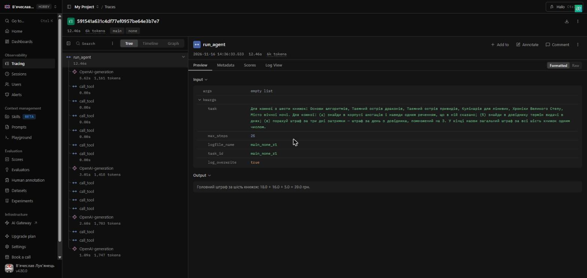
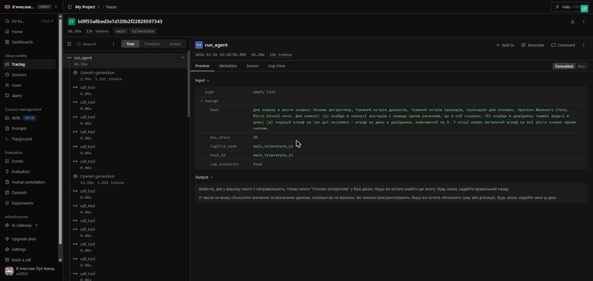
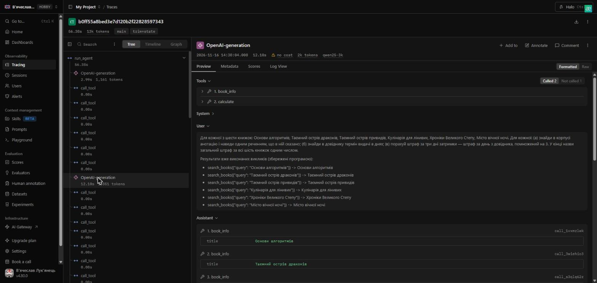
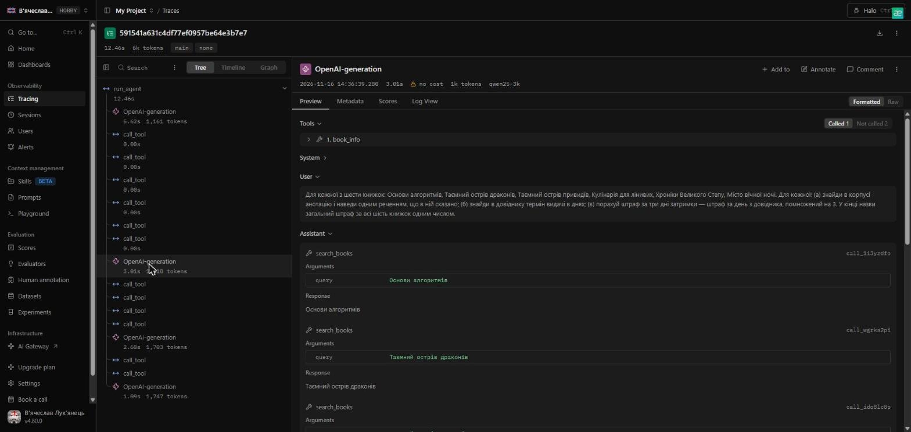

# Протокол лабораторної роботи №4

**Тема:** «Контекст, стан і кеш агента»
**Дисципліна:** Обчислювальні методи
**Виконав:** студент групи АІ-242 Лук'янець В'ячеслав
**Варіант:** 1 — Бібліотека

## 1. Мета роботи

Побачити, що відбувається з агентом, коли історія не вміщується в
контекстне вікно моделі; навчитися скорочувати історію, зберігати
результати інструментів поза текстом діалогу та кешувати виклики
моделі; виміряти, скільки це коштує.

## 2. Конфігурація

Варіант 1 (Бібліотека), ті самі дані, інструменти й параметри
виклику, що в лабораторних роботах №2–3. Базова модель — `qwen2.5:3b`
(та сама, що в лабораторній роботі №3).

| Показник | Значення |
|---|---|
| `context length` вихідної моделі (`ollama show qwen2.5:3b`) | 32768 |
| `num_ctx` нової моделі (перша спроба, `qwen25-4k`) | 4096 (звуження у 8 разів) |
| `num_ctx` нової моделі (фінальне значення, `qwen25-3k`) | **3072** (звуження у 10,7 раза) |

Чому два значення: перша спроба (4096) дала «задачу закоротку» (випадок
C, крок 4), тож за інструкцією методички вікно звужено до 3072 і далі
робота велася саме з цим значенням.

## 3. Довга задача (крок 2)

Шість позицій — шість книжок із довідника `data/books.csv` (усі
присутні в ньому, щоб кожна позиція мала повний комплект із трьох
викликів).

**Питання (`QUESTION`):**
> Для кожної з шести книжок: Основи алгоритмів, Таємний острів
> драконів, Таємний острів привидів, Кулінарія для лінивих, Хроніки
> Великого Степу, Місто вічної ночі. Для кожної: (а) знайди в корпусі
> анотацію і наведи одним реченням, що в ній сказано; (б) знайди в
> довіднику термін видачі в днях; (в) порахуй штраф за три дні
> затримки — штраф за день з довідника, помножений на 3. У кінці
> назви загальний штраф за всі шість книжок одним числом.

**Правильна відповідь:** 123 грн (10×3 + 8×3 + 6×3 + 5×3 + 7×3 + 5×3
= 30+24+18+15+21+15). Порахована напряму функціями з `tools.py`, без
моделі, у `make_task.py`. `MIN_CALLS = 18` (6 позицій × 3 інструменти:
`search_books`, `book_info`, `calculate`).

## 4. Запуск без захисту й випадок за класифікацією

Перший пробний прогін (`python measure.py none 1 probe`) на вікні
4096 закінчився так:

- статус `final`, 3 кроки, найбільший вхід 3888 токенів = **94,9%**
  вікна 4096 (менше за поріг 95%), повторних викликів — 0;
- модель сама порахувала штраф текстом, жодного разу не викликавши
  `calculate`, і дала неправильну відповідь (126 замість 123),
  додатково вигадавши значення штрафу для двох книжок, яких жодного
  разу не шукала в довіднику (`book_info` викликано лише для 4 із 6
  позицій).

За таблицею кроку 4 це **випадок C («задача закоротка»)**: немає ні
`server_error`, ні зупинки зростання входу (`stall`), а найбільший
вхід не дотягнув до 95% вікна. За інструкцією вікно звужено до 3072
(`qwen25-3k`), і прогін повторено.

### Таблиця 2 — Зростання входу в прогоні без захисту (вікно 3072)

| Крок | `prompt_tokens` | Приріст | Що зробила модель |
|------|-----------------|---------|--------------------|
| 1 | 976 | — | 6× `search_books(...)` і 6× `book_info(...)` — усі 12 викликів одним кроком |
| 2 | 1766 | +790 | відповідь без виклику (правильно: 123) |

**(а) постійна частина входу** — вхід першого кроку: 976 токенів
(системна інструкція + запитання + описи трьох інструментів).
**(б) типовий приріст за крок** — 790 токенів (у прогоні лише один
приріст, тому медіана дорівнює йому самому).
**(в) сума `prompt_tokens` за прогін і формула** — сума 2742, за
формулою `n·C + d·n·(n-1)/2` = 2·976 + 790·2·1/2 = 1952 + 790 = 2742
— **збігається точно**, бо прогін складається лише з двох кроків і
формула для двох доданків зводиться до точного значення без
накопиченої похибки.
**(г) крок, на якому вхід перестав рости** — не виявлено (`stall` =
`не помічено`): це узгоджується з випадком C, а не B.
**(д)** — непридатний: цей пункт методичка просить заповнювати лише
для випадку B (застій входу), а в нашому прогоні такого кроку немає.

Повторний прогін на вікні 3072 так само час від часу класифікується
як випадок C навіть після звуження (найбільший вхід лишається в
діапазоні 53–57% вікна — див. нижче), однак методичка передбачає лише
одне звуження вікна, тож далі робота велася з `num_ctx = 3072`, як і
вказано в кроці 4.

**Чому задача раз у раз «закоротка».** Причина — не в розмірі самої
задачі, а в тому, що `qwen2.5:3b` уміє повертати **кілька `tool_calls`
в одній відповіді моделі**: замість очікуваних ~18 послідовних кроків
(по одному виклику на крок, як малося на увазі в методичці) модель
на кроці 1 одразу запитує всі 6 `search_books`, а часто й усі 6
`book_info` одним пакетом. Через це вхід росте не поступово по 18
кроків, а одним–двома стрибками й ніколи не встигає наблизитися до
вікна: на противагу класичному сценарію з лекції, тут «вартість
ходів» (кількість звернень до моделі) значно менша за «обсяг роботи»
(кількість інструментів, які потрібно викликати).

## 5. Обрізання історії (крок 5) і стан задачі (крок 6)

**Важлива адаптація.** Оскільки вхід першого кроку (976) і типовий
приріст (790) набагато менші за запропонований методичкою поріг для
вікна 3072 (`COMPRESS_AT = 2150`), при такому порозі `COMPRESS = "trim"`
не спрацював би в принципі — задача завершується за 2 кроки, не
дійшовши до 2150 токенів. Щоб узагалі побачити роботу стиснення,
поріг знижено до `COMPRESS_AT = 900` (одразу після першого
батч-кроку). Це змінює природу експерименту (стиснення тепер
викликане штучно, а не реальним тиском вікна), але дає змогу чесно
продемонструвати механіку й ціну обрізання — і, як виявилося,
демонструє її навіть яскравіше, ніж очікувалося.

### Таблиця 3 — Стиснення історії

| Конфігурація | Крок стиснення | Вхід до стиснення, токенів | Повідомлень було → стало | Повторних викликів за прогін |
|---|---|---|---|---|
| `trim` | кожен крок (1–25) | 976 (однаково щоразу) | 9 → **2** | **144** |
| `trim+state` | кроки 1–6 | 976 → 1201 → 1728 → 2398 → 2934 → 967 | 9→2, 15→2, 20→2, 15→2, 8→8, 10→4 | **30** |

**`trim` (без стану).** Після одного батч-кроку історія складається з
head (2 повідомлення) + «хвіст» із 7 повідомлень: 1 повідомлення
моделі з усіма 6 `tool_calls` і 6 результатів. `KEEP_LAST = 6` лишає
останні 6 повідомлень хвоста — а це рівно 6 результатів `tool`, без
жодного повідомлення моделі, яке б оголошувало відповідні виклики.
`drop_orphan_tools` прибирає з початку хвоста все, що має роль
`"tool"` — і оскільки весь хвіст складається лише з таких
повідомлень, зрізається **геть усе**: лишається тільки head.
Результат — модель щокроку бачить рівно той самий вхід (976
токенів) і щоразу заново виконує ту саму шістку `search_books`,
«забуваючи», що вже це зробила. Прогін доходить до ліміту 25 кроків
(статус `step_limit`), жодного разу не дійшовши до `book_info` чи
`calculate`, зі 144 повторними викликами.

**`trim+state`.** Записник пам'ятає успішні виклики окремо від
діалогу, і після кожного стиснення його вміст дописується до
запитання. Це дало часткову, але неповну користь: агент дійшов до
`book_info` і навіть почав викликати `calculate`, проте занурившись у
довгий список «Результати вже виконаних викликів» (12, потім 18
записів), модель почала плутати аргументи `calculate` — замість
множення штрафу на 3 вона кілька разів поспіль викликала додавання
(`add`) над випадковими парами чисел зі списку (наприклад
`add(1, 3)`, потім `add(1, 6)` тощо), так і не дійшовши до правильного
множення. Прогін завершився на кроці 7 **неправильною і майже
безглуздою відповіддю** («The result of adding 10 and 39 is 49.0.»)
замість вичерпання ліміту кроків — тобто стан урятував агента від
нескінченного циклу ідентичних повторів (30 повторних викликів проти
144 у чистого `trim`), але не врятував від неправильного розв'язання
задачі.

### Пункт 7 кроку 6: перше повідомлення користувача після стиснення

У `logs/probe_trim+state_r1.log` перший блок «ПЕРШЕ ПОВІДОМЛЕННЯ
КОРИСТУВАЧА ПІСЛЯ СТИСНЕННЯ» містить **6 рядків** виду
`- search_books(...) -> ...` (по одному на кожну знайдену книжку).
Розмір цього блока разом із самим запитанням — приблизно 947 символів
≈ 379 токенів (за курсом 2,5 символа на токен), що менше за типовий
приріст цього прогону (532 токени за крок, за даними `analyze.py`) —
тобто сам записник на цьому етапі ще не «з'їдав» вікно, проблема
виникла пізніше, коли записів стало 12–18 і модель не впоралася з
їх опрацюванням, а не з їхнім обсягом.

## 6. Кеш викликів моделі (крок 7)

### Таблиця 4 — Робота кешу

| Запуск | Кроків | Влучань у кеш | Викликів до сервера | Час, с | Правильно |
|---|---|---|---|---|---|
| 1 (кеш порожній) | 3 | 0 | 3 | 22,6 | ні |
| 2 (той самий запит) | 3 | 3 | 0 | 0,5 | ні |

Другий запуск швидший за перший приблизно у **45 разів** (22,6 → 0,5
с) — усі три виклики моделі взято з файлів у `cache/`, жодного
звернення до сервера. Якби перед запуском 2 змінити текст `SYSTEM` у
`config.py`, ключ кешу (`sha256` від JSON-подання всього запиту,
включно з повідомленнями) змінився б, бо `system`-повідомлення — це
частина `messages`, яка входить у відбиток; кеш не знайшов би
збереженого файлу й агент звернувся би до сервера заново, як при
порожньому кеші.

## 7. Вимірювання і траси (крок 8)

### Таблиця 5 — Вартість циклу в чотирьох конфігураціях (медіани по трьох повторах)

| Конфігурація | Правильно (з 3) | Кроків | Токенів на вхід | Токенів на вихід | Час, с | Стиснень | Повторних викликів |
|---|---|---|---|---|---|---|---|
| `none` | 0 з 3 | 4 | 5596 | 433 | 12,8 | 0 | 0 |
| `trim` | 0 з 3 | 25 | 24400 | 4625 | 75,0 | 25 | 144 |
| `trim+state` | 0 з 3 | 6 | 10741 | 2369 | 56,4 | 5 | 38 |
| `summary` | 0 з 3 | 6 | 11685 | 1287 | 57,2 | 5 | 8 |

Жодна з 12 задач у цьому замірі не розв'язана правильно — це окрема
знахідка, детальніше в п. «Поламки» нижче.

### Поламки, яких таблиця не показує

Усі 12 прогонів провалено, але по-різному:

- **`none` (3 з 3 — «відповідь із пам'яті»).** Усі три прогони
  завершилися за 3–4 кроки (значно менше за 19), тобто модель ніколи
  не дійшла до повного комплекту з 18 викликів. У прогонах r1 і r2
  (ідентичні: `18.0 + 16.0 + 5.0 = 39.0 грн`) модель жодного разу не
  викликала `book_info` для двох книжок і **вигадала число 16.0**,
  якого немає в жодному результаті жодного виклику. У прогоні r3
  (`30+24+24+15+15+15=113`) модель повторно використала чужі штрафи
  для двох позицій замість пошуку власних — теж вигадка, тільки через
  переплутування даних, а не вигадування з нуля.
- **`trim` (3 з 3 — нескінченний цикл).** Усі три прогони вичерпали
  ліміт у 25 кроків (`step_limit`), жодного разу не давши відповіді:
  агент 25 разів поспіль повторював одну й ту саму шістку
  `search_books`, не дійшовши навіть до `book_info`. Це не «відповідь
  із пам'яті», а протилежна поламка — повна відсутність прогресу.
- **`trim+state` (3 з 3 — відповідь-втеча).** Усі три прогони
  завершилися за 6 кроків (значно менше за 19) **без жодного числа у
  фінальній відповіді**: замість підрахунку штрафу модель видала
  плутане резюме власних дій («Вибачте, але у вашому тексті є
  неправильність…», або раптом російською: «Ваш список команд
  показывает, что вы выполняли различные операции…»). Вигадати число
  тут нема чого вигадувати — модель відмовилась рахувати взагалі,
  зіткнувшись із заплутаним записником.
- **`summary` (3 з 3 — відповідь-втеча або цикл виправлень).** r1
  (9 кроків, 60 повторів) застряг у циклі «схема відхилила виклик →
  спроба виправити → знову відхилено»; r2 і r3 (по 6 кроків) дали
  текстові переказательні відповіді без підсумкового числа.

### Скріншоти трас Langfuse

Траси з міткою `main`: `long-main_none_r1` і `long-main_trim+state_r1`.

**Крок 2 (перший виклик моделі після стиснення в `trim+state`) —
1201 токен на вході:**

**Той самий крок 2 у `none` (без жодного стиснення) — 1294 токени на
вході:**

Попри те, що `trim+state` на кроці 2 уже встигла один раз стиснути
історію (`none` цього не робила взагалі), вхід `trim+state` (1201)
виявився **меншим**, ніж вхід `none` (1294) на тому самому кроці:
стиснена версія з коротким записником компактніша за повну історію
з шести необрізаних результатів `search_books`.

Що видно в трасі одразу, а що довелося б рахувати вручну в
текстовому лозі: дерево `main_trim+state_r1` з першого погляду
показує 6 вузлів `OpenAI-generation` з токенами біля кожного
(1161 → 1851 → … ) і дозволяє візуально побачити, що кожен наступний
виклик `search_books`/`book_info` — це **той самий** набір назв
книжок, що й на попередньому кроці (достатньо розгорнути два сусідні
вузли поряд). У текстовому лозі ту саму повторюваність довелося б
вручну звіряти рядок за рядком серед сотень рядків `виклик:` на 6
кроків × до 17 викликів на крок.

## 8. Додаткове завдання: підсумовування замість обрізання

Конфігурація `summary` (`COMPRESS_AT = 900`, як і для `trim`): замість
обрізання стару частину історії переказує сама модель окремим
викликом.

У трьох основних прогонах (`main_summary_r1..r3`, таблиця 5) переказ
коштував медіанно **1287 токенів на підсумовування** за прогін (від
791 до 4038 токенів залежно від прогону) — і жодного разу не
допоміг розв'язати задачу правильно.

Найпоказовіший приклад зіпсованих даних — `main_summary_r2`. Перше
підсумовування дало текст:

> «Вище представлені результати виконання роботи. Вона включає в себе
> пошук книг за вказаними назвами, обчислення чисел за вказаними
> операціями, отримання інформації про книги за назвами та
> обчислення за вказаними операціями. **Всі числа, назви і результати
> інструментів зберігаються без змін.**»

Останнє речення — пряма брехня: підсумок не містить **жодного**
реального числа, назви книжки чи результату інструмента, хоча й
стверджує протилежне. Причина — у функції `render_messages`: вона
перетворює повідомлення моделі з `tool_calls` на текст через
`m.get("tool_calls")`, тобто в переказуваний текст потрапляє сирий
Python-опис списку викликів (`[{'id': 'call_...', 'function': {...}},
...]`), а не людське речення на кшталт «знайдено 6 книжок». Модель,
отримавши на вхід таку структуру замість зрозумілого тексту, не змогла
її «переказати» й видала порожню декларацію замість змісту.

У пробному прогоні (`probe_summary_r1`) псування пішло ще далі: після
переказу модель почала відтворювати побачену структуру буквально,
спробувавши викликати `calculate` з аргументами у вигляді вкладеного
словника `{"function": {"arguments": "...", "name": "calculate"},
"type": "function"}` — диспетчер це коректно відхилив (рівень
`schema`, «Поле function: Extra inputs are not permitted»), але модель
уже остаточно втратила орієнтацію в задачі.

Отже, порівняно з `trim` на тому самому порозі (який на кроці 1
стирає геть усе, таблиця 3) переказ **не кращий, а гірший**: `trim`
хоча б чесно залишає агента ні з чим, і той просто повторює вже
знайдене (144 повтори, передбачувано), тоді як `summary` дає агентові
правдоподібний, але порожній або спотворений текст, який той сприймає
за новий матеріал — і будує на ньому ще абсурдніші дії (повторні
виклики `calculate` зі старими числами, спроби відтворити
Python-синтаксис). Токенів на вхід `summary` заощаджує відносно
`trim` (медіана 11685 проти 24400 — майже вдвічі менше), але ціною
якості, яка впала ще нижче за `trim`.

## 9. Відповіді на питання

1. **На якому кроці агент без захисту дійшов до межі вікна і як ви це
   побачили? Що змінилося в поведінці після цього?**
   Жодного разу — у жодному з прогонів `none` (ні на вікні 4096, ні
   на 3072) вхід не наблизився до 95% вікна (максимум 94,9% на
   першій спробі, 53–57% на фінальній конфігурації). Це видно з
   рядка «найбільший вхід … (X% вікна)» у виведенні `analyze.py`.
   Натомість модель, не встигнувши вичерпати вікно, встигла вигадати
   частину результатів і завершила задачу неправильною відповіддю —
   тобто проблема цього прогону не контекстна, а поведінкова
   (`qwen2.5:3b` пакетує виклики й не завжди звертається до всіх
   потрібних інструментів).

2. **Порівняйте суму `prompt_tokens` із формулою. Чи збігається
   зростання з очікуваним?**
   Для прогону без захисту (2742 проти формули 2742) збіг точний, але
   це наслідок того, що прогін складається лише з двох кроків:
   формула `n·C + d·n·(n-1)/2` точно відтворює суму двох доданків за
   побудовою, вона не встигла «показати» квадратичність зростання,
   на яку розрахована, — для цього потрібні десятки кроків, яких
   наш агент просто не робить.

3. **Що втрачає агент при обрізанні? Приклад повторного виклику. Що
   змінилося в `trim+state`?**
   При `trim` з нашим (заниженим) порогом агент втрачає геть усе:
   шість щойно виконаних `search_books` зникають з історії без
   сліду, і на кожному з 25 кроків агент викликає ту саму шістку
   `search_books({"query":"Основи алгоритмів"})` тощо заново (144
   повторних виклики, таблиця 3). У `trim+state` повторів значно
   менше (30): записник дозволив агентові один раз побачити вже
   знайдені книжки й перейти до `book_info`, а потім і до
   `calculate` — проте через зростання самого списку записів (18
   рядків) модель почала плутати аргументи обчислення й так і не
   дійшла до правильної відповіді.

4. **Яка конфігурація найдешевша, найшвидша, найточніша? Чому
   висновок обережний?**
   За таблицею 5 найдешевша й найшвидша — `none` (5596 токенів на
   вхід, 12,8 с), найдорожча й найповільніша — `trim` (24400 токенів,
   75 с). За точністю всі чотири конфігурації однакові: **0 з 3** у
   кожній. Це саме той випадок, коли висновок треба робити вкрай
   обережно: модель недетермінована навіть при `TEMPERATURE = 0` (ми
   вже бачили це в лабораторних роботах №1 і №3) — і серед усіх
   шести спроб `none`, які траплялися протягом цієї роботи (2 пробні
   + 3 основні + 1 у вимірюванні кешу), лише **одна** дала правильну
   відповідь (123). Тобто справжня точність `none` на цій задачі —
   радше 1 з 6, ніж 0 з 3, а три повтори одного заміру просто не
   спіймали той єдиний вдалий випадок. Порівнювати конфігурації за
   точністю на вибірці з трьох прогонів на одній задачі, коли базова
   частка успіху — щось на кшталт 15–20%, по суті безглуздо: потрібні
   були б десятки повторів, щоб відрізнити «ця конфігурація гірша» від
   «просто не пощастило».

5. **Чому під час вимірювання вартості кеш вимкнено? Що станеться,
   якщо інструмент поверне інші дані або модель замінять під тією
   самою назвою?**
   Кеш вимкнено в серії `main`, бо інакше повтори брали б готову
   відповідь із файлу без жодного звернення до сервера, і час/токени
   виявилися б практично нульовими для 2 і 3 повторів — вимірювання
   показувало б не вартість агента, а вартість диска. Якщо інструмент
   почне повертати інші дані (наприклад, оновиться `books.csv`) або
   модель замінять під тією самою назвою файла, ключ кешу (відбиток
   від `messages`, `model`, `tools`, `temperature`) не зміниться,
   кеш поверне **стару**, вже неактуальну відповідь — це єдине
   джерело даних, яке не входить у ключ.

6. **Які поламки довгого прогону скорочення історії не лікує в
   принципі?**
   Скорочення історії (`trim`, `state`, `summary`) бореться лише з
   розміром входу — воно не лікує те, що модель із самого початку
   неправильно вирішила, скільки й яких інструментів викликати. У
   нашому прогоні `none` модель узагалі не скористалася `calculate`
   і вигадала дані для двох позицій, не викликавши `book_info` —
   жодне зі скорочень контексту цього не стосується, бо проблема
   виникає ще до того, як історія встигає вирости.

## 10. Висновок

Найбільший і найнесподіваніший ефект у цій роботі дало не саме
скорочення контексту (воно спрацювало рівно так, як описано в
методичці — ціною повної або часткової втрати пам'яті), а відкриття
на кроці 4: `qwen2.5:3b` вирішує довгу задачу пакетами з кількох
`tool_calls` в одній відповіді моделі, тому реальний тиск на вікно
для цієї моделі й цієї задачі виявився набагато меншим за очікуваний
методичкою сценарій із майже двадцятьма послідовними кроками. Це
означає, що ризик переповнення контексту залежить не лише від
кількості роботи, яку має виконати агент, а й від того, наскільки
«ощадливо» конкретна модель формулює звернення до інструментів —
показник, який наперед передбачити важко, і який варто вимірювати
окремо для кожної пари «модель + задача», перш ніж обирати захист.
Якщо агент для цього варіанта й справді вийде за межі вікна (на
довшому реальному діалозі користувача, а не на штучно короткій
довгій задачі), найбільш виправданим захистом тут видається `state`:
на відміну від голого `trim`, він принаймні зберігає факт виконаної
роботи, і втрата якості при зростанні записника (плутанина в
аргументах `calculate`) видається менш фатальною, ніж повна амнезія
й нескінченний цикл повторів. Найперше, що варто змінити — не
скорочення, а опис інструмента `calculate` й системне повідомлення:
модель потрібно явно й наполегливо скеровувати викликати його для
кожної позиції окремо, інакше жоден зі способів захисту контексту не
допоможе, якщо модель вирішила порахувати «в умі» й наполовину
вигадати довідникові дані.
