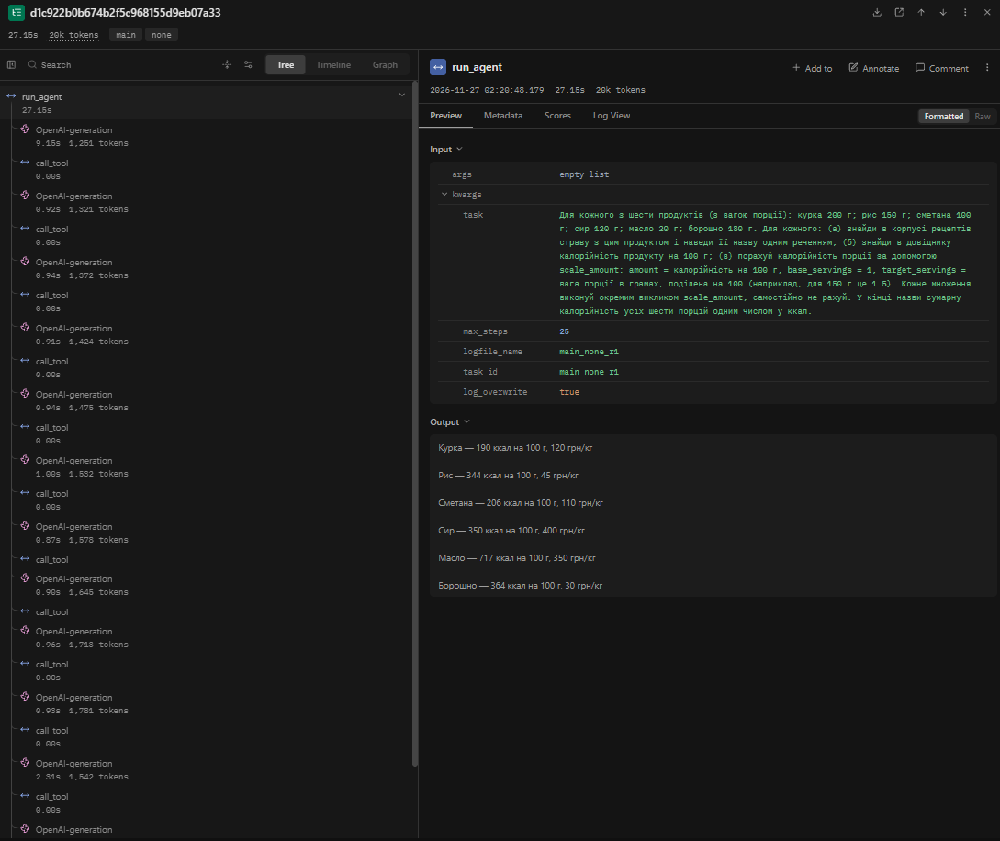
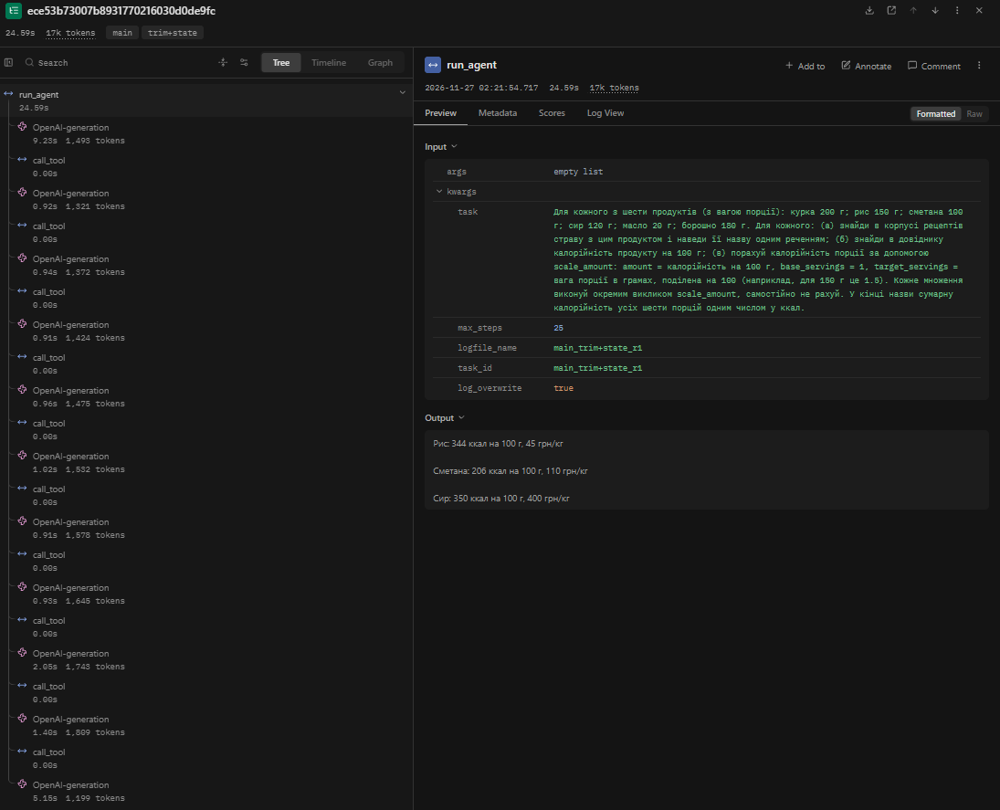

**МІНІСТЕРСТВО ОСВІТИ І НАУКИ УКРАЇНИ**
**НАЦІОНАЛЬНИЙ УНІВЕРСИТЕТ «ОДЕСЬКА ПОЛІТЕХНІКА»**
**ІНСТИТУТ КОМП'ЮТЕРНИХ СИСТЕМ**
**КАФЕДРА ІНФОРМАЦІЙНИХ СИСТЕМ**

# ПРОТОКОЛ

## лабораторної роботи №4
**«Контекст, стан і кеш агента»**

Виконав(-ла): студент групи АІ-242
Манкевич Тимур

Перевірив: ас. Баранов О.М.

Одеса – 2026

---

## 2. Мета роботи, варіант, модель і вікно

**Мета роботи:** побачити, що відбувається з агентом, коли історія не вміщується в контекстне вікно моделі; навчитися скорочувати історію, зберігати результати інструментів поза текстом діалогу та кешувати виклики моделі; виміряти, скільки це коштує.

**Варіант:** 12 (за таблицею 6 - варіант 2), предметна область «Кулінарія» (довідник продуктів `data/products.csv`, корпус рецептів `data/corpus`, інструменти `search_recipes`, `product_info`, `scale_amount`).

**Модель:** `qwen3:4b-instruct` (локально, Ollama), копія з вузьким вікном створена з `Modelfile` (`FROM qwen3:4b-instruct`, `PARAMETER num_ctx 1792`).

| Що | Значення |
|----|----------|
| `context length` вихідної моделі `qwen3:4b-instruct` (`ollama show qwen3:4b-instruct`) | 262144 |
| `num_ctx` нової моделі `qwen3-1792` (розділ `Parameters`) | 1792 |
| У скільки разів вікно звузили | 262144 / 1792 ≈ 146 |

Фактичне вікно довелося підбирати (див. розділ 4): перша спроба - 2304 токени, у ній вікно не заповнилося, тому його звужено до **1792**, `COMPRESS_AT = 1600`.

Зміни в коді відносно методички: у `agent.py` виконується лише перший виклик інструмента за крок (`msg.tool_calls = msg.tool_calls[:1]`); у `SYSTEM` додано `/no_think` і речення «Викликай не більше одного інструмента за крок і чекай його результату».

## 3. Довга задача (крок 2)

Шість продуктів із вагою порції. Для кожного: (а) пошук страви з цим продуктом у корпусі рецептів (`search_recipes`), (б) калорійність на 100 г із довідника (`product_info`), (в) калорійність порції через `scale_amount` (`amount` = ккал на 100 г, `base_servings` = 1, `target_servings` = вага / 100). Підсумок - сумарна калорійність шести порцій, ккал.

**Питання** (з `long_task.json`):

> Для кожного з шести продуктів (з вагою порції): курка 200 г; рис 150 г; сметана 100 г; сир 120 г; масло 20 г; борошно 180 г. Для кожного: (а) знайди в корпусі рецептів страву з цим продуктом і наведи її назву одним реченням; (б) знайди в довіднику калорійність продукту на 100 г; (в) порахуй калорійність порції за допомогою scale_amount: amount = калорійність на 100 г, base_servings = 1, target_servings = вага порції в грамах, поділена на 100 (наприклад, для 150 г це 1.5). Кожне множення виконуй окремим викликом scale_amount, самостійно не рахуй. У кінці назви сумарну калорійність усіх шести порцій одним числом у ккал.

**Правильна відповідь:** `2320.6` ккал (380 + 516 + 206 + 420 + 143.4 + 655.2). `min_calls` = 18.

(Речення «Кожне множення виконуй окремим викликом scale_amount…» додано після першого прогону у вікні 2304; `expected` не змінювався.)

## 4. Запуск без захисту (кроки 3-4)

### Підбір вікна

| Вікно | Що змінено | Кроків | Найбільший вхід | Результат | Випадок |
|-------|------------|-------:|-----------------|-----------|---------|
| 2304 | початкові параметри, `COMPRESS_AT = 2050` | 13 | 1936 (84%) | 12 викликів, `scale_amount` не викликано, відповідь 2211.4 (в іншому запуску 2029.4), неправильно | C |
| **1792** | вікно, `COMPRESS_AT = 1600`, у питанні вимога про `scale_amount` | 13 | 1760 (98%) | вхід на кроці 11 впав з 1760 до 1520, `scale_amount` не викликано, суми немає | **B** |

### Прогін без захисту у вікні 1792

Прогін `python measure.py none 1 cache1` (кеш порожній, тож це те саме, що прогін без кешу; окремо `probe_none` у вікні 1792 не запускався). Правильно: **ні**, час **28,3 с**.

Таблиця 2 - Зростання входу в прогоні без захисту

| Крок | `prompt_tokens` | Приріст | Що зробила модель |
|-----:|----------------:|--------:|:------------------|
|    1 |            1229 |         | search_recipes({"query":"курка"}) |
|    2 |            1300 |      71 | search_recipes({"query":"рис"}) |
|    3 |            1349 |      49 | search_recipes({"query":"сметана"}) |
|    4 |            1402 |      53 | search_recipes({"query":"сир"}) |
|    5 |            1452 |      50 | search_recipes({"query":"масло"}) |
|    6 |            1508 |      56 | search_recipes({"query":"борошно"}) |
|    7 |            1557 |      49 | product_info({"product":"курка"}) |
|    8 |            1625 |      68 | product_info({"product":"рис"}) |
|    9 |            1691 |      66 | product_info({"product":"сметана"}) |
|   10 |            1760 |      69 | product_info({"product":"сир"}) |
|   11 |            1520 |    -240 | product_info({"product":"масло"}) |
|   12 |            1589 |      69 | product_info({"product":"борошно"}) |
|   13 |            1658 |      69 | відповідь без виклику |

- **(а)** постійна частина входу (вхід першого кроку): **1229** токенів
- **(б)** типовий приріст за крок: **66** токенів (медіана додатних приростів)
- **(в)** сума `prompt_tokens`: **19640**; за формулою *n·C + d·n(n−1)/2*: **21125**. Розбіжність ≈ 7%: формула припускає, що вхід росте на кожному кроці, а фактично на кроці 11 він упав на 240 токенів (сервер відкинув частину історії).
- **(г)** вхід перестав рости на кроці: **11** (на кроці 10 вхід 1760, 98% вікна 1792; на кроці 11 мав бути ≈ 1830, більше за вікно, але зафіксовано 1520).
- **(д)** після кроку 11 модель ще двічі викликала `product_info` (масло, борошно) і на кроці 13 відповіла без виклику. Відповідь містить лише калорійність і ціну за кг для шести продуктів: `scale_amount` не викликався жодного разу, суми немає, тобто частину завдання (порахувати порції, назвати суму) модель відкинула разом з обрізаним початком історії. Чисел, яких немає в результатах інструментів, у відповіді немає, але відповідь не відповідає на питання.

**Випадок:** **B** (сервер мовчки обрізає вхід). Обґрунтування: статус `final`, помилки сервера немає, а `prompt_tokens` на кроці 11 впав з 1760 до 1520, хоча історія росла.

## 5. Обрізання (крок 5) і стан (крок 6)

Таблиця 3 - Стиснення історії (прогони `probe_trim_r1` і `probe_trim+state_r1`)

| Конфігурація | Крок стиснення | Вхід до стиснення, токенів | Повідомлень було -> стало | Повторних викликів за прогін |
|--------------|----------------|----------------------------|---------------------------|------------------------------|
| `trim`       | 8  | 1625 | 18 -> 8 | 9 |
| `trim`       | 12 | 1618 | 16 -> 8 | |
| `trim`       | 16 | 1628 | 16 -> 8 | |
| `trim`       | 20 | 1617 | 16 -> 8 | |
| `trim`       | 24 | 1610 | 16 -> 8 | |
| `trim+state` | 8  | 1625 | 18 -> 8 | 0 |
| `trim+state` | 9  | 1721 | 10 -> 8 | |
| `trim+state` | 10 | 1788 | 10 -> 8 | |

**`trim`:** вхід утримувався в межах ≈ 1410-1630 токенів (максимум 91% вікна), але прогін закінчився на ліміті кроків (25), відповіді немає (`відповідь:` порожня). Модель забувала виконане й повторювала виклики: на кроці 13 знову `search_recipes({"query":"курка"})` (уже було на кроці 1), на кроці 14 знову `product_info({"product":"рис"})` (крок 8), на кроці 21 і 22 знову курка і сметана. Дев'ять повторних викликів із двадцяти п'яти кроків. `scale_amount` викликався п'ять разів (кроки 12, 16, 18, 20, 23), один раз із неправильним аргументом: для сметани 100 г на кроці 16 передано `target_servings` = 1.5 (результат 309.0) замість 1.

**`trim+state`:** повторних викликів 0, але прогін закінчився за 11 кроків (`final`) неправильною відповіддю: модель вивела калорійність і ціну лише трьох продуктів (рис, сметана, сир), `scale_amount` не викликала, суми немає. Вхід після стиснення не зменшився, а зріс (1625 -> 1721 -> 1788, до 100% вікна 1792), стиснення спрацьовувало на кожному кроці з 8-го по 10-й, а на кроці 11 вхід упав до 1124: початок історії знову мовчки відкинуто (фактично повторилося те, що вже було в прогоні без захисту). Час 650,4 с у таблиці не показовий: у логу між кроками 6 і 7 пауза ≈ 10 хв (01:56:10 -> 02:06:22), а без неї прогін тривав ≈ 37 с.

**Блок `ПЕРШЕ ПОВІДОМЛЕННЯ КОРИСТУВАЧА ПІСЛЯ СТИСНЕННЯ`** (`logs/probe_trim+state_r1.log`): рядків виду `- інструмент(аргументи) -> результат` у першому блоці (крок 8): **8**; розмір блока стану (заголовок і рядки) 710 символів / 2,5 ≈ **284 токени** при типовому прирості за крок **56** токенів (≈ 5 кроків історії). До кроку 10 блок виріс до 10 рядків (890 символів ≈ 356 токенів). Висновок: **завеликий**: записник займає ≈ 16-20% вікна, тому відкинуті повідомлення не вивільняють місця (вхід після стиснення більший, ніж до нього), і на кроці 11 вікно знову переповнюється.

## 6. Кеш (крок 7)

Таблиця 4 - Робота кешу

| Запуск              | Кроків | Влучань у кеш | Викликів до сервера | Час, с | Правильно |
|---------------------|--------|---------------|---------------------|--------|-----------|
| 1 (кеш порожній)    | 13 | 0  | 13 | 28,3 | ні |
| 2 (той самий запит) | 13 | 13 | 0  | 2,0  | ні |

Запуск 2 швидший за запуск 1 у ≈ 14 разів (28,3 / 2,0). Решта 2 с - читання файлів кешу й робота інструментів. Відповідь ідентична, бо береться з файла. Якби перед запуском 2 змінити текст `SYSTEM` у `config.py`, змінилося б перше повідомлення в запиті, а з ним відбиток `sha256` усіх запитів прогону: кеш не спрацював би на жодному кроці, і прогін пройшов би з нуля так само довго, як запуск 1.

## 7. Вимірювання (крок 8)

Основне вимірювання `python measure.py all 3 main` (серія `main`, кеш вимкнено), по три повтори на конфігурацію.

Таблиця 5 - Вартість циклу в трьох конфігураціях (медіани по трьох повторах)

| Конфігурація | Правильно (з 3) | Кроків | Токенів на вхід | Токенів на вихід | Час, с | Стиснень | Повторних викликів |
|--------------|-----------------|--------|-----------------|------------------|--------|----------|--------------------|
| `none`       | 0 | 13 | 19640 | 755 | 31,3 | 0 | 0 |
| `trim`       | 0 | 25 | 37127 | 871 | 40,5 | 5 | 9 |
| `trim+state` | 0 | 11 | 16055 | 536 | 24,1 | 3 | 0 |

«Правильно» перевірено вручну за рядками `відповідь:` у `logs/main_*.log`: жодна відповідь не містить суми, жодна з них не дорівнює 2320.6.

**Поломки, яких таблиця не показує** (з 12 прогонів `logs/main_*.log`):
- відповів, зробивши менше 19 кроків («з пам'яті»): **6 з 12** (усі 3 прогони `none` відповіли на кроці 13, усі 3 прогони `trim+state` на кроці 11; у жодному з них не було шести викликів `scale_amount`). Три прогони `trim` відповіді не дали взагалі (ліміт кроків 25);
- назвав число, якого не було в жодному рядку `результат:`: **0 з 12** (усі числа у відповідях `none` і `trim+state` - калорійність і ціна, які є в результатах `product_info`; суми немає). Але відповіді неповні: питання про порції й суму лишилося без відповіді.

Прогони однієї конфігурації майже однакові (при `TEMPERATURE = 0` у `trim` і `trim+state` усі три повтори збігаються за токенами крок за кроком; у `none` відрізняється лише текст кінцевої відповіді), тому три повтори не дають незалежних вимірів.

**Траси Langfuse** (мітка `main`): дерева трас `long-main_none_r1` і `long-main_trim+state_r1`.

*Рис. 1 - Траса `long-main_none_r1` (конфігурація `none`)*

*Рис. 2 - Траса `long-main_trim+state_r1` (конфігурація `trim+state`)*

Токени першого виклику після стиснення в `trim+state` (крок 9; стиснення відбулося наприкінці кроку 8): у Langfuse **1743** (вхід 1721 + вихід 22); той самий крок у `none`: **1713** (вхід 1691 + вихід 22). Langfuse показує токени входу й виходу разом, тому значення з логів (`prompt_tokens`) на 22 менші: 1721 і 1691. Тобто після стиснення вхід у `trim+state` виявився більшим, ніж у прогоні без стиснення: відкидання повідомлень звільнило ≈ 213 токенів (1625 -> 1412 у `trim`), а блок стану додав ≈ 284. У трасі одразу видно кожен виклик моделі з токенами й часом: у `none` на кроці 11 обсяг падає з 1781 до 1542, у `trim+state` останній виклик має лише 1199 токенів (1124 + 75), хоча історія росла. У текстовому лозі довелося б вирахувати це з рядків `prompt_tokens` і `СТИСНЕННЯ` вручну.

## 8. Відповіді на питання

1. **На якому кроці агент без захисту дійшов до межі вікна?** На кроці 10 вхід був 1760 токенів (98% вікна 1792), на кроці 11 він упав до 1520 (таблиця 2, пункти (г) і (д)). Після цього модель відповіла на кроці 13 без суми й без `scale_amount`, тобто втратила частину завдання.
2. **Сума `prompt_tokens` і формула.** 19640 проти 21125 (≈ 7%). До кроку 10 зростання відповідало очікуваному (≈ 66 токенів за крок), різницю дає крок 11, на якому вхід не виріс, а впав.
3. **Що втрачає агент при обрізанні?** Результати відкинутих повідомлень: у `trim` це дало 9 повторних викликів (приклади: крок 13 `search_recipes(курка)`, крок 14 `product_info(рис)`) і відсутність відповіді за 25 кроків. У `trim+state` повторних викликів 0 (таблиця 3), але блок стану (≈ 284-356 токенів) сам з'їв вікно, і на кроці 11 початок історії знову відкинуто.
4. **Яка конфігурація найдешевша, найшвидша, найточніша?** За таблицею 5 найдешевша за токенами на вхід і найшвидша - `trim+state` (16055 токенів, 24,1 с), потім `none` (19640, 31,3 с), `trim` найдорожча (37127, 40,5 с, бо виконує 25 кроків і не завершується). Найточніша - жодна: правильних відповідей 0 з 3 в усіх конфігураціях. Перевага `trim+state` умовна: вона швидша лише тому, що закінчує прогін на кроці 11 неповною відповіддю про три продукти. Висновок обережний: це одна задача, одна модель, а три повтори майже однакові (`TEMPERATURE = 0`), тобто незалежних вимірів фактично один.
5. **Чому під час вимірювання кеш вимкнено?** Інакше повтори брали б відповіді з файлів, і вартість була б нульовою (запуск 2: 0 викликів до сервера, 2,0 с проти 28,3 с). Якщо інструмент поверне інші дані, у запиті зміниться історія, відбиток зміниться й кеш не спрацює. Якщо ж замінити модель під тією самою назвою, відбиток не зміниться, і кеш віддасть застарілу відповідь старої моделі (теоретично, не перевірялося).
6. **Які поломки скорочення історії не лікує?** Пропуск інструмента (`scale_amount` у прогоні без захисту не викликано, у `trim` викликано лише п'ять разів із потрібних шести), неправильні аргументи (`target_servings` = 1.5 для сметани) і передчасна відповідь без суми.

## 9. Додаткове завдання

Не виконувалось.

## 10. Висновок

У вікні 1792 довга задача варіанта 12 переповнює вікно: у прогоні без захисту вхід на кроці 11 упав з 1760 до 1520 токенів, початок історії мовчки відкинуто (випадок B), відповідь неповна. Три способи дали різні результати. Обрізання (`trim`) тримає вхід у межах 91% вікна, але ціною 9 повторних викликів і 25 кроків без відповіді: найдорожча конфігурація (37127 токенів на вхід). Стан (`trim+state`) прибрав повторні виклики (0) і виявився найдешевшим (16055 токенів, 24,1 с), але блок стану (≈ 284-356 токенів, до 20% вікна) завеликий: вхід після стиснення був більшим, ніж без нього (1721 проти 1691), і вікно знову переповнилося на кроці 11, тож відповідь неповна. Кеш дав найбільший вимірюваний ефект на повторних запусках (≈ 14 разів швидше, 28,3 с проти 2,0 с), але для вимірювання вартості його вимкнено. Правильної суми 2320.6 не дала жодна конфігурація (0 з 3 у кожній): модель пропускала `scale_amount` навіть тоді, коли вікно не заважало, а скорочення історії цього не лікує. Що ще варто змінити: збільшити вікно або скоротити стан (`STATE_RESULT_CHARS`, менше `KEEP_LAST`), щоб записник займав менше 10% вікна, і додати перевірку, що перед відповіддю викликано всі потрібні інструменти (наприклад, відхиляти відповідь, якщо викликів менше `min_calls`).
