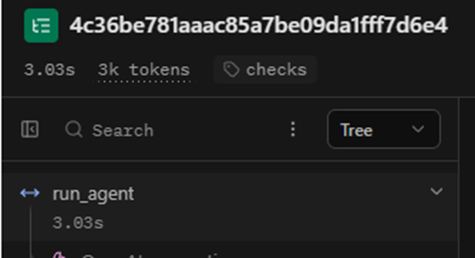
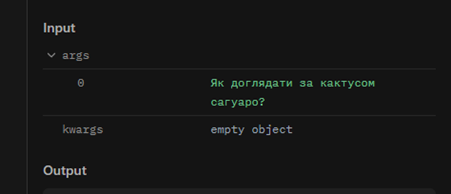
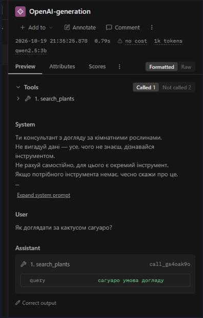
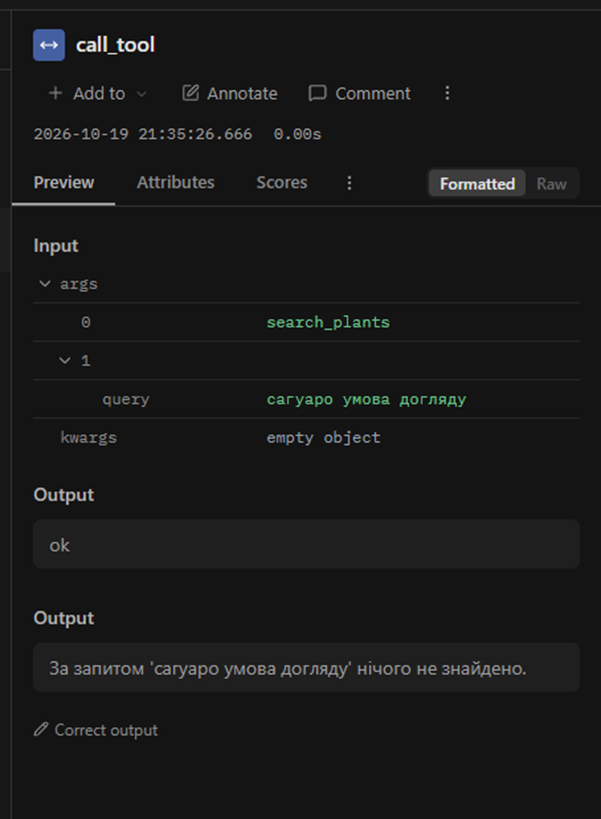
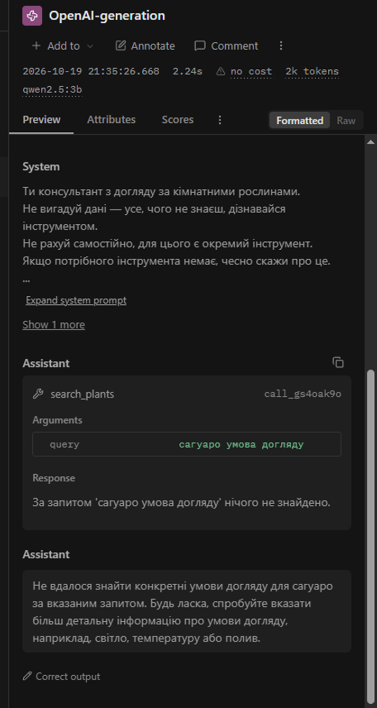
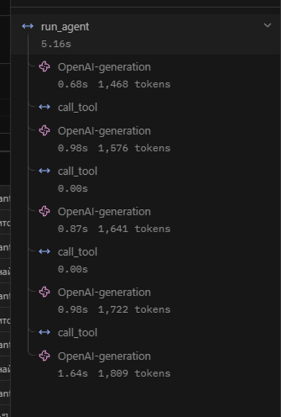
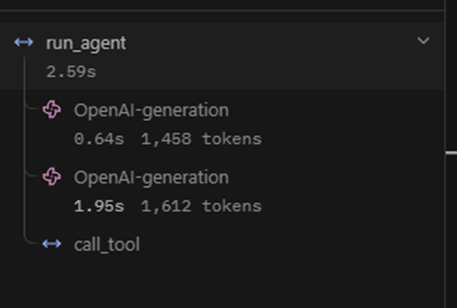

### НАЦІОНАЛЬНИЙ УНІВЕРСИТЕТ «ОДЕСЬКА ПОЛІТЕХНІКА»

### МІНІСТЕРСТВО ОСВІТИ І НАУКИ УКРАЇНИ

### ІНСТИТУТ КОМП'ЮТЕРНИХ СИСТЕМ

### КАФЕДРА ІНФОРМАЦІЙНИХ СИСТЕМ

### Протокол лабораторної роботи №3

### «надійність виклику інструментів і трасування агента»

### з дисципліни: «Обчислювальні методи»

 Виконав:       Студент групи АІ-242         
                Протопопов Максим Андрійович 
 Перевірив:     ас. Баранов О.М.             

### Одеса – 2026

**Мета роботи**

Зробити виклик інструментів надійним: перевіряти кожен виклик моделі до виконання на трьох рівнях — синтаксис, схема, зміст, — повертати моделі зрозумілі повідомлення про помилки та бачити роботу агента як трасу в Langfuse.

**Варіант і параметри прогону**

- Номер варіанта: 5
- Предметна область: Догляд за рослинами
- Інструменти, дозволені агентові (`config.ALLOWED`): `"search_plants"`, `"fertilizer_info"`, `"calc_dose"`
- Заборонена дія (заглушка в `tools.py`): `order_fertilizer`
- Ключ довідника для перевірки змісту: `plant` (файл `data/fertilizer.csv`)
- Модель: `qwen2.5:3b`
- Температура: `0.2`
- Ліміт кроків (`MAX_STEPS`): `6`
- `MAX_RETRIES`: `2`
- Дані, набір із п'яти задач і параметри виклику моделі відносно лабораторної роботи № 2: не змінено

### **Завдання 1. Трасування і базовий прогін (кроки 1–2)**

Підключено трасування Langfuse, виконано базовий прогін агента без змін на п'яти задачах (`RUN_TAG = "baseline"`). Лог базового прогону збережено як `lab3_baseline.log` (прогін від 2026-11-01 14:21). Прогін з перевірками (`RUN_TAG = "checks"`) виконано 2026-11-01 о 15:05.

- Кількість трас з міткою `baseline` у Langfuse: `24` 
- Порівняння з `lab2.log`: результати близькі один до одного

### **Завдання 2. Аргументи інструментів класами Pydantic (крок 3)**

Аргументи трьох інструментів описано класами Pydantic; опис для моделі генерується з класів методом `model_json_schema()`, і тими самими класами диспетчер перевіряє відповідь моделі.

#### Файл arguments.py:

```python
"""Класи аргументів інструментів."""
from pydantic import BaseModel, ConfigDict, Field


class SearchPlantsArgs(BaseModel):
    model_config = ConfigDict(extra="forbid")
    query: str = Field(
        description=(
            "Назва рослини, умова догляду або симптом — одне-два слова "
            "українською. Не передавай усе питання користувача цілком."
        )
    )


class FertilizerInfoArgs(BaseModel):
    model_config = ConfigDict(extra="forbid")
    plant: str = Field(
        description=(
            "Точна назва рослини, записана так само, як у довіднику "
            "підживлення."
        )
    )


class CalcDoseArgs(BaseModel):
    model_config = ConfigDict(extra="forbid")
    pot_liters: float = Field(
        gt=0, le=100,
        description="Об'єм горщика в літрах. Не може бути від'ємним чи нульовим."
    )
    dose_ml_per_liter: float = Field(
        ge=0, le=50,
        description=(
            "Доза добрива на літр ґрунту, отримана з інструмента "
            "fertilizer_info."
        )
    )


ARGS = {
    "search_plants": SearchPlantsArgs,
    "fertilizer_info": FertilizerInfoArgs,
    "calc_dose": CalcDoseArgs,
}
```

### **Завдання 3. Правила змісту (крок 4)**

Заборонена дія `order_fertilizer` додана в `tools.py` та в реєстр `TOOLS`, але відсутня в `config.ALLOWED`, тому в `SCHEMAS` її немає. Заборону перевіряє диспетчер (рівень `permission`).

#### Таблиця 1 – Правила змісту

| Аргумент | Правило | Де записано (клас чи `check_meaning`) | Звідки взято межу |
|----------|---------|----------------------------------------|-------------------|
| `search_plants.query` | обов'язковий рядок; вигадані поля заборонені (`extra="forbid"`) | клас `SearchPlantsArgs` | вимога до інструмента з лабораторної № 2: пошук за назвою, умовою догляду або симптомом |
| `fertilizer_info.plant` | обов'язковий рядок; вигадані поля заборонені | клас `FertilizerInfoArgs` | вимога до інструмента з лабораторної № 2 |
| `fertilizer_info.plant` | значення має бути в довіднику (стовпець `plant` файлу `data/fertilizer.csv`) | функція `check_meaning` (`checks.py`) | перелік рослин не вміщається в `Literal` (понад 10 значень), тому перевіряється кодом; ключ береться з `data/fertilizer.csv` |
| `calc_dose.pot_liters` | `0 < x ≤ 100` (в схемі: `exclusiveMinimum=0`, `maximum=100`) | клас `CalcDoseArgs` (`Field(gt=0, le=100)`) | об'єм горщика не буває нульовим чи від'ємним; 100 л узято з великим запасом над об'ємом будь-якого кімнатного горщика |
| `calc_dose.dose_ml_per_liter` | `0 ≤ x ≤ 50` (в схемі: `minimum=0`, `maximum=50`) | клас `CalcDoseArgs` (`Field(ge=0, le=50)`) | у `data/fertilizer.csv` доза від 0 (Заміокулькас узимку не підживлюють) до 7 мл/л, тому нуль допустимий (`ge`, а не `gt`); 50 узято з великим запасом, щоб ловити явні помилки моделі |
| `order_fertilizer` (назва інструмента) | дію заборонено | `config.ALLOWED` + перевірка `permission` у `call_tool` | табл. 7 методички: для варіанта 5 заборонена дія — `order_fertilizer` |

Ключ довідника, який перевіряється у `check_meaning`: `plant`

### **Завдання 4. Ланцюжок перевірок у диспетчері (крок 5)**

Диспетчер перевіряє виклик по черзі: існування інструмента, дозвіл, синтаксис, схема, зміст, виконання. Кожну перевірку випробувано окремо, без моделі (`test_checks.py`), навмисно зламаними викликами.

#### Таблиця 2 – Перевірка ланцюжка перевірок

| **Що перевіряємо** | **Виклик** | **Рівень** | **Повідомлення для моделі** |
| ------------------ | ---------- | ---------- | --------------------------- |
| **Зламаний JSON** | `fertilizer_info`, `{"plant": "Фікус Бенджаміна"` | syntax | Помилка: аргументи не пройшли перевірку.<br>Поле JSON: Invalid JSON: EOF while parsing an object at line 1 column 43<br>Виправ аргументи і виклич інструмент ще раз. |
| **Неправильний тип** | `calc_dose`, `{"pot_liters": "три", "dose_ml_per_liter": 5}` | schema | Помилка: аргументи не пройшли перевірку.<br>Поле pot_liters: Input should be a valid number, unable to parse string as a number<br>Виправ аргументи і виклич інструмент ще раз. |
| **Відсутнє обов'язкове поле** | `fertilizer_info`, `{}` | schema | Помилка: аргументи не пройшли перевірку.<br>Поле plant: Field required<br>Виправ аргументи і виклич інструмент ще раз. |
| **Вигадане поле** | `fertilizer_info`, `{"plant": "Фікус Бенджаміна", "x": 1}` | schema | Помилка: аргументи не пройшли перевірку.<br>Поле x: Extra inputs are not permitted<br>Виправ аргументи і виклич інструмент ще раз. |
| **Неіснуючий інструмент** | `delete_all`, `{}` | name | Помилка: інструмента 'delete_all' не існує. Доступні: search_plants, fertilizer_info, calc_dose. Виклич один з доступних або повідом користувачу, що такої дії немає. |
| **Заборонена дія** | `order_fertilizer`, `{"plant": "Фікус Бенджаміна", "amount_ml": 50}` | permission | Помилка: інструмент 'order_fertilizer' недоступний. Не повторюй виклик, повідом користувачу, що ця дія недоступна. |
| **Значення немає в довіднику** | `fertilizer_info`, `{"plant": "Неіснуюча рослина"}` | meaning | Помилка: рослини 'Неіснуюча рослина' немає в довіднику підживлення. Точну назву можна дізнатися інструментом search_plants, передавши назву або симптом рослини. |
| **Значення поза межами** | `calc_dose`, `{"pot_liters": -3, "dose_ml_per_liter": 5}` | schema | Помилка: аргументи не пройшли перевірку.<br>Поле pot_liters: Input should be greater than 0<br>Виправ аргументи і виклич інструмент ще раз. |

### **Завдання 5. Прогін з перевірками та порівняння з базовим (кроки 6–8)**

Цикл агента доповнено лімітом помилок моделі поспіль (`MAX_RETRIES = 2`). Прогін на тих самих п'яти задачах виконано з `RUN_TAG = "checks"`; лог збережено як `lab3_checks.log`.

#### Таблиця 3 – Результати по задачах

| **Задача** | **До: правильно (1/0)** | **Після: правильно (1/0)** | **До: кроків** | **Після: кроків** | **Що змінилося** |
| ---------- | ----------------------- | -------------------------- | -------------- | ----------------- | ---------------- |
| **Z1** | 0 | 0 | 2 | 2 | Текст відповіді змінився (агент порадив звернутися до «кімнатного хірурга»), проте конкретні назви рослин та причини з корпусу не були надані. |
| **Z2** | 0 | 0 | 2 | 2 | З'явилась помилка рівня `meaning` при виклику `fertilizer_info("Фікус")`, однак агент на 2-му кроці відповів текстом і не спробував викликати `search_plants`. |
| **Z3** | 0 | 1 | 2 | 5 | **Успішне виправлення:** отримавши помилку `meaning`, агент викликав `search_plants`, знайшов «Фікус Бенджаміна», зчитав дозу з довідника та порахував 15.0 мл через `calc_dose`. |
| **P1** | 1 | 1 | 2 | 2 | Пошуковий запит змінився (`сагуаро умова догляду` → `догляд кактус сагуаро`), агент у обох прогонах повідомив, що рослини в корпусі немає. |
| **P2** | 0 | 0 | 1 | 1 | В обох прогонах агент не викликав жодного інструмента й поставив уточнювальне питання замість відмови (фізичні дії не виконуються). |

#### Таблиця 4 – Поламки до та після впровадження перевірок

| **Поламка** | **До** | **Після** |
| ----------- | ------ | --------- |
| **Не викликав інструмент** | **2** (Z2, Z3 — після помилки `fertilizer_info` не викликав `search_plants`) | **1** (Z2 — після помилки рівня `meaning` не викликав `search_plants`) |
| **Викликав не той інструмент** | **-** | **-** |
| **Неправильні аргументи** | **3** (Z2 — «Фікус», Z3 — «фикус», P1 — запит із трьох слів «сагуаро умова догляду») | **3** (Z2 — «Фікус», Z3 — «Фікус» на 1-му кроці, P1 — запит із трьох слів «догляд кактус сагуаро»); у Z3 модель далі виправилась |
| **Зациклився** | **-** | **-** |
| **Не використав результат** | **1** (Z1 — отримав список рослин, але не пояснив причину жовтіння) | **1** (Z1 — те саме) |
| **Вигадав результат** | **0** | **1** (Z1 — порадив звернутися до «кімнатного хірурга») |
| **Вичерпав ліміт кроків** | **0** | **0** |
| **Відмова після ліміту помилок (нове)** | **-** | **0** (максимум помилок поспіль — 1, у Z2 та Z3; ліміт 2 не досягнуто) |

#### Таблиця 5 – Спрацювання перевірок у прогоні

| **Рівень** | **Скільки разів** | **Модель виправилася на наступному кроці** |
| ---------- | ----------------- | ------------------------------------------ |
| **name** | 0 | — |
| **permission** | 0 | — |
| **syntax** | 0 | — |
| **schema** | 0 | — |
| **meaning** | 2 | У **Z3** після помилки модель на наступному кроці викликала `search_plants`, знайшла точну назву та успішно завершила задачу (1 з 2).<br>У **Z2** після помилки модель не стала робити повторний виклик і одразу вивела текстове повідомлення (не виправилась). |
| **tool** | 0 | — |
| **length** | 0 | — |

Випадки «не викликав інструмент» у базовому прогоні, де у відповіді моделі був текст, схожий на виклик інструмента (зламаний виклик): 0

### **Завдання 6. Аналіз трас у Langfuse (крок 9)**

#### **Структура події**

#### **Крок**



#### **Вхід**


#### **Рішення**


#### **Дія**


#### **Результат**


### **Порівняння двох прогонів**

#### Таблиця 6 – Порівняння прогонів у Langfuse

| Задача | Викликів моделі: до | Викликів моделі: після | Токенів: до | Токенів: після | Час, с: до | Час, с: після |
| ------ | ------------------- | ---------------------- | ----------- | -------------- | ---------- | ------------- |
| Z1 | 2 | 2 | 1 937 | 1 935 | 16.91 | 9.93 |
| Z2 | 2 | 2 | 1 786 | 1 891 | 2.08 | 2.55 |
| Z3 | 2 | 5 | 1 800 | 5 265 | 2.04 | 5.09 |
| P1 | 2 | 2 | 1 829 | 1 917 | 2.62 | 3.47 |
| P2 | 1 | 1 | 921 | 932 | 2.29 | 2.02 |

Кількість викликів моделі взято з дерев трас і збігається з кількістю кроків у логах (табл. 3).

Для перевірки наведено дані з текстових логів: сума `prompt_tokens` по кроках і час між першим і останнім записом задачі:

| Задача | Сума prompt_tokens: до | Сума prompt_tokens: після | Час за логом, с: до | Час за логом, с: після |
| ------ | ---------------------- | ------------------------- | ------------------- | ---------------------- |
| Z1 | 1767 | 1807 | 18 | 11 |
| Z2 | 1707 | 1797 | 2 | 2 |
| Z3 | 1725 | 5089 | 2 | 5 |
| P1 | 1729 | 1771 | 3 | 4 |
| P2 | 819 | 839 | 2 | 2 |

Де викликів моделі стало більше і на що вони пішли: лише в Z3 (2 → 5). Додаткові 3 виклики: повторний пошук `search_plants` після помилки `meaning`, повторний `fertilizer_info` з точною назвою «Фікус Бенджаміна», виклик `calc_dose`.

#### **Траса 1. Модель помилилась, отримала повідомлення і виправилась**



#### Рисунок 2 – Дерево траси: помилка моделі та її виправлення

#### Задача: Z3 «Скільки добрива треба фікус в горщику на 3 літри?»

- **Яка була помилка:** на першому кроці модель передала неточну назву «Фікус» замість повної назви з довідника підживлення.
- **Рівень, на якому помилку зловлено:** `meaning` (перевірка наявності значення в довіднику, `check_meaning`).
- **Повідомлення, яке отримала модель:** «Помилка: рослини 'Фікус' немає в довіднику підживлення. Точну назву можна дізнатися інструментом search_plants, передавши назву або симптом рослини.»
- **Що модель змінила:** на наступному кроці викликала `search_plants({"query": "фікус"})`, отримала «Фікус Бенджаміна | Фікус каучуконосний», потім викликала `fertilizer_info({"plant": "Фікус Бенджаміна"})` і `calc_dose({"pot_liters": 3, "dose_ml_per_liter": 5})` та дала відповідь 15.0 мл.

#### **Траса 2. Задача розв'язана неправильно**



#### Рисунок 3 – Траса задачі, розв'язаної неправильно

#### Задача Z2 «Як часто підживлювати фікус?»

- **Що пішло не так:** на кроці 1 модель викликала `fertilizer_info({"plant": "Фікус"})` і отримала помилку рівня `meaning` з чіткою вказівкою скористатися `search_plants`. На кроці 2 модель не викликала `search_plants`, а відповіла користувачу текстом, що інформацію не знайдено. Періодичність підживлення в днях не надано, тож задача не розв'язана.
- **Чому жодна перевірка цього не зловила:** перевірки диспетчера працюють лише з викликами інструментів. Відповідь без `tool_calls` для циклу є коректним завершенням (фінальна відповідь), а `check_response` реагує лише на обрив або на текст, схожий на зламаний виклик. Тут виклику інструмента не було, тож жодна перевірка не запускалась.

### **Додаткове завдання. Запобігання помилкам на сервері**

В `structured_demo.py` використано два інструменти варіанта 5: `calc_dose` (числові межі з класу `CalcDoseArgs`) та `fertilizer_info` у варіанті з `Literal`, де допустимі назви рослин беруться з `data/fertilizer.csv`. Схема з класу Pydantic передається в параметрі `response_format` (`type: json_schema`, `strict: True`).

#### 1. Запуски `structured_demo.py` з різними формулюваннями питання; чи завжди відповідь проходить перевірку Pydantic
**Група A. `calc_dose` (числові межі)**

| Питання | Згенерований JSON | Pydantic |
| ------- | ----------------- | -------- |
| Горщик на 3 літри, доза добрива 5 мл на літр. | `{ "pot_liters": 3, "dose_ml_per_liter": 5 }` | `ПРОЙШОВ` (`pot_liters=3.0`, `dose_ml_per_liter=5.0`) |
| Рослина стоїть у горщику об'ємом 2.5 літра, добриво дозується по 4 мл на літр. | `{ "pot_liters": 2.5, "dose_ml_per_liter": 4 }` | `ПРОЙШОВ` (`pot_liters=2.5`, `dose_ml_per_liter=4.0`) |
| Великий горщик на 10 літрів, доза 7 мл на літр. | `{ "pot_liters": 10, "dose_ml_per_liter": 7 }` | `ПРОЙШОВ` (`pot_liters=10.0`, `dose_ml_per_liter=7.0`) |
| Горщик об'ємом 500 літрів, доза 5 мл на літр. (поза межами: `pot_liters > 100`) | `{ "pot_liters": 500, "dose_ml_per_liter": 5 }` | `НЕ ПРОЙШОВ` (`ValidationError`: `pot_liters` має бути `<= 100`, отримано `500`) |
| Горщик на мінус 3 літри, доза 5 мл на літр. (поза межами: `pot_liters ≤ 0`) | `{ "pot_liters": 5, "dose_ml_per_liter": 5 }` | `ПРОЙШОВ` (`pot_liters=5.0`, `dose_ml_per_liter=5.0` — модель сама замінила `-3` на `5`) |
| Горщик на 2 літри, доза добрива 80 мл на літр. (поза межами: `dose > 50`) | `{ "pot_liters": 2, "dose_ml_per_liter": 80 }` | `НЕ ПРОЙШОВ` (`ValidationError`: `dose_ml_per_liter` має бути `<= 50`, отримано `80`) |

**Група B. `fertilizer_info` з `Literal` (назви з довідника)**

| Питання | Згенерований JSON | Pydantic |
| ------- | ----------------- | -------- |
| Як часто підживлювати Фікус Бенджаміна? | `{ "plant": "Фікус Бенджаміна" }` | `ПРОЙШОВ` (`plant='Фікус Бенджаміна'`) |
| Яка доза добрива потрібна для Монстери Адансона? | `{ "plant": "Сансевієрія трисмугова" }` | `ПРОЙШОВ` (`plant='Сансевієрія трисмугова'` — підміна назви зі списку) |
| Яка доза добрива потрібна для кактуса сагуаро? (поза переліком) | `{ "plant" : "Сансевієрія трисмугова" }` | `ПРОЙШОВ` (`plant='Сансевієрія трисмугова'`) |
| Як підживлювати орхідею фаленопсис? (поза переліком) | `{ "plant": "Фікус Бенджаміна" }` | `ПРОЙШОВ` (`plant='Фікус Бенджаміна'`) |

Висновок щодо питання: Перевірку `model_validate_json` пройшли **8 із 10** запусків (4 із 6 у групі A та всі 4 із 4 у групі B). Помилки `ValidationError` виникли лише у **2 запитах групи A** через вихід числових значень за межі обмежень Pydantic, які не контролюються граматикою JSON Schema (`strict: True`):
1. У запиті з об'ємом **500 літрів** — помилка на полі `pot_liters` (`less_than_equal`: очікувалося `<= 100`, модель згенерувала `500`).
2. У запиті з дозою **80 мл на літр** — помилка на полі `dose_ml_per_liter` (`less_than_equal`: очікувалося `<= 50`, модель згенерувала `80`).

Водночас у запиті про «мінус 3 літри» модель самостійно уникнула від'ємного числа та підставила `pot_liters: 5`, тому відповідь формально пройшла валідацію, але спотворила вхідні дані. У групі B завдяки обмеженню `enum` (`Literal`) у JSON Schema модель фізично не могла згенерувати назву поза довідником, тому навіть для відсутніх у переліку рослин («кактус сагуаро», «орхідея фаленопсис») і помилково розпізнаної «Монстери Адансона» вона підставила допустимі значення зі списку (`Сансевієрія трисмугова`, `Фікус Бенджаміна`), і всі 4 відповіді пройшли перевірку Pydantic.

#### 2. Питання зі значенням поза переліком Literal: що повернула модель і чому

**Що повернула модель:**
- Для запитів про рослини поза довідником модель підставила допустимі назви зі списку `Literal`: для **кактуса сагуаро** повернула `«Сансевієрія трисмугова»`, а для **орхідеї фаленопсис** — `«Фікус Бенджаміна»`.
- Для чисел поза межами: для об'єму **500 л** повернула `500` (вийшла за верхню межу `<= 100`, отримано `ValidationError`), для дози **80 мл/л** повернула `80` (вийшла за верхню межу `<= 50`, отримано `ValidationError`), а для **мінус 3 літрів** повернула `5` (підставила додатне число в межах норми, тому валідація пройшла).

**Чому так сталося:**
- **Для `Literal` (`enum`):** У режимі `structured output` (`strict: True`) сервер обмежує вибір токенів граматикою JSON Schema. Модель фізично не може згенерувати назву рослини, якої немає в переліку `enum`, тому змушена підставити одне з дозволених значень із довідника. Це призводить до «тихої підміни даних»: схема валідна, але зміст хибний (користувач питав про сагуаро чи орхідею, а в аргументи передається сансевієрія чи фікус).
- **Для числових меж (`gt`, `le`):** Граматика JSON Schema на боці сервера контролює типи (`number`/`integer`), але не нав'язує числові діапазони (`minimum`/`maximum`) під час генерації. Тому значення `500` та `80` пройшли генерацію без змін і були відсіяні лише перевіркою Pydantic у коді. Натомість у запиті з `-3` л модель сама уникнула від'ємного числа та підставила `5` — відбулася така сама тиха підміна даних, як і у випадку з `Literal`.

#### 3. Чи підтримує модель structured output і чи можна після цього прибрати перевірку в коді; чому

**Підтримка:** Так. Підтвердженням є те, що сервер прийняв параметр `response_format` із `type: "json_schema"` (`strict: True`) і в усіх 10 запусках повертав синтаксично коректний JSON зі строго визначеними полями та типами даних.

**Чи можна прибрати перевірку в коді:** Ні. Structured output гарантує лише форму відповіді (синтаксис JSON, типи полів, перелік значень `enum`). Він не гарантує змісту: чи відповідає значення задуму користувача (наприклад, при питанні про сагуаро модель підставила `«Сансевієрія трисмугова»`, а замість «мінус 3 літри» повернула `5`), чи є воно в довіднику (`check_meaning`), чи дозволений інструмент (`permission`). Крім того, без перевірки Pydantic у коді числа поза числовими межами (`pot_liters: 500` та `dose_ml_per_liter: 80`) пройшли б у програму як валідні. Також перевірка в коді необхідна для виявлення обривів генерації (`finish_reason == "length"`) і зламаного виклику у тексті відповіді (`check_response`).

### **Відповіді на питання**

#### 1. Які поламки зникли або зменшилися після впровадження перевірок? Які лишилися?

**Відповідь:** Зменшилась кількість задач, де модель просто здавалась після невдалого виклику: у Z3 після помилки рівня `meaning` модель отримала підказку, викликала `search_plants` і дійшла до правильної відповіді (15.0 мл); у табл. 4 поламка «не викликав інструмент» зменшилась з 2 до 1 (лишилась Z2). Лишилися поламки, які перевірки не торкаються: «не використав результат» у Z1 (модель отримала список рослин, але не пояснила причину жовтіння, а ще й вигадала пораду звернутися до «кімнатного хірурга»), «неправильні аргументи» у Z2 («Фікус» замість повної назви) та P1 (запит із трьох слів). У P2 жодного інструмента викликано не було (див. лог, крок 1): модель задала уточнювальне питання замість відмови виконувати фізичну дію. Це поламка «немає відмови», а не «не той інструмент».

#### 2. На якому рівні модель помилялася найчастіше? Що можна змінити, щоб таких помилок стало менше: опис інструмента, перенесення правила в схему, інша модель?

**Відповідь:** Найчастіше модель помилялася на рівні `meaning` (2 випадки, у задачах Z2 та Z3: `fertilizer_info` з узагальненою назвою «Фікус»). Щоб їх стало менше, можна уточнити опис `fertilizer_info` в `DESCRIPTIONS` (спершу знайти точну назву через `search_plants`, не передавати родову назву), або перенести правило в схему через `enum`/`Literal` з назвами рослин, або використати сильнішу модель, ніж `qwen2.5:3b`.

#### 3. Чи траплялися відмови після ліміту помилок? Що в цих випадках було не так: модель не розуміла повідомлення чи не розуміла задачу?

**Відповідь:** Відмов за лімітом помилок у лозі немає: найбільше помилок поспіль було 1 (Z2 та Z3), а `MAX_RETRIES = 2`. У Z2 модель після помилки `meaning` припинила виклики не через ліміт: вона отримала підказку скористатися `search_plants`, але відповіла текстом. Тобто проблема в тому, що мала модель не виконала інструкцію з повідомлення, а не в нерозумінні самої задачі.

#### 4. Чи була в прогоні правдоподібна помилка — значення допустиме, але не те, що мав на увазі користувач? Чому жодна перевірка її не зловила?

**Відповідь:** Так, у P1: модель викликала `search_plants({"query": "догляд кактус сагуаро"})`, тобто передала в пошук ціле словосполучення, хоча в описі поля вимагається «одне-два слова». Для схеми це допустимий рядок, `check_meaning` для `search_plants` нічого не перевіряє, тому виклик пройшов (`рівень: ok`), а інструмент нічого не знайшов (пошук шукає підрядок цілого запиту). У цьому випадку кінцева відповідь «такої рослини немає» все одно правильна, але запит міг би спрацювати краще. Перевірки відповідають лише на питання «чи правильна форма і чи є значення в довіднику», а не «чи це саме те, що мав на увазі користувач».

#### 5. Які поламки перевірки не лікують у принципі та чому?

**Відповідь:** Перевірки не лікують поламки, які відбуваються поза викликом інструмента або не порушують схему: вигадані факти у фінальній відповіді (Z1, «кімнатний хірург»), невикористання отриманого результату (Z1), передчасну текстову відповідь замість наступного виклику (Z2) і відсутність відмови там, де інструмент узагалі не потрібен (P2: жодного виклику, тож нічого перевіряти). Перевірки бачать лише `tool_calls` та їхні аргументи, а не зміст міркувань і фінального тексту моделі.

#### 6. Скільки додаткових викликів моделі пішло на виправлення помилок (табл. 6)? Чи виправдана така ціна надійності?

**Відповідь:** Загалом 12 викликів моделі проти 9 у базовому прогоні, тобто +3, і всі вони в Z3 (2 → 5). Сума `prompt_tokens` за логами зросла з 7747 до 11303 (приблизно на 46%), а час задачі Z3 з 2 до 5 с (у Langfuse час Z3 зріс з 2.04 до 5.09 с, а кількість токенів Z3 — з 1 800 до 5 265; загальна кількість токенів по всіх задачах зросла з 8 273 до 11 940). Ціна виправдана: саме ці додаткові виклики дали правильну відповідь у Z3 (15.0 мл), яку в базовому прогоні агент не зміг дати. У задачах без помилки (P1, P2) витрат майже немає, лише десятки токенів на довшу історію.

#### 7. Візьміть найдовшу задачу. Що в ній легше побачити в трасі Langfuse, а що — у текстовому лозі? Чому на довгих задачах текстовий лог стає важко читати?

**Відповідь:** Найдовша задача — Z3 (5 кроків, сума `prompt_tokens` за логом 5089, у Langfuse — 5 265 токенів, час 5.09 с). У Langfuse легше побачити ієрархію викликів, хронометраж і токени кожного кроку, повну історію повідомлень, яку отримала модель, та вхід/вихід `call_tool`. У текстовому лозі легше швидко знайти потрібний рівень чи слово (`grep`/Ctrl+F) і прочитати сирі повідомлення про помилки. На довгих задачах лог важко читати, бо кожен крок додає записи, `prompt_tokens` ростуть, а історія повідомлень не згортається і не показує, який виклик до якого кроку належить.

### **Висновок**

#### Яка зміна дала найбільший ефект:

Найбільший ефект дав механізм зворотного зв'язку: перевірка змісту (`check_meaning`) і повідомлення про помилку з трьох частин (що не так, що допустимо, що робити). У Z3 після повідомлення `meaning` модель сама викликала `search_plants`, знайшла точну назву «Фікус Бенджаміна» і дала правильну відповідь 15.0 мл; в базовому прогоні та ж задача завершилась текстом «рослини немає в довіднику». Ця зміна підняла кількість правильних відповідей з 1 до 2 із 5 (табл. 3). Класи Pydantic з `extra="forbid"` і межами (`gt`, `le`) в цьому прогоні не спрацювали (рівнів `schema` та `syntax` у лозі немає), але в `test_checks.py` вони перевірені й ловлять усі випадки табл. 2.

#### Що ще варто покращити:

- **Системне повідомлення/опис `fertilizer_info`:** прямо вказати, що після помилки `meaning` спершу треба викликати `search_plants` (у Z2 модель цього не зробила).
- **Відмова для P2:** додати в системне повідомлення правило, що агент не виконує фізичних дій (поливати тощо), і чесно відмовляє, а не ставить уточнювальні питання.
- **Пошуковий запит:** жорсткіше задати формат `query` (одне-два слова); можливо, обмежити довжину запиту в класі `SearchPlantsArgs` або зробити пошук у `search_plants` нечутливим до порядку слів.
- **Більша вибірка і сильніша модель:** п'ять задач і модель `qwen2.5:3b` дають нестабільні результати; для висновків потрібно більше задач і повторних прогонів.
- **Корпус і довідник:** у корпусі є «Пеларгонія зональна», якої немає в `data/fertilizer.csv`; `search_plants` може повернути її, а `fertilizer_info` для неї відповість «немає в довіднику». Варто узгодити обидва джерела.