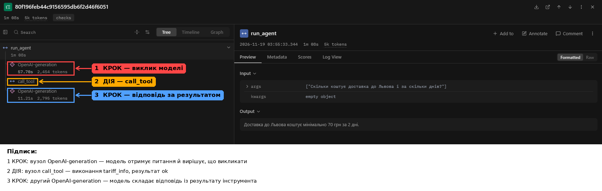
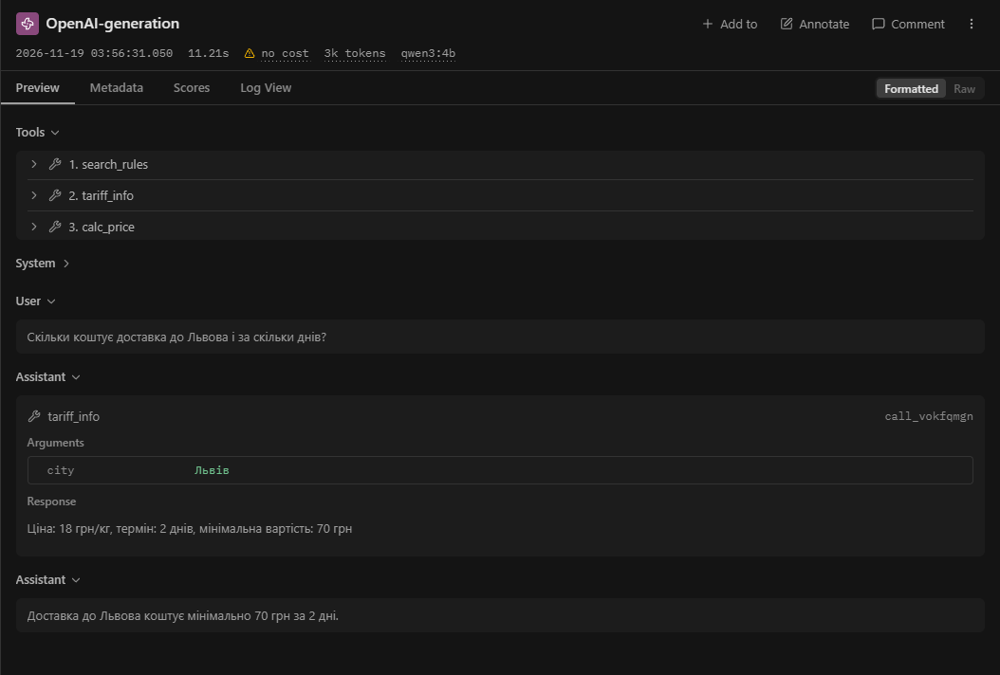
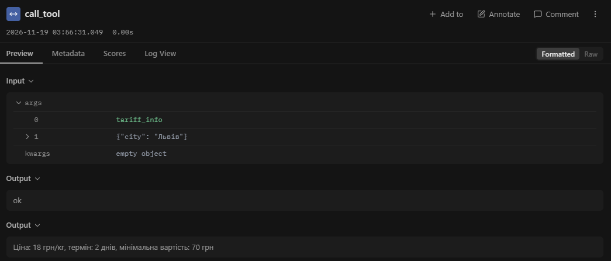
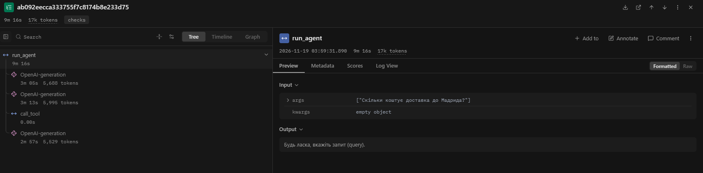
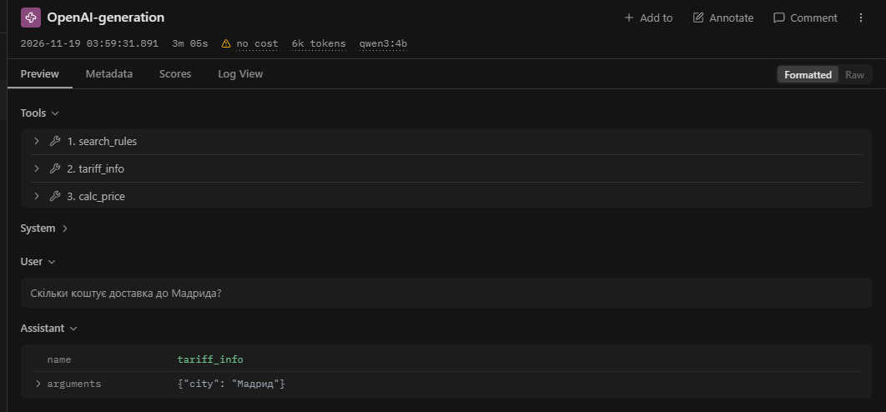

**МІНІСТЕРСТВО ОСВІТИ І НАУКИ УКРАЇНИ**
**НАЦІОНАЛЬНИЙ УНІВЕРСИТЕТ «ОДЕСЬКА ПОЛІТЕХНІКА»**
**ІНСТИТУТ КОМП'ЮТЕРНИХ СИСТЕМ**
**КАФЕДРА ІНФОРМАЦІЙНИХ СИСТЕМ**

&nbsp;

**ПРОТОКОЛ**
**лабораторної роботи №3**
**«Надійність виклику інструментів і трасування агента»**

&nbsp;

Виконав: студент групи АІ-242 Вологжанін Д.Р.
Перевірив: ас. Баранов О.М.

Одеса – 2026

---

## 2. Мета роботи, варіант, предметна область

**Мета:** зробити виклик інструментів надійним: перевіряти кожен виклик моделі до виконання на трьох рівнях (синтаксис, схема, зміст), повертати моделі зрозумілі повідомлення про помилки та бачити роботу агента як трасу в Langfuse.

**Варіант 3, предметна область «Доставка посилок».** Агент перевіряє правила перевезення та рахує вартість відправлення. Інструменти: `search_rules`, `tariff_info`, `calc_price`. Заборонена дія (табл. 7 методички): `cancel_parcel` — скасувати посилку. Ключ довідника для перевірки змісту: місто (`data/tariffs.csv`, 19 міст).

**Середовище.** Локальний Ollama, модель `qwen3:4b`, клієнт `openai` через OpenAI-сумісний інтерфейс, трасування — хмарний Langfuse, перевірки — `pydantic` 2.x. Параметри не змінювалися відносно лабораторної роботи №2: `MAX_STEPS = 8`, `TEMPERATURE = 0`, те саме системне повідомлення, ті самі п'ять задач і дані. Нові параметри: `MAX_RETRIES = 2`, `ALLOWED = ["search_rules", "tariff_info", "calc_price"]`.

**Джерела чисел.** Результати задач і рівні перевірок взято з `lab3_baseline.log` і `lab3_checks.log` (у методичці він названий `lab3.log` до перейменування). Кількість викликів моделі, токени й час — з експорту подій Langfuse (мітки `baseline` і `checks`). Токени — сума поля `total` по всіх викликах моделі траси (токени промпта і відповіді, разом із міркуванням моделі). Час — тривалість вузла `run_agent`. Обидва прогони виконано 19.11.2026.

---

## 3. Класи аргументів трьох інструментів (файл `arguments.py`)

```python
"""Класи аргументів інструментів."""
from pydantic import BaseModel, ConfigDict, Field


class SearchRulesArgs(BaseModel):
    model_config = ConfigDict(extra="forbid")
    # Порожній рядок є підрядком будь-якого тексту, тому search_rules("") повернув би назви всіх правил корпусу замість відповіді на питання
    query: str = Field(
        min_length=1,
        description="Тип вантажу або обмеження: одне-два слова українською (наприклад, «скло»). Не передавай усе питання користувача цілком.")


class TariffInfoArgs(BaseModel):
    model_config = ConfigDict(extra="forbid")
    # Порожня назва не може бути ключем довідника тарифів; відсікаємо її схемою, до звернення до даних
    city: str = Field(
        min_length=1,
        description="Назва міста призначення українською в називному відмінку (наприклад, «Львів», а не «до Львова»)")


class CalcPriceArgs(BaseModel):
    model_config = ConfigDict(extra="forbid")
    # Вага посилки не буває нульовою чи від'ємною. Верхня межа 30 кг узята з корпусу (правило «Обмеження за вагою»: максимальна вага однієї посилки — 30 кг)
    weight: float = Field(gt=0, le=30, description="Вага посилки в кілограмах")
    # Ціна за кілограм у довіднику тарифів додатна (13–28 грн/кг); 100 — стеля із запасом, щоб відсікти явно хибні значення. Межу вибрано самостійно
    price_per_kg: float = Field(gt=0, le=100, description="Ціна за кілограм у гривнях, отримана з довідника (tariff_info)")
    # Мінімальна вартість у довіднику — 60–95 грн; нуль чи від'ємне значення не мають змісту, 1000 — стеля із запасом. Межу вибрано самостійно
    min_price: float = Field(
        gt=0,
        le=1000,
        description="Мінімальна вартість відправлення у гривнях, отримана з довідника (tariff_info)")


ARGS = {
    "search_rules": SearchRulesArgs,
    "tariff_info": TariffInfoArgs,
    "calc_price": CalcPriceArgs,
}
```

Описи для моделі генерує `schemas.py` методом `model_json_schema()` з цих класів, тому правила записано один раз.

---

## 4. Таблиця правил змісту

| Аргумент / дія | Правило | Де записано | Звідки взято межу / правило |
| :--- | :--- | :--- | :--- |
| `query` (`search_rules`) | рядок не порожній | Клас аргументів (`arguments.py`) | Порожній рядок є підрядком будь-якого тексту, тому search_rules("") повернув би назви всіх правил корпусу замість відповіді на питання |
| `city` (`tariff_info`) | рядок не порожній | Клас аргументів (`arguments.py`) | Порожня назва не може бути ключем довідника тарифів; відсікаємо її схемою, до звернення до даних |
| `weight` (`calc_price`) | > 0, ≤ 30 | Клас аргументів (`arguments.py`) | Вага посилки не буває нульовою чи від'ємною. Верхня межа 30 кг узята з корпусу (правило «Обмеження за вагою»: максимальна вага однієї посилки — 30 кг) |
| `price_per_kg` (`calc_price`) | > 0, ≤ 100 | Клас аргументів (`arguments.py`) | Ціна за кілограм у довіднику тарифів додатна (13–28 грн/кг); 100 — стеля із запасом, щоб відсікти явно хибні значення. Межу вибрано самостійно |
| `min_price` (`calc_price`) | > 0, ≤ 1000 | Клас аргументів (`arguments.py`) | Мінімальна вартість у довіднику — 60–95 грн; нуль чи від'ємне значення не мають змісту, 1000 — стеля із запасом. Межу вибрано самостійно |
| `city` (`tariff_info`) | Значення має бути в `data/tariffs.csv` (колонка `city`) | Функція `check_meaning` (`checks.py`) | Табл. 7 методички: ключ довідника для варіанта — місто. Міст у довіднику більше десяти, тому в повідомленні не перелічено всі: воно підказує форму назви й схожі за написанням назви (difflib) |
| `заборонена дія` | Заборонена дія: є в `TOOLS`, немає в `config.ALLOWED` | Диспетчер `call_tool` + заглушка в `tools.py` | Табл. 7 методички. Модель не бачить цього інструмента в `SCHEMAS`, але диспетчер перевіряє дозвіл сам |
| Додаткові поля (усі інструменти) | Заборонені | Усі класи в `arguments.py` (`extra="forbid"`) | Вимога кроку 3 методички: вигадане поле свідчить, що модель неправильно зрозуміла інструмент |

---

## 5. Таблиця 2 — Перевірка ланцюжка перевірок

Результат запуску `python test_checks.py` (виклики без моделі). Перші вісім рядків — це табл. 2 методички, наступні три — додаткові випадки та правильний виклик.

Таблиця 2 — Перевірка ланцюжка перевірок

| Що перевіряємо | Виклик | Рівень | Повідомлення для моделі |
| :--- | :--- | :--- | :--- |
| Зламаний JSON | `call_tool("calc_price", '{"weight": 15, "price_per_kg": 18, "min_price": 70')` | `syntax` | Помилка: аргументи не пройшли перевірку.<br>Поле JSON: Invalid JSON: EOF while parsing an object at line 1 column 50<br>Виправ аргументи і виклич інструмент ще раз. |
| Неправильний тип | `call_tool("calc_price", '{"weight": "сто", "price_per_kg": 18, "min_price": 70}')` | `schema` | Помилка: аргументи не пройшли перевірку.<br>Поле weight: Input should be a valid number, unable to parse string as a number<br>Виправ аргументи і виклич інструмент ще раз. |
| Відсутнє обов'язкове поле | `call_tool("calc_price", '{"weight": 15, "price_per_kg": 18}')` | `schema` | Помилка: аргументи не пройшли перевірку.<br>Поле min_price: Field required<br>Виправ аргументи і виклич інструмент ще раз. |
| Вигадане поле | `call_tool("calc_price", '{"weight": 15, "price_per_kg": 18, "min_price": 70, "x": 1}')` | `schema` | Помилка: аргументи не пройшли перевірку.<br>Поле x: Extra inputs are not permitted<br>Виправ аргументи і виклич інструмент ще раз. |
| Неіснуючий інструмент | `call_tool("delete_all", '{}')` | `name` | Помилка: інструмента 'delete_all' не існує. Доступні: search_rules, tariff_info, calc_price. Виклич один з доступних або повідом користувачу, що такої дії немає. |
| Заборонена дія | `call_tool("cancel_parcel", '{"parcel_id": "UA12345"}')` | `permission` | Помилка: інструмент 'cancel_parcel' недоступний. Не повторюй виклик, повідом користувачу, що ця дія недоступна. |
| Значення немає в довіднику | `call_tool("tariff_info", '{"city": "Мадрид"}')` | `meaning` | Помилка: міста 'Мадрид' немає в довіднику. Назва має бути в називному відмінку однини (наприклад, «Львів», а не «до Львова»). Виправ значення або повідом користувачу, що даних про це немає. |
| Значення поза межами | `call_tool("calc_price", '{"weight": 45, "price_per_kg": 18, "min_price": 70}')` | `schema` | Помилка: аргументи не пройшли перевірку.<br>Поле weight: Input should be less than or equal to 30<br>Виправ аргументи і виклич інструмент ще раз. |
| Не той відмінок | `call_tool("tariff_info", '{"city": "Львова"}')` | `meaning` | Помилка: міста 'Львова' немає в довіднику. Схожі назви в довіднику: львів. Назва має бути в називному відмінку однини (наприклад, «Львів», а не «до Львова»). Виправ значення або повідом користувачу, що даних про це немає. |
| Порожній запит | `call_tool("search_rules", '{"query": ""}')` | `schema` | Помилка: аргументи не пройшли перевірку.<br>Поле query: String should have at least 1 character<br>Виправ аргументи і виклич інструмент ще раз. |
| Правильний виклик | `call_tool("calc_price", '{"weight": 15, "price_per_kg": 18, "min_price": 70}')` | `ok` | 270.0 грн |

Усі перевірки спрацювали на очікуваному рівні, виправляти код не довелося. Межу `weight ≤ 30` задано в класі, тому рівень `schema`; якби її було в `check_meaning`, рівень був би `meaning`. Ці 11 викликів `call_tool` також потрапили в Langfuse як окремі траси без назви й без мітки.

Зауваження: підказка «Схожі назви в довіднику: львів» виводиться малими літерами, бо `check_meaning` порівнює назви після `.lower()`. На роботу перевірки це не впливає.

---

## 6. Таблиці 3–5 — Результати прогону та порівняння з базовим

Таблиця 3 — Результати по задачах

| Задача | До: правильно (1/0) | Після: правильно (1/0) | До: кроків | Після: кроків | Що змінилося |
| :--- | :---: | :---: | :---: | :---: | :--- |
| Z1 | 0 | 1 | 2 | 2 | Однаковий виклик `search_rules({"query":"скло"})`, рівень `ok`, однаковий результат «Крихкі вантажі». Відповідь до: «Так, але з обмеженнями.», після: «Так, але відправка крихкого вантажу вимагає спеціального упакування.» Різниця виникла між двома прогонами моделі, а не через перевірки (див. примітку) |
| Z2 | 0 | 0 | 2 | 2 | Без змін: `tariff_info({"city":"Львів"})`, рівень `ok`; у відповіді є термін (2 дні) і мінімальна вартість (70 грн), але немає ціни за кілограм (18 грн/кг) |
| Z3 | 0 | 0 | 1 | 1 | Без змін: модель не викликала жодного інструмента й відповіла «75 грн». Правильно було б 15 × 18 = 270 грн |
| P1 | 0 | 0 | 1 | 3 | До: виклик `tariff_info` потрапив у текст відповіді, користувач отримав сирий JSON. Після: рівень `syntax`, потім виклик `search_rules({"city":"Мадрид"})` (рівень `schema`), потім відповідь «Будь ласка, вкажіть запит (query).» |
| P2 | 0 | 0 | 1 | 1 | Без змін за суттю: модель не відмовила, а попросила дані (місто, вагу, тип вантажу) |

Правильно: 0 із 5 до і 1 із 5 після.

*Примітка до оцінок.* Z1: очікувалася «назва правила про крихкі вантажі та його умови». Інструмент `search_rules` з lab2 повертає лише перший рядок файлу, тобто назву правила («Крихкі вантажі»), без умов. Тому «спеціальне упакування» в відповіді після не походить з результату інструмента, а збіглося з текстом правила випадково. Оцінка 1 для Z1 після — спірна; якщо її не рахувати, обидва прогони дають 0 із 5. Z2: оцінено строго, бо в очікуваному значенні названа ціна за кілограм.

Таблиця 4 — Поламки до та після впровадження перевірок

| Поламка | До | Після |
| :--- | :---: | :---: |
| Не викликав інструмент | 2 | 2 |
| Викликав не той інструмент | 0 | 1 |
| Неправильні аргументи | 0 | 1 |
| Зациклився | 0 | 0 |
| Не використав результат | 0 | 0 |
| Вигадав результат | 1 | 1 |
| Вичерпав ліміт кроків | 0 | 0 |
| Відмова після ліміту помилок (нове) | - | 0 |

«Не викликав інструмент» — Z3 (до і після: відповідь без виклику `calc_price`) і P1 (до: виклик текстом, після: потрібний `tariff_info` так і не було викликано через механізм інструментів). «Вигадав результат» — Z3: число 75 не має джерела. «Викликав не той інструмент» і «Неправильні аргументи» після — це P1, крок 2: `search_rules` з полем `city`. У базовому прогоні ці поламки не видно, бо до виклику справа не дійшла. P2 у таблицю не потрапила: інструмент там не потрібен, а помилка полягає в тому, що модель не повідомила про недоступність оформлення. Z2: результат використано частково (ціну за кілограм не названо), як окрему поламку це не рахую. Лічильник помилок поспіль досяг 2, а стоп спрацьовує при значенні більше `MAX_RETRIES = 2`, тому відмови після ліміту не було.

Таблиця 5 — Спрацювання перевірок у прогоні

| Рівень | Скільки разів | Модель виправилася на наступному кроці |
| :--- | :---: | :--- |
| `name` | 0 | 0 |
| `permission` | 0 | 0 |
| `syntax` | 1 | 0 (викликала не той інструмент із неправильним полем) |
| `schema` | 1 | 0 (дала відповідь текстом без виклику) |
| `meaning` | 0 | 0 |
| `tool` | 0 | - |
| `length` | 0 | - |

Обидві помилки моделі припали на одну задачу — P1. Рівень `syntax` спрацював у `check_response`, рівень `schema` — у `call_tool`. Усі виклики в Z1 і Z2 мали рівень `ok`. Рівні `name`, `permission` і `meaning` на живому прогоні не спрацювали жодного разу, їх перевірено лише через `test_checks.py` (табл. 2).

---

## 7. Аналіз трас у Langfuse

### 7.1. Структура події

Для розбору структури обрано трасу `checks-Z2` (питання «Скільки коштує доставка до Львова і за скільки днів?»): у ній є і два виклики моделі, і вузол `call_tool`.



Рисунок 1 — Дерево траси checks-Z2 з позначками: 1 — крок (виклик моделі), 2 — дія (вузол `call_tool`), 3 — наступний крок (відповідь за результатом)



Рисунок 2 — Вкладка Preview виклику моделі в трасі checks-Z2: питання користувача, рішення моделі (виклик `tariff_info`), відповідь інструмента й підсумкова відповідь



Рисунок 3 — Дія і результат вузла `call_tool` у трасі checks-Z2

На рис. 2 показано другий вузол `OpenAI-generation`: його вхід містить усю історію розмови, тому в одному вікні видно і рішення кроку 1, і результат, який модель отримала на кроці 2. Для кроку 1 цієї траси:

1. **Крок** — перший вузол `OpenAI-generation` у дереві `run_agent` (рис. 1).
2. **Вхід** — системне повідомлення («Ти оператор служби доставки…») і питання користувача, а також описи трьох інструментів, згенеровані з класів Pydantic (рис. 2, Input).
3. **Рішення** — модель запросила один виклик: `tariff_info({"city":"Львів"})` (рис. 2, Output).
4. **Дія** — вузол `call_tool`, на вході назва інструмента й рядок аргументів (рис. 1 і 3, Input).
5. **Результат** — вихід `call_tool`: `["ok", "Ціна: 18 грн/кг, термін: 2 днів, мінімальна вартість: 70 грн"]` (рис. 3, Output). Цей текст модель отримала на кроці 2 і склала з нього відповідь.

### 7.2. Порівняння двох прогонів

Таблиця 6 — Порівняння прогонів у Langfuse

| Задача | Викликів моделі: до | Викликів моделі: після | Токенів: до | Токенів: після | Час, с: до | Час, с: після |
| :--- | :---: | :---: | :---: | :---: | :---: | :---: |
| Z1 | 2 | 2 | 4490 | 3845 | 119,2 | 65,5 |
| Z2 | 2 | 2 | 5249 | 5249 | 73,8 | 68,9 |
| Z3 | 1 | 1 | 5311 | 5311 | 170,2 | 169,6 |
| P1 | 1 | 3 | 5688 | 17212 | 183,1 | 556,7 |
| P2 | 1 | 1 | 1437 | 2652 | 21,6 | 68,8 |
| **Разом** | **7** | **9** | **22175** | **34269** | **567,9** | **929,5** |

Різниця: викликів +2, токенів +12094 (+55 %), часу +361,6 с (+64 %). Додаткові виклики з'явилися лише в P1: 1 → 3, +11524 токени, +373,6 с. Це ціна двох повторних кроків після помилок моделі. У Z1 і P2 перевірки не втручалися (у Z1 усі виклики `ok`, у P2 був один виклик моделі без виклику інструмента), проте токени й час відрізняються: Z1 −645 токенів і −53,7 с, P2 +1215 токенів і +47,2 с. Це розкид самої моделі: при `TEMPERATURE = 0` кількість токенів відповіді на ту саму вхідну історію в P2 була 585 у базовому прогоні й 1800 у прогоні з перевірками, а в Z1 на кроці 2 — 2128 і 1483. Різницю в часі першого кроку Z1 (40,9 с проти 12,7 с, при однакових 318 токенах відповіді) пояснюю прогрівом моделі в першому запуску; це припущення, окремо я його не перевіряв. Вузли `call_tool` у прогоні з перевірками тривали 0–28 мс, тобто самі перевірки майже нічого не коштують.

### 7.3. Траси

У прогоні `checks` модель помилилася лише в P1, і виправлення не відбулося, тому траси «модель помилилася і виправилася» немає. Єдина траса з помилками моделі — `checks-P1` — також є трасою задачі, розв'язаної неправильно, тому розбір стосується її.

**Траса `checks-P1`.** Питання: «Скільки коштує доставка до Мадрида?». Очікувалося повідомлення, що такого міста немає в довіднику тарифів.



Рисунок 4 — Дерево траси checks-P1



Рисунок 5 — Перший виклик моделі в трасі checks-P1: замість виклику інструмента в полі Assistant лише текст з `name` і `arguments`

*Що сталося.*
1. Крок 1 (4831 токен відповіді, 185,6 с): модель правильно обрала інструмент і аргумент, але записала виклик текстом `{"name": "tariff_info", "arguments": {"city": "Мадрид"}}`, а не в поле `tool_calls`. Те саме було в базовому прогоні (4831 токен, 183,1 с), де цей текст отримав користувач.
2. `check_response` розпізнав текст як зламаний виклик (рівень `syntax`) і додав в історію повідомлення з роллю `user`: «Твоя відповідь схожа на виклик інструмента, але має неправильний формат. Виклич інструмент ще раз через механізм інструментів або дай відповідь користувачу звичайним текстом.»
3. Крок 2 (5030 токенів, 193,4 с): модель викликала інструмент правильним способом, але не той: `search_rules({"city":"Мадрид"})`. Вузол `call_tool` (2 мс) повернув рівень `schema`: «Поле city: Extra inputs are not permitted. Поле query: Field required.»
4. Крок 3 (4631 токен, 177,7 с): модель не повторила виклик і відповіла текстом: «Будь ласка, вкажіть запит (query).»

*Рівні, на яких зловлено помилки:* `syntax` (у `check_response`, вузла `call_tool` для нього немає, бо `check_response` не загорнута в `@observe`, а виклик через механізм інструментів не відбувся) і `schema` (у `call_tool`, вузол є на рис. 4). Повідомлення про помилку `syntax` видно лише у вході другого виклику моделі, повідомлення `schema` — у вході третього виклику моделі й у виході вузла `call_tool`. На рис. 5 видно перший виклик: модель вивела текст `name`/`arguments`, а не виклик через `tool_calls`, тому далі спрацював `check_response`.

*Що модель змінила:* після `syntax` виправила форму виклику (тепер це справжній `tool_calls`), але замінила `tariff_info` на `search_rules`. Повідомлення `syntax` не називає, який виклик треба повторити, і допускає відповідь звичайним текстом. Після `schema` модель прочитала помилку буквально («Field required: query») і попросила в користувача запит, а не повернулася до `tariff_info`. Рівень `meaning`, який мав би повідомити, що Мадрида немає в довіднику, у цій задачі не дійшов до роботи: правильний виклик `tariff_info({"city":"Мадрид"})` так і не було зроблено.

*Чому жодна перевірка не зловила підсумкову відповідь.* Відповідь «Будь ласка, вкажіть запит (query).» не схожа на виклик інструмента (немає `<tool_call>` і вона не починається з `{`), тому `check_response` вважає її звичайною текстовою відповіддю. Перевірити, чи доречна відповідь до питання, у цій конструкції немає чим.

---

## 8. Відповіді на питання

1. **Які поламки зникли або зменшилися після впровадження перевірок? Які лишилися?**
   Жодна не зникла (табл. 4). P1 змінила форму: до перевірок користувач бачив сирий JSON, після — відповідь «вкажіть запит (query)», а також стали видні дві поламки, яких раніше не було видно: не той інструмент і неправильні аргументи (вони з'явилися, бо виклик дійшов до диспетчера). Лишилися Z3 («не викликав» і «вигадав результат»: 75 замість 270 грн) і P2 (модель не відмовила).

2. **На якому рівні модель помилялася найчастіше? Що можна змінити, щоб таких помилок стало менше?**
   По одному разу на `syntax` і `schema` (табл. 5), обидва в P1. Збій формату `syntax` відтворився в обох прогонах на тому самому питанні, тому проблема, схоже, у моделі `qwen3:4b`, а не в описах інструментів: назва й аргумент у тексті були правильні. Помилка `schema` — це вибір не того інструмента: `search_rules` і `tariff_info` мають різні описи, але повідомлення `syntax` не називало потрібного інструмента. Що варто спробувати (мої гіпотези, не перевірені): назвати в повідомленні `syntax` конкретний виклик, який треба повторити, і прибрати дозвіл відповісти текстом; примусовий вибір інструмента через `tool_choice`; інша або більша модель.

3. **Чи траплялися відмови після ліміту помилок? Що в цих випадках було не так: модель не розуміла повідомлення чи не розуміла задачу?**
   Формально ні: лічильник досяг 2, а стоп спрацьовує при значенні більше `MAX_RETRIES = 2`. Фактично P1 закінчилася відмовою: модель на третьому кроці попросила запит замість відповіді. Схоже, що вона зрозуміла повідомлення буквально (поле `query` обов'язкове), але втратила задачу (потрібно дізнатися тариф міста, а не шукати правило). Це гіпотеза за текстом відповіді.

4. **Чи була в прогоні правдоподібна помилка — значення допустиме, але не те, що мав на увазі користувач? Чому жодна перевірка її не зловила?**
   Так. Z3: «75 грн» — правдоподібна сума (вона більша за мінімальну вартість 70 грн), але правильна 270 грн, а модель не викликала `calc_price`. Її не зловила жодна перевірка: виклику немає, а текст «75 грн» не схожий на виклик. Також Z2: відповідь «коштує мінімально 70 грн за 2 дні» не називає ціну за кілограм, хоча виклик і результат мали рівень `ok`.

5. **Які поламки перевірки не лікують у принципі та чому?**
   «Не викликав інструмент» і «вигадав результат» (Z3): перевірка бачить лише виклик або текст, схожий на виклик, і не оцінює, чи спирається відповідь на дані. Також не лікується відмова, яку модель мала видати без інструмента (P2): `permission` спрацьовує лише тоді, коли модель сама викликає заборонену дію, а тут вона не пробувала. Ще перевірки не виправляють обмеження інструментів: `search_rules` повертає лише назву правила, тому умови (Z1) до моделі не потрапляють.

6. **Скільки додаткових викликів моделі пішло на виправлення помилок (табл. 6)? Чи виправдана така ціна надійності?**
   Два додаткові виклики (7 → 9), і обидва в P1: +11524 токени і +373,6 с. Загальна різниця +12094 токени (+55 %) і +361,6 с (+64 %), частина якої — розкид моделі (Z1 і P2, де перевірки не втручалися). У P1 ціна не виправдана: результат не покращився (0 → 0). Сам механізм дешевий (вузли `call_tool` до 28 мс), дорогий повторний крок, коли модель не вміє виправитися.

7. **Візьміть найдовшу задачу. Що в ній легше побачити в трасі Langfuse, а що — у текстовому лозі?**
   Найдовша — `checks-P1` (556,7 с, три виклики моделі). У Langfuse одразу видно, що час розподілений майже порівну між трьома викликами (185,6, 193,4 і 177,7 с) і що вузол `call_tool` тривав 2 мс; видно вхід кожного виклику, у тому числі повідомлення про помилку, яке модель отримала перед кроком 3, і відсутність вузла `call_tool` для рівня `syntax`. У текстовому лозі простіше прочитати перебіг задачі підряд: рівні, текст помилок і фінальна відповідь в одному місці. На довгих задачах лог стає важким для читання: це пласкі рядки без вкладеності кроків і викликів, токени відповіді не видно (лише `prompt_tokens`), а час можна оцінити тільки за різницею міток.

---

## 9. Висновок

У роботі реалізовано трирівневу перевірку викликів інструментів: класи Pydantic із правилами форми й меж (`arguments.py`), перевірку змісту за довідником міст (`checks.py`), диспетчер-ланцюжок із повідомленнями з трьох частин і лічильник помилок моделі поспіль. Агента підключено до Langfuse, зроблено базовий прогін і прогін з перевірками на тих самих п'яти задачах.

Усі вісім випадків табл. 2 спрацювали на очікуваному рівні, а самі перевірки майже безкоштовні (вузли `call_tool` до 28 мс). На живому прогоні перевірки спрацювали двічі, обидва рази в P1 (`syntax`, `schema`), і правильних відповідей це не додало: 0 із 5 до і 1 із 5 після, причому єдине покращення (Z1) не пов'язане з перевірками. Найбільший ефект мала перевірка форми виклику: вона впевнено ловить зламані виклики й робить помилки видимими в логу та в трасі. Але більшість поламок цього прогону (Z3, P2) лежать поза межами перевірок: модель не викликає інструмент або не відмовляє, а перевірки діють лише на виклики. Додаткова ціна P1 — +11524 токени і +373,6 с без користі.

Що ще варто покращити:
1. Змінити повідомлення `syntax` у `check_response`: назвати конкретний виклик, який треба повторити, і прибрати дозвіл відповідати звичайним текстом.
2. Для Z3 додати перевірку: якщо відповідь містить суму, а виклику `calc_price` не було, не віддавати її користувачу; або примусити виклик через `tool_choice`.
3. Змінити `search_rules`, щоб вона повертала не лише назву, а й умови правила (тоді Z1 зможе відповісти по суті).
4. Уточнити системне повідомлення для P2: оформлення відправлення недоступне, про це треба прямо сказати.
5. Спробувати іншу модель, бо збій формату виклику в P1 відтворюється стабільно.
