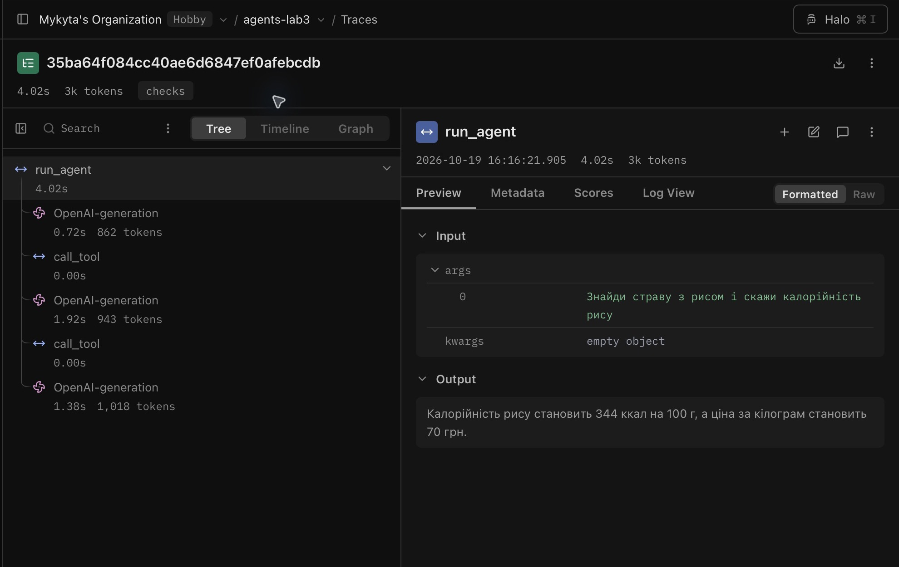
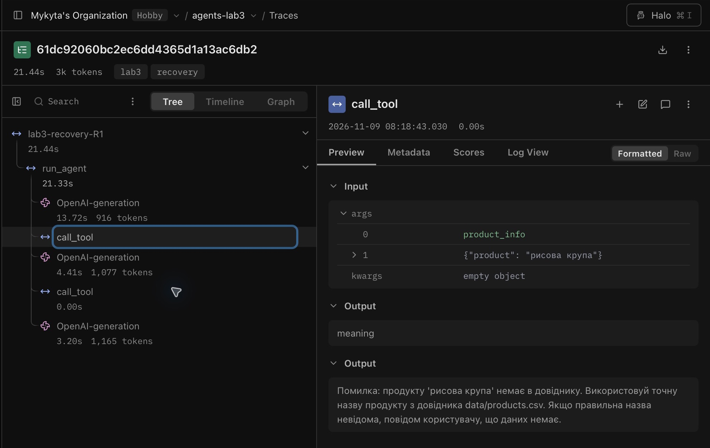
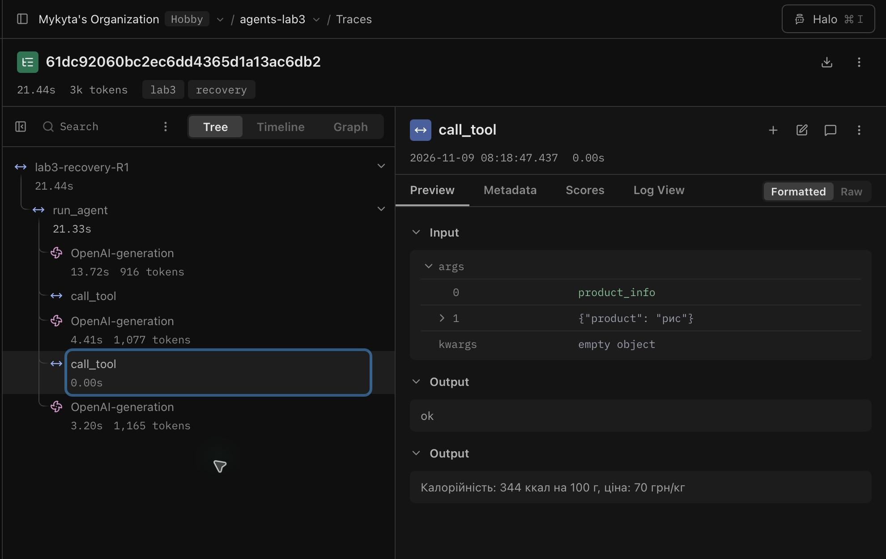

# Лабораторна робота № 3

**Дисципліна:** Обчислювальні методи  
**Тема:** Надійність виклику інструментів і трасування агента  
**Студент:** Антонович Микита  
**Група:** АІ-243  
**Варіант:** 2 — Кулінарія

## Мета роботи

Підвищити надійність агента з лабораторної роботи № 2: перевіряти назви й дозволи інструментів, синтаксис JSON, схему та зміст аргументів; повертати моделі пояснення помилок; обмежувати кількість помилок поспіль; аналізувати виконання через Langfuse.

## Середовище та параметри

| Компонент | Значення |
|---|---|
| Python | 3.12 |
| Локальний сервер | Ollama (`http://localhost:11434/v1`) |
| Модель | `qwen2.5:3b` |
| Температура | `0` |
| Максимум кроків | `6` |
| Ліміт послідовних помилок моделі | `2` |
| Основні бібліотеки | `openai`, `pydantic`, `python-dotenv`, `langfuse>=4` |
| Трасування | Langfuse Cloud, проєкт `agents-lab3` |

Для чесного порівняння між прогонами `baseline` і `checks` збережено вихідні завдання, модель, температуру, ліміт кроків, системне повідомлення та дані лабораторної роботи № 2.

## Функціональність

Агент має три дозволені інструменти:

| Інструмент | Призначення |
|---|---|
| `search_recipes(query)` | Шукає рецепти за інгредієнтом, типом страви або способом приготування. |
| `product_info(product)` | Повертає калорійність на 100 г і ціну продукту з `data/products.csv`. |
| `scale_amount(amount, base_servings, target_servings)` | Перераховує кількість інгредієнта на іншу кількість порцій. |

`place_order(products)` — **тестова заборонена дія**. Функцію зареєстровано в `TOOLS`, але не включено в `config.ALLOWED`; диспетчер має відхиляти її на рівні `permission`.

### Перевірки викликів

| Рівень | Що перевіряється |
|---|---|
| `name` | Інструмент існує у реєстрі. |
| `permission` | Виклик дозволено для агента. |
| `syntax` | Аргументи можна розібрати як JSON. |
| `schema` | Аргументи проходять валідацію Pydantic. |
| `meaning` | Значення узгоджені з даними, зокрема продукт є в довіднику. |
| `ok` | Інструмент успішно виконано. |
| `tool` | Помилка під час виконання інструмента. |
| `length` | Відповідь моделі обірвана через ліміт генерації. |

У класах Pydantic використано `extra="forbid"`, обов'язкові поля та обмеження значень. Диспетчер повертає рівень перевірки і повідомлення, яке пояснює, що сталося та що робити далі. Лічильник `MAX_RETRIES` контролює послідовні помилки моделі.

## Структура файлів

```text
lab3/
├── agent.py                 # цикл агента
├── agent_runner.py          # запуск п'яти задач і запис трас
├── arguments.py             # Pydantic-моделі аргументів
├── checks.py                # предметні перевірки
├── config.py                # конфігурація агента
├── dispatcher.py            # перевірка й виконання викликів
├── schemas.py               # JSON-схеми для LLM
├── tools.py                 # інструменти агента
├── tasks.json               # незмінений набір із п'яти задач
├── test_checks.py           # вісім тестів диспетчера
├── data/
│   ├── products.csv
│   └── corpus/               # r01.txt — r12.txt
├── lab2.log                 # результати ЛР2
├── lab3_baseline.log        # початковий прогін
├── lab3_checks.log          # прогін із перевірками
├── langfuse-step-annotated.png
├── langfuse_checks_overview.png
├── langfuse_validation_events.png
├── README.md
└── report.md                # підсумковий звіт; додається перед здачею
```

Файли `.env`, `.venv/` і Python-кеші зберігаються тільки локально та не публікуються в GitHub. Скріншоти знаходяться **безпосередньо в `lab3/`**

## Перевірені результати

| Задача | Коректність до | Коректність після | Кроків до / після | Викликів інструментів до / після | Спостереження |
|---|:---:|:---:|:---:|:---:|---|
| Z1 | 1 | 1 | 2 / 2 | 1 / 1 | Знайдено рецепти з куркою, але одну назву спотворено. |
| Z2 | 0 | 0 | 3 / 3 | 2 / 2 | Калорійність наведено, назву знайденої страви пропущено. |
| Z3 | 1 | 1 | 2 / 2 | 1 / 1 | Правильно розраховано **750 г** рису. |
| P1 | 1 | 1 | 2 / 2 | 1 / 1 | Повідомлено про відсутність рецепта. |
| P2 | 1 | 1 | 1 / 1 | 0 / 0 | Повідомлено про недоступність списку покупок. |
| **Разом** | **4/5** | **4/5** | **10 / 10** | **5 / 5** | У цих п'яти задачах поведінка не змінилася. |

**Висновок за цими даними:** валідація обробляє некоректні виклики у тестових випадках, але не усуває помилок формування остаточної відповіді (Z1, Z2). У реальному прогоні помилкових викликів не було, тому немає підстав стверджувати, що модель там виправилася після повідомлення диспетчера.

## Langfuse: розбір трас

**Рисунок 1 — [`checks-Z2`](https://cloud.langfuse.com/project/cmvfb0h1m0akmad0jvla538t0/traces/35ba64f084cc40ae6d6847ef0afebcdb):** дерево, вхід і неправильна фінальна відповідь. Модель отримала назву «Плов з куркою» й калорійність 344 ккал/100 г, але у відповіді пропустила назву. Обидва виклики повернули `ok`: перевірка аргументів не перевіряє повноту тексту.



**Рисунки 2–3 — [`lab3-recovery-R1`](https://cloud.langfuse.com/project/cmvfb0h1m0akmad0jvla538t0/traces/61dc92060bc2ec6dd4365d1a13ac6db2):** у провокаційному питанні перший виклик `product_info` з «рисова крупа» повернув `meaning`. Після повідомлення диспетчера модель повторила виклик з «рис», отримала `ok` і вказала 344 ккал на 100 г.





Скріншот з п’ятьма підписаними складниками, порівняння `baseline` та `checks` за метриками Langfuse й аналіз обох випадків — у [звіті, розділ 6](report.md#6-аналіз-трас-у-langfuse). Лог додаткового прогону: [`lab3_recovery.log`](lab3_recovery.log).
