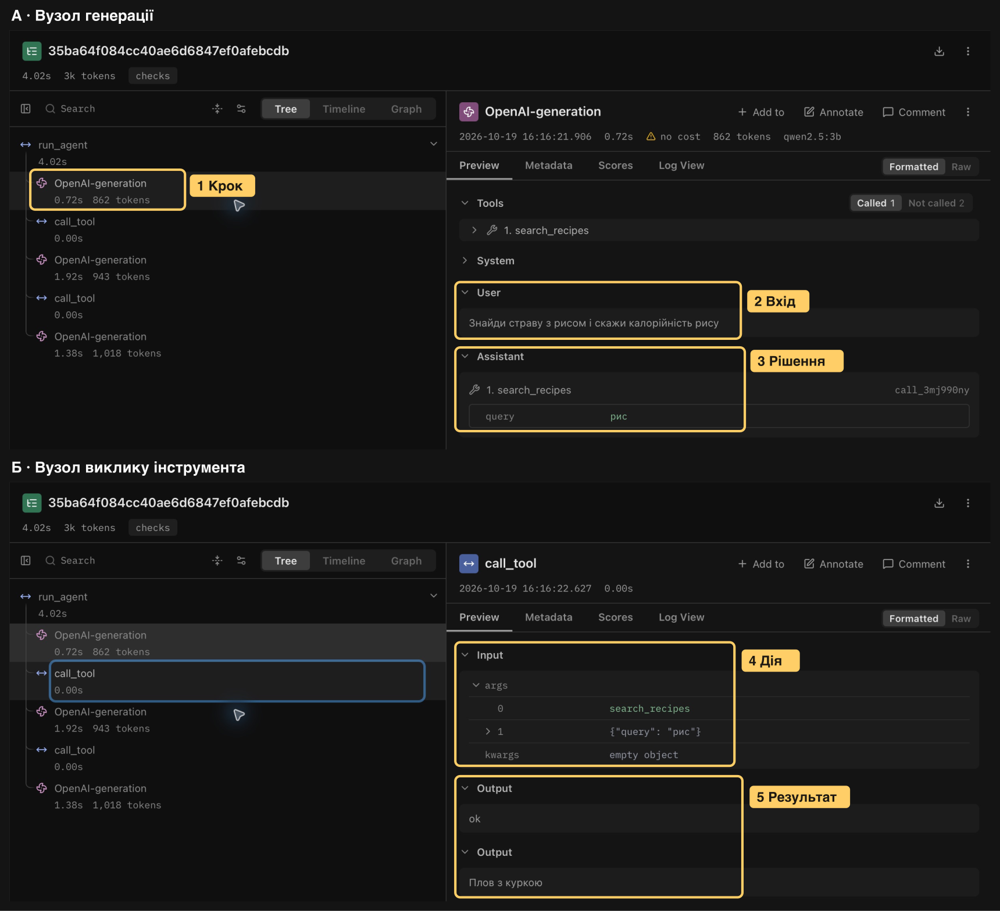
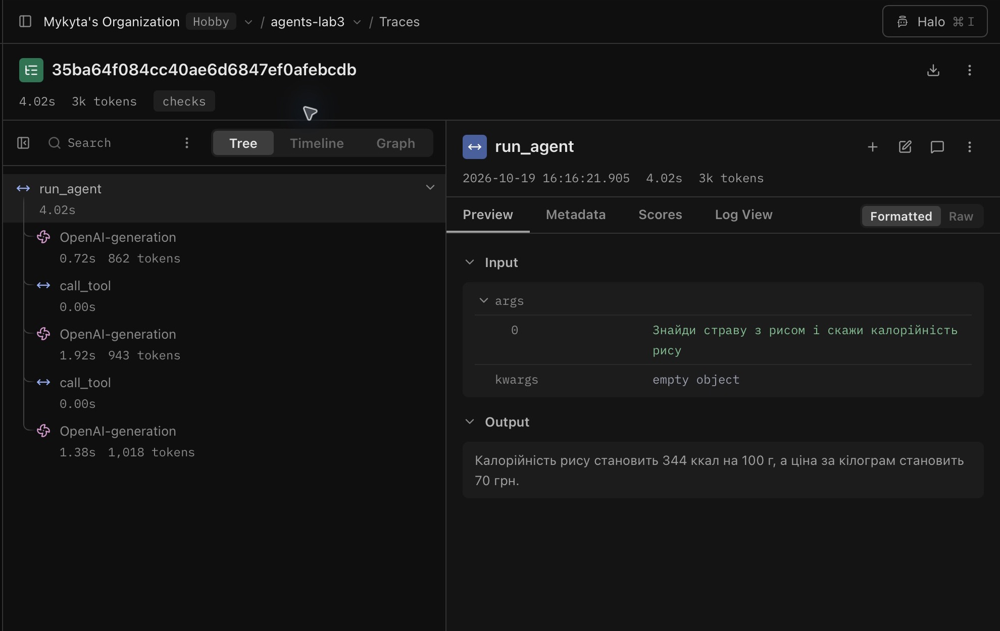
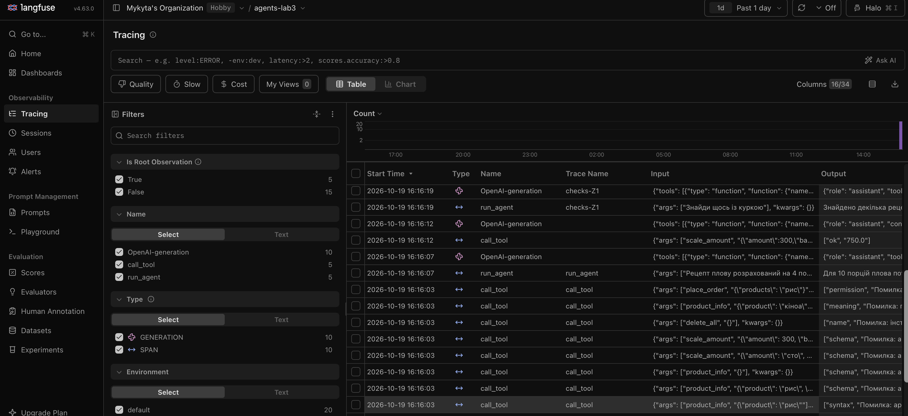
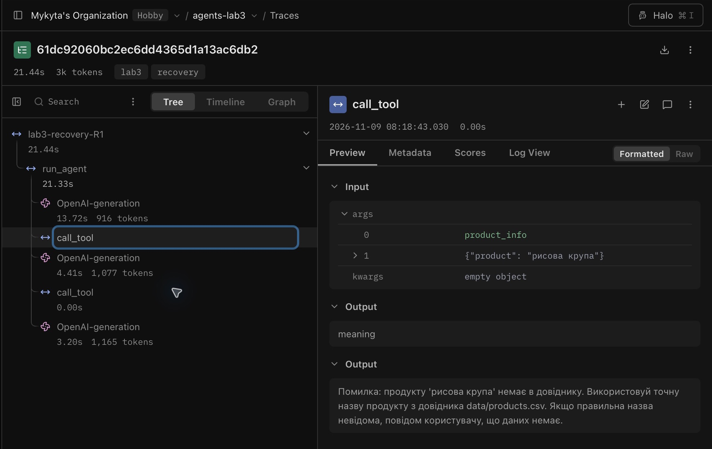
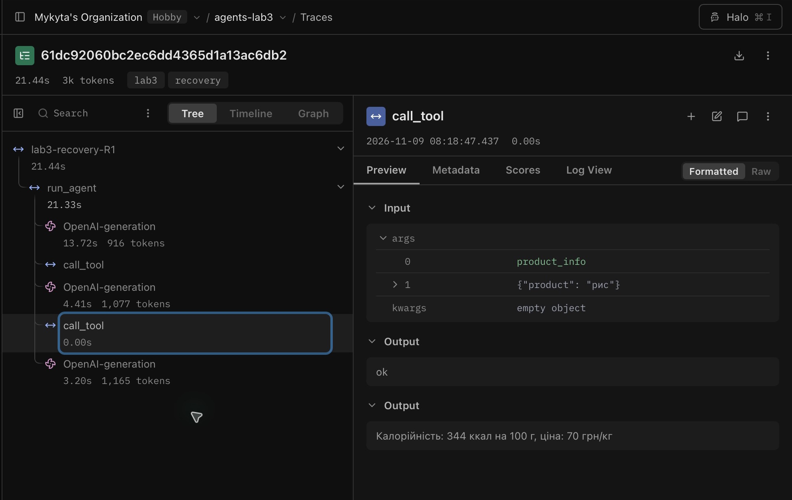

# Лабораторна робота № 3

**Дисципліна:** Обчислювальні методи  
**Тема:** Надійність виклику інструментів і трасування агента  
**Виконав:** Антонович Микита  
**Група:** АІ-243  
**Варіант:** № 2  
**Предметна область:** Кулінарія  
**Дата виконання:** 19 жовтня 2026 р.

---

## 1. Мета роботи

Підвищити надійність агента, розробленого в лабораторній роботі № 2, завдяки перевірці викликів інструментів на рівнях синтаксису, схеми та змісту. Реалізувати повідомлення про помилки, що допомагають моделі виправляти некоректні виклики, обмеження кількості послідовних помилок та трасування в Langfuse. Порівняти поведінку того самого агента до й після запровадження перевірок.

## 2. Вихідні дані та параметри експерименту

Для порівняння використано агента з ЛР2 з незмінними предметною областю, корпусом із **12 рецептів**, довідником `data/products.csv` із **18 продуктів**, системним повідомленням та п'ятьма завданнями (`Z1`, `Z2`, `Z3`, `P1`, `P2`).

| Параметр | Значення |
|---|---|
| Модель | `qwen2.5:3b` (локальна Ollama) |
| Температура | `0` |
| Максимальна кількість кроків | `6` |
| Максимальна кількість послідовних помилок моделі | `2` |
| Дозволені інструменти | `search_recipes`, `product_info`, `scale_amount` |
| Заборонена дія-заглушка | `place_order` |
| Трасування | Langfuse Cloud, проєкт `agents-lab3` |
| Мітки прогонів | `baseline`, `checks` |
| Джерела результатів | `lab3_baseline.log`, `lab3_checks.log`, скріншоти Langfuse |

**Порядок експерименту:** спочатку виконано базовий прогін із логікою ЛР2 та підключеним трасуванням, потім уведено перевірки й повторено ті самі п'ять задач. Усі результати порівняння нижче взято саме з логів ЛР3, а не перенесено з оцінок попередньої лабораторної.

## 3. Класи аргументів інструментів (`arguments.py`)

Для кожного дозволеного інструмента аргументи описано окремим класом Pydantic. Вони використовуються одночасно для формування JSON-схем моделі (`model_json_schema()`) і перевірки фактичних аргументів у диспетчері (`model_validate_json()`).

```python
from pydantic import BaseModel, ConfigDict, Field


class SearchRecipesArgs(BaseModel):
    model_config = ConfigDict(extra="forbid", str_strip_whitespace=True)
    query: str = Field(
        min_length=1,
        max_length=100,
        description="Інгредієнт, тип страви або спосіб приготування. Одне-два слова українською.",
    )


class ProductInfoArgs(BaseModel):
    model_config = ConfigDict(extra="forbid", str_strip_whitespace=True)
    product: str = Field(
        min_length=1,
        description="Назва продукту в називному відмінку, як у довіднику.",
    )


class ScaleAmountArgs(BaseModel):
    model_config = ConfigDict(extra="forbid")
    amount: float = Field(ge=0, le=1_000_000, description="Кількість інгредієнта")
    base_servings: float = Field(gt=0, le=1_000, description="Початкова кількість порцій")
    target_servings: float = Field(gt=0, le=1_000, description="Бажана кількість порцій")


ARGS = {
    "search_recipes": SearchRecipesArgs,
    "product_info": ProductInfoArgs,
    "scale_amount": ScaleAmountArgs,
}
```

Ключове налаштування `extra="forbid"` запобігає мовчазному ігноруванню зайвих полів. Поля без значень за замовчуванням стають обов'язковими. Схеми, згенеровані з Pydantic, містять `"additionalProperties": false` і перелік `required`.

### 3.1. Правила перевірки змісту

**Таблиця 1 — Обмеження аргументів та обґрунтування правил**

| Аргумент | Правило | Місце перевірки | Підстава |
|---|---|---|---|
| `query` | Непорожній рядок до 100 символів | `SearchRecipesArgs` | Обраний захисний ліміт довжини пошукового запиту |
| `product` | Непорожній рядок | `ProductInfoArgs` | Назва продукту обов'язкова |
| `product` | Значення повинно існувати в `products.csv` | `check_meaning()` | Фактичний довідник із 18 продуктів |
| `amount` | `0 ≤ amount ≤ 1 000 000` | `ScaleAmountArgs` | Невід'ємна кількість; верхня межа обрана як захисна |
| `base_servings` | `0 < base_servings ≤ 1 000` | `ScaleAmountArgs` | Не можна ділити на нуль; верхня межа захисна |
| `target_servings` | `0 < target_servings ≤ 1 000` | `ScaleAmountArgs` | Кількість порцій має бути додатною; верхня межа захисна |
| Усі поля | Заборонено додаткові невизначені аргументи | `extra="forbid"` | Виявлення порушень схеми замість відкидання полів |
| Назва інструмента | Дозволені тільки три основні інструменти | `config.ALLOWED`, `dispatcher.py` | `place_order` є у `TOOLS`, але його виклик заборонено |

Межі 100, 1 000 та 1 000 000 — **обрані під час реалізації запобіжники**, а не значення з файлів даних. Перевірка наявності продукту виконується окремо, оскільки перелік значень береться з довідника й не повинен дублюватися в схемі.

## 4. Диспетчер і перевірка помилкових викликів

У `dispatcher.py` перевірки виконуються послідовно: існування інструмента (`name`), дозвіл (`permission`), синтаксис JSON (`syntax`), схема Pydantic (`schema`), зміст (`meaning`), фактичне виконання (`ok` або `tool`). Окрема функція `check_response()` виявляє обрив відповіді (`length`) або текст, схожий на неправильно сформований виклик.

Метод `call_tool()` повертає пару `(рівень, повідомлення)`. Повідомлення для моделі пояснює помилку, допустиму альтернативу та наступну дію. Виклики інструментів записуються в Langfuse завдяки `@observe(name="call_tool")`.

Тестування проведено окремо від моделі командою `python test_checks.py`. Фактичний результат запуску — **8 із 8 тестів пройдено**.

**Таблиця 2 — Перевірка ланцюжка диспетчера**

| Перевірка | Виклик / аргументи | Отриманий рівень | Повідомлення для моделі (основне) |
|---|---|---|---|
| Зламаний JSON | `product_info`, `{"product":"рис"` | `syntax` | Некоректний JSON; виправити аргументи |
| Неправильний тип | `scale_amount`, `{"amount":"сто","base_servings":4,"target_servings":10}` | `schema` | Поле `amount` має містити число |
| Відсутнє поле | `product_info`, `{}` | `schema` | Обов'язкове поле `product` відсутнє |
| Вигадане поле | `product_info`, `{"product":"рис","x":1}` | `schema` | Додаткове поле `x` заборонено |
| Неіснуючий інструмент | `delete_all`, `{}` | `name` | Інструмента не існує; наведено дозволені інструменти |
| Заборонена дія | `place_order`, `{"products":"рис"}` | `permission` | Інструмент недоступний; не повторювати виклик |
| Невідомий продукт | `product_info`, `{"product":"кіноа"}` | `meaning` | Продукту немає в довіднику; уточнити назву або повідомити про відсутність даних |
| Значення поза межами | `scale_amount`, `{"amount":300,"base_servings":0,"target_servings":10}` | `schema` | `base_servings` має бути більшим за нуль |

Отже, помилки синтаксису, схеми, змісту та прав доступу виявляються **до виконання інструмента**. Зокрема, запит на `place_order` відхиляється навіть тоді, коли назва функції є у внутрішньому реєстрі.

## 5. Результати прогонів Baseline та Checks

### 5.1. Виконання п'яти задач

**Таблиця 3 — Результати по задачах**

| Задача | До: правильно (1/0) | Після: правильно (1/0) | До: кроків | Після: кроків | Що змінилося |
|---|:---:|:---:|---:|---:|---|
| Z1 | 1 | 1 | 2 | 2 | Пошук виконано, одна назва страви спотворена у фінальній відповіді в обох прогонах |
| Z2 | 0 | 0 | 3 | 3 | Знайдено плов і калорійність рису, але назву страви не включено у фінальну відповідь |
| Z3 | 1 | 1 | 2 | 2 | Інструмент правильно обчислив **750 г** рису в обох прогонах |
| P1 | 1 | 1 | 2 | 2 | Агент повідомив, що рецепт стейка з тунця не знайдено |
| P2 | 1 | 1 | 1 | 1 | Агент повідомив, що не має доступу до списку покупок |
| **Разом** | **4/5** | **4/5** | **10** | **10** | **Кількість правильних відповідей не змінилася** |

Приклад Z3 із прогону `checks`:

```text
виклик   : scale_amount({"base_servings":4,"target_servings":10,"amount":300})
рівень   : ok
результат: 750.0
ВІДПОВІДЬ: Для 10 порцій плова потрібно 750 г рису.
```

У Z2 інструменти повернули «Плов з куркою» та «Калорійність: 344 ккал на 100 г», проте модель використала у відповіді лише дані про калорійність. Виявлена проблема стосується **використання результату**, а не формату виклику.

### 5.2. Поламки до та після перевірок

**Таблиця 4 — Кількість зафіксованих поламок**

| Поламка | До | Після |
|---|---:|---:|
| Не викликав інструмент, коли потрібно | 0 | 0 |
| Викликав не той інструмент | 0 | 0 |
| Неправильні аргументи | 0 | 0 |
| Зациклився | 0 | 0 |
| Не використав результат | 1 | 1 |
| Вигадав / спотворив результат | 1 | 1 |
| Вичерпав ліміт кроків | 0 | 0 |
| Відмова після ліміту помилок моделі | — | 0 |

У Z1 агент змінив знайдену назву «Плов з куркою» на «Повідь з куркою», але навів також дві правильні назви страв — тому задача зарахована за очікуваним критерієм, а спотворення зафіксовано окремо. У Z2 правильні дані були отримані, але кінцева відповідь виявилася неповною.

### 5.3. Спрацювання перевірок під час стандартного прогону

**Таблиця 5 — Рівні перевірок у `lab3_checks.log`**

| Рівень | Скільки разів | Модель виправилася на наступному кроці |
|---|---:|---|
| `name` | 0 | Випадків не було |
| `permission` | 0 | Випадків не було |
| `syntax` | 0 | Випадків не було |
| `schema` | 0 | Випадків не було |
| `meaning` | 0 | Випадків не було |
| `tool` | 0 | — |
| `length` | 0 | — |

У стандартному прогоні зафіксовано **5 успішних викликів** із рівнем `ok`: один у Z1, два у Z2, по одному у Z3 та P1. P2 завершилася без виклику інструмента. Усі помилкові виклики, описані в таблиці 2, належать **окремому тестуванню**, а не стандартному прогону `checks`.

## 6. Аналіз трас у Langfuse

### 6.1. Структура події

Подію роботи агента можна розділити на п'ять складників:

1. **Крок** — вузол `OpenAI-generation` із викликом моделі.
2. **Вхід** — передана моделі історія повідомлень, включно з питанням та попередніми відповідями інструментів.
3. **Рішення** — відповідь моделі з назвою інструмента та аргументами.
4. **Дія** — вузол `call_tool`, що перевіряє й виконує виклик.
5. **Результат** — відповідь `call_tool` у формі `(рівень, текст)`, наприклад `("ok", "750.0")`.

**Рисунок 1 — П’ять частин першого кроку в трасі `checks-Z2`.** Верхня панель показує вхід і рішення моделі, нижня — виконання виклику і результат.



**Рисунок 2 — [Langfuse: дерево траси `checks-Z2`](https://cloud.langfuse.com/project/cmvfb0h1m0akmad0jvla538t0/traces/35ba64f084cc40ae6d6847ef0afebcdb), 19.10.2026.** Ліворуч три кроки моделі (`OpenAI-generation`) та дві дії (`call_tool`); праворуч, у `Input` і `Output` вузла `run_agent`, питання й фінальна відповідь. У відповіді є 344 ккал на 100 г, але пропущено назву страви.



У Z2 перший крок моделі (1) отримав запит про страву з рисом (2), обрав `search_recipes` з `query="рис"` (3), виконав його у вузлі `call_tool` (4) та одержав `ok` і «Плов з куркою» (5). На другому кроці модель одержала калорійність, а третій `OpenAI-generation` сформував фінальний текст.

### 6.2. Порівняння двох прогонів

Повторно записано однакові п'ять задач в оточення `lab3`. Для `baseline` запущено агента ЛР2 з доданим трасуванням викликів моделі й інструментів, зі збереженням його промпту та поведінки. Для `checks` запущено агента ЛР3. Журнали цих двох серій наведено в розділі 5.

Для кожної траси кількість викликів дорівнює числу вузлів генерації. Токени — сума `total` для цих вузлів (вхідні, зокрема кешовані Ollama, і вихідні). Час — тривалість кореневої події в Langfuse, округлена до мілісекунд. Посилання «до» й «після» відкривають відповідні дерева.

**Таблиця 6 — Порівняння вимірювань у Langfuse**

| Задача | Викликів моделі: до | Викликів моделі: після | Усього токенів: до | Усього токенів: після | Час, с: до | Час, с: після |
|---|---:|---:|---:|---:|---:|---:|
| Z1 ([до](https://cloud.langfuse.com/project/cmvfb0h1m0akmad0jvla538t0/traces/2d9d872056230eea35e7b9ee02e4a8fc) · [після](https://cloud.langfuse.com/project/cmvfb0h1m0akmad0jvla538t0/traces/fdc1e1743e7863305a83ed18c30c8709)) | 2 | 2 | 1 793 | 1 793 | 4,091 | 6,383 |
| Z2 ([до](https://cloud.langfuse.com/project/cmvfb0h1m0akmad0jvla538t0/traces/fbfcd420c2f1aec49791b7f122f7d8ce) · [після](https://cloud.langfuse.com/project/cmvfb0h1m0akmad0jvla538t0/traces/949c67bf97bf545357ca1b1c85c8ac01)) | 3 | 3 | 2 823 | 2 823 | 6,839 | 5,990 |
| Z3 ([до](https://cloud.langfuse.com/project/cmvfb0h1m0akmad0jvla538t0/traces/67095f722c19e778d3cf045dd133132d) · [після](https://cloud.langfuse.com/project/cmvfb0h1m0akmad0jvla538t0/traces/604e2d906d2c51a494b87e42cb1f6d2b)) | 2 | 2 | 1 858 | 1 858 | 4,649 | 3,678 |
| P1 ([до](https://cloud.langfuse.com/project/cmvfb0h1m0akmad0jvla538t0/traces/1ab4031de5923e7ab5be0a0de311b4b4) · [після](https://cloud.langfuse.com/project/cmvfb0h1m0akmad0jvla538t0/traces/bad36c8975b5e836412b655680176471)) | 2 | 2 | 1 820 | 1 820 | 5,051 | 3,223 |
| P2 ([до](https://cloud.langfuse.com/project/cmvfb0h1m0akmad0jvla538t0/traces/20190675fb749c49232310879881a44c) · [після](https://cloud.langfuse.com/project/cmvfb0h1m0akmad0jvla538t0/traces/08217681914ae7d4e49df771ba9718cf)) | 1 | 1 | 900 | 900 | 4,246 | 4,752 |
| **Разом** | **10** | **10** | **9 194** | **9 194** | **24,876** | **24,026** |

Кількість додаткових викликів моделі, пов'язаних із виправленням помилок у стандартному прогоні, становить **0**. Отже, у цих задачах валідація не спричинила додаткових кроків, проте й не підвищила точність фінальних відповідей.

### 6.3. Тестові події перевірок

**Рисунок 3 — Події `call_tool`, створені під час окремих тестів диспетчера.** Видно результати перевірок `syntax`, `schema`, `name`, `meaning` і `permission`.



Ці події підтверджують здатність диспетчера **виявляти** різні типи помилок. Вони не є доказом того, що модель отримала повідомлення та **самостійно виправила** виклик на наступному кроці.

### 6.4. Розбір двох випадків

**Випадок 1 — модель виправила аргумент після помилки `meaning`.** У стандартних п’яти задачах не було відхилених викликів, тому 09.11.2026 запущено окрему провокаційну задачу [`lab3-recovery-R1`](https://cloud.langfuse.com/project/cmvfb0h1m0akmad0jvla538t0/traces/61dc92060bc2ec6dd4365d1a13ac6db2). Модель отримала прохання спершу перевірити «рисова крупа», а за відсутності такої назви спробувати «рис». Виклики обирала сама модель `qwen2.5:3b`; диспетчер та довідник не змінювалися.

| Частина траси | Крок 1: помилковий виклик | Крок 2: виправлення |
|---|---|---|
| 1. Крок | Перший `OpenAI-generation` під `run_agent` | Другий `OpenAI-generation` |
| 2. Вхід | Запит із назвою «рисова крупа» | Той самий запит і повідомлення інструмента про невідому назву |
| 3. Рішення моделі | `product_info({"product":"рисова крупа"})` | `product_info({"product":"рис"})` |
| 4. Дія | Перший `call_tool` перевіряє аргумент і відхиляє його | Другий `call_tool` читає довідник |
| 5. Результат | `meaning`: назви немає, слід використати точну | `ok`: 344 ккал на 100 г, 70 грн/кг |

**Рисунок 4 — R1, перший `call_tool`: аргумент «рисова крупа» та повідомлення перевірки.**



**Рисунок 5 — R1, другий `call_tool`: аргумент «рис» і результат `ok`.**



На третьому кроці лічильник послідовних помилок знову дорівнює нулю; фінальна відповідь містить 344 ккал на 100 г. Корекція потребувала ще одного виклику моделі з інструментом перед фінальною відповіддю. Це демонстрація виправлення за контрольованої підказки, а не оцінка того, як часто модель самостійно підбирає правильну назву. Послідовність також збережено в [`lab3_recovery.log`](lab3_recovery.log).

**Випадок 2 — невірно виконана задача Z2.** Агент послідовно викликав `search_recipes("рис")` і `product_info("рис")`; отримав назву «Плов з куркою» та 344 ккал/100 г. У фінальній відповіді залишив лише калорійність і ціну, не назвавши знайдену страву. Диспетчер не міг виявити цю помилку, оскільки всі аргументи були правильними, інструменти успішно виконалися (`ok`), а механізму перевірки **повноти фінального тексту** в ЛР3 немає.

Це видно на рисунку 2 та у фрагменті `lab3_checks.log`:

```text
виклик   : search_recipes({"query":"рис"})
рівень   : ok
результат: Плов з куркою
виклик   : product_info({"product":"рис"})
рівень   : ok
результат: Калорійність: 344 ккал на 100 г, ціна: 70 грн/кг
ВІДПОВІДЬ: Калорійність рису становить 344 ккал на 100 г, а ціна за кілограм становить 70 грн.
```

## 7. Відповіді на питання

**1. Які поламки зникли або зменшилися після впровадження перевірок? Які лишилися?**  
У п'яти стандартних задачах жодна поламка не зникла: за таблицею 4 в обох прогонах зафіксовано по одному випадку спотворення результату та невикористання результату. Водночас вісім окремих тестів (таблиця 2) підтвердили, що диспетчер може зупиняти некоректні виклики ще до виконання інструмента.

**2. На якому рівні модель помилялася найчастіше? Що можна змінити?**  
За таблицею 5 модель не помилялася на рівнях `name`, `permission`, `syntax`, `schema` або `meaning` під час стандартного прогону, тому визначити найчастіший рівень неможливо. Для зменшення майбутніх помилок можна уточнювати описи інструментів, переносити перевірювані межі до Pydantic та тестувати інші моделі, але ці зміни слід досліджувати в окремих порівнюваних прогонах.

**3. Чи траплялися відмови після ліміту помилок?**  
Ні: у таблиці 4 кількість відмов дорівнює нулю, а в журналі `checks` лічильник послідовних помилок не зростав. Через це немає фактичних підстав визначати, чи могла б відмова бути викликана нерозумінням пояснення або самого завдання.

**4. Чи була правдоподібна помилка зі значенням, допустимим за схемою, але не тим, що мав на увазі користувач?**  
Серед фактичних аргументів викликів такого випадку не зафіксовано: усі п'ять викликів пройшли перевірки. Найближчі проблеми проявилися на етапі формування тексту — спотворення назви у Z1 і пропуск правильно знайденої назви у Z2; перевірка аргументів не аналізує остаточну відповідь.

**5. Які поламки перевірки не лікують у принципі та чому?**  
Перевірки інструментів не гарантують, що модель правильно використає отримані дані, не пропустить частину відповіді або не спотворить назву, як у Z1 та Z2 (таблиці 3–4). Вони також не гарантують правильного вибору семантично близького значення, якщо це значення формально допустиме й існує в довіднику.

**6. Скільки додаткових викликів моделі пішло на виправлення помилок? Чи виправдана така ціна?**  
За таблицею 6 в обох прогонах виконано по 10 викликів моделі, тобто додаткових викликів на виправлення було **0**. У цих задачах перевірки не збільшили кількість звернень до моделі, а в окремій задачі R1 виправлення видно за переходом `meaning → ok` (рис. 4–5).

**7. Що легше побачити в трасі Langfuse, а що — у текстовому лозі найдовшої задачі?**  
Найдовша задача — Z2, де виконано три звернення до моделі й два інструменти: спочатку пошук рецепта, потім отримання калорійності, після чого сформовано неповну відповідь. У Langfuse зручніше бачити ієрархію цих дій, їхні входи й виходи та метрики, тоді як у лозі зручніше швидко процитувати конкретні повідомлення; зі збільшенням кількості кроків суцільний текст важче зіставляти з причинними зв'язками.

## 8. Додаткове завдання

Додаткове завдання зі structured output в наданих результатах **не підтверджено**; у межах цього звіту не заявляється як виконане.

## 9. Висновок

У лабораторній роботі реалізовано перевірку викликів інструментів через Pydantic, предметну перевірку назв продуктів, контроль доступу до забороненого `place_order`, повідомлення про помилки, ліміт послідовних помилок моделі та трасування в Langfuse. Окремі тести продемонстрували правильну реакцію на всі вісім навмисно некоректних викликів.

У стандартних прогонах `baseline` і `checks` агент правильно розв'язав **4 із 5 задач**, виконав **10 звернень до моделі та 5 викликів інструментів** у кожному прогоні. Усі фактичні виклики інструментів у `checks` мали рівень `ok`, тому захисні перевірки не змінювали перебіг цих задач і не створювали повторних звернень до моделі. Проблеми Z1 та Z2 залишилися, оскільки стосуються точності й повноти фінальної відповіді, а не коректності викликів інструментів.

Найсуттєвіший результат роботи — **диспетчер тепер може виявити та пояснити некоректний виклик до його виконання**, що підтверджують 8/8 тестів. Наступним удосконаленням доцільно зробити перевірку фінальної відповіді на використання всіх обов'язкових результатів і окремо показати трасу, в якій модель отримала повідомлення про помилку та виправила виклик.

---

**Матеріали:** `lab2.log`, `lab3_baseline.log`, `lab3_checks.log`, `test_checks.py`, `arguments.py`, `checks.py`, `dispatcher.py`, знімки Langfuse.  
**Завдання:** [Agents-lab3.md](https://github.com/oleksii-m-baranov/computational-methods-2026-practice/blob/master/docs/lab3/Agents-lab3.md).
