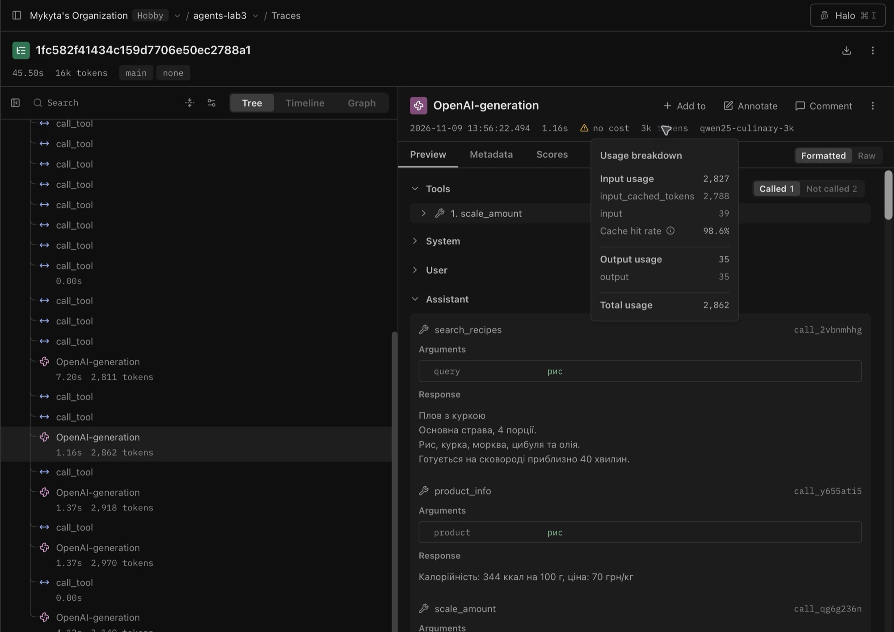
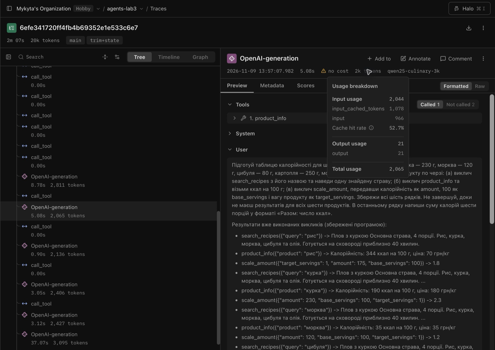

# Лабораторна робота № 4. Контекст, стан і кеш агента

- **Дисципліна:** Обчислювальні методи
- **Студент:** Антонович Микита, АІ-243
- **Варіант:** № 2 — Кулінарія
- **Рік:** 2026

## Мета та умови

Виміряти, як росте вхід агента на довгій задачі, що дає обрізання діалогу, як стан повертає моделі відкинуті результати та як кеш змінює вартість повторного прогону. Використано локальний Ollama, ту саму модель, що у ЛР3 (`qwen2.5:3b`), температуру 0 та незмінний системний запит.

| Властивість | Значення |
|---|---:|
| Номінальне вікно вихідної моделі (`context length`) | 32 768 |
| Початкове вікно `qwen25-culinary-4k` | 4 096 |
| Звуження відносно номінального вікна | 8× |
| Робоче вікно `qwen25-culinary-3k` | 3 072 |
| Звуження для основного експерименту | 10,67× |

Ліміт довгої задачі — 25 звернень до моделі, звичайних — 6. Використано три режими: `none` залишає всю історію, `trim` після 2150 вхідних токенів зберігає системний запит, питання та до шести останніх повідомлень без осиротілих результатів, `trim+state` також додає короткий запис успішних викликів. Повний результат пошуку зберігається в журналі та у файлі стану; у повідомлення зі станом виводиться до 120 символів кожного результату. Повторні записи з однаковими аргументами в стані не дублюються. Кеш вимкнено в усіх основних вимірюваннях. Ліміт генерації для моделі 3072 становив 640 токенів в усіх конфігураціях.

## Довга задача L1

Для кожного з шести продуктів агент має знайти рецепт у корпусі, прочитати калорійність на 100 г і перерахувати її на задану вагу. Наприкінці треба дати таблицю й загальну калорійність. Точний текст питання й еталон зафіксовано в [`long_task.json`](long_task.json); значення обчислено прямими викликами інструментів у [`make_task.py`](make_task.py), без моделі.

| Продукт | Вага, г | Ккал на 100 г | Ккал у порції |
|---|---:|---:|---:|
| Рис | 175 | 344 | 602 |
| Курка | 230 | 190 | 437 |
| Морква | 120 | 35 | 42 |
| Цибуля | 80 | 40 | 32 |
| Картопля | 250 | 77 | 192,5 |
| Молоко | 150 | 60 | 90 |
| **Разом** | | | **1 395,5** |

Потрібні щонайменше 18 доречних викликів інструментів. Крок моделі може містити кілька викликів, тому кількість кроків і кількість дій рахували окремо. У підсумковому CSV `right` означає збіг числа в рядку «Разом», а `complete` додатково вимагає щонайменше 18 успішних викликів; зміст викликів перевіряли в логах.

## Пробний прогін без захисту

У [початковому прогоні](logs/probe_none_4k_r1.log) вхід досяг 3688 токенів (90% вікна 4096), і модель завершилася. Це випадок C за методичкою. Для решти ЛР4 встановлено вікно 3072 й поріг стиснення 2150.

**Таблиця 2 — Зростання входу при 3072 токенах.** [Лог](logs/probe_none_r1.log).

| Крок | Вхідних токенів | Приріст | Дія моделі |
|---|---:|---:|---|
| 1 | 1084 | — | `search_recipes` × 7, `product_info` × 7, `scale_amount` × 7 |
| 2 | 2773 | +1689 | `scale_amount` |
| 3 | 2827 | +54 | `scale_amount` |
| 4 | 2883 | +56 | `scale_amount` |
| 5 | 2939 | +56 | `scale_amount` |
| 6 | 3039 | +100 | Фінальна відповідь |

Початковий вхід — **1084**, типовий приріст — **56** токенів. Сума входів — **15545**. Формула `n·C + d·n·(n−1)/2` дає **7344**. Перший пакет викликів додав кілька повних рецептів, тому припущення про рівний приріст не справдилося. Максимум — **3039** (98.9% вікна). На цьому прогоні скрипт не зафіксував зупинки росту або помилки сервера. Наприкінці модель відтворила повідомлення про помилку `target_servings` і не дала підсумку. Саме наближення до межі не доводить обрізання Ollama.

## Обрізання і стан

**Таблиця 3 — Пробні прогони при 3072 токенах.**

| Режим | Крок стиснення | Вхід до стиснення | Повідомлення до → після | Повторів за прогін |
|---|---:|---:|---|---:|
| `trim` | 2 | 2773 | 26 → 4 | 7 |
| `trim` | 8 | 2234 | 24 → 6 | 7 |
| `trim+state` | 2 | 2773 | 26 → 4 | 3 |

У першому блоці стану **18 записів** і приблизно **770 токенів**. Це більше за типовий приріст 56 токенів без стиснення. Записник повертає контекст, але додає власну вартість. У ньому лишаються також формально валідні перерахунки з неправильними для задачі аргументами.

## Кеш відповідей моделі

**Таблиця 4 — Холодний та теплий кеш.**

| Серія | Кроків | Влучань у кеш | Звернень до Ollama | Час, с | Правильна сума |
|---|---:|---:|---:|---:|:---:|
| [cache1](logs/cache1_none_r1.log) | 6 | 0 | 6 | 36,2 | ні |
| [cache2](logs/cache2_none_r1.log) | 6 | 6 | 0 | 0,2 | ні |

Теплий прогін виконався швидше приблизно в 181 разів, бо всі звернення до моделі замінив кеш. Кеш відтворив попередні відповіді. Зміна системної інструкції змінює хеш запиту. Зміна даних інструмента вплине на наступний ключ, коли нові дані потраплять в історію. Після заміни ваг під тією самою назвою кеш треба оновити.

## Основне вимірювання

**Таблиця 5 — Три повтори на режим, 3072 токени, кеш вимкнено.** [Сирі результати](results/main.csv).

| Режим | Правильно | Кроків | Токенів входу | Токенів виходу | Час, с | Стиснень | Повторів |
|---|---:|---:|---:|---:|---:|---:|---:|
| `none` | 0/3 | 6 | 15545 | 825 | 37,5 | 0 | 2 |
| `trim` | 0/3 | 11 | 18626 | 1056 | 60,3 | 2 | 8 |
| `trim+state` | 0/3 | 4 | 8065 | 700 | 37,6 | 1 | 4 |

Найменшу медіану входу дав `trim+state` (8065). Медіани часу `none` та `trim+state` майже збіглися (37,5 і 37,6 с). Перший `trim+state` тривав 127,2 с: два останні звернення досягли ліміту 640 вихідних токенів і прогін завершився за лімітом помилок. У 9 з 9 прогонів було менше 19 звернень до моделі. Модель може робити кілька викликів за один крок, тому перевірка також враховує зміст викликів. У пробах зустрічається підстановка ваги в `amount` і одиниці в `target_servings`, хоча задача вимагає підставити ккал на 100 г та вагу. Позитивні числа проходять валідацію, але результат не є потрібною калорійністю. У трьох повторах однієї задачі висновок про точність і час обмежений.

На кроці 3 після першого стиснення в `trim+state` було **2044** вхідних токенів. На тому самому кроці в `none` — **2827**. [Лог none](logs/main_none_r1.log) · [Лог trim+state](logs/main_trim%2Bstate_r1.log).

Перші повтори для `none` і `trim+state` виконано з трасуванням в оточенні `lab4`; саме ці вимірювання входять до табл. 5. Для всіх дев’яти рядків використано однакову модель і налаштування відповідного режиму. На обох рисунках відкрито статистику третього звернення. Langfuse показує вхід і вихід вузла, тому не потрібно шукати рядки стиснення та зіставляти номери кроків вручну. Показник `input_cached_tokens` стосується внутрішнього кешу Ollama. Кеш відповідей агента в обох повторах був вимкнений.

**Рисунок 1 — [Langfuse, режим `none`.](https://cloud.langfuse.com/project/cmvfb0h1m0akmad0jvla538t0/traces/1fc582f41434c159d7706e50ec2788a1)** Третє звернення використало **2827** вхідних токенів. У дереві видно попередні звернення до моделі та інструментів.

**Рисунок 2 — [Langfuse, режим `trim+state`.](https://cloud.langfuse.com/project/cmvfb0h1m0akmad0jvla538t0/traces/6efe341720ff4fb4b69352e1e533c6e7)** Після обрізання на кроці 2 третє звернення використало **2044** вхідні токени. У вході видно короткий список попередніх результатів, доданий до питання.

## Відповіді на питання

1. **Межа вікна.** У табл. 2 шостий крок мав 3039 із 3072 вхідних токенів. Агент завершився без суми й повторив повідомлення про помилку; журнал не підтверджує фактичне обрізання сервером.
2. **Ріст входу.** Сума 15545 проти оцінки 7344 у табл. 2. Перший пакет інструментів дав стрибок на 1689 токенів, тому сталий приріст 56 занижує оцінку.
3. **Втрата історії.** Після обрізання агент утрачає частину попередніх результатів. У [пробі `trim`](logs/probe_trim_r1.log) він повторив `scale_amount` з `amount=120`, `base_servings=4`, `target_servings=1.5`; короткий записник зменшив кількість повторів у пробі з 7 до 3 (табл. 3).
4. **Вартість і точність.** У табл. 5 режим `trim+state` мав найменшу медіану входу, а `none` — найменшу медіану часу з різницею лише 0,1 с. Правильної суми не дала жодна конфігурація; три повтори однієї задачі обмежують узагальнення.
5. **Кеш.** Кеш замінює звернення до Ollama, тому його вимкнено в табл. 5 і виміряно окремо в табл. 4. Зміна відповіді інструмента змінює історію та ключ наступного звернення; заміна ваг під тим самим ім'ям потребує оновлення кешу.
6. **Межі обрізання.** Обрізання не перевіряє одиниці, підстановку ваги й калорійності чи повноту фінальної відповіді. У [основному журналі](logs/main_none_r1.log) значення `amount=175` пройшло перевірку типу, хоча для рису там мало бути 344 ккал на 100 г.

## Висновок

У довгій задачі обрізання зі станом найбільше зменшило медіану вхідних токенів. Кеш мав найбільший ефект на час повторного запуску. Обрізання і стан змінюють розмір історії та кількість повторів, але не перевіряють, чи модель підставила правильні одиниці, використала всі результати і назвала суму. Для такого класу помилок доречні окремий інструмент для розрахунку калорійності порції та перевірка фінальної таблиці. Кеш корисний для повторних запусків. Він був вимкнений під час порівняння режимів.
