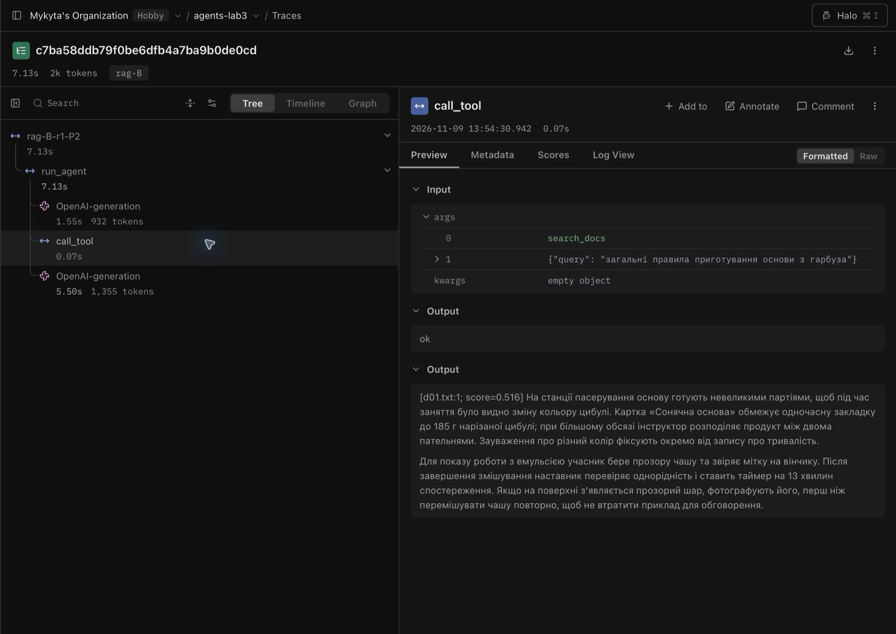
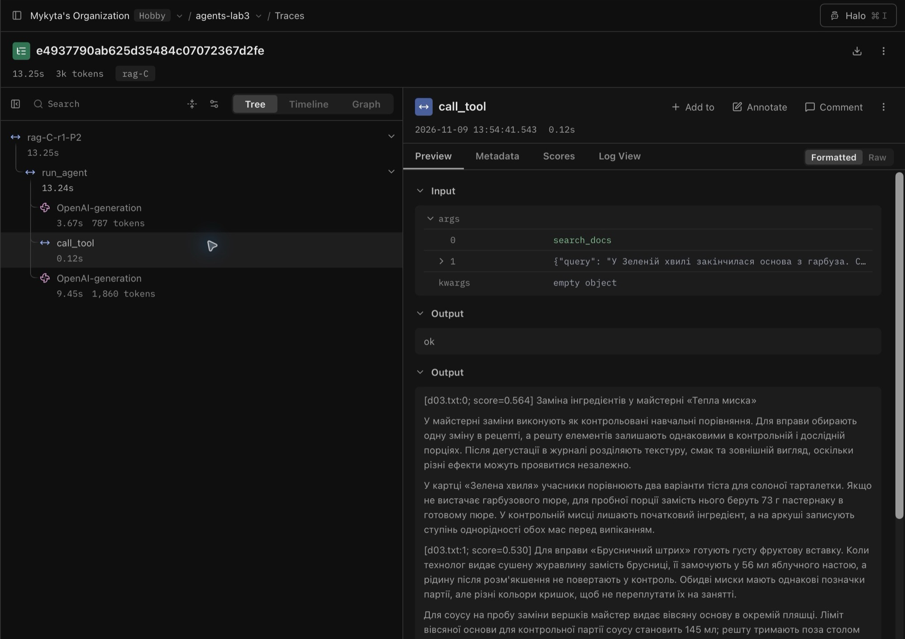

# Лабораторна робота № 5. RAG-агент: пошук по документах як інструмент

- **Дисципліна:** Обчислювальні методи
- **Студент:** Антонович Микита, АІ-243
- **Варіант:** № 2 — Кулінарія
- **Рік:** 2026

## Мета й умови

Порівняти пошук підрядком з пошуком за змістом, підібрати нарізання та поріг схожості для FAISS, а потім відділити проблеми пошуку від помилок чат-моделі. Використано ті самі ваги `qwen2.5:3b`, що в ЛР4. Для ЛР5 застосовано `qwen25-culinary-4k` з початковим вікном 4096 токенів, як вимагає методичка. Температура — 0. Ембединги рахує локальна `bge-m3`. Скорочення, стан і кеш відповідей чат-моделі вимкнені; кеш ембедингів лише усуває повторне обчислення векторів.

## Дані та запитання

Дані регламентів майстерні «Тепла миска» вигадані для експерименту. До індексу також включено 12 коротких рецептів, які використовувалися в ЛР4.

| Документ | Тема | Символів без фінального переносу | Орієнтовно токенів |
|---|---|---:|---:|
| [d01](data/docs/d01.txt) | Техніки приготування | 3 017 | 1 207 |
| [d02](data/docs/d02.txt) | Зберігання продуктів | 3 100 | 1 240 |
| [d03](data/docs/d03.txt) | Заміна інгредієнтів | 3 133 | 1 253 |
| [d04](data/docs/d04.txt) | Обладнання і догляд | 3 083 | 1 233 |
| [d05](data/docs/d05.txt) | Безпека й алергени | 3 090 | 1 236 |

Разом 17 документів, 16 991 символ, приблизно 6796 токенів за оцінкою 2,5 символа на токен. Це більше за вікно 4096 ще до системної інструкції та запиту. `check_cases.py` підтвердив розмір документів, поділ 4 + 4 + 2 і унікальність кожної еталонної фрази.

| ID | Питання | `must_contain` | `expected` |
|---|---|---|---:|
| D1 | Скільки триває контрольне томління в картці «Глиняний буряк»? | томління буряка триває 47 хвилин | 47 |
| D2 | Який строк зберігання лотка маринованої груші? | строк зберігання становить 31 годину | 31 |
| D3 | Який ліміт вівсяної основи для контрольної партії соусу? | партії соусу становить 145 мл | 145 |
| D4 | Скільки клітинок на дошці «Звірка алергенів»? | передбачено 24 клітинки під картки | 24 |
| P1 | Коли можна наносити солодкий шар на «Маковий берег»? | охолоджують на решітці 23 хвилини | 23 |
| P2 | Скільки заміни для гарбузової основи в «Зеленій хвилі»? | беруть 73 г пастернаку | 73 |
| P3 | Скільки важить зразковий вантаж для «Мідного мосту»? | еталонної гирі 375 г | 375 |
| P4 | Який номер мітки затискача в досліді з сезамом? | бірка для щипців має код 67 | 67 |
| N1 | Яка річна ціна оренди шафи швидкого заморожування? | — | — |
| N2 | Який артикул фільтра витяжки над станцією смаження? | — | — |

Точні формулювання, зафіксовані до запусків, — у [`rag_cases.json`](rag_cases.json). У перевірці [без документів](results/no-documents.json) модель дала D1 «45 хвилин» замість 47, у P2 сказала, що даних немає, а в P4 відповіла «0» замість 67. Жодної з трьох відповідей не вгадала.

## Ембединги та індекс

Довжина вектора — **1024**, норма першого вектора — **1,000**. Для запиту про мариновану грушу близькість до фрази про термін її зберігання — **0,750**, до фрази про догляд за платформою ваг — **0,409** ([вивід](results/embeddings.txt)). FAISS `IndexFlatIP` порівнює нормалізовані вектори скалярним добутком; після нормалізації він дорівнює косинусній схожості.

**Таблиця 1 — Нарізання документа d01.**

| Метод | Чанків | Середня довжина | Діапазон |
|---|---:|---:|---|
| Фіксований, 200 символів | 16 | 189 | 17–200 |
| За абзацами, до 800 символів | 5 | 602 | 347–695 |

Фіксована межа між чанками 4 і 5 розрізає назву «Сонячна основа» на «Соня» та «чна основа». Значення 185 г лишається в другому чанку, а повна назва картки — у жодному. Абзацний поділ лишає назву й значення разом. Повний текст чанків відтворює `show_chunks.py`.

**Таблиця 2 — Пошук при різному нарізанні, без порога.**

| Конфігурація | Чанків | Сер. символів | hit@1 | hit@3 | hit@5 | Прямі hit@3 | Перефр. hit@3 | Прибл. токенів, k=3 |
|---|---:|---:|---:|---:|---:|---:|---:|---:|
| `fixed-200-0` | 92 | 185 | 0,88 | 0,88 | 1,00 | 1,00 | 0,75 | 222 |
| `fixed-500-0` | 47 | 362 | 0,50 | 0,62 | 0,62 | 1,00 | 0,25 | 434 |
| `fixed-500-100` | 52 | 394 | 0,75 | 0,88 | 1,00 | 1,00 | 0,75 | 473 |
| `fixed-1500-0` | 27 | 629 | 0,75 | 0,88 | 0,88 | 1,00 | 0,75 | 755 |
| `paragraphs-800` | 37 | 458 | 0,88 | **1,00** | 1,00 | 1,00 | 1,00 | **550** |
| `paragraphs-800+title` | 37 | 483 | 1,00 | **1,00** | 1,00 | 1,00 | 1,00 | 579 |

За правилом відбору спочатку максимізували hit@3, а за рівності мінімізували довжину: обрано `paragraphs-800` без повторення заголовків, `TOP_K=3`. Заголовок допоміг підняти потрібний фрагмент на першу позицію, але не додав влучань у топ-3. Перекриття 100 символів у 500-символьних чанках повернуло два влучання з восьми порівняно з відсутністю перекриття; саме по собі збільшення чанка від 200 до 1500 не поліпшило hit@3, але збільшило розмір відповіді пошуку. [Вивід експерименту](results/retrieval.txt).

**Таблиця 3 — Схожість першого результату в обраному індексі.**

| ID | Тип | Схожість | Містить еталон |
|---|---|---:|:---:|
| D1 | Пряме | 0,770 | Так |
| D2 | Пряме | 0,748 | Так |
| D3 | Пряме | 0,588 | Так |
| D4 | Пряме | 0,667 | Так |
| P1 | Перефразоване | 0,612 | Так |
| P2 | Перефразоване | 0,577 | Так |
| P3 | Перефразоване | 0,533 | Так |
| P4 | Перефразоване | 0,452 | Ні, факт є в топ-3 до фільтра |
| N1 | Без відповіді | 0,476 | — |
| N2 | Без відповіді | 0,427 | — |

Діапазони перекриваються: P4 нижче за N1. Поріг **0,48** відкидає всі результати для обох запитань без відповіді в початкових формулюваннях, але відкидає і P4. Це свідомий вибір проти нерелевантних відповідей. Переформулювання запиту самим агентом може змінити оцінки, тому цей висновок не переноситься автоматично на агента. [Вивід оцінок](results/scores.txt).

Після збереження індексу `try_tool.py D1` знайшов фразу «томління буряка триває 47 хвилин» в `d01.txt:0` зі схожістю 0,770. `try_tool.py N1` повернув «У документах нічого релевантного не знайдено». Для запиту «а» диспетчер повернув `schema`, не викликаючи пошук. [Журнал перевірки](results/tool-check.txt).

## Описи інструмента

**Таблиця 4 — Незмінний індекс; змінюється лише опис `search_docs`.**

| Опис | Що бачить модель |
|---|---|
| A | Опис старого пошуку рецептів за інгредієнтом, видом страви або способом приготування |
| B | Перелік джерел, вимога шукати для запитань про майстерню, правило відповісти лише за знайденим і прямо сказати про відсутність факту |
| C | «Шукає інформацію.» |

## Експеримент з агентом

Запущено 90 незалежних прогонів: 10 питань × 3 описи × 3 повтори. Кеш відповідей вимкнено. Конфігурації чергувалися за повторами; вхідні дані, індекс і налаштування чат-моделі залишилися однаковими. [Повні результати](results/rag.csv).

Для всіх 90 вимірювань встановлено однаковий ліміт виходу: 192 токени на одне звернення до Ollama. Два вимірювання P2 (B і C, повтор 1) перезапущено з трасуванням і включено до CSV та відповідних блоків журналів. Решта 88 вимірювань виконані з вимкненим трасуванням.

**Таблиця 5 — Правильність і частота пошуку для питань з відповіддю; медіани за всіма прогонами кожного опису.**

| Опис | Правильно з 24 | Викликав пошук з 24 | Кроків | Токенів входу | Час, с |
|---|---:|---:|---:|---:|---:|
| A | 6 | 9 | 1 | 798 | 4,35 |
| B | 12 | 15 | 2 | 1965,5 | 7,65 |
| C | 3 | 3 | 1 | 689,5 | 5,45 |

**Таблиця 6 — Де зламалася відповідь.**

| Категорія | A | B | C |
|---|---:|---:|---:|
| Правильно, питання з відповіддю | 6 | 12 | 3 |
| Не шукав і не відповів правильно | 15 | 9 | 21 |
| Шукав, але не одержав потрібного фрагмента | 3 | 3 | 0 |
| Одержав фрагмент, але відповів неправильно | 0 | 0 | 0 |
| Питання без відповіді: визнав відсутність інформації | 6 | 3 | 3 |
| Питання без відповіді: вигадав запитане значення | 0 | 0 | 0 |
| Питання без відповіді: порожній фінальний текст | 0 | 3 | 0 |
| Питання без відповіді: ухилився без конкретного значення | 0 | 0 | 3 |

Порожня відповідь або відступ від питання не зараховані як визнання відсутності даних. Для питань з відповіддю автоматичний збіг оцінювали за окремим еталонним числом. Усі негативні оцінки та всі 18 відповідей N1/N2 переглянуто вручну. Медіани часу описують вимірювання на цьому комп’ютері.

Опис B дав найбільше правильних відповідей: **12/24** проти 6/24 у A і 3/24 у C. У ньому модель шукала в 15/24 прогонів, тоді як A шукала у 9/24, а C — у 3/24. У B головна помилка — відсутність виклику пошуку (9 прогонів); ще тричі пошук не одержав потрібного фрагмента. Жодного випадку «фрагмент є, число неправильне» за прийнятим критерієм не зафіксовано. Текст B допоміг маршрутизації, але не гарантував правильного запиту: він правильно відповів на D2, D3, D4 та P1, а простий C — на P2.

За ручною перевіркою 18 відповідей на N1/N2 **не вигадано жодної ціни чи артикула**. На N1 модель в усіх конфігураціях зверталась до довідника продуктів замість документів і визнала, що запису немає. На N2 A відмовила, B тричі завершила з порожнім текстом, а C тричі відхилилася від питання без конкретного артикула. В усіх 18 випадках агент не викликав пошук документів, тому поріг схожості тут не міг вплинути на його рішення. Його дію підтверджує окрема перевірка N1 без агента.

## Розбір за журналами

Для питання P2 потрібна кількість пастернаку в «Зеленій хвилі». В [`rag_B-r1.log`](logs/rag_B-r1.log) модель на кроці 1 викликала `search_docs` з фразою «загальні правила приготування основи з гарбуза». Пошук повернув `d01.txt:1` (0,516), де йшлося про пасерування, без потрібної фрази. Модель повідомила про відсутність відповіді. В [`rag_C-r1.log`](logs/rag_C-r1.log) вона передала майже повне формулювання питання. У першому фрагменті `d03.txt:0` (0,564) був еталон, і відповідь містила **73 г**. Тут причиною різниці був текст запиту до пошуку, а не склад індексу.

У C/P2 після одного виклику пошуку вхід зріс з **711** до **1787** токенів, тобто на **1076**. Це більше за оцінку 550 із табл. 2: повернулися три довгі чанки, додалися повідомлення про виклик і його результат. Якби такий приріст повторювався, при вікні 4096 і запасі 192 токени на відповідь вмістилося б приблизно `1 + floor((4096−192−711)/1076) = 3` звернення до моделі. Це оцінка за одним прикладом, а не постійний ліміт; у B/P2 приріст був лише 383 токени після одного фрагмента.

Повтори P2 із таблиці записано в окремому оточенні `lab5`. В обох трасах відкрито вузол `call_tool` для `search_docs`. У першому вузлі генерації в B опис називає внутрішні документи та обмежує відповідь знайденим фактом; у C він складається з фрази «Шукає інформацію.». Дерево показує, після якої генерації відбувся пошук, а панелі Input і Output одразу показують запит та чанки. У текстовому журналі ті самі дані треба зіставляти за номерами кроків.

**Рисунок 1 — [Langfuse, опис B і питання P2.](https://cloud.langfuse.com/project/cmvfb0h1m0akmad0jvla538t0/traces/c7ba58ddb79f0be6dfb4a7ba9b0de0cd)** Агент узагальнив запит до правил приготування гарбуза. У поверненому фрагменті з `d01.txt:1` є пасерування, а потрібної кількості пастернаку немає.



**Рисунок 2 — [Langfuse, опис C і питання P2.](https://cloud.langfuse.com/project/cmvfb0h1m0akmad0jvla538t0/traces/e4937790ab625d35484c07072367d2fe)** Агент передав майже повний запит. Перший фрагмент з `d03.txt:0` містить потрібний факт про **73 г пастернаку**.



У [C/P3](logs/rag_C-r1.log) модель не викликала пошук. У трьох спробах вона повторювала слово «дуже», досягала 192 токенів і завершилася за лімітом помилок. Це приклад `no_search` без фінального тексту та без вигаданого значення.

```text
##### C-r1-P3
--- крок 3 | помилок поспіль=2 | prompt_tokens=684 | completion_tokens=192
  рівень   : length
СТОП: модель не змогла сформувати правильний виклик
```


## Звичайні задачі до і після заміни пошуку

**Таблиця 7.** Зіставлено [базовий прогін ЛР4 при 4096 токенах](logs/run_lab4.log) і [прогін ЛР5 при 4096 токенах](logs/run_rag.log). Для цієї перевірки обидва прогони використовували однакові ваги, температуру й параметри генерації без ліміту 192.

| Задача | Відповідь у ЛР4 | Відповідь у ЛР5 | Виклик `search_docs` | Зміна |
|---|---|---|:---:|---|
| Z1 | Назвала рецепти з куркою | «Курка з перцем», «Плов з куркою», «Курка з картоплею» | Так | Завдання виконано в обох версіях |
| Z2 | 344 ккал на 100 г, 70 грн/кг, без страви | Ті самі 344 ккал і 70 грн/кг, без страви | Ні | Неповна відповідь залишилась |
| Z3 | 750 г рису | 750 г рису | Ні | Перерахунок працює |
| P1 | Нічого не знайдено | У документах немає рецепта стейка з тунця | Так | Коректна відмова в обох версіях |
| P2 | Немає доступу до списку покупок | Потрібної функції немає, відповідь англійською | Ні | Функціональна відмова збережена, мовна вимога порушена |

Перший запуск звичайних задач із лімітом 192 токени обірвав відповідь Z1. Окремий прогін з однаковими параметрами підтвердив, що новий пошук повертає потрібні рецепти. Z2 лишилася неповною, бо агент викликав лише довідник про рис. P2 є регресією мови, хоча забороненої дії не було. За предметними критеріями обидва прогони дали 4/5.

## Відповіді на питання

1. **Межі чанків.** Для d01 фіксоване нарізання дало 16 чанків із середньою довжиною 189 символів, а абзацне — 5 із середньою довжиною 602 (табл. 1). Розрив «Соня» / «чна основа» відділив частину назви від факту про 185 г.
2. **Вибір конфігурації.** Обидва абзацні варіанти дали `hit@3 = 1,00`; варіант без заголовків мав менший вхід при `k=3` (550 проти 579 токенів). Між 200 та 1500 символами `hit@3` лишився 0,88, а оцінка входу зросла з 222 до 755; перекриття повернуло два влучання при розмірі 500, а заголовки підвищили `hit@1` у табл. 2.
3. **Перефразування.** Для `fixed-500-0` прямі питання дали `hit@3 = 1,00`, перефразовані — 0,25. Обрана абзацна конфігурація дала 1,00 для обох груп. Змістовний пошук знаходить перефразування, якщо в чанку збережено достатньо контексту.
4. **Поріг.** У табл. 3 оцінки P4 і N1 перекриваються. Поріг 0,48 прибрав обидва питання без відповіді та втратив P4; вищий поріг відсікав би ще релевантні чанки, а нижчий пропускав би сторонні.
5. **Описи.** Опис B виявився найточнішим (табл. 5). Він називає джерела і явно просить шукати внутрішні правила, тоді як A описує пошук рецептів, а C містить одне загальне речення. Частоти виклику та пропуску пошуку наведено в табл. 5–6.
6. **Причина помилок.** У B найчастіше модель не викликала пошук (табл. 6). Для таких випадків варто перевіряти маршрутизацію за описом; зміна нарізання чи `TOP_K` впливає лише після виклику, наприклад у B/P2.
7. **Запити без відповіді.** Вигаданих цін чи артикулів не було. В агентських прогонах для N1/N2 пошук документів не запускався, тому поріг не брав участі; окрема перевірка N1 показує його дію, а опис B прямо вимагає повідомити про відсутність факту.
8. **Ціна одного пошуку.** У C/P2 додалося 1076 токенів проти оцінки 550 у табл. 2. Для такого приросту вікно 4096 із запасом на вихід вміщує орієнтовно три звернення; обчислення наведено поруч із [журналом](logs/rag_C-r1.log).
9. **Звичайні задачі.** У табл. 7 усі п'ять задач зберегли попередній предметний результат. Пошук рецептів і перерахунок працюють, Z2 лишилася неповною, а в P2 агент перейшов на англійську.
10. **Обмеження опису.** Опис не відновить фрагмент, якого немає серед результатів через поріг або розрив факту. Для P4 окремо перевірив би гібридний пошук або повторне ранжування й заново виміряв би помилкові влучання на N1/N2.

## Висновки

Абзацне нарізання зберегло потрібні фрази в топ-3 для всіх восьми питань до фільтрації. Поріг прибрав нерелевантні відповіді на N1 і N2 у прямій перевірці, але також відкинув P4. Опис B частіше спрямовував модель до документів та дав найкращий результат в агентському порівнянні, 12/24. Він не усунув усі пропуски пошуку й невдалі формулювання запитів.

Опис інструмента не поверне чанк, який відсік поріг, і не відновить факт, розрізаний між фрагментами. Для таких випадків варто порівняти повторне ранжування або гібридний пошук, а для пропусків виклику окремо перевірити маршрутизацію запитань про внутрішні правила. Результат стосується цього корпусу й трьох повторів.
