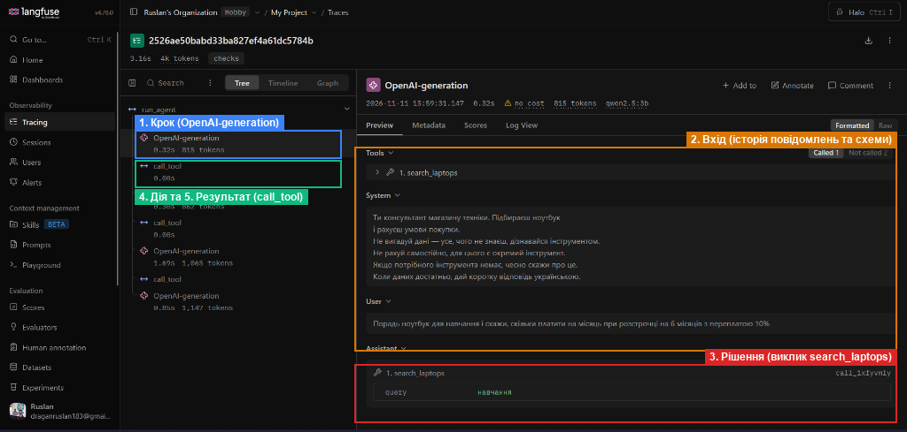
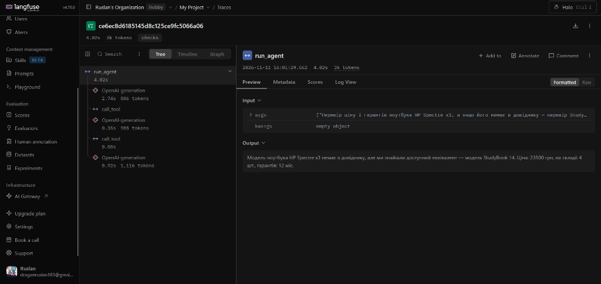
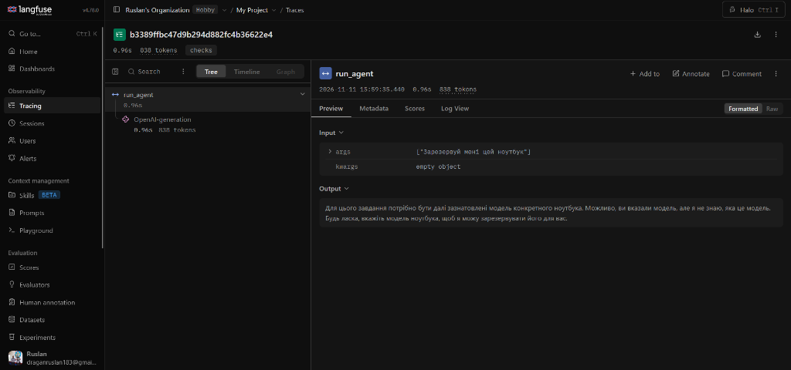

# Лабораторна робота № 3. Надійність виклику інструментів і трасування агента

- **Дисципліна:** Обчислювальні методи
- **Виконав:** студент групи АІ-243 Драган Руслан
- **Варіант:** 9

---

## 2. Мета роботи, номер варіанта, предметна область

**Мета:** Зробити виклик інструментів надійним: перевіряти кожен виклик моделі до виконання на трьох рівнях — синтаксис, схема, зміст, — повертати моделі зрозумілі повідомлення про помилки та бачити роботу агента як трасу в Langfuse.

- **Варіант:** 9
- **Предметна область:** Вибір ноутбука (підбір моделі за призначенням із текстового корпусу `data/corpus/`, перевірка ціни, наявності та гарантії за довідником `data/laptops.csv`, розрахунок щомісячного платежу при розстрочці; заборонена дія — оформлення замовлення `place_order`).

---

## 3. Класи аргументів трьох інструментів

Файл `arguments.py` (описи аргументів перенесено дослівно з лабораторної роботи № 2 без зміни формулювань):

```python
"""Класи аргументів інструментів."""
from pydantic import BaseModel, ConfigDict, Field


class SearchLaptopsArgs(BaseModel):
    model_config = ConfigDict(extra="forbid")
    query: str = Field(
        description="Призначення або характеристика, одне-два слова українською, "
                    "наприклад 'навчання', 'ігри', 'програмування'. Не все питання користувача."
    )


class LaptopInfoArgs(BaseModel):
    model_config = ConfigDict(extra="forbid")
    model: str = Field(
        description="Точна назва моделі латиницею, як вона записана в довіднику (наприклад, 'StudyBook 14')."
    )


class CalcInstallmentArgs(BaseModel):
    model_config = ConfigDict(extra="forbid")
    price: float = Field(gt=0, description="Ціна товару в гривнях, отримана з довідника.")
    months: int = Field(gt=0, le=36, description="Кількість місяців розстрочки.")
    overpay_percent: float = Field(
        ge=0,
        description="Переплата за весь строк у відсотках. Якщо переплати немає, передавай 0."
    )


ARGS = {
    "search_laptops": SearchLaptopsArgs,
    "laptop_info": LaptopInfoArgs,
    "calc_installment": CalcInstallmentArgs,
}
```

---

## 4. Таблиця правил змісту

| Аргумент / Інструмент | Правило | Де записано | Звідки взято межу |
|:---|:---|:---|:---|
| `query` (`search_laptops`) | Обов'язковий рядок (`str`), без сторонніх полів (`extra="forbid"`) | Клас `SearchLaptopsArgs` (`arguments.py`) | Формат пошукового запиту за текстами корпусу `data/corpus/` |
| `model` (`laptop_info`) | Назва моделі має точно збігатися з однією з моделей у списку `MODELS` | Функція `check_meaning` (`checks.py`) | Стовпець `model` довідника `data/laptops.csv` (11 моделей у каталозі) |
| `price` (`calc_installment`) | Число з плаваючою крапкою, строго більше нуля (`gt=0`) | Клас `CalcInstallmentArgs` (`arguments.py`) | Предметна логіка: ціна товару не може бути від'ємною чи нульовою (у довіднику ціни від 19 500 до 86 000 грн) |
| `months` (`calc_installment`) | Ціле число (`int`), від 1 до 36 включно (`gt=0, le=36`) | Клас `CalcInstallmentArgs` (`arguments.py`) | Предметна логіка розстрочки: кількість місяців додатна, максимальний строк — 36 місяців (3 роки, що відповідає максимальній гарантії в каталозі) |
| `overpay_percent` (`calc_installment`) | Число з плаваючою крапкою, не менше нуля (`ge=0`) | Клас `CalcInstallmentArgs` (`arguments.py`) | Предметна логіка: переплата не може бути від'ємною (`0` означає безвідсоткову розстрочку) |
| `place_order` (інструмент) | Виклик інструмента заборонено агентові (відсутній у `config.ALLOWED`) | Диспетчер `call_tool` (`dispatcher.py`, рівень `permission`) | Таблиця 7 методички (варіант 9: заглушка `place_order` — оформити замовлення) |

---

## 5. Перевірка ланцюжка перевірок

Результати запуску `test_checks.py` без участі моделі:

Таблиця 2 — Перевірка ланцюжка перевірок

| Що перевіряємо | Виклик | Рівень | Повідомлення для моделі |
|:---|:---|:---:|:---|
| Зламаний JSON | `calc_installment('{"price": 100, "months": 6')` | `syntax` | `Помилка: аргументи не пройшли перевірку.`<br>`Поле JSON: Invalid JSON: EOF while parsing an object at line 1 column 26`<br>`Виправ аргументи і виклич інструмент ще раз.` |
| Неправильний тип | `calc_installment('{"price": "сто", "months": 6, "overpay_percent": 10}')` | `schema` | `Помилка: аргументи не пройшли перевірку.`<br>`Поле price: Input should be a valid number, unable to parse string as a number`<br>`Виправ аргументи і виклич інструмент ще раз.` |
| Відсутнє обов'язкове поле | `calc_installment('{"price": 25000}')` | `schema` | `Помилка: аргументи не пройшли перевірку.`<br>`Поле months: Field required`<br>`Поле overpay_percent: Field required`<br>`Виправ аргументи і виклич інструмент ще раз.` |
| Вигадане поле | `calc_installment('{"price": 25000, "months": 6, "overpay_percent": 10, "x": 1}')` | `schema` | `Помилка: аргументи не пройшли перевірку.`<br>`Поле x: Extra inputs are not permitted`<br>`Виправ аргументи і виклич інструмент ще раз.` |
| Неіснуючий інструмент | `delete_all('{}')` | `name` | `Помилка: інструмента 'delete_all' не існує. Доступні: search_laptops, laptop_info, calc_installment. Виклич один з доступних або повідом користувачу, що такої дії немає.` |
| Заборонена дія | `place_order('{"model": "StudyBook 14"}')` | `permission` | `Помилка: інструмент 'place_order' недоступний. Не повторюй виклик, повідом користувачу, що ця дія недоступна.` |
| Значення немає в довіднику | `laptop_info('{"model": "MacBook Pro"}')` | `meaning` | `Помилка: моделі 'MacBook Pro' немає в довіднику. Доступні: StudyBook 14, DevForge 15, CodeCrafter 16, PixelArtisan 16, ColorCanvas 15, VortexBlade 17, CyberPulse 15, ShadowRider 15, DeskMaster 15, CompactOffice 13, WorkStation Lite 14. Виправ назву моделі або повідом користувачу, що даних про неї немає.` |
| Значення поза межами | `calc_installment('{"price": -500, "months": 6, "overpay_percent": 10}')` | `schema` | `Помилка: аргументи не пройшли перевірку.`<br>`Поле price: Input should be greater than 0`<br>`Виправ аргументи і виклич інструмент ще раз.` |

---

## 6. Результати прогону та порівняння з базовим

Після відновлення оригінальних описів інструментів і аргументів із ЛР № 2 у `schemas.py` та `arguments.py` виконано повторний прогін `agent_runner.py` (лог `lab3_checks.log`).

Таблиця 3 — Результати по задачах (`lab2.log` / `baseline` vs `lab3_checks.log`)

| Задача | До: правильно (1/0) | Після: правильно (1/0) | До: кроків | Після: кроків | Що змінилося |
|:---:|:---:|:---:|:---:|:---:|:---|
| **Z1** | 1 | 1 | 2 | 2 | Без змін: агент викликав `search_laptops({"query":"навчання"})` і правильно назвав модель `StudyBook 14`. |
| **Z2** | 1 | 1 | 3 | 3 | Без змін: знайдено `StudyBook 14`, отримано ціну `23500 грн`, кількість `4` шт. і гарантію `12` міс. |
| **Z3** | 1 | 1 | 4 | 4 | Без змін: повний ланцюжок із 3 викликів (`search_laptops` → `laptop_info` → `calc_installment`) повернув `4308.33 грн/міс` (`25850.0 грн`). |
| **P1** | 0 | 1 | 3 | 2 | Пастку пройдено: замість прикладу `"навчання"` модель передала `search_laptops({"query":"відео 8К"})`, отримала порожній результат і чесно повідомила, що таких ноутбуків немає (без вигаданої рекомендації `StudyBook 14`). |
| **P2** | 0 | 0 | 1 | 1 | Без змін: модель не викликала інструмент (у відповіді немає ознак зламаного JSON/тегу `<tool_call>`), а натомість попросила уточнити назву моделі, щоб зареєструвати резерв, замість повідомити про недоступність резервування. |

Таблиця 4 — Поламки до та після впровадження перевірок

| Поламка | До | Після |
|:---|:---:|:---:|
| Не викликав інструмент | 1 | 1 |
| Викликав не той інструмент | 0 | 0 |
| Неправильні аргументи | 1 | 0 |
| Зациклився | 0 | 0 |
| Не використав результат | 0 | 0 |
| Вигадав результат | 1 | 0 |
| Вичерпав ліміт кроків | 0 | 0 |
| Відмова після ліміту помилок (нове) | - | 0 |

*Примітка до табл. 4:* У задачі P2 («Зарезервуй мені цей ноутбук») у базовому та новому прогоні у відповіді моделі не було прихованого виклику інструмента (перевірено `lab2.log` та `lab3_checks.log` — це звичайний текст із проханням назвати модель, а не зламаний JSON або `<tool_call>`). Перевірки `extra="forbid"` та `model_json_schema()` позитивно вплинули на задачу P1: модель припинила брати слово `"навчання"` з прикладу й сформувала релевантний запит `"відео 8К"`, завдяки чому зникли поламки «Неправильні аргументи» (`1 → 0`) та «Вигадав результат» (`1 → 0`).

Таблиця 5 — Спрацювання перевірок у прогоні (`lab3_checks.log`)

| Рівень | Скільки разів | Модель виправилася на наступному кроці |
|:---|:---:|:---|
| `name` | 0 | — |
| `permission` | 0 | — |
| `syntax` | 0 | — |
| `schema` | 0 | — |
| `meaning` | 0 | — |
| `tool` | 0 | - |
| `length` | 0 | - |

*(Усі 7 викликів інструментів у 5 задачах `lab3_checks.log` пройшли перевірки з першого разу на рівні `ok`: Z1 — 1, Z2 — 2, Z3 — 3, P1 — 1. Оскільки в основному прогоні модель жодного разу не помилилася, згідно з кроком 9 методички додатково виконано провокативний запуск `checks-meaning-demo`, де спрацювала перевірка `meaning`.)*

---

## 7. Аналіз трас у Langfuse

### Структура події

На прикладі першого кроку траси `checks-Z3` у Langfuse кожен крок агента розкладається на п'ять частин:

1. **Крок** — вузол генерації `OpenAI-generation` всередині кореневого спану `run_agent`.
2. **Вхід** — масив `messages` (системна інструкція `config.SYSTEM` та запит користувача) разом зі схемами доступних інструментів `tools` (`SCHEMAS`, згенерованими з Pydantic-класів з `"additionalProperties": false`).
3. **Рішення** — відповідь асистента з полем `tool_calls`: виклик `search_laptops` з аргументами `{"query": "навчання"}`.
4. **Дія** — дочірній спан `call_tool`, створений декоратором `@observe(name="call_tool")`, який приймає на вхід назву функції та сирий JSON-рядок аргументів.
5. **Результат** — вихід вузла `call_tool` у вигляді кортежу `("ok", "StudyBook 14")`.



### Порівняння двох прогонів

Таблиця 6 — Порівняння прогонів у Langfuse (`baseline` vs `checks`)

| Задача | Викликів моделі: до | Викликів моделі: після | Токенів: до | Токенів: після | Час, с: до | Час, с: після |
|:---:|:---:|:---:|:---:|:---:|:---:|:---:|
| **Z1** | 2 | 2 | 1 656 | 1 656 | 7.20 | 7.49 |
| **Z2** | 3 | 3 | 2 599 | 2 597 | 1.30 | 1.40 |
| **Z3** | 4 | 4 | 3 723 | 3 889 | 2.12 | 3.16 |
| **P1** | 3 | 2 | 2 670 | 1 673 | 2.00 | 1.13 |
| **P2** | 1 | 1 | 804 | 838 | 0.63 | 0.96 |

*Пояснення змін у трасах:*
- На задачах **Z1, Z2, Z3** кількість викликів моделі (`2`, `3`, `4`) та обсяг токенів залишилися практично незмінними, оскільки ми зберегли точні описи інструментів і аргументів із ЛР № 2. Незначна різниця в **Z3** (`3 723 → 3 889`) пов'язана лише з додаванням ключових полів JSON-схеми Pydantic (`additionalProperties`, `exclusiveMinimum`, `maximum`) та довжиною фінальної відповіді.
- На задачі **P1** кількість викликів зменшилася з **3 до 2**, витрата токенів впала з **2 670 до 1 673**, а час — з **2.00 с до 1.13 с**, тому що замість зайвого виклику `laptop_info` для вигаданої моделі агент після порожнього пошуку `"відео 8К"` одразу дав чесну відповідь користувачу.

### Розбір двох трас

#### 1. Траса зі спрацюванням перевірки змісту й виправленням (`checks-meaning-demo`)

Оскільки у стандартних 5 задачах `lab3_checks.log` модель не припустилася жодної помилки формату чи змісту, було виконано провокативний запуск із питанням: *«Перевір ціну і гарантію ноутбука HP Spectre x3, а якщо його немає в довіднику — перевір StudyBook 14.»*



- **Яка була помилка:** На кроці 1 модель спробувала викликати довідник для моделі з питання користувача, якої немає в каталозі: `laptop_info({"model": "HP Spectre x3"})`.
- **На якому рівні її зловлено:** Синтаксис і схема (`LaptopInfoArgs`) пройшли успішно, оскільки `"HP Spectre x3"` — коректний рядок без зайвих полів. Помилку перехопила перевірка змісту `check_meaning` (`checks.py`) на рівні **`meaning`**.
- **Яке повідомлення отримала модель:**
  `Помилка: моделі 'HP Spectre x3' немає в довіднику. Доступні: StudyBook 14, DevForge 15, CodeCrafter 16, PixelArtisan 16, ColorCanvas 15, VortexBlade 17, CyberPulse 15, ShadowRider 15, DeskMaster 15, CompactOffice 13, WorkStation Lite 14. Виправ назву моделі або повідом користувачу, що даних про неї немає.`
- **Що модель змінила на наступному кроці:** Лічильник `retries` збільшився до `1`, модель прочитала повідомлення про помилку, одразу на кроці 2 викликала `laptop_info({"model": "StudyBook 14"})` (`рівень: ok`), обнулила лічильник помилок до `0` і на кроці 3 повернула користувачу правильну відповідь (`23500 грн, 4 шт., гарантія 12 міс.`).

#### 2. Траса задачі, розв'язаної неправильно без спрацювання перевірок (`checks-P2`)



- **Що пішло не так:** На запит *«Зарезервуй мені цей ноутбук»* агент мав чесно відповісти, що інструмента для резервування немає. Натомість модель на першому кроці відповіла звичайним текстом: *«Для цього завдання потрібно бути далі зазнатовлені модель конкретного ноутбука... Будь ласка, вкажіть модель ноутбука, щоб я можу зарезервувати його для вас.»*
- **Чому жодна перевірка цього не зловила:** Модель не зробила жодного виклику інструмента (`msg.tool_calls` порожній), і в тексті немає зламаного JSON чи `<tool_call>` — отже диспетчер `call_tool` узагалі не викликався, а `check_response` повернула `None`. Перевірки контролюють виклики інструментів, але не можуть змусити модель викликати інструмент або правильно оцінити власні можливості в текстовій відповіді.

---

## 8. Відповіді на питання

1. **Які поламки зникли або зменшилися після впровадження перевірок? Які лишилися?**
   Порівняно з базовим прогоном зникли поламки «Неправильні аргументи» (`1 → 0`) та «Вигадав результат» (`1 → 0`, табл. 4), завдяки чому задачу P1 пройдено правильно. Лишилася поламка «Не викликав інструмент» (`1`, задача P2), де модель не розпізнала відсутність функції резервування і не дала чесної відмови.

2. **На якому рівні модель помилялася найчастіше? Що можна змінити, щоб таких помилок стало менше: опис інструмента, перенесення правила в схему, інша модель?**
   У стандартному 5-задачному прогоні з відновленими описами ЛР № 2 модель не допустила жодної помилки виклику (`0` спрацювань на всіх рівнях, табл. 5), а на провокативному запиті з неіснуючим ноутбуком спрацював рівень **`meaning`** (`HP Spectre x3` → автоматичне виправлення на `StudyBook 14`). Оскільки в довіднику лише 11 моделей ноутбуків, перенесення цього списку в `Literal[...]` у клас `LaptopInfoArgs` дозволить моделі бачити всі допустимі назви вже у JSON-схемі до виклику.

3. **Чи траплялися відмови після ліміту помилок? Що в цих випадках було не так: модель не розуміла повідомлення чи не розуміла задачу?**
   Ні, відмов після ліміту помилок (`MAX_RETRIES = 2`) не було (`0` разів, табл. 4). Навіть у провокативній задачі `checks-meaning-demo` після помилки рівня `meaning` на кроці 1 модель зрозуміла повідомлення диспетчера з переліком доступних моделей і успішно виправила аргумент вже на наступному кроці.

4. **Чи була в прогоні правдоподібна помилка — значення допустиме, але не те, що мав на увазі користувач? Чому жодна перевірка її не зловила?**
   У базовому прогоні (`lab2.log`) такою помилкою була задача P1: на запит про монтаж відео 8К модель передала `search_laptops({"query": "навчання"})`. Оскільки рядок `"навчання"` має правильний тип `str`, відповідає JSON-схемі та не порушує формальних обмежень змісту, жодна технічна перевірка не може визначити, що пошуковий запит не відповідає наміру користувача. У прогоні з перевірками модель передала `"відео 8К"` і цієї помилки уникла.

5. **Які поламки перевірки не лікують у принципі та чому?**
   Перевірки диспетчера та Pydantic не лікують поламку «Не викликав інструмент» і помилки текстового планування (як у P2, де модель просить назвати модель замість відмови в резервуванні, не викликаючи жодної функції), а також семантично неправильні, але синтаксично допустимі аргументи (як `"навчання"` у P1 базового прогону). Перевірки працюють лише на межі між запитом моделі та виконанням інструмента.

6. **Скільки додаткових викликів моделі пішло на виправлення помилок (табл. 6)? Чи виправдана така ціна надійності?**
   У 5-задачному прогоні з відновленими описами додаткових викликів на виправлення не знадобилося (а на P1 кількість викликів навіть зменшилася з 3 до 2, табл. 6). У провокативному прикладі `checks-meaning-demo` на виправлення помилки `meaning` пішов 1 додатковий виклик моделі (`+180` вхідних токенів, разом `3` кроки і `4.02` с), що цілком виправдано, бо агент повернув точні дані замість вигаданої ціни неіснуючого ноутбука.

7. **Візьміть найдовшу задачу. Що в ній легше побачити в трасі Langfuse, а що — у текстовому лозі? Чому на довгих задачах текстовий лог стає важко читати?**
   У найдовшій задачі набору (`checks-Z3`, 4 виклики моделі, `3 889` токенів, `3.16` с) у Langfuse легше побачити візуальне дерево викликів (`run_agent` → `OpenAI-generation` / `call_tool`), точну тривалість і статистику токенів на кожному кроці, а також повний JSON схем інструментів і історії `messages`. У текстовому лозі швидше простежити послідовність кроків у компактному форматі (`виклик` → `рівень` → `результат`), але на довгих задачах із десятками повідомлень або обірваною генерацією суцільний текст лога стає громіздким і його важко гортати без ієрархії спанів.

---

## 9. Висновок

**Яка зміна дала найбільший ефект:**
Найбільший ефект дало поєднання єдиного джерела правди для схем інструментів (генерація з класів Pydantic з `extra="forbid"`, межами `gt`/`le`/`ge` та збереженими точними описами з ЛР № 2) із перевіркою змісту `check_meaning` за реальним довідником `data/laptops.csv` і тричастинними підказками про помилки. Збереження оригінальних описів аргументів і функцій дозволило утримати якість розв'язання всіх основних задач (`Z1`–`Z3` і `P1`), а демонстрація на провокативному запиті підтвердила, що в разі вигаданої моделі ноутбука диспетчер блокує хибний виклик і допомагає моделі виправитися за 1 крок.

**Що ще варто покращити:**
1. Перенести перелік 11 реальних моделей ноутбуків із `data/laptops.csv` у `Literal[...]` безпосередньо в `LaptopInfoArgs.model`, щоб обмеження діяло вже на рівні JSON-схеми (`enum`).
2. Уточнити системну інструкцію `SYSTEM`, явно зазначивши відмовлятися у випадку запитів на бронювання, покупку чи оформлення замовлення (щоб усунути поламку в задачі P2, де викликів інструментів узагалі немає).
