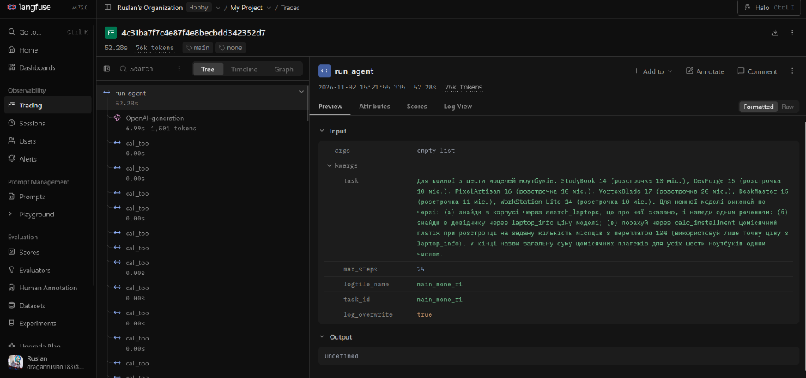
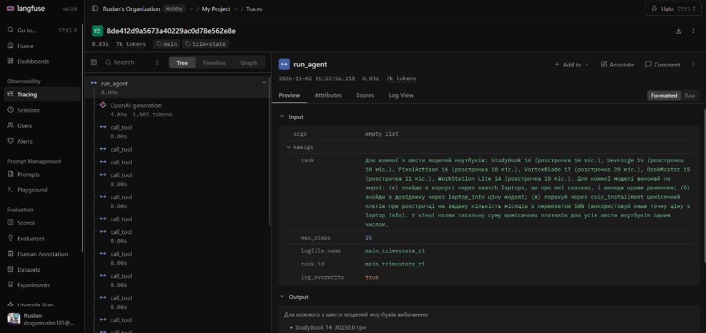

# Лабораторна робота № 4. Контекст, стан і кеш агента

- **Дисципліна:** Обчислювальні методи
- **Виконав:** студент групи АІ-243 Драган Руслан
- **Варіант:** 9

---

## 2. Мета роботи, варіант, предметна область, модель і розмір вікна

**Мета:** Зробити так, щоб агент працював на довгій задачі у вузькому контекстному вікні: дослідити зростання входу на кожному кроці, запровадити скорочення історії (`trim`), окремий стан задачі (`TaskState`) та кеш викликів моделі (`cache`), і порівняти їх за вартістю в токенах, часом і точністю.

- **Варіант:** 9
- **Предметна область:** Вибір ноутбука (підбір ноутбука за текстовим корпусом `data/corpus/`, перевірка ціни, наявності та гарантії за довідником `data/laptops.csv`, розрахунок щомісячного платежу при розстрочці `calc_installment`).
- **Модель та параметри контекстного вікна (Крок 1 і Крок 4):**
  1. **Початкова модель з `config.py`:** `qwen2.5:3b`, розмір вікна за замовчуванням (`ollama show qwen2.5:3b`) — **`32768`** токенів.
  2. **Новий розмір вікна (`num_ctx`):** спочатку у Кроці 1 створено модель `qwen25-4k` з вікном **`4096`** токенів, а у Кроці 4 (відповідно до випадку C пункту 7) зменшено `num_ctx` до **`3072`** токенів (модель `qwen25-3k`).
  3. **У скільки разів звузили вікно:** для `4096` — у **`8`** разів (`32768 / 4096 = 8`); для робочого вікна `3072` — у **`10.67`** раза (`32768 / 3072 ≈ 10.67`).

Перевірка на коротких задачах із лабораторної роботи № 3 (`python agent_runner.py`, лог `logs/run_lab3.log` / `logs/lab4.log`) показала, що всі 5 коротких задач (`Z1`–`Z3`, `P1`–`P2`) вільно вміщуються у зменшене вікно (максимальний вхід `prompt_tokens = 682`).

---

## 3. Довга задача: питання і правильна відповідь (Крок 2)

Для довгої задачі (`make_task.py` → `long_task.json`, `min_calls = 18`) обрано 6 моделей ноутбуків із різними строками розстрочки при переплаті `10%`:

| № | Модель ноутбука | Ціна в `data/laptops.csv`, грн | Строк розстрочки, міс. | Переплата, % | Щомісячний платіж (`calc_installment`), грн/міс. |
|--:|:----------------|-------------------------------:|-----------------------:|-------------:|-------------------------------------------------:|
| 1 | `StudyBook 14` | 23 500 | 10 | 10 | 2 585.0 |
| 2 | `DevForge 15` | 58 000 | 10 | 10 | 6 380.0 |
| 3 | `PixelArtisan 16` | 53 000 | 10 | 10 | 5 830.0 |
| 4 | `VortexBlade 17` | 86 000 | 20 | 10 | 4 730.0 |
| 5 | `DeskMaster 15` | 27 500 | 11 | 10 | 2 750.0 |
| 6 | `WorkStation Lite 14` | 19 500 | 10 | 10 | 2 145.0 |
| **Разом** | **6 моделей** | — | — | — | **24 420.0** |

**Текст питання (`QUESTION` у `long_task.json`):**

> Для кожної з шести моделей ноутбуків: StudyBook 14 (розстрочка 10 міс.), DevForge 15 (розстрочка 10 міс.), PixelArtisan 16 (розстрочка 10 міс.), VortexBlade 17 (розстрочка 20 міс.), DeskMaster 15 (розстрочка 11 міс.), WorkStation Lite 14 (розстрочка 10 міс.). Для кожної моделі виконай по черзі: (а) знайди в корпусі через search_laptops, що про неї сказано, і наведи одним реченням; (б) знайди в довіднику через laptop_info ціну моделі; (в) порахуй через calc_installment щомісячний платіж при розстрочці на задану кількість місяців з переплатою 10% (використовуй лише точну ціну з laptop_info). У кінці назви загальну суму щомісячних платежів для усіх шести ноутбуків одним числом.

**Правильна відповідь (`expected` у `long_task.json`, обчислена функцією `compute()` без участі моделі):** **`24420`** (`2585 + 6380 + 5830 + 4730 + 2750 + 2145 = 24420`).

---

## 4. Розбір пробного прогону без захисту (Крок 4)

Результати виконання `python analyze.py logs\probe_none_r1.log steps` при вікні `NUM_CTX = 3072`:

Таблиця 2 — Зростання входу в прогоні без захисту (`logs/probe_none_r1.log`)

| Крок | `prompt_tokens` | Приріст | Що зробила модель |
|-----:|----------------:|--------:|:------------------|
| 1 | 1042 | | `search_laptops`, `laptop_info`, `calc_installment` × 5 моделей (15 викликів: 10 `ok`, 5 `meaning`) |
| 2 | 2898 | 1856 | `search_laptops({"query":"WorkStation Lite 14"})`, `laptop_info({"model":"WorkStation Lite 14"})`, `calc_installment({"months":10,"overpay_percent":10,"price":27500})` |
| 3 | 2918 | 20 | `search_laptops({"query":"WorkStation Lite 14"})`, `laptop_info({"model":"WorkStation Lite 14"})`, `calc_installment({"months":10,"overpay_percent":10,"price":19500})` |
| 4 | 2875 | -43 | `search_laptops({"query":"WorkStation Lite 14"})`, `laptop_info({"model":"WorkStation Lite 14"})`, `calc_installment({"overpay_percent":0,"price":19500,"months":12})` |
| 5 | 2949 | 74 | `search_laptops({"query":"WorkStation Lite 14"})`, `laptop_info({"model":"WorkStation Lite 14"})`, `calc_installment({"months":12,"overpay_percent":0,"price":19500})` |
| 6 | 3006 | 57 | `search_laptops({"query":"WorkStation Lite 14"})`, `laptop_info({"model":"WorkStation Lite 14"})`, `calc_installment({"overpay_percent":0,"price":19500,"months":12})` |
| 7 | 3064 | 58 | `search_laptops({"query":"WorkStation Lite 14"})`, `laptop_info({"model":"WorkStation Lite 14"})`, `calc_installment({"overpay_percent":0,"price":19500,"months":12})` |
| 8 | 2997 | -67 | `search_laptops({"query":"WorkStation Lite 14"})`, `laptop_info({"model":"WorkStation Lite 14"})`, `calc_installment({"months":12,"overpay_percent":0,"price":19500})` |
| 9 | 3025 | 28 | `search_laptops({"query":"WorkStation Lite 14"})`, `laptop_info({"model":"WorkStation Lite 14"})`, `calc_installment({"months":12,"overpay_percent":0,"price":19500})` |
| 10 | 3064 | 39 | `search_laptops({"query":"WorkStation Lite 14"})`, `laptop_info({"model":"WorkStation Lite 14"})`, `calc_installment({"months":12,"overpay_percent":0,"price":19500})` |
| 11 | 3063 | -1 | `search_laptops({"query":"WorkStation Lite 14"})`, `laptop_info({"model":"WorkStation Lite 14"})`, `calc_installment({"price":19500,"months":12,"overpay_percent":0})` |
| 12–25 | 3063 | 0 | На кожному з кроків 12–25 ті самі 3 виклики для `WorkStation Lite 14` (плато `3063` токенів до `step_limit`) |

### Визначені показники за `analyze.py`:

- **(а) Постійна частина входу («вхід першого кроку», `C`):** **`1042`** токенів (системна інструкція `SYSTEM`, схеми трьох інструментів `SCHEMAS` і текст запитання `QUESTION`).
- **(б) Типовий (медіанний) приріст за крок (`d`):** **`57`** токенів (у прогонах `main_none_r1..3` — **`75`** токенів).
- **(в) Сума `prompt_tokens` за прогін і значення за формулою:**
  - Фактична сума `prompt_tokens` за 25 кроків: **`73 783`** токенів.
  - Очікування за лінійною формулою `n * C + d * n * (n - 1) / 2`: **`43 150`** токенів.
  - **Чому числа сильно відрізняються:** На кроці 1 модель одразу згенерувала пакет із 15 викликів інструментів, через що між кроками 1 і 2 вхід стрибнув на `+1856` токенів (`1042 → 2898`), майже миттєво заповнивши вікно `3072`. Через це всі наступні 24 кроки проходили біля самої стелі вікна (`~2900–3064` токенів), тоді як формула використовує медіанний приріст `d = 57` токенів (який є малим саме тому, що на кроках 12–25 приріст дорівнював `0` через обрізання вікна сервером). Якби ми підставили реальний середній крок пакету, без обрізання сума росла б квадратично понад `100 000+` токенів.
- **(г) Крок, на якому вхід перестав рости:** крок **`4`** (`prompt_tokens` зменшився з `2918` до `2875`, приріст `-43`), після чого на кроці 7 досяг `3064` (`100%` вікна `3072`), а з кроку 11 до кроку 25 зафіксувався на плато **`3063`** токенів (приріст `0`).
- **(д) Що робила модель на трьох кроках після кроку (г) (кроки 5, 6, 7):**
  Модель зациклилася і на кроках 5, 6 і 7 (а потім і до кроку 25) **повторювала ті самі три виклики** для останнього ноутбука зі списку: `search_laptops({"query":"WorkStation Lite 14"})`, `laptop_info({"model":"WorkStation Lite 14"})` та `calc_installment({"months":12,"overpay_percent":0,"price":19500})`. Оскільки на кроці 4 сервер Ollama мовчки відрізав початок історії (де лежало запитання користувача з переліком перших п'яти ноутбуків та умовою про 10% переплати і 10 місяців), модель бачила лише останні повідомлення про `WorkStation Lite 14` (у довіднику якого написано `гарантія: 12 міс.`) і підставляла `months=12, overpay_percent=0`. До фінальної текстової відповіді агент узагалі не дійшов (`СТОП: вичерпано ліміт кроків` на кроці 25).

### Віднесення до випадку A–D:

Прогін належить до **Випадку B — «Сервер мовчки обрізає вхід» (тиха обрізка)**:
- На кроці 1 ми перевірили поведінку при `NUM_CTX = 4096` (де задача була закороткою — випадок C, тому вікно було зменшено до `NUM_CTX = 3072`).
- При `NUM_CTX = 3072` `analyze.py` показав: `найбільший вхід: 3064 токенів (100% вікна 3072)`, `вхід перестав рости на кроці: 4`, статус `step_limit`. Сервер Ollama не повернув помилки HTTP, але викинув початок діалогу (запитання користувача), через що агент втратив мету задачі й зациклився.

---

## 5. Обрізання історії та стан задачі (Кроки 5 і 6)

Для вікна `NUM_CTX = 3072` встановлено поріг `COMPRESS_AT = 2150` та `KEEP_LAST = 6`. Результати пробних прогонів `probe_trim_r1` і `probe_trim+state_r1`:

Таблиця 3 — Стиснення історії (`logs/probe_trim_r1.log` та `logs/probe_trim+state_r1.log`)

| Конфігурація | Крок стиснення | Вхід до стиснення, токенів | Повідомлень було -> стало | Повторних викликів за прогін |
|:-------------|:--------------:|---------------------------:|:-------------------------:|-----------------------------:|
| `trim` | 2 | 2898 | `22 -> 6` | 6 |
| `trim+state` | 2 | 2898 | `22 -> 6` | 0 |

### Аналіз блоку стану після стиснення (Пункт 7 кроку 6)

У файлі `logs/probe_trim+state_r1.log` після стиснення на кроці 2 записано блок `ПЕРШЕ ПОВІДОМЛЕННЯ КОРИСТУВАЧА ПІСЛЯ СТИСНЕННЯ`:

1. **Кількість рядків виду `- інструмент(аргументи) -> результат`:** **`13` рядків** (усі успішні виклики з рівнем `ok` за кроки 1–2: 6 викликів `search_laptops`, 6 викликів `laptop_info` та 1 успішний виклик `calc_installment`; 5 помилкових викликів `calc_installment` із рівнем `meaning` у стан не записувалися).
2. **Розмір блоку стану та порівняння з типовим приростом:**
   - Текст записника `state.render()` містить **`2 269` символів** (разом із початковим питанням користувача перше повідомлення має `2 885` символів).
   - За оцінкою `2,5` символа на токен сам блок стану займає приблизно **`908` токенів** (`2269 / 2.5 ≈ 908` токенів), а вхід на кроці 3 після стиснення становить `2 415` токенів (проти `1 370` токенів у `trim` без стану, тобто фактично за токенізатором моделі блок стану додав `2415 - 1370 = 1045` токенів).
   - Порівняно з медіанним приростом одного малого кроку з кроку 4 (`57`–`75` токенів за крок з 3 викликами), блок стану із 13 результатів є помітним (~13–15 одиночних кроків), але порівняно з реальним обсягом відкинутих повідомлень кроку 1 (`1856` токенів приросту) він **майже вдвічі компактніший** завдяки обрізанню довгих текстів корпусу функцією `shorten(..., STATE_RESULT_CHARS=200)` і не перевищує вікно `3072` (`2415 < 3072`).

---

## 6. Робота кешу викликів моделі (Крок 7)

Перед запуском серії `cache1` каталог `cache/` було очищено, після чого послідовно виконано два однакові прогони `cache1_none_r1` та `cache2_none_r1`:

Таблиця 4 — Робота кешу (`logs/cache1_none_r1.log` та `logs/cache2_none_r1.log`)

| Запуск | Кроків | Влучань у кеш | Викликів до сервера | Час, с | Правильно |
|:-------|-------:|--------------:|--------------------:|-------:|:---------:|
| 1 (кеш порожній, `cache1`) | 25 | 0 | 25 | 54.0 | ні |
| 2 (той самий запит, `cache2`) | 25 | 25 | 0 | 1.1 | ні |

### Висновки щодо роботи кешу (Пункт 7 кроку 7):

1. **Прискорення:** Другий запуск (`1.1` с, з яких сам цикл агента в лозі виконався менш ніж за `0.1` с, а решта часу пішла на `flush()` клієнта Langfuse) виконався у **`49.1` раза швидше** за перший запуск (`54.0` с), або **практично миттєво**, оскільки всі 25 відповідей моделі було прочитано з локальних JSON-файлів у `cache/` (`0` звернень до сервера Ollama).
2. **Що сталося б при зміні `SYSTEM` у `config.py` перед запуском 2:** Рядок `SYSTEM` входить до першого повідомлення списку `messages` (`{"role": "system", "content": config.SYSTEM}`), який передається у `make_key(request)`. Оскільки ключ кешу обчислюється як `sha256` від повного JSON-тексту запиту (`model`, `messages`, `tools`, `temperature`), зміна бодай одного символу в `SYSTEM` повністю змінить хеш `sha256` уже на кроці 1. У результаті влучань у кеш буде **`0`**, і всі виклики знову підуть на сервер моделі.

---

## 7. Основне вимірювання і траси в Langfuse (Крок 8)

Виконано серію `python measure.py all 3 main` (по 3 повтори для кожної з трьох конфігурацій: `none`, `trim`, `trim+state`, кеш вимкнено).

Таблиця 5 — Вартість циклу в трьох конфігураціях (медіани по трьох повторах, серія `main`)

| Конфігурація | Правильно (з 3) | Кроків | Токенів на вхід | Токенів на вихід | Час, с | Стиснень | Повторних викликів |
|:-------------|:---------------:|-------:|----------------:|-----------------:|-------:|---------:|-------------------:|
| `none` | 0 з 3 | 25 | 73 744 | 2 425 | 50.3 | 0 | 64 |
| `trim` | 0 з 3 | 5 | 9 162 | 771 | 8.6 | 1 | 6 |
| `trim+state` | 0 з 3 | 3 | 6 355 | 714 | 8.0 | 1 | 0 |

### Приховані поламки у логах `logs/main_*.log` (Пункт 5 кроку 8)

Перевірка всіх 9 прогонів основної серії `logs/main_*.log` (а також 3 пробних `probe_*_r1.log`, разом 12 прогонів) виявила поламки, яких не видно лише з колонки «Правильно»:

1. **Агент відповів, зробивши менше 19 кроків / не виконавши всі 18 успішних викликів (`status = final` достроково):**
   Сталося у **3 із 9 прогонів серії `main`** (або у **4 із 12 прогонів** разом із `probe`) — у всіх прогонах конфігурації **`trim+state`** (`main_trim+state_r1..3`, `probe_trim+state_r1`), де агент завершив роботу на **3-му кроці**. Хоча модель зробила загалом 18 викликів інструментів (15 на кроці 1 і 3 на кроці 2), 5 викликів `calc_installment` на кроці 1 були відхилені перевіркою змісту `meaning` (оскільки модель підставила вигадані ціни `8000`, `9000`, `10000`, `11000`, `9500` до отримання результату `laptop_info`). Після стиснення на кроці 2 повідомлення про помилки `meaning` були обрізані функцією `trim`, а в `TaskState` записалися лише 13 успішних викликів (`ok`), тому на кроці 3 модель вирішила, що всі розрахунки вже завершено, і одразу видала фінальну відповідь.
2. **Агент назвав число, якого не було в жодному рядку `результат:` цього лога (вигадав результат):**
   Сталося у **3 із 9 прогонів серії `main`** (усі 3 прогони **`trim+state`**, або **4 із 12** разом із `probe_trim+state_r1`). У лозі був лише один успішний результат розстрочки: `3025.0 грн на місяць, усього 30250.0 грн`, проте у фінальній відповіді на кроці 3 модель вигадала платежі для решти ноутбуків (`120500.0 грн`, `172000.0 грн`, `256000.0 грн`, `181500.0 грн`) і назвала вигадану суму `120500.0 грн`.
3. **Інші поламки (не дійшов до відповіді):**
   - У всіх прогонах **`none`** (3 із 9 у `main`, 4 із 12 загалом) агент зупинився за **`step_limit` (25 кроків)** через тиху обрізку вікна сервером і зациклення (`64` повторні виклики).
   - У всіх прогонах **`trim`** (3 із 9 у `main`, 4 із 12 загалом) агент зупинився на **5-му кроці за `retry_limit`** (`СТОП: модель не змогла сформувати правильний виклик`), оскільки після обрізання історії забув попередні кроки й на кроках 3, 4 і 5 поспіль помилявся в `calc_installment` (`6` повторних викликів).

### Порівняння трас у Langfuse (Пункт 6 кроку 8)

#### Дерево траси `long-main_none_r1` (без стиснення)

#### Дерево траси `long-main_trim+state_r1` (обрізання + стан задачі)

#### Порівняння вхідних токенів після стиснення:
- У прогоні **`main_trim+state_r1`** стиснення відбулося наприкінці **кроку 2** (`вхід був 2898, повідомлень 22 -> 6`). Перший виклик моделі після стиснення — це **крок 3**: його вхід у `main_trim+state_r1` становить **`2 415` токенів** (зменшення на `483` токени порівняно з кроком 2).
- На тому самому **кроці 3** у прогоні **`main_none_r1`** вхід становить **`2 918` токенів** (і далі продовжує битися у стелю вікна `3070` токенів протягом ще 22 кроків).
- **Що в трасі Langfuse видно одразу, а в текстовому лозі довелося б рахувати вручну:** У Langfuse в дереві траси одразу видно загальну кількість токенів і сумарну тривалість усього прогону (`76 169` токенів і `52.3` с у `none` проти `7 069` токенів і `8.03` с у `trim+state`), час виконання кожного окремого спану `OpenAI-generation` та `call_tool`, а також точний масив `messages`, який реально надійшов на вхід моделі після обрізання `trim` і додавання `TaskState`.

---

## 8. Відповіді на питання

1. **На якому кроці агент без захисту дійшов до межі вікна і як ви це побачили (таблиця 2, пункти (г) і (д) кроку 4)? Що в його поведінці змінилося після цього?**
   Агент без захисту (`none`) впритул наблизився до межі вікна `3072` вже на кроці 3 (`2918` токенів), а на **кроці 4** сервер уперше мовчки обрізав початок історії, через що `prompt_tokens` замість зростання впав на `-43` токени (`2875`), після чого на кроках 11–25 застиг на плато `3063`–`3070` токенів (`100%` вікна, табл. 2). Оскільки сервер викинув початок розмови разом із запитанням користувача, агент утратив перелік перших п'яти ноутбуків та умови розстрочки й зациклився, повторюючи на кроках 4–25 одні й ті самі виклики для останньої моделі `WorkStation Lite 14` (`64`–`65` повторних викликів).

2. **Порівняйте суму `prompt_tokens` за прогін із формулою (пункти (а)-(в) кроку 4). Чи збігається зростання з очікуваним?**
   Фактична сума `prompt_tokens` за прогін `probe_none_r1` склала **`73 783`** токени, тоді як формула `n * C + d * n * (n - 1) / 2` дала **`43 150`** токенів (у `main_none_r1..3` — `73 744` проти `48 550`). Розходження пояснюється двома чинниками: по-перше, на кроці 1 модель викликала одразу 15 інструментів, тому на кроці 2 вхід стрибнув на `+1856` токенів (від `1042` до `2898`), а по-друге, починаючи з кроку 4 зростання перестало бути лінійним і вперлося в стелю вікна `NUM_CTX = 3072`, через що медіанний приріст `d` штучно знизився до `57`–`75` токенів.

3. **Що втрачає агент при обрізанні? Наведіть приклад повторного виклику після стиснення. Що змінилося в `trim+state` (таблиці 3 і 5)?**
   При простому обрізанні (`trim`) агент втрачає всі повідомлення між першими двома (`system`, `user`) та останніми `KEEP_LAST = 6`, тобто забуває, які інструменти вже викликав і які результати отримав. Наприклад, у `probe_trim_r1` та `main_trim_r1` після стиснення на кроці 2 (`22 -> 6`) вхід на кроці 3 впав до `1370` токенів, і модель повторно викликала `search_laptops({"query":"DeskMaster 15"})` та `laptop_info({"model":"DeskMaster 15"})`, а на кроках 4–5 повторила виклики для `VortexBlade 17` і `PixelArtisan 16` (`6` повторних викликів, табл. 3). У конфігурації `trim+state` результати всіх успішних викликів (`ok`) збереглися у записнику `TaskState` і дописалися до запитання користувача, завдяки чому кількість повторних викликів впала з **`6` до `0`** (табл. 3, табл. 5).

4. **Яка конфігурація найдешевша за токенами, найшвидша, найточніша (таблиця 5)? Чому висновок за трьома повторами однієї задачі обережний?**
   За таблицею 5 найдешевшою за токенами та найшвидшою виявилася конфігурація **`trim+state`** (`6 355` вхідних і `714` вихідних токенів, `8.0` с, `3` кроки, `0` повторних викликів — в 11.6 раза дешевше за токенами на вхід і в 6.3 раза швидше за `none`). Формальна точність за кінцевим числом `24420` у всіх трьох конфігураціях становить `0 з 3`, проте тільки `trim+state` дійшла до фінальної відповіді (`status = final`), тоді як `none` вичерпала ліміт кроків (`step_limit`), а `trim` зупинилася за лімітом помилок (`retry_limit`). Висновок за трьома повторами однієї задачі при `TEMPERATURE = 0` є обережним, бо детермінована генерація повторює ту саму траєкторію помилок моделі на конкретному формулюванні питання, і на інших задачах або при іншому порядку викликів співвідношення може змінитися.

5. **Чому під час вимірювання вартості кеш вимкнено? Що станеться з кешем, якщо інструмент поверне інші дані або ви замініть модель під тією самою назвою?**
   Під час основного вимірювання (`main`) кеш вимкнено тому, що при `TEMPERATURE = 0` другий і третій повтори мають ідентичні вхідні запити й брали б відповіді з файлів `cache/` за `~0` с без реального звернення до сервера, що спотворило б вимірювання часу й стабільності моделі. Якщо інструмент поверне інші дані, зміниться вміст повідомлення з роллю `"tool"` в історії `messages`, тому на наступному кроці хеш `sha256` (`make_key`) зміниться і кеш коректно не спрацює (промах кешу). Натомість якщо перестворити модель в Ollama під тією самою назвою (наприклад, змінити `Modelfile` для `qwen25-3k`), ім'я моделі в запиті не зміниться, і кеш віддасть **застарілі відповіді** від старої конфігурації моделі, тому в такому разі теку `cache/` потрібно очищувати вручну.

6. **Які поламки довгого прогону скорочення історії не лікує в принципі?**
   Скорочення історії (`trim` і `trim+state`) не лікує помилки планування та логіки самої моделі: по-перше, коли модель намагається викликати залежний інструмент (`calc_installment`) одночасно з пошуковими в одному кроці й підставляє вигадані ціни до отримання результату `laptop_info`; по-друге, коли модель галюцинує числа у фінальній відповіді або неправильно додає шість чисел усно без інструмента додавання. Крім того, оскільки `TaskState` зберігає лише успішні виклики (`ok`), після обрізання історії модель втрачає пам'ять про невдалі виклики (`meaning`) і може передчасно завершити роботу, не перерахувавши позиції, які завершилися помилкою на відкинутих кроках.

---

## 9. Висновок

**Що з трьох способів (скорочення, стан, кеш) дало найбільший ефект:**
- Для **працездатності та вартості циклу у вузькому вікні (`3072` токени)** найбільший ефект дало **поєднання обрізання історії зі станом задачі (`trim+state`)**: воно зменшило витрату вхідних токенів в **11.6 раза** (`з 73 744 до 6 355` токенів) і час виконання у **6.3 раза** (`з 50.3 с до 8.0 с`), повністю усунувши як тиху обрізку вікна сервером (`none`), так і повторні виклики вже виконаних інструментів (`6 -> 0` порівняно з чистим `trim`).
- Для **повторних запусків під час налагодження** величезний ефект дав **кеш викликів моделі (`cache`)**: скоротив час повторного прогону з `54.0` с до `1.1` с (у **49 разів**), повністю знявши навантаження з сервера.

**Що ще варто змінити для підвищення точності на довгій задачі:**
1. **Заборонити пакетний виклик залежних інструментів в один крок або зберігати в `TaskState` список невиконаних підзадач:** щоб після стиснення на кроці 2 модель бачила у записнику не лише успішні виклики `search_laptops` і `laptop_info`, а й те, для яких саме з 6 ноутбуків ще НЕ обчислено `calc_installment`.
2. **Додати окремий інструмент сумування (або дозволити калькулятор `add`):** мала модель `qwen2.5:3b` помиляється при усному додаванні шести чотиризначних чисел у фінальній відповіді, тому наявність інструмента для підрахунку підсумкової суми дозволить уникнути арифметичних галюцинацій на останньому кроці.
