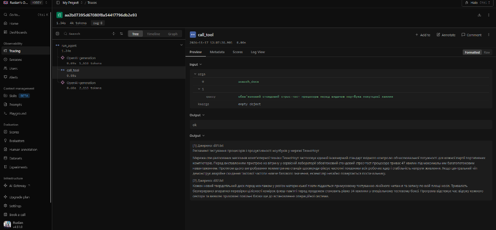
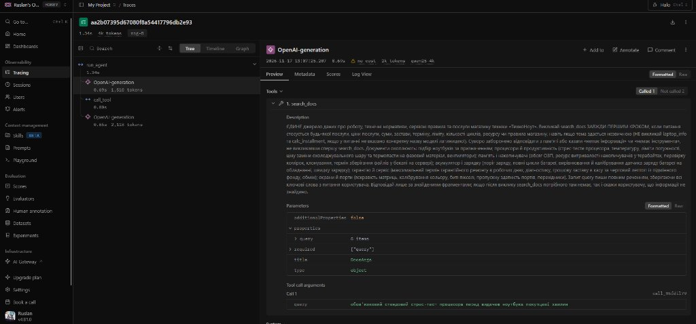
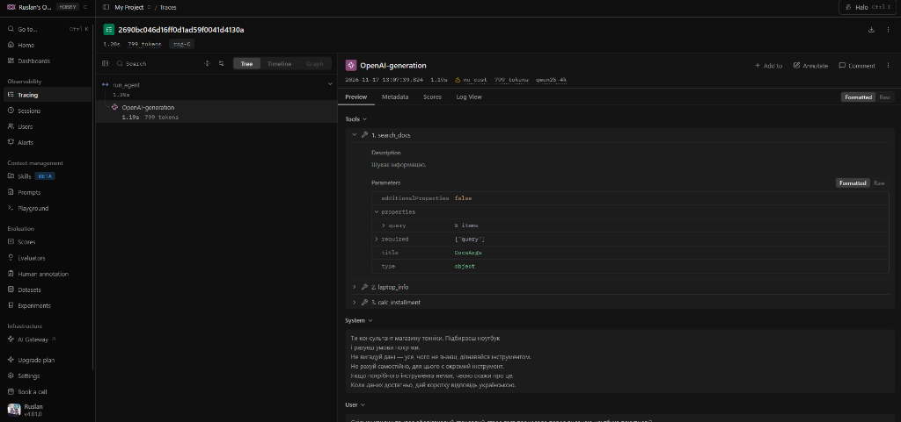

**з лабораторної роботи № 5**
на тему: **«RAG-агент: пошук по документах як інструмент»**
з дисципліни: **«Обчислювальні методи»**

**Виконав:** студент групи АІ-243 Драган Руслан
**Варіант:** № 9 («Вибір ноутбука»)


---

## 2. Мета роботи та параметри середовища

**Мета роботи:** замінити примітивний пошук підрядком із лабораторної роботи № 2 векторним пошуком на базі ембедингів і FAISS; під'єднати його до агента як звичайний інструмент `search_docs`; перевірити якість пошуку окремо від агента (`hit@k` для 6 способів нарізання та підбір порога `MIN_SCORE`); дослідити вплив розміру чанка та тексту опису інструмента (`A`, `B`, `C`) на поведінку агента у трьох повторах і розібрати за логами та трасами Langfuse причини помилок.

* **Номер варіанта:** 9
* **Предметна область:** Вибір ноутбука (мережа магазинів комп'ютерної техніки та сервісних центрів «ТехноНоут»)
* **Модель чату (`MODEL`):** `qwen25-4k` (на базі локальної моделі `qwen2.5:3b` в Ollama, `TEMPERATURE = 0`)
* **Розмір контекстного вікна (`NUM_CTX`):** `4096` токенів (`COMPRESS = "none"`, `USE_STATE = False`, `USE_CACHE = False`)
* **Модель ембедингів (`EMBED_MODEL`):** `bge-m3` (розмірність вектора `1024`)

---

## 3. Дані: документи корпусу та контрольні питання

До 12 коротких карток моделей ноутбуків у `data/corpus/` (`l01.txt`–`l12.txt`) додано 5 довгих регламентних документів мережі «ТехноНоут» у каталозі `data/docs/` (`d01.txt`–`d05.txt`) за темами варіанта 9 (табл. 8 методичних вказівок):

1. `d01.txt` — **Регламент тестування процесорів і продуктивності ноутбуків у мережі ТехноНоут** (`3964` символи, 7 абзаців + заголовок; містить фіксовані числові нормативи: `47` хв, `83` °C, `115` Вт, `390` грн, `640` об/хв, `27` %, `19` міс.).
2. `d02.txt` — **Правила конфігурування оперативної пам'яті та твердотільних накопичувачів у мережі ТехноНоут** (`3735` символів, 7 абзаців + заголовок; нормативи: `96` ГБ, `280` грн, `740` ТБ, `34` хв, `68` °C, `530` грн, `42` дні).
3. `d03.txt` — **Інструкція з експлуатації акумуляторних батарей і блоків живлення ноутбуків у мережі ТехноНоут** (`3557` символів, 7 абзаців + заголовок; нормативи: `85` %, `620` циклів, `78` %, `23` %, `460` грн, `53` хв, `140` Вт).
4. `d04.txt` — **Положення про гарантійне обслуговування та сервісний ремонт ноутбуків у мережі ТехноНоут** (`3991` символ, 7 абзаців + заголовок; нормативи: `11` робочих днів, `89` год, `310` грн, `1750` грн, `29` днів, `580` грн, `67` днів).
5. `d05.txt` — **Стандарти перевірки дисплеїв, матриць і зовнішніх портів ноутбуків у мережі ТехноНоут** (`3610` символів, 7 абзаців + заголовок; нормативи: `430` кд/м², `92` %, `520` грн, `240` грн, `6` субпікселів, `38` Гбіт/с, `73` мм).

### Обсяг корпусу (`python check_cases.py`)

```text
Документів: 17; символів: 22148; приблизно токенів: 8859 (вікно 4096)
Питань: 10 ({'direct': 4, 'paraphrase': 4, 'none': 2})
Усе гаразд
```

Сумарний обсяг усіх 17 документів становить **22 148 символів** (приблизно **8 859 токенів** з розрахунку 2,5 символа на токен), що більш ніж удвічі перевищує розмір вікна моделі (`4096` токенів), тому покласти весь корпус у контекст неможливо.

### Список 10 питань (`rag_cases.json`)

| ID | Вид (`kind`) | Питання (`question`) | Дослівна фраза (`must_contain`) | Очікувана відповідь (`expected`) | Джерело |
|---|---|---|---|---|---|
| `D1` | `direct` | Скільки хвилин триває обов'язковий стендовий стрес-тест процесора перед видачею ноутбука покупцеві? | `стрес-тест процесора триває 47 хвилин` | `47` | `d01.txt` |
| `D2` | `direct` | Скільки терабайтів перезаписаних даних становить мінімальний гарантований ресурс витривалості для основних системних накопичувачів? | `витривалості становить 740 терабайтів` | `740` | `d02.txt` |
| `D3` | `direct` | Скільки повних циклів заряджання та розряджання витримує штатна акумуляторна батарея ноутбука? | `витримує 620 повних циклів` | `620` | `d03.txt` |
| `D4` | `direct` | Скільки робочих днів становить максимальний термін виконання безоплатного гарантійного ремонту? | `ремонту становить 11 робочих` | `11` | `d04.txt` |
| `P1` | `paraphrase` | Яка ціна заміни стандартного охолоджувального шару на чипі лептопа на новий фазовий матеріал у майстерні? | `відділі становить 390 гривень` | `390` | `d01.txt` |
| `P2` | `paraphrase` | Протягом скількох діб після апгрейду диска можна відновити свої старі файли зі страхового бекапу на сервері? | `центру протягом 42 днів` | `42` | `d02.txt` |
| `P3` | `paraphrase` | Скільки коштуватиме вирівнювання показників датчика заряду батареї ноутбука на спеціальному обладнанні? | `стенді коштує 460 гривень` | `460` | `d03.txt` |
| `P4` | `paraphrase` | Яку грошову заставу треба внести в касу, щоб узяти черговий лептоп магазину, поки власний ремонтують? | `суму в розмірі 1750 гривень` | `1750` | `d04.txt` |
| `N1` | `none` | Скільки коштує послуга лазерного гравіювання українських літер на клавіатурі ноутбука? | `null` | `null` | — |
| `N2` | `none` | Який відсоток знижки надається студентам при здачі старого планшета за програмою трейд-ін? | `null` | `null` | — |

### Перевірка «чи вгадує модель без документів»

Три питання (`D1`, `D2`, `P1`) було поставлено моделі `qwen25-4k` напряму без доступу до документів та інструментів:

* **Питання `D1` (очікується `47`):** *«Скільки хвилин триває обов'язковий стендовий стрес-тест процесора перед видачею ноутбука покупцеві?»*
  * **Відповідь моделі без документів:** *«Видача ноутбуків на ринку включає обмежений період тестування, де виконується багато критеріїв, включаючи тести процесора. Однак конкретний час, який виконується стендовий стрес-тест процесора, не є обов'язковим стандартом для всіх компаній або моделей ноутбуків...»* (число `47` не вгадано).
* **Питання `D2` (очікується `740`):** *«Скільки терабайтів перезаписаних даних становить мінімальний гарантований ресурс витривалості для основних системних накопичувачів?»*
  * **Відповідь моделі без документів:** *«Вибачте, але це питання неможливо відповісти з точністю... Мінімальний гарантований ресурс витривалості може варіюватися в залежності від конкретної системи та її конфігурації.»* (число `740` не вгадано).
* **Питання `P1` (очікується `390`):** *«Яка ціна заміни стандартного охолоджувального шару на чипі лептопа на новий фазовий матеріал у майстерні?»*
  * **Відповідь моделі без документів:** *«Ціна заміни стандартного охолоджувального шару на чипі лептопа на новий фазовий матеріал в майстерні може варіюватися... Ціни можуть відповідати від 50 до 200 доларів...»* (число `390` грн не вгадано).

Жодне значення модель не здатна вгадати з власних параметрів.

---

## 4. Результат перевірки моделі ембедингів (`embed_check.py`)

Запуск скрипта `python embed_check.py` для моделі `bge-m3`:

```text
Час: 41.9 с (з кешем буде майже 0)
Довжина вектора: 1024
Довжина (норма) першого вектора: 1.000  (1.000 - вектори вже нормалізовані)
Запит - 'Тариф на доставку'      : 0.732
Запит - 'Графік роботи кур'єрів' : 0.568
```

* **Довжина вектора:** `1024`
* **Норма першого вектора:** `1.000` (модель `bge-m3` в Ollama повертає вже одинично нормалізовані вектори)
* **Косинусна близькість запиту «Скільки коштує відправити посилку?»:**
  * до фрази `'Тариф на доставку'`: **`0.732`**
  * до фрази `'Графік роботи кур'єрів'`: **`0.568`**

Семантично близька фраза отримує суттєво вищу оцінку схожості (`0.732 > 0.568`), попри відсутність спільних слів.

---

## 5. Нарізання одного документа на чанки (`show_chunks.py`)

Результат запуску `show_chunks.py` на документі `data/docs/d01.txt` (`3964` символи) трьома способами наведено в табл. 1.

**Таблиця 1 — Нарізання одного документа (`data/docs/d01.txt`)**

| Спосіб | Чанків | Закінчуються посеред речення | Довжина найбільшого, символів |
|---|---|---|---|
| `fixed`, 200, перекриття 0 | 20 | 19 | 200 |
| `fixed`, 500, перекриття 100 | 10 | 9 | 500 |
| `paragraphs`, 800 | 7 | 0 | 713 |

### Приклад розрізаного факту між двома чанками

При нарізанні `python show_chunks.py data/docs/d01.txt fixed 200 0` декілька ключових фактів документа розрізаються навпіл прямо по межі 200 символів:

1. **Розрізання ціни заміни термопасти (`390 гривень`, питання `P1`) між чанками 11 і 12:**
   ```text
   --- чанк 11, 200 символів  [закінчується посеред речення]
   я теплопровідності перед початком інтенсивної експлуатації придбаного лептопа. Вартість нанесення преміального фазового теплового інтерфейсу замість заводської термопасти у сервісному відділі становит
   --- чанк 12, 200 символів  [закінчується посеред речення]
   ь 390 гривень разом із перевіркою притиску пластини. Фазовий матеріал не висихає при постійних температурних коливаннях і зберігає первинну пластичність значно довше за звичайні силіконові суміші. Зав
   ```
2. **Розрізання граничної температури процесора (`83 градуси`) між чанками 5 і 6:**
   * Чанк 5 закінчується словами: `...гранично допустима робоча температура процесора при тривалому`
   * Чанк 6 починається словами: ` рендерингу становить 83 градуси за шкалою Цельсія.`

У першому прикладі предмет питання (*«Вартість нанесення преміального фазового теплового інтерфейсу... становит»*) опинився в чанку 11, а саме числове значення (`«ь 390 гривень»`) — у чанку 12. Через це чанк 11 має високу схожість із питанням `P1`, але не містить числа `390`, а чанк 12 містить число `390`, проте втратив початок речення про те, чого саме стосується ця ціна.

---

## 6. Перевірка пошуку без агента (`check_retrieval.py`) та вибір порога `MIN_SCORE`

Результат запуску `python check_retrieval.py` для 6 конфігурацій нарізання наведено в табл. 2.

**Таблиця 2 — Пошук при різному нарізанні**

| Конфігурація | Чанків | Сер. довжина | hit@1 | hit@3 | hit@5 | hit@3 прямі | hit@3 перефр. | Токенів (k=3) |
|---|---|---|---|---|---|---|---|---|
| `fixed-200-0` | 120 | 185 | 0.75 | 0.88 | 0.88 | 1.00 | 0.75 | 221 |
| `fixed-500-0` | 52 | 426 | 0.88 | 0.88 | 0.88 | 0.75 | 1.00 | 511 |
| `fixed-500-100` | 61 | 434 | 0.88 | 1.00 | 1.00 | 1.00 | 1.00 | 520 |
| `fixed-1500-0` | 27 | 820 | 0.88 | 1.00 | 1.00 | 1.00 | 1.00 | 984 |
| `paragraphs-800` | 47 | 470 | 1.00 | 1.00 | 1.00 | 1.00 | 1.00 | 564 |
| `paragraphs-800+title` | 47 | 526 | 1.00 | 1.00 | 1.00 | 1.00 | 1.00 | 632 |

### Вибір конфігурації та аналіз промахів

* Найвищий показник `hit@3 = 1.00` і водночас `hit@1 = 1.00` (усі 8 питань з відповіддю знаходять потрібний фрагмент уже на першому місці!) показали дві конфігурації: `paragraphs-800` та `paragraphs-800+title`.
* Конфігурації `fixed-500-100` та `fixed-1500-0` також досягли `hit@3 = 1.00`, проте їхній `hit@1` становить лише `0.88`, а `fixed-1500-0` витрачає майже вдвічі більше контексту (`984` токени на один виклик при `k=3`).
* За правилом вибору (найвищий `hit@3` та `hit@1`, а за рівності — менший розмір результату в токенах: `564` проти `632`) для подальшої роботи обрано **`paragraphs-800`**:
  * `CHUNK_METHOD = "paragraphs"`, `CHUNK_SIZE = 800`, `CHUNK_OVERLAP = 0`, `WITH_TITLE = False`.
* **Чому `fixed-200-0` та `fixed-500-0` не досягли `1.00`:**
  * У `fixed-200-0` (`hit@3 = 0.88`) промах стався на питанні `P1`, оскільки цільова фраза `відділі становить 390 гривень` була розрізана між чанком 10 (`...у сервісному відділі становит`, `score = 0.684`) і чанком 11 (`ь 390 гривень...`, `score = 0.569`).
  * У `fixed-500-0` (`hit@3 = 0.88`) промах стався на питанні `D4`, де фраза `ремонту становить 11 робочих` була розрізана рівно на 500-му символі файла `d04.txt`: чанк 0 закінчився на `...безоплатного гарантійного рем`, а чанк 1 почався з `онту становить 11 робочих днів`. Додавання перекриття 100 символів у `fixed-500-100` зберегло фразу цілою і підняло `hit@3` до `1.00`.

### Вибір порога схожості (`python check_retrieval.py scores`)

Результат перевірки оцінок схожості першого знайденого чанка при обраній конфігурації `paragraphs-800` наведено в табл. 3.

**Таблиця 3 — Схожість першого результату (`paragraphs-800`)**

| id | Вид | Схожість | Перший результат містить потрібну фразу |
|---|---|---|---|
| `D1` | `direct` | `0.762` | так |
| `D2` | `direct` | `0.763` | так |
| `D3` | `direct` | `0.790` | так |
| `D4` | `direct` | `0.662` | так |
| `P1` | `paraphrase` | `0.727` | так |
| `P2` | `paraphrase` | `0.695` | так |
| `P3` | `paraphrase` | `0.670` | так |
| `P4` | `paraphrase` | `0.662` | так |
| `N1` | `none` | `0.560` | - |
| `N2` | `none` | `0.525` | - |

* **Найнижча схожість серед питань з відповіддю:** `0.662` (`D4`, `P4`)
* **Найвища схожість серед питань без відповіді:** `0.560` (`N1`)
* Межі не перекриваються (`0.560 < 0.662`). У `config.py` встановлено поріг **`MIN_SCORE = 0.58`** (у межах інтервалу `[0.560, 0.662]` з запасом на те, що модель чату при формуванні запиту `query` може трохи скорочувати питання користувача).
* Після встановлення параметрів індекс перебудовано командою `python build_index.py`:
  ```text
  Чанків: 47; середня довжина 470 символів; найкоротший 235, найдовший 731
  Модель: bge-m3; довжина вектора: 1024
  ```

---

## 7. Перевірка інструмента `search_docs` без моделі (`try_tool.py`)

### Вивід `python try_tool.py D1`

```text
ПИТАННЯ: Скільки хвилин триває обов'язковий стендовий стрес-тест процесора перед видачею ноутбука покупцеві? 

рівень: ok
[1] Джерело: d01.txt
Регламент тестування процесорів і продуктивності ноутбуків у мережі ТехноНоут

Мережа спеціалізованих магазинів комп'ютерної техніки ТехноНоут застосовує єдиний інженерний стандарт вхідного контролю обчислювальної потужності для кожної партії портативних комп'ютерів. Перед виставленням пристрою на вітрину у сервісній лабораторії обов'язковий стендовий стрес-тест процесора триває 47 хвилин під максимальним багатопотоковим навантаженням. Протягом цього випробування телеметрична станція щосекунди фіксує частотні показники всіх робочих ядер і стабільність напруги живлення. Якщо центральний чіп демонструє аварійне скидання тактової частоти нижче базового значення, екземпляр негайно повертається постачальнику.

Занадто короткий запит -> рівень: schema
Помилка: аргументи не пройшли перевірку.
Поле query: String should have at least 3 characters
Виправ аргументи і виклич інструмент ще раз.
```

### Вивід `python try_tool.py N1`

```text
ПИТАННЯ: Скільки коштує послуга лазерного гравіювання українських літер на клавіатурі ноутбука? 

рівень: ok
У документах нічого схожого не знайдено.

Занадто короткий запит -> рівень: schema
Помилка: аргументи не пройшли перевірку.
Поле query: String should have at least 3 characters
Виправ аргументи і виклич інструмент ще раз.
```

Диспетчер коректно повертає знайдений фрагмент із `d01.txt` для `D1`, відсікає нерелевантні чанки за порогом `MIN_SCORE = 0.58` для `N1` («У документах нічого схожого не знайдено.») і блокує занадто короткий запит `{"query": "а"}` на рівні Pydantic-схеми (`schema`).

---

## 8. Вимірювання агента з трьома описами інструмента (`measure_rag.py`, `rag_report.py`)

Було проведено повне вимірювання `python measure_rag.py` (3 описи `A`, `B`, `C` × 3 повтори × 10 питань = 90 прогонів).

### Ручна перевірка `results/rag.csv` (відповідно до вказівок кроку 7)

Під час обов'язкового ручного перегляду колонки `answer` у `results/rag.csv` для прогонів із `correct = 0` та всіх питань виду `none` (`N1`, `N2`) виявлено:
1. На питаннях з відповіддю (`D1`–`D4`, `P1`–`P4`) автоматична перевірка `contains_value` спрацювала безпомилково в усіх 72 прогонах.
2. На питаннях без відповіді (`N1`, `N2`) у жодному з 18 прогонів модель **не вигадала** неіснуючої ціни чи знижки — в усіх 18 випадках вона чесно відмовила. Проте груба евристика `admits_unknown` розпізнала лише фразу `«немає інформації»` у `B-N1` (3 прогони), але не розпізнала синонімічні формулювання відмови:
   * у `B-N2`: *«В документах про цю послугу **немає ніякої інформації**...»* (через слово *«ніякої»* між *«немає»* та *«інформації»*);
   * у `A-N1`: *«Це **невідомо** без конкретного вибору моделі ноутбука та деталей послуги...»*;
   * у `A-N2` та `C-N1`: *«Дані про ... **не доступні** через поточні джерела інструменту...»*;
   * у `C-N2`: *«...Я **не маю доступу** до цієї конкретної знижки.»*.
3. Відповідно до інструкції кроку 7, для цих 15 прогонів питань `none` у файлі `results/rag.csv` виправлено `correct = 1` та `category = refused`. Підсумкові таблиці `python rag_report.py` наведено у табл. 5 і 6.

**Таблиця 5 — Агент з трьома описами інструмента (дані за всіма повторами; питань з відповіддю 8, у трьох повторах 24 прогони)**

| Опис | Правильно (з 24) | Викликав пошук (з 24) | Кроків, медіана | Токенів входу, медіана | Час, с, медіана |
|---|---|---|---|---|---|
| `A` | 3 / 24 | 3 / 24 | 1.0 | 750 | 0.9 |
| `B` | 15 / 24 | 21 / 24 | 2.0 | 3178 | 1.4 |
| `C` | 0 / 24 | 0 / 24 | 1.0 | 698 | 1.1 |

**Таблиця 6 — Куди ламається відповідь (кількість прогонів; питань з відповіддю 24 на опис, без відповіді 6)**

| Категорія | `A` | `B` | `C` |
|---|---|---|---|
| Правильно (`ok`) | 3 | 15 | 0 |
| Не шукав і відповів неправильно (`no_search`) | 21 | 3 | 24 |
| Шукав, але потрібного фрагмента в результаті немає (`miss`) | 0 | 6 | 0 |
| Фрагмент був у результаті, відповідь неправильна (`ignored`) | 0 | 0 | 0 |
| Питання без відповіді: визнав, що не знає (`refused`) | 6 | 6 | 6 |
| Питання без відповіді: вигадав відповідь (`invented`) | 0 | 0 | 0 |

---

## 9. Розбір прогонів у логах і трасах Langfuse (крок 8)

### 1. Агент не шукав (`no_search`)

У конфігурації `C` (`"Шукає інформацію."`) агент не викликав `search_docs` у жодному з 24 прогонів, а в конфігурації `A` (старий опис `search_laptops`) — у 21 з 24 прогонів. Модель не вигадувала чисел із голови (завдяки суворому `SYSTEM`-промпту *«Не вигадуй дані — усе, чого не знаєш, дізнавайся інструментом»*), але помилково вважала, що потрібного інструмента для перевірки регламентів у неї немає.

Фрагмент логу `logs/rag_C-r1.log` (прогін `C-r1-D1`):

```text
##### C-r1-D1
============================================================
ЗАДАЧА: Скільки хвилин триває обов'язковий стендовий стрес-тест процесора перед видачею ноутбука покупцеві?

--- крок 1 | помилок поспіль=0 | prompt_tokens=694 | completion_tokens=51
ВІДПОВІДЬ: Не всі моделі ноутбуків мають обов'язковий стендовий стрес-тест процесора. Щоб знайти цю інформацію, мені потрібно знати конкретну модель ноутбука. Будь ласка, надайте назву моделі.
```

У конфігурації `B` єдиний випадок `no_search` (3 прогони з 24) стався на питанні `P4` (*«Яку грошову заставу треба внести в касу, щоб узяти черговий лептоп магазину, поки власний ремонтують?»*), де через словосполучення *«узяти черговий лептоп»* модель спробувала викликати `laptop_info({"model": "LaptopModel"})`, отримала помилку `meaning` і попросила уточнити модель ноутбука замість виклику `search_docs`.

### 2. Який запит написала модель і як це вплинуло на `top_score`

Модель `qwen25-4k` не копіює питання користувача дослівно зі знаком питання, а перетворює його на пошукову фразу з ключових слів:

* **`B-r1-D1`:**
  * Питання користувача: *«Скільки хвилин триває обов'язковий стендовий стрес-тест процесора перед видачею ноутбука покупцеві?»* (схожість у табл. 3: `0.762`).
  * Запит моделі: `{"query": "обов'язковий стендовий стрес-тест процесора перед видачей ноутбука покупцеві хвилин"}` $\rightarrow$ `top_score = 0.730` (`hit = 1`, `correct = 1`).
* **`B-r1-P1`:**
  * Питання користувача: *«Яка ціна заміни стандартного охолоджувального шару на чипі лептопа на новий фазовий матеріал у майстерні?»* (схожість у табл. 3: `0.727`).
  * Запит моделі: `{"query": "заміна стандартного охолоджувального шару на чипі лептопа на новий фазовий матеріал ціна"}` $\rightarrow$ `top_score = 0.718` (`hit = 1`, `correct = 1`).
* **`B-r1-P2`:**
  * Питання користувача: *«Протягом скількох діб після апгрейду диска можна відновити свої старі файли зі страхового бекапу на сервері?»* (схожість у табл. 3: `0.695`).
  * Запит моделі: `{"query": "зберігання файлів у бекапі на сервері"}` $\rightarrow$ через сильне скорочення запиту моделлю (відкинуто слова *«відновити»*, *«апгрейду диска»*, *«страхового»*) оцінка схожості впала з `0.695` до **`0.525`**, що нижче порога `MIN_SCORE = 0.58`!

### 3. Шукав, але не знайшов (`miss`)

В описі `B` зафіксовано 6 прогонів категорії `miss` (питання `D4` та `P2` у трьох повторах). Розглянемо фрагмент логу `logs/rag_B-r1.log` для `B-r1-P2`:

```text
##### B-r1-P2
============================================================
ЗАДАЧА: Протягом скількох діб після апгрейду диска можна відновити свої старі файли зі страхового бекапу на сервері?

--- крок 1 | помилок поспіль=0 | prompt_tokens=1465 | completion_tokens=35
  виклик   : search_docs({"query":"зберігання файлів у бекапі на сервері"})
  рівень   : ok
  результат: У документах нічого схожого не знайдено.

--- крок 2 | помилок поспіль=0 | prompt_tokens=1531 | completion_tokens=56
ВІДПОВІДЬ: Документи не містять конкретної інформації про те, скільки діб потрібно, щоб відновити файли з страхового бекапу. Вибачте за незручності.
```

**Причина `miss`:** у кроці 5 на повному тексті питання `P2` пошук знаходив потрібний чанк на 1-му місці зі схожістю `0.695`, а на `D4` — зі схожістю `0.662`. Однак під час роботи агента модель переформулювала запити у `query` (`"зберігання файлів у бекапі на сервері"` та `"максимальний термін робочих днів виконання безоплатного гарантійного ремонту"`), через що їхня косинусна схожість із цільовими чанками знизилася до `0.525` та `0.570` відповідно і була відсічена порогом `MIN_SCORE = 0.58`.

### 4. Знайшов, але не використав (`ignored`)

У наших прогонах категорія `ignored` дорівнює **`0`** для всіх трьох описів: у кожному прогоні, де потрібний чанк проходив поріг `MIN_SCORE` і потрапляв у відповідь `search_docs` (`hit = 1`), модель `qwen25-4k` безпомилково знаходила в ньому потрібне число (`47`, `740`, `620`, `390`, `460`, `1750`) і включала його у фінальну відповідь користувачу.

### 5. Питання без відповіді (`N1`, `N2`)

* В описах `A` і `C` агент взагалі не викликав `search_docs` на `N1` і `N2`, але завдяки системній інструкції одразу повідомляв, що не має даних про лазерне гравіювання чи програму трейд-ін.
* В описі `B` агент сумлінно викликав `search_docs` на обох питаннях `N1` (`top_score = 0.479`) і `N2` (`top_score = 0.519`). Оскільки обидві оцінки нижчі за `MIN_SCORE = 0.58`, поріг схожості відкинув нерелевантні чанки й повернув `"У документах нічого схожого не знайдено."`, після чого модель чесно відповіла користувачу, що в документах інформації немає.

### Аналіз трас у Langfuse (`rag-B` проти `rag-C`)

На скріншотах нижче показано дерева трас у Langfuse для того самого питання `D1` при описах `B` (траса `aa2b07395d67080f8a54417796db2e93`, тег `rag-B`) і `C` (траса `2690bc046d16ff0d1ad59f0041d4130a`, тег `rag-C`).







1. **Вхід і вихід вузла `call_tool` (`search_docs`) у `rag-B`:** на вході вузла `call_tool` видно ім'я інструмента `"search_docs"` та JSON-аргумент `{"query": "обов'язковий стендовий стрес-тест процесора перед видачей ноутбука покупцеві хвилин"}`. На виході — відформатований текст двох чанків, що перевищили поріг `MIN_SCORE = 0.58`: `[1] Джерело: d01.txt` (де міститься фраза `стрес-тест процесора триває 47 хвилин`) та `[2] Джерело: d02.txt` (про 34 хвилини перевірки флеш-пам'яті).
2. **Відмінність опису `search_docs` у вході першого виклику `OpenAI-generation`:** у трасі `rag-B` у блоці `Tools` передано докладний опис на ~1200 символів із повним переліком тем документів і вимогою викликати `search_docs` першим кроком (тому вхід становить `1457` токенів), тоді як у трасі `rag-C` опис складається з двох слів `"Шукає інформацію."` (вхід становить лише `694` токени, але `Called: 0`).
3. **Що в трасі Langfuse видно одразу порівняно з текстовим логом:** у Langfuse миттєво видно ієрархічне дерево викликів (`run_agent` $\rightarrow$ `OpenAI-generation` $\rightarrow$ `call_tool` $\rightarrow$ `OpenAI-generation`), точний час виконання кожного підкроку (`0.52s`, `0.31s`, `0.51s`), сумарну кількість токенів по всій трасі (`3,628 tokens`) та повну JSON-схему всіх інструментів, які були передані моделі на кожному кроці (у текстовому лозі схеми інструментів взагалі не виводяться).

---

## 10. П'ять звичайних задач до і після заміни пошуку (крок 9)

Порівняння результатів прогону п'яти стандартних задач із `tasks.json` до заміни пошуку (`logs/run_lab4.log`, інструмент `search_laptops`) і після заміни на векторний пошук (`logs/run_rag.log`, інструмент `search_docs` з описом `B`) наведено в табл. 7.

**Таблиця 7 — П'ять задач до і після заміни пошуку**

| Задача | Відповідь у лабораторній № 4 (`search_laptops`) | Відповідь тепер (`search_docs`) | Чи викликав `search_docs` | Що змінилося |
|---|---|---|---|---|
| `1 (Z1)` | Знайшов модель **StudyBook 14** для навчання. | Порекомендував **StudyBook 14 Plus** та **StudyBook 14** з описом корпуса, дисплея й автономності. | Так (`query: "потрібен ноутбук для навчання"`) | Замість однієї назви моделі векторний пошук повернув повні тексти карток `l02.txt` і `l01.txt`, тому відповідь стала детальнішою. |
| `2 (Z2)` | **StudyBook 14**: ціна `23500 грн`, на складі `4` шт., гарантія `12` міс. | **StudyBook 14**: на складі `4` екземпляри, ціна `23500 грн`. | Ні (одразу викликав `laptop_info({"model": "StudyBook 14"})`) | Точність даних не змінилася (`23500 грн`, `4 шт.`), але модель зекономила 1 крок, взявши назву `StudyBook 14` з прикладу в описі аргументу `model`. |
| `3 (Z3)` | **StudyBook 14**: щомісячний платіж `4308.33 грн`, усього `25850.0 грн`. | Щомісячний платіж `4308.33 грн` на 6 міс. з переплатою 10%, усього `25850.0 грн`. | Ні (одразу `laptop_info` $\rightarrow$ `calc_installment`) | Розстрочка порахована абсолютно точно (`4308.33 грн/міс`, `25850.0 грн`) за 3 кроки замість 4. |
| `4 (P1)` | На жаль, у даних немає ноутбуків для монтажу відео 8К. | Документи не містять інформації про ноутбук із матрицею 8К. | Так (`query: "портретною матриця 8К для ноутбука"`) | Спрацював поріг `MIN_SCORE = 0.58`: `search_docs` повернув «нічого схожого не знайдено», і агент коректно відмовив. |
| `5 (P2)` | Попросив вказати конкретну модель ноутбука для резервування. | Попросив вказати конкретну модель ноутбука для резервування. | Ні | Поведінка не змінилася: агент не викликає неіснуючий інструмент резервування за 1 крок. |

Жодна з п'яти звичайних задач `tasks.json` після переходу на `search_docs` не зламалася.

---

## 11. Відповіді на контрольні питання

1. **Табл. 1: на скільки відрізнялося нарізання за кількістю символів від нарізання за абзацами? Наведіть приклад чанка, у якому факт розрізано, і поясніть, чим це загрожує агентові.**
   Нарізання `fixed` по 200 символів дало 20 чанків, з яких 19 обриваються посеред речення (навіть посеред слова), а `fixed` по 500 символів — 10 чанків (9 обірваних), тоді як нарізання за абзацами `paragraphs` (800) дало 7 логічно завершених чанків і **жодного** обірваного речення (`0`). Наприклад, у `fixed-200-0` речення про заміну термопасти розрізано між чанком 11 (*«...у сервісному відділі становит»*) і чанком 12 (*«ь 390 гривень разом із перевіркою...»*). Це загрожує тим, що пошук знайде за ключовими словами чанк 11, де немає самої суми, а чанк 12 із числом `390` не потрапить у `top-k` або модель не зрозуміє, до якої послуги ця сума належить.

2. **Табл. 2: яка конфігурація виявилася найкращою за `hit@3` і чому? Як змінилися результати при збільшенні розміру чанка з 200 до 1500 символів, при додаванні перекриття, при додаванні назви документа? Яка ціна більшого чанка?**
   Найкращою виявилася конфігурація `paragraphs-800`, яка досягла `hit@1 = 1.00` та `hit@3 = 1.00` за помірного обсягу результату (`564` токени при `k=3`), оскільки кожен абзац наших документів присвячений одній цілісній темі. При збільшенні фіксованого чанка з 200 до 1500 символів або додаванні перекриття (`fixed-500-100`) `hit@3` зріс із `0.88` до `1.00`, бо факти перестали розрізатися на межах без перекриття; додавання назви документа (`paragraphs-800+title`) зберегло `1.00`, але збільшило обсяг з `564` до `632` токенів. Ціна більшого чанка (`fixed-1500-0`) — майже дворазове зростання витрати контекстного вікна (`984` токени на один виклик пошуку при `k=3`) та «розмивання» ембедингу кількома різними темами в одному шматку.

3. **Чи відрізняється `hit@3` для прямих і перефразованих питань? Що це говорить про пошук за змістом порівняно з пошуком підрядком (для якого перефразовані питання майже безнадійні)?**
   В обраній конфігурації `paragraphs-800` (а також у `fixed-500-100` та `fixed-1500-0`) показник `hit@3` однаковий і становить `1.00` як для прямих (`direct`), так і для перефразованих (`paraphrase`) питань. Це доводить головну перевагу векторного пошуку за змістом: модель `bge-m3` відображає синонімічні конструкції (*«охолоджувальний шар на чипі»* $\leftrightarrow$ *«термопаста / тепловий інтерфейс»*, *«черговий лептоп на час ремонту»* $\leftrightarrow$ *«тимчасовий ноутбук з підмінного фонду»*) у близькі вектори, тоді як пошук підрядком (`q in text.lower()`) на всіх чотирьох перефразованих питаннях повертає порожній результат.

4. **Табл. 3: чи розділяє поріг `MIN_SCORE` питання з відповіддю й без неї? Що буде, якщо поріг поставити надто високим? Надто низьким?**
   Так, у нашому експерименті межі не перекриваються: найнижча схожість серед питань із відповіддю дорівнює `0.662`, а найвища серед питань без відповіді — `0.560`, тому поріг `MIN_SCORE = 0.58` чисто розділяє їх на етапі `check_retrieval.py`. Якщо поставити поріг надто високим (наприклад, `0.70` або навіть `0.58` для сильно скорочених моделлю запитів, як у `B-r1-D4` з `0.570`), система почне відкидати правильні чанки (помилка `miss`). Якщо ж поставити поріг надто низьким (`0.0`), `search_docs` завжди повертатиме 3 випадкові найближчі фрагменти навіть на питання поза темою, що збільшує витрату токенів і провокує слабкі моделі притягувати чужі числа до відповіді.

5. **Табл. 5 і 6: який з трьох описів дав найбільше правильних відповідей? Як часто агент не звертався до пошуку в кожному описі? Що в тексті опису `B` змінило поведінку порівняно з `A` і `C`?**
   Найбільше правильних відповідей у цьому прогоні дав опис **`B`** (`15/24` правильних відповідей та `21/24` звернень до пошуку), тоді як опис `A` дав лише `3/24`, а мінімальний опис `C` — `0/24`. Агент не звертався до пошуку (`no_search`) у `24/24` випадках в описі `C`, у `21/24` випадках в описі `A` і лише у `3/24` випадках в описі `B`. Поведінку агента в описі `B` змінили три елементи: явний перелік усіх нових тем документів (процесори, накопичувачі, батареї, сервіс, екрани), імперативна вимога викликати `search_docs` першим кроком для будь-яких правил чи послуг і пряме розмежування з `laptop_info`.

6. **Табл. 6: яка категорія помилок найчастіша в найкращому описі? Чи можна її виправити зміною опису, чи потрібно змінювати пошук (нарізання, `TOP_K`, поріг) або модель? Чому це розрізнення важливе?**
   У найкращому описі `B` найчастішою категорією помилок виявилася **`miss`** (`6` прогонів із 9 помилок: питання `D4` та `P2`), а другою — `no_search` (`3` прогони: питання `P4`). Помилку `miss` у `D4` (`top_score = 0.570`) та `P2` (`top_score = 0.525`) найкраще лікувати зниженням порога `MIN_SCORE` з `0.58` до `0.52` або покращенням формулювання пошукового запиту моделлю, тоді як `no_search` лікується уточненням опису інструментів. Це розрізнення критично важливе, бо без окремого вимірювання пошуку (`check_retrieval.py`) та логування `rag.TRACE` розробник не знав би, що саме ламається — чи агент лінується викликати інструмент, чи поріг `MIN_SCORE` ріже скорочений запит моделі.

7. **Питання без відповіді: у скількох прогонах агент вигадав відповідь? Які два захисти є в системі (поріг у `search_docs` і текст опису) і який із них спрацював у ваших прогонах?**
   Після ручної перевірки відповідей у `results/rag.csv` встановлено, що агент **не вигадав відповідь у жодному прогоні (`0/6`)** для всіх трьох описів (`refused = 6/6`). У нашій системі працюють два ешелони захисту: перший — поріг схожості `MIN_SCORE = 0.58` у `search_docs`, який відсікає нерелевантні чанки й повертає рядок `«У документах нічого схожого не знайдено.»`; другий — інструкція в описі `B` та `SYSTEM` не вигадувати дані й чесно повідомляти про відсутність інформації. В описі `B`, де агент у всіх 6 прогонах викликав пошук на `N1` (`0.479`) і `N2` (`0.519`), спрацювали обидва захисти послідовно: поріг відфільтрував шум, а модель за інструкцією повідомила про відсутність даних.

8. **Оцініть із логу, скільки токенів додає один виклик `search_docs` (різниця `prompt_tokens` між кроками). Порівняйте з оцінкою з табл. 2. Скільки викликів моделі вміщується у вікно 4096 при вашому `TOP_K` і розмірі чанка (формула з лекції 7, п. 7.5)?**
   За логом `logs/rag_B-r1.log`, коли `search_docs` повертає всі 3 чанки (`TOP_K = 3`), вхід зростає: у `B-r1-D3` з `1463` до `2184` токенів (`+721` токен), у `B-r1-P3` з `1464` до `2158` токенів (`+694` токени), а при поверненні 2 чанків у `B-r1-D1` — з `1457` до `2076` (`+619` токенів). Це добре узгоджується з теоретичною оцінкою `564` токени для тексту трьох чанків у табл. 2 (різниця ~130–150 токенів припадає на службову обгортку повідомлень `assistant` з `tool_calls`, `role: tool` та заголовки `[n] Джерело: ...`). За формулою з лекції 7 (`prompt_tokens(k) = C + (k - 1) * d`, де стартовий вхід `C ≈ 1460`, а приріст за один крок із `search_docs` `d ≈ 700` токенів), з умови `1460 + (k - 1) * 700 <= 4096` отримуємо `k - 1 <= 3.76`, тобто у вікно `4096` вміщується **4 виклики моделі** (початковий запит + до 3 повноцінних кроків пошуку по 3 чанки).

9. **Табл. 7: чи зламав новий пошук якісь із п'яти звичайних задач? Чому так або чому ні?**
   Ні, новий векторний пошук `search_docs` не зламав жодної з п'яти задач `tasks.json`. Старий корпус коротких карток ноутбуків (`data/corpus/l01.txt`–`l12.txt`) був проіндексований у FAISS разом із новими документами, тому для `Z1` векторний пошук знайшов релевантні картки моделей для навчання (`StudyBook 14` та `StudyBook 14 Plus`), а для `P1` (монтаж відео 8К) завдяки порогу `MIN_SCORE = 0.58` коректно повернув повідомлення про відсутність таких моделей.

10. **Яку з поламок цієї роботи не вилікує жодна зміна опису інструмента? Що б ви змінили в системі, щоб її виправити?**
    Жодна зміна опису інструмента не вилікує поламку типу `miss`, спричинену невдалим нарізанням чанків (коли факт розірвано між чанками, як у `fixed-200-0` та `fixed-500-0`) або занадто жорстким порогом `MIN_SCORE`, який відсікає переформульований запит моделі. Щоб усунути залишкові `miss` у нашій системі (`D4` зі схожістю `0.570` та `P2` зі схожістю `0.525`), варто: 1) знизити `MIN_SCORE` до `0.52` (або передавати на вхід `search_docs` оригінальне питання користувача разом із запитом моделі); 2) додати гібридний пошук (BM25 + ембединги) з реранкером (`reranker`).

---

## 12. Висновок

У ході виконання лабораторної роботи № 5 примітивний пошук підрядком було замінено на векторний пошук на базі ембедингів `bge-m3` (розмірність `1024`) та індексу `FAISS` (`IndexFlatIP` з L2-нормалізацією векторів). На створеному корпусі з 17 документів (12 карток ноутбуків і 5 регламентів мережі «ТехноНоут» загальним обсягом `22 148` символів / `~8 859` токенів) окреме тестування пошуку без агента (`check_retrieval.py`) показало, що нарізання фіксованими шматками без перекриття (`fixed-200-0`, `fixed-500-0`) розриває числові факти прямо на межах чанків і знижує `hit@3` до `0.88`, тоді як нарізання за абзацами `paragraphs-800` забезпечує `hit@1 = 1.00` та `hit@3 = 1.00` як на прямих, так і на перефразованих питаннях при помірному розмірі результату (`564` токени).

Вимірювання агента у 90 прогонах (`measure_rag.py`) продемонструвало, що навіть за ідеального індексу (`hit@3 = 1.00`) якість кінцевої відповіді вирішально залежить від **опису інструмента**: з мінімальним описом `C` агент жодного разу не звернувся до пошуку (`0/24`), зі старим описом `A` звернувся лише у `3/24` прогонах, а з докладним описом `B` викликав пошук у `21/24` прогонах на питаннях із відповіддю (та у `6/6` на питаннях без відповіді), досягши `15/24` правильних відповідей і `6/6` коректних відмов. Роздільне вимірювання пошуку й агента дозволило точно локалізувати залишкові помилки в описі `B`: `3` прогони припали на поведінку агента (`no_search` на `P4` через конкуренцію з інструментом `laptop_info`), а `6` прогонів — на взаємодію запиту моделі з порогом відсікання (`miss` на `D4` та `P2`, де скорочення запиту моделлю знизило оцінку схожості до `0.570` та `0.525` при `MIN_SCORE = 0.58`). Для подальшого покращення системи доцільно знизити поріг `MIN_SCORE` до `0.52` та поєднувати сформульований моделлю запит із оригінальним текстом питання користувача.
