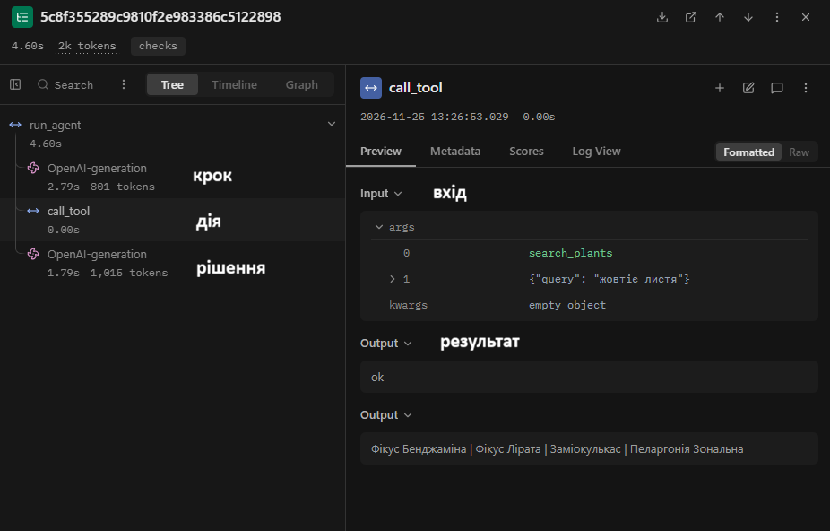
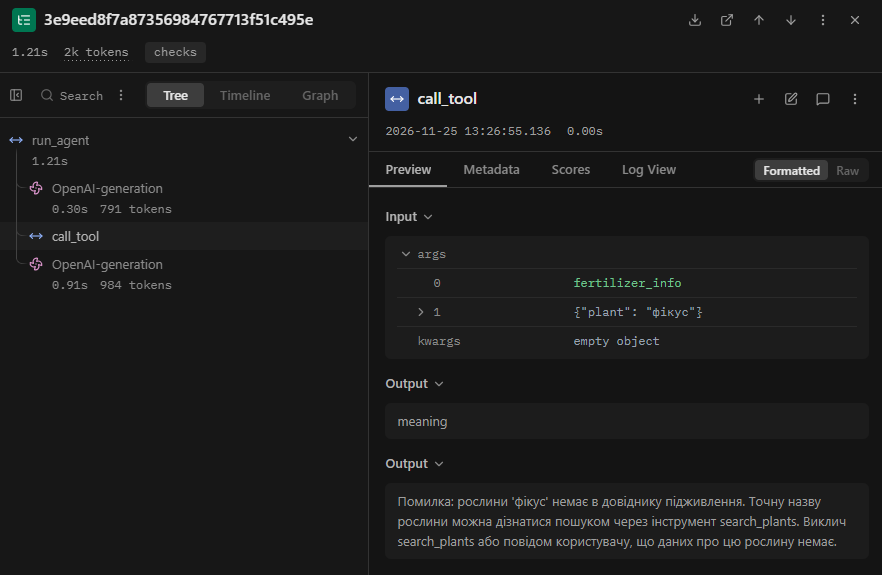
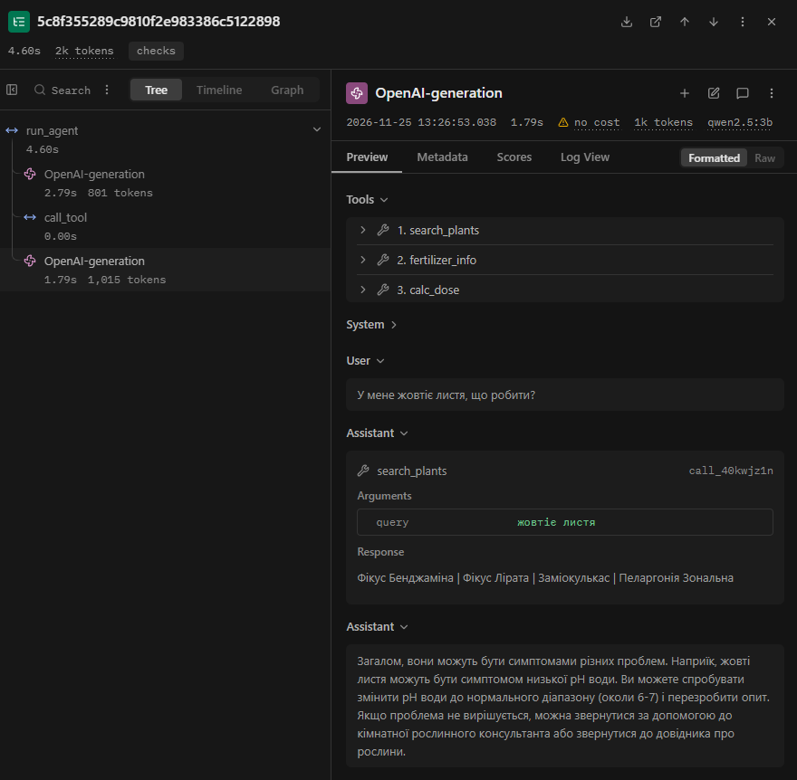

# Лабораторна робота № 3. Надійність виклику інструментів і трасування агента

**Виконала:** студентка групи АІ-243 Галчонкова Анжеліка Дмитрівна  
**Навчальний заклад:** Національний університет «Одеська політехніка», Інститут комп’ютерних систем  
**Рік:** 2026  

---

## 1. Мета роботи та варіант

* **Мета роботи:** зробити виклик інструментів агентом надійним — перевіряти кожен виклик моделі до виконання на трьох рівнях (синтаксис, схема, зміст), повертати моделі структуровані повідомлення про помилки з трьох частин, обмежити кількість помилок поспіль і проаналізувати роботу агента через трасування в Langfuse.
* **Номер варіанта:** 5.
* **Предметна область:** Догляд за рослинами (`search_plants`, `fertilizer_info`, `calc_dose` та заборонений інструмент-заглушка `order_fertilizer`).

---

## 2. Класи аргументів трьох інструментів (`arguments.py`)

```python
"""Класи аргументів інструментів."""
from pydantic import BaseModel, ConfigDict, Field


class SearchPlantsArgs(BaseModel):
    model_config = ConfigDict(extra="forbid")
    query: str = Field(
        min_length=2,
        max_length=50,
        description="Назва рослини, умова догляду або симптом, одне-два слова українською, не все питання користувача цілком",
    )


class FertilizerInfoArgs(BaseModel):
    model_config = ConfigDict(extra="forbid")
    plant: str = Field(
        min_length=2,
        max_length=60,
        description="Точна назва рослини, як вона записана в довіднику",
    )


class CalcDoseArgs(BaseModel):
    model_config = ConfigDict(extra="forbid")
    pot_liters: float = Field(
        gt=0,
        le=50,
        description="Об'єм горщика в літрах",
    )
    dose_ml_per_liter: float = Field(
        ge=0,
        le=50,
        description="Доза на літр, отримана з довідника",
    )


ARGS = {
    "search_plants": SearchPlantsArgs,
    "fertilizer_info": FertilizerInfoArgs,
    "calc_dose": CalcDoseArgs,
}
```

---

## 3. Правила змісту

| Аргумент | Правило | Де записано | Звідки взято межу |
| :--- | :--- | :--- | :--- |
| `query` (`search_plants`) | Рядок довжиною від 2 до 50 символів (`min_length=2, max_length=50`), зайві поля заборонено (`extra="forbid"`) | Клас `SearchPlantsArgs` (`arguments.py`) | Пошук за 1 символом дає шум у корпусі, а обмеження 50 символів не дає моделі передати все питання цілком |
| `plant` (`fertilizer_info`) | Рядок довжиною від 2 до 60 символів (`min_length=2, max_length=60`), зайві поля заборонено (`extra="forbid"`) | Клас `FertilizerInfoArgs` (`arguments.py`) | Найдовша назва рослини в `fertilizer.csv` має 20 символів («Сансевієрія Триканта»), запас до 60 символів покриває повні видові назви |
| `plant` (`fertilizer_info`) | Назва рослини має точно збігатися зі списком `PLANTS` із довідника `data/fertilizer.csv` | `check_meaning` (`checks.py`) | Табл. 7 методичних вказівок (варіант 5: звіряти назву рослини з довідником) |
| `pot_liters` (`calc_dose`) | Строго додатне число, не більше 50 (`gt=0, le=50`) | Клас `CalcDoseArgs` (`arguments.py`) | Фізичний зміст предметної області: об'єм кімнатного горщика не може бути нульовим або від'ємним і не перевищує 50 л |
| `dose_ml_per_liter` (`calc_dose`) | Невід'ємне число від 0 до 50 (`ge=0, le=50`) | Клас `CalcDoseArgs` (`arguments.py`) | У довіднику `data/fertilizer.csv` мінімальне значення дорівнює `0` (Сансевієрія Триканта взимку), максимальне — `9` мл/л |
| `pot_liters * dose_ml_per_liter` (`calc_dose`) | Загальна розрахована доза не перевищує 1000 мл | `check_meaning` (`checks.py`) | Перевірка узгодженості двох аргументів: захист від абсурдної концентрації для кімнатних рослин |
| `order_fertilizer` (інструмент) | Виклик інструмента заборонено (`name not in config.ALLOWED`) | `call_tool` (`dispatcher.py`) | Табл. 7 методичних вказівок (варіант 5: замовлення добрив агенту заборонено) |

---

## 4. Перевірка ланцюжка перевірок (Таблиця 2)

Результати запуску `test_checks.py` без виклику мовної моделі:

| Що перевіряємо | Виклик | Рівень | Повідомлення для моделі |
| :--- | :--- | :---: | :--- |
| Зламаний JSON | `calc_dose({"pot_liters": 3, "dose_ml_per_liter": 5)` | `syntax` | `Помилка: аргументи не пройшли перевірку. Поле JSON: Invalid JSON: EOF while parsing an object at line 1 column 40 Виправ аргументи і виклич інструмент ще раз.` |
| Неправильний тип | `calc_dose({"pot_liters": "три", "dose_ml_per_liter": 5})` | `schema` | `Помилка: аргументи не пройшли перевірку. Поле pot_liters: Input should be a valid number, unable to parse string as a number Виправ аргументи і виклич інструмент ще раз.` |
| Відсутнє обов'язкове поле | `calc_dose({"pot_liters": 3})` | `schema` | `Помилка: аргументи не пройшли перевірку. Поле dose_ml_per_liter: Field required Виправ аргументи і виклич інструмент ще раз.` |
| Вигадане поле | `calc_dose({"pot_liters": 3, "dose_ml_per_liter": 5, "extra_field": 1})` | `schema` | `Помилка: аргументи не пройшли перевірку. Поле extra_field: Extra inputs are not permitted Виправ аргументи і виклич інструмент ще раз.` |
| Неіснуючий інструмент | `water_plant({})` | `name` | `Помилка: інструмента 'water_plant' не існує. Доступні: search_plants, fertilizer_info, calc_dose. Виклич один з доступних або повідом користувачу, що такої дії немає.` |
| Заборонена дія | `order_fertilizer({"plant": "Фікус Бенджаміна", "liters": 1})` | `permission` | `Помилка: інструмент 'order_fertilizer' недоступний. Не повторюй виклик, повідом користувачу, що ця дія недоступна.` |
| Значення немає в довіднику | `fertilizer_info({"plant": "фікус"})` | `meaning` | `Помилка: рослини 'фікус' немає в довіднику підживлення. Точну назву рослини можна дізнатися пошуком через інструмент search_plants. Виклич search_plants або повідом користувачу, що даних про цю рослину немає.` |
| Значення поза межами | `calc_dose({"pot_liters": -3, "dose_ml_per_liter": 5})` | `schema` | `Помилка: аргументи не пройшли перевірку. Поле pot_liters: Input should be greater than 0 Виправ аргументи і виклич інструмент ще раз.` |

---

## 5. Результати прогону та порівняння з базовим (Таблиці 3–5)

### Таблиця 3 — Результати по задачах (`lab3_baseline.log` vs `lab3_checks.log`)

| Задача | До: правильно (1/0) | Після: правильно (1/0) | До: кроків | Після: кроків | Що змінилося |
| :--- | :---: | :---: | :---: | :---: | :--- |
| **Z1** (жовтіє листя) | 0 | 0 | 2 | 2 | У `checks` модель сформувала точний запит `"жовтіє листя"` і знайшла 4 рослини (`ok`), але на 2-му кроці проігнорувала результат і вигадала пораду про pH води |
| **Z2** (як часто підживлювати фікус) | 0 | 0 | 2 | 2 | Виклик `fertilizer_info("фікус")` перехоплено перевіркою `meaning` із підказкою викликати `search_plants`, але модель переадресувала цю пораду користувачу |
| **Z3** (скільки добрива фікусу на 3 л) | 0 | 0 | 2 | 2 | Перевірка `meaning` коректно зловила неповну назву `"фікус"`, проте модель на 2-му кроці не викликала `search_plants`, а попросила користувача уточнити назву |
| **P1** (пастка: кактус сагуаро) | 1 | 1 | 2 | 2 | У `checks` запит став чистішим (`"сагуаро"` замість `"сагуаро сагуаро"`), агент успішно підтвердив відсутність рослини |
| **P2** (пастка: полий мою рослину) | 0 | 0 | 1 | 1 | Агент не викликав жодного інструмента, але замість чіткої відмови від фізичної дії продовжив уточнювати назву рослини |

### Таблиця 4 — Поламки до та після впровадження перевірок

| Поламка | До | Після |
| :--- | :---: | :---: |
| Не викликав інструмент | 0 | 0 |
| Викликав не той інструмент | 2 | 2 |
| Неправильні аргументи | 0 | 0 |
| Зациклився | 0 | 0 |
| Не використав результат | 0 | 1 |
| Вигадав результат | 0 | 1 |
| Вичерпав ліміт кроків | 0 | 0 |
| Відмова після ліміту помилок (нове) | - | 0 |

### Таблиця 5 — Спрацювання перевірок у прогоні (`lab3_checks.log`)

| Рівень | Скільки разів | Модель виправилася на наступному кроці |
| :--- | :---: | :---: |
| `name` | 0 | — |
| `permission` | 0 | — |
| `syntax` | 0 | — |
| `schema` | 0 | — |
| `meaning` | 2 | Ні (у `Z2` та `Z3` модель замість виклику `search_plants` переказала підказку користувачу) |
| `tool` | 0 | - |
| `length` | 0 | - |

---

## 6. Аналіз трас у Langfuse

### Структура події

На скріншоті траси `checks-Z1` видно дерево виконання кроку агента:
* **крок** — вузол `OpenAI-generation` (перший виклик моделі з `prompt_tokens=773`);
* **вхід** — масив `messages` (системний промпт, питання користувача та JSON-схеми трьох дозволених інструментів);
* **рішення** — відповідь моделі `tool_calls`: виклик `search_plants({"query": "жовтіє листя"})`;
* **дія** — вкладений вузол `call_tool` із вхідними аргументами `search_plants` та `{"query":"жовтіє листя"}`;
* **результат** — вихід вузла `call_tool`: кортеж `("ok", "Фікус Бенджаміна | Фікус Лірата | Заміокулькас | Пеларгонія Зональна")`.



### Таблиця 6 — Порівняння прогонів у Langfuse (`baseline` vs `checks`)

| Задача | Викликів моделі: до | Викликів моделі: після | Prompt-токенів: до | Prompt-токенів: після | Час, с: до | Час, с: після |
| :--- | :---: | :---: | :---: | :---: | :---: | :---: |
| **Z1** | 2 | 2 | 1487 | 1627 | 4.0 | 4.0 |
| **Z2** | 2 | 2 | 1469 | 1669 | 1.0 | 2.0 |
| **Z3** | 2 | 2 | 1491 | 1691 | 1.0 | 1.0 |
| **P1** | 2 | 2 | 1489 | 1603 | 1.0 | 2.0 |
| **P2** | 1 | 1 | 700 | 762 | 1.0 | 1.0 |

### Розбір двох трас

1. **Траса з перехопленням помилки моделі (`checks-Z2`):**
   * **Що сталося:** на першому кроці модель викликала `fertilizer_info({"plant": "фікус"})`.
   * **Рівень і повідомлення:** диспетчер пропустив виклик через перевірки `name`, `permission`, `syntax` та `schema` (оскільки `"фікус"` — валідний рядок довжиною 5 символів), але зупинив на рівні **`meaning`**, повернувши повідомлення: *«Помилка: рослини 'фікус' немає в довіднику підживлення. Точну назву рослини можна дізнатися пошуком через інструмент search_plants. Виклич search_plants або повідом користувачу, що даних про цю рослину немає»*. Лічильник `помилок поспіль` зріс до `1`.
   * **Реакція моделі:** отримавши повідомлення, компактна модель `qwen2.5:3b` не виконала самостійний виклик `search_plants`, а сформувала фінальну текстову відповідь, адресовану користувачу з проханням викликати `search_plants`.

   

2. **Траса задачі, розв'язаної неправильно без спрацювання перевірок (`checks-Z1`):**
   * **Що сталося:** на кроці 1 модель викликала `search_plants({"query": "жовтіє листя"})` і отримала валідний результат (`рівень: ok`): `Фікус Бенджаміна | Фікус Лірата | Заміокулькас | Пеларгонія Зональна`. На кроці 2 модель не назвала жодної з цих рослин і написала вигадану пораду про «низьку pH води (околи 6-7)».
   * **Чому жодна перевірка цього не зловила:** ланцюжок перевірок у `dispatcher.py` контролює лише **виклики інструментів** (вхідні аргументи та доступність функцій), але не перевіряє фінальний текстовий висновок моделі (`msg.content`) на відповідність фактам, повернутим інструментами.

   

---

## 7. Відповіді на питання

1. **Які поламки зникли або зменшилися після впровадження перевірок? Які лишилися?**  
   Жодна з категорій поламок у таблиці 4 не зникла повністю (загальна точність залишилася 1 з 5), оскільки основні помилки належали до логіки вибору інструментів. Покращення формулювання пошукових запитів у `Z1` та `P1` пов'язане зі стохастичною варіацією генерації моделі (`temperature = 0.2`), а не з Pydantic-обмеженнями на довжину рядка. Водночас залишилися логічні поламки планування: вибір не того інструмента на першому кроці (`Z2`, `Z3`), ігнорування результату інструмента та вигадування поради у фінальній відповіді (`Z1`).
2. **На якому рівні модель помилялася найчастіше? Що можна змінити, щоб таких помилок стало менше?**  
   Найчастіше (2 рази з 2 зафіксованих помилок диспетчера) модель помилялася на рівні **`meaning`**, передаючи в `fertilizer_info` скорочену назву `"фікус"` замість попереднього пошуку. Щоб зменшити кількість таких помилок, варто уточнити опис `search_plants` (прямо вказати, що будь-яку неповну або родову назву рослини треба спершу перевіряти пошуком) або використати потужнішу модель, здатну до багатоетапного планування.
3. **Чи траплялися відмови після ліміту помилок? Що в цих випадках було не так?**  
   Ні, відмов після ліміту помилок (`MAX_RETRIES = 2`) не було: максимальне значення лічильника становило `помилок поспіль=1` у `Z2` та `Z3`. Замість повторної спроби виклику інструмента модель одразу завершувала діалог, перекладаючи дію пошуку на користувача.
4. **Чи була в прогоні правдоподібна помилка — значення допустиме, але не те, що мав на увазі користувач? Чому жодна перевірка її не зловила?**  
   У нашому корпусі є два види фікуса («Фікус Бенджаміна» та «Фікус Лірата»), і якби модель передала один із них без уточнення в користувача, формальні перевірки `schema` і `meaning` пропустили б виклик, бо обидві назви є в довіднику. Крім того, у `Z1` модель видала правдоподібну на вигляд агрономічну пораду про pH води, яку перевірки диспетчера не зловили, оскільки вони валідують лише аргументи інструментів, а не фінальний текст відповіді.
5. **Які поламки перевірки не лікують у принципі та чому?**  
   Перевірки викликів інструментів не лікують **ігнорування повернутого результату**, **вигадування фактів у фінальній відповіді** (`Z1`) та **відсутність відмови від неможливих дій без виклику інструментів** (`P2`), оскільки в цих випадках модель генерує звичайний текст без `tool_calls`, який не проходить через диспетчер.
6. **Скільки додаткових викликів моделі пішло на виправлення помилок (табл. 6)? Чи виправдана така ціна надійності?**  
   У цьому прогоні кількість викликів моделі не змінилася (по 2 виклики на `Z1`–`P1` і 1 виклик на `P2`, усього 9 викликів у кожному прогоні), зросла лише кількість вхідних токенів (~на 11%) через детальнішу схему та інформативні повідомлення про помилки. Така помірна ціна виправдана з погляду **безпеки та захисту системи** (валідація надійно перехоплює невалідні або заборонені виклики до виконання коду), хоча для компактної моделі qwen2.5:3b вона не підвищила підсумкову точність розв'язання задач без додаткового контролю логіки відповідей.
7. **Візьміть найдовшу задачу. Що в ній легше побачити в трасі Langfuse, а що — у текстовому лозі?**  
   У найдовшій задачі (`Z1`, ~4 с) у **Langfuse** наочно видно ієрархію вкладених подій (`run_agent` → `OpenAI-generation` → `call_tool`), затримку кожного кроку в мілісекундах та повний JSON запиту зі схемами інструментів, тоді як у **текстовому лозі** швидше проглядати суху послідовність кроків, аргументів і лічильник `помилок поспіль` одразу по всіх п'яти задачах без перемикання між сторінками. На довгих задачах із десятками кроків текстовий лог стає важко читати через громіздкі тексти промптів і результатів пошуку, які розривають структуру виконання.

---

## 8. Додаткове завдання (`structured_demo.py`)

Для перевірки запобігання помилкам на рівні сервера був створений скрипт `structured_demo.py`, який передає JSON-схему класу `CalcDoseArgs` у параметр `response_format={"type": "json_schema", ...}`:

1. **Коректний запит** (*«Порахуй дозу добрива для горщика об'ємом 3.5 літри при нормі 6 мл на літр»*): модель повернула `{ "pot_liters": 3.5, "dose_ml_per_liter": 6 }`, перевірка Pydantic пройшла успішно.
2. **Запит із порушенням межі** (*«Порахуй дозу добрива для горщика об'ємом мінус 5 літрів при нормі 6 мл на літр»*): модель повернула `{ "pot_liters": -5, "dose_ml_per_liter": 6 }`, після чого Pydantic відхилив результат із помилкою `Input should be greater than 0`.
3. **Висновок щодо structured output:** локальний сервер Ollama з моделлю `qwen2.5:3b` підтримує `json_schema` на рівні структури об'єкта та типів полів, проте **не блокує порушення числових меж** (`exclusiveMinimum: 0`) під час генерації токенів. Крім того, `response_format` не перевіряє бізнес-правила та наявність ключів у CSV-довіднику, тому **перевірку в коді (Pydantic + `check_meaning`) прибирати не можна**.

---

## 9. Висновок

Найбільший практичний ефект дало поєднання **Pydantic-схем як єдиного джерела правди** (які одночасно формують підказку для моделі та валідують її відповідь) і **трирівневого диспетчера з інформативними повідомленнями про помилки**, що повністю унеможливлює виконання невалідних або заборонених викликів. Для подальшого покращення агента варто використати потужнішу модель (здатну коректно виконувати повторний виклик після підказки диспетчера), додати лематизацію або морфологічний пошук у `search_plants` та впровадити перевірку узгодженості фінальної відповіді з даними, отриманими від інструментів.